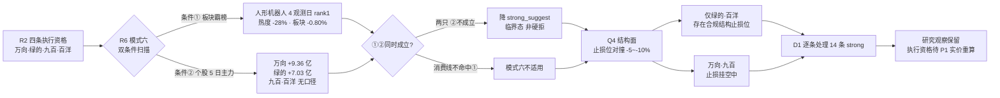

# 2026-10-27 · **反证 / Devil's Advocate**

> **数据源新鲜度**: partial · **降级状态**: true · **置信度**: 0.42
> **数据归属日**: 2026-10-26 收盘（盘前 T-1 设计口径）· **方法**: 纯磁盘 artifact，零 MCP、零联网、零子 Agent
> **硬否决**: 0 只 · **strong_suggest**: 14 条 · **soft_suggest**: 10 条

## 一句话结论

**霸榜出货硬约束今日不成立（板块在派发、两只龙头的 5 日主力仍在净流入），但四只可执行候选里只有两只挂得出合规止损位 —— 结构承载不足才是今天真正的否决面。**

## 🧭 反证主线：从「板块霸榜」到「止损无位可挂」

盘前最容易犯的错，是把「R3 连霸 4 日的霸榜告警」直接等价于「机器人线今天不能碰」。R6 逐票过双条件后发现事实更细：**人形机器人板块确实在派发**（概念榜 4 个观测日 rank 1、热度 149729→107879 跌 28%、板块当日 -0.80%），**可万向钱潮与绿的谐波的 5 日主力仍是净流入**（+9.36 亿 / +7.03 亿，R5 与 R7 双源一致，4/5 日为正）。板块在出货、个股在进钱 —— 这是「共识仍在、方向已转」的临界态，按契约只能降为 `strong_suggest`，不能硬拒。

真正把四只候选卡死的是另一件事。把 R5 的均线结构与用户纪律「止损距 -5~-10% 硬区间」对撞：万向 12.71 的三个结构位（MA5 11.10 / MA20 10.65 / MA50 10.93）分别对应 **-12.67% / -16.23% / -13.99%**，全部越界；上海九百 12.10 的 MA5 10.09 对应 **-16.61%**、MA20 8.79 对应 **-27.36%**，连一个能挂的位置都没有。若改用 -8% 固定止损（11.69 / 11.13），这两个价位都停在 MA5 **上方** —— 止损挂在空中，当日振幅 7.01% 的票一根阴线就能打掉。四只里只有绿的谐波（MA20 -8.98% / MA5 -6.64%）与百洋股份（MA5 -8.83%）存在落在硬区间内的结构止损位。

所以今天的反证结论与昨天相反：**昨天否决的是「谁不能买」，今天否决的是「谁都买不多」**。四只候选的持有周期被 Q3 估值面全部压到日内 —— 绿的谐波 PE 380.80x、上海九百 PE 104.06x（公司自认 97.28x vs 零售业 21.22x）、百洋股份亏损且 PB 处三年 100% 分位、万向 F1 存贷双高（货币 28.9% + 短借 22.8% 总资产）。

还有一个必须说清的边界：**hard_rejects 为空不等于四只候选通过审核**。空集只说明模式六的双条件没有同时成立，四只仍各自背着 1-4 条 `strong_suggest`。R6 不授予任何开仓权限，正向结论由 D1 独立形成。

## 🔀 反证路径

## 📊 四象限负面识别

| 象限 | 追问 | 命中 | 密度 | 结论 |
|---|---|:--:|:--:|---|
| **Q1 资金面** | 钱在不在、往哪走 | 6 | ●●●●○ | 总方向是撤，局部是回补；回补可持续性最多看 5 日 |
| **Q2 情绪面** | 人气是真需求还是击鼓传花 | 6 | ●●●●○ | 唯一**已被昨日实盘验证**的负面，高开仍是兑现窗口 |
| **Q3 基本面/估值** | 值不值这个价 | 7 | ●●●●● | 命中最多但属慢变量：压持有周期，不决定今日挂单 |
| **Q4 结构面** | 位置/封单/止损承载 | 5 | ●●●○○ | **当日唯一直接决定「能不能挂单」的象限** |

**主导变量 = Q4 × Q2，不是估值。** Q3 的 7 条决定「拿到明天要不要跑」，Q4 的 5 条决定「今天能不能下单」，Q2 的 6 条决定「开盘那一笔是买点还是卖点」。三者叠加的实际含义：今日任何执行都只能是日内、小仓、带硬止损，且不接开盘第一波。

Q1 的六条里最硬的一条被市场忽略了：全市场 5 日主力 **-1,126.66 亿**（5 日里 4 天净流出）、单日 -278.67 亿，同期小单 **+298.20 亿** —— 散户在接机构的货。两融 5 日再减 569.35 亿。R1 自己的话是「两融退潮期间高度股的反包多为一次性脉冲，不做第二波假设」。

Q2 的验证来自昨天：20261026 观察池 27 只等权 -0.28%、**竞价买入口径 -1.17%**、红盘率 48.1%；其中 `distribution_alert` 组两只收盘 +9.25%，但「开盘到收盘」**-0.99%** —— 高开不是买点，是被统计过三次的卖点。

## 🧩 逐票反证（4 只执行资格 + 消费线两只）

| 代码 | 名称 | 身位/板型 | 模式六 | 核心负面 | 结构止损位 | R6 态度 |
|---|---|---|:--:|---|---|:--:|
| 000559.SZ | 万向钱潮 | 2 板 · 机器人龙一 | ①✔②✘ | F1 存贷双高(P0)、PE 83.5% 分位、Q3 营收 -14.16%、位置 100% 分位 | MA5 -12.67% 越界 | **降级** |
| 688017.SH | 绿的谐波 | 未涨停 · 龙二 | ①✔②✘ | PE 380.80x、PB 92% 分位、户数 +87.64%、上影 -8.09% 未站半年线 | MA20 -8.98% 合规 | **降级** |
| 600838.SH | 上海九百 | 4 板 · 消费龙一 | 不适用 | PE 104.06x（自认 97 vs 行业 21）、封单 1.36 亿而主力净卖 0.58 亿、5 板监管临界 | MA5 -16.61% 越界 | **降级** |
| 002696.SZ | 百洋股份 | 1 板/12 天 8 板 · 龙二 | 不适用 | 亏 8,253.64 万(-800.10%)、CFO 连续 3 期为负、公司自认偏离基本面、10-29 三季报 | MA5 -8.83% 合规 | **降级** |
| 000700.SZ | 模塑科技 | 2 板 13:03 才封 · 候补 | — | 控股股东 5-9 月连续减持 5%、封板偏晚 | — | 观察 |
| 000678.SZ | 襄阳轴承 | 3 板开板 5 次 · 身位 | — | 龙虎榜净卖 0.46 亿、融资 15 日 +132.62%、中报亏 | — | 观察 |

### 000559.SZ 万向钱潮 —— 板块在出货，它却在进钱

- **大资金意图**: 主力当日 +5.90 亿（净占比 23.51%，涨停股第 1）、龙虎榜单日净买 3.74 亿（机构专用 +1.63 亿）、封单 1.42 亿 —— 钱在为「大业股份 6/7 断板后的容量接棒位」备货，是**换载体**而不是**加仓位**：同期板块涨停家数 43→23 腰斩，钱只往容量端（流通 422.9 亿）集中。
- **为什么走强**: 位置（20 日区间 100% 分位、20 日新高）× 催化（R4 E002 量产三连 score 0.74 属板块级、未点名本票）× 筹码（股东户数 -5.04% QoQ、获利盘 86.2%）三维里，**只有筹码是真优势**；位置与催化都不站在多头一侧。
- **逻辑够不够硬**: 不够硬。三条反向硬事实并列：① 所属板块 4 日霸榜出货；② F1 存贷双高（货币 75.89 亿=28.9% 总资产、短借 60.08 亿=22.8%）；③ 三季报营收 -14.16% 而归母 +1.36%，利润不是营收给的。重组（收购 Wanxiang America 100%）尽调中、未签正式文件，是无时间表的期权，不能计入当期定价。
- **买入理由**: R6 立场为**不构成买入理由**。多头可引用的仅有两条（全市场涨停股资金第 1、容量 422.9 亿可承接大单），均属「钱的位置」而非「价的安全」。
- **风险点**: ① 板块 β 反噬 —— 板块霸榜出货期间个股再强也受板块约束，断板潮一旦出现第二只，容量端会先被卖；② 止损无位可挂 —— 三个结构位全部越过 -10% 上限，任何「-8% 止损」都落在 MA5 上方，属空中止损。
- **止损条件**: 不适用（R6 不给执行资格）。研究层面失效条件：跌破 MA5 11.10 且当日板块涨停家数 <15 家 → 接棒失败，撤销观察。
- **可验证假设**: 未来 1-2 个交易日，若 ① 主力资金仍净流入且 ② 板块涨停家数回到 20 家以上 → 属真接棒，临界态解除；若出现「主力净流入但板块涨停继续收缩」→ 是接盘而非接棒，降为剔除。

### 600838.SH 上海九百 —— 封单霸榜，主力在撤

- **大资金意图**: 封单 0.07→0.45→1.09→1.36 亿逐日增厚，看着是主力加码；但 4 板当日主力 **净卖 0.58 亿（-13.89%）**，30 日龙虎榜净买 0.851 亿全部发生在首二板（10-21 +0.435 / 10-22 +0.415），4 板当日无任何龙虎榜净买记录 —— **封单是接力盘堆的，主力在首二板就已完成派发**。
- **为什么走强**: 位置（5 日 +42.29%、20 日与 60 日区间双 100% 分位）× 催化（R4 八条硬事件零消费催化、R5 catalyst 仅 30 分） × 筹码（户数 -16.20% QoQ 集中、获利盘 99.3%）——**催化这一维是空的**，走强的真实原因是「全市场唯一 4 板」的辨识度垄断，属于纯情绪定价。
- **逻辑够不够硬**: 不硬，且公司自己承认。10-24 风险提示公告自认静态 PE 97.28 / 滚动 87.93，零售业 21.22 / 20.48 —— 4.6 倍行业溢价由公司自己写进公告。名字套利（上海国资/消费/羊字辈）三叙事不清，R3 自评保质期 1-3 日。
- **买入理由**: R6 立场为**无**。唯一勉强成立的多头论据是「辨识度垄断 + 封单逐日增厚」，但它与主力净卖方向相反，属自我矛盾论据。
- **风险点**: ① 封单质量 —— 主力净卖的封单只承受一次抛压测试，开板即散；② 监管临界 —— 第 5 板即触发「连续 3 日涨幅偏离累计 20%」的二次异动与更严监管；③ 结构无承载 —— MA5 止损 -16.61%，最紧的均线也在 -16% 外。
- **止损条件**: 不适用（R6 不给执行资格）。若 D1 仍要执行，前置条件必须写成「竞价封单 ≥1.36 亿且主力资金转正」，任一不满足即视为开板预演。
- **可验证假设**: 未来 1 个交易日，若开板且换手放大到 15% 以上 → 整条消费线当日作废（R2 与 R3 口径一致）；若竞价即封且封单再增厚 → 情绪仍在，但仍不给二次反弹假设。

### 002696.SZ 百洋股份 —— 现金流连续三期失血，两天后交财报

- **大资金意图**: 主力当日 +1.58 亿（净占比 16.77%，链内第 1）、30 日龙虎榜 10 次上榜累计净买 3.533 亿 —— 但 10-26 当日**机构专用净卖 -2,482.6 万**而榜单净买 +5,578.6 万（R7）：机构在把筹码交给游资，这是典型的接力末段席位结构。
- **为什么走强**: 位置（20 日 +57.58%、60 日 +95.79%、区间 100% 分位）× 催化（R4 零消费事件、公司 3 次异动公告自认无未披露事项）× 筹码（换手 26.58% 高位、股东户数 -8.38%）—— 三维里没有一维支持，走强靠「12 天 8 板」的累计身位记忆。
- **逻辑够不够硬**: 最不硬的一只。CFO 连续 3 期为负（2026H1 -3.30 亿 / Q1 -1.34 亿 / 2025 全年 -3.15 亿）、归母 -8,253.64 万（-800.10%）、PB 3 年 100% 分位、10-22 风险提示自认「股价严重偏离公司基本面」。10-29 预约三季报 —— 两个交易日后交卷。
- **买入理由**: R6 立场为**无**。任何基于「链内资金第一」的理由都必须先回答：为什么机构在卖给它？
- **风险点**: ① 财报兑现 —— 亏损公司带 8 板身位进三季报，预期差只能是负向；② 短借 10.63 亿（25.8% 总资产）vs 货币 5.32 亿，现金流靠外部输血；③ 高位换手 26.58%，任何 -5% 回撤都会触发踩踏（10-16/-9.97%、10-19/-10.04% 已有两次前科）。
- **止损条件**: 不适用（R6 建议剔除）。若保留，只允许竞价确认后的日内仓位，MA5 10.28（-8.83%）为唯一合规位，收盘不留隔夜。
- **可验证假设**: 未来 2 个交易日（含 10-29 三季报），若三季报单季仍亏或 CFO 仍为负 → 剔除并记入 E1 过错本（R2 将其列为龙二的判断失效）；若意外转正 → R6 反证记为假阳性。

## 🔍 关键证据

- 证据 1：模式六双条件逐票表 —— 人形机器人连续 4 观测日 rank 1（热度 -28%、板块 -0.80%）但万向 +9.36 亿 / 绿的 +7.03 亿 5 日主力双源一致为净流入 → **hard_reject = 0** · 来源 R3 hotlist_signals + R5 chip_structure_flat + R7 stock_flows
- 证据 2：结构止损位对撞 -5~-10% 预算 —— 万向 MA5/MA20/MA50 = -12.67%/-16.23%/-13.99%，上海九百 -16.61%/-27.36%，仅绿的（-8.98%）与百洋（-8.83%）合规 · 来源 R5 technical_readiness 均线
- 证据 3：主力与散户对手盘 —— 全市场 5 日主力 -1,126.66 亿、小单 +298.20 亿、两融 5 日 -569.35 亿 · 来源 R1 evidence + R7 market_windows
- 证据 4：昨日竞价买入口径被证伪 —— 20261026 观察池等权 -0.28% / 竞价买入 -1.17% / 红盘率 48.1%；distribution_alert 组收盘 +9.25% 但开盘至收盘 -0.99% · 来源 data/reports/20261026/observation_tracking.json
- 证据 5：消费线资金维不可复核 —— R7 43 行业横截面无「食品饮料/商贸零售/社会服务」任一行；R2 自认 CV=0.33 < 0.34 · 来源 R7 sector_flows + R2 cross_validation
- 证据 6：万向 F1 存贷双高 —— 货币 75.89 亿=28.9% TA、短借 60.08 亿=22.8% TA，双超 20% 阈值 · 来源 _r5_fin_stmt.json 资产负债表（20260930）

## 🧾 14 条 strong_suggest 一览（D1 必须逐条处理或记录覆盖理由）

| # | 目标 | 一句话 |
|---|---|---|
| M1_01 | 消费线（主线#2） | 资金维无法在 R7 横截面复核，R2 自认 CV 破线 |
| M2_01 | 四只候选 | R1 高位震荡「不做第二波」vs 四只全部 100% 分位 |
| M2_02 | 绿的谐波 | R2 自己的 stage_action 说只做龙一弱转强，却给了龙二执行资格 |
| M2_03 | 消费线阶段 | 「板块资金 1 日转正」掩盖了「龙一净卖 0.58 亿」 |
| M2_04 | 四只候选 | 两只挂不出合规止损位（结构承载不足） |
| M3_01 | 绿的谐波 | PE 380.80x + 户数 +87.64% = 资金真、筹码散、估值贵 |
| M3_02 | 上海九百 | PE 104.06x，公司自认 4.6 倍行业溢价 |
| M3_04 | 百洋股份 | 亏损 + PB 100% 分位 = 零估值锚，两天后交财报 |
| M5_01 | 高位股整体 | 昨日 hard_reject 以「断板」兑现；竞价买入口径 -1.17% |
| M6_01 | 万向/绿的 | 板块霸榜 + 个股进钱 = 临界态，只接分歧弱转强 |
| M6_02 | 上海九百 | 封单 1.36 亿是接力盘，主力净卖 0.58 亿 |
| M7_01 | 万向钱潮 | F1 存贷双高（P0 单条即 strong） |
| M7_02 | 百洋股份 | CFO 连续 3 期负 + 亏 800% + 公司自认偏离基本面 |
| M9_01 | 九百/百洋 | extreme_tail_risk=true，禁止按晋级预期给仓位 |

## 数据源审计

| 源 | 日期 | 状态 | 备注 |
|---|---|:--:|---|
| R1_style.json | 2026-10-26 | 🟡 | degraded 0.49 · 风格震荡分化型 · 情绪 40.6 · 仓位上限 0.45 |
| R2_main_sectors.json | 2026-10-27 | 🟢 | complete 0.72 · 2 条主线 · 4 只 execution_eligible · 消费线 CV 0.33 |
| R3_sentiment.json | 2026-10-27 | 🟢 | complete 0.56 · 5 共振主题 · 1 条霸榜告警（人形机器人 4 日 rank1） |
| R4_news.json | 2026-10-27 | 🟡 | complete 0.70 但 degraded · 8 事件 · 21 板块极性 · 公众号源全断 |
| R5_stock_profiles.json | 2026-10-27 | 🟡 | complete 0.525 但 degraded · 10 画像 · 两只缺 5 日主力口径 |
| R5 财务原始件 _r5_fin_stmt.json | 2026-10-27 | 🟢 | 10 票 bs/cf · 用于 F1/F8 红旗复核 |
| R7_capital_flow.json | 2026-10-27 | 🟡 | ok 0.74 但 degraded · 43 行业 + 12 概念 · 40 条派发告警 · 商品/汇率缺失 |
| observation_tracking.json | 2026-10-26 | 🟢 | complete · 27 只观察池 · 竞价口径 -1.17% |
| 前一日 R6 反证 | 2026-10-26 | 🟢 | complete 0.45 · 12 条 · hard_reject 1 只（大业股份，已兑现断板） |
| 历史失败事件库 | — | 🔴 | 缺失 → 模式四 degraded，不编造类比 |
| 商品序列（原油/铜/金）· DXY | — | 🔴 | 完全缺失 → 模式十 degraded，只做方向一致性讨论 |

## 不确定性 / 反证

1. **模式六条件②没有覆盖消费线两只**：上海九百与百洋股份在 R5 与 R7 都缺 5 日主力口径。R6 按「不可判定」处理，不是「不成立」。若 D1 从别处拿到 5 日数据且为净流出，这两只应立即改判 hard_reject。
2. **临界态的升级权在 D1**：万向与绿的属「板块出货 + 个股进钱」。R6 的立场是降级不硬拒，理由是契约条件②取个股 5 日口径且为正。但若 D1 采信概念 20 日 -231.38 亿（一个月净撤）的解释力更强，本条应等效为执行禁令 —— 这个判断 R6 不替 D1 做。
3. **低开假设未经验证**：R1 写「竞价转负或炸板率 35% 即降到 0.30 以下」，R3 写「弱修复 0.15」。这两条都是概率而非事实，今日竞价 09:25 之前无法证伪。
4. **模式四与模式十降级**：无历史失败事件库、无商品序列。这两类反证本日**没有覆盖**，不构成「无风险」；油气线的方向一致性无法量化验证。
5. **R5 位置字段二义会污染闸门**：同票 `position_20d_pct` 出现 93.3（分位秩）与 71.5（区间位置）两个值，差 21.8pct。D1 若不声明口径，位置闸门会出现误判 —— 这是本日最容易被忽略的数据缺陷。
6. **R6 昨日也有假阳性**：大业股份被 hard_reject 后当日仍收 +8.08%，兑现形式是断板而非下跌。R6 不自我加冕，该笔收益应记为「避免次日高开接盘」，由 E1 记账。

## 与其他 R/D/E 的关系

- 依赖: R1_style / R2_main_sectors / R3_sentiment / R4_news / R5_stock_profiles（含 _r5_fin_stmt 原始件）/ R7_capital_flow / 20261026 observation_tracking / 20261026 R6_devil_advocate —— 全部为磁盘 artifact，无 MCP、无联网、无子 Agent
- 被消费: D1(canghai-plan) 读 `hard_rejects`（本日为空）与 `counter_arguments[].severity`（14 strong 须逐条处理或写入 d1_override）；E1(canghai-review) 读 `mode6_audit` 与 `negative_quadrants` 做兑现校准

## Sub-Agent 元数据

- skill: analyze_devil_advocate_v1
- artifact: data/research/20261027/R6_devil_advocate.json（46 KB）
- 方法: llm_v1_disk_only_strict_complete_gate + negative_quadrants_v1
- 反证条数: 24（strong 14 / soft 10 / hard 0）· 模式四降级
- 读取上游: R1/R2/R3/R4/R5/R7 + R5 财务原始件 + 昨日 observation_tracking + 昨日 R6
- 红线自检: 未抓新数据（0 次 MCP）· 未派生子 Agent · 未读 data/plans · 未写白名单外路径
