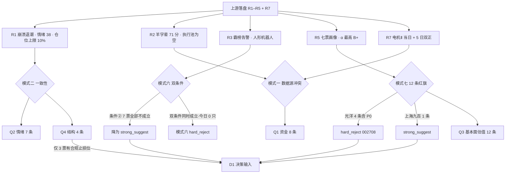

# 2026-10-28 · **反证 / Devil's Advocate**

> **数据源新鲜度**：partial（R1 degraded · R7 partial · 兑现率源为 skeleton）
> **降级状态**：true（模式四 / 五 / 八 / 十降级，模式七部分条目 not_computable）
> **置信度**：0.42 = 0.75（上游可用度）× 0.70（模式覆盖度）× 0.80（口径一致性）

## 一句话结论

今日唯一硬拒不在「霸榜出货」而在「报表失血」——**光洋股份**命中存贷双高、经营现金流连续两期为负（P0）、应收占营收 53.1%、有息负债占净资产 99.7% 共 4 条红旗；而霸榜告警（人形机器人）对 7 票逐条过双条件后 **0 命中**，因为 7 票 5 日主力全为净流入。

## 详细分析

**第一层：今日的市场已经不是「选哪只」，而是「能不能出手」。** R1 判定崩溃退潮型、情绪 38.0 落恐惧档、情绪周期主跌、仓位上限被压到 0.10 的下限；R1 自报「无主线」，而 R2 却给出一条 71 分的核心主线。这个数字上的冲突本身就是第一条反证——因为 R2 给同一条线的叙事维只有 5/20，R4 八条硬事件零一条落在名字套利上，R5 七票的催化维最高 45 分、α 无一进 A 档。于是「核心主线」这四个字的实际含义是「今日唯一还能被讨论的情绪载体」，不是「可以进攻的方向」。R5 的闸门模拟把这件事讲得最直白：仓位上限 0.10 时要求 α≥A，本批 7 票最高 B+，执行池必然为 0。**R6 今天的硬拒，不改变当日的买入结果，改变的是「情绪修复那天谁不许被递补进来」。**

**第二层：霸榜出货这次没有抓到人，原因是条件②集体不成立。** R3 的告警对象是人形机器人概念——连续 5 个观测日热榜第 1、热度两日 -47%、板块当日 -2.76%、主力净流出 70.24 亿，这是教科书级的「关注度与价格背离」。但模式六要求两条同时成立：所属板块命中告警 + 个股 5 日主力净流出。逐票过一遍，大洋 +5.26 亿、光洋 +2.40 亿、襄阳 +3.84 亿、阳光 +1.91 亿、桂发祥 +1.01 亿、上海九百 +0.72 亿、海洋王 +0.62 亿，**7/7 全是净流入**，第二条一个都没过。更关键的是羊字辈本体根本没有板块指数（R3 原文明写「名字集合，无对应行业/概念指数」），告警只能通过「载体电机零部件」间接牵连。所以模式六的产出是 0 条硬拒 + 2 条 strong_suggest（板块β留档），不是「没执行」。

**第三层：真正被抓住的是光洋股份的报表。** 把 R5 落盘的三张表拉出来算 12 条红旗，光洋是七只里唯一过 4 条的：货币资金 9.73 亿占 21.2% 总资产、短期借款 11.21 亿占 24.4%，一边存 9.7 亿一边借 18.08 亿（F1 存贷双高）；经营现金流 Q1 -0.62 亿、H1 -0.75 亿连续两期为负，而同期归母净利 +0.572 亿（F8，P0 级，利润没有变成钱）；应收账款 7.86 亿占营收 14.80 亿的 53.1%（F9）；有息负债 18.08 亿除以净资产 18.13 亿等于 99.7%（F10）；未分配利润还是 -0.42 亿。这只票的板型是全批最好的——2 板零开板、封单 1.70 亿占流通 1.94%、换手仅 3.87%，正因为如此，它是最容易被 D1 在情绪修复日「递补」进来的那一只，必须在这里拦掉。**边界必须说清：F1 是边界命中（超阈值 1.2 个百分点）；即便把它剔除，剩下的 F8（P0）+ F9 + F10 也足以构成 strong_suggest 下限。D1 没有覆盖权，但 E1 复核时请按这个算术逐条核对，不要只看结论。**

**第四层：四象限里，今天真正卡住出手的是结构而不是估值。** Q3 基本面估值条数最多（12 条），但它是慢变量；Q4 结构只有 4 条，却直接决定「止损挂在哪儿」。按 -5%~-10% 硬区间逐票量：大洋电机 MA5 7.152 距收盘 -7.12%（合规，这也是 R2 给低吸通道的唯一物理依据）、光洋股份 MA20 15.673 距收盘 -8.99%（合规边缘）、阳光乳业 MA5 12.21 距收盘 -8.27%（合规）；上海九百 MA5 -16.61%、襄阳轴承 -16.59%、桂发祥 -11.20%、海洋王 -10.28% 全部越界。也就是说，七只票里有四只**没有可以挂单的结构位**，只能挂固定百分比止损，而固定止损在 climax 段等于把「盈亏比」交给运气。

**第五层：R6 也要承认自己错了。** 昨日我用「结构止损位不存在，等于挂在空中」反对上海九百，逻辑里藏了一个我没检验的前提——「它会开板」。10-27 它 5 板 +10%、竞价后首分钟秒板、零开板、封单从 0.07 亿一路递增到 1.50 亿（越涨越锁），我昨天预言的「开板即放量、整线当日作废」根本没被触发。**这条必须写下来，否则明天我会用同一个理由再否它一次。** 今日对同一只票的反证换到了新证据面：5 板日主力 -0.432 亿（净占比 -10.95%）+ 龙虎榜净卖 -0.26 亿 + 三日前两笔净买 +0.85 亿今天在出 + 上交所监管工作函 + PE 114.46 对行业 21.9 的 5 倍溢价。这是「封住价格出货」，不是「结构不好」。

## 四象限负面识别

| 象限 | 条数 | 代表条目 | 是否直接决定今日能否出手 |
|---|---|---|---|
| **Q1 资金** | 8 | 载体口径不可平移（电机Ⅱ +7.25 亿 ≠ 名字集合有资金）· 7/7 票 5 日净流入但当日机器人 -3.46 亿 · 东财主力与龙虎榜同源不构成双源 · 上海九百「封住价格出货」 | 是（第一否决面之一） |
| **Q2 情绪** | 7 | R1 无主线/恐惧档/仓位 10% 对撞 R2 核心主线 71 · R3 次日信号震荡且 13/14 观点是冲高卖 · 高度票尾部风险 | 是（决定持有期只能按日内） |
| **Q3 基本面估值** | 12 | 光洋 4 条红旗硬拒 · 上海九百 F8 + 114 倍 PE · 襄阳 PB 9.47 配 ROE -2.63% · 大洋单季净利 -70.58% | 否（慢变量，但硬拒出口在本象限） |
| **Q4 结构** | 4 | 7 票仅 3 票有合规结构止损位 · climax 段「回踩 MA5」实为分歧接刀 · 缠论 pos_in_zs 5 票 >200% | 是（唯一直接决定「能不能挂单」） |

## 模式六 · 霸榜出货双条件逐票审计

告警事实（R3）：人形机器人概念 20261022 / 1023 / 1024 / 1026 / 1027 连续 5 个观测日热榜第 1，热度 149729 → 107879 → 57662（两日 -47%），板块当日 -2.76%，主力净流出 70.24 亿。

| 标的 | 角色 | 条件① 所属板块命中告警 | 条件② 5 日主力净流出 | 判定 |
|---|---|---|---|---|
| 002249 大洋电机 | 龙一 | 部分（本体为名字集合无指数；载体电机Ⅱ属被丢弃的机器人零部件线） | ✗ +5.26 亿（3/5 日正） | 不成立 → strong |
| 002708 光洋股份 | 龙二 | 部分（R4 曾以「人形机器人 lead_stock 代理」点名，quality=low） | ✗ +2.40 亿（4/5 日正） | 模式六不成立；由模式七硬拒 |
| 600838 上海九百 | 次线龙一 | ✗ 一般零售不在告警内 | ✗ +0.72 亿（但当日 -0.43 亿） | 不成立 → strong（等价结构） |
| 002724 海洋王 | 情绪锚 | ✗ 照明设备孤军 | ✗ +0.62 亿 | 不成立 → soft |
| 000678 襄阳轴承 | 身位股 | ✗ 汽车零部件不在告警内 | ✗ +3.84 亿（但龙虎榜 -1.30 亿） | 不成立 → strong |
| 002820 桂发祥 | 候补 | ✗ 休闲食品不在告警内 | ✗ +1.01 亿 | 不成立 → soft |
| 001318 阳光乳业 | 低位补涨 | ✗ 饮料乳品不在告警内 | ✗ +1.91 亿 | 不成立 → soft |

**审计结论**：7 票对条件②的通过率是 0/7。这意味着今日的「霸榜出货」是**板块级派发 + 个股级承接仍在**的临界态——与本轮 20261027 的结构完全同型。处置按 v1.3：降 strong_suggest，既不放过板块β，也不用告警误杀 5 日净流入的个股。

## 硬否决清单

| 标的 | 来源模式 | 命中条目 | 阈值 | 边界披露 |
|---|---|---|---|---|
| **002708 光洋股份** | 模式七 基本面红旗 | F1 存贷双高（现金 21.2% / 短借 24.4% 总资产）· F8（P0）CFO 连续两期 -0.62 / -0.75 亿而归母 +0.572 亿 · F9 应收/营收 53.1% · F10 有息负债/净资产 99.7% | 4 条 ≥ 附录 A「≥4 条」阈值 | F1 超阈值仅 1.2pct；剔除后仍余 F8(P0)+F9+F10 三条 |

**模式六贡献 0 条硬拒。** 唯一硬拒来自模式七，其作用范围需读清：

1. R2 execution_pool 与 R7 execution_candidates 今日均为空，R5 闸门模拟也判 7 票全不过 → **本条没有「从池内移除」的对象**；
2. 真实作用是**阻止情绪修复日的降档递补**（R5 明写：若 cap 回到 0.5，大洋/光洋两只 B+ 可过闸）；
3. 禁止用龙三或低位票替补（v1.3）：桂发祥与阳光乳业已双双命中 `forbidden_filter.mid_laggard`，阳光乳业另命中 `down_trend_break`。

## 反证链条

## 关键证据

- **证据 1**：光洋股份 2026H1 有息负债 18.08 亿 ≈ 净资产 18.13 亿（99.7%），同期 CFO 两期为负 —— 报表层面「借钱扩张 + 现金不回流」，来源 `_r5_fin_stmt.json`。
- **证据 2**：7 票 5 日主力全为净流入，霸榜告警的条件②通过率 0/7 —— 来源 `R5_stock_profiles.chip_structure_flat` 与 `R7_capital_flow.research_candidates` 双读一致。
- **证据 3**：R1 仓位上限 0.10 与 R5 闸门要求 α≥A 冲突，本批最高 B+ → 执行池必然为 0，来源 `R1_style.position_cap_suggestion` + `R5_stock_profiles.d1_gate_simulation`。
- **证据 4**：上海九百 5 板日主力 -0.432 亿、龙虎榜 -0.26 亿，而前两笔净买合计 +0.85 亿 —— 「封住价格出货」，来源 `R5_stock_profiles.chip_structure_flat`。
- **证据 5**：R3 次日信号 14 条观点 13 条动作是「冲高卖」，score +0.07 判震荡 —— 持有期只能按日内，来源 `R3_sentiment.next_day_signal`。
- **证据 6**：昨日对上海九百的结构性反对被证伪（5 板 +10%、零开板、封单递增至 1.50 亿），来源 `R3_sentiment.limit_structure` + `_r3_limit_list_20261027.json`。

## 三个必答问题

### 002249 大洋电机（研究龙一）

**大资金意图**：单日主力 +5.05 亿（净占比 35.57%，全场第 3）、龙虎榜净买 +3.01 亿（当日全场涨停股第 1），席位行合计 +3.82 亿，买方前五 4 席国泰海通系营业部接近单向扫货。这不是分散的题材钱，是一笔有组织的大单在收容量位；反向证据是融资余额 15 日从 8.28 亿降到 7.77 亿（-6.18%），杠杆资金在撤，说明买方不是两融盘。

**为什么走强**：三条叠加——名字含「洋」、电机执行器是机器人链里少数有真实产业承接的环节、7.7 元低价 + 144 亿容量。R4 八条事件没有一条落在它身上，所以它涨的不是消息，是「在一条纯情绪线里，唯一有产业外壳的容量票」这个身份。

**逻辑够不够硬**：容量的逻辑硬，故事的逻辑软。硬在 20 日 +17.56%、收盘创 20 日新高、电机Ⅱ 是全市场唯一当日 +5 日双正的成规模行业；软在 10-24 三季报单季归母 -70.58%、PE 26.20 已处 3 年 79.5 分位（利润下滑把估值被动抬高）、R4 零催化、190 亿市值只对应 1 家券商覆盖。**结论：它是「承接位」，不是「成长股」，禁止用低估值叙事给它加仓依据。**

### 002708 光洋股份（硬拒对象）

**大资金意图**：龙虎榜三日累计 +1.665 亿，申万宏源上海二分 +1.09 亿、国新证券北京 +0.71 亿；同日机构专用 3 席合计净卖 5,201 万，且国新证券北京同时卖出襄阳轴承 7,191 万 —— 买盘与卖方是同一笔资金在线内换仓，**不是增量资金进场**。

**为什么走强**：位置低（20 日 -0.17%、距 20 日高 -3.8%）+ 板型干净（秒板、零开板、封单 1.70 亿、换手 3.87%）+ 缩量（量比 0.60）。名字含「洋」提供入场理由，真实原因是「高位两只接不动了，钱挪到低位的二板」。

**逻辑够不够硬**：板型硬，报表软到反向。有息负债等于净资产、CFO 连续两期为负、应收占营收过半、PE 92 / PB 99.7 分位。**这正是「板型质量」最容易骗人的地方：封单越厚，越容易让人忘记它是一家借钱经营、利润不变成现金的公司。R6 的职责就是把这两件事分开摆。**

### 600838 上海九百（自我证伪对象）

**大资金意图**：分歧最大的一只。前两笔龙虎榜净买合计 +0.85 亿，今日在涨停日净卖 -0.26 亿、东财主力 -0.432 亿 —— 前两天进场的人在涨停板上出货；同时封单从 7 亿分之一的起点递增到 1.50 亿，越涨越锁。这是「价格封住、资金转身」的组合。

**为什么走强**：5 连板、连续三日竞价后首分钟秒板、零开板、一般零售 6 家涨停（行业广度第 2）。它是这条次线的绝对龙头，也是全市场最高板（5 板，唯一）。

**逻辑够不够硬**：不硬，且比昨天更不硬。昨天的问题是「结构位太远」，今天多了三条新证据：上交所下发监管工作函（对象含董监高、控股股东、实控人）、公司自曝静态 PE 117.71 对行业 21.91、5 板日资金首次转负。**监管函 + 5 倍溢价 + 资金转向，这三条同时出现时，「板型最强」反而是最危险的信号，因为它意味着没有换手承接的层次。**

## 每票思维链

### 大洋电机（若 D1 采纳，须按此边界）

1. **反证起点**：R2 给低吸通道「回踩 MA5 7.15 缩量止跌」，但同一份文件把阶段定为 climax、写「禁追高缩量一字」。climax 段的回踩不是低吸，是分歧接刀。
2. **证据链**：MA5 7.152（距收盘 -7.12%，落在 -5~-10% 硬区间内，是七只里唯二合规的结构位）；MA20 正偏离 +17.67%；缠论未完成笔方向向下（自 10-22 高点 7.75 起）与「收盘新高」矛盾 = 顶背驰迹象；封单 1.10 亿对 144 亿流通仅 0.76%，撑不起一字预期。
3. **可采纳的边界**：只有在「不破 MA5 7.152 + 量比回落 + 开盘半小时内无放量阴线」三个条件同时成立时，这个位置才有盈亏比；任一不成立即视为计划外出手。
4. **风险点**：单季净利 -70.58%、PE 3 年 79.5 分位、机器人板块当日 -3.46 亿（β 仍在撤）、5 日 +21.07% 属短线高位。
5. **止损条件**：结构止损 MA5 7.152（-7.12%），跌破即出，不设第二档；若用固定百分比则必须是 -8% 且仓位按单笔风险敞口反算。
6. **可验证假设**：明日若机器人板块资金转正且大洋不破 MA5，则「载体承接」成立；若机器人继续净流出而大洋靠名字惯性上冲，则本线在 1-2 日内作废（R2 与 R3 都给了这个保质期）。

### 光洋股份（硬拒，不可覆盖）

1. **反证起点**：R5 把「封单质量第一、零开板、换手 3.87%」当作核心正面，R2 据此给龙二。反证的问题是：板型衡量的是「今天有多少人想买」，不衡量「这家公司值不值」。
2. **证据链**：F1 存贷双高（现金 21.2% / 短借 24.4% 总资产，有息负债合计 39.3%）· F8（P0）CFO 连续两期 -0.62 / -0.75 亿而归母 +0.572 亿 · F9 应收/营收 53.1% · F10 有息负债/净资产 99.7% · 未分配利润 -0.42 亿 —— 4 条，达硬拒阈值。
3. **否决的边界（自我限制）**：这不是「因为涨得多所以否决」，也不是「因为位置高所以否决」。R6 的规则明写否决高位龙一必须给具体证据；本条给的是报表账目，且 F1 的边界敏感性已在硬拒清单披露。
4. **风险点（若不否决会发生什么）**：2 板 + 封单最厚 + 换手最低，是最容易在情绪修复日被当作「低位弱转强」递补进池的形态；而它的负债与现金流结构不允许任何持有期超过日内。
5. **止损条件**：硬拒状态下不适用止损位（禁止入场）。若 D1 越权执行，必须在 d1_override 记录并接受 E1 追责。
6. **可验证假设**：若明日它以更大封单继续封板，说明市场愿意为「板型」付钱而不看报表 —— 这会证伪 R6 的否决价值（不是证伪 F 类红旗的事实），E1 应按「hard_reject 的机会成本」记账，而不是记成「避免了下跌」。

## 数据源审计

| 源 | 状态 | 抓取日期 | 记录数 | 备注 |
|---|---|---|---|---|
| R1_style.json | 🟡 degraded | 2026-10-28 | 1 | 商品 skipped、DXY 缺、美股 stale；风格/仓位/宽度字段完整可用 |
| R2_main_sectors.json | 🟢 ok | 2026-10-28 | 1 主线 + 1 次线 | execution_pool 为空；research_precheck 2 只 |
| R3_sentiment.json | 🟢 ok | 2026-10-28 | 5 主题 | weflow 永久下线（非当日故障）；xtick 走 http fallback |
| R4_news.json | 🟡 degraded | 2026-10-28 | 8 事件 | official_rss missing、xtick_hot_news/datapro 未调用 |
| R5_stock_profiles.json | 🟢 ok | 2026-10-28 | 7 票 | 含 forbidden_check 与 d1_gate_simulation |
| _r5_fin_stmt.json | 🟢 ok | 2026-10-28 | 7 票 × 3 表 | 模式七 F1/F2/F3/F8/F9/F10 的取值源 |
| R7_capital_flow.json | 🟡 partial | 2026-10-28 | 6 研究候选 | 两融 lag1、北向口径不可与主力相加、coverage_complete=false |
| observation_tracking（昨日） | 🔴 skeleton | 2026-10-27 | 21 只 | actual_return_pct 全 null → 模式五兑现率不可计算 |
| E1_data（昨日） | 🔴 skeleton | 2026-10-27 | 0 | r6_fulfillment 未填充 |
| 昨日 R6 反证 | 🟢 ok | 2026-10-27 | 24 条 | 用于模式五定性复核 |

## 不确定性 / 反证

**我可能错在这四处。** 第一，模式七的 4 条里有 1 条（F1 存贷双高）是贴着阈值判的，货币资金 21.2% 对 20% 只超 1.2 个百分点，把它算进去刚好够 4 条硬拒线——这是我在今日唯一一次「阈值决定了严重等级」的地方，已在硬拒清单逐条披露，请 E1 反查。第二，光洋与襄阳的最新财报期是 2026 年中报（Q3 未披露），我算的杠杆与现金流可能已被 Q3 改善或恶化，方向未知。第三，模式五的兑现率完全算不出来（观察池与 E1 都是 skeleton、价格全 null），所以我在正文里只做定性复核，没有给任何「昨日反证准确率 N%」的数字——这类数字如果出现，一定是编的。第四，我昨天刚刚在「结构止损位」这个理由上错过一次上海九百，今天虽然换了证据面，但同一只票连续两天被同一套机构（R6）给出负面结论，本身就值得警惕：可能是我对「监管函 + 高溢价」的敏感度过高，也可能是市场确实在赌监管函之后还有一波。**这条分歧无法在盘前裁决，只能由集合竞价的封单增厚与主力方向来回答。**

## 与其他 R/D/E 的关系

- **依赖**：R1_style、R2_main_sectors、R3_sentiment、R4_news、R5_stock_profiles（含 _r5_fin_stmt）、R7_capital_flow、昨日 R6、昨日 observation_tracking / E1（后者仅用于声明不可计算）
- **被消费**：D1（canghai-plan）必须执行 `hard_rejects[]`；E1（canghai-review）按 `meta.self_falsification` 记账，并复核 F1 的边界判定
- **对 D1 的三条硬性要求**：① `002708.SZ` 不得进 execution_pool，无覆盖权；② 引用 R2 的 71 分时必须同时引用「叙事 5/20」与 `r7_match_scope=carrier_sector`；③ 若在 climax 段采纳「回踩 MA5 低吸」，须在 `d1_override` 写明这是对 R2 自身 `stage_action` 的覆盖
- **对 E1 的两条记账要求**：① hard_reject 记「未接盘」，不记「躲过下跌」；② distribution_alert 的有效域按「高位本体」限定（今日本体 3/3 下跌、低位零部件未跌）

## Sub-Agent 元数据

- skill: analyze_devil_advocate_v1@1.3
- artifact: data/research/20261028/R6_devil_advocate.json（52,238 B）
- 反证条数: 31（hard 1 / strong 16 / soft 14）
- 四象限: Q1 资金 8 / Q2 情绪 7 / Q3 基本面估值 12 / Q4 结构 4
- 模式状态: 1/2/3/6/7/9 executed · 4/5/10 degraded · 8 not_triggered
- candidates_evaluated: 7
- confidence: 0.42（0.75 × 0.70 × 0.80）
- model: ark-code-latest
- 红线自检: MCP 0 次 · delegate 0 次 · 联网 0 次 · 未抓新数据 · 未触碰 data/plans、data/execution、user_preferences.yaml、human_thesis
