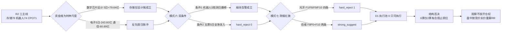

# 2026-10-29 · **反证 / Devil's Advocate**

> **数据源新鲜度**: partial
> **降级状态**: true（模式四/五/八/十 降级，模式七 仅 6/12 红旗可计算）
> **置信度**: 0.448 = 0.80 × 0.70 × 0.80

## 一句话结论

**31 条反证、1 条硬拒（002708 光洋股份）、模式六零硬拒**；今日真正否掉的不是「板块霸榜」，而是**结构止损位**——6 只龙一/龙二/身位股里只有绿的谐波（-8.85%）与中际旭创（-5.38%）有合规位置，其余 4 票的低吸全挂在空中或落在噪音带。

## 详细分析

### 一、先认市场：三条主线全是「反包第一天」，没有一条是「趋势确认」

R2 给出存储 78 / 机器人 74 / CPO 71 三条主线，R1 定风格「震荡分化型」、仓位上限 45%。反证的第一刀砍在**资金维的时间尺度**上：R7 的 496 个东财行业里，5 日与今日同时为正的只有 `数字芯片设计`（+57.27 / +79.64 亿）与 `汽车`（+26.59 / +28.54 亿）两个。存储线引以为据的「半导体 +68.91 亿」背后是 5 日 **-42.24 亿**；CPO 线的通信 +80.20 亿背后是 5 日 **-80.89 亿**；元件 +50.31 / 5 日 **-144.11 亿**；PCB +47.02 / 5 日 **-120.14 亿**。

| 主线 | R2 分 | 今日主力 | 5 日主力 | 5 日正日 | 反证判定 |
|---|:--:|---:|---:|:--:|---|
| 存储芯片 | 78 | 数字芯片 +57.27 | 数字芯片 **+79.64** | 3 | 🟡 只设计端成立 |
| 人形机器人 | 74 | 概念 +75.21 | 概念 **+75.84** | 3 | 🟢 双正唯一成链 |
| 光模块/CPO | 71 | 通信 +80.20 | 通信 **-80.89** | — | 🔴 单日脉冲 |
| （辅助）电子 | — | +149.86 | **-243.60** | 2 | 🔴 反包首日 |

所以「三条主线」的真实含金量是：一条双正（机器人链）、一条单子行业正（存储设计）、一条纯脉冲（CPO）。这不是要给 R2 扣分，而是要拦住 D1 用 78/74/71 三个分数去做同权配仓——三个分数的资金维内涵完全不同。

### 二、模式六（霸榜出货）：双条件逐票全数不成立，0 条硬拒

R3 的告警是硬的：人形机器人概念连续 5 个观测日（10-22/23/26/27/28）居概念榜第 1，5 日涨幅 -1.79 / +4.46 / -0.79 / -2.76 / +4.13，热度与价格背离。但模式六要求**双条件同时成立**，逐票过一遍：

| 票 | 身位 | 条件①板块告警 | 条件②5 日主力 | 判定 |
|---|---|:--:|---:|---|
| 绿的谐波 | 龙一 | ✅ | **+4.567 亿**（4/5 正） | strong_suggest |
| 双环传动 | 龙二 | ✅ | **+1.537 亿**（3/5 正） | strong_suggest |
| 襄阳轴承 | 身位 5 板 | ✅ | **+4.407 亿** | strong_suggest |
| 光洋股份 | 身位 3 板 | ✅ | **+1.758 亿** | strong_suggest |
| 三花智控 | 候补 | ✅ | **+5.083 亿** | strong_suggest |

**五只全部为净流入，无一只满足条件②。按 v1.3 不得以板块告警替代个股资金证据，故模式六今日硬拒 0 条。** 但这里必须补一刀：板块 5 日 +75.84 亿的同时，襄阳轴承昨日龙虎榜净卖 **-1.305 亿**、两融余额 **+50.76%**；光洋股份 3 板当日主力净流出 **-0.513 亿**。板块净流入是子链（减速器 5 日 +58.83 亿 / 4 正日、执行器 +32.46 亿 / 4 正日）贡献的，高位连板票恰恰是净流入的对手盘——**板块β在，个股β不在**。

### 三、唯一硬拒：光洋股份的 4 条财报红旗

昨日（20261028）R6 已对同一票出具 hard_reject，今日证据面未变（同一份 20260630 报表），且新增了一条更强的资金反向证据：

| 红旗 | 数值 | 阈值 | 判定 |
|---|---|:--:|:--:|
| F1 存贷双高（P0） | 货币资金 9.734 亿 = **21.2%** 总资产；短借 11.213 亿 = **24.4%** 总资产 | >20% 双条件 | ✅ 边界命中 |
| F8 现金流连续为负（P0） | CFO 2026Q1 **-0.621 亿** / H1 **-0.745 亿**，同期归母净利 +0.572 亿 | 连续 2 期 <0 | ✅ |
| F9 应收/营收异常 | 7.863 亿 / 14.800 亿 = **53.1%** | >40% | ✅ |
| F10 有息负债率 | (11.213+6.870)=18.083 亿 / 净资产 18.130 亿 = **99.7%** | >80% | ✅ |

四条命中达附录 A「≥4 条 → hard_reject」线。同时 R5 记下 `3 板当日主力净流出 0.513 亿`、`PB 100 分位`、`PE 101.17`、`pos20 100% / MA20 正偏离 +20.07%`。一只**利润未变现、有息负债等于净资产、封住价格的同时主力在减**的 3 板票，板型再漂亮也不是可买标的。

### 四、结构否决：纪律 §4 在这一批票上大面积失效

这是今天最容易被忽略、但对 D1 最有约束力的一条。把 15 票的均线距离算出来，只有 2 票能挂出合规止损位（-5% ~ -10%）：

| 票 | 收盘 | 最近合规结构位 | 距离 | 判定 |
|---|---:|---|---:|:--:|
| 绿的谐波 | 291.98 | MA20 266.15 | **-8.85%** | 🟢 合规 |
| 中际旭创 | 636.30 | MA5 602.11 | **-5.38%** | 🟢 合规 |
| 兆易创新 | 289.88 | MA5 280.81 | -3.13% | 🟡 太紧=噪音位 |
| 金安国纪 | 58.59 | MA5 57.08 | -2.65% | 🟡 太紧 |
| 双环传动 | 45.10 | MA10 38.66 | **-14.28%** | 🔴 空中 |
| 光洋股份 | 18.94 | MA5 15.95 | **-15.78%** | 🔴 空中 |
| 襄阳轴承 | 17.61 | MA5 14.69 | **-16.60%** | 🔴 空中 |
| 新易盛 | 256.79 | MA10 277.70（在上方） | 无支撑 | 🔴 无位可挂 |

**「回踩 MA5 低吸」这句话在兆易（-3.13%）、金安（-2.65%）、天孚（-2.23%）上等于当日反转即止损；在双环、光洋、襄阳上等于给了 15% 的止损空间却只有 1% 的上方空间。** 两种都不是低吸，前者是噪音交易，后者是赌博。

### 五、顺带查出的三个上游缺陷（供 E1 归因）

1. **R5 封单比字段单位错误**：`seal_amount_ratio_pct` 的值实际是「元」。光洋 `184003767.88`（=1.84 亿）被字段名读成 1.84%，进而生成 flag `seal_ratio_thin_1.84pct`；而 R2 同票的封单/成交是 **49.6%（全市场最厚）**。金安 `76994347.61` 对应 R2 的 20.5%、襄阳 `360612485.78` 对应 35.3%——三只票全部反向。**这个 flag 今天谁用谁错。**
2. **两套广度口径差 2.1 倍**：R1 记涨停 **72** 家（逐票判定，炸板率 48.94%），R7 记 `approx_limitup` **152**（涨幅近似）。同一交易日，用错一套，情绪阈值判断翻倍。
3. **R5 文件内自相矛盾**：`d1_gate_simulation` 在 cap=0.45 下放行 **7 票**（兆易/旭创/双环/华天/君正/金安/沪电），而同一份文件的 `d1_stance` 对这 7 票全部写着「观察 / 不进 execution」。档位闸门不等于开仓资格。

### 六、推理深度三问

**① 光洋股份（硬拒对象）**

- **大资金意图**: 3 板 0 开板、换手仅 3.71%、封单 1.78 亿，是典型的「锁仓不让人上车」形态，目的是维持次日溢价预期。但同日主力净流出 0.513 亿说明锁仓的是小单情绪盘，大单在借封单流动性出货——对手盘就是次日抢 4 板的接力资金。
- **为什么走强**: 位置 pos20 100%、MA20 正偏离 +20.07%（超买极端）+ 催化只来自板块β（机器人 26 家涨停）而非个股订单（无个股公告）+ 筹码端股东户数与龙虎榜均无机构身影。三维里只有「催化-板块」一维成立。
- **逻辑够不够硬**: 不硬。报表四条红旗（F1/F8/F9/F10）任何一条单独都足以让专业资金回避，四条叠加而股价还能 3 板，说明定价锚是情绪不是价值。证伪路径很明确：Q3 报告 10-30 披露，若经营现金流仍为负，情绪面无处可躲。

**② 绿的谐波（机器人链龙一）**

- **大资金意图**: 减速器 5 日 +58.83 亿 / 4 正日，是全场唯一「5 日 + 今日双正」的成链方向；资金买的是「谐波减速器国产替代 + 特斯拉/上海 8000 台落地」的容量承接位（535 亿），不是买当期业绩（ROE H1 仅 1.96%）。
- **为什么走强**: 位置 pos20 95%、MA20 正偏离 +9.71%，贴着 MA60（294.1，仅差 -0.71%）往上顶；催化是硬事件（上海 2028 年 8000 台人形机器人进工厂，R4 给 0.88 分）；筹码端 5 日 4/5 日净流入确认。
- **逻辑够不够硬**: 半硬。叙事硬、资金硬，但**估值不硬**——PE 379.48（分位 69.1%）、PB 14.84（分位 91.7%）、应收/营收 65.5%、股东户数 +87.6%（散户化），R5 自己算出 RR 1.4 < 2。证伪路径：MA60 294 若三日不破且量能萎缩，说明「顶在长期均线下沿」而非突破。

**③ 中际旭创（CPO 龙一）**

- **大资金意图**: 单日主力 +31.97 亿、成交 235.73 亿双双全市场第 1，7062 亿流通是全场最大承接位。这种量级不是游资行为，是机构在 20 日 -35.37% 的位置做再平衡，对手盘是 9-10 月高位套牢盘。
- **为什么走强**:  今日 +10.28% 但 MA20 仍差 -10.75%、pos20 仅 25%、距 20 日高 -32.24%，属「趋势破坏后的第一次强反抽」；催化（微软 24 个数据中心 / 谷歌卖 TPU）是中性偏多，而 AI 债务收益率两位数、12 月加息概率 50% 是压制项。
- **逻辑够不够硬**: 需求侧硬、资金侧半硬（5 日 +29.72 亿 vs 20 日 **-101.4 亿**）、估值侧不硬（PE 36.64 / 分位 28.8%，PB 分位 71.5%）。最硬的证伪路径是次日主力净额：若 235 亿成交后主力转负，今日就是换手派发而非建仓。

## 关键证据

- **证据 1**：R7 496 个东财行业里，5 日与今日同时为正的只有 `数字芯片设计`（+57.27 / +79.64 亿）与 `汽车`（+26.59 / +28.54 亿）；电子 5 日 **-243.60 亿**、通信 **-80.89 亿**、元件 **-144.11 亿**、PCB **-120.14 亿** · 来源 `R7_capital_flow.sector_net_inflow`
- **证据 2**：人形机器人 5 只候选 5 日主力全为净流入（+4.567 / +1.537 / +4.407 / +1.758 / +5.083 亿），模式六双条件无一只同时成立 · 来源 `R5_stock_profiles.chip_structure`
- **证据 3**：002708 光洋股份 4 条财报红旗——现金 21.2% 总资产 + 短借 24.4% 总资产（F1）、CFO 连续两期为负 -0.621 / -0.745 亿（F8·P0）、应收 53.1% 营收（F9）、有息负债 99.7% 净资产（F10） · 来源 `R5_fin_stmt(002708.SZ)` 现算
- **证据 4**：6 只龙一/龙二/身位股中仅绿的谐波（MA20 -8.85%）与中际旭创（MA5 -5.38%）落在纪律 §4 的 -5%~-10% 止损区间 · 来源 `R5.technical_pattern` 现算
- **证据 5**：R5 `seal_amount_ratio_pct` 值为「元」被读成「百分比」，光洋 184003767.88 → flag `seal_ratio_thin_1.84pct`，与 R2 的 49.6%（最厚）方向相反 · 来源 `R5.technical_pattern` × `R2.leaders`

## 每票思维链

### 002708 光洋股份 · hard_reject（不可买，思维链用于留档校准）

- **买入理由**: （若有人要买，会这么说）①机器人链 3 板是市场最高梯队之一，轴承/减速器产业链有上海 8000 台落地的产业逻辑；②10-28 09:30 秒板、0 开板、封单 1.78 亿/成交 3.58 亿 = 49.6%，封单比全市场最厚档。
- **风险点**: ①短期——3 板当日主力净流出 0.513 亿，封住价格在减仓；一字板换手仅 3.71%，一旦开板承接断层无处可躲。②中期——F8 现金流连续两期为负而净利为正，Q3 报告 10-30 披露就是证伪时点；有息负债等于净资产，任何一次融资收紧都会直接压缩利润。
- **止损条件**: **不给止损位，因为不给仓位。** 若强行按结构挂，最近合规结构位 MA5 15.95 距收盘 18.94 为 **-15.78%**，已越过纪律 §4 的 -5%~-10% 硬区间，属「挂在空中」，不构成有效止损。
- **可验证假设**: ①10-30 Q3 报告披露后，若前三季经营现金流仍为负 → 报表失血持续，硬拒得到确认；②若次日开板且换手 >15% 而主力净额仍为负 → 派发确认；③若连续 4 板且主力转正 → 本条硬拒方向被证伪，须在 E1 记为模式七的误报（报表风险与短线价格脱钩）。

### 688017 绿的谐波 · 龙一 · 降级 watch

- **买入理由**: ①减速器子链 5 日 +58.83 亿 / 4 正日，是全链唯一双正方向，容量核心 535 亿能承接大资金；②上海 2028 年 8000 台人形机器人进工厂（R4 score 0.88）+ 智元 Genie Sim 一致性 96.7%，产业催化有硬时间锚。
- **风险点**: ①短期——RR 1.4 < 2（R5 自算），赔率不够；MA60 294.1 与 20 日高 318.8 双重压制，pos20 已 95%。②中期——PE 379.48 / PB 91.7 分位 / ROE H1 1.96%，应收/营收 65.5%、股东户数 +87.6%，是「叙事定价」而非「业绩定价」；且概念 5 个观测日霸榜的派发警报仍在其板块上。
- **止损条件**: 跌破 MA20 **266.15**（距收盘 -8.85%）即止损，这一位是唯一落在合规区间的结构位；若竞价高开 >3% 则 RR 进一步恶化，直接放弃。
- **可验证假设**: ①次日若站稳 MA60 294.1 且量比 >1.5 → 突破成立，可升观察为试仓；②若三日内在 266-294 之间横盘且主力 5 日转负 → 「顶在均线下沿」确认，降为剔除；③Q3 报告 10-31 披露，若应收/营收仍 >60% → F9 从 soft 升级。

### 300308 中际旭创 · 龙一 · 观察

- **买入理由**: ①主力 +31.97 亿、成交 235.73 亿双双全市场第 1，是全场资金锚；②AI 算力硬件需求侧有硬事件（微软新增 24 个数据中心、谷歌对外卖 TPU、Marvell 洽购 Lumentum），CPO 技术路线是确定性受益位。
- **风险点**: ①短期——单日 +10.28% 后 MA20 仍差 -10.75%，20 日主力 **-101.4 亿**，今日只是回补 29.73 亿；②中期——AI 债务收益率升至两位数、惠誉警告数据中心评级下调、12 月加息概率 50%，「需求好、钱变贵」对高估值成长是最差组合；Q3 报告 10-30 披露是未落地变量。
- **止损条件**: 跌破 MA5 **602.11**（距收盘 -5.38%）止损；竞价高开 >5% 直接放弃（R5 stance 原文口径）。
- **可验证假设**: ①次日主力净额若转负 → 今日 235 亿成交定性为换手派发，CPO 线降为脉冲；②若通信板块 5 日净额回正至 >-40 亿 → 单日脉冲升级为趋势回流；③若竞价高开 >5% 且 30 分钟内炸板家数 >15 → 按 R3 次日剧本「高位票一律不接」执行。

## 数据源审计

| 源 | 日期 | 状态 | 备注 |
|---|---|:--:|---|
| R1_style | 2026-10-28 | 🟡 | status=degraded · confidence 0.392 · 广度 5217 只 / 涨停 72 / 炸板率 48.94% |
| R2_main_sectors | 2026-10-28 | 🟢 | 3 主线 / 15 候选 / execution_pool 空 |
| R3_sentiment | 2026-10-28 | 🟡 | WeFlow 永久下线 · 群聊窗口仅早盘 · 热榜 7 个观测日可用 |
| R4_news | 2026-10-28 | 🟢 | 8 条 top_events / 20 只 stocks_catalyzed / 9 只首板候选 |
| R5_stock_profiles | 2026-10-28 | 🟢 | 15 票六维 · seal_amount_ratio_pct 单位错误（见关键证据 5） |
| R5_fin_stmt | 2026-06-30 / 2026-09-30 | 🟢 | 15 票三表 · 8 票停在 H1、7 票含 Q3 |
| R7_capital_flow | 2026-10-28 | 🟡 | degraded=true · 落盘早于 R2、未继承主线 · approx_limitup 152 与 R1 的 72 冲突 |
| R6（20261028） | 2026-10-28 | 🟢 | 昨日反证 31 条 / hard_reject 1（同一票） |
| observation_tracking / E1 | — | 🔴 | 缺失 · data/reports/20261029 不存在 · 兑现率不可算 |
| 商品 / DXY / 美股 | 2026-10-27 | 🔴 | 商品 skipped · DXY 缺 · 美股少一夜 · 模式十降级 |
| WeFlow / 群聊原文 | 2026-10-28 | 🟡 | 7 个焦点群有内容（匿名：游资群 / 机构群 / 行业分析师群 / 产业群）· 长文本仅 1 条 |

## 不确定性 / 反证

- **R6 自己连续两日被价格证伪**：昨日 hard_reject 光洋后该票 3 板 +9.99%（秒板 0 开板）；连续两日反对上海九百，其同花顺热股 14→2（+12）继续升温。教训已写进 `meta.self_falsification`：对一字/秒板票，报表风险与当日价格脱钩，硬拒的价值只在「买不到」一侧兑现；对无板块指数的名字套利票，均线与 PE 不是有效反对工具，应改用筹码集中度与龙虎榜席位。
- **模式七覆盖不足**：12 条红旗只算了 6 条（F1/F3/F4/F8/F9/F10），F5 研发资本化率、F6 非经常损益、F7 关联交易、F11 质押率、F12 审计意见全部 `not_computable`——不是「未命中」。且 8 票的报表停在 20260630，10-30/10-31 的 Q3 披露才是真正的信息事件。
- **F1 是边界命中**：货币资金 21.2% vs 阈值 20%，只超 1.2pct。若 D1/E1 裁定 F1 不成立，光洋仍有 F8(P0)+F9+F10 三条 → 按附录 A 降为 strong_suggest 下限，但**不得按优于 strong_suggest 的档位处理**。
- **契约字面冲突未解**：红线 3 写「除模式六外不允许 hard_reject」，附录 A（v1.2 模式七）写「≥4 条红旗即 hard_reject」。本 run 按新模式执行并在 `threshold_note` 双处披露。若架构侧裁定红线 3 优先，光洋降为 strong_suggest，其余 30 条不受影响。
- **模式四/五/八/十 降级**：无历史库、无 observation_tracking、涨停 72 < 100、商品序列缺失。四项均未编造数字，模式五只做 3 票人工核对（光洋 +9.99% 未兑现 / 上海九百热度上升未兑现 / 机器人低位零部件继续涨停未兑现）。

## 与其他 R/D/E 的关系

- **依赖**：R1_style、R2_main_sectors、R3_sentiment（distribution_alert）、R4_news（E005/E006/E008）、R5_stock_profiles + R5_fin_stmt、R7_capital_flow、20261028 R6_devil_advocate
- **被消费**：D1（canghai-plan）读 `hard_rejects[]` 强制剔除、`counter_arguments[].severity` 决定是否记 `meta.d1_override[]`；E1（canghai-review）回填 `bias_risk.extreme_tail_risk` 三票与 `meta.self_falsification` 三条，校准模式七与分布告警的误报率
- **对 D1 的三条硬要求**：①光洋股份不得进 execution_pool，无覆盖权；②R5 `d1_gate_simulation.result_today` 的 7 票不得当执行名单（R2/R7 执行池均为空）；③封单质量判断改用 R2 的「封单/成交」口径，禁用 R5 的 `seal_ratio_thin_*`

## Sub-Agent 元数据

- skill: analyze_devil_advocate_v1（v1.3）
- artifact: data/research/20261029/R6_devil_advocate.json（58,324 B · status=complete · confidence 0.448）
- 反证分布: hard_reject 1 / strong_suggest 15 / soft_suggest 15（合计 31）
- 四象限: Q1资金 7 / Q2情绪 8 / Q3基本面估值 11 / Q4结构 5
- 覆盖票数: 15（R2 全量候选）；模式六逐票 5；模式七逐票 15
- 生成耗时: 约 14 分钟
- model: ark-code-latest
