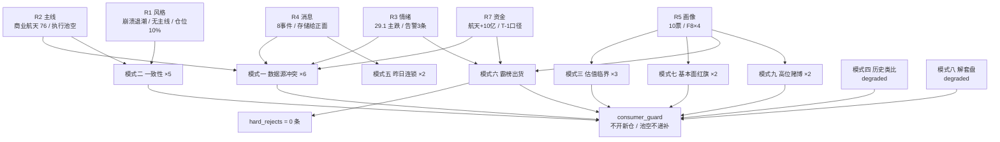

# 2026-10-30 · **反证 / Devil's Advocate**

> **数据源新鲜度**：partial（资金轴整体落后 1 个交易日）
> **降级状态**：true（R1 / R3 上游降级；模式四、模式八本单元降级）
> **置信度**：0.58

## 一句话结论

**霸榜出货硬否决今日 0 条 —— 不是漏判，是 R2 唯一主线商业航天只霸榜 1 日、与 3 条告警零交集；真正该否的是「T-1 资金确认 T 日开仓」这条证据链断点。**

## 详细分析

### 一、今日反证的落点不在「霸榜」，在「证据链的三处断点」

24 条反证（strong 14 / soft 10）里，最硬的三条都不是「哪只票要出货」，而是**上游把不确定当成了确定**。第一处断点：R2 给商业航天打 `cross_validation_score=1.0`，意味着共振、催化、资金三源全过；但 R3 自己在同一份 artifact 里写明「只能给 L1+L2b，此级别强度低于标准 L1+L2，只作方向确认不作加权」，R2 的 notes⑤ 也承认「这是今日置信度只有 0.62 的主因」。一个满分 1.0 与一个 0.62 的自述同时存在于 `R2_main_sectors.json` 里，这不是精度问题，是口径分裂 —— 下游若只读 score 字段，会把 2 个有效源当成 3 个。

第二处断点更要紧：**所谓「今日航天装备 +10.00 亿」是 10-29 的数据**。R2 的 dependencies 里已经诚实登记 `moneyflow_ind_dc_1030: unavailable`，理由是「东财板块资金盘后 19-20 点更新，10-30 盘中无当日值；资金维使用 R7 的 10-29 口径」。也就是说 R2 用 T-1 的资金读数，去支持 T 日的执行判断；而 T 日上午的实测广度是反向的 —— 板块 483 只成分中位 -0.53%、上涨占比 35.4%、涨停由 11 家缩至 6 家、最高连板由 4 板降至 3 板。**资金确认与广度实测一正一负，而后者的时点更新。**

第三处断点：中国卫星的盈亏比在三份 artifact 里有三个值。R2 写 1.94（未过 §4 的 RR≥2.0），R4 写 2.00（`rr` 字段恰在门槛线上，因此被判「唯一达门槛」），R7 写 0.52（entry 55.9 / stop 48.51 / target 59.72，止损距 13.22%，已超出 -5%~-10% 硬区间）。差异来自止损参照的取法，但**一个恰好等于门槛的值出现在门槛判定语境里，是最危险的巧合** —— 下游若采信 R4，就会把一只 RR 0.52、止损距 13% 的票放行。

### 二、霸榜出货：逐票核验后 0 条，规则没有被绕过

模式六要求①所属板块命中 R3 `distribution_alert` 且②R5 五日主力净额为负，两者同时成立才硬拒。今日两条都不齐：

| 告警对象 | 类型 | 是否在 R2/R5 候选池 | 判定 |
|---|---|---|---|
| 人形机器人（概念榜） | 板块 | ❌ 不在 | 条件①不适用，转市场级负证据 |
| 天孚通信 | 个股 | ❌ 不在 | 禁低吸，不硬拒 |
| 新易盛 | 个股 | ❌ 不在 | 禁低吸，不硬拒 |

R3 的三条告警与 R5 十只候选**零交集**；R7 的 19 条 `distribution_alerts` 同样零交集。而商业航天虽在概念榜从 10-28 第 7 跃至 10-29 第 1，**只霸榜 1 个观测日**，未进入「连续多观测日霸榜」的派发警戒口径 —— 所以四只航天票的条件①全线不成立。

条件②只有三票成立：古井贡酒 -0.04 亿、满坤科技 -0.34 亿、明阳电路 -0.31 亿。但白酒与 PCB 都不在告警名单，按 v1.3 降级为 `strong_suggest`，**不硬拒、不递补**。空硬拒不等于全票通过 —— `consumer_guard.empty_hard_rejects_means_all_clear` 已显式写 false。

### 三、四象限负面识别：Q1 是风险集中区，不是安全区

情绪轴取 R3 共振与概念榜关注，资金轴取 R7 同族板块/概念主力净额，跨概念不求和：

| 象限 | 对象 | 情绪 | 资金（当日 / 5日 / 20日，亿） | 负面结论 | 行动 |
|---|---|---|---|---|---|
| 🔴 Q1 高情绪高资金 | 商业航天 | 概念榜第 1 | +10.00 / +10.92 / **-5.19** | 5 日流入建立在 20 日流出之上，T 日广度转负 | 观察，不进 |
| 🔴 Q1 高情绪高资金 | 减速器（机器人） | 榜第 2 | **-17.71** / +34.62 / +20.20 | 霸榜 4 日后让位，当日已在派发 | 禁做 |
| 🟠 Q2 高情绪低资金 | 电子链 5 子链 | 反向共振 | -309.22 / -389.37 / -1881.45 | 关注度在、筹码先跑，属禁做名单 | 禁做 |
| 🟠 Q2 高情绪低资金 | 数字芯片设计 | R4 给正面 | -65.33 / +33.06 / **-362.38** | 5 日正、当日与 20 日负 = 反弹非反转 | 剔除 |
| 🟡 Q3 低情绪高资金 | 白酒 | R3/R4 零覆盖 | +4.25 / +7.18 / +19.56 | 资金真但无板型无龙头，龙头开板 8 次 | 观察，不进 |
| 🟡 Q3 低情绪高资金 | 银行 / 保险 | 防御 | +5.77 / +2.62 / +7.74 | 只证明进攻缺位，日波动 <2% 无涨停基因 | 回避 |
| ⚫ Q4 低情绪低资金 | PCB / 覆铜板 | 降温 | -82.49 / -140.59 / -409.02 | 6 家涨停全靠「跌出来的空间」 | 剔除 |
| ⚫ Q4 低情绪低资金 | 有色金属 | 无 | -30.03 / -91.37 / -402.65 | 5 日零净流入日，个股逆行业 | 回避 |

**因果**：Q1 里的钱全是「5 日窗口」的钱，20 日窗口全是负的；真正的当日在 Q1 里只有减速器的 -17.71 亿是派发证据。所以 Q1 不是进攻区，是接盘区。

### 四、推理三问 · 商业航天主线

**大资金意图**：航天装备 10-29 三窗口（当日 +10.00 / 5 日 +10.92 / 10 日 +8.68 亿）是全市场唯一同向为正的行业，同期国防军工 5 日仍 -39.59 亿，说明资金只吸航天子链、不吸整个军工 —— 这是**定向换仓**，不是板块整体加仓。但 20 日 -5.19 亿说明这波换仓发生在行业整体净流出的尾部，属「局部止跌回补」而非「行业反攻」。

**为什么走强**：叙事硬（蓝箭 9500 万中标成飞研究所 + 星宇过港交所聆讯 + 上海 800 亿 / 3000 颗方案）+ 板块小（483 只成分、涨停从 11 家缩到 6 家即可拉动指数）+ 前期跌得深（中国卫星 20 日 -17.2%、距 20 日高 -6.4%）。三个条件凑齐的是「首日见效」，凑不齐的是「持续」。

**逻辑够不够硬**：方向够硬，载体不够硬。四只票全部命中 F8（Q1-Q3 经营现金流连续为负，中国卫星 -4.13 亿、电科蓝天 -3.86 亿），意味着**业绩端无法承接估值**；龙一是纸封 8 次（封单仅占成交 2.66%、14:08 才最后封），高度龙是焊接设备主业与卫星零关联的伪题材。该带的不带、该封的不封 —— 主线成立但可交易载体不成立。

### 五、思维链 · 600118.SH 中国卫星（研究观察，**非首推**，池空）

> 说明：今日 R2/R7 执行池均为空，本单元无「首推票」。中国卫星是 R2 唯一主线的容量核心，故单列思维链以说明「为什么它也不进」。

**买入理由**①：板块唯一有真实资金合力的方向；661 亿全流通容量能装大资金；股东户数环比 -14.1%（26.07 万户，全样本最集中三只之一）；10-29 主力 +6.64 亿、净占比 21.33%；今日 09:52 创 20 日新高 59.72，半日成交 41.63 亿全场第 2、量比 3.44。**逻辑上它是「该涨的那只」。**

**风险点**②：昨日封板结构是 10:24 首封、14:08 最后封、开板 8 次、封单仅占成交 2.66% 的尾盘纸封；今日冲高 6.8% 后回落 2.67 元收长上影，放量滞涨；五天净流入 6.14 亿里 10-29 单日占 6.64 亿（5 日仅 2 个正日，集中度 1 天）；PE_TTM 625.5 使估值锚失效、PS 9.5 对应净利率 2.40%；周线仍空头排列（周 MA20 63.35 在价格上方 11%）；板块广度仅 35.4% 上涨，无跟风接力。

**止损条件**③：R7 口径 entry 55.9 / stop 48.51 / target 59.72，止损距 13.22%，**已超出 -5%~-10% 的硬区间** —— 这不是「止损设得宽」，而是「没有合规结构位可挂」。R2 给的口径是「明日竞价高开 >2% 且不破 55.90 视为分歧转一致，开板后 30 分钟跌破 55.90 则主线当日作废」。两条口径都不能把止损压进 -10% 以内，故按纪律 §4 降 watch。

**可验证假设**④：若明日竞价高开 >2% 且不破 55.90、板块上涨占比回升至 >50%、涨停回到 ≥6 家，则「放量滞涨」被证伪为「高位换手后的二波起点」，可重评；若明日低开或开盘 30 分钟内破 55.90，则 10-30 的长上影就是主线第一次派发，整条线当日作废。

## 关键证据

- 🧨 **证据 1（最强）**：R2 dependencies 自认 `moneyflow_ind_dc_1030: unavailable`，「资金维使用 R7 的 10-29 口径」→ R2 的「资金三窗口同向为正」是 T-1 读数 · 来源 R2_main_sectors.json
- 🧨 **证据 2**：同一只票 RR 三值 —— R2 1.94 / R4 2.00 / R7 0.52，且 R7 止损距 13.22% 超出硬区间 · 来源 R2 + R4 + R7
- 🧨 **证据 3**：R3 自述共振等级仅 L1+L2b 且「不作加权」，与 R2 `cross_validation_score=1.0` 冲突 · 来源 R3_sentiment.json
- 🧨 **证据 4**：昨日反证侧三组全兑现 —— financial_red_flag 组 -15.79%、r6_strong_suggest_downweight 组 -10.01%、fund_flow_weak 组 -14.88%；唯一反例 extreme_tail_anchor 组 +6.47% · 来源 observation_tracking.json（20261029）
- 🧨 **证据 5**：航天四票 4/4 命中 F8 现金流连负，板块级而非个股级 · 来源 R5 divergence_flags D1
- 🧨 **证据 6**：霸榜告警零交集 —— R3 3 条告警（人形机器人 / 天孚 / 新易盛）与 R5 10 只候选 0 重合，R7 19 条告警同样 0 重合 · 来源 R3 + R7 + R5
- 🧨 **证据 7**：10-30 上午广度反向 —— 板块 483 只中位 -0.53%、上涨占比 35.4%、涨停 11→6 家、最高连板 4→3 板 · 来源 R2 market_snapshot
- 🧨 **证据 8**：R5 模拟闸门 gate 只含 alpha/risk 双级，放行 3 票（中国卫星 / 电科蓝天 / 金安国纪），缺 RR 与止损距 → 与 R2 空池直接冲突 · 来源 R5 d1_gate_simulation

## 反证条目索引（24 条）

| 编号 | 模式 | 对象 | severity | 一句话 |
|---|---|---|---|---|
| M1_01 | 数据源冲突 | 商业航天主线 | strong | 三源共振评 1.0，实为 2 有效源 + 1 折扣源 |
| M1_02 | 数据源冲突 | 中国卫星 RR | strong | 三源三值 1.94 / 2.00 / 0.52，门槛不可互证 |
| M1_03 | 数据源冲突 | R5 资金 vs R7 资金 | soft | 同源东财，非独立证据面 |
| M1_04 | 数据源冲突 | 商业航天资金维 | strong | T-1 资金确认 T 日开仓，T 日广度已反向 |
| M1_05 | 数据源冲突 | 存储链 | strong | R4 给 +0.62 正面 vs R3 降温 + R7 半导体 -136.40 亿 |
| M1_06 | 数据源冲突 | R2 契约完整性 | soft | 缺 main_template 与候选 rank / execution_eligible |
| M2_01 | 一致性 | R1 vs R2 主线 | strong | 无主线 vs 1 条主线主升早期 |
| M2_02 | 一致性 | R2 stage_action | strong | 同字段内「最佳窗口」与「对今日无效」并存 |
| M2_03 | 一致性 | R5 闸门 vs R2 空池 | strong | 模拟闸门放行 3 票，缺 RR 与止损距 |
| M2_04 | 一致性 | 候选砍半口径 | soft | 依 10-29 的 39.06% 砍半，今日 23.33% 不触发 |
| M2_05 | 一致性 | 情绪温度标签 | soft | 主跌标签 vs 今日三指标修复 |
| M3_01 | 估值临界 | 上海沪工 | strong | 估值 20 分 / PB 100 分位 / 一字无止损参照 |
| M3_02 | 估值临界 | 电科蓝天 | strong | PE 232.7（90 分位）/ PEG≈7.8 / 流通仅 8.2% |
| M3_03 | 估值临界 | 中国卫星 | soft | PE 625 失效，PB 分位低不等于便宜 |
| M5_01 | 昨日连锁 | 同类结构 | strong | 昨日反证 3 组全兑现，今日同类应加权 |
| M5_02 | 昨日连锁 | R6 自身习惯 | soft | 高位锚组 +6.47% 反例，不可单凭高度判死 |
| M6_01 | 霸榜出货 | 人形机器人 | strong | 霸榜 4 日后当日 -17.71 亿派发（市场级，无适用对象） |
| M6_02 | 霸榜出货 | 古井贡酒 | strong | 条件②成立（-0.04 亿）条件①不成立 → 降级不硬拒 |
| M7_01 | 基本面红旗 | 航天四票 | strong | 4/4 命中 F8，板块级现金流红旗 |
| M7_02 | 基本面红旗 | 硬拒边界 | soft | 最高 1 条红旗，未达 ≥4 条阈值，不凑硬拒 |
| M8_01 | 解套盘 | 46 家涨停 | soft | 缺封板量×套牢区数据，降级只给替代证据 |
| M9_01 | 高位赌博 | 上海沪工 | strong | 3 板即天花板，一字缩量零换手 |
| M9_02 | 高位赌博 | 西部材料 | soft | 炸板 6 次 + 融券余额 +31.6% |
| M10_01 | 跨资产背离 | 西部材料 | soft | 个股逆有色金属四窗口流出，价格轴缺源 |

## 数据源审计

| 源 | 状态 | 数据日期 | 记录数 | 备注 |
|---|---|---|---|---|
| R1 风格研判 | 🟡 stale | 2026-10-29 | — | degraded，confidence 0.49，跨资产三档无法建立 |
| R2 主线板块 | 🟢 ok | 2026-10-30（11:30 快照） | 1 主线 / 4 龙头 / 10 候选 | 缺 main_template；板块资金维为 T-1 |
| R3 情绪共振 | 🟠 partial | 2026-10-29 + 10-30 上午文本 | 2 共振主题 | degraded，共振上限 L1+L2b |
| R4 消息面 | 🟠 partial | 2026-10-30 | 8 事件 / 27 票 | health severity 2；群聊抓取为空、weflow error |
| R5 个股画像 | 🟢 ok | 2026-10-30（11:30 快照） | 10 票（failed 0） | 闸门口径不完整 |
| R7 资金面 | 🟡 stale | 2026-10-29 | 19 条派发告警 | degraded；期权/期货/外盘缺源 |
| E1 观察跟踪 | 🟢 ok | 2026-10-29 | 22 票 | 昨日反证兑现证据来源 |
| R6 昨日反证 | 🟢 ok | 2026-10-29 | 31 条 | 模式五输入 |

## 不确定性 / 反证

**本单元最可能错的地方**：把「T-1 资金」判为不足以支持 T 日开仓。若今日尾盘航天装备资金转为当日净流入、且板块涨停回到 6 家以上，那么 10-30 上午的广度转弱只是洗盘，R2 的「修复第 1 天」判断会比我更接近事实。我的反证在这个情形下会被证伪，但被证伪的代价是「少赚一次」，而不是「接在派发上」—— 在当前结构（最高 3 板、龙一纸封、高度龙伪题材）下这个赔率是可接受的。

**第二处不确定**：模式八完全降级（无封板量×历史套牢区数据），所以「46 家涨停里有 % 是解套盘」这个判断我给不出比例，只能用「涨停多但高度缺失」作替代。若后续补上封板量数据，今日的「假繁荣」结论可能被削弱或加强。

**第三处**：模式四无授权历史事件库，全部历史类比都未做。这意味着「这次和历史上某次像」这类论据在本单元完全缺席 —— 是缺口，不是结论。

**自我纠偏记录**：昨日 R6 对高位锚（extreme_tail_anchor 组）的看空在唯一一例上失败（+6.47%）。故今日不把上海沪工的否决理由挂在「3 板高度」上，而挂在伪题材 + 一字缩量 + 无止损参照三项主证上，高度只作辅助。

## 与其他 R/D/E 的关系

- **依赖**：R1_style.json / R2_main_sectors.json / R3_sentiment.json / R4_news.json / R5_stock_profiles.json / R7_capital_flow.json / reports/20261029/observation_tracking.json / research/20261029/R6_devil_advocate.json
- **被消费**：D1（canghai-plan）消费 `hard_rejects`（今日 0 条，无强制剔除对象）、14 条 `strong_suggest`（须逐条接受或写 `meta.d1_override`）、10 条 `soft_suggest`（记 `r6_soft_notes`）；E1（canghai-review）消费 `bias_risk` 与 `consumer_guard` 做盘后兑现核对
- **给 D1 的三条硬提醒**：①单读 R2 `stage` 字段视为误用，必须同读 `stage_override_note`；②R5 `d1_gate_simulation.pass` 的三票未过 RR 与止损距，不得直接采信；③中国卫星 RR 按最保守 0.52 处理，不采信 R4 的 2.00

## Sub-Agent 元数据

- skill: analyze_devil_advocate_v1
- artifact: data/research/20261030/R6_devil_advocate.json（66.7 KB）
- 反证条目：24 条（strong_suggest 14 / soft_suggest 10 / hard_reject 0）
- 四象限：Q1 资金 5 / Q2 情绪 6 / Q3 基本面估值 6 / Q4 结构 7
- 模式状态：执行 8 项（1/2/3/5/6/7/9/10）、降级 2 项（4/8）
- 数据边界：只读磁盘 artifact，未调用任何 MCP、未抓新数据、未派生 sub-agent
- model: deepseek-v4.1-flash
