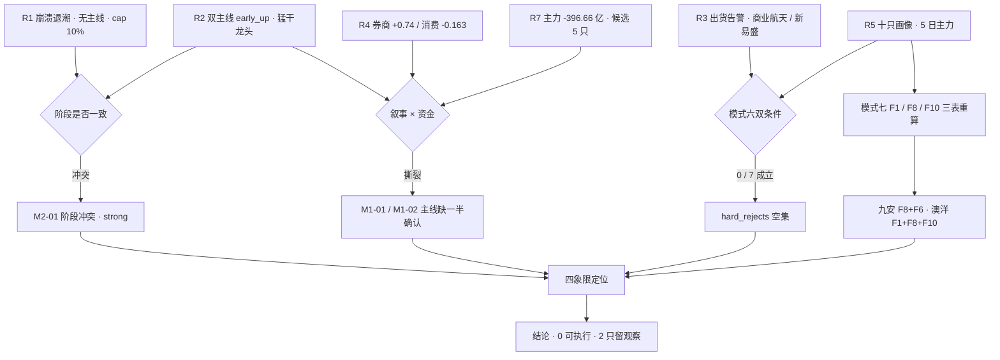

# 2026-11-02 · **反证 / Devil's Advocate**

> **数据源新鲜度**: partial（R1 0.49 / R3 0.50 均 degraded，R7 partial）
> **降级状态**: true
> **置信度**: 0.45（0.80 基准 × 0.70 上游完整度 × 0.80 降级惩罚）

## 一句话结论

今日 **0 条硬拒、13 条强反证、15 条软反证**；真正的漏洞不是"哪只票会跌"，而是上游对"今天是什么行情"没有共识 —— R1 说无主线主跌，R2 说双主线主升早期。

## 详细分析

**第一段：阶段判定不成立，这是今日最贵的漏洞。** R1 给出崩溃退潮型、情绪 31.3 恐惧、`main_lines_count=0` 无主线、周期阶段 `capitulation`（投降第 3 天）、仓位上限 10%；R2 却在同一份行情上判出两条主线，`stage=early_up`，`stage_action` 直接写「最佳参与窗口：猛干龙头 / 第一时间上龙二；收益最大段」。两者不可能同时为真。更要命的是 R2 自己也没信这句话 —— 同一份报告里 `execution_pool=[]`，空池理由第一条就是「两条主线都不满足已确认可交易主线」。80 分是相对排序的第一名，不是绝对水位；炸板率 39.74% 连续两日站在 35% 红线上方的日子里，分数高只说明**矮子里最高**。

**第二段：叙事与资金分住在两个房间。** R4 今日最强正面是券商 +0.74（全表最高、strength=high、首推国泰海通 / 中信证券），催化是一行一局一会今日开会 + 国新诚通各获千亿级回购增持额度 —— 当日级增量信息。而 R2 给券商 33 分淘汰，理由是证券Ⅲ 当日 -13.30 亿、5 日 -62.99 亿、`pos 0/5`、20 日 -179.16 亿，板块零涨停。反过来，R2 的第一主线消费 80 分，R4 的板块极性表却给「消费」**-0.163 负面**，唯一相关事件是 PMI 49.3 双降。同一个市场，一条线有钱没故事，一条线有故事没钱。这不是主线，这是**未定价的预期差**，且两边都不能当买入依据。

**第三段：候选池是错位的。** R7 的 research_candidates 五只是康龙化成、药明康德、百亚股份、泸州老窖、金安国纪；R2 两条主线 8 只 leaders 加 R5 十只画像，只覆盖了其中两只。全市场资金连续性最好的 CRO 标的康龙化成（5 日 +4.74 亿、5/5 正日、5 日 +11.09%）**没有画像**；中期资金最强的百亚股份（5 日 +14.90 亿、20 日 +61.21 亿）既不属任何主线也不在画像里。而 R2 选出的医药龙一是 PE 4.46 的九安医疗、龙二是 PE 1436 的万邦医药。钱在真龙头身上，画像给了两只妖股 —— 这个缺口 D1 无法靠"多买一点"绕过去，无画像就是无禁止清单闸门、无 RR 校验。

**第四段：基本面红旗到了升级线下沿。** 用 `_r5_fin_stmt.json` 三表重算：九安医疗命中 F8（经营现金流 -1.64 亿且前一期 -1.14 亿连续两期为负，同期归母 +52.05 亿）+ F6（净利率 646.7%，利润来自 8.06 亿营收之外的投资收益）= 2 条含 1 条 P0；澳洋健康命中 F1 存贷双高（货币 24.2% 总资产、有息负债 50.8% 总资产）+ F8（CFO -0.82 亿而净利 +0.37 亿）+ F10（有息负债/净资产 433.6%）= 3 条含 2 条 P0，距 4 条硬拒只差 1 条。这里必须点名一个上游缺陷：R5 的 `fundamental_flags` 编号与附录 A 语义不一致 —— R5 的 F4 是"利润结构异常"（附录 F4 是存货异常）、F5 是"经营现金流"（附录 F5 是资本化率）、F6 是"短债覆盖"（附录 F6 是一次性收益）、F3 是"业绩下滑"（附录 F3 是应收暴增）。照编号消费会把四个检查项全部错读，本报告因此弃用编号。

**第五段：R6 自己的账要算。** 昨日（2026-10-30）R6 判「不开新仓、10 只留研究观察」，并把上海沪工判「不进」。当日收盘：古井贡酒 **+10.00% 涨停**、上海沪工 **+10.03% 一字续板**、西部材料 +3.90%、中国卫星 +0.02%、688818 -0.84%。方向命中 2/5，两处假阳性都是**过度保守**。这条写进报告不是为了自罚，是为了给今日的反证定口径：所有 `strong_suggest` 只能写「须降价 / 须等确认 / 须补数据」，不许写「不宜参与」。R6 有系统性偏保守的历史误差，D1 读的时候要知道这一点。

## 四象限负面识别

以 R2 五维里的「热度」「资金」为主轴，R3 hotlist 与 R7 行业资金做校验，28 条反证的分布：

| 象限 | 含义 | 板块落位 | 反证条数 | R6 判定 |
|---|---|---|---|---|
| Q1 高情绪高资金 | 接力成本最高区 | 消费白酒（热度 18 / 资金 19）、医药 CRO（14 / 18） | 7 | 🔴 风险集中区：两条线都是 1 日龄、R4 零催化，只配研究观察 |
| Q2 高情绪低资金 | 出货 / 一日游 | 商业航天（R3 霸榜第 1 但 -4.00%）、名字套利洋·阳字辈（14 / 8，R3 自判 late） | 3 | ⛔ 禁做：热度是派发的燃料 |
| Q3 低情绪高资金 | 资金孤岛 | PCB 覆铜板（金安国纪个股 +8.18 亿 / 板块 5 日 -154.5 亿）、CRO 真龙头康龙化成、医药生物行业级（+26.49 亿但 -0.61%） | 8 | 🟠 有钱无板块效应 / 无画像，兑现不了接力 |
| Q4 低情绪低资金 | 超跌反抽 / 无地位 | 券商（叙事 +0.74 最硬、资金 pos 0/5）、存储、机器人、银行红利 | 10 | 🟡 券商是唯一有今日增量催化的预期差，盘前不能当主线 |

## 三问 · 三个关键对象

**① 消费防御线（R2 第一主线，80 分）**
- **大资金意图**：不是在买白酒的成长，是在买"科技杀跌时的现金流确定性"。食品饮料 +30.05 亿、白酒Ⅱ +25.00 亿、5 日 +27.91 亿、20 日 +55.29 亿，是全市场唯一 20 日主力净流入仍为正的成规模行业；对照电子 -112.43 亿、通信 -58.76 亿、半导体 -56.14 亿。这是**资金迁移**，不是产业启动。
- **为什么走强**：科技链崩塌（隔夜半导体篮子 -6.37%、光模块 -7.19%）+ 三季报八成盈利提供业绩底 + 周末茅台连续三日人气在榜。三条同源，都指向"避险"。
- **逻辑够不够硬**：不够。R4 零正面催化、消费极性 -0.163 负面；龙一泸州老窖单季归母 -57.0%、13:27 晚封、封单占流通 0.01%；空间板青岛食品涨停日主力净卖 -0.199 亿、换手 47.8%。**这条线只有资金，没有催化，且龙头没有锁仓。**

**② 医药 / CRO 线（R2 第二主线，75 分）**
- **大资金意图**：钱在子板块，不在行业。医疗服务 5 日 +34.90 亿（pos 4/5）、医疗研发外包 5 日 +28.86 亿（pos 5/5）、康龙化成 5 日 +4.74 亿 5/5 正日；但医药生物行业级 5 日 -3.10 亿，当日 +26.49 亿而板块指数 -0.61%。
- **为什么走强**：与消费同源 —— 高盛交易员口径"AI 泡沫见顶后防御资产先受青睐"，R3 记录的三条 KOL 文本都指向同一个迁移。
- **逻辑够不够硬**：硬的部分和软的部分是分开的。CRO 资金连续性 5/5 是全市场最好；但 R2 选的龙一龙二都不是 CRO 真核心 —— 九安医疗是 PE 4.46 的会计幻觉（F8+F6），万邦医药是 PE 1436 + Q3 -98.3%。**线对，票错。**

**③ 券商 / 大金融（R4 最强正面、R2 淘汰、今日 Q4 预期差）**
- **大资金意图**：没有意图。证券Ⅲ 当日 -13.30 亿、5 日 -62.99 亿 `pos 0/5`、20 日 -179.16 亿，板块零涨停；同一政策下的银行 +0.77%、5 日 +16.40 亿 `pos4/5` —— 资金把"回购增持贷款额度"读成避险，不是读成进攻。
- **为什么走强**：还没走强。R4 的 +0.74 是叙事分，不是价格分。
- **逻辑够不够硬**：叙事最硬、资金最软的组合。它属于"今日会议盘中落地才可能兑现"的事件型预期差，盘前无法确认，因此**不能进 execution_pool，只能登记为盘中新增信息**。

## 逐票反证速览（7 只，按 R6 立场排序）

| 标的 | 角色 | R5 档位 | 5 日主力 | 距 MA5 | R3 告警 | R6 立场 |
|---|---|---|---|---|---|---|
| 迎驾贡酒 603198 | 消费龙二 | B+/B | +1.26 亿 | +6.34% | 无 | 🟡 本批结构最优，仍不进执行（无催化 + 融券 15 日 +94.2%） |
| 泸州老窖 000568 | 消费龙一 | B/B- | +5.17 亿 | +7.30% | 无 | 🟡 观察：晚封 + 封单占流通 0.01% + 单季归母 -57% |
| 万邦医药 301520 | 医药龙二 | B/C | +1.14 亿 | +14.13% | 无 | 🟠 降级 watch：止损距超硬区间，PE 1436 |
| 百花医药 600721 | 医药候补 | B-/C | +2.38 亿 | +5.77% | 无 | ⛔ 否决：F9 应收/营收 57.1% + 减持在案 + 户数 +263.4% |
| 九安医疗 002432 | 医药龙一 | B-/C | +1.97 亿 | +6.30% | 无 | ⛔ 否决：F8+F6 双红旗 + 机构席位净卖 -2812 万 |
| 青岛食品 001219 | 消费身位 5 板 | B-/C | +0.37 亿 | +19.90% | 无 | ⛔ 强否决：涨停日 -0.199 亿 + 换手 47.8% + 风险提示公告 |
| 澳洋健康 002172 | 医药身位 3 板 | C/C | +2.66 亿 | +18.48% | 无 | ⛔ 强否决：F1+F8+F10（2 条 P0）+ 涨停日 -0.93 亿 |

## 首推票思维链（迎驾贡酒 · R6 给它的四道题）

R6 不出正向结论，但本批唯一"结构上没硬伤"的是迎驾贡酒；D1 若真要动它，必须先答完这四问 —— 缺任何一问即为计划外出手。

- **买入理由**：板型是本批最好的一只 —— 09:44 早封、封单 0.76 亿、开板 1 次、获利盘 95.5% 套牢仅 4.5%（全员浮盈无解套抛压）、Q3 单季归母 +8.6% 是白酒里唯一正增长、PE 17.36 落 52.8% 分位属中性。技术面 MA5/MA20/MA50 多头排列，今日 +9.99% 收 44.47 创 30 日新高。
- **风险点**：R4 零催化（catalyst 维度 32 分）；30 日龙虎榜 0 次 = 无席位级证据；融券余额 15 日 +94.2% = 有人在为回调下注；融资余额 15 日 -24.6% = 杠杆资金在退；距 MA20 +12.24% 不算便宜的低吸位。
- **止损条件**：破 MA5 41.82（距收盘 -5.96%，在 -5~-10% 硬区间内）即逻辑证伪，收盘价确认，不看盘中插针。若竞价高开 >5% 则整笔放弃 —— 因为止损距会被高开撑破 10%。
- **可验证假设**：①今日白酒Ⅱ 板块资金不为负（R3 invalidation：次日转净流出 >15 亿即轮动证伪）；②09:30-10:00 不破分时均价；③青岛食品不断板（身位股断板 = 消费线一日游信号）。三条全中才算"主线延续"，缺一条即降为纯粹的个股脉冲。

## 霸榜出货 hard_reject 审计（模式六 · 唯一硬否决权）

| 标的 | 条件① R3 distribution_alert | 条件② 5 日主力净流出 | 双条件 | 裁定 |
|---|---|---|---|---|
| 泸州老窖 000568 | ❌ 未命中 | ❌ +5.174 亿 | 否 | 无 |
| 迎驾贡酒 603198 | ❌ 未命中 | ❌ +1.264 亿 | 否 | 无 |
| 九安医疗 002432 | ❌ 未命中 | ❌ +1.965 亿 | 否 | 无 |
| 万邦医药 301520 | ❌ 未命中 | ❌ +1.139 亿 | 否 | 无 |
| 百花医药 600721 | ❌ 未命中 | ❌ +2.380 亿 | 否 | 无 |
| 青岛食品 001219 | ❌ 未命中 | ❌ +0.373 亿（当日 -0.199 亿） | 否 | 降 strong_suggest |
| 澳洋健康 002172 | ❌ 未命中 | ❌ +2.661 亿（当日 -0.931 亿） | 否 | 降 strong_suggest |

**结论：`hard_rejects = []`，count = 0，逐票打印核对。** 模式六今日的触发对象本身就是 0 只（R2 `execution_pool=[]`），R3 的告警只命中「商业航天」板块与「新易盛」个股，与 7 只候选零交集。空集只代表"未形成否决"，不代表全票审核通过 —— 真正的否决面在模式七（九安 F8+F6、澳洋 F1+F8+F10）和结构位（三只票止损距 >14%）。

## 关键证据

- **证据 1**：R1 `main_lines_count=0` / `capitulation` / `position_cap=0.10`，与 R2 两条主线 `early_up`「猛干龙头」正面冲突 —— 来源 R1_style.json + R2_main_sectors.json。
- **证据 2**：R4 券商 +0.74（high 正面、首推国泰海通）对 R2 券商 33 分（证券Ⅲ 5 日 -62.99 亿、pos 0/5、零涨停）—— 来源 R4_news.json + R2_main_sectors.json。
- **证据 3**：R4 消费 -0.163 负面、`sectors_catalyzed` 不含消费，而 R2 把消费列为 80 分第一主线 —— 来源 R4_news.json + R2_main_sectors.json。
- **证据 4**：R7 五只资金候选里，康龙化成（5 日 +4.74 亿、5/5 正日）与百亚股份（5 日 +14.90 亿、20 日 +61.21 亿）均无 R5 画像 —— 来源 R7_capital_flow.json + R5_stock_profiles.json。
- **证据 5**：九安医疗 CFO -1.64 亿（前一期 -1.14 亿）对归母 +52.05 亿，净利率 646.7% —— 来源 `_r5_fin_stmt.json` 三表复算（F8 + F6）。
- **证据 6**：澳洋健康货币资金 24.2% 总资产 + 有息负债 50.8% 总资产 + 有息负债/净资产 433.6%，CFO -0.82 亿对净利 +0.37 亿 —— 同上复算（F1 + F8 + F10）。
- **证据 7**：昨日 R6 判「不开新仓」后，古井贡酒 +10.00%、上海沪工 +10.03% —— 来源 `_work/daily_20261030.json` 收盘价复核。

## 数据源审计

| 源 | 状态 | 抓取日期 | 记录数 | 备注 |
|---|---|---|---|---|
| R1_style | 🟡 degraded | 2026-11-02 | 1 | 置信度 0.49，无主线、cap 10%，30 日样本取得 42 个收益日 |
| R2_main_sectors | 🟢 ok | 2026-11-02 | 2 条主线 + 8 只 leaders | 置信度 0.68，`execution_pool=[]` |
| R3_sentiment | 🟡 degraded | 2026-11-02 | 3 主题 / 2 条告警 | WeFlow 永久下线、群聊断更 5 个交易日、attention 未落盘 |
| R4_news | 🟢 ok | 2026-11-02 | 8 个事件 / 2397 篇原文 | 置信度 0.62，`kol_confirm` 全部 unavailable（R3 无 KOL 层） |
| R5_stock_profiles | 🟢 ok | 2026-11-02 | 10 只画像 | `fundamental_flags` 编号与附录 A 冲突（已改用三表重算） |
| R7_capital_flow | 🟠 partial | 2026-11-02 | 5 只研究候选 / 0 只可执行 | 北向停抓，`data_quality=partial` |
| R6@20261030 | 🟢 ok | 2026-10-30 | 24 条反证 | 用于模式五实盘校验，发现自身 2 处假阳性 |
| daily_20261030 收盘 | 🟢 ok | 2026-10-30 | 5571 行 | 仅用于昨日反证兑现度核算 |

## 不确定性 / 反证（自我批判）

1. **我自己昨日是错的，而且是"看空错了"两次**。古井贡酒与上海沪工都在我判「不进」的次日涨停。今日所有反证因此只写"须降价/须等确认"，不写"不宜参与"。若 D1 把本报告的 strong_suggest 当"一定不能买"，就是把我的偏差放大了。
2. **模式四（历史类比）与模式八（解套盘假繁荣）是 degraded，不是"通过"**。前者盘上没有同构事件索引；后者需要 tick 级封板量与历史套牢区比对，盘上只有 R5 的 `overhead_supply` 比例（泸州 49.1% / 九安 51.7%），无法计算 100+ 涨停里解套盘的真实占比，我不编造。
3. **模式九（高位触板）只到 partial**：候选最高 5 板（青岛食品），未达 8 板+ 的 `extreme_tail_risk` 口径；"5 板以上晋级率"盘上无数据，因此我不能说它"必断"，只能说它"承接最差"。
4. **F12（审计师意见）与 F11（控股股东质押率）无数据**。澳洋只算到 3 条红旗（距硬拒 4 条差 1 条），这不等于它清白 —— 是"未核"。任何"没查出来所以没问题"的推论都是错的。
5. **R2 的 `stage` 与本报告的"阶段冲突"结论可能同时被读成对立**。我的立场是：R2 的 stage 由单日数据生成（`age_days=1`），没有隔日验证；它不是错，是**还不配当授权**。
6. **全部金额与涨跌幅都是 2026-10-30 收盘口径**，盘前没有 T 日价格。任何 RR、止损距、盈亏比的最终值必须由 D1 在 09:25 用竞价实价重算，本报告只用它做"能不能挂得住止损"的可行性判断。

## 与其他 R/D/E 的关系

- **依赖**：R1_style、R2_main_sectors、R3_sentiment、R4_news、R5_stock_profiles、R7_capital_flow、`_r5_fin_stmt.json`、R6@20261030、`daily_20261030`。
- **被消费**：D1（canghai-plan）读取 `hard_rejects[]`（空集）、`counter_arguments[]`、`candidates_audit[]`、`quadrant_summary`；E1（canghai-review）可用 `self_audit_yesterday` 做兑现度回溯。
- **对 D1 的硬约束**：①`hard_rejects=[]` 不代表放行，逐票门禁仍须独立跑；②不得对康龙化成 / 百亚股份 / 金安国纪下单（无画像）；③不得采信 R5 的 `F#` 编号；④券商只能当盘中事件，不得盘前入池；⑤青岛食品 / 澳洋健康即使被标 strong_suggest，也按其 R5 risk=C 直接剔除。

## Sub-Agent 元数据

- skill: `analyze_devil_advocate_v1@1.3`
- artifact: `data/research/20261102/R6_devil_advocate.json`（51,304 B · status=complete）
- 反证总量: 28 条（strong_suggest 13 / soft_suggest 15 / hard_reject 0）
- 四象限分布: Q1 7 · Q2 3 · Q3 8 · Q4 10
- 生成耗时: 约 12 分钟（09:40 → 09:52）
- model: deepseek-v4.1-flash
- 红线自检: 0 次 MCP、0 次联网、0 次 delegate；只读 `data/research/`，未写入 `data/plans`、`data/execution`、`user_preferences.yaml`、`human_thesis/`
