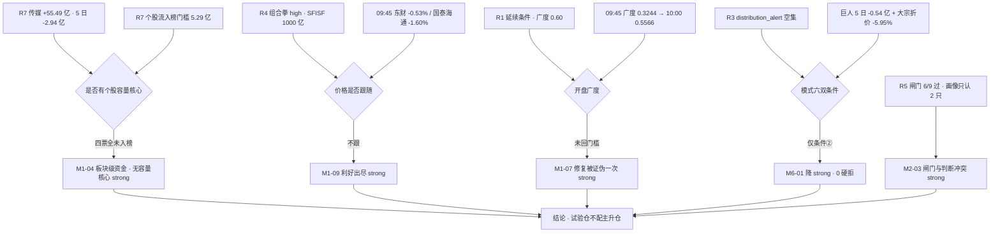

# 2026-11-03 · **反证 / Devil's Advocate**

> **数据源新鲜度**: partial（R1 0.49 / R3 0.45 双降级，R7 partial）
> **降级状态**: true
> **置信度**: 0.45（0.80 基准 × 0.70 上游完整度 × 0.80 多源冲突惩罚）

## 一句话结论

今日 **0 条硬拒、14 条强反证、9 条软反证**；真正的问题不是"哪只票会跌"，而是两条 formation 主线都只有**板块级资金、没有个股级容量核心**，且政策明牌首日价格不跟（东财 09:45 -0.53%）—— 这是试验仓的行情，不是主升仓的行情。

## 详细分析

**第一段：传媒的资金第一是"散钱"，不是"大钱"。** R7 传媒当日 +55.49 亿、板块 +8.49%，是全市场第一，R2 因此给了资金维 17/20。但同一份 R7 里，个股级当日流入榜第 20 名的门槛是 5.29 亿，传媒四票一个都没进：捷成 4.27 亿、芒果 3.09 亿、粤传媒 1.97 亿、龙版 0.73 亿。55 亿分散在 11-02 的 38 家涨停上，均摊 1.4 亿/票 —— 这是"板块级点火"，不是"容量核心吸筹"。更要紧的是时间结构：传媒 5 日 -2.94 亿、10 日 -38.47 亿、20 日 -61.11 亿，5 日正日数 2/5，也就是说**前 4 日累计流出 -58.43 亿，被 11-02 一天 +55.49 亿几乎全额抹平**。一天的流入补齐四天的失血，方向可能对，级别只能是脉冲。

**第二段：券商的催化当天就被价格否掉了。** R4 把三部门组合拳（SFISF 第三次超 1000 亿、回购增持再贷款转长期且利率降至 1%、融资保证金优化、350 亿 ETF 加速建仓）列为当日唯一 high 级催化，R2 给 77 分。但 09:45 实测：东方财富 -0.53%、国泰海通 -1.60%（`stocks_catalyzed` 原文），配合 11-02 券商只有 2 家涨停（国金 09:34 秒板、太平洋 09:50），"集体涨停"没有出现。资金端也不支持接力：非银 +31.61 亿但 5 日 -25.04 亿、证券Ⅲ +28.38 亿但 5 日 -28.04 亿、5 日正日数各只有 1/5；前 4 日累计 -56.65 亿，当天回补一半。**明牌利好当天不涨 + 5 日资金仍负 = 利好出尽形态**，不是启动形态。

**第三段：开盘 40 分钟，R1 自己的延续条件已经被打穿一次。** R1 写得很清楚：修复延续的前提是"昨日涨停红盘率 66.0% 与广度 85.1% 不再走弱，任一转弱即按一日反抽处理"。09:45 实测上涨 1811 家 / 下跌 3473 家，up_ratio 0.3244，涨停 26、跌停 3、炸板 9，成交 2679.7 亿 —— 宽度从 0.84 直落 0.32。到 10:00 回升到 0.5566、涨停 40、炸板 11、成交 5143.5 亿，修复仍在，但**没有回到 0.60 门槛**。同一天传媒的 2 板梯队也断了一次：掌阅科技 09:45 涨停 +9.99%，10:00 回落到 +8.79% 炸板；龙版传媒 2 板封住 14.30 但成交仅 0.45 亿。有修复、没高度，这正是"高位震荡 + 修复第 2 天"该有的样子。

**第四段：两条主线的龙一龙二，基本面都不站在价格这一边。** 芒果超媒 PE_TTM 117.92、处 3 年 100.0 分位，Q3 累计净利 -79.01%、单季 -95.42%、ROE 0.92%，涨停日机构专用四席净卖 -0.85 亿、深股通 -0.21 亿，只有游资席位 +0.53 亿在接；捷成股份 PE 101.18（83 分位）、商誉 29.73 亿占净资产 34.8%、单季 -85.26%，涨停是 13:46 尾盘封、盘中 3 次开板；银之杰 PB 46.14、ROE -11.68%、单季 -347.99%，龙虎榜机构两席合计只有 +0.03 亿（纯游资）。R5 的档位闸门在 cap=0.55 时放过了 6/9 只，但 R5 自己在 `implied` 里写明"过闸门 ≠ 可执行，本批只有东财与芒果够得上主线核心" —— **算法闸门和画像判断互相打脸，D1 不能照闸门放行**。

**第五段：R6 自己的账要先算清楚，否则今天会重复昨天的错。** 昨日 9 条可核验反证：兑现 1 条（九安医疗 -1.32%）、partial 3 条、未兑现 5 条，兑现率 11%。最难看的是派发类 3 条全部反向 —— 青岛食品 +9.98%、澳洋健康 +9.98%、百花医药 +1.53%。在涨停潮环境里，"大宗折价/霸榜/龙虎榜派发"会被次日接力资金直接覆盖，兑现形式往往是**断板而非下跌**。所以今日所有派发类反证统一降一档执行：巨人网络虽然个股级派发信号很硬（24 家机构 121 笔大宗 7.93 亿、平均折价 -5.95%、5 日主力 -0.54 亿），也只给 strong_suggest，不给 hard_reject。

## 四象限负面识别

本 run 按**证据维度**归象限（资金 / 情绪 / 基本面估值 / 结构），便于逐条审计；23 条反证分布如下（与 20261102 的"高情绪×高资金"矩阵口径不同，口径变更已记入 JSON `quadrant_summary`）。

| 象限 | 含义 | 落位 | 条数 | R6 判定 |
|---|---|---|---|---|
| Q1 资金 | 板块级流向 vs 个股级承载 | 传媒 +55.49 亿但个股最高 4.27 亿；非银/证券 5 日 -25/-28 亿；银行 5 日仍 +净流入 | 6 | 🔴 主线资金一天补齐四天失血，只配脉冲待遇 |
| Q2 情绪 | 广度 / 相位 / 价格反馈 | 09:45 广度 0.3244 → 10:00 0.5566 未回 0.60；政策首日价格不跟；昨日反证兑现率 11% | 5 | 🟠 修复成立但级别是反抽，不给主升假设 |
| Q3 基本面估值 | 红旗 / 估值陷阱 / 跨资产 | 芒果 PE 100 分位 + 净利 -79%；捷成商誉 34.8% + 单季 -85%；银之杰 PB 46 + 亏损；金银铜涨而资源股跌 | 6 | 🟠 龙一龙二靠叙事定价，禁锁仓 |
| Q4 结构 | 板型 / 筹码 / 位置 / 闸门一致性 | 传媒 2 板梯队只剩龙版、掌阅炸板；龙版距 MA20 -14.8%；R5 闸门 6 只 vs 画像 2 只；巨人个股级派发 | 6 | 🟡 无容量核心 + 高度断裂，只做日内板型 |

衔接 20261102 的"情绪×资金"矩阵口径：传媒（热度 18 / 资金 17）与券商（17 / 16）都落在 **Q1 高情绪高资金 = 接力成本最高区**，这也是 R6 今日唯一不给"低吸就被动安全"结论的原因 —— 两条线都处在情绪与资金的双高位。

## 三问 · 三个关键对象

**① 传媒 / AI 内容（R2 第一主线，89 分）**
- **大资金意图**：买的是"AI 应用能落地的叙事 + 板块级点火"，不是买盈利。38 家涨停里 0 家 2 板，说明进场的钱是分散的日内资金，没有一家愿意承担锁仓成本；对比 R7 板块 +55.49 亿而个股最高 4.27 亿，容量核心在资金层面根本不存在。
- **为什么走强**：三条同源 —— R3 共振第 1（AI漫剧/AI视频 L1+L2b）、R4 E20261103_005 硬数据（AI 漫剧市场规模 +390%、海外短剧付费前十中国占 9 席、活跃用户超 1.5 亿）、R7 传媒资金全市场第一。但三条都是"当日"级别，没有一个跨日锚。
- **逻辑够不够硬**：不够硬的是承接。R3 自述"仅首板群＝一日游"；10:00 掌阅科技从涨停回落 +8.79% 炸板、传媒 2 板只剩龙版（成交 0.45 亿）。**线对、身位对、容量不对** —— 这是 D1 只能给试验仓的全部理由。

**② 券商 / 非银金融（R2 第二主线，77 分）**
- **大资金意图**：钱在赌"政策组合拳 → 增量资金 → 券商先受益"的链条，但赌的是政策本身，不是券商的业绩。东财主力 +12.30 亿、净占比 14.22%，同日小单 -8.74 亿、超大单 +7.00 亿，是机构接散户筹码；可 5 日只有 +0.01 亿，说明这是第一天的仓位建立，不是持续加仓。
- **为什么走弱**：明牌被媒体充分解读（"1000 亿有点用但不够"），09:45 东财 -0.53%、国泰海通 -1.60%，价格不认；11-02 只有 2 家涨停，没有集体涨停就没有板块效应；5 日非银 -25.04 亿、证券 -28.04 亿，正日数 1/5。
- **逻辑够不够硬**：政策是硬催化，价格是软现实。**唯一"硬"的落点是国金证券**（PE 12.05、PB 0.84 破净、净利 +18.0%、09:34 零开板首封），但它被 R5 标了 `mid_laggard`，一年内只涨停过 1 次。这条线的正确定位是"政策脉冲第 1 天的观察对象"，不是主升主线。

**③ 巨人网络（个股级派发样本，模式六唯一边界案）**
- **大资金意图**：24 家机构 121 笔大宗合计 7.93 亿、平均折价 -5.95%，这是典型的**折价分销**（折价 > 5% 即分销信号）；同日主力 +2.16 亿是接盘方在护价，5 日累计仍 -0.54 亿、仅 1/5 日为正。机构在出货、游资在接，股东户数 +125.53% 是最直白的证据 —— 筹码从机构手里散到了散户手里。
- **为什么走强**：靠 R4 的游戏版号与《影之刃零》叙事 + R3 短剧游戏共振第 2，属于主线内的"容量补涨"。技术面并不支持：收盘 20.68 仍在 MA10 20.27 / MA20 21.16 / MA50 23.59 下方，距 MA50 -12.32%，30 日区间位置只有 34%。
- **逻辑够不够硬**：不硬。它连模式六的硬否决都够不上（R3 板块级 distribution_alert 为空集），只能算"个股级派发 + 板块健康"的组合。**结论：禁追高、不进执行池主位；只有站上 MA20 21.16 且当日主力续流入，才值得作为观察对象。**

## 逐票反证速览（9 只，按 R6 立场排序）

| 标的 | 角色 | R5 档位 | 5 日主力 | 红旗 | R6 立场 |
|---|---|---|---|---|---|
| 芒果超媒 300413 | 传媒龙二（容量核心） | A-/B- | +1.45 亿（2/5） | F3 + V2 | 🟠 只允许回踩 MA5 24.11 缩量低吸；竞价 >26.2 则 RR 不达标放弃 |
| 东方财富 300059 | 券商龙一 | A-/B | +0.01 亿（1/5） | 无 | 🟡 政策首日不跟 → 须站上 18.75 且续流入 >+5 亿才承认 |
| 捷成股份 300182 | 传媒龙一（容量核心） | B+/B- | +1.48 亿（2/5） | F2+F3+V2（3 条） | 🟠 只做日内板型短打，禁锁仓；商誉 34.8% 记减值风险 |
| 巨人网络 002558 | 游戏候补（孤军） | B+/B- | -0.54 亿（1/5） | F11（质押 20.4% 未超阈） | ⛔ 禁追高：大宗 121 笔折价 -5.95%，仅站上 MA20 后观察 |
| 龙版传媒 605577 | 传媒身位股（点火位） | B/B- | +0.59 亿（3/5） | 无 | ⛔ 不进：距 MA20 -14.8%、套牢 58.5%、成交 0.45 亿 |
| 银之杰 300085 | 券商龙二（弹性） | B/C | +2.59 亿（1/5） | F3+V2 | ⛔ 拦截：PB 46.14 + ROE -11.68% + 纯游资（机构 +0.03 亿） |
| 粤传媒 002181 | 传媒候补 | B+/B- | +4.50 亿（2/5） | F3 | 🟡 watch：中位杂毛禁令，不得替补龙一 |
| 国金证券 600109 | 券商候补 | B+/B+ | +1.17 亿（1/5） | 无 | 🟡 watch：券商唯一零开板首封，作情绪温度计 |
| 太平洋 601099 | 券商候补 | B/B- | +3.65 亿（2/5） | F3 | 🟡 watch：PE 195.81 / 78.6 分位，低价弹性不可参与 |

**霸榜出货双条件审计（模式六，逐票）**：条件①（R3 板块级 `distribution_alert`）= **0/9**，R3 明确写"AI视频仅 1 个观测日第 1，未触发霸榜 ≥2 日红线；商业航天/人形机器人旧警报已 expired"；条件②（5 日主力净流出）= **1/9**（仅巨人网络 -0.543 亿）。双条件无一票同时成立 → `hard_rejects` 为空集，巨人网络按 v1.3 降 `strong_suggest`。

## 关键证据

- **传媒资金一天补齐四天失血**：+55.49 亿 / 5 日 -2.94 亿 / 10 日 -38.47 亿 / 20 日 -61.11 亿，前 4 日累计 -58.43 亿 · 来源 R7 `main_force.sector_flows`
- **传媒无个股容量核心**：个股流入榜第 20 名门槛 5.29 亿，捷成 4.27 / 芒果 3.09 / 粤传媒 1.97 / 龙版 0.73 全部未入榜 · 来源 R7 `stock_top_today_inflow`
- **政策首日价格不认**：09:45 东财 -0.53%、国泰海通 -1.60%；非银 +31.61 亿但 5 日 -25.04 亿、正日数 1/5 · 来源 R4 `stocks_catalyzed` + R7
- **开盘广度崩塌**：09:45 up_ratio 0.3244（涨 1811 / 跌 3473、涨停 26、炸板 9）→ 10:00 回升 0.5566、涨停 40、炸板 11，仍未回 0.60 · 来源 R4 `market_context.intraday_0945` + raw `intraday_snapshot_1000`
- **2 板梯队断裂**：掌阅科技 09:45 涨停 +9.99% → 10:00 +8.79% 炸板；龙版 2 板封 14.30 但成交 0.45 亿 · 来源 raw `intraday_snapshot_1000`
- **芒果估值与派发同时发生**：PE 117.92 / 100.0 分位、净利 -79.01%、单季 -95.42%，涨停日机构净卖 -0.85 亿、获利盘 99.0% · 来源 R5 `valuation_safety` + `chip_structure`
- **捷成三项红旗**：商誉 29.73 亿 / 净资产 34.8%、单季 -85.26%、PE 101.18 处 83 分位、首封 13:46 且 3 次开板 · 来源 R5 `fundamental_flags` + R2 leaders
- **巨人个股级派发**：24 家机构 121 笔大宗 7.93 亿、折价 -5.95%，5 日主力 -0.54 亿（1/5），股东户数 +125.53% · 来源 R5 `chip_structure`
- **银行不是失血方**：当日 -19.49 亿但 5 日仅 -3.91 亿、正日数 3/5，股份制 +7.67 亿 / 国有大行 +9.54 亿（5 日） · 来源 R7 `sector_flows`
- **昨日反证兑现率 11%**：9 条中 1 兑现 / 3 partial / 5 未兑现，派发类 3 条全部反向（青岛食品 +9.98%、澳洋健康 +9.98%、百花医药 +1.53%） · 来源 `observation_tracking.r6_fulfillment`

## 反证对象思维链（芒果超媒 · 若 D1 仍要参与的四道题）

R6 不出正向结论，但本批唯一"被 R3 称主线总龙候选、且 09:45 仍在走强"的是芒果（+5.49% / 28.17）。它不是首推，是**反证最密集的那一只**，所以把四道题摆出来：

- **买入理由（若成立）**：主线①唯一的 20cm 零开板龙头（首封 11:25 零开板、封单 1.30 亿），R3 共振第 1，09:45 二板方向确认；R1 修复段第 2 天只允许"低开承接与分歧转强"，芒果是少数已经用价格证明分歧转强的票。
- **风险点**：PE 117.92 处 100 分位、单季净利 -95.42%、机构涨停日净卖 -0.85 亿、获利盘 99.0%（平均成本 23.71 vs 收盘 26.76）、距 MA20 +15.34% / 距 MA50 +35.3%，30 日位置 100%。筹码结构是"全员浮盈 + 机构在减"，任何一次高开都是给获利盘抬轿。
- **止损条件**：MA5 24.11 是唯一有效结构位（距 26.76 约 -9.9%，已在 -10% 硬区间上沿）。若竞价高于 26.2，止损距将超 -10%，**RR 不达标，直接放弃，不许用"龙头例外"绕过硬区间**。破 MA10 23.58 视为机构派发确认，逻辑证伪即出。
- **可验证假设**：① 今日传媒主力净流入 ≥ +15 亿（低于则整线按一日游证伪）；② 分时回踩不破 24.11 且缩量（放量破位 = 派发延续）；③ 15 分钟内不再冲击涨停而横住均价（反复冲板 = 分歧未解）。三条任一不成立，芒果从"可低吸"降为"只观察"。

## 数据源审计

| 源 | 状态 | 抓取时间 | 记录数 | 备注 |
|---|---|---|---|---|
| R1_style | 🟡 stale | 2026-11-03 08:07 | 1 | degraded / conf 0.49；SOX 空、DXY 缺、商品 skipped；main_lines_count=19 为代理口径 |
| R2_main_sectors | 🟢 ok | 2026-11-03 09:56 | 2 | complete / conf 0.78；execution_pool=[] 为纪律结果 |
| R3_sentiment | 🟡 stale | 2026-11-03 09:41 | 3 | degraded / conf 0.45；WeFlow 下线 + 群聊断更 6 日；distribution_alert=[] |
| R4_news | 🟢 ok | 2026-11-03 09:49 | 8 | complete / conf 0.68；含 09:45 实测价 |
| R5_stock_profiles | 🟢 ok | 2026-11-03 10:02 | 9 | complete / conf 0.74；fundamental_flags 已按 F/V 编号透传 |
| R7_capital_flow | 🟢 ok | 2026-11-03 06:23 | 6 | ok / conf 0.82，data_quality=partial；r2_pool_inherited=0 |
| observation_tracking | 🟢 ok | 2026-11-02 18:05 | 9 | 昨日反证兑现核验（r6_fulfillment） |
| intraday_snapshot | 🟢 ok | 2026-11-03 10:00 | 4 | 09:30/09:40/09:50/10:00 四档；广度与涨停/炸板数直接取用 |

## 不确定性 / 反证

**本报告最可能错在哪。** 第一，**过度保守**：昨日兑现率只有 11%，派发类 3/3 反向，我对"派发→下跌"的映射已经系统性失准，今日即便降档，仍可能拦住真正要加速的票（最可能是捷成——三项红旗很硬，但 11-02 是龙虎榜净买 3.31 亿、机构 +1.01 亿的唯一三方净买票）。第二，**容量核心判定依赖单点数据**：传媒"无容量核心"结论完全建立在 R7 个股流入榜前 20 的截面上，若 R7 漏了某些未进入榜单的中位票，结论会被削弱，但"板块 +55 亿 vs 个股最高 4.27 亿"的量级差不会因此消失。第三，**盘中数据的时点风险**：广度 0.3244 是 09:45 单点、0.5566 是 10:00 单点，20 分钟不构成趋势；R5 也明确"盘中 20 分钟不构成趋势证据"，本报告只把它当"证伪一次"而不是"定论"。第四，**模式四/八降级**：无历史类比库、无全市场解套盘字段，这两项不参与 severity 分布，也不应被 D1 当作"已排除风险"。

## 与其他 R/D/E 的关系

- **依赖**：`R1_style`（市场结构硬计数与相位）、`R2_main_sectors`（主线与 9 只研究候选）、`R3_sentiment`（共振等级与 `distribution_alert`）、`R4_news`（催化与 09:45 实测）、`R5_stock_profiles`（六维画像与红旗）、`R7_capital_flow`（板块/个股资金序列）、`data/reports/20261102/observation_tracking`（昨日兑现核验）、`data/raw/20261103/intraday_snapshot_*`（盘中广度与涨停结构）
- **被消费**：D1 `canghai-plan`（`hard_rejects` 无覆盖权；14 条 `strong_suggest` 必须接受或写 `d1_override`；4 条硬约束级见 meta）、E1 `canghai-review`（次日核验本报告 23 条的兑现率，方法与 `r6_fulfillment` 对齐）
- **不写**：不触碰 `chzl_kg/`（由 `scripts/research/publish_unit_md.py` 发布）、不改 `data/plans` / `data/execution` / `user_preferences.yaml` / `human_thesis/`

## Sub-Agent 元数据

- skill: analyze_devil_advocate_v1@1.3（method=llm_v1）
- artifact: data/research/20261103/R6_devil_advocate.json（49.7 KB · status=complete · confidence 0.45）
- 反证总量: 23 条（hard_reject 0 / strong_suggest 14 / soft_suggest 9）
- 四象限: Q1 资金 6 / Q2 情绪 5 / Q3 基本面估值 6 / Q4 结构 6
- 模式命中: mode1 9 / mode2 3 / mode3 1 / mode4 degraded / mode5 1 / mode6 1（double-condition 0 hard）/ mode7 4 / mode8 degraded / mode9 1 / mode10 partial
- 红线自检: 0 次 MCP、0 次 delegate、0 次联网；只读 data/research、data/reports、data/raw 既有 artifact
- 生成耗时: 约 9 分钟（含 8 个上游 artifact 逐字段核对与盘中四档快照比对）
- model: deepseek-v4.1-flash
