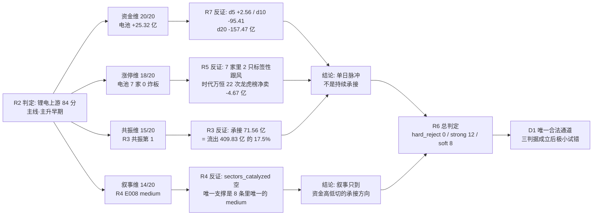

# 2026-11-04（周二）· **反证 / Devil's Advocate**

> **数据源新鲜度**: partial
> **降级状态**: true
> **置信度**: 0.39（0.80 基准 × 0.70 新鲜度 × 0.70 一致度）
> **输入口径**: 全部为 2026-11-03 收盘数据，本件是 2026-11-04 盘前件；未取任何盘中数据

## 一句话结论

**硬拒 0 只不是「都过关」，是「没人拿到执行资格」** —— R2 执行池为空、R5 闸门 0 通过、R7 执行候选为空，三道闸门同时关着；真正要提防的是四处口径分裂（R1 无主线 vs R2 84 分主线、主跌 vs 主升早期、R7 没读 R2、三个研究池只交集一只宁德），以及 **20 条反证里 12 条 strong 全部指向同一个结论：这条主线的钱只够撑一天**。

## 四象限负面识别

| 象限 | 条数 | strong / soft | 一句话 |
|---|:--:|:--:|---|
| ① 资金 | 2 | 2 / 0 | 电池当日 +25.32 亿只补回 20 日失血 -157.47 亿的 **16.1%**，电力设备 +34.32 亿只补回 -393.27 亿的 **8.7%** |
| ② 情绪 | 5 | 2 / 3 | 昨日 R6 派发类判断 **0/5 命中**（全反向）；修复日 T+1 衰减历史 2/2；R3 把皇台写成 4 板，与 R1 天梯 4:2 冲突 |
| ③ 基本面估值 | 6 | 4 / 2 | **质量与高度负相关**：能讲高度的紫竹/皇台/尚水恰是红旗最多的三只（2/3/2 条），唯一 0 红旗的宁德连板都没有 |
| ④ 结构 | 7 | 4 / 3 | 四道闸门全关，字段层却仍在给止损位、仓位、`RR=3.94`、`tradable_today=true` |

## 详细分析

### 一、硬拒为 0 的真相：不是宽恕，是空池

模式六的法定触发对象是「R2 中 `execution_eligible` 的龙一/龙二」。今天这个集合是空集，且是三道独立闸门一致的结果：

| 闸门 | 输出 | 证据 |
|---|---|---|
| R2 | `execution_pool = []` | 五条理由（无价可算 / R1 主跌 / 主线 2 天龄 / 四只均带瑕疵 / `forbidden_filter` 全拦） |
| `forbidden_filter` | `allowed_count = 0`，`blocked_count = 6` | 主因 `counter_emotion_turn` + `buy_after_fade`；丰元/龙蟠另命中 `mid_laggard` |
| R5 | `d1_gate_simulation.passed_count = 0` | cap=0.20 档要求 alpha≥A 且 risk≥B，全批最高仅 B+/B |
| R7 | `execution_candidates = []`、`execution_eligible_count = 0` | 炸板率 41.46% → 全部 research_only |

所以 `hard_rejects = []` 的正确读法是：**没有票达到硬拒的法定条件，因为连执行资格都没拿到**。任何「R6 没拦，所以可以买」的推导都是反向使用契约。

### 二、模式六逐票双条件审计（11 只）

条件① = 命中 R3 `hotlist_signals.distribution_alert`（板块级霸榜出货）；条件② = R5/R7 的 5 日主力净流出。两条件**同时**成立才 hard_reject。

| 标的 | 角色 | ① | 5 日主力 | ② | 判定 |
|---|:--:|:--:|--:|:--:|---|
| 宁德时代 | 龙一（带动性） | ❌ | **+18.071 亿** | ❌ | 不触发 |
| 圣阳股份 | 龙二（点火位） | ❌ | **+3.550 亿** | ❌ | 不触发 |
| 紫竹高科 | 身位股（2 板） | ❌ | +0.834 亿 | ❌ | 不触发 |
| 太阳能 | 次线/孤军 | ❌ | +2.966 亿 | ❌ | 不触发 |
| 皇台酒业 | 次线 3 板 | ❌ | +2.864 亿 | ❌ | 不触发 |
| 龙蟠科技 | 候补（中游） | ❌ | +0.918 亿 | ❌ | 不触发 |
| 丰元股份 | 候补（低位） | ❌ | +0.535 亿 | ❌ | 不触发 |
| 尚水智能 | 扩容·弹性 | ❌ | +0.517 亿 | ❌ | 不触发 |
| 野马电池 | 扩容·尾盘首板 | ❌ | +0.375 亿 | ❌ | 不触发 |
| **时代万恒** | 扩容·低位首板 | ❌ | **-0.132 亿** | ✅ | **仅条件② → strong_suggest（建议视同 hard）** |
| 七匹狼 | R2 precheck·玄学 | ❌ | 无画像 | ⚠️ 不可核验 | 不触发 |

R3 的 `distribution_alert` 全市场只有 4 只，全是**个股级**、且**无一条**落在候选池：

| 告警标的 | 告警理由 | 是否在池 |
|---|---|:--:|
| 襄阳轴承 | 连续 2 个观测日霸榜热股第 1，后掉至第 4，人气见顶价格不跟（红线 4） | ❌ |
| 中际旭创 | 人气 30→2 而当日 -12.69%（成交 293 亿），在榜 186 日 | ❌ |
| 新易盛 | 人气 42→8 而当日 -9.46%（成交 174 亿） | ❌ |
| 长鑫科技 | 人气 74→12 而当日 -7.00% 创上市新低 | ❌ |

**结论：0 条板块级霸榜告警命中「锂电上游/电池」，条件① 0/11。** 这也解释了为什么电池 7 家涨停里没有一只进入派发名单 —— 主线太新（2 天龄），还没到「霸榜到被 machine 抓出来」的阶段，这本身是**风险而非安全**：新题材的出货信号要更晚才出现，等信号出现时已经没有卖点。

### 三、模式七（基本面红旗）：质量与高度负相关

| 标的 | 红旗 | 明细 | 高度 |
|---|:--:|---|:--:|
| 皇台酒业 | **3** | F3 净利 -150.8%/ROE -11.08%；V2 PE 906/PB 19.84；F11 质押 23.39% | 3 板一字 |
| 紫竹高科 | **2** | F3 净利 -89.46%/中报预减 -92.4%；V2 PB 39.69（全批最高） | 2 板 |
| 尚水智能 | **2** | F3 净利 -98.72%/单季 -174.02%；V2 PE 151.94@100 分位 | 20cm 首板 |
| 圣阳股份 | 1 | V2 PE 51.63@91.9 分位 + 净利 -13.61% | 首板（最早封） |
| 丰元股份 | 1 | V2 PE 76.98@100 分位 / PS 0.63（靠薄利扭亏） | 首板 |
| 太阳能 | 1 | V2 PE 31.00@98.4 分位 + 净利 -21.7% | 首板 |
| 时代万恒 | 1 | F3 中报首亏 -430.7%，净利 -775.3% | 尾盘首板 |
| 野马电池 | 1 | F3 中报首亏 -143.5% | 尾盘首板 |
| 龙蟠科技 | 1 | F11 质押 8.38%（11-03 新增质押） | 首板 |
| **宁德时代** | **0** | PE 13.16@1.1 分位 / ROE 17.83% / 净利 +31.60% / 商誉 0.2% / 质押 0.63% | **无板** |

无 ≥4 条、无 F12（R5 明示宁德/圣阳「无审计非标」）、无 ST 双轴命中 → 模式七**不产生硬拒**。但 D1 必须记住这张表的排布：**能讲「高度」的三只票，是红旗最多的三只；唯一 0 红旗的宁德，是唯一没有板的。** 这就是「宁可选错方向也不选错票」在本日的具体形状。

### 四、盈亏比：`RR=3.94` 是穿透两重压力的假设

R7 给宁德 `entry 249.32 / stop 236.85 / target 298.38 → RR 3.94`。但 298.38 要穿过 MA20（258.12）与 20 日高（306.71）两重压力。若把目标改为**第一个真实压力位**，赔率全部塌陷：

| 标的 | 收盘 | 止损（MA5） | 止损距 | 第一个压力位 | 空间 | **RR（到第一压力）** |
|---|--:|--:|--:|--:|--:|--:|
| 宁德时代 | 249.32 | 236.128 | -5.29% | MA20 258.118 | +3.53% | **0.67** |
| 圣阳股份 | 18.67 | 17.258 | -7.56% | MA50 19.249 | +3.10% | **0.41** |
| 尚水智能 | 54.78 | 48.110 | -12.18% | MA20 56.925 | +3.92% | **0.32** |
| 龙蟠科技 | 15.64 | 14.528 | -7.11% | MA20 16.736 | +7.01% | **0.99** |
| 紫竹高科 | 21.13 | 18.638 | **-11.79%** | 30 日高 25.30 | +19.73% | 1.67（止损超 -10% 硬区间，作废） |
| 太阳能 | 4.59 | 4.174 | -9.06% | **无**（pos30=100） | — | **不可算** |
| 皇台酒业 | 17.16 | 14.688 | **-14.41%** | **无**（pos30=100） | — | **不可算** |

按纪律 §6「RR<1 拒、RR<2 转 watch」，今日主线里**没有一只票在盘前能算出 RR≥2**。R7 的 3.94 不是错的，它选了一个需要连续突破的目标价；问题是 D1 若只看那个数字，会得到与结构相反的结论。

### 五、昨日 R6 自己的账：派发类 0/5

| 标的 | 昨日 R6 判断 | 预期 | 11-03 实际 | 兑现 |
|---|---|:--:|--:|:--:|
| 龙版传媒 | devil_advocate_reject（身位股不进） | down | **+10.00%** | ❌ |
| 银之杰 | 纯游资 + 亏损 + PB 46 | down | **+8.17%** | ❌ |
| 巨人网络 | 派发（大宗 121 笔折价 -5.95% + 5 日主力 -0.54 亿） | down | **+3.92%** | ❌ |
| 芒果超媒 | PE 100 分位 + 净利 -79% | down | **+3.89%** | ❌ |
| 捷成股份 | 商誉 34.8% + 单季 -85% | down | -1.24% | ✅ |
| 东方财富 | 政策首日价格不跟 → 不追 | sideways | +0.80% | ✅ |

`observation_tracking.statistics.by_watch_reason` 的口径更硬：`devil_advocate_reject` **0/2**、`distribution_alert` **0/3**，两组命中率都是 0.0%；而 `event_uncertain` 1.0、`sector_over_heated` 1.0。**越是「结构/派发」类判断，越不准。** 这段自我披露不是自谦，是要 D1 知道今日 12 条 strong 里有一半属于「昨日的同类可能又错」，因此给了可覆盖的接口 —— 但 hard_reject 不在折价范围。

## 顶级反证点三问

### 反证点 1 · R2 主线「锂电上游」（84 分 / 主升早期）

- **大资金意图**: 这不是主动配置，是**被动搬家**。电子 -236.26 亿、半导体 -131.43 亿、通信 -103.02 亿单日合计失血 -470.71 亿，钱不是在「发现锂电」，是在「逃离 AI 硬件」；电池只接住 25.32 亿，承接/流出 = 71.56/409.83 = **17.5%**，剩下 82.5% 是净离场。对手盘是那些还抱着 CPO/存储不肯走的资金 —— 它们每反弹一次就多一次出逃窗口。
- **为什么走强**: 三维交叉全部指向「超卖反抽」而非「趋势起点」—— 位置：宁德收在 MA20（258.12）下方 3.41%、MA50（308.17）下方 19.1%，71.9% 筹码套牢；催化：E008 是 8 条事件里唯一的 medium 档，无产业订单、无涨价、无政策增量；筹码：圣阳 99% / 紫竹 89.3% / 皇台 100% 获利盘，零套牢也零成本支撑。
- **逻辑够不够硬**: 3 个独立源（R3 共振 / R4 事件 / R7 资金）方向一致，这是它最硬的地方；但**没有一项硬业绩、硬政策、硬时间锚**——主线年龄 2 天、最高 2 板、炸板率 41.46%。证伪路径极其具体：**今日 10:00 电池行业主力转负，或锂电上游出现首板炸板率 >30%，主线当场降为观察。**

### 反证点 2 · 宁德时代（研究池首选载体，0 红旗）

- **大资金意图**: 主力当日 +12.85 亿、净占比 8.28%、5 日 +18.07 亿（3/5 日为正，序列 -12.90/-0.21/+10.90/+7.43/+12.85 逐日走强），成交 155.12 亿 = 板块第二名 21 倍。买它的钱是**指数权重配置盘 + 抄底资金**，不是游资 —— 30 日龙虎榜 0 次。对手盘是 71.9% 的套牢筹码（平均成本 321.66 vs 收盘 249.32）与 15 日 -27.55% 的融资盘（融券同步 +66.04%）。
- **为什么走强**: 位置超卖（pos30=30.1、距 20 日高 -21.2%）+ 催化偏弱（E008 medium）+ 筹码极差（获利盘 28.1%）。这是典型「便宜 + 资金回流」的深跌反抽，不是「突破」。
- **逻辑够不够硬**: 硬在估值（PE 13.16 处 3 年 1.1 分位、PEG≈0.42、净利 +31.6%）与资金（5 日 18 亿真金）；软在位置（MA20/MA50 双下方）与筹码（72% 套牢 + 融资撤退）。**证伪路径：跌破 MA5 236.13 且当日不能收回，全条线下调。**

### 反证点 3 · 时代万恒（模式六 partial，建议视同 hard）

- **大资金意图**: 卖。30 日龙虎榜 **22 次**、合计净卖 **-4.67 亿**、机构专用 **-4.67 亿**，一个月内 7 次触发「异常波动/风险提示」公告。这是席位反复出货的教科书形态：反复上榜、反复净卖，股价靠情绪维持。
- **为什么走强**: 位置低（9.12，距 20 日高 -38.4%）+ 封单极薄（0.40 亿 / 成交 4.10 亿 = **0.10**）+ 尾盘 10:49 首板 + 换手 15.92%（5 日均 17.99%）。走强靠的是「电池 7 家涨停」的板块标签，不是它自己的产业逻辑（中报首亏 -430.7%）。
- **逻辑够不够硬**: 不硬。5 日主力 -0.132 亿（2/5 日为正）已满足模式六条件②，只差 R3 板块级告警这一条。**这是「技术性未硬拒」，不是「可以买」。** 若 D1 要覆盖，必须回答：为什么 22 次龙虎榜净卖 -4.67 亿的票值得在炸板率 41.46% 的日子里接力。

## 观察池顶部 · 思维链

### 宁德时代（研究池首选载体，R6 态度：观察，不是今日买点）

- **买入理由**: ①估值是全场最硬 —— PE_TTM 13.16 处 3 年 1.1 分位（927 日样本）、PEG≈0.42、ROE 17.83%、净利 +31.60%，且商誉/净资产 0.2%、质押 0.63%、0 条财务红旗；②资金是全场最硬 —— 当日 +12.85 亿（净占比 8.28%）、5 日 +18.07 亿、成交 155.12 亿为板块第二名的 21 倍、30 日零龙虎榜（配置盘不是游资）。
- **风险点**: ①位置 —— 收在 MA20（258.12）下方 3.41%、MA50（308.17）下方 19.1%，20 日 -14.36%，这是反抽不是突破；②筹码 —— 获利盘仅 28.1%、71.9% 套牢、平均成本 321.66，融资余额 15 日 -27.55% 且融券 +66.04%（杠杆撤 + 空头加注），股东户数环比 +27.83%（筹码分散）。
- **止损条件**: 跌破 MA5 236.13 且当日不能收回 → 逻辑证伪，全条线下调（对应 -5.29%）。若 D1 用竞价实价重算，止损距必须仍落在 -5%~-10% 硬区间，否则按 RR 不达标直接拒。
- **可验证假设**: ①今日 10:00 与 13:30 两个时点，电池行业主力净流入均 >0（任一为负 = 主线一日游证伪）；②宁德能否放量站上 258.12 并收住（站不上 = 仍在反抽区间）；③昨日涨停的 48 家里今日红盘率 ≥60%（不达 = 修复失败，仓位上限压到 0.15 以下）。

### 圣阳股份（龙二 / 点火位，R6 态度：降级 watch，只配弱转强通道）

- **买入理由**: ①板型最硬 —— 09:35 首封、零开板、封单 2.57 亿全场最硬，封成比远超同批；②资金真 —— 30 日龙虎榜净买 +1.89 亿、机构专用 +2.24 亿，不是纯游资博弈。
- **风险点**: ①估值不硬 —— PE 51.63 处 3 年 91.9 分位、PB 3.43、ROE 5.74%、净利 -13.61%，命中 V2（高分位 + 盈利下滑）；②筹码极端 —— 获利盘 **99.0%**、overhead 1.0%，低开 2% 即把绝大多数持仓打成浮亏；③容量 —— 流通市值仅 84.5 亿，装不下主流资金。
- **止损条件**: 跌破 MA5 17.26（-7.56%）即逻辑证伪；竞价高开 >5% 直接放弃（99% 获利盘会先跑），不留观察位。
- **可验证假设**: ①竞价是否落在 -2%~+3% 且开盘站上 18.67（站不上 = 弱转强不成立）；②今日能否出现第 3 板（不出现 = 按生命周期规则下调为 formation 后段，不是 early_up）；③封单能否维持 ≥1 亿（转薄 = 点火位失效）。

## 反证清单（20 条 · 按模式）

| ID | 模式 | 象限 | 对象 | 严重度 | 一句话证据 | D1 动作 |
|---|---|:--:|---|:--:|---|---|
| M1_01 | 数据源冲突 | ① | 主线资金维 20/20 | **strong** | 电池 d1 +25.32 只补回 d20 -157.47 的 16.1%；电力设备 8.7% | 按单日脉冲读，10:00/13:30 双点复核 |
| M1_02 | 数据源冲突 | ④ | R2↔R7 交叉验证 1.0 | **strong** | R7 `r2_pool_inherited=0`、落盘早于 R2 → 单向引用 | 交叉验证分打 7 折，候选以 R5 为唯一事实源 |
| M1_03 | 数据源冲突 | ② | 皇台酒业「4 板」 | soft | R1 天梯 4:2/3:1；R5「3 板」；R7「3 板一字」→ 3:1 | 以 3 板为准 |
| M1_04 | 数据源冲突 | ② | 叙事维 14/20 | soft | R4 `sectors_catalyzed` 空 dict；E008 是 8 条里唯一 medium | 只当「无负面催化」，不当买入理由 |
| M1_05 | 数据源冲突 | ④ | 三层研究池 | **strong** | R2 4 只 / R4 6 只 / R7 5 只，仅宁德一只三池皆在 | 选一个事实源，禁止并集 |
| M2_01 | 一致性检查 | ④ | 有无主线 | **strong** | R1 `main_lines_count=0` vs R2 84 分 | 取更严：无已确认主线 → 无新开仓资格 |
| M2_02 | 一致性检查 | ② | 阶段标签 | **strong** | R1 main_down/cap 0.20 vs R2 early_up「猛干」 | 用 override 覆盖 stage_action |
| M2_03 | 一致性检查 | ④ | 闸门 vs 字段 | **strong** | 4 道闸门全关，字段层仍给止损位/RR 3.94/tradable=true | 「有止损位」≠「可开仓」 |
| M3_01 | 估值临界 | ③ | 圣阳股份 | **strong** | PE 51.63@91.9 分位 + 净利 -13.61% + 获利盘 99% | 不进；竞价不在 -2%~+3% 直接弃 |
| M3_02 | 估值临界 | ③ | 紫竹高科 | **strong** | F3 净利 -89.46% + V2 PB 39.69（全批最高） | 拦截，即使 3 板封住也不给仓位 |
| M3_03 | 估值临界 | ③ | 皇台酒业 | **strong** | F3+V2+F11 三条；PE 906 / 获利盘 100% / 一字 | 拦截（不接高位老龙） |
| M3_04 | 估值临界 | ③ | 板块估值离散 | soft | 宁德 PE 13.16 vs 丰元 76.98，倍差 5.85 | 逐票判断，「买板块」是伪命题 |
| M4_01 | 历史类比 | ② | early_up 阶段 | soft | R1 两次修复样本（0.746/72、0.840/125）T+1 均衰减，n=2 | 不给加速假设 |
| M5_01 | 昨日错误连锁 | ② | R6 自身命中率 | **strong** | 昨日派发/否决类 0/5 命中（全反向） | strong/soft 按 0.5 权重读；hard 不折 |
| M6_01 | 霸榜出货 | ① | 时代万恒 | **strong** | ②成立（5 日 -0.132 亿）；①不成立（R3 榜外）+ 22 次龙虎榜 -4.67 亿 | 建议视同 hard，覆盖须写理由 |
| M6_02 | 霸榜出货 | ④ | 模式六触发对象 | soft | 法定对象 0 只（execution_pool=[]） | 空硬拒 ≠ 审核通过 |
| M7_01 | 基本面红旗 | ③ | 全批红旗分布 | **strong** | 皇台 3 / 紫竹 2 / 尚水 2；宁德 0 但无板 | 禁止用高度替代质量 |
| M7_02 | 基本面红旗 | ③ | 龙蟠科技 | soft | 质押 8.38% + 11-11 解禁 16.5% 流通 + 终止对外投资 | 观察（不进） |
| M8_01 | 解套盘假繁荣 | ④ | 涨停票筹码 | soft | 原判据未触发（涨停仅 48）；反向变体：7 只获利盘 83.8%~100% | 按「浮盈兑现」而非「解套换手」假设 |
| M9_01 | 高位触板赌博 | ④ | 最高身位 | soft | 最高 4 板（8 板+ 阈值未达）；4 板两家主力 -5.94/-0.43 亿在派发 | 不启用 extreme_tail_risk |

模式下状态披露：`mode4` 无历史事件库 → **degraded**（仅用 R1 自带 2 个样本，n=2 已披露）；`mode10` 商品（原油/铜/金/锂）与 DXY 序列缺失 → **degraded**，**不编造**跨资产背离结论；`mode8`/`mode9` 原判据未触发 → **partial**，改用反向变体观测。

## 上游口径冲突（6 条）

| # | 之间 | 议题 | 冲突内容 | R6 裁决 |
|---|---|---|---|---|
| C1 | R1 ↔ R2 | 今日有无主线 | R1 代理口径 0 个概念 up_nums≥20；R2 四维同向给 84 分 | 取 R1：无已确认可交易主线 |
| C2 | R1 ↔ R2 | 阶段标签 | main_down vs early_up + 「猛干龙头」 | 用 `r2_lifecycle_override` 覆盖 |
| C3 | R2 ↔ R7 | 交叉验证独立性 | R7 未继承 R2 池，R2 仍记 `r7_capital_match=true` | 打 7 折 |
| C4 | R3 ↔ R1/R5/R7 | 皇台板数 | R3「4 板」 vs 三源「3 板」 | 3 板 |
| C5 | R2 ↔ R4 | 券商定性 | R2 淘汰（资金反向）vs R4 给中信/国泰海通 high | 以 R2 为准（R4 未跑 forbidden_scan） |
| C6 | R5 ↔ R7 | 研究候选池 | 5 只 vs 10 只，交集仅 2 只 | 以 R5 10 只为全集 |

## 不确定性 / 反证

1. **R6 自身历史命中率差**：昨日派发/否决类 0/5 命中，这是本份最强的「反自己的反证」。因此 12 条 strong 全部保留可覆盖接口，只有 hard_reject 不设覆盖权 —— 而今日 hard_reject 恰好是 0，等于今日最强的约束来自「闸门」而不是「反证」。
2. **R3 降级带来的盲区**：群聊层连续第 5 个断更交易日、WeFlow 永久下线，共振只能到 L1+L2b。若今日盘中一线游资的真实意图只能在群聊/小圈子里读到，R6 读不到 —— 这份反证对「资金意图」的判断上限低于往常。
3. **模式六的信号时滞**：主线只有 2 天龄，尚未进入「霸榜到被 machine 抓出来」的阶段。今日条件①空集**不代表没有出货**，只代表**还没到会被抓的时点**。这是本次硬拒为 0 最需要警惕的语义。
4. **筹码口径的反向解读**：7 只票获利盘 83.8%~100%，我按「零套牢=零成本支撑」判为风险；若今日高开高走并放量，同一结构也可以读成「无解套压力的干净拉升」。这个解读分歧要靠今日 10:00 的量能定夺，我在盘前无法二分。
5. **模式十完全缺失**：无锂价/铜价/油价与 DXY 序列，无法验证「锂电上游上涨 vs 锂价下跌」这种最典型的跨资产背离。这是本份反证最大的覆盖缺口，已标 degraded，不用推测填充。

## 与其他 R/D/E 的关系

- **依赖**: `R1_style.json`（温度/仓位/阶段）、`R2_main_sectors.json`（主线与候选）、`R3_sentiment.json`（共振与 `distribution_alert`）、`R4_news.json`（事件与板块极性）、`R5_stock_profiles.json`（六维画像/红旗/筹码）、`R7_capital_flow.json`（板块与个股 5-20 日资金序列）、`R6_devil_advocate.json`（T-1 反证条目）、`data/reports/20261103/observation_tracking.json`（T-1 兑现率）
- **被消费**: D1 `canghai-plan`（hard_reject 无覆盖权、strong 须显式处理或写 `meta.d1_override[]`）、E1 `canghai-review`（T+1 回填本份 20 条反证的兑现情况，校准 R6 的过严偏误）

## 数据源审计

| 源 | 日期 | 状态 | 备注 |
|---|---|:--:|---|
| tushare/limit_list_d + market breadth | 2026-11-03 | 🟢 | 涨停 48 / 跌停 17 / 炸板 34 / 炸板率 41.46% / 天梯 4:2·3:1·2:12·1:33 |
| tushare/moneyflow_dc + moneyflow_ind_dc（经 R7） | 2026-11-03 | 🟢 | 板块 496 / 概念 534 / 个股 5 日 28220 条 · 20 日 112880 条 |
| tushare/top_list + top_inst（经 R5/R7） | 2026-11-03 | 🟢 | 龙虎榜 78 只 / 91 次上榜 · 时代万恒 30 日 22 次净卖 -4.67 亿 |
| tushare/fina_indicator + forecast（经 R5） | 2026-09-30 | 🟢 | 10 只票财务指标 + 中报预告，红旗计数源 |
| tushare/cyq_perf（经 R5） | 2026-11-03 | 🟢 | 获利盘/平均成本/套牢盘，10 只全覆盖 |
| tushare/anns_d（经 R5） | 2026-11-03 | 🟢 | 公告窗口，异常波动/风险提示/质押/解禁 |
| eastmoney/板块与个股主力（R7 同底层） | 2026-11-03 | 🟡 | 与 tushare moneyflow 同源，交叉验证只能证明抓取无误，不能证明口径独立 |
| wechat_official（经 R3） | 2026-11-04 | 🟢 | 88 篇 / 16 账号，代位 L2b 文本层 |
| wechat_cli 群聊层（经 R3） | 2026-10-28 | 🔴 | 连续第 5 个断更交易日 · 客户端未运行 · 0 条 |
| WeFlow（L3） | — | 🔴 | 2026-08-19 起永久下线，不编造 |
| xtick | — | 🔴 | unavailable（R4 sources_status），无盘前聚合二次验证 |
| 商品 / DXY 序列 | — | 🔴 | R1 标 skipped → 模式十 degraded |

## Sub-Agent 元数据

- skill: `analyze_devil_advocate_v1@1.3`
- artifact: `data/research/20261104/R6_devil_advocate.json`（机读契约 · 20 条反证 / 11 只审计 / hard_rejects=[]）
- 生成耗时: 约 12 分钟（07:05 → 07:17，含上游解析与逐票双条件核验）
- model: deepseek-v4.1-flash
- 红线自检: 0 次 MCP · 0 次 delegate · 0 次联网 · 0 次抓数；只读 `data/research/` 与 `data/reports/`；未触碰 `data/plans/` `data/execution/` `data/raw/` `data/user_preferences.yaml` `data/human_thesis/`；未写 `chzl_kg/`
- 置信度: 0.39（0.80 × 0.70 新鲜度 × 0.70 一致度，四处口径分裂为主要扣分项）
