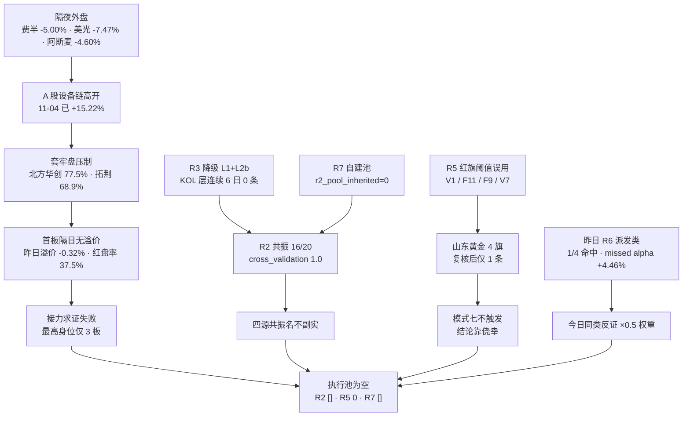

# 2026年11月05日 · **反证 / Devil's Advocate**

> **数据源新鲜度**: partial
> **降级状态**: true（R1 degraded · R3 degraded · R7 partial）
> **置信度**: 0.42（0.80 × 0.70 × 0.75）

## 一句话结论

**今日 hard_reject 为 0，但有 16 条 strong — 真正的风险不是某只票该不该拒，而是「四源共振 1.0」名不副实、阶段定性两源分裂、以及设备链涨停直接打进 62%–78% 的套牢区。**

---

## 详细分析

### 一 · 空 hard_rejects 的三重复核，不是放行

今日 10 只候选**没有一只进入模式六的法定触发面**。R2 的 `execution_pool` 是空数组（`execution_pool_reason` 原文：空池是纪律结果，不是数据缺失）；R5 的 `d1_gate_simulation.passed_count = 0`（10/10 命中 `plan_outside_scan`，4 只 `late_speculation`，6 只 `mid_laggard`）；R7 的 `execution_candidates = []`。三道闸门同时关闸。

更关键的是双清单零交集：R3 的 `distribution_alert` 只有 3 条（襄阳轴承的霸榜后派发续报、七匹狼的人气-价格背离、中际旭创/CPO 链的热度-资金背离），R7 的 `hot_money.distribution_alerts` 有 20 条（东山精密 -18.38 亿、正帆科技 -3.89 亿、江丰电子 -1.05 亿…），**两份清单与 10 只候选的交集都是空集**。模式六要求「①板块/个股霸榜告警 ②5 日主力净流出」同时成立，条件①全灭，条件②即使命中 4 只（赤峰 -1.31 亿、山东黄金 -1.15 亿、盛达 -0.24 亿、华峰…）也无法触发。

所以「R6 没拦」这句话今天是无效推理。**今天拦人的是闸门，不是反证。**

### 二 · 山东黄金：一只「双条件实质成立、形式落空」的边界票

这是今天最值得写进档案的边界案例。R5 自己在 `chip_structure.summary` 里写「命中 distribution_alert」——30 日龙虎榜机构专用净卖 -2.28 亿、大宗折价 -8.06%、5 日主力 -1.15 亿、20 日 -4.00 亿、融券 15 日 +70.10%、套牢 65.8%，派发的四项证据全在。但它不在 R3 的告警清单里，且身位是候补（rank 4），按 v1.3 契约只能记 `strong_suggest`。

处理办法是不打折地照契约记录，同时把判断说死：**D1 视同不进**。若 D1 要用，必须在 `meta.d1_override[]` 写明「我覆盖了 R6 的派发结论」，并给出反向证据——不能默默放行。

### 三 · 阶段定性：两源在同一时点给出互斥的坐标系

R2 给两条主线 `stage = formation`、`stage_action = 首板试探`、confidence 0.6，理由是「主线第 1 天、资金持续性未确认」。R1 把同一天定性为「高位震荡第 4 天 / 强修复次日」，并写下「打板/接力降级为观察」。

两条都是同一批数据的合理读法，但**行动指令是不能共存的**。R1 给出同口径 2/2 次日回吐、涨停家数 82→55 与 125→48 的腰斩样本；R2 自己也算出北方华创 535.50 vs MA20 548.17、拓荆 487.79 vs 535.21、云南锗业 75.38 vs 78.25、华峰测控 218.53 vs 281.74，全部在 MA20 下方，R2 原文写的是「深跌反抽第 1 日，不是趋势反转」。

**formation 描述的是板块年龄，不是趋势成立。** 今日若按「启动期首板试探」做，等于把深跌反抽当主升起点。

### 四 · 模式七差点误杀：R5 红旗的编码与阈值系统性错位

R5 给山东黄金挂了 F9 + F2 + V1 + F4 四条红旗。按模式七「≥4 条即 hard_reject」，它今天就该被硬拒。逐条对照附录 A 阈值后：

| 红旗 | 附录 A 要求 | 实际值 | 是否成立 |
|---|---|---|---|
| F2 商誉炸弹 | 商誉/净资产 > 30% | 27.4% | ❌ 未越线 |
| V1 周期低 PE | PE < 8 | PE 29.67 | ❌ 不满足 |
| F9 应收陷阱 | 应收/营收 > 40% | 被用于「净利同比 -19.60%」 | ❌ 语义错配 |
| F4 存货异常 | 存货增速 > 收入×1.5 | 被用于「大宗折价 -8.06%」 | ❌ 语义错配 |

四条里三条站不住。同类误用遍布全批：V1 被套在 PE 17.23 / 23.08 / 18.27 / 74.63 四只上（全部 PE>8），F11 被套在盛达 26.21% 质押上（阈值 >70%），V7 港股仙股陷阱被套在 A 股中科飞测上。

按阈值重算，真实分布是：拓荆 0、华峰 0、山金 1、北方华创 1、赤峰 1、云南锗业 1、盛达 1、山东黄金 1、晓程 2、中科飞测 2。**最高 2 条，无一条达 ≥4，无 F12，无 ST 双轴 —— 模式七今日 0 硬拒是对的，但它对得侥幸。** 如果按 R5 原样计数，今天就有一只龙一/龙二级别的票被误杀。

### 五 · 自我校准：昨日 R6 的「派发」判断只有 1/4 命中

`data/reports/20261104/observation_tracking.json` 把昨天的反证拉出来对账：`devil_advocate_reject` 组 4 只、命中 1 只（25%），被误杀组等权 **+4.46%** —— 紫竹高科预期跌、实际 +9.99%；尚水智能预期跌、实际 +12.43%；皇台酒业预期跌、实际 -4.66%（唯一兑现）；野马电池 -0.07% 近似平。

对照组反过来很硬：`thin_seal` 2/2、`attention_surge` 3/3、`distribution_alert` 2/4。

结论要写下来：**R6 的「位置高/派发」族在修复日是系统性过严的，今日同类 soft/strong 按 0.5 权重读；「薄封」族则相反，要加重。** hard_reject 不享受任何折价——它本来就只在天花板条件下触发。

### 六 · 筹码与外盘：两处被忽略的硬事实

**筹码**：全批 10 只的 `overhead_pct` 均值 56.8%，≥65% 的有 5 只 —— 北方华创 77.5%、华峰测控 72.2%、赤峰黄金 70.3%、拓荆科技 68.9%、山东黄金 65.8%。北方华创平均成本 654.79 对收盘 535.50，涨停价仍在平均成本下方 18.2%。**11-04 的设备链涨停不是突破筹码真空，是打进套牢区。** 按模式八「解套盘比例 >70%」的整体阈值未触发（5/10 = 50%），故不标 `high_suspicion`，但设备链内部 4/5 只 ≥62%，属局部高解套盘，其信心上限须按 0.6 约束。

**外盘**：A 股设备指数 11-04 +15.22% 涨停潮，同一晚费半盘中 -5.00%、美光 -7.47%、英伟达 -3.17%、阿斯麦 -4.60%。R2 自己写下「A 股高开就是给隔夜盘抬轿」，却在主线评分里没为此扣分。这是模式十的典型背离：**国产替代叙事的内循环 vs 外盘定价的外循环，两者今天指相反方向。**

---

## 四象限负面识别

| 象限 | 条数 | 分布 | 一句话 |
|---|---|---|---|
| ① 资金 | 5 | strong 4 / soft 1 | 单日高低切不是趋势建仓：电子 +312.63 亿只补回 20 日 -1176.61 亿的 26.6%，全市场 +500.28 亿只补回 -4685.50 亿的 10.7%；超大单 +474.06 亿 vs 大单 -392.75 亿是被动托举指纹 |
| ② 情绪 | 7 | strong 5 / soft 2 | 广度极强、接力极弱：涨停 118 家但 40.7% 在 14:30 后封，昨日涨停收盘溢价 -0.32%（中位 -2.34%）、红盘率 37.5%；KOL 层连续 6 日 0 条 |
| ③ 基本面估值 | 6 | strong 5 / soft 1 | 估值与地位负相关：龙一 PE 67.40@84.5 分位 + 净利 +5.1%；云南锗业 PE 276.59/PB 30.20 却握全场第 2 封单；R5 红旗阈值系统性误用 |
| ④ 结构 | 5 | strong 2 / soft 3 | 阶段定性互斥：R2 formation 第 1 天 vs R1 高位震荡第 4 天；8/10 在 MA20 下方；无连板梯队；空执行池是纪律 |

合计 **23 条：hard_reject 0 / strong_suggest 16 / soft_suggest 7**。

---

## 模式六逐票审计（霸榜出货）

| 代码 | 名称 | 角色 | 条件① R3/R7 告警 | 条件② 5 日主力 | 判定 |
|---|---|---|---|---|---|
| 002371.SZ | 北方华创 | 龙一 | ❌ 零交集 | +16.27 亿 | no_trigger |
| 688072.SH | 拓荆科技 | 龙二 | ❌ 零交集 | +4.11 亿 | no_trigger |
| 002428.SZ | 云南锗业 | 候补 | ❌ 零交集 | +10.93 亿 | out_of_scope |
| 688200.SH | 华峰测控 | 候补 | ❌ 零交集 | +1.89 亿 | out_of_scope |
| 688361.SH | 中科飞测 | 候补 | ❌ 零交集 | +0.89 亿 | out_of_scope |
| 000975.SZ | 山金国际 | 龙一 | ❌ 零交集 | +4.12 亿 | no_trigger |
| 600988.SH | 赤峰黄金 | 龙二 | ❌ 零交集 | **-1.31 亿** | no_trigger（仅条件②） |
| 600547.SH | 山东黄金 | 候补 | ❌ R3 未收录（R5 自标告警） | **-1.15 亿** | out_of_scope → 规则边界，见 R6_M6_02 |
| 000603.SZ | 盛达资源 | 候补 | ❌ 零交集 | **-0.24 亿** | out_of_scope |
| 300139.SZ | 晓程科技 | 候补 | ❌ 零交集 | +3.22 亿 | out_of_scope |

**hard_rejects = []（0 条）。** 法定对象 0 只、双清单交集 0 只、模式七阈值复核后 0 只达 ≥4 条 —— 三重复核一致。

---

## 三问 · 两大主线

### 半导体设备/材料（R2 83 分 · 第 1 主线）

| 三问 | 回答 |
|---|---|
| **大资金意图** | 真金在子行业里，不在整链里。半导体设备 d1 +42.47 / d5 +37.07 / d20 -36.02 亿，是电子链唯一 5 日为正的子行业；而电子 20 日 -1176.61 亿、半导体 -454.59 亿、CPO -1003.29 亿。大资金做的是「设备先行」的定点回补，不是「科技全面反攻」 |
| **为什么走强** | 三条腿同向：①E003 设备指数 +15.22% 涨停潮（拓荆/芯源微/中科飞测/京仪装备 20cm）+ 长鑫回购上限提至 50 亿；②封单集中（半导体链 29.28 亿板块第一，北方华创 3.56 亿 / 0 开板）；③R3 主题第 1（L1+L2b，存储芯片 15→3、大基金 #4、先进封装 #16） |
| **逻辑够不够硬** | 半硬。硬的一半：5 日真金 + 封板质量 + 容量龙头（3895 亿流通盘承载大资金）。软的一半：19 家全是首板（0 连板）= 只有广度没有高度；龙头仍在 MA20 下方；隔夜费半 -5%、阿斯麦 -4.60%；北方华创套牢 77.5%、PE 84.5 分位。**结论：可研究、可低吸条件单、不可当主升追** |

### 贵金属 · 黄金白银（R2 81 分 · 第 2 主线）

| 三问 | 回答 |
|---|---|
| **大资金意图** | 事件驱动的一次性映射，不是趋势建仓。贵金属 d1 +23.49 亿（净流入率 12.06% 全场第 2），但 5 日仅 +4.45 亿、20 日 -9.19 亿，且今日之前是 -7.03/-7.43/-3.67/-0.91 四连负。钱是隔夜金银破 4070 之后才进来的 |
| **为什么走强** | E001 中期选举民主党大胜 → 美元美债双跌 → 现货金 +3.57% 破 4070、白银 +5.00% 报 52.26、沪银主力 +5%，花旗 0-3 月目标 4500。A 股 11 家涨停（招金/盛达/山金/四川黄金/湖南黄金/湖南白银/晓程等） |
| **逻辑够不够硬** | 不够硬。封单合计仅 9.20 亿（均 0.84 亿/家）、开板 18 次、湖南黄金 0.15 亿、山东黄金 0.46 亿；龙虎榜机构专用在山东黄金净卖 -2.28 亿、大宗折价 -8.06%；**黄金股 0 只进入东财人气榜前 15**。涨停潮成立、封板质量与人气都不成立，且驱动是事件次日 |

---

## 每票思维链

### 北方华创 002371.SZ（研究首推 · 非买入推荐）

**买入理由**：全批唯一同时具备「资金本体 + 容量 + 封单质量」三项的票。主力 +8.12 亿（净占比 12.94%）、5 日 +16.27 亿且序列 -0.77/+0.46/+8.03/+0.43/+8.12 逐日走强、20 日 +9.09 亿由负转正；封单 3.56 亿、0 开板、13:47 封板（不属尾盘投机）；30 日龙虎榜 0 次 = 纯机构容量票，无游资痕迹；3895 亿流通盘是全市场承载大资金的少数容器之一。

**风险点**：①PE 67.40 处 3 年 84.5 分位，而净利同比只有 +5.10% —— 67 倍对 5% 增速（V2 成立）；②套牢 77.5%，平均成本 654.79 远高于收盘 535.50，每上涨 1% 都有解套盘；③MA20 548.17 仍在上方压制，MA50 620.25 更远（-13.66%），MA5 斜率 -3.63% 仍负；④两融反向：融资 15 日 -36.85%、融券 -43.00%，杠杆盘在撤；⑤隔夜费半 -5.00%、阿斯麦 -4.60%，高开就是抬轿。

**止损条件**：MA5 500.47（距 535.50 约 -6.5%，落在 -5~-10% 硬区间）。若开盘高开 >3%，一律不进（R2 precheck 原始前置条件）；若盘中站不上 MA20 548.17，维持「反抽」定性，不加仓、不摊薄。

**可验证假设**：①今日 10:00 与 13:30 两个时点，半导体设备行业主力净流入须维持为正（否则 5 日真金叙事当日证伪）；②昨日涨停股今日红盘率须 ≥60%（11-04 为 37.5%，这是 R3 给的三判据之一），不达标则整批首板隔日通道关闭；③半导体设备封单前 3 名合计须 ≥6 亿，低于此数视为承接不足。

### 山金国际 000975.SZ（研究观察 · 全批财务最干净）

**买入理由**：全批唯一 5/5 天主力净流入（+4.12 亿）、20 日 +6.63 亿；唯一同时站上 MA5（+6.69%）与 MA20（+0.30%）；20 日 +1.41% 是贵金属里唯一不亏钱的；PE 17.23 处 6.6 分位、ROE 20.27%、资产负债率 26.86%、商誉 2.7%、质押 0.70%；10 日振幅 5.92% 全批最低。

**风险点**：①封单仅 0.83 亿 + 开板 2 次 = 薄封，昨日 `thin_seal` 判据命中率 2/2，这条要加重；②驱动是事件次日映射，R4 明写「今日属接力段」，金价不续涨即失效；③融券 15 日 +24.14%，是贵金属里唯一融券上升的；④60 日/MA50 24.71 仍在收盘上方 -6.58%；⑤V1 边界：金价 4070 历史新高下 PE 6.6 分位，低 PE 可能对应周期利润顶。

**止损条件**：MA5 21.63（距 23.08 约 -6.3%，符合硬区间）。竞价高开 >5% 一律不进（R3 纪律原文）；跌破 MA20 23.01 且当日不能收回，视为事件映射失效。

**可验证假设**：①昨夜现货金须守住 4070、白银守住 52.26，任一项跌破则映射逻辑当日证伪；②今日贵金属行业主力净流入须为正（11-04 为 +23.49 亿），转负即一日游；③封单须 ≥1 亿（11-04 仅 0.83 亿），否则按薄封降级观察。

---

## 反证传导链

---

## 关键证据

- **证据 1**：R2 两条主线 `cross_validation_score` 均为 1.0，而 R3 `status=degraded`（L1+L2b、L1 用 T-1 榜）、R7 `r2_pool_inherited=0`（自建池）—— 「四源共振」实为 1 源产出 + 1 源降级 + 1 源同源对齐 + 1 源未继承 · 来源 R2 与 R3/R7
- **证据 2**：电子 d1 +312.63 亿 / d20 -1176.61 亿，补回率 26.6%；全市场 d1 +500.28 亿 / d20 -4685.50 亿，补回率 10.7% · 来源 R7 main_force
- **证据 3**：昨日涨停股在 11-04 收盘溢价 -0.32%、中位 -2.34%、红盘率 37.5%、再涨停仅 12 只；118 家涨停中 48 家（40.7%）在 14:30 后才封 · 来源 R2 market_context
- **证据 4**：R3 `distribution_alert` 3 条 + R7 `hot_money.distribution_alerts` 20 条，与 10 只候选交集均为空 · 来源 R3 hotlist_signals / R7 hot_money
- **证据 5**：山东黄金 30 日龙虎榜机构专用 -2.28 亿、大宗折价 -8.06%、融券 15 日 +70.10%、套牢 65.8% · 来源 R5 chip_structure
- **证据 6**：全批 `overhead_pct` 均值 56.8%，设备链 4/5 只 ≥62%（北方华创 77.5%）· 来源 R5 cyq
- **证据 7**：R5 fundamental_flags 阈值复核：V1 要求 PE<8 却套在 PE 17.23–74.63 五只上；F11 要求质押>70% 却套在 26.21% 上；F9 要求应收/营收>40% 却套在净利同比上 · 来源 R5 valuation_safety vs 附录 A
- **证据 8**：昨日 R6 `devil_advocate_reject` 4 只命中 1 只（25%），被误杀组等权 +4.46%（紫竹高科 +9.99%、尚水智能 +12.43%）· 来源 observation_tracking 20261104

---

## 数据源审计

| 源 | 状态 | 抓取日期 | 记录数 | 备注 |
|---|---|---|---|---|
| R1_style | ⚠️ stale | 2026-11-05 | 1 | degraded / conf 0.39 · 商品与 DXY 缺失 · 群聊 0 条 |
| R2_main_sectors | ✅ ok | 2026-11-05 | 10 只 | complete / conf 0.72 · 空执行池为纪律结果 |
| R3_sentiment | ⚠️ stale | 2026-11-05 | 5 主题 | degraded / conf 0.52 · L2 连续第 6 日 0 条 · L1 用 T-1 榜 |
| R4_news | ✅ ok | 2026-11-05 | 8 事件 | complete / conf 0.70 · 板块极性 10 条 |
| R5_stock_profiles | ✅ ok | 2026-11-05 | 10 票 | complete / conf 0.72 · 红旗编码存在阈值误用 |
| R7_capital_flow | ⚠️ partial | 2026-11-05 | 496 板块 | partial · 两融与 ETF T-1 · 北向已 retired · 板块池自建 |
| R6_prev 20261104 | ✅ ok | 2026-11-04 | 20 条 | 用于模式五对账 |
| observation_tracking | ✅ ok | 2026-11-04 | 22 只 | 观察池兑现率 50% |

**主源缺失判定**：R1/R3 降级、R7 partial，`degraded = true`，置信度按 0.42 落。

---

## 不确定性 / 反证

**这份反证最容易错在哪：**

1. **昨日同类判断只命中 25%，被误杀组等权 +4.46%。** 今天我仍然写了 16 条 strong_suggest，其中「派发」「位置高」「套牢重」这一族占比不小。如果 11-05 又是强修复延续日（指数继续放量、昨日涨停溢价转正），这批 strong 会重演昨天的假阳性。我已按 0.5 权重做了标注，但权重是主观的，事实可能证明它还不够轻。

2. **「四源共振名不副实」这条也可能过严。** R2 已经自陈解释了口径差（广度 vs 可交易性），R7 建池早于 R2 属于时序问题而非错误。把 cross_validation 1.0 打折到 0.6–0.7 是我的判断，不是上游的数字。

3. **模式七阈值的复核可能双向出错。** 我用附录 A 的字面阈值（V1 要求 PE<8、F11 要求 >70%、F9 要求应收/营收>40%）去否掉 R5 的 flags，这些阈值本身可能有版本漂移。如果 R5 用的是更新版口径，那「山东黄金 1 条」会被低估，我否掉 hard_reject 就变成了放水。这条必须由 R5 下一版澄清。

4. **商品与 DXY 腿是空的。** 模式十今日只做了「股 vs 股」（设备 vs 费半），金/铜/油与美元指数的连续序列在 R1 里标为缺失。所以「贵金属无背离」这个结论只覆盖了金银现货与 A 股的同向性，不覆盖其他商品链。

5. **R3 的 KOL 层连续 6 日 0 条，意味着「人群怎么看」这个维度今天完全空白。** 我对共振成色的所有折扣都基于这一点；如果群聊层恢复后显示情绪远强于榜位，我的贵金属「人气弱」判断会被推翻。

6. **模式四（历史类比）今日 degraded。** n=2 的同口径回吐样本不足以下结论，我没有用它支撑任何一条 severity 判定，只作为背景披露。

---

## 与其他 R/D/E 的关系

- **依赖**：`R1_style.json`（风格/情绪相位/仓位上限/风险清单）· `R2_main_sectors.json`（主线与 10 只候选/执行池/forbidden_scan）· `R3_sentiment.json`（霸榜告警/共振主题/discipline）· `R4_news.json`（事件与板块极性）· `R5_stock_profiles.json`（六维画像/红旗/筹码）· `R7_capital_flow.json`（板块与个股资金序列/派发告警）· `data/reports/20261104/observation_tracking.json`（昨日兑现对账）
- **被消费**：D1 `canghai-plan`（hard_rejects 无覆盖权；strong_suggest 须接受或记录 override；soft_suggest 记入 `r6_soft_notes`）· E1 `canghai-review`（次日对账本文件 23 条反证的兑现率，用于下一轮模式五校准）
- **对本批的净影响**：10 只全部为研究观察对象；执行池维持为空；今日不给任何票开仓资格。

---

## Sub-Agent 元数据

- skill: `analyze_devil_advocate_v1@1.3`
- artifact: `data/research/20261105/R6_devil_advocate.json`（64,719 B）
- 方法: `llm_v1` · run_mode `disk_only`
- 反证条数: 23（模式一 6 / 二 4 / 三 4 / 四 1 / 五 2 / 六 2 / 七 1 / 八 1 / 九 1 / 十 1）
- 硬拒: 0；法定触发对象: 0；双清单交集: 0
- model: deepseek-v4.1-flash
- 红线: 0 次 MCP · 0 次 delegate · 0 次联网 · 未触 `data/plans` `data/execution` `user_preferences.yaml` `human_thesis`
