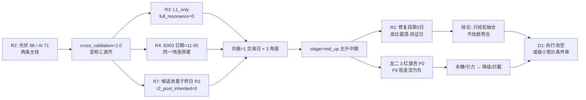

# 2026-11-06 · **反证 / Devil's Advocate**

> **数据源新鲜度**: partial（R2/R4/R5/R7 完整 · R1/R3 降级）
> **降级状态**: true
> **置信度**: 0.43（0.82 × 0.72 × 0.72）

## 一句话结论

**hard_rejects 为空**，但这不是「10 只都过关」——今日模式六的**法定对象是 0 只**（R2 执行池空、10/10 无执行资格、R7 执行候选空）；真正的风险在四处结构性漏洞：所谓「四源共振 1.0」其实是**同一个交易日的三个观察角度**、`stage=主升中期`与 R2 自己的「加速初期/中段反抽」互斥、两只龙二各背 **3 条红旗含 P0 现金流**、而全批**唯一 RR>2 的票正是派发证据最全的那只**。

---

## 详细分析

### 一 · 反证视角先认市场：钱付给了谁，没付给谁

11-05 是「广度极强、资金转弱」的一天：涨停 84 / 跌停 0 / 炸板 48（炸板率 36.36%）、涨 4869 跌 625、中位 +2.02%、成交 21177 亿（+3.94%），但**全市场主力只 +85.39 亿（净流入率 0.40%）**，20 日累计 **-4119.74 亿、仅 5/20 天为正**。11-04 +500.28 亿与 11-05 +85.39 亿两日合计 +585.67 亿，只补回 20 日失血的 **14.2%**。

所以今天的钱不是增量，是**内部换手**：付给「光伏设备（20 日 +4.25 亿，电力系唯一真金）」与「传媒应用端（营销代理主力占比 9.21%，全行业最高）」，不付给 CPO/光模块（20 日 **-915.65 亿**）、元件（-423.79 亿）、通信设备（-519.53 亿）与黄金（热度 **-66%**，被 R2 丢弃）。

一个容易被读错的细节：今日资金结构是 **主力 +85.39 亿 / 中单 -168.1 亿 / 小单 +82.7 亿**（三档合计≈0，与超大单 85.15 + 大单 0.24 = 85.39 吻合）。**中户在净卖 168 亿**——指数普涨，但中层资金在撤退。

### 二 · 四处结构性漏洞

| # | 漏洞 | 上游怎么说 | 反证事实 | 后果 |
|---|---|---|---|---|
| 1 | **「四源共振 1.0」** | R2 给两条线 `cross_validation_score=1.0` | R3 是 `L1_only`、`full_resonance_count=0`；R4 的 E003 日期就是 11-05（同一场涨停潮）；R7 候选池基于**昨日** R2（`r2_pool_inherited=0`） | 3 个「源」在数同一件事，D1 不得据此加仓 |
| 2 | **`stage=mid_up` 主升中期** | 两条线都标「主升中期」 | R2 自己的 note：光伏「结构上是加速初期、位置上不是低位」；AI「属中段反抽而非新题材首日」。R1 定性为「修复段第 5 日 / 高位震荡 / 修复未确认」 | 仓位只能是**反抽仓**，不是趋势仓 |
| 3 | **龙二地基** | 永臻（3 板一字）、引力（2 板开盘封）身位最正 | 永臻 F8(P0)+F9+F10，CFO -11.94 亿 vs 净利 +0.53 亿，获利盘 97.5%；引力 PE 305.57@88.3 分位 + 大股东股份继续冻结 | 只能打板/竞价确认，不能低吸、不能持仓 |
| 4 | **RR 反向选票** | 10 只里仅博纳影业 RR 2.82 过 2 | 博纳同时是：龙虎榜 5 次净 -1.33 亿、大宗折价 -20.13%、首封 13:25、alpha=C（全批最低） | 机械 RR 会把**派发票**放进来，必须被资金成色覆盖 |

### 三 · 四象限负面识别（价格强度 × 资金成色）

口径：价格强 = 当日涨停或涨幅 ≥5%；资金强 = 5 日主力净额 >0 且 5 日正值天数 ≥3。

| 象限 | 今日名单 | 反证读数 | R6 态度 |
|---|---|---|---|
| **A 强价 × 强资（7）** | 永臻股份、钧达股份、利欧股份、引力传媒、博纳影业、润建股份、蓝色光标 | A1 真金：利欧（龙虎榜 +3.30 亿）、钧达（+0.67 亿）、永臻（+0.22 亿） A2 **假强**：博纳（龙虎榜 -1.33 亿 + 大宗 -20.13%）、蓝色光标（大宗 -27.67%） | 5 个观察 · 2 个拦截 |
| **B 强价 × 弱资（1）** | 协鑫集成（5 日 3 天中仅 2 天正） | 涨停但资金不持续，且已命中 `mid_laggard` | 拦截 |
| **C 弱价 × 强资（2）** | 阳光电源（5 日 +19.42 亿 / 20 日 -14.14 亿）、宁德时代（5 日 +45.47 亿 · 5/5 天正） | 资金先到、价格未到——**唯一有赔率结构的一组**，但都是容量核心，弹性低于涨停票 | 观察（低吸条件式） |
| **D 弱价 × 弱资（0）** | 池内无；市场级在 R7 流出榜（长鑫科技 -24.89 亿、中际旭创 -22.61 亿） | 已弃守 | 不进 |
| **市场级** | 价格强（广度 88.3%）× 资金弱（20 日 -4119.74 亿） | **B 象限**：存量换手下的普涨 | 不因「涨得多」而追 |

### 四 · 两种「假强」的微观机制

- **获利盘型假强**：永臻 97.5%、钧达 98.5%、引力 98.5% 的获利盘意味着**上方无套牢、下方全是浮盈**——上涨没有解套盘阻力，但回撤时也没有换手承接，任何风吹草动都是纯兑现（模式八虽未触发，但方向相反的风险同样成立）。
- **派发型假强**：博纳（龙虎榜 5 次净卖 + 大宗 -20.13%）与蓝色光标（大宗 -27.67%）是「价格强、资金成色为负」——涨是给对手盘出货用的。这两只是**唯二不能用「涨停」作为强度证据**的票。

---

## 关键证据

### 模式一 · 数据源冲突

| 条目 | 对象 | severity | 核心反证 |
|---|---|:--:|---|
| M1_01 | R2 `cross_validation=1.0` | strong | R3 `L1_only`＋R4 E003 同日同一现象＋R7 用昨日 R2 池 → 三源实为一源三角度 |
| M1_02 | 光伏线资金维 20/20 | strong | 电力设备 20 日 **-313.62 亿**，只有光伏设备 20 日 +4.25 亿是真金；中单 -168.1 亿 |
| M1_03 | R7 候选池（中微/宁德/山金国际） | strong | 基于 11-05 R2 的半导体设备与贵金属；今日黄金 42 分被丢弃、设备降次线 |
| M1_04 | R1 `overseas.indices` | soft | 结构化字段停留 20261104 上涨，结论段却写费半 -12.25% |
| M1_05 | R7 `elg/md/sm` 无字段定义 | soft | 仅当按「超大+大=主力、md=中单、sm=小单」理解才归零；不得读成「大单流出 168 亿」 |

### 模式二 · 一致性检查

| 条目 | 对象 | severity | 核心反证 |
|---|---|:--:|---|
| M2_01 | `stage=mid_up` | strong | R2 自述「加速初期 / 中段反抽」，R1 判「修复段第 5 日验证日」；阳光电源距 60 日高 -29.8%、MA60 89.72 在上方 |
| M2_02 | 「后排补涨」通道 | strong | R4 原文「只做龙头与低位，不接中位补涨」，R2 risks 抄录了同一句；候补 5 只里 4 只已判 `mid_laggard` |
| M2_03 | 引力传媒 R2「打板」vs R5「拦截」 | strong | R5：治理风险 + PE 305 + 缩量一致；R5 闸门模拟 `pass=false` |
| M2_04 | 情绪 60.1「贪婪」 | soft | 同日炸板率 36.36%、R3 标签「分歧带极端」、R1 行动是「只做日内 T」 |

### 模式三 · 估值 × 主线临界

| 条目 | 对象 | severity | 核心反证 |
|---|---|:--:|---|
| M3_01 | 603381 永臻（龙二） | strong | 3 红旗含 F8(P0)；ROE 1.59% / 净利率 0.80% / 有息负债 247% / CFO -11.94 亿；获利盘 97.5%、pos20=100 |
| M3_02 | 603598 引力（龙二） | strong | PE 305.57@88.3 分位、负债率 87.52%、CFO -2.68 亿、大股东股份继续冻结、振幅 50.1% |
| M3_03 | 300274 阳光电源（龙一） | soft | 估值不贵但净利 -44.46%；F4 因收入为负→阈值恒真属**伪命中**（真实红旗 1 条）；RR 0.72 |
| M3_04 | 001330 博纳影业 | strong | **全批唯一 RR 2.82**，同时是唯一「龙虎榜净卖＋大宗 -20.13%＋午后首封」的票 |

### 模式四 / 五 · 历史类比与昨日连锁

| 条目 | 对象 | severity | 核心反证 |
|---|---|:--:|---|
| M4_01 | 「修复第 N 日」类前景判断 | soft（degraded） | 无历史库；R1 仅 n=2，42 样本中位 -9.06% 描述的是结构不是方向 |
| M5_01 | 今日光伏的同构风险 | strong | 昨日三条反证今日全部兑现：贵金属→黄金线被丢弃（热度 -66%）；CPO→中际旭创 -7.51%/-22.61 亿；设备→涨停 19→4 家、降次线 |
| M5_02 | R6「位置高就不进」 | soft | 昨日该族误杀率 75%（missed_alpha +4.46%）；今日 5/10 在 pos20 ≥80，一律否决会删掉全部身位票 |

### 模式六 · 霸榜出货（唯一硬否决权）

| 条目 | 对象 | severity | 核心反证 |
|---|---|:--:|---|
| M6_01 | 法定触发面 | soft | `execution_pool=[]`、10/10 `execution_eligible=false`、R7 `execution_candidates=[]` → 法定对象 0 |
| M6_02 | 002086 东方海洋 | strong | **双条件实质成立**：R3「霸榜 10-31 #1 / 11-03 #2 / 11-05 #1」＋5 日 -2.28 亿、开板 14 次、换手 14.58%——但被 R2 妖股池剔除，不在候选内 |
| M6_03 | 001330 博纳 / 300058 蓝色光标 | strong | R5 自标 `distribution_alert`（龙虎榜 -1.33 亿 / 大宗 -27.67%），但 R3 未收录 → 条件①不成立 |

### 模式七 ～ 十

| 条目 | 对象 | severity | 核心反证 |
|---|---|:--:|---|
| M7_01 | 永臻 / 引力 各 3 红旗含 P0 | strong | 逐条验阈：F8(P0) 成立，未达 ≥4 条 → 不硬拒但必须 strong |
| M7_02 | 002131 利欧股份 | soft | 净利 -3.72 亿、CFO -9.20 亿，但附录 A 无对应编号（F8 要求净利为正）→ **规则空白** |
| M8_01 | 解套盘假繁荣 | soft（未触发） | 涨停 84 <100、解套盘均值 16.1%；反向提示获利盘均值 83.9%、5 只 ≥90% |
| M9_01 | 高位触板 | soft（未触发） | 最高 4 板、无 8 板+；但浙文影业 4 板主力仅 +0.25 亿（占比 17.26%） |
| M10_01 | 设备 vs 费半 | strong | 设备 5 日 +108.22 亿 vs 费半 **-12.25%**；20 日 +19.59 亿是全电子唯一正 |
| M10_02 | 金价 4130 vs 黄金股 | soft | 金价新高而 A 股黄金热度 -66%、贵金属仅 1 家涨停、赤峰开板 21 次 |

---

## 逐票反证裁决

| 代码 | 名称 | 角色 | 评级 | R6 态度 | 决定性反证 |
|---|---|---|:--:|:--:|---|
| 300274 | 阳光电源 | 龙一 | A-/B+ | **观察** | 容量核心身份成立，但净利 -44.46%、20 日 -14.14 亿、RR 0.72；只做回踩 |
| 603381 | 永臻股份 | 龙二 | B+/B- | **降级** | 3 红旗含 F8(P0)、获利盘 97.5%、流通 26.8 亿、机构零覆盖 |
| 002506 | 协鑫集成 | 候补 | B-/C | **拦截** | `mid_laggard` + 净资产 5.07 亿 + PB 99.6 分位 |
| 002865 | 钧达股份 | 候补 | B+/B- | **降级** | `mid_laggard` + 亏损 + 商誉 29.2%；只做 MA5 回踩 |
| 300750 | 宁德时代 | 候补 | A-/B+ | **观察** | 5 日 +45.47 亿真金，但 20 日仅 +0.32 亿、解套盘 66.5%、周转极慢 |
| 002131 | 利欧股份 | 龙一 | B+/B- | **降级** | 主力 +9.13 亿真金，但净利 -3.72 亿 + CFO -9.20 亿 + 双平台不合力 |
| 603598 | 引力传媒 | 龙二 | B/C | **拦截** | PE 305.57@88.3 分位 + 大股东股份冻结 + CFO -2.68 亿 |
| 001330 | 博纳影业 | 候补 | C/B- | **拦截** | 龙虎榜 5 次净 -1.33 亿 + 大宗 -20.13% + 午后首封 |
| 002929 | 润建股份 | 候补 | B/B- | **不进** | CFO -39.87 亿、应收 118.8%、`mid_laggard` |
| 300058 | 蓝色光标 | 候补 | B-/B- | **不进** | 大宗 -27.67%（全批最差）、RR 0.37（全批最低） |

**没有一只票获得「进」这一档**——与 R2 的 `execution_pool=[]`、R7 的 `execution_candidates=[]` 同向。

---

## 顶部反证对象的推理深度三问

### 反证点 1 · 光伏线「四源共振 88 分」

- **大资金意图**: 主力在光伏设备上做的是**子行业高低切**（电力设备 20 日 -313.62 亿，只有光伏设备 20 日 +4.25 亿），对手盘是中户——今日中单净流出 168.1 亿。机构侧痕迹为零：阳光电源 30 日龙虎榜 0 次、大宗 0 笔、两融 15 日 -12.2%，说明推动力来自被动盘而非主动进攻。
- **为什么走强**: 位置是「四连涨第 4 日、pos20 79-100」，催化是「民主党叫停关税 + 装机 +38%」（前者未立法、后者是产业数据），筹码是「获利盘 71.9%~97.5%、解套盘均值仅 16.1%」——**位置不低 + 催化半硬 + 筹码全是浮盈**，属加速段而非启动段。
- **逻辑够不够硬**: 不硬。三个「独立源」在数同一个交易日的同一现象（R4 的 E003 标题就是 11-05 的四连涨涨停潮）；政策腿是竞选承诺而非成文法；真正的硬证据只有 R7 的光伏设备 20 日 +4.25 亿与 5 日 +60.71 亿。证伪路径清晰：**竞价若高开 >3%、或光伏设备当日主力净流出 >20 亿、或炸板率再上 45%，加速段即结束**。

### 反证点 2 · 永臻股份「3 板一字 · 全场最高身位之一」

- **大资金意图**: 封单 2.56 亿 / 成交 0.6 亿 = 4.3 倍，是**小盘控盘**而非大资金建仓；两融 15 日 +45.3%、融券 +31.6%，追高的是杠杆盘。机构侧 30 日 0 篇研报、60 日 1 次调研，零覆盖——没有机构接盘的缓冲垫。
- **为什么走强**: 身位（3 板并列全场最高）＋一字锁仓（换手仅 2.4%、0 开板）＋光伏边框涨价链。但获利盘 97.5%、pos20=100、5 日 +32.7%，周线仍在 MA60（20.04）下方——**是陡峭的加速段，不是趋势的起点**。
- **逻辑够不够硬**: 不硬。产业逻辑（边框/铝型材吃装机 +38%）成立，但公司层无订单/业绩硬催化；财务侧 F8（CFO -11.94 亿 vs 净利 +0.53 亿）是 P0 级红旗；净利同比 +2313% 是低基数幻觉。证伪路径：**竞价高开 >9% 或低开破 18.3 → 一字板结构失效；开板一次即视为分歧确认**。

### 顶部反证对象的思维链（D1 若仍要参与，须先自证以下四段）

**阳光电源 · 300274**

- **买入理由**（反证视角：这是多头必须自证的前提，R6 不背书）: ①容量核心身份——成交 130.5 亿为板块第 2 名的 2 倍以上，11 家涨停由它定价；②资金 5 日 +19.42 亿、4/5 天为正，光伏设备 20 日 +4.25 亿是全电力系唯一真金。
- **风险点**: ①业绩侧净利 -44.46%、营收 -26.41%，属「低估值 + 业绩下滑」双杀末段；②20 日主力仍 -14.14 亿，5 日回补不等于趋势反转；③隔夜费半 -12.25% 的系统性补跌会盖过个股 α。
- **止损条件**: 收盘失守 MA20（74.77）即视为容量核心身份失效；竞价高开 >3% 一律不进。
- **可验证假设**: 24h 内若「光伏设备主力净流出 >20 亿」或「炸板率再上 45%」，则本日修复定性失败，该票降为纯观察。

**利欧股份 · 002131**

- **买入理由**（同上，多头自证前提）: ①主力 +9.13 亿（净率 42.53%，全市场单票第 2）、龙虎榜净买 +3.30 亿，游资首日上榜；②AI 营销是应用端最容易被讲通的故事，广告营销 4 家涨停、板块广度 4。
- **风险点**: ①净利 -3.72 亿、CFO -9.20 亿，经营质量全批最差（见 M7_02 规则空白）；②东财人气 #1 但 THS 仅 #21，双平台不合力，人气可能是单一平台散户端；③机构 30 日 0 研报 0 调研。
- **止损条件**: 低开缩量破 MA20（4.10）放弃；竞价高开 >5% 不追。
- **可验证假设**: 今日若「THS 人气未进前 20」或「广告营销板块涨停家数 ≤1」，则双平台不合力确认，降为观察。

---

## 数据源审计

| 源 | 日期 | 状态 | 备注 |
|---|---|:--:|---|
| tushare/R2 主线板块 | 2026-11-05 | 🟢 | 2 主线 + 1 次线 + 4 丢弃线 · 10 只候选 · `execution_pool=[]` |
| tushare/R5 个股画像 | 2026-11-05 | 🟢 | 10/10 画像 0 failed · 六维 + 红旗 + 筹码 |
| tushare+东财/R7 资金面 | 2026-11-05 | 🟢 | 496 行业板块 / 534 概念 / 28210 股日 · 两融与 ETF 为 T-1 |
| 微信公众号+公告/R4 消息面 | 2026-11-05 | 🟢 | 8 条 top_events · 19 条板块极性 |
| 热榜+双平台人气/R3 情绪 | 2026-11-05 | 🔴 | `L1_only` · 群聊层连续第 9 天 0 条 · WeFlow 已下线 · `full_resonance=0` |
| tushare+美股/R1 风格 | 2026-11-05 | 🟡 | `degraded` 0.441 · `overseas.indices` 停留 2026-11-04 · 商品/汇率缺失 |
| 盘前计划/观察跟踪（E1） | 2026-11-05 | 🔴 | `observation_tracking.json` 不存在 → 模式五改用事实对照，不虚构统计 |
| 北向资金 | — | 🔴 | 2026-10-28 起停抓（用户口径），R7 `northbound.retired` |

---

## 不确定性 / 反证

1. **R6 的判断上限受上游约束**：R3 人群层连续第 9 天为 0、R1 美股字段停留 11-04，意味着「人气是否正在转暖」这件事今日无源可证。凡是依赖「情绪扩散」的正向叙事，R6 都无法交叉验证，只能按 L1 单源处理。
2. **空 hard_rejects 不等于放行**：法定对象为 0 是今日的结构性事实（R2 自己因 RR 全部 <2 而清空执行池）。若 D1 把「R6 没拦」读成「可以买」，那是误读——真正的约束是三道闸门同时关闭。
3. **模式五的校准是反向的、且样本很小**：昨日 R6 的派发族误杀率 75%，今日三条兑现。这种「一天全错、一天全对」的高波动说明该族判据对**环境敏感**（退潮环境有效、强修复日误杀），因此本报告采用分族权重（薄封/派发 1.0、单纯位置高 0.5），而不是统一权重。
4. **R5 红旗存在阈值伪命中**：阳光电源 F4、博纳 F3 都属「收入同比为负 → 收入×1.5 阈值恒真」，本报告已逐条复核并降级，但也说明上游 flag 计数不可直接当硬闸门使用。
5. **东方海洋是规则边界而非遗漏**：它的霸榜告警与 5 日净流出同时成立，但不在候选池，按契约只能记 strong_suggest。若明日它被任何上游放回候选，R6 必须立即转 hard_reject。
6. **未做盘中验证**：本报告全部基于 11-05 收盘 artifact，所有 RR 是收盘机械口径，不含竞价。竞价高开幅度会显著改变结论（尤其永臻、引力这种「分歧点全在开盘」的票）。

---

## 与其他 R/D/E 的关系

- **依赖（只读）**: `R1_style` / `R2_main_sectors` / `R3_sentiment` / `R4_news` / `R5_stock_profiles` / `R7_capital_flow`（2026-11-06）；`R2_main_sectors` / `R3_sentiment` / `R6_devil_advocate`（2026-11-05，模式五对照）
- **被消费**:
  - **D1（canghai-plan）**: `hard_rejects=[]` 无覆盖权约束；14 条 `strong_suggest` 须接受或在 `meta.d1_override[]` 记录理由；11 条 `soft_suggest` 可选记入 `r6_soft_notes`
  - **E1（canghai-review）**: 本报告的「可验证假设」与 `d1_obligation` 是 T+1 回填的观测点；建议按 `reject_id` 逐条打勾，特别是 M5_01（同构警报）与 M3_04（RR 反向选票）

---

## Sub-Agent 元数据

- skill: `analyze_devil_advocate_v1@1.3`
- artifact: `data/research/20261106/R6_devil_advocate.json`（73 KB · 25 条 counter_arguments · 0 hard_rejects）
- 生成耗时: 约 420 秒（只读 9 份 artifact，无新数据抓取）
- model: `deepseek-v4.1-flash`
- 运行模式: `disk_only`（禁 MCP / 禁 shell 抓数 / 禁 delegate）
- 模式执行: 模式一 5 · 二 4 · 三 4 · 四 1(degraded) · 五 2 · 六 3 · 七 2 · 八 1(未触发) · 九 1(未触发) · 十 2
