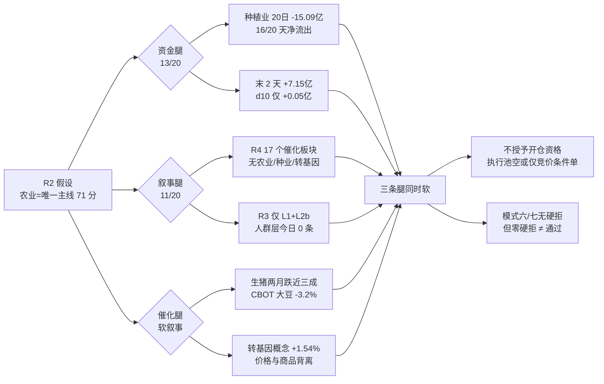

# 2026年11月9日（周一盘前 · 数据基准 11-06 收盘）· **反证 / Devil's Advocate**

> **数据源新鲜度**: partial · A 股盘面为 11-06 收盘全量，两融 T+1，人群层今日为空
> **降级状态**: false（主路径完整；模式四、模式十局部 degraded）
> **置信度**: 0.39 = 0.82 × 0.70 × 0.68

## 一句话结论

**今日零硬拒，但农业这条唯一主线三条腿（资金 / 叙事 / 催化）同时是软的 —— D1 应按空池或极小竞价条件单执行，」怕错过」不是买入理由。**

## 详细分析

### 一、零硬拒是核验结论，不是遗漏

反证总量 **30 条**：`strong_suggest` 16 / `soft_suggest` 14 / `hard_reject` **0**。必须先把「零硬拒」的性质讲清楚，否则它会被误读成「今日可以正常开仓」。

模式六（霸榜出货）的法定对象是 R2 里 `execution_eligible` 的龙一/龙二。今日这个集合是**空集**：R2 的 `execution_pool` 为空、R5 的十只票在 0.35 仓位档的模拟里 **10/10 不通过**、R7 的执行候选也是空。再看 R3 的两条霸榜告警 —— 光伏概念（概念榜连续两个观测日第 1、11-06 转跌 1.79%）、东方海洋（热股榜两日第 1、当日 9.97%、换手 42.6%）—— 与 R5 的十只候选**零交集**。条件一不成立，双条件就无从谈起。

唯一的「邻近命中」在 R2 的妖股赛道里：日出东方（603366）既是光伏概念成员又带东方系梗，条件一成立。但它**不在 R5 的十只画像内**，条件二（个股 5 日主力净额 < 0）无法核验，而 R6 禁止抓新数据 —— 所以按 v1.3 只能降为 `strong_suggest`，不能硬拒。这一条的意义不在于拦住某只票，而在于提醒：**如果 D1 自行把光伏概念里的东方系票纳入池子，等于绕过了今日唯一有效的板块级警报**。

模式七（基本面红旗）同样没有达标项。按附录 A 的原始定义逐条重算：F1 存贷双高 0 条、F2 商誉/净资产 > 30% 0 条（最高红太阳 22%）、F11 控股股东质押 > 70% 0 条（最高红太阳 11.16%）、F12 审计非标 0 条、F8「经营现金流连续两期为负」无法确认（只有单期 OCFPS）、ST 双轴无命中。最高的是上海电影 2 条（Q3 净利 −86.72%、PB 98 分位），未达 ≥4 条的硬拒线。**顺带查出一处上游缺陷：R5 用「F9」标注业绩下行、用「V2」标注高估值分位，与附录 A 的定义（F9=应收/营收 > 40%、V2=PEG > 2 且靠单次并购）完全不是一回事。如果照 R5 的标签计数，会把六只票误判成「命中红旗」——这正是本 skill 要求逐条复核的原因。**

### 二、资金腿：所谓「唯一三正行业」，是两日脉冲

R2 给农业的资金维打了 13/20 分，依据是「种植业是 496 个行业里唯一『单日 + 5 日 + 价格』三正的行业」。这句话没写错，但它是**口径正确、结论错误**的典型。

把 R7 的 20 日序列摊开：种植业 **20 个交易日里 16 天净流出，前 15 天累计 −20.74 亿，最后两天 +7.15 亿（11-05 +3.92、11-06 +3.23）**，20 日合计仍是 **−15.09 亿**。也就是说 d5 的 +5.64 亿全部由这两天贡献，d10 只剩 +0.05 亿。同一结构在三个概念口径上重复出现：转基因 d20 −10.64（14/20 天流出）、粮食概念 d20 −27.77（13/20 天流出）、农业种植 d20 −38.46（14/20 天流出）。

放大到全市场也是同一件事：11-04 +507.57 亿、11-05 +90.24 亿（两日合计 +597.81 亿），11-06 单日 **−528.52 亿**基本抹平。**「三正」是两天回补，不是趋势建仓。** 这两者在操作上的区别是决定性的：前者只能给试错仓，后者才配给趋势仓。

个股层面更尖锐。润建股份的个股资金是全批最好（5 日 +6.35 亿、20 日 +12.82 亿、4/5 天正），但它踩在 **算力概念 20 日 −609.24 亿**、**通信行业 20 日 −547.74 亿** 的地基上 —— 个股与板块方向完全相反。红太阳是另一个极端：自身 5 日主力已转 −0.504 亿，所属农化制品 **20 日 −44.52 亿、18/20 天流出、pos20 排名 2**。它那 3/6 板不是「板块身位」，是「板块最差的行业里一只反复涨停的孤票」。

### 三、叙事腿：R4 的十七个催化板块里，没有农业

这是今日最硬的一条反证。R4 扫描了 2200 条财联社快讯、800 条 major news、40 篇公众号、76 条公告窗口，归并出 8 个 top event、17 个 catalyzed 板块 —— **其中不含农业、种业、转基因、粮食任何一个**。R2 的叙事维只有 11/20 分，它自己列出的三条「软腿」是：公众号复盘点名、农业农村部部长 11-08 调研、ADM 进博会签约 320 亿。

三条都不是硬催化：第一条是别人的盘面描述，第二条是方向性表态无金额无时间锚，第三条落点在进口（对国内种业是中性偏负）。而反向证据是硬的：**生猪期货两个月跌近三成、CBOT 大豆周跌 3.2%、玉米跌 1.23%**。股票端转基因概念 11-06 涨 1.54%、种植业涨 2.72%，商品端同期下跌 —— 这是标准的价格背离（`commodity_divergence = true`）。**当一只票的上涨找不到现货或期货的依据时，它定价的就不是产业，是情绪。**

### 四、估值腿：资金最强的两只，恰好是最贵的两只

把「个股 5 日与 20 日主力同时为正」当作筛选条件，十只票里只剩两只：上海电影（+3.52 亿 / +5.78 亿）与润建股份（+6.35 亿 / +12.82 亿）。而这两只同时是全批估值最高的两只 —— 上海电影 PB 9.58 处 3 年 **98.0 分位**、2026H1 预告 −72%~−64%、Q3 净利 −86.72%；润建 PE_TTM **235.31**（88.5 分位）、净利率 **0.10%**、OCFPS −13.9、还有一笔 **折价 3.01%** 的大宗交易。

其余八只没有一只提供安全垫：万向德农静态 PE 654、PB 92.9 分位、PS 18.85、净利 −49.56%、2025 年预告 −89.5%~−87.5%；浙文影业 PB 96.6 分位、行业分类是纺织（跨界壳）、经营现金流为负；红太阳的「PB 仅 11.6 分位」看着最便宜，但它是亏损 + 重整转增的低基数产物 —— 便宜是会计口径，不是安全边际。

**「资金强度与安全边际负相关」，是本日最一致的反向结构。** 它直接否定了「因为资金在买所以能加仓」这条最常用的加仓理由。

### 五、昨日 R6 的账：5 对 3 错，错的两类今天必须降权

反证的价值在于可被证伪。用 `data/reports/20261106/observation_tracking.json` 对昨日（20261106 期）逐项回填：

| 昨日反证项 | 预期 | 实际 | 结果 |
|---|---|---|:--:|
| distribution_alert 蓝色光标 | down | −2.32% | ✅ 兑现 |
| distribution_alert 博纳影业 | sideways | +1.14% | ✅ 兑现 |
| r6_intercepted 引力传媒 | sideways | −0.46% | ✅ 判对 |
| 「执行池设空/极小」策略 | 优于满池 | 执行池 −3.47% vs 观察池 +1.41% | ✅ 占优 |
| r6_intercepted 润建股份 | down | **+10.01%** | ❌ 判错 |
| event_bearish 北方华创 | down | −0.18% | ❌ 未达 |
| event_bearish 中微公司 | down | 0.00% | ❌ 未达 |
| event_bearish 先导基电 | down | +1.23% | ❌ 未达 |
| event_bearish 有研新材 | down | −0.26% | ❌ 未达 |

两类判断全错：**「个股资金与板块背离 → 个股必跌」**（润建）与**「事件负面 → 个股下跌」**（4 只全错）。今日对这两类一律降权，只作风险提示，不作拦截或降级理由。反过来，结构性 / 派发类判断（霸榜出货、封板质量）**2/2 兑现，权重维持 1.0** —— 这也是今日唯一被实盘验证过的反证类型。

需要坦白的一点：润建昨日被拦后照样 +10%，但**这不构成今日追高的理由**。它现在的证据（PE 235、MA20 乖离 +23.6%、pos20/pos60 = 100/100、大宗折价 3.01%）比昨日更差，不是因为「昨天拦错了」就该反着做。

### 六、假设与反证据的传导

## 四象限负面识别

把 30 条反证按负面性质归到四个象限，供 D1 逐条审计：

| 象限 | 条数 | severity 分布 | 这一象限在说什么 |
|---|:--:|---|---|
| Q1 资金 | 9 | strong 5 / soft 4 | 「三正」是两日脉冲；润建、红太阳是孤票；光伏概念 20 日 −352.07 亿仍带霸榜告警 |
| Q2 情绪 | 6 | strong 3 / soft 3 | 恐惧 38.7 + 连跌第 2 天 + 昨日涨停溢价 −0.06%；R4 零农业事件；昨日拦截判错两类 |
| Q3 基本面估值 | 11 | strong 6 / soft 5 | 十只票无一有安全垫；资金最强的两只最贵；模式七按定义无一达标 |
| Q4 结构 | 4 | strong 2 / soft 2 | 4 次开板却给打板通道；MA20 下方却叫低吸；600313 名称错配 |

### 三问 · 反证点一：农业主线（R2 71 分）

- **大资金意图**: R7 的 20 日序列给出的答案是：过去 20 天没有大资金在这里建仓，前 15 天净流出 20.74 亿、16/20 天为负。11-05 与 11-06 的 7.15 亿更像游资在普跌里挑的「低位轮动试错」，对手盘是同一批在 11-04/11-05 被打下来、正在找低位票接力的短线资金。机构席位没有出现在这条线上（R5 的 institutional_interest 万向仅 28/100、红太阳 30/100、新赛 24/100）。
- **为什么走强**: 位置（万向 pos20 44%、pos60 47.6% 属中位；新赛 pos20 38.1%）+ 催化（无硬事件，只有部委表态）+ 筹码（万向获利盘 99.4%、股东户数 Q3 +106.6%，新赛户数 +73.65%）。三维交叉只有「位置不高」一腿成立，筹码维度是**散户接盘**而不是主力收集。
- **逻辑够不够硬**: 不够硬。独立源只有 2 个（R2 打分 + R3 的 L1+L2b），R4 零事件、R7 资金排名第 11 未进前十，跨源一致度只有 2/4。硬业绩（净利 −49.56%）、硬政策（无金额无时间锚）、硬时间锚（无）三者皆缺。证伪路径很明确：**今日竞价承接不放大，或种植业单日资金转负，这条线立刻降为「昨日的一日游」。**

### 三问 · 反证点二：红太阳 3/6 板（R2 龙二）

- **大资金意图**: 龙虎榜 30 日 6 次上榜累计 +1.63 亿、当日席位净买 0.99 亿，是**游资在做「农业 + 阳字辈」双梗的高位接力**。对手盘是看到「零开板 + 封单 0.77 亿」以为一致性的跟风盘。机构不在场（机构兴趣 30/100），板块资金也不在（农化制品 20 日 −44.52 亿）。
- **为什么走强**: 位置（pos20 79.6%、距 20 日高仅 −5.28%，空间已被打掉）+ 催化（无个股催化，指数型梗）+ 筹码（free 换手仅 13.29%、零开板，惜售）。惜售是真的，但**惜售发生在最差的行业里**，这就是孤票的定义。
- **逻辑够不够硬**: 不硬。板块 β 是负的（−44.52 亿），RR 机械口径 0.80 < 2，3/6 说明它已经在 6 个交易日里反复涨停（妖股博弈，不是主线身位）。证伪路径：**今日竞价不能弱转强，或农化制品单日资金继续为负，即视为最后一棒。**

### 三问 · 反证点三：润建股份（昨日 R6 判错的那只）

- **大资金意图**: 5 日 +6.35 亿、20 日 +12.82 亿、龙虎榜 30 日 6 次 +3.24 亿、融资 15 日 +17.3%、机构调研 138 次 —— 这是**机构调仓 + 游资接力同时发生**的一只票。但它在算力概念（20 日 −609.24 亿）与通信（−547.74 亿）的地基上独走，说明买方是「选票不选板块」。
- **为什么走强**: 位置（pos20/pos60 = 100/100，历史区间顶部；MA20 乖离 +23.6%，全批最高）+ 催化（中国移动 2027 算力投资 > 1000 亿、智谱 GLM 接入移动云，属硬产业叙事）+ 筹码（股东户数 −4.57%，筹码在集中；但有一笔折价 3.01% 的大宗）。
- **逻辑够不够硬**: 叙事硬、资金硬、估值软。独立源有 R4（E006 正面）+ R7（个股资金）+ R5（六维 B+），算今日少数三源同向的标的。**但它的证伪路径最短：算力概念只要再来一个 −50 亿的单日，或竞价高开 > 4%，接力就变成接最后一棒。**

## 思维链 · 三个观察顶部对象

今日**无首推票**（R1 开仓资格 0 条、R2 `open_permission = false`、R7 执行候选为空）。以下三只是观察池顶部，四条思维链锚点用于留证，不是买入依据。

### 万向德农（600371.SH · 龙一 · 2/3 板）

- **买入理由**（今日均不成立，仅记录多头逻辑）: ①转基因是全市场概念榜前十里唯一收红的方向（#3 / +2.01%），它是该概念的旗手，R7 明确标注 leader_stock；②R3 热榜新进 #13，是 5 条共振主题里唯一「早期 + 无出货警报」的方向。
- **风险点**: 短期 —— 首封 09:36 后 **4 次开板**、尾封 10:05、free 换手 46.30%，承接不连续；获利盘 99.4% 意味着几乎没有套牢盘托底，回撤时没有支撑买盘。中期 —— 净利 −49.56%、2025 年预告 −89.5%~−87.5%、PE 654，估值没有任何安全垫；R4 零农业事件，叙事腿随时断。
- **止损条件**: 竞价低开破 **11.15**（MA20 为 11.45，该止损位在均线下方）→ 直接放弃，当日无任何追高资格；若高开 ≤3% 但 30 分钟内不能站上 12.39 前高，同样放弃。
- **可验证假设**: ①今日 09:45 前，转基因概念是否继续在 THS 概念榜前十且成交额放大（观测阈：概念涨幅 > +1%）；②万向竞价量是否 ≥ 昨日同期的 0.8 倍、且封单回补到 ≥ 0.8 亿；③种植业板块当日资金能否由负转正（观测阈：d1 > 0）。三条中有两条不成立 → 视为「一日游」，移出观察。

### 红太阳（000525.SZ · 龙二 · 3/6 板）

- **买入理由**（今日均不成立，仅记录多头逻辑）: ①身位是全市场农业线最高（3/6），筹码形状最干净（零开板、free 换手 13.29%、封单 0.77 亿）；②当日席位净买 +0.99 亿、主力 +1.32 亿（净率 22.28%），是农业线里唯一「席位与主力同向净买」的涨停票。
- **风险点**: 短期 —— 首封 13:39 落在午后，次日必须靠竞价承接才能确认，落空即炸；RR 机械口径 0.80（距 20 日高仅 −5.28%，上方空间被打掉）。中期 —— 所属农化制品 20 日 −44.52 亿、18/20 天流出，板块 β 为负；「PB 11.6 分位」的便宜来自亏损 + 重整转增的低基数，不是安全边际。
- **止损条件**: 竞价不能高开（或高开 < 1%）即视为弱转强失败 → 不进；若进入观察后跌破 4.81（MA5）→ 立即放弃；不设「盘中再看」类模糊条件。
- **可验证假设**: ①今日农化制品/农药行业单日资金能否转正（观测阈：d1 > +1 亿）；②竞价封单能否回补到 ≥ 0.77 亿；③同线是否出现第二只 4 板以上票（观测阈：农业链涨停 ≥ 4 家）。三条有两条不成立 → 判定孤票接力失败。

### 润建股份（002929.SZ · 次线连板 · 2/3 板）

- **买入理由**（今日均不成立，仅记录多头逻辑）: ①R4 E006 是当日最硬的产业级叙事（中国移动 2027 算力投资 > 1000 亿 + 智谱 GLM 接入移动云）；②资金维度全批第一（5 日 +6.35 亿、20 日 +12.82 亿、龙虎榜 +3.24 亿、调研 138 次），且筹码在集中（户数 −4.57%）。
- **风险点**: 短期 —— pos20/pos60 = 100/100、MA20 乖离 +23.6%，任何追高都是接最后一棒；一笔折价 3.01% 的大宗说明有持股方在出。中期 —— PE 235、净利率 0.10%、OCFPS −13.9，叙事与资金远跑在盈利前面；算力概念 20 日 −609.24 亿，板块地基极不稳。**另加一条昨日教训：R6 在 20261106 期把它判成 down，实际 +10.01%，今日不得因「被拦过」而加重否决，也不得因「涨过」而追。**
- **止损条件**: 竞价高开 > 4% → 直接放弃观察（不追）；若开盘后跌破 55.73（MA5）→ 放弃；算力概念单日再流出一笔 ≥ 50 亿 → 无条件放弃（逻辑证伪即出）。
- **可验证假设**: ①今日中国移动能否高开 > 2% 且 30 分钟不回落（它是整条线的方向标）；②通信服务行业单日资金能否连续第三日为正（观测阈：d1 > 0）；③润建竞价量能否 ≥ 5 日均量的 1.2 倍。第①条不成立即判定「无板块背书」。

## 关键证据

- **资金是两日脉冲**：种植业 20 日 −15.09 亿、16/20 天净流出、前 15 天 −20.74 亿、末 2 天 +7.15 亿；转基因 −10.64、粮食概念 −27.77、农业种植 −38.46 —— 四个口径无一例外 · 来源 R7 moneyflow_ind_dc 20 日序列
- **叙事是零事件**：R4 扫描 3616 条输入（2200 快讯 + 800 major + 40 公众号 + 76 公告 + 500 业绩预告），归并出 8 个 top event、17 个 catalyzed 板块，**不含农业/种业/转基因/粮食** · 来源 R4 top_events + sectors_catalyzed
- **催化与商品背离**：生猪期货两月跌近三成、CBOT 大豆周 −3.2%、玉米 −1.23%，而转基因概念 +1.54%、种植业 +2.72% · 来源 R4 新闻 → R5 catalyst 转述
- **红太阳是孤票**：所属农化制品 20 日 −44.52 亿、18/20 天流出、pos20 = 2（496 行业中倒数区间）；个股 5 日主力已转 −0.504 亿 · 来源 R7 + R5 chip_structure
- **润建是逆板块独走**：个股 20 日 +12.82 亿，而算力概念 −609.24 亿、通信行业 −547.74 亿 · 来源 R5 chip_structure + R7 sector_flows
- **万向筹码在派发**：获利盘 99.4%、股东户数 Q3 +106.64%、龙虎榜 25/30 日 8 次累计 −2.77 亿、free 换手 46.26%、日内 4 次开板 · 来源 R5 chip_structure
- **资金最强 = 估值最贵**：十只票中仅上海电影（PB 98 分位）与润建（PE 235）的个股 5 日、20 日主力同时为正 · 来源 R5 valuation_safety × chip_structure
- **霸榜告警两条**：光伏概念（概念榜 2 日第 1、11-06 −1.79%、20 日 −352.07 亿）、东方海洋（热股 2 日第 1、换手 42.6%、主力净流出） · 来源 R3 hotlist_signals.distribution_alert
- **昨日拦截判错**：润建预期 down、实际 +10.0052%；event_bearish 4 只 0/4 兑现 · 来源 data/reports/20261106/observation_tracking.json
- **执行池代价**：执行池等权 −3.47%、观察池 +1.41%、missed_alpha 4.88pct · 来源 observation_tracking.missed_alpha_summary

## 霸榜出货硬约束审计（模式六）

| 标的 | 身位 | 所属行业/概念 | 条件①告警 | 条件②5日主力 | 判定 |
|---|---|---|:--:|---|:--:|
| 万向德农 | 龙一 | 种植业/转基因 | ✗ | +3.41 亿 | 不触发 |
| 红太阳 | 龙二 | 农药/农化制品 | ✗ | **−0.50 亿** | 不触发（①不成立） |
| 新赛股份 | 候补 | 其他种植业/农业种植 | ✗ | +0.72 亿 | 不触发 |
| 农发种业 | 候补 | 种植业/转基因 | ✗ | +0.36 亿 | 不触发 |
| 浙文影业 | 次线身位龙 | 影视院线 | ✗ | +1.87 亿 | 不触发 |
| 上海电影 | 次线首板 | 影视动漫制作 | ✗ | +3.52 亿 | 不触发 |
| 润建股份 | 次线连板 | 通信服务/算力 | ✗ | +6.35 亿 | 不触发 |
| 中国移动 | 叙事载体 | 电信运营 | ✗ | +1.68 亿 | 不触发 |
| 特变电工 | 资金票 | 电网设备/特高压 | ✗ | +2.86 亿 | 不触发 |
| 平高电气 | 催化票 | 电网自动化 | ✗ | **−0.07 亿** | 不触发（①不成立） |
| 日出东方 | 妖股首推 | **光伏概念** + 东方系 | **✓** | 无 R5 画像 | **降 strong_suggest** |
| 大东方 | 妖股候选 | 东方系 | ✗ | 无 R5 画像 | 不触发 |
| 东方新能 | 妖股候选 | 东方系 | ✗ | 无 R5 画像 | 不触发 |

结论：**0 只 hard_reject**。红太阳、平高电气各满足条件②（5 日主力为负），但两者都不在霸榜告警板块内 —— 单腿不构成硬拒。日出东方满足条件①但缺条件②核验数据，只能降级，不能硬拒。

## 数据源审计

| 源 | 日期 | 状态 | 备注 |
|---|---|:--:|---|
| tushare/limit_list_d+daily | 2026-11-06 | 🟢 | 5218 行 · 涨停 32/跌停 15/炸板 14 |
| tushare/ths_hot+dc_hot | 2026-11-04~11-06 | 🟢 | 三日全量 100/100/100 + 200/200/200 · 用于霸榜 diff |
| tushare/moneyflow_ind_dc | 2026-11-06 | 🟢 | 496 行业 + 531 概念 · 20 日序列完整 |
| R2 main_sectors | 2026-11-09 | 🟢 | 1 研究主线 + 4 次线 + 2 丢弃 · 10 只候选 |
| R3 sentiment | 2026-11-09 | 🟢 | 5 条共振主题 + 2 条霸榜告警 |
| R4 news | 2026-11-09 | 🟢 | 3616 条输入 → 8 top event / 17 催化板块 |
| R5 stock_profiles | 2026-11-09 | 🟢 | 10 只六维画像 · 1 处名称错配已更正 |
| R7 capital_flow | 2026-11-09 | 🟡 | complete 但 input partial · 两融 T+1 · raw 未生成 |
| wechat_cli 群聊 | 2026-11-09 | 🔴 | 7 群 0 条 · KOL 文本层断更 |
| weflow（L3） | 2026-11-09 | 🔴 | DOWN · 2026-08-19 永久下线 |
| wechat_official_rss | 2026-11-09 | 🟢 | 40 篇 · L2b 代位 |
| observation_tracking | 2026-11-06 | 🟢 | 26 只观察池 + 3 只执行池 · 用于模式五回填 |
| R6 prev artifact | 2026-11-06 | 🟢 | 25 条反证 · hard_rejects 0 |

## 不确定性 / 反证（对本报告的反证）

1. **R6 的置信度只有 0.39，不是免责声明，是量级提示。** 五处上游口径互相矛盾（R2 农业 vs R4 零事件、R7 候选池错配、600313 名称、R5 红旗编号、情绪分 34.2 vs 38.7），任何单条结论都不具备「独立确认」的强度。
2. **R7 与 R2 的「互斥」其实是管线并行造成的，不是真正的分歧。** R7 自述它在 07:30 前没看到 R2，候选池是自下而上构建的。这意味着 R7 的半导体设备池**不是对农业的独立否决票**，也不能被解读为「半导体是另一个共识方向」——两边都缺少交叉验证。
3. **上一个交易日的教训可能反向成立。** 昨日 R6 用「板块资金弱」证伪润建，结果它 +10.01%。今日我对润建、万向、红太阳的所有负面判断，都可能在同一结构下再错一次。**如果今日农业线出现两只以上 4 板票且板块资金转正，本报告的核心结论就是错的** —— 这是它可被证伪的明确条件。
4. **模式八、模式九均未触发（涨停 32 < 100、最高 5 板 < 8 板），这意味着「假繁荣」与「高位赌博」两个视角今日没有数据支撑**，不能用于论证；本报告没有把它们当作证据。
5. **模式四（历史类比）完全降级**：无历史事件库，仅 R1 的 30 日样本中位 −10.67%、正收益 9/42 单点统计，不足以形成分档结论。R2 妖股赛道使用的「2024 年 11 月东方系复刻」叙事，本质是历史记忆，不构成可复核证据。

## 与其他 R/D/E 的关系

- **依赖**:
  - `data/research/20261109/R1_style.json`（风格/情绪/仓位上限/市场结构）
  - `data/research/20261109/R2_main_sectors.json`（主线与候选、妖股赛道）
  - `data/research/20261109/R3_sentiment.json`（霸榜告警、共振主题）
  - `data/research/20261109/R4_news.json`（事件极性、催化板块、负面事件）
  - `data/research/20261109/R5_stock_profiles.json`（六维画像、筹码、估值、红旗）
  - `data/research/20261109/R7_capital_flow.json`（行业/概念 20 日资金序列）
  - `data/research/20261106/R6_devil_advocate.json`（昨日反证）
  - `data/reports/20261106/observation_tracking.json`（昨日兑现回填）
- **被消费**: D1（`canghai-plan`）读 `hard_rejects[]` 与 `counter_arguments[].severity`；E1（`canghai-review`）回填 `counter_arguments[]` 的 `d1_impact` 与 `self_audit_yesterday`
- **对 D1 的硬约束**: `hard_rejects` 空 → D1 无强制剔除项；16 条 `strong_suggest` 必须显式接受或在 `meta.d1_override[]` 记录理由；14 条 `soft_suggest` 记入 `r6_soft_notes`
- **不可被 D1 覆盖的结论**: 无（今日无 hard_reject）。但 R6 明确给出的是「零硬拒 ≠ 可开仓」—— 开仓资格由 R1 的 0 条主线与 R2 的 `open_permission = false` 决定，不因 R6 无硬拒而解锁

## Sub-Agent 元数据

- skill: `analyze_devil_advocate_v1` @ v1.3
- artifact: `data/research/20261109/R6_devil_advocate.json`（71,246 B · status=complete · confidence 0.39）
- 反证总量: 30（strong 16 / soft 14 / hard 0）· 四象限 Q1 9 / Q2 6 / Q3 11 / Q4 4
- 评估对象: 13（R5 画像 10 只 + 妖股赛道 3 只）
- 上游可用性: R1-R5/R7 全部 complete（R3 degraded、R7 input partial）
- 模式状态: 模式一/二/三/五/六/七/八/九 executed · 模式四 degraded · 模式十 partial
- 红线自检: 0 次 MCP · 0 次 delegate · 0 次联网 · 0 次抓数；只读 `data/research/` 与 `data/reports/`；未触碰 `data/plans` `data/execution` `data/user_preferences.yaml` `data/human_thesis` `chzl_kg`
- model: deepseek-v4.1-flash · method: llm_v1
