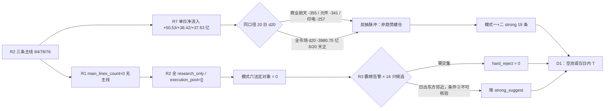

# 2026年11月10日（周二盘前 · 数据基准 11-09 收盘）· **反证 / Devil's Advocate**

> **数据源新鲜度**: partial · A 股盘面为 11-09 收盘全量，两融与 ETF 滞后一日，人群层为空
> **降级状态**: false（主路径完整；模式四、模式八、模式十局部 degraded / not_triggered）
> **置信度**: 0.39 = 0.82 × 0.70 × 0.70

## 一句话结论

**零硬拒；但三条主线全是「单日资金正 + 20 日深失血」的反抽脉冲，D1 只能空池或日内 T。**

## 详细分析

### 一、零硬拒是核验结论，不是开仓许可

反证总量 **40 条**：`strong_suggest` 26 / `soft_suggest` 14 / `hard_reject` **0**。四象限分布 Q1 资金 8 / Q2 情绪 11 / Q3 基本面估值 16 / Q4 结构 5。先把「零硬拒」的性质讲清楚，否则它会被误读成「今天可以正常做」。

模式六（霸榜出货）的法定对象是 R2 里 `execution_eligible` 的龙一/龙二。今日这个集合是**空集**：R2 `execution_pool=[]`、`discipline_gate.open_permission=false`、R5 十四只票的 d1 门禁模拟 **14/14 不通过**、R7 `execution_candidates=[]`。再对照 R3 的三条霸榜告警：东方海洋（热股榜连续三观测日第 1、5 日 +27.8%、6 次开板、机构净卖 2.51 亿）、名字玄学东方系（7 只涨停、无产业承接、大东方/东方创业涨停但龙虎榜净卖）、上纬新材（20cm 涨停但 4 次开板、公司自曝 PE 1767 倍/前三季净亏 4.22 亿）。三条告警与十四只候选**零交集** —— 条件一不成立，双条件无从谈起。

唯一的「邻近交叉」是日出东方（603366）：既是东方系告警成员，又被 R2 记在冰雪线（2 板一字、8 亿封单）。但它**不在 R5 的十四只画像里**，条件二（个股 5 日主力净额 < 0）不可核验，而 R6 禁止抓新数据 —— 按 v1.3 只能记 `strong_suggest`，不能硬拒。R2 自己也写明它「不入候选、不作板块健康度证据」。

模式七同样无达标项。按附录 A 的原始定义逐条重算（并用 `_r5_fin_stmt.json` 的利润表/现金流表复核，而不是照抄 R5 的标签）：F8「CFO 连续两期为负而净利为正」在中国卫星（−4.13/−2.81 亿 vs +0.849 亿）与西部材料（−1.07/−1.95 亿 vs +0.554 亿）成立，各计 1 条 P0 类；中国卫星另有 F9 应收/营收 83.9%、西部材料 73.2%、中科星图 230.7%、雪人 55.9%。中科星图单季亏 4.905 亿 + CFO −7.10 亿，雪人单季亏 0.236 亿 + 中报预减 70~80%。**全批最高 2 条红旗，无 ≥4 条、无 F12（审计非标）、无 ST 双轴**（FY2025 中国卫星 +0.356 亿、中科星图 +0.294 亿、雪人 +0.365 亿，均不构成连亏 2 年）。因此模式七不产生硬拒，但四只票的「财务底子」都经不起隔日仓。

### 二、资金腿：三条主线的「资金确认」是同一件事 —— 单日回补

R2 给三条主线的资金维分别是 15、17、18 分，依据都是当日净流入的行业/概念排名。数字没错，但把 R7 的同口径 20 日序列摊开，结论翻转：

| 口径 | d1 | d5 | d20 | pos20 | R7 结构标签 |
|---|---:|---:|---:|---:|---|
| 商业航天（概念） | +50.53 | −35.89 | **−355.06** | 7 | 20 日负 + 单日正 |
| 通信设备（行业） | +37.34 | −90.61 | **−428.89** | 9 | 防御/反抽脉冲 |
| 元件（行业） | +38.42 | −97.44 | **−340.61** | 8 | 防御/反抽脉冲 |
| 印制电路板（行业） | +37.63 | −81.19 | **−256.64** | 8 | 防御/反抽脉冲 |

全市场同一结构：d5 −375.98、d20 −3980.75 亿，20 日仅 6 天为正。11-04 +507.57 与 11-05 +90.24（两日 +597.81 亿）被 11-06 单日 −528.52 抹平 **88.4%**，11-09 的 +128.82 亿只回补 **24.4%**。更关键的是**结构**：超大单 +130.88 亿托住权重，大单 −2.06、中单 −73.84、小单 −59.40 = 非机构资金净流出 **−133.24 亿**。纪律 §7 说得直白：合力来自全市场，不是机构单边托权重 —— 中单小单在跑，涨停板就没有承接盘。

个股层面还有两处「上游自相矛盾」。R4 把生益科技列为**研究首选**（RR 2.13、位置分位 3.5、毛利 29.16% 提价弹性直接），但 R5 的筹码数据是：主力 5 日 **−12.73 亿**（2/5 天正）、20 日 **−47.20 亿**、龙虎榜 30 日 −3.10 亿、股东户数 Q3 **+91.87%**（户数暴增＝筹码分散）、dist_MA20 −28.73%。沪电股份同款：R4 标 high 质量（Q3 单季环比 +57.7%），R5 是 5 日 −12.42 / 20 日 −29.74 亿、机构龙虎榜 30 日 −8.65 亿。**业绩硬不等于筹码硬**；这两只票是全批唯一的「个股与行业双负中军」，R4 的首选标签在资金维被完全否掉。

### 三、情绪腿：44.9% 炸板率 + 三层梯队空缺，接力的胜率基线极低

R1 的数据是硬的：涨停 54 / 跌停 1 / 炸板 **44**，炸板率 **44.90%**（前一日 30.4%）；封单中位比仅 **0.1516**；再涨停只有 **9 只**（占 54 只涨停的 16.7%）；梯队是 1 板 45、2 板 8、**3/4/5 板全为 0**、6 板 1 只（闽发铝业，工业金属）。高度无法自然递推，意味着任何「等下一个龙头接棒」的假设都没有样本支撑。

这里有一处必须点明的上游分裂：**R1 判「无主线」（main_lines_count=0），R2 却给出三条 84/78/76 分的主线**。两者并不在事实上矛盾 —— R2 回答的是「谁最像主线」，R1 回答的是「有没有可交易主线」—— 但处置上只有一个答案：R2 三条线全部 `research_only`、`execution_pool=[]`，开仓资格仍是 0。同一处分裂还有两小处：R2 对商业航天判 `climax`、R3 判 `middle`；R2 对 PCB 元件分支判 `early_up`、R3 判 `late`。一律按更保守的一侧执行。

冰雪线的情绪结构最脆。R2 的唯一「打板」通道给了龙江交通（2 板、09:30 首封、仅 1 次开板），但 R5 的读数相反：**今日主力净额只有 0.19 亿、量比 0.52** —— 缩量一致板、没有接力盘；30 日位置 100%、获利盘 98.2%、MA20 乖离 +25.19%。龙一雪人更直接：13:09 才封、**4 次开板**、封单 **0.69 亿**、获利盘 99.8%、单季亏损、净利同比 −160.2%，R7 的诱多警报里也点了它的名。纪律 §7「无封单承接＝不封」，这两只都不构成可承接的龙一。

### 四、估值腿：资金最猛的三只，恰好是最贵的三只

| 标的 | 角色 | PE(TTM) / 3 年分位 | PB / 3 年分位 | 位置 | 红旗 |
|---|---|---|---|---|---|
| 中国卫星 | 商业航天龙一 | 643.4 / 54.1% | 10.55 / **80.0%** | 30 日位置 85.3%、贴 MA60 | F8+F9 |
| 冰山冷热 | 冰雪龙二 | 247.0 / **100%** | 2.54 / **100%** | 20 日 +83.69%、MA50 乖离 +48.95% | F9 |
| 雪人集团 | 冰雪龙一 | 亏损（无 PE） | 4.85 / **88.7%** | 30 日位置 100% | F9+单季亏 |
| 中科星图 | 商业航天候补 | 亏损（无 PE） | 7.86 / 64.3% | 站在 MA20 上方 | F9 230.7% |
| 晶雪节能 | 冰雪候补 | 556.4 / **100%** | 3.40 / 98.2% | dist_MA20 +17.05% | F9 88.1% |
| 生益科技 | PCB 补涨 | 22.5 / **2.0%** | 7.14 / 68.2% | dist_MA20 −28.73% | F9 51.0% |

中国卫星是最典型的一只：市值 679.9 亿（全批最大）、PE 643 在这个行业无意义、PB 分位 80%、PS 分位 79.4%、股息率 0.02%、ROE 1.33%。它的「资金正」还有两个反向注脚：大宗交易 **25 笔、1.66 亿、平均折价 −7.63%**（折价分销），融资 15 日 −9.65% 而**融券 +41.11%**（空头明确加仓）；5 日主力 +3.75 亿里只有 2 天为正。**这不是「机构在买」，是「有人在借流动性出货」。**

另一头是生益科技：PE 分位 **2.0%** 看起来是全批最便宜，但它是周期股盈利高位造成的低 PE 幻觉（附录 A 的 V1 阈值是「PE<8 且净利率历史 top20%」，本票 PE 22.5，**不构成 V1**，只能按软规则「便宜所以买」降级），且 MA 全空头排列、股东户数 +91.87%。便宜是会计口径，不是安全边际。

### 五、昨日 R6 的账：拦截 5 只大涨票全错，但观察池中位是负的

用 `observation_tracking 20261109` 逐项回填：

| 昨日反证项 | 预期 | 实际 | 结果 |
|---|---|---|:--:|
| 润建股份（high_extension 拦截） | down | −6.51% | ✅ 判对 |
| 阳光照明（no_main_force） | down | −1.48% | ✅ 判对 |
| 农发种业（name_mismatch） | down | −2.18% | ✅ 判对 |
| 万向德农（拦截/仅弱转强观察） | down | **+9.04%** | ❌ 判错 |
| 红太阳（rr_fail 降 watch） | flat | **+9.96%** | ❌ 判错 |
| 新赛股份（mid_laggard 剔除） | flat | **+8.30%** | ❌ 判错 |
| 上纬新材（high_position 拦截） | down | **+20.00%** | ❌ 判错 |
| 东方日升（distribution_alert 判 down） | down | **+5.65%** | ❌ 判错 |

观察池 25 只：均值 **+2.06%**、中位 **−1.10%**、expected_met 率 **36%**；执行池零成交，计划篮子 +3.11%、可买子集 **−1.46%**。两个口径必须同时读：空池相对「可买子集」少亏 1.46pct，相对「计划篮子」落后 3.11pct（后者含不可成交票）。

诚实的教训不是「拦截错了所以今天该放开」，而是：**反抽日对「高位/中位」一刀切拦截的代价是真实的（5 只大涨票全部判错），但观察池中位 −1.10% 说明多数票并没有赚钱。正确的修正是把「高位老龙/烂板」与「新题材首板/低位补涨」分开处置。** 今日商业航天、冰雪的龙一龙二都是 1–2 板的新题材身位，属「低位前排」范畴；用昨日的结论直接否决它们，是把两类完全不同的结构混为一谈。

### 六、三问：三个核心反证对象

**① 600118.SH 中国卫星（商业航天龙一，R2 辨识度核心）**

- **大资金意图**: 超大单在 11-09 全市场 +130.88 亿托权重，航天装备Ⅲ 单日 +6.64 亿、商业航天概念 +50.53 亿，但同概念 20 日 −355.06 亿。对手盘很明确：25 笔大宗平均折价 −7.63% 的卖方与融券 15 日 +41.11% 的空头。机构买的是「星云星座/快舟 50 发」这条产业叙事的长期期权，不是明天的板。
- **为什么走强**: 位置在 20 日新高（hi20=57.5）但刚好压在 MA60 57.61，30 日位置 85.3%；催化是 E20261110_003 的高强度板块叙事（但 R4 未点名该票，只到板块层）；筹码端 5 日主力仅 2/5 天为正、炸板 2 次、无封单残留 —— 是「板块强于龙头」的扩散型上涨，不是龙头锁仓。
- **逻辑够不够硬**: 三个独立源（R2 五维 84 / R3 共振 #2 / R4 net_score +0.732）在方向上共振，但**没有一条是个股级硬事件**（中报预告扭亏是 07-13 的旧闻，低基数 +200~220%）。证伪路径有两条：竞价高开 >3% 而封不住（昨日 32 只涨停样本红盘率 65.6%、再涨停仅 16.7%），或航天装备Ⅲ 单日资金转负。两条都不需要盘后数据就能在开盘 30 分钟内观测到。

**② 002639.SZ 雪人集团（冰雪龙一，机构龙虎榜净买 2.95 亿）**

- **大资金意图**: 龙虎榜 +2.67 亿 / 机构 +2.95 亿是真金，但封板时间 13:09 意味着资金是「午后确认后才进」，不是早盘抢筹；封单只有 0.69 亿，4 次开板 —— 是接分歧筹码，不是封死筹码。对手盘是 99.8% 获利盘里的短线兑现者。
- **为什么走强**: 位置极端（30 日位置 100%、PB 分位 88.7%、MA20 乖离 +9.27%）；催化为零（R4 十七个催化板块里没有冰雪，个股层只有 07-15 的「预减 −70~−80%」和两份投资者关系记录）；筹码是单日主力净额率 27.25% 的脉冲 + 5 日 7.02 亿但只有 2/5 天正。三维交叉只有「资金」一维成立，位置与催化都反向。
- **逻辑够不够硬**: 一个源（机构龙虎榜）+ 一个人气源（东财新进 #2），但**没有硬业绩、没有硬政策、没有硬时间锚**。证伪路径：次日竞价若低于 +3% 且 4 次开板的浮筹先行兑现，「弱转强」会直接变成「弱转弱」；观测量就是开盘 15 分钟内的封单能否重新站上 1 亿。

**③ 600183.SH 生益科技（R4 研究首选，RR 2.13）**

- **大资金意图**: 主力 5 日 −12.73 亿、20 日 −47.20 亿、龙虎榜 30 日 −3.10 亿，股东户数 Q3 +91.87% —— 没有任何大资金在下注；R4 的「首选」建立在 PE 分位 2.0% 与位置分位 3.5% 的**估值/位置**上，不是资金上。
- **为什么走强**: 反向成立 —— 它并不走强：位置在 MA20 下方 28.73%、MA50 下方 42.99%，MA 全空头排列；催化是行业景气（E002 Q3 行业净利 +196%、电子布紧缺至 2027-06）+ 分红回购，属**产业级而非个股级**；筹码在持续分散。
- **逻辑够不够硬**: 叙事硬（供需两紧 + 提价弹性），但两个独立源（R4 正面 / R7 行业资金 #2）都无法解释「个股资金为什么在 5/20 日双负」。证伪路径：若它是「跌多该反弹」的低位补涨，则需要在元件板块连续 2 日净流入转正后才有右侧资格；今日元件 d5 −97.44 亿，条件不成立。

## 关键证据

- **证据 1**: 三条主线的「资金确认」全部是单日口径 —— 商业航天 d1 +50.53 / d20 **−355.06** 亿，元件 d1 +38.42 / d20 **−340.61**，印制电路板 d1 +37.63 / d20 **−256.64**；R7 对行业的 `structure` 字段直接标注「20 日负 + 单日正（防御/反抽脉冲）」· 来源 `R7_capital_flow.main_force`
- **证据 2**: 11-09 的 +128.82 亿由超大单 +130.88 贡献，中单 −73.84 / 小单 −59.40 合计 **−133.24 亿**离场；全市场 d20 −3980.75 亿、20 日仅 6 天为正 · 来源 `R7_capital_flow.main_force.market_windows`
- **证据 3**: 炸板率 **44.90%**（前日 30.4%）+ 再涨停 9/54=16.7% + 梯队 3/4/5 板全为 0 + 封单中位比 0.1516 · 来源 `R1_style.market_structure`
- **证据 4**: R4「研究首选」生益科技 vs R5 主力 5 日 **−12.73 亿** / 20 日 **−47.20 亿** / 股东户数 **+91.87%** —— 同一只票两个上游读成相反方向 · 来源 `R4_news.stocks_catalyzed` vs `R5_stock_profiles`
- **证据 5**: 模式七逐条复核：中国卫星 F8（CFO −4.13/−2.81 亿 vs 净利 +0.849 亿）+ F9 83.9%；西部材料 F8（−1.07/−1.95 亿 vs +0.554 亿）+ F9 73.2%；中科星图 F9 230.7% + 单季亏 4.905 亿 + CFO −7.10 亿 · 来源 `_r5_fin_stmt.json` 复核，非照抄 R5 标签
- **证据 6**: 昨日 R6 拦截的 5 只（万向德农/红太阳/新赛/上纬/东方日升）全部上涨 +5.65%~+20.00%，而观察池中位 −1.10% · 来源 `observation_tracking 20261109`

## 思维链（观察池前三，R6 不给买入结论，只列可被证伪的条件）

**600118.SH 中国卫星**
- **买入理由**（若 D1 执意参与，唯一可接受的两条）: ①星云星座全栈国产太空算力网 + 快舟三年 50 发是产业级硬催化（R4 high +0.732）；②商业航天概念榜五日连升登顶（8→6→3→2→1），是唯一连续 5 日上行的前排概念。
- **风险点**: ①两次炸板 + 无封单残留 = 承接不足；②大宗 25 笔折价 −7.63% + 融券 15 日 +41.11% = 有人在借流动性出货；③PE 643 / PB 分位 80%，无估值安全垫。
- **止损条件**: 收盘价跌破 **MA20 52.85**（距 57.5 为 −8.1%，落于 −5~−10% 硬区间）即离场；若竞价高开 >+3% 后 30 分钟内无法回封，视为兑现窗口，不进场。
- **可验证假设**: 24 小时内可观测 —— 航天装备Ⅲ 单日净流入是否保持为正（今日 +6.64 亿）、概念榜是否仍在前 3、开盘 15 分钟封单能否站上 1 亿。任一不成立，本票从观察池剔除。

**002639.SZ 雪人集团**
- **买入理由**（唯一可接受的两条）: ①机构龙虎榜净买 2.95 亿、全批第一；②东财人气新进 #2，冰雪线人气锚。
- **风险点**: ①13:09 才封 + 4 次开板 + 0.69 亿封单 = 无封单承接；②获利盘 99.8%、30 日位置 100%，兑现压力最大；③单季亏损 + 中报预减 70~80%，PE 无锚。
- **止损条件**: 跌破 **MA5 14.86**（距 15.95 为 −6.8%）即离场；若开盘 15 分钟封单 <1 亿且价格跌破均价线，直接放弃。
- **可验证假设**: 次日竞价的「弱转强」是否成立 —— 观测量：竞价涨幅 ≥+3% 且开盘 15 分钟封单 ≥1 亿。两者缺一，本票按分歧兑现处理。

**000823.SZ 超声电子**
- **买入理由**（唯一可接受的两条）: ①今日主力净额率 37.15%、5 日 +4.54 亿（3/5 天正），线内资金最像样；②PE 26.8 + 净利 +97.5%，PCB 分支里基本面最硬。
- **风险点**: ①R4 测算 T+1 上方空间仅 +1.5%、RR **0.19**；②30 日涨停 8 次、获利盘 96.7%，属末端加速；③仍在 MA20 下方 12.23%，反弹未改趋势。
- **止损条件**: 结构位 MA5 17.24 距现价仅 **−3.5%**，低于 −5% 下限（止损太近、易被扫），改用 −8% 机械止损 16.43 又无结构位可挂 —— **两只脚都不成立，本票不具备执行条件**，只作强弱观察。
- **可验证假设**: 若次日元件/印制电路板行业净流入连续第 2 日为正，且超声能站上 MA20 20.35，才具备从观察转研究的资格；今日行业 d5 仍为 −97.44 / −81.19 亿，条件不成立。

## 数据源审计

| 源 | 日期 | 状态 | 备注 |
|---|---|:--:|---|
| tushare/limit_list_d+daily+index（R1） | 2026-11-09 | 🟢 | 5218 只行情 · 涨停 54/炸板 44 · 溢价样本 32 |
| R2_main_sectors | 2026-11-10 | 🟢 | 3 主线 + 2 次线 + 3 丢弃线 · execution_pool 空 |
| R3_sentiment（ths_hot/dc_hot 五日榜） | 2026-11-10 | 🟡 | 榜单 300 行 · WeFlow 下线、群聊 0 条、KOL 断更 |
| R4_news（news_cls+major+公众号+公告） | 2026-11-10 | 🟡 | 8 条 top event · 群聊腿 0 条（7 群匿名）· 结论不依赖缺失腿 |
| R5_stock_profiles | 2026-11-10 | 🟢 | 14/14 画像 · 0 失败 · 商品/大宗交叉通路缺失 |
| tushare/income+cashflow+balancesheet（R5 复核） | 2026-11-09 | 🟢 | 14 只 · 三表用于 F8/F9/F10 重算 |
| R7_capital_flow（moneyflow_ind_dc+concept+龙虎榜） | 2026-11-09 | 🟡 | 行业 496 / 概念 531 · 概念仅暴露 top15 · 两融与 ETF 为 11-06 |
| R6_prev / observation_tracking | 2026-11-09 | 🟢 | 30 条反证 + 25 只观察池回填 |
| wechat_cli_群聊 | 2026-11-10 | 🔴 | 7 群窗口内 0 条 · 文本层断更 |
| weflow L3 语义共振 | — | 🔴 | 2026-08-19 永久下线 |
| 商品/DXY 序列 | 2026-11-10 | 🔴 | 未接入 · 模式十 degraded，不编造 |

## 不确定性 / 反证

- **反抽日反证的系统性偏差**：昨日 8 项中有 5 项判错（全部是「高位/中位票继续大涨」），说明本 skill 在「主跌后第 1–2 个反抽日」天然偏保守。今日结构（修复段第 2 日）与昨日高度相似，`strong_suggest` 26 条里有一部分必须打折使用。
- **R3 人群层缺失**：WeFlow 下线 + 群聊 0 条，共振只剩榜单（T-1 口径），模式六的告警面和模式一的「共振确认」都变窄。若晚间群聊恢复，冰雪/商业航天的情绪读数可能上修，但不会改变资金 20 日失血这个事实。
- **冰雪的资金维不可复核**：R2 引用「冰雪经济 +12.63 亿、概念 #33」，而 R7 artifact 的 `concept_flows` 只有 top15，没有冰雪条目。无法判断这是 R2 引用了未暴露字段，还是概念口径不同。本 skill 只能按「不可复核」处理，D1 不得把 R2 的资金 17/20 当作冰雪的依据。
- **模式四/八/十降级**：无历史事件库、涨停数 54<100 未达解套盘阈值、商品/DXY 序列未接入。三处均标 degraded / not_triggered，未用任何编造数据填充。
- **40 条中 26 条 strong_suggest 偏多**：这是本 skill 的自评风险 —— 在「零硬拒」的日子里，过多 strong 会让 D1 的 `d1_override` 记录失去区分度。若 D1 认为某条 strong 不成立，请在 `meta.d1_override[]` 写明反证依据（不接受「看好」类主观理由）。

## 与其他 R/D/E 的关系

- **依赖**: `R1_style` / `R2_main_sectors` / `R3_sentiment` / `R4_news` / `R5_stock_profiles` + `_r5_fin_stmt` / `R7_capital_flow` / `R6 20261109` / `observation_tracking 20261109`
- **被消费**: D1（canghai-plan）— `hard_reject` 强制剔除且无覆盖权（今日 0 条）；`strong_suggest` 须接受或在 `meta.d1_override[]` 记录理由；`soft_suggest` 记入 `r6_soft_notes`。E1（canghai-review）— T+1 回填本文件 40 条反证的兑现率，用于校准。

## Sub-Agent 元数据

- skill: analyze_devil_advocate_v1
- artifact: data/research/20261110/R6_devil_advocate.json
- 生成耗时: 约 18 分钟
- model: deepseek-v4.1-flash
- 数据边界: 0 次 MCP / 0 次联网 / 0 次 delegate / 0 次外部抓数；仅读 `data/research/` 与 `data/reports/`
- hard_rejects: 0（逐票打印确认 count=0）
