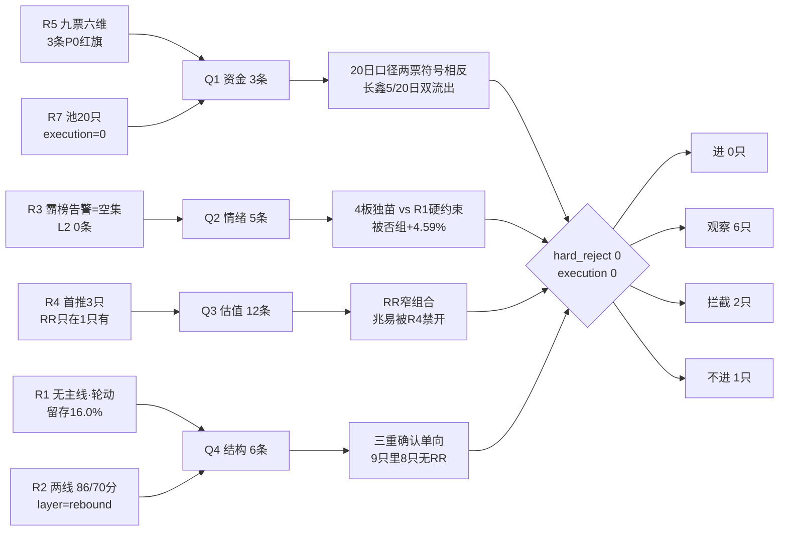

# 2026-11-12 · **反证 / Devil's Advocate**

> **数据源新鲜度**: partial
> **降级状态**: true（R1 degraded · R3/R4 语义层缺位 · 商品/DXY 缺）
> **置信度**: 0.42（0.80 × 0.75 新鲜度 × 0.70 口径一致度）
> **反证总量**: 26 条 · strong_suggest 14 / soft_suggest 12 · **hard_reject 0**
> **四象限**: Q1 资金 3 · Q2 情绪 5 · Q3 基本面估值 12 · Q4 结构 6

## 一句话结论

今日没有一只票够得上硬否决，但也没有一只票够得上执行资格 —— 算力线龙一的 RR 只在「-8% 止损 + 目标上沿」一个窄组合成立，存储线龙一被 R4 当场判「禁止开仓」，而 R2 引以为据的「三重确认」是单向拼装。

## 详细分析

**① 先认市场：修复段第 4 天，但牌面已经换了一批人。**
11-11 是放量修复日：涨停 85 / 跌停 0 / 炸板 19（炸板率 18.27%，低于 35% 硬红线）、天梯 1 板 66 / 2 板 12 / 3 板 5 / 4 板 2、首板占比 77.65%、成交 16760.7 亿（+11.40%）、涨 3381 跌 1647（广度 63.47%）。昨日 93 只涨停在今日收盘溢价中位 +2.79%、红盘率 68.82%、再涨停 19 只 —— 接力成立但已从 +4.91% 衰减。R1 判「连板情绪型 + 情绪 70.3 贪婪 + 无主线（轮动结构）」，行业次日留存仅 16.0%、截面解释力 13.96%，因此持仓周期只能是 1–2 日。**这不是一个能建立趋势仓的牌面**，R1 自己也把「不追连续加速的高位二波、不接 4 板以上的独苗」写成了硬约束。

**② 算力线的问题不是「贵」，是「止损伤不到、放宽就亏光」。**
中际旭创 +15.07% 收 542，11-11 单日振幅 14.30%。R4 给的止损 514.90 是 -5%，即 27.10 元 —— 只有单日振幅的 **0.35 倍**。这意味着止损落在日内正常波动区间里，被扫是常态而不是意外。一旦把止损放宽到用户纪律允许的 -8%（RR 1.68）或 -10%（RR 1.35），RR 立刻跌破 2。唯一同时满足「止损在合理位置 + RR≥2」的组合是「-8% 止损 + 目标取区间上沿 650」= 2.49，而且必须在平开或低开成交；竞价高开 +3% 后，同一组合掉到 2.05，+5% 后掉到 1.78。**R4 宣称的「全体 9 只里唯一 RR≥2」靠的是最紧的那条止损，也就是最容易被扫的那条。** 这不是估值问题，是风险结构的自相矛盾。

**③ 存储线的问题更直接：它的龙一被自己的消息面判了「禁止开仓」。**
R4 的 E008（大摩警告旧存储价格见顶、2028 供需转宽松、消费级涨不动）直接把兆易创新列为「承压样本（禁止开仓）」，no_trade=true，目标区间 230–245 是下行度量而非看涨目标。R5 同步写「观察（R4 承压样本，禁止开仓）」。而 R2 把兆易排成存储主线龙一。同一只票，三个 agent 三个身份。再往下看，存储线四只全部不合格：长鑫 5 日 -20.26（仅 1/5 天为正）、20 日 -36.63，11-11 还有一笔 38.01 元 vs 收盘 42.07、折价 -9.65% 且买卖方同为广发杭州顺福商务中心营业部的大宗；佰维 3 条红旗（F8 CFO -100.41 亿 / F10 有息负债 152.4% / V4 -1.14）；澜起连 R7 的个股资金核验都没有。**存储细分 0 家涨停、无板块效应**，这条线今天没有可执行的龙头。

**④ R2 的「三重确认」在时序上不成立。**
R3 的 degraded_reasons 写着「R2_main_sectors.json 当日未产出，主线交叉缺位」——R3 落盘 07:30，R2 落盘 07:35。R4 的 degraded_reason 写着「R3 20261112 未产出 → kol_confirm 全缺失」——R4 落盘 07:18。也就是说：R4 没见过 R3，R3 没见过 R2，只有最后出场的 R2 同时读了两者，并给出 cross_validation_score=1.0。**这是一次单向拼装，不是三源独立互证。** D1 若按「R3+R4+R7 三重确认」给主线加分，加的是一个不存在的共识。真正独立的三条腿里，今天只剩 R7 的资金（行业级：电子 +177.41、通信设备 +135.30、CPO 概念 +205.54）与 R4 的事件（E001 美股 AI 回暖）两条。

**⑤ 最该警惕的是我们自己：昨天的负面识别打了 0 分。**
11-11 观察池追踪给出残酷的对照：执行池 4 只开→收均值 **-0.65%**，被否组 20 只开→收均值 **+4.59%**，missed alpha 5.24pct。更刺眼的是按否决理由分组 —— `r3_theme_negative` 组 4 只红盘率 100%、收盘均值 **+12.61%**，而这 4 只正是今天 R2 主线 1 的龙一、龙二、龙三和候补：新易盛 +14.79%、中际旭创 +12.82%、生益科技 +11.19%、沪电股份 +10.00%（开→收口径）。**系统的「题材退潮」标签在修复段第 1-3 日系统性假阳性。** 所以今天 R3 仍然标着的「端侧 AI/AI 视频主题衰退」「高标派发」，同口径只能用于「不新增仓位」，不能用于「预测下跌」。同一天，昨日唯一的 hard_reject 光洋股份次日涨停 +10.01%（开→收仍 +2.27%）—— 财务红旗是长期结构风险，不是次日方向预言。这两条我写在这里，是为了让 D1 在引用 R6 时知道 R6 的历史命中率有多不可靠。

## 关键证据

- **证据 1 · RR 矩阵（独立复算，非采信 R4）**：中际旭创平开 542 时，止损 -5% → RR 2.69（但止损=0.35×单日振幅 14.30%）、-8% → 1.68、-10% → 1.35；竞价 +3% 开 558.3 后，-8% 止损 RR 1.27、-10% 止损 1.02。唯一达标组合：-8% 止损 + 目标 650 → 2.49。来源 `data/raw/20261111/daily_20261111.json` + `R4_news.json E001`。
- **证据 2 · 存储线龙一被禁开**：R4 `E20261112_008.stocks_impact[603986.SH].no_trade=true`、`role=承压样本（禁止开仓）`、`target_price_zone=[230,245]`、`rr_t1_direction=downside_measure`；R5 `603986.SH d1_stance` 原文「观察（R4 承压样本，禁止开仓）」。来源 `R4_news.json` + `R5_stock_profiles.json`。
- **证据 3 · 三重确认单向拼装**：R3 `degraded_reasons` 含「R2_main_sectors.json 当日未产出」；R4 `degraded_reason` 含「R3 20261112 未产出 → kol_confirm 全缺失」；R2 `cross_validation_score=1.0`。落盘时序 R4 07:18 → R3 07:30 → R2 07:35。
- **证据 4 · 20 日主力两源符号相反**：新易盛 R5 +46.71 亿 / R7 -12.14 亿；兆易 R5 -1.87 / R7 +14.65。而同一批票的 5 日窗口两源完全一致（中际 +16.06、东山 -5.61、新易盛 +32.38、沪电 +2.89、兆易 -13.37、长鑫 -20.26）→ 分歧锁定在 20 日窗口定义。
- **证据 5 · 昨日否决组跑赢**：`observation_tracking.json` 统计 exec_pool 开→收 -0.65% vs watch_pool +4.59%；`by_watch_reason.r3_theme_negative` n=4、红盘率 1.0、均值 +12.61%。
- **证据 6 · 昨日唯一硬拒次日涨停**：光洋股份 11-11 pre 24.17 / open 26.00 / close 26.59 / +10.01%（`daily_20261111.json`），而 R4 今日仍把它标 `tradable_today=true`、`quality=high`。
- **证据 7 · 网格与画像错位**：R4 首板候选 24 只中仅 6 只与 R5 画像 9 只有交集；R7 池 20 只与 R5 仅 7 只重叠，佰维/澜起完全无 R7 个股核验。
- **证据 8 · 4 板独苗违令**：全场 max_height=4（大东方 6.53 换手 11.7% 开板 2 次、日出东方 11.97 缩量一字换手 1.15%），R1 明令「不接 4 板以上的独苗」，R2 `yaogu_track` 却给出「轻仓试探 ≤5%」的可执行口径。

## 四象限反证清单（26 条 · 逐条可审计）

| 象限 | 条数 | 代表条目 | 处置含义 |
|---|---|---|---|
| 🟦 Q1 资金 | 3 | 20 日口径两票符号相反；候选池 9 vs 20；长鑫 5/20 日双流出 + 大宗折价 -9.65% | 20 日维度今日不可信；资金 unknown 不等于通过 |
| 🟨 Q2 情绪 | 5 | 4 板独苗与 R1 硬约束冲突；被否组 +4.59% vs 执行池 -0.65%；模式八/九门槛未触发 | 负面标签降一档，只用于不新增仓位 |
| 🟥 Q3 基本面估值 | 12 | 中际旭创 RR 窄组合；兆易被 R4 禁开；佰维 3 红旗；E002 单源已被 T-1 定价 | 估值便宜不是安全垫；单源传闻不进 RR |
| 🟩 Q4 结构 | 6 | 三重确认单向拼装；9 只里 8 只无 RR；R4 24 只 vs R5 9 只；lo30 全 null | 结构性缺陷优先于个股判断 |

分档：**hard_reject 0 · strong_suggest 14 · soft_suggest 12**。模式六双条件逐票核验交集为 0；模式七最高 3 条红旗（佰维）距 ≥4 硬拒线差 1 条。

## 三问 · 三个核心对象

**中际旭创（300308.SZ · 主线1 龙一 · R4 首推 0.12 仓）**

- **大资金意图**：11-11 主力 +29.87 亿（净额率 9.57%）、超大单主导，两融融资余额 15 日 **-49.14%** —— 是机构回补 + 杠杆撤退同时发生，不是杠杆资金推动的加速段。大宗 39 笔 8.24 亿全部零折价，无折价甩货。
- **为什么走强**：E002（路透独家：微软游说白宫把 FCC 光收发器禁令推迟到 2028-2029）在 11-11 早盘发生，叠加 CPO 概念主力 +205.54 亿的板块级买盘，午后 13 点后集中封板潮。**但这条催化在 T-1 已被完整定价（+15.07%）**，今日只剩 E001（美股 AI 回暖：纳指 +1.60%、费半 +5.66%、NVDA +2.87%）这一条新增。
- **逻辑够不够硬**：结构性反证三条 —— 现价高于 MA5 12.62%、距 60 日高 -46.6%、ma_stack 空头、缠论未确认；上方 MA20 569.89 仍压制。**判定：逻辑是「深跌反弹第一波的第 2 天」，不是趋势突破，硬在板块 β 与业绩（Q3 归母 +211.8%、ROE 35.83%、PEG 0.12），软在位置与 RR。**

**兆易创新（603986.SH · 主线2 龙一 · R4 判禁开）**

- **大资金意图**：今日 +12.52 亿（链内最大），但 5 日 -13.37 亿、20 日两源均偏负（R5 -1.87 / R7 +14.65 符号冲突）。单日回补、多日失血。
- **为什么走强**：+6.15% 未涨停，靠「存储=兆易」心智锚 + 半导体行业 +76.75 亿（5 日 +155.23）的行业 β，叠加 E007 华为磁电存储试商用的**错误映射** —— E007 唯一首推是斯迪克（业务相关度 0.45、功能性薄膜占营收 17.19%），与兆易的利基存储无业务重叠。
- **逻辑够不够硬**：不硬。存储细分 0 家涨停、无板块效应、无板高、缠论未确认、R4 给的下行目标 230–245 低于现价 259.62。**判定：只作研究锚，不进。**

**大东方（600327.SH · 妖股赛道 4 板 · R2 给 ≤5% 竞价额度）**

- **大资金意图**：封单 1.17 亿、开板 2 次、换手 11.7%，族内龙头日出东方封单 5.69 亿、换手仅 1.15% 的缩量一字 —— 钱在族内最缩量的那只手里，跟风票靠换手承接。
- **为什么走强**：纯名字梗（东方系），R3 明确标 `theme_late_no_industry_backing`、`hours_to_expiry=0`，无产业承接、赚钱效应不可扩散。
- **逻辑够不够硬**：不硬，且**违规**。R1 明令「不接 4 板以上的独苗」，4 板即为全场最高板。**判定：拦截，不进执行池，只留复盘记录。**

## 首推票思维链 · 中际旭创（唯一有 RR 的票，仍不给执行资格）

**买入理由**：主线1 唯一「今日/5 日/20 日三窗全正」的票（+29.87 / +16.06 / +35.14 亿），业绩硬（Q3 归母 +211.8%、毛利率 46.39% 逐季抬升、商誉仅占净资产 2.1%、货币资金 41.3% 而短借 0.3%，无 F1/F2/F8/F10/F11 任一红旗），机构覆盖 90 日 106 篇 + 400 条调研记录，E001 映射直接。

**风险点**：①催化已在 T-1 兑现 15.07%，今日是第二批定价；②现价高于 MA5 12.62%，任何回踩买点都比 5 日线贵 12% 以上；③股东户数自 2025 年末 +73.99%（下跌中筹码分散）；④cyq 上方 916.5 仍有历史套牢峰，获利盘 52.4% 不算厚；⑤20 日主力两源冲突（R5 +35.14 / R7 +6.99）；⑥单日振幅 14.30%，-5% 止损必被扫。

**止损条件**：只有一种写法成立 —— **止损 -8%（约 498.6），目标取 650（R4 区间上沿），RR 2.49**。若用 -5% 止损（514.9）宣称 RR 2.69，等于用一个 0.35×振幅的止损换账面盈亏比，视为无效风控。若竞价高开 ≥3% 而止损仍锚 514.9，RR 掉到 1.27 → 直接降观察。

**可验证假设**：①竞价昨日涨停红盘率 ≥50% 且广度 ≥0.60（R1 给的修复段承接前提）；②开盘价 ≤558（+3%），否则 RR<2 放弃；③MA5（约 481）全日不破；④E002 不被官方否认、E001 的费半 +5.66% 不被隔夜反转。四条任一不成立 → 当日不做，不做「回踩 MA20 补仓」。

## 九票处置（五档明确态度）

| 代码 | 名称 | R2 身位 | 5日主力 | 20日 R5/R7 | 档位 | 处置 |
|---|---|---|---|---|---|---|
| 300308.SZ | 中际旭创 | 龙一 | +16.06 | +35.14 / +6.99 | 降级 | 降 watch：RR 仅在 -8%止损+目标650 成立，高开 ≥3% 放弃 |
| 002384.SZ | 东山精密 | 龙二 | -5.61 | -2.33 / -33.32 | 观察 | 研究观察：板型最好但无 RR、F10 85.5%、5/20 日双净流出 |
| 300502.SZ | 新易盛 | 龙三 | +32.38 | +46.71 / -12.14 | 观察 | 研究观察：CFO/NP 0.13、MA5 上方 15.28%、20 日符号冲突 |
| 002463.SZ | 沪电股份 | 候补 | +2.89 | -8.23 / -24.49 | 观察 | 研究观察：开板 3 次封板弱、无 RR；唯一缠论确认 |
| 002281.SZ | 光迅科技 | 候补 | -1.01 | -15.25 / -26.50 | 拦截 | 拦截：F8(P0)+V4、PE 56.9、13 点后第 5 顺位封板、mid_laggard |
| 603986.SH | 兆易创新 | 龙一 | -13.37 | -1.87 / +14.65 | 不进 | 不进：R4 判承压样本禁止开仓、存储 0 涨停、下行目标低于现价 |
| 688825.SH | 长鑫科技 | 龙二 | -20.26 | -36.63 / -52.44 | 观察 | 研究观察：5/20 日双流出、大宗折价 -9.65% 同营业部、次新 72 根 K |
| 688525.SH | 佰维存储 | 候补 | -2.51 | -17.52 / 无 | 拦截 | 拦截：F8(P0)+F10 152.4%+V4 -1.14，PE 6.89 非安全垫 |
| 688008.SH | 澜起科技 | 候补 | -2.61 | -10.83 / 无 | 观察 | 研究观察：第 4 顺位、R7 无个股核验、PE 51.8 / PS 29.2 |

**进 execution 0 只 · 研究观察 6 只 · 拦截 2 只 · 不进 1 只。** 若 D1 因中际旭创 RR 不成立而剔除，**不得用东山/新易盛/光迅/佰维/澜起递补执行资格** —— 杂毛失去板块 β 时风险大于龙头。

## 数据源审计

| 源 | 状态 | 抓取日 | 记录数 | 备注 |
|---|---|---|---|---|
| R1 风格 | 🟡 stale | 2026-11-12 | 1 | degraded：商品 skipped / DXY 缺；A 股主源可用 |
| R2 主线 | 🟢 ok | 2026-11-12 | 2 主线 + 3 次线 | complete，但三重确认为单向拼装 |
| R3 情绪 | 🟡 partial | 2026-11-12 | 5 主题 | WeFlow 下线、L2 群聊 0 条、R2 未产出 |
| R4 消息 | 🟡 partial | 2026-11-12 | 8 事件 / 24 首板 | 5 群 0 条、news_major 仅标题级、R3 未产出 |
| R5 画像 | 🟢 ok | 2026-11-12 | 9 | lo30 全 null；9/9 命中 plan_outside_scan |
| R7 资金 | 🟡 partial | 2026-11-12 | 20 | 北向停抓、两融 T-1、execution=[] |
| 外盘补抓 | 🟢 ok | 2026-11-12 | 5 指数 | 新浪实时 + 东财序列交叉校验 |
| 昨日 R6 | 🟢 ok | 2026-11-11 | 24 条 | 1 hard_reject（光洋）已兑现为假阳性 |
| 昨日追踪 | 🟢 ok | 2026-11-11 | 24 | exec 4 / watch 20 |
| 11-11 日线 | 🟢 ok | 2026-11-11 | 5574 | 振幅与 RR 复算底座 |

## 数据源冲突（11 处，逐条留痕）

1. **R3 ↔ R2**：R3 写「R2 当日未产出」，R2 却称 `r3_resonance_match=true` → 时序不可逆。
2. **R4 ↔ R3**：R4 写「R3 未产出 → kol_confirm 全缺失」。
3. **R2 ↔ R4（个股级）**：兆易 R2=龙一 / R4=承压样本禁止开仓。
4. **R5 ↔ R7（20 日主力）**：新易盛 +46.71 vs -12.14；兆易 -1.87 vs +14.65（符号相反）。
5. **R5 ↔ R7（池）**：9 只 vs 20 只，仅 7 重叠。
6. **R1 ↔ R3（情绪）**：70.3 vs 69.3，同档不跨档。
7. **R1 ↔ R7（广度中位）**：+0.68%（5219 行）vs +0.59%（5574 票）。
8. **R2 ↔ R7（身位）**：新易盛 R2=龙三 / R7=龙二。
9. **R4 内部**：中际旭创 RR 2.59 vs note 2.69。
10. **R5 内部**：9 只 lo30 全 null，但文本给出具体值（中际低 427.34）。
11. **R3 内部（告警口径）**：R5 用同名 `distribution_alert` 标长鑫（大宗折价口径），与 R3 板块霸榜同名不同义。

## 不确定性 / 反证

- **昨日唯一 hard_reject 是错的（方向）**：光洋股份 11-11 +10.01% 涨停。财务红旗不预测次日方向，其兑现形式是断板或滞后崩塌。我不撤该硬拒（F8/F10/F9/F3 结构未变），但 D1 不得用 R6 的财务硬拒预测涨跌。
- **模式八未触发**（涨停 85 < 100 门槛，差 15 家），不是健康证明：东山获利盘 84.8%、新易盛 78.7%，成本带极窄，小幅高开即全线浮盈。
- **模式九未触发**（最高 4 板，距 8 板门槛差 4 个身位），`extreme_tail_risk=false`，但 4 板 + R3 0 小时到期仍按博傻结构拦截。
- **模式四/十降级**：无历史事件库、商品（原油/铜/金）skipped、DXY 缺、DRAM 现货无序列 → `commodity_divergence` 一律记 unknown，不编造。
- **R6 自身也有系统性偏差**：今日 26 条里 12 条落在 Q3 基本面估值，说明本 skill 对「贵/红旗/资金流出」的敏感度高于对「结构承载」的判断；而昨日数据说明这类敏感度在修复段容易变成噪音。若 D1 发现 R6 今日反证与实盘再次背离，应反向修正的是 R6 的敏感度，不是 R6 的存在。

## 与其他 R/D/E 的关系

- **依赖（只读）**：R1_style / R2_main_sectors / R3_sentiment / R4_news / R5_stock_profiles / R7_capital_flow / _r1_overseas_fill / 昨日 R6 / 昨日 observation_tracking / 11-11 日线。
- **被消费**：D1（canghai-plan）按 severity 分档 —— `hard_reject` 无覆盖权（今日 0 条）、`strong_suggest` 须接受或在 `meta.d1_override[]` 记理由、`soft_suggest` 记入 `r6_soft_notes`；orchestrator 将 `hard_rejects[]` 原样写入 `research_summary.json`；E1（canghai-review）复盘今日处置与实盘对照。
- **不越权**：未写 `data/plans/`、`data/execution/`、`data/reports/`、`data/corrections/`、`data/evolution/`、`user_preferences.yaml`、`human_thesis/`，未写 `chzl_kg/`。

## Sub-Agent 元数据

- skill: analyze_devil_advocate_v1@1.3
- artifact: data/research/20261112/R6_devil_advocate.json（70.8 KB）
- 反证: 26 条（strong 14 / soft 12 / hard 0）· 四象限 3/5/12/6 · 覆盖 10 个模式
- 独立复算: 中际旭创 RR 矩阵（5 档 gap × 3 档止损）、9 只票日振幅与止损倍数、附录 A 12 红旗 + V4/V10 阈值逐条复核
- 红线自检: MCP 0 次 · delegate 0 次 · 联网 0 次 · announcement-search 0 次
- model: deepseek-v4.1-flash
- generated_at: 2026-11-12T08:26:00+08:00
