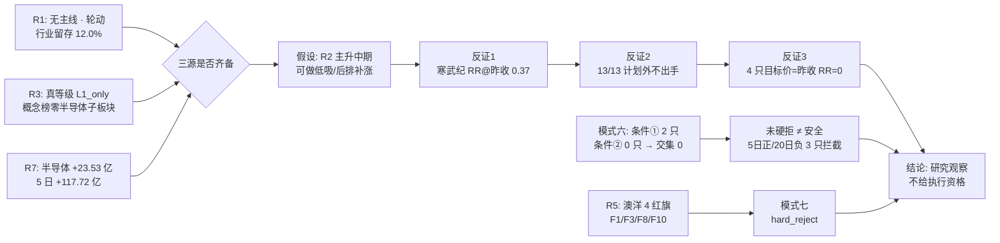

# 2026-11-13 · **反证 / Devil's Advocate**

> **数据源新鲜度**: partial
> **降级状态**: true（R1/R3/R4/R7 四源降级，R2/R5 本体完整）
> **置信度**: 0.45（0.80 × 0.70 × 0.80，公式与折价理由见 JSON `confidence_breakdown`）
> **今日定位**: 高位震荡第 2 天 · 炸板率 48.61% · 无已确认可交易主线 · 执行池 0 只

## 一句话结论

今日 30 条反证：hard_reject 1（澳洋健康·模式七 4 红旗）、strong_suggest 18、soft_suggest 11；**模式六霸榜出货双条件交集为 0（13 只 5 日主力全为正）**，真正的否决点是结构承载——13/13 命中计划外不出手、5 只龙头全在轮动/反弹层、4 只目标价锚昨收致盈亏比归零。

## 结论速览

| 项目 | 结果 | 判定 |
|---|---|:--:|
| 反证总量 | 30 条（Q1 5 / Q2 6 / Q3 12 / Q4 7） | 🟡 覆盖完整 |
| 硬拒 | 1（002172.SZ 澳洋健康·模式七） | 🔴 无覆盖权 |
| 模式六（霸榜出货） | 条件① 2 只 / 条件② 0 只 / 交集 0 | 🟡 未硬拒≠安全 |
| 执行资格对象 | 0（R2 execution_pool=[]、R7 execution_candidates=[]、R3 open_permission=false） | 🔴 空池 |
| 主要否决通道 | 计划外不出手 13/13 · 趋势破位 2 只 · 财务红旗 5 只 | 🟡 拦截为主 |

## 详细分析

### 一、霸榜出货：双条件没有一只同时成立

模式六是唯一有硬否决权的通道，规则要求「① 所属板块命中 R3 霸榜派发告警」且「② 个股 5 日主力净流出」**同时成立**。今日逐票核验 13 只：

- R3 的 `distribution_alert` 只有 3 条：东方系名字玄学集群（high）、中际旭创/新易盛（high）、人形机器人（medium）。
- 条件① 命中 2 只：源杰科技（光芯片，光互联上游）、剑桥科技（光通信设备）——按「同链」口径计入，深南电路属 PCB 不在告警名单；蓝色光标身上那条 `distribution_alert` 是**个股大宗折价 -22.89%**，不是板块霸榜，不构成条件①。
- 条件② 命中 **0 只**：13 只 5 日主力全为正，最高寒武纪 +34.21 亿，最低惠发 +0.38 亿。
- 因此交集 0，模式六 hard_reject = 0。源杰/剑桥按「仅①命中」降为 strong_suggest。

**为什么这个 0 不是好消息**：5 日为正并不等于没在派发。深南电路 5 日 +6.55 亿 / 20 日 **-12.89 亿**、源杰 +27.88 / **-8.86**、剑桥 +7.52 / **-14.28**，三只都是「5 日承接托盘、20 日仍在出货」；同期 R7 口径电子 -79.05 亿、通信 -73.03 亿、通信设备 -68.14 亿。5 日窗口只是短，不是强。

### 二、真正的否决点是结构承载，不是板块叙事

四组硬数字把「今日可做」这条路堵死：

| 结构闸门 | 数据 | 后果 |
|---|---|---|
| 计划外不出手 | R2 `execution_pool=[]`、R3 `open_permission=false`、R5 13/13 命中 `plan_outside_scan` | 全部无执行资格 |
| 分层标注 | 寒武纪/中芯 `layer=rotation`（不给买点）、北方华创/通富/安集 `layer=rebound`（只做第一波、破 5 日线无条件走） | 任何「低吸建仓」都越界 |
| 盈亏比锚点 | 通富/长城军工/惠发/澳洋 `take_price` 等于昨收 → RR@昨收 = **0.00** | 四只属伪赔率 |
| 趋势破位 | 深南 `MA50 -28.24%`、源杰 `MA50 -39.14%`、剑桥 `-30.23%`，距 60 日高 -44%~-58% | `down_trend_break` 系统禁令 |

独立复算补了一刀：R5 给寒武纪 RR 2.92「通过」，但那是「买 890」的价格——比昨收 973 低 8.53%。按昨收算 RR = (1020-973)/(973-845.5) = **0.37**，高开 3% 后 0.11、高开 5% 后 **-0.01**。同理源杰 3.29 只在 -8.23% 深跌买入成立（按昨收 0.53）、深南 2.42 只在 -3.61% 回撤买入成立（按昨收 0.96）。**这类 RR 是「抄底赔率」，不是右侧赔率**，与纪律「不做左侧抄底」直接冲突。

### 三、基本面红旗：一只硬拒、五只拦截

逐条复核附录 A 阈值（不套用错阈值），结果：

| 标的 | 命中红旗 | 判定 |
|---|---|:--:|
| 澳洋健康 | F1 存贷双高（货币资金 24.2%、短期借款 47.9% 双 >20%）· F3 应收 +14.2% vs 收入 -8.2% · F8 现金流恶化（P0）· F10 有息负债/净资产 433.6% | 🔴 hard_reject |
| 蓝色光标 | F3 soft · F8（P0）· 大宗折价 -22.89% | 🟠 strong_suggest |
| 长城军工 | F3 · F9 应收/营收 160.3% · S1（净利 -1.18 亿、ROE -5.44%） | 🟠 strong_suggest |
| 剑桥科技 | F3 · F9 72.3% · F8（P0） | 🟠 strong_suggest |
| 惠发食品 | F10 112.0% · S1（净利 -0.05 亿） | 🟠 strong_suggest |
| 安集 / 寒武纪 / 深南 | 各 1 条 V4（CFO/净利 0.45 / 0.06 / 0.47） | 🟡 soft_suggest |

澳洋的边界敏感性已写进 `hard_rejects[].threshold_note`：F3 在**负收入基数**下是机械命中，若裁定其不成立，则只剩 F1/F8/F10 三条，规则强制降为 strong_suggest；F1 是严格双超（24.2/47.9 各超线 4.2/27.9pct），不是 1~2pct 级边界。V4 与 F8 同源于现金流，按 1 条计，未重复计数。

### 四、四象限负面识别

| 象限 | 条数 | 核心负面 |
|---|:--:|---|
| Q1 资金 | 5 | 5 日正 / 20 日负三只；单日电子 -79.05、通信 -73.03、通信设备 -68.14 亿；融资融券概念 -454.45 亿、深股通 -341.22 亿 |
| Q2 情绪 | 6 | 涨停 37 / 炸板 35（48.61%）、封成率 51.4%、昨日涨停收盘溢价 -0.87%、涨家占比 16.2%；洋族 5 涨停但封成率 2/5（东方海洋开板 26 次、换手 35.1%） |
| Q3 基本面估值 | 12 | 澳洋 4 红旗；三只 P0 F8；北方华创 PE 85.8 / PB 82.3 分位 + 净利增速 5.1%；惠发 PB 99.4 分位；源杰 PB 78.9 分位 |
| Q4 结构 | 7 | 13/13 计划外；4 只目标价=昨收；深南/源杰/剑桥趋势破位；R2 单票禁止清单与 R5 口径分裂 |

### 五、推理深度三问

**对象一：半导体/国产算力主线（R2 score 70.0 · stage=mid_up）**

- **大资金意图**: 钱在换手不在普涨——R7 口径半导体 +23.53 亿（5 日 +117.72 亿）是被卖掉的通信/电子（-79.05 / -73.03 亿）腾出来的仓位，本质是「卖光通信、买半导体」的结构切换；对手盘是 11-12 追高光模块的接力资金。
- **为什么走强**: 催化是硬的（E002 中芯 Q3 净利 +87.6%、Q4 指引环比 +4~6%），位置不硬（寒武纪距 60 日高 -16.3%、MA60 1000.5 未过、中芯 20 日高 114.9 与 MA60 114.93 双压），筹码不硬（13/13 计划外、5 只全在轮动/反弹层）。三点交叉的结论是：**涨的是预期差修复，不是板块趋势**。
- **逻辑够不够硬**: 三源同向（R2 主线、R4 催化、R7 资金）但**赚钱效应缺席** —— R3 真等级 L1_only、概念榜零子板块进前 10、板块当日 -0.83%、涨占比 25%、涨停 1 家。硬业绩有一项，硬政策无，硬时间锚只有「财报披露」这一条且已在盘中定价一部分；证伪路径是「开盘半小时半导体子板块无一进概念榜前 20 + 寒武纪跌破均价线」。

**对象二：光互联链候选（深南电路 / 源杰科技 / 剑桥科技）**

- **大资金意图**: 20 日仍在净流出（-12.89 / -8.86 / -14.28 亿），5 日转正更像低位承接盘与 ETF 被动买，不是主动做多；对手盘是 11-12 被 E001（英伟达治理断点）套住的追高盘。
- **为什么走强（实为为什么弱，反向表述）**: 位置极低（距 60 日高 -44% / -58% / -48%，MA50 -28% / -39% / -30%），催化被对冲（E004/E005 技术利好 vs E001 行业级利空，R4 叉乘 -0.059 判「分歧」），筹码在恶化（源杰龙虎榜机构 -3.91 亿）。低位置 + 分歧催化 + 机构卖 = 反弹不是反转。
- **逻辑够不够硬**: 不硬。它依赖「英伟达利空出尽」这一条二阶推理，没有任何硬业绩或硬政策落地；证伪路径是「板块资金连续两日为正 + 站上 MA50」，在此之前所有 5 日正数都只是承接证据。

**对象三：澳洋健康（R2 妖股线唯一质量候选）**

- **大资金意图**: 游资博傻——龙虎榜 17 次、净 -0.12 亿，高频进出而非锁仓；股东户数 +82.9% 说明筹码在向散户扩散，大资金意图是「借洋族名字梗做出货窗口」，不是重估。
- **为什么走强**: 纯情绪（4 涨停族扩散 + 名字梗）叠加换手 29.27%，但 4 次开板、获利盘 98.2%、封单 0.51 亿；催化层面 E008 监管工作函已掐断高标反馈。位置（PB 99.2 分位）与筹码（散户化）双差。
- **逻辑够不够硬**: 完全不硬，且被财务结构反向证伪——F1/F3/F8/F10 四条红旗，CFO 连续两期为负而报表盈利，属「利润未变现 + 高杠杆」组合；证伪路径已经在盘面上（监管函 + 开板 4 次），不需要等业绩。

### 六、思维链（对 R6 反证对象，非推荐）

**688256.SH 寒武纪**

- **买入理由**（D1 可能的理由）: ① 国产算力第一心智锚 + 6119 亿容量，E002 中芯指引证伪「Q3 见顶」；② 5/20 日主力 +34.21 / +43.99 亿全批最强，研报 78 篇。
- **风险点**: ① 按昨收 RR 仅 0.37，2.92 只在 -8.5% 深跌买入成立；② MA60 1000.5 与 1020 目标重叠，无量突破易假突破，周线空头排列；③ CFO/净利 0.06，利润未变现。
- **止损条件**: 845.5（R5 口径，距昨收 -13.1%）；结构位改用 5 日线，跌破且收盘不收复即失效；竞价高开 >3% 直接放弃当日计划。
- **可验证假设**: 24 小时内观察两条 —— ① 半导体子板块是否至少 1 条进概念榜前 20；② 寒武纪是否站上 1000.5 且量比 >1.8。两条不同时成立即证伪「主升延续」。

**002172.SZ 澳洋健康（hard_reject）**

- **买入理由**（被否的理由）: ① 洋族名字梗是 11-12 唯一成气候的赚钱效应（5 只涨停）；② 封单 0.51 亿为族内最大，四周期均线多头。
- **风险点**: ① 4 条财务红旗（F1/F3/F8/F10），CFO 连续两期为负；② 换手 29.27% 接近死亡换手、获利盘 98.2% 无承接；③ E008 监管函 + 开板 4 次 = 高标反馈被掐断；④ 股东户数 +82.9%，主力已换手给散户。
- **止损条件**: 5.89（R5 口径，距昨收 -11.56%）；结构位 5.99，跌破即失效。硬拒状态下不设买点，本条仅作证伪记录。
- **可验证假设**: 若次日仍涨停，属「财务硬拒不预测次日方向」的已知假阳性形态（参照 11-11 光洋股份硬拒后 +10.01%），兑现形式应为断板/滞后崩塌，不因此撤销硬拒。

## 关键证据

- 证据 1: 炸板率 48.61%（涨停 37 / 炸板 35 / 跌停 5），封成率 51.4%，昨日 85 家涨停股收盘溢价 -0.87%、红盘率 37.6% · 来源 R1_style
- 证据 2: R3 `distribution_alert` 3 条（东方系 high / 中际旭创·新易盛 high / 人形机器人 medium），候选池无一只属前两类 · 来源 R3_sentiment
- 证据 3: 13 只画像 5 日主力全正（寒武纪 +34.21 亿最高），20 日口径 3 只为负（深南 -12.89 / 源杰 -8.86 / 剑桥 -14.28 亿）· 来源 R5 + R7
- 证据 4: 13/13 命中 `plan_outside_scan`；R5 `d1_gate_simulation` 结论「实放行 0 只」· 来源 R5
- 证据 5: 澳洋健康 F1 货币资金 24.2%/短期借款 47.9%、F8 CFO 连续两期为负、F10 有息负债/净资产 433.6% · 来源 R5 `fundamental_flags`
- 证据 6: 11-12 R7 追踪 10 只中 8 只主力反手转负（中际 -26.5 / 新易盛 -16.13 亿），昨日 R6 对光模块的反证被实盘验证 · 来源 R7 `yesterday_top10_5d_tracking`

## 数据源审计

| 源 | 日期 | 状态 | 备注 |
|---|---|:--:|---|
| tushare/limit_list_d（R1 主体） | 2026-11-12 | 🟢 | 涨停 37 / 跌停 5 / 炸板 35 · 全市场 |
| tushare/daily+index（R1 广度） | 2026-11-12 | 🟢 | 涨 838 / 跌 4320 / 平 60 · 中位 -1.60% |
| eastmoney/dc_hot + ths_hot（R3 L1） | 2026-11-12 | 🟢 | 概念榜 20 条 · 个股榜 50 条 |
| weflow（R3 L3 语义） | — | 🔴 | 2026-08-19 永久下线 · 语义共振层缺位 |
| wechat_cli 群聊样本（R3 L2，7 群匿名） | 2026-11-13 | 🔴 | 0 条 0 字节 · 连续断更 |
| 公众号 RSS（R3 L2b / R4） | 2026-11-13 | 🟢 | 95 篇 · 14 个源（官媒 3 + 自媒体 11） |
| news_cls + news_major（R4） | 2026-11-12 | 🟢 | 2973 + 800 条扫描 · top_events 8 条 |
| 公告窗口（R4/R5） | 2026-11-12 | 🟢 | 2358 条 · 覆盖披露窗口 |
| tushare/moneyflow_dc + 板块（R7） | 2026-11-12 | 🟢 | 43 行业 + 概念净流入 · 全市场 |
| tushare/两融 + ETF（R7） | 2026-11-11 | 🟡 | T+1 滞后 · 未含 11-12 |
| 美股指数（R1/R7 外盘） | 2026-11-11 | 🟡 | stale 1 session · 纳指 -0.39%/费半 -0.54% 取 11-12 盘前值 |
| 商品（原油/铜/金）+ DXY（R1） | — | 🔴 | skipped / 缺失 · 跨资产坐标不可建立 |
| R5 六维画像（13 只） | 2026-11-13 | 🟢 | 13/13 成功 · 图表/缠论/事件线全 ok |

## 不确定性 / 反证

- **R1/R3/R4 三源降级**：WeFlow 永久下线使「真人话语→情绪共振」这条腿彻底缺失，R3 真等级只能记 L1_only；因此「半导体主线只有资金和催化、没有赚钱效应」这个判断本身建立在单一维度上，若明日子板块集体进榜，本反证的第一条就要重估。
- **RR 复算是单点口径**：用昨收作买入价是「不加择时」的保守假设，真实执行若能在竞价拿到 R5 的买点，赔率会改善；但反过来，高开 3% 后赔率归零也是事实。两种情形都已列在 `meta.recomputed_metrics`，D1 必须用实际开盘价复算，不得引用任一静态值。
- **模式五缺数据**：`data/reports/20261113/observation_tracking.json` 不存在，昨日 strong_suggest 的 T+1 兑现只能借 R7 的 10 只追踪间接核验（8/10 反手），不属于逐票回填；本轮不做「昨日全对/全错」的总评。
- **澳洋硬拒的边界**：F3 的机械命中已在 threshold_note 披露，若 E1 复盘认为该条不成立，硬拒应降为 strong_suggest —— 这是本轮唯一可能被推翻的硬结论，其余 29 条均为 soft/strong 级。
- **R6 自身的结构性偏差**：只做负面识别意味着「全绿日」也会产出 soft 条款；今日 11 条 soft 中有 3 条（V4、20 日主力口径、跨资产降级）属于审计记录而非交易结论，不应被 D1 当作否决。

## 与其他 R/D/E 的关系

- 依赖: R1_style / R2_main_sectors / R3_sentiment / R4_news / R5_stock_profiles / R7_capital_flow（全部 20261113 盘前档）+ 20261112 R6（模式五对照）
- 被消费: D1（canghai-plan）—— `hard_rejects` 强制剔除、`strong_suggest` 需显式处理或记 `meta.d1_override`、`soft_suggest` 记入 `r6_soft_notes`；E1（canghai-review）用于 T+N 兑现校准
- 下游禁令: 澳洋健康硬拒后禁止用东方海洋/日出东方/大东方/百洋股份递补；深南/源杰/剑桥被拦截后禁止用低位 PCB/光芯片票替补执行资格；允许空池

## Sub-Agent 元数据

- skill: analyze_devil_advocate_v1@1.3
- artifact: data/research/20261113/R6_devil_advocate.json
- 生成耗时: 约 18 分钟（读盘 + 逐票复核 + 独立复算 + 落盘）
- model: deepseek-v4.1-flash
- 红线自检: MCP 0 次 / delegate 0 次 / 联网 0 次 / shell 抓数 0 次；未写 plans、execution、reports、corrections、evolution、user_preferences、human_thesis、chzl_kg
