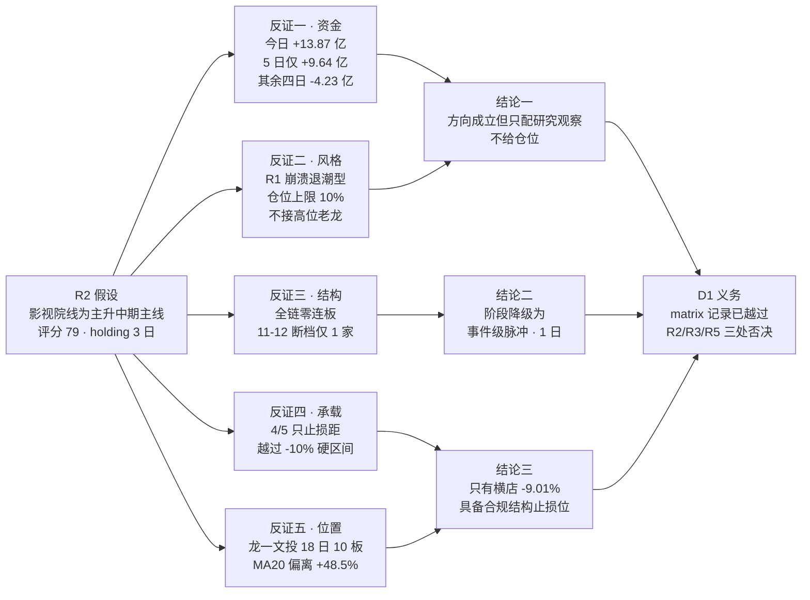

# 2026-11-16 · **反证 / Devil's Advocate**

> **数据源新鲜度**: partial · **降级状态**: true · **置信度**: 0.45
> **覆盖**: R2 主线候选 5 只 + 次线观察 7 只，共 12 只逐票扫描 · 反证 27 条 · **hard_reject 0 个**
> **纪律前置**: 今日 R2 `execution_pool=[]`、R3 `open_permission=false`、R7 `execution_candidates=[]` —— 三层已否决开仓资格，R6 的任务是把「为什么不能开」写成可审计的反面证据

## 一句话结论

影视院线是全场唯一板块级流入方向，但**今日 +13.87 亿的流入里有 4.23 亿是其他四天净流出的回填**；龙一文投是 18 日 10 板的高位老龙，5 只候选中 4 只止损距已越过 -10% 硬区间、3 只命中中位跟风 —— **硬拒 0 个，但可交易资格同样为 0，方向只配研究观察**。

## 详细分析

### 一、先说结论的形状：为什么今天没有 hard_reject

霸榜出货是全卷唯一硬否决权，双条件必须同时成立：板块命中 R3 出货告警 + 个股 5 日主力净流出。今日两条都松了。

- **条件①**：R3 的 `distribution_alert` 只有三只个股 —— 东方海洋（周四涨停起连续两日热榜第一，周五 -6.59% 且龙虎榜净卖 1.45 亿）、日出东方、阳光照明。三只全属「名字套利集群」，**没有一只在影视链，告警也没有落在「影视院线」这个板块上**。
- **条件②**：五只主线候选的 5 日主力全是净流入 —— 文投 +5.90 亿、凯撒 +1.44 亿、中国电影 +1.10 亿、金逸 +0.92 亿、横店 +0.68 亿。次线七只里只有恒瑞 -5.16 亿为负，而它不属主线、条件① 也不成立。

交集为零。所以模式六 **不出硬拒**，这**不等于**这五只通过了审核 —— 只代表没有触发「霸榜出货」这一条既定死刑条件。真正的拦截来自结构与承载，见下文。

唯一的边界要披露：文投在周末双榜（东财人气、同花顺热股）同时登顶第一，注意力榜已连续三天在榜。如果今天盘中再居第一，就构成「连续两日霸榜」，当日应转入 R3 红线四判定。按今日证据只标 `strong_suggest`，不升硬拒，因为条件② 明确不成立。

### 二、资金面：一天流入超过五天总和

| 口径 | 影视院线 |
|---|---|
| 今日净流入 | **+13.87 亿**（全市场板块第一，+4.39%，5 家涨停）|
| 近 5 日净流入 | +9.64 亿（正流入天数 **2/5**）|
| 前 5 日净流入 | **-5.52 亿** |
| 近 20 日净流入 | +10.65 亿 |
| 其余四日合计（复算） | **-4.23 亿** |

这条复算是今天的核心反证：**今日一天流入 13.87 亿，超过 5 日累计 9.64 亿**，意味着前四个交易日合计净流出 4.23 亿。把它叫「板块级资金确认」没有问题，把它叫「持续吸筹」就是误读。同一时点的对照组更能说明性质 —— 银行 +12.26 亿（5 日 +25.04 亿、正流入 3/5 天）、红利 +18.32、中特估 +17.64、大盘价值 +16.67、保险重仓 +20.6、证金持股 +23.35，**六个防御概念同日进钱**。R7 自己的定性原话是「这不是主线切换完成，是资金无处可去的避险」。

再看增量资金：ETF 七只全线赎回（沪深300 ETF 5 日 -10.17 亿、科创50 ETF -43.32 亿），两融 5 日持平，北向已于 10-28 停抓。**没有新钱进场**，影视院线的流入是存量资金在市场内部腾挪的结果，而不是新增配置。

### 三、结构面：零连板、止损悬挂、中位跟风

| 票 | 角色 | 昨收 | 封单 | 换手 | 5 日主力 | RR | 止损距昨收 | 中位跟风 | 财务红旗 |
|---|---|---|---|---|---|---|---:|---:|---:|---|
| 文投控股 | 龙一 | 3.40 | 2.46 亿 | 10.90% | +5.90 亿 | 1.88 | **-12.06%** | 否 | S1 |
| 横店影视 | 龙三 | 19.31 | 0.91 亿 | 1.11% | +0.68 亿 | 1.18 | -9.01% | **是** | S1 |
| 凯撒文化 | 龙二 | 3.96 | 1.50 亿 | 13.70% | +1.44 亿 | 1.30 | **-12.88%** | 否 | **F2+F9+S1** |
| 金逸影视 | 候补 | 9.90 | 0.83 亿 | 2.36% | +0.92 亿 | **0.70** | **-11.31%** | **是** | F10+S1 |
| 中国电影 | 候补 | 17.05 | 0.29 亿 | 6.07% | +1.10 亿 | 2.22 | **-10.32%** | **是** | S1 |

三处硬伤，逐条都不需要主观判断：

第一，**全链零连板**。8 家封板全部是首板，细分口径近四日封板数为 8 → 5 → 1 → 8，中间断档只剩 1 家，且回补的 8 家里 6 家是新面孔。R2 自己写出「没有可打的『总龙』，接力高度依赖文投单票」，却又给 `stage=mid_up 主升中期 · holding 3 日` —— 主升中期的定义要求连板梯队存在，这是标签与事实自相矛盾。

第二，**止损挂在空中**。R5 算出的 RR 1.88（文投）、1.30（凯撒）、2.22（中国电影）都基于「买价 3.15 / 3.78 / 16.10」这样的回踩价，而昨收是 3.40 / 3.96 / 17.05。按昨收附近买入，止损距立刻变成 -12.06% / -12.88% / -10.32%，越过 -5~-10% 硬区间上限。**唯一合规的是横店 -9.01%**，但横店换手仅 1.11% 的缩量板，次日要有放量承接才算数。

第三，**三只中位跟风**。横店、金逸、中国电影全部命中 `mid_laggard`（R2/R5 双口径，sector_rank≥3 的中位跟风票），既不是龙头（板高与带动性不及文投），也不是真低位（30 日区间位置全为 100%、当日创 60 日新高）。纪律第 2 条「只做龙头或低位，躲中位和杂毛」在这里直接适用。

### 四、基本面：五只全线亏损，PB 全在历史顶

五只候选的盈利侧没有一个正数：文投净利 -0.38 亿、ROE -3.52%；横店 -0.82 亿、ROE -6.85%；凯撒 -0.11 亿、ROE -0.46%；金逸 -0.44 亿、ROE -69.62%；中国电影 -0.38 亿、ROE -0.34%。对应的 PB 三年分位是 100.0 / 92.7 / 99.8 / 95.9 / 94.7 —— **全部历史顶部区域**。

这意味着板块 +4.39% 的涨幅完全由 PB 分位扩张驱动，没有盈利支撑。R4 的票房破 320 亿是 11-15 收盘后披露的已兑现数据（利好落地），不构成 2027 年盈利预期；横店毛利 1.48% 更直接说明票房不等于利润。估值陷阱口径上与附录 A 的 V6（盈利未转正而 EPS 增速好看）、V2（高 PEG）同型成立。

财务红旗逐票计数：凯撒三条（F2 商誉/净资产 51.9% 属 P0 级、F9 应收/营收 91.8%、S1 净利为负），金逸两条（F10 有息负债/净资产 372.8%、S1），文投、横店、中国电影各一条（S1）。**最高 3 条，未达 4 条硬拒线**，所以模式七最高只到 `strong_suggest`。逐条复核过阈值口径：F2 的 30% 与附录 A 完全一致；F9 用 9M 口径 91.8%、TTM 口径 69.5%，两种都超 40%，不存在误套。

### 五、昨日错在哪：低吸在退潮期是负期望

11-13 的实盘追踪给了今天最直接的教训：执行池按计划等权 open→close **-4.86%**，观察池 20 只 -1.02%、红盘只有 8 只，买入区命中 12 只**仍然全亏**；T+1 追踪 21 只平均 **-6.47%**、红盘率 9.5%。也就是说，**买点被触及不代表有边际** —— 在 main_down 里「等回踩」是一种系统性亏钱的结构。

今天 R2/R5 给出的买点还是同一类：文投「回踩当日均价线 3.35 附近」、横店「回踩 18.3-18.6」、凯撒「等回踩 3.6-3.8」、中国电影「回踩 16.0-16.3」。同型结构原样重演，昨日 R6 已经用 `plan_outside_scan` 拦过 13/13，今天结构未变。

顺带验证昨日硬拒的有效性：澳洋健康被 11-13 的 R6 以四条红旗硬拒，当日跌停 -10.06%；东方海洋热榜连续两日第一后 -6.59%、龙虎榜净卖 1.45 亿。硬拒这条线是有效的 —— 但今天它没有被触发，因为没有一个候选同时站在「霸榜」和「资金流出」两侧。

## 关键证据

- **资金四天缺口**：影视院线 5 日累计 +9.64 亿，今日单日 +13.87 亿，复算其余四日合计 -4.23 亿 · 来源 R7 板块资金序列
- **防御同向**：银行 +12.26 亿 / 5 日 +25.04 亿、红利 +18.32、中特估 +17.64、保险重仓 +20.6、证金持股 +23.35 六概念同日进钱 · 来源 R7 关键板块
- **无增量资金**：ETF 七只全线赎回（科创50 5 日 -43.32 亿）、两融 5 日持平、北向停抓 · 来源 R7 ETF/两融
- **游资单层**：文投龙虎榜净买 +4.68 亿但机构净额 0.00、北向 -0.11 亿，R7 定性「游资主导·机构缺席」· 来源 R7 游资明细
- **零连板**：8 家封板全为首板，封板序列 8 → 5 → 1 → 8，回补 8 家里 6 家新面孔 · 来源 R2 板块宽度
- **止损越界**：文投 -12.06%、凯撒 -12.88%、金逸 -11.31%、中国电影 -10.32%，仅横店 -9.01% 合规 · 来源 R5 止损距离
- **加速末端**：文投 MA20 偏离 +48.47%、MA50 偏离 +75.80%、30 日位置 100%、量比 0.54 缩量涨停 · 来源 R5 技术准备度
- **全链亏损**：五只净利全为负、PB 三年分位 92.7~100 · 来源 R5 估值安全
- **昨日负反馈**：执行池 open→close -4.86%、观察池 -1.02%、T+1 21 只 -6.47%/红盘率 9.5% · 来源 11-13 观察追踪
- **霸榜双条件交集为 0**：告警不含本链（东方海洋/日出东方/阳光照明），5 日主力全为正 · 来源 R3 告警 + R5 筹码结构

## 推理三问（三个顶级反证对象）

### 反证对象一 · 「影视院线是唯一双确认方向」这个判断

- **大资金意图**: 11-13 是普跌日（涨 765 / 跌 4748、主力净流出 605.71 亿、两日累计 -1130.83 亿），资金不是在买成长，而是在**找一个跌不下去的角落停泊**。银行/红利/中特估/保险重仓/证金持股五个防御概念同日进钱，影视院线只是这轮避险里唯一带涨停潮的容器。对手盘是次日接力的游资，不是配置盘 —— 机构在文投的龙虎榜净额为 0。
- **为什么走强**: 位置（链内 8 家全首板、板块 4.39%，属跌市里的相对强势，但绝对位置全在 60 日新高）；催化（E007 三重触发，票房 320 亿是已兑现数据，官媒定调短剧是软催化）；筹码（文投封单 2.46 亿占流通 2.5%、0 开板，但 3 日龙虎榜累计仍净卖 0.48 亿、股东户数 +4.47% 在分散）。
- **逻辑够不够硬**: **不够硬，只能算准主线**。四源交汇（R2 79 分 / R3 第一主题 / R4 影视院线 high / R7 板块流入第一）看着齐，但每一源都打了折：R3 真等级只有 L1、R4 事件整体强度只是 medium、R7 5 日只有 2 天正流入、R2 自己承认是「研究级」。可证伪路径很直白 —— **11-17 封板少于 3 家即按一日游降级**，不需要等 K 线走坏。

### 反证对象二 · 文投控股（R2 龙一）

- **大资金意图**: 单日净买占成交 44.78%、上榜额占成交 63.14%，十个席位级别的高度集中，是**单一游资集群的卡位动作**，机构与北向都是零。它赌的不是基本面（PB 13.15 处 100 分位、ROE -3.52%），赌的是「题材内高低切之后由谁来当新龙头」这个位置。
- **为什么走强**: 位置上它是 11-13 的**首板**（11-11 曾 3 板、11-12 炸板断板后重启），但身份上是 18 日 10 板的高位股，MA20 偏离 +48.5%、MA50 偏离 +75.8%，属加速末端；催化上是 E007 名实双合（游戏Ⅱ + 短剧双身份）；筹码上封单最厚、0 开板，但同月内两次交易风险提示公告 + 偿债股票司法拍卖构成未定价供给。
- **逻辑够不够硬**: **不够硬**。带动性证据（首封最早 09:30、封单最厚、0 开板）只说明当天它是资金的第一选择，不说明次日有人接。三个证伪点都在明面上：缩量涨停（量比 0.54）说明接力盘薄、3 日龙虎榜累计净卖、司法拍卖随时可能落地。R1 的「不接高位老龙」与它直接冲突，这条冲突没有任何上游单元做过调和。

### 反证对象三 · 凯撒文化（R2 龙二）

- **大资金意图**: 36.4 亿流通是全链最小盘，4 日内 3 板、换手 13.7%，是典型的**小盘弹性位被游资反复做**；但龙虎榜 30 日仅上榜 1 次 +0.19 亿，资金厚度是五只里最薄的 —— 说明每次封板靠的是散户跟风而非席位主攻。
- **为什么走强**: 位置（PB 1.54 处 3 年 99.8 分位，估值在历史顶；30 日位置 100%、逼近前高 4.21）；催化（云游戏心智锚第五，但 R4 未点名）；筹码（换手 13.7% 高位换手，次日必须有承接）。
- **逻辑够不够硬**: **最不硬的一只**。三条财务红旗里 F2 是商誉/净资产 51.9%（P0 级），意味着**任何一次题材退潮都可能触发减值叙事**；F9 应收/营收 91.8% 说明收入没有变现。同时它落在今日最差市值桶（50-200 亿桶中位 -2.09%、上涨占比 13%）。三件事叠加，它是「弹性最大也最容易被打穿」的那只。

## 每票思维链（反证视角 · R2 龙一与龙二）

> R6 不给正向结论，此处思维链写的是「若 D1 仍然要碰这只票，它的条件长什么样」，供 E1 回填校准。

### 文投控股 600715.SH

- **买入理由**（若成立）：① 卡位证据是全链最硬的一组 —— 09:30 首封、封单 2.46 亿占流通 2.5%、0 开板、5 日主力 +5.90 亿（占流通 6.06%，全批最强）；② 题材名实双合，游戏Ⅱ + 短剧双身份，周末东财人气与同花顺热股双榜第一，注意力已到位。
- **风险点**：① **位置风险**——18 日 10 板、MA20 偏离 +48.5%、量比 0.54 缩量涨停，加速末端且接力盘薄；② **供给风险**——偿债股票司法拍卖未定价、户数 +4.47% 筹码分散、3 日龙虎榜累计净卖 0.48 亿；③ 游资单层结构，机构净额 0.00，次日无人接力即无承接。
- **止损条件**：R5 结构位 2.99-3.00（距昨收 -12.06%），**已越过 -10% 硬区间**，因此按昨收买入不成立。唯一可行路径是等价格回落到 3.15 附近使止损收敛进 -5~-10%；若竞价高开 >5% 且链内无新增封板，视为先手兑现位而非买点。
- **可验证假设**（24-72h）：① 开盘 09:30-10:00 若链内涨停潮不足 3 家，则整链按一日游处理（阈值：封板家数 <3）；② 今日若双榜（东财人气 / 同花顺热股）再居第一，即构成连续两日霸榜，转入 R3 红线四判定；③ 次日若缩量红盘（换手 <8% 且无新增封板），即判定无承接。

### 凯撒文化 002425.SZ

- **买入理由**（若成立）：① 封单 1.50 亿链内第二厚、09:35 首封、0 开板，板型干净；② 36.4 亿流通为链内最小弹性位，4 日内 3 板，情绪弹性最大。
- **风险点**：① 三条财务红旗（F2 商誉 51.9%、F9 应收 91.8%、S1 净利为负），减值叙事随时可被退潮触发；② 资金厚度最薄（30 日龙虎榜仅 1 次 +0.19 亿），封板靠跟风；③ 落在 50-200 亿最差市值桶（中位 -2.09%）。
- **止损条件**：结构位 3.45（距昨收 -12.88%），同样越过硬区间；return 到 3.78 附近才使 RR 1.30 生效。破 3.45 无条件离场。
- **可验证假设**（24-72h）：① 次日换手率能否维持在 10% 以上且封板不打开（阈值：换手 <8% 或开板 >2 次 = 无承接）；② 商誉减值是否在年报预告窗口被提及（阈值：出现减值表述即永久移出观察池）。

## 数据源审计

| 源 | 日期 | 状态 | 备注 |
|---|---|:--:|---|
| 研究单元 R1 风格 | 2026-11-16 | 🟡 | status=degraded · 商品/DXY/汇率维缺失 · confidence 0.472 · 仓位上限 0.10 |
| 研究单元 R2 主线 | 2026-11-16 | 🟢 | 主线 1 条（79 分）· 候选 5 只 · execution_pool 为空 |
| 研究单元 R3 情绪 | 2026-11-16 | 🟡 | degraded=true · L2 群聊 0 条 · WeFlow 已下线 · 真等级 L1_only · 炸板率 36.21% |
| 研究单元 R4 消息 | 2026-11-16 | 🟢 | 8 条 top 事件 · E007 影视院线 high / 事件整体 medium |
| 研究单元 R5 画像 | 2026-11-16 | 🟢 | 12 只画像 · 红旗 F2×1 / F9×4 / F10×1 / S1×8 · 全部 research_only |
| 研究单元 R7 资金 | 2026-11-16 | 🟡 | 11-13 收盘档 · 两融仅 SSE 一行改同口径 · 北向 2026-10-28 停抓 · ETF partial_lag |
| 昨日反证单元 R6 | 2026-11-13 | 🟢 | 30 条反证 · hard_reject 1（澳洋健康）· 当日跌停 -10.06% 兑现 |
| 昨日观察追踪 | 2026-11-13 | 🟢 | 执行池 3 只 / 观察池 20 只 · open→close -4.86% / -1.02% |
| 群聊层（行业分析师群等） | 2026-11-16 | 🔴 | 7 群命令成功但窗口内 0 条消息 · 本地库停在 2026-10-28 · 不用旧文本冒充当日情绪 |
| 北向资金 | 2026-10-28 | 🔴 | 用户决定停抓 · 本单元只读，不补 |
| 商品实时价（票房/铜/DRAM） | — | 🔴 | 未接入 · 模式十 commodities 判据降级，不编造背离 |

## 不确定性 / 反证

**关于本单元自身的局限，三件必须说清**：

第一，**R6 无正向结论，也因此无法替代 D1 的择优功能**。今天给出 27 条反面证据、0 个硬拒，最自然的误读是「既然没硬拒，那就是可以买」。这个推论是错的。硬拒是唯一死刑，没有死刑不等于有通行证 —— 通行证在 R2/R3/R5 三处已经被逐一否决（execution_pool 为空、open_permission=false、档位过闸门 0 只），R6 只是补上了「为什么这些票只能研究」的证据链。

第二，**模式六的边界判断依赖「告警是否落在板块」这一机械口径**。R3 的告警是票级（东方海洋等三只），不是板块级，所以本链条件① 判定为不命中。但文投「周末双榜第一 + 注意力连续三日」实质上是霸榜状态，只差第二日官方披露。若明日 R3 把它写进告警，今日的 strong_suggest 就会变成明日的 hard_reject —— **今天放过的不是风险，而是次日可能变成硬拒的那部分风险**。这条敏感性已写进 JSON 的 threshold_note。

第三，**覆盖不完全**。同链 11-13 还有 3 只涨停没有画像：儒意电影（封单 0.09 亿、10:38 首封）、幸福蓝海（10:09 首封、封单 0.11 亿）、湖北广电（09:36 首封、广电非院线主业）；另有北京文化（开板）、博纳影业（11:17 首封＝尾盘投机板）两只当日即被结构否决。R4 的首推其实是儒意（院线收入 100%），R2 却把龙一判给游戏Ⅱ身份的文投 —— **主线名与龙一主业并不匹配**，这个身份错配本单元只做了披露，未做裁定。

第四，模式四（历史类比）与模式十（跨资产背离）今日均标 degraded：前者缺历史事件库，后者缺影视链对口商品（票房属服务消费、非可交易品种）。按 skill 要求**不编造**，只记录可用的替代证据（模式五用昨日本单元的实际追踪数据补位，模式十用风格层避险同向补位）。

## 与其他 R/D/E 的关系

- **依赖**：R1 风格（阶段与仓位上限）、R2 主线（反证对象与龙头身份）、R3 情绪（霸榜告警、共振等级、候选砍半）、R4 消息（催化强度与首推票）、R5 画像（筹码/估值/红旗/止损距）、R7 资金（板块流入序列、游资明细、ETF 两融）、昨日 R6 与 11-13 观察追踪
- **被消费**：D1 主决策 —— `hard_rejects` 为空则无强制剔除项；16 条 `strong_suggest` 须逐条接受或在 `meta.d1_override[]` 记录理由（重点四条：R6_M1_01 资金四日缺口、R6_M2_01 阶段冲突、R6_M4_02 止损越界、R6_M4_03 中位跟风）；11 条 `soft_suggest` 记入 `r6_soft_notes`
- **回填**：E1 复盘将按 `candidate_ids` 追踪文投/凯撒/横店/中国电影/金逸的次日溢价与封板家数，用于校准「准主线是否可升级为主线」这一判定

## Sub-Agent 元数据

- skill: analyze_devil_advocate_v1
- artifact: data/research/20261116/R6_devil_advocate.json（27 条反证 · 16 strong / 11 soft · hard_reject 0）
- 生成耗时: 约 13 分钟（只读扫描 8 个上游 artifact）
- model: deepseek-v4.1-flash
- 红线自检: MCP 调用 0 · delegate_task 0 · 联网 0 · chzl_kg 写入 0
