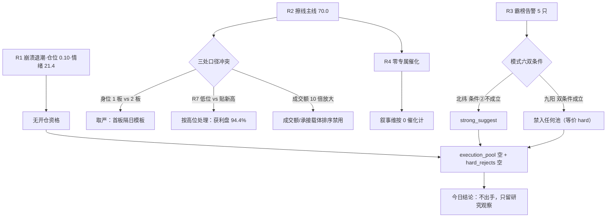

# 2026-11-17 · **反证 / Devil's Advocate**

> **数据源新鲜度**: partial
> **降级状态**: true
> **置信度**: 0.45（0.80 × 0.70 × 0.80）

## 一句话结论

全场唯一 70 分"擦线主线"没有 R4 专属催化，龙一吉视在身位（1 板 vs 2 板）、位置（低位 vs 贴新高）、成交额（10 倍放大）三处口径全部冲突；12 只候选无一只过闸门，霸榜出货硬拒为空集但九阳股份按"禁入任何池"执行 —— 今日正确动作是不出手。

## 四象限负面识别

| 象限 | 条数 | 今日最重的一条 | 数字锚 |
|---|---|---|---|
| 🔵 Q1 资金 | 4 | R2 成交额对 7/8 只放大 10 倍，R5 已把"华数 82.2 亿"写进结论 | 实为 8.48 亿（换手 5.84% × 流通 145.2 亿） |
| 🟠 Q2 情绪 | 5 | 主线叙事维无 R4 专属催化，唯一相关事件在游戏子链 | 叙事维 11/20，R4 8 条事件 0 条覆盖广电/院线 |
| 🟡 Q3 基本面估值 | 19 | 12 只里 9 只亏损或经营现金流为负；F8 三条复核成立 | 吉视 ROE -7.06%，金逸 ROE -69.62% |
| 🔴 Q4 结构 | 11 | 龙一身位/位置口径冲突 + R7"低位首板"误标 | 30 日区间位置 100%，获利盘 94.4% |

> Q3 占比高达 19 不是判据失衡，是结构事实：今天在场的候选本身就是一批亏损小市值壳型票，估值与财务面天然是主战场。

## 详细分析

### 一 · 这是一条"擦线主线"，而不是主线

R2 自己给出了最诚实的定性：本线 70.0 分"扣任一维即跌破 70"，并注明"与 20261113 半导体 70.0 同类"。这句话是可以拿实盘验证的：11-13 那条同分半导体线，到 11-16 已进入 R2 的剔除名单 —— 半导体 -5.99%、涨占比 0.01（2 涨 185 跌）、5 日 -61.06 亿。同分同结构的先验是"3 个交易日内崩塌"，不是"主升起点"。因此本线的任何仓位都不能跨日，只能当日闭环。

更硬的缺口在消息面。R4 的 8 条事件里没有一条覆盖电视广播、影视院线或短剧漫剧；唯一相关的是 E008"GTA VI 11-19 发售、三季度国内游戏收入 925 亿"—— medium 级，而且落在 R2 自己承认"钱不认"的 游戏 子链。R2 在共振维给了 13 分，靠的是 R3 rank1 的排名；但 R3 的真等级是 L1_only（真人语义层自 8 月起永久缺位，本地微信库已连续 11 个交易日 0 字节），按红线 3 不能标强共振。排名第一 + 零真实验证 + 零专属催化，三者相加只能得出"研究观察"，不能得出"主线"。

### 二 · 龙头吉视的三处口径冲突，任何一处都足以拦住买入

第一处是身位。R2 写 limit_times=2.0、"11-13 首板 → 11-16 二板（3 天 2 板）"，据此判龙一；R5 用 limit_list_d 逐日 U 名单回推，写的是"1 板 limit_times=1"，并在扣分项里明确点名"R2『二板』表述与逐日数据不符"。这不是措辞差异，是"首板隔日模板"与"二板接力模板"的分野 —— 前者要求竞价弱转强确认，后者默认有接力资金。取严只能用 1 板。

第二处是位置。R7 的研究卡把吉视标成"低位首板（电视广播）"，pos20=93.0。但同一批 artifact 里 R2 写"距 60 日高 0.0%（贴新高）"、R5 写"30 日区间位置 100.0%、获利盘 94.4%、无套牢缓冲"。93 分的分位秩不是低位，是高位。D1 若照 R7 的 rank 文本套"低位首板"通道，等于在最没有缓冲的位置开仓。

第三处是量级。R2 的 leaders 里，8 只有 7 只的成交额对不上自己的换手率与流通市值 —— 华数 82.2 亿 vs 8.48 亿、金逸 4.92 亿 vs 0.50 亿、北纬 165.32 亿 vs 16.82 亿、广百 32.86 亿 vs 3.28 亿，全部约 10 倍；只有吉视是 0.96 倍（14.8 亿，与 R5 用主力净额 4.48 亿 / 30.28% 反算出的量级一致）。这个误差已经被下游继承了：R5 的华数结论原文写着"82.2 亿成交为链内最大承接载体"。一条 10 倍的成交额，足以把"承接力最弱（3 次开板、封单 0.29 亿）"读成"承接载体最强"。

### 三 · 资金面只有一个真信号，其余都要打折

今日唯一无争议的资金事实是电视广播净流入 6.79 亿，居全市场行业第一，且电视广播是唯一正涨幅行业（+2.19%、涨占比 0.62）。吉视当日主力 +4.48 亿、占成交额 30.28%，5 日 +6.23 亿（3/5 天正），R5 与 R7 双源一致 —— 这是全场最扎实的一笔钱。

但往下每一层都要打折：链内第二子行业 游戏Ⅱ -1.76%、影视院线 -1.81%，两个子行业涨占比都 <0.25，本线是"一条腿站着"；影视院线 5 日 +11.62 亿、一般零售 -12.02 亿、电网设备 -19.35 亿这些数字全是 R2 自算，R7 只透出 top10 流入榜、没有流出榜，无法双源复核；吉视那 +2.14 亿龙虎榜净买，机构 0 席、沪股通 0.36 亿，无机构覆盖（近 90 日研报 0 篇、调研 0 次），究竟是游资合力还是对倒，本地 artifact 没有 top_inst 明细，判不了 —— R2 自己也把它列成"待 R6 验证项"，我只能给"未核验"，不能给"合力"。

最难看的一笔钱在北纬：4 板当日主力净流出 -1.22 亿（占比 -7.39%），30 日龙虎榜净卖 -1.68 亿、机构净卖 -2.05 亿，开板 7 次、换手 42.59%、封成比 0.016。涨停日净流出，是派发而不是拉抬。

### 四 · 情绪面：昨天的"条件式买点"已经被实测打负

昨日观察池 21 只，今日均跌 -3.40%，开盘至收盘 -4.32%，红盘 5 只、跌停 4 只，买入区间命中率 45.0%。这不是说低吸一定错，是说在主跌第 3 日的环境里，"回踩均价线就接"的期望值是负的。今日 R2 又有 7 只给的是这类条件式买点，必须整体降级为"开盘 30 分钟三判据成立后才谈"。

情绪口径本身也有分歧：R1 用 limit_list_d 得涨停 32 / 跌停 60 / 炸板率 33.33%，R7 用交易所限价得跌停 68 / 炸板率 40.00%。R2 已对炸板率取严 40%（≥35% 硬红线、候选砍半），但跌停 60 vs 68 这 8 家的差异没有人披露。取严汇报是唯一安全做法。

另一个被误读的信号是 R1 的"修复窗口"。R1 的原话是"第 4 天语义=连跌 3 天后的修复窗口，不是继续空仓…开盘 30 分钟三判据确认…不成立 → 维持观察，不硬做"。这是"条件+纪律"，不是"许可"。同一份 artifact 里仓位上限是 0.10、情绪 21.4 恐惧、R3 六项否决、R7 零可执行 —— 修复窗口的意思是小额度试错窗口开着，不是门开着。

### 五 · 基本面：9 只票的财务面本身就在否决自己

12 只逐票过附录 A checklist，F8（经营现金流连续两期为负而净利润为正）三条全部用现金流原始序列独立复核成立，没有一条是拿错阈值：华数 9M -5.49 亿 / 6M -6.96 亿 vs 净利 +2.70 亿；北纬 9M -0.14 亿 / 6M -0.09 亿 / 2025 年报 -0.21 亿 vs 净利转正；九阳 9M -1.48 亿 / 6M -0.53 亿 / Q1 -1.25 亿 vs 净利为正。F8 属 P0 类，单条即 strong。

F9 则需要谨慎：五只票的"应收/营收>40%"全部是 9M 累计口径，换成 TTM 后华数 31.1%、紫竹 29.7%、吉视 33.9% 都不成立（顺钠 54.9%、领湃 57.9% 仍成立）。凡属边界项的，我一律按不成立计，宁可少报一条红旗，也不拿口径造硬拒。

真正极端的两条不是红旗而是结构：金逸有息负债/净资产 372.8%（PB 97.6 分位、ROE -69.62%、2026H1 首亏）、紫竹 719.3%（同时机构净卖 -1.89 亿、股东户数 +39.39%）。按附录 A 计数规则它们各自只算 1 条非 P0 红旗（soft），但强度接近 P0 —— soft 是计数结论，不是"可忽略"。

## 推理三问（三个必须被反着问的对象）

### 601929.SH 吉视传媒 · 龙一

- **大资金意图**：当日主力 +4.48 亿、占成交额 30.28%，5 日 +6.23 亿，是链内唯一大额净买；但席位结构是游资主导（机构 0、沪股通 0.36 亿、近 90 日零研报零调研）。意图是"卡住唯一正涨幅行业里的低价国资票"，不是"做一条有基本面支撑的线"。
- **为什么走强**：大盘崩溃日（主力 -646.77 亿、跌停 60~68 家、科创50 -5.16%）还能 2 板零开板，买的是相对强度 + 低价 + 无 ST 风险 + 板块唯一正涨幅，四件事叠在一起。不是题材变好了。
- **逻辑够不够硬**：不够。缺口有三处 —— 身位取严只有 1 板；位置是 30 日区间 100%、获利盘 94.4%；成交额口径虽自洽但封成比 0.093 属薄封，次日竞价一档就能打穿。叙事端 R4 零专属催化。结论：可观察，不可开仓。

### 300530.SZ 领湃科技 · 全场唯一 RR>2

- **大资金意图**：当日 +0.88 亿、5 日仅 +0.39 亿（占流通市值 0.81%），但龙虎榜 30 日净买 1.82 亿、机构 +2.59 亿 —— 大钱在更早的窗口已进，今日是情绪首板的低成本延续。
- **为什么走强**：E006 十五五新型储能点名"本质安全固态电池" + 11-20 上海论坛接力，20cm 板 + 上午封板 + 0 开板 + 封单 0.98 亿，是标准的事件驱动首板。
- **逻辑够不够硬**：半硬。硬的部分是事件时点明确（11-20 前有博弈窗口）、板型干净；软的部分是主营动力电池、无固态收入，电池行业 5 日 -70.33 亿，R7 资金维完全不确认。RR 2.23 是"按昨收 27.83 买"的算法，而止损 24.5 距昨收 -12.0%，超出 -5~-10% 硬区间；只有回踩 26.0 买，RR 3.88 与止损 -5.8% 才同时成立。**结论：只能在 26.0 附近谈，不能追 20cm。**

### 002242.SZ 九阳股份 · 唯一双条件命中的派发票

- **大资金意图**：5 日主力 -4.63 亿（全批最差，2/5 天正）、当日 -0.34 亿；同时融资余额 15 日 +553%、融券 +163% —— 杠杆双向爆量，是典型"高位换手派发 + 杠杆博弈"结构。
- **为什么走强**：60 日 +215.5%、心智锚"复苏消费"TOP3、人气 dc#3，是消费链的情绪锚。今日尾盘炸板 7 次收在均价线下。
- **逻辑够不够硬**：不硬。PE 330.97、PB 6.78 双双 100% 分位，净利同比 -41.75%，F8 成立。人气 #1 + 尾盘炸板 + 主力净流出，三个信号同向。**结论：禁入任何池（等价 hard）。**

## 每票思维链 · 被反证对象的假设面（吉视传媒）

- **买入理由（假设面，非本单元建议）**：唯一正涨幅行业里的卡位票 + 封单 1.37 亿链内最厚 + 0 开板 + 龙虎榜单日净买 2.14 亿 + 5 日主力 6.23 亿，按首板隔日模板可等竞价弱转强。
- **风险点**：身位只有 1 板（R5 逐日口径）；贴 60 日新高、获利盘 94.4% 无缓冲；封成比 0.093 薄封；R4 零专属催化；炸板率 40% 环境下首板隔日晋级率仅 25.81%（R3 记录 11-16 实测值，11-12 为 7.58%）。
- **止损条件**：结构位在 MA5 2.71（距收盘 -8.45%）；若按 2.78 的回踩买点，止损 2.64（-5.0%）。跌破 2.71 且不能当日收回，逻辑即证伪，不救。
- **可验证假设**：① 竞价高开 ≤3% 且板块红盘率 >60%、板块级涨停 ≥3 只 → 弱转强成立；② 若高开 >5% 但 30 分钟内回落跌破开盘价 → 视为派发，直接放弃；③ 北纬若跌停，链内"高度"叙事失效，吉视作为卡位票的溢价同时失效。

## 霸榜出货双条件扫描（模式六）

| 标的 | 角色 | 条件① R3 霸榜告警 | 条件② 5 日主力<0 | 当日主力(亿) | 裁决 |
|---|---|---|---|---|---|
| 002148.SZ 北纬科技 | 身位 4 板 | ✅ 命中 | ❌ +2.18 亿（3/5 天正） | -1.22 | strong_suggest（当日已转净流出） |
| 002242.SZ 九阳股份 | 观察·心智锚 | ✅ 命中 | ✅ -4.63 亿 | -0.34 | strong_suggest → 禁入任何池 |
| 601929.SH 吉视传媒 | 龙一 | ❌ | ❌ +6.23 亿 | +4.48 | not_triggered |
| 000156.SZ 华数传媒 | 龙二 | ❌ | ❌ +1.50 亿 | +1.73 | not_triggered |
| 002905.SZ 金逸影视 | 龙三 | ❌ | ❌ +0.96 亿 | +0.16 | not_triggered |
| 605577.SH 龙版传媒 | 候补 | ❌ | ❌ +0.38 亿 | -0.08 | not_triggered |
| 002187.SZ 广百股份 | 次线龙一 | ❌ | ❌ +1.30 亿 | +0.26 | not_triggered |
| 002959.SZ 小熊电器 | 次线龙二 | ❌ | ❌ +0.42 亿 | +0.47 | not_triggered |
| 300530.SZ 领湃科技 | 次线龙一 | ❌ | ❌ +0.39 亿 | +0.88 | not_triggered |
| 000533.SZ 顺钠股份 | 观察·低位 | ❌ | ❌ +0.94 亿 | +2.03 | not_triggered |
| 002058.SZ 紫竹高科 | 观察·电池 | ❌ | ❌ +0.36 亿 | +0.65 | not_triggered |
| 002419.SZ 天虹股份 | 观察·零售 | ❌（R5 侧大宗折价告警，非 R3） | ❌ +0.88 亿 | +0.95 | not_triggered（另按 R6_M1_08 拦截） |

**hard_rejects = 空集（0 只），逐票核对确认。** 原因不是"全部健康"，而是：R2 今日 execution_pool 为空、8 只 leaders 里没有一只带 execution_eligible 字段，契约意义上的硬拒对象不存在。唯一双条件同时成立的九阳是观察池票，按 v1.3 出口（允许空仓、禁止递补）记 strong_suggest，但 suggestion 前置"禁入任何池"，在 D1 消费端等价于硬拒 —— 它会从任何候选或试仓名单里被拿掉。

## 昨日反证兑现审计（诚实计分）

| 昨日 R6 判断 | 今日实际 | 计分 |
|---|---|---|
| 影视链"事件级脉冲·1 日" | 链存活第 2 日：文投 +10.00%、横店 +8.75%、湖北广电 +3.49%、儒意 +1.49%（6 只中 4 只正收益） | ❌ 判错 |
| 金逸影视"直接剔除" | 再涨 +10.00%（竞价一字、封单 1.16 亿、封成比 2.354 全批最高） | ⚠️ "买不到"成立，"不该涨停"不成立 |
| 横店影视"降级观察" | +8.75%、买入区间命中、开盘至收盘 +4.01% | ❌ 假阳性 |
| 文投"按高位老龙、不追" | 仍 +10.00%，但同日龙虎榜净卖 -3.55 亿、开板 8 次、*ST 风险成立 | 🟡 结论迟到但成立 |
| "回踩均价线"类买点需三判据 | 21 只观察池均跌 -3.40%、开盘至收盘 -4.32%、买入区间命中率 45% | ✅ 成立 |

昨日最大的教训不是"别做影视链"，而是**把"买不到"和"不该涨"混成了一个结论**。今天对二线票只用可买性（换手、封单、一字）否决，不再用涨幅预判否决。

## 关键证据

- **R2 leaders 成交额 7/8 只放大 10 倍**：amount_yi 与"换手 × 流通市值"的比值 9.26~10.01 倍，仅吉视 0.96 倍；R5 已据此写出"华数 82.2 亿成交、链内最大承接载体"。来源：R2_main_sectors.json / R5_stock_profiles.json
- **吉视身位冲突**：R2 limit_times=2.0 与 R5"1 板 limit_times=1、R2 二板表述与逐日数据不符"并存。来源：R2 + R5
- **R7 把贴新高票标成低位**：R7 rank"低位首板"、pos20=93.0；R2"距 60 日高 0.0%"、R5"30 日区间位置 100%、获利盘 94.4%"。来源：R7 + R2 + R5
- **F8 三条独立复核成立**：华数 / 北纬 / 九阳的现金流原始序列（_r5_fin_stmt.json）均连续两期以上为负，同期净利为正。来源：R5 + 财报三表原始
- **主线零专属催化**：R4 8 条事件无一条覆盖电视广播/影视院线/短剧，唯一相关是游戏 medium。来源：R4_news.json
- **同分主线 3 日崩塌先验**：11-13 半导体 70.0 分，11-16 已被 R2 剔除（-5.99%、涨占比 0.01、5 日 -61.06 亿）。来源：R2 / R3
- **昨日条件式买点实测为负**：观察池 21 只均跌 -3.40%、红盘 5 只、跌停 4 只、买入区间命中率 45%。来源：observation_tracking 20261116

## 反证传导链

## 数据源审计

| 源 | 状态 | 抓取日期 | 记录数 | 备注 |
|---|---|---|---|---|
| R1 风格 | 🟡 stale | 2026-11-17 | — | status=degraded，商品/DXY/两融缺；仓位上限 0.10 仍可用 |
| R2 主线 | 🟢 ok | 2026-11-17 | 8 只 leaders / 7 只观察 | complete；但 leaders 缺 execution_eligible 字段、amount_yi 有 10 倍误差 |
| R3 情绪 | 🟢 ok | 2026-11-17 | 5 个共振主题 | complete；真人语义层永久缺位，真等级 L1_only |
| R4 消息 | 🟡 partial | 2026-11-17 | 8 条事件 | complete 但 degraded=true（群聊 0 条、正文全空） |
| R5 画像 | 🟢 ok | 2026-11-17 | 12 只 | complete；转述了 R2 的 82.2 亿成交额错误 |
| R7 资金 | 🟢 ok | 2026-11-17 | 5 研究 + 10 行业流入 | status 字面 "ok"、analysis_status=completed；只透出流入榜 |
| R5 财报原始 | 🟢 ok | 2026-11-17 | 11 只三表 | 用于 F8/F3/F9 独立复核 |
| E1 昨日跟踪 | 🟢 ok | 2026-11-16 | 21 观察 + 4 执行 | price_source=tushare daily 20261116 |
| 昨日 R6 | 🟢 ok | 2026-11-16 | 27 条反证 | 用于模式五连锁审计 |

## 不确定性 / 反证

1. **我可能低估了这条线。** 昨日我判"影视链 1 日游"已经被实盘否过一次；今天同样的结构我又给了"3 日崩塌"先验。若 11-17 板块级涨停重新扩到 8 家以上、且吉视竞价弱转强成立，本单元的结构判断就是二次误判。这是我的主要自反证点。
2. **成交额 10 倍误差未经数据源二次确认。** 我用"换手 × 流通市值"反算得出的结论，若 tushare 的 turnover_pct 与 float_mv 口径本身有偏差（例如含限售口径错配），误差倍数可能不是整齐的 10 倍。但 7 只同时落在 9.26~10.01 倍这个窄区间，更像单位换算问题而非巧合，我按"禁用该字段"处理而不下"数据造假"结论。
3. **模式四/八/十 是降级产物。** 无历史事件库、无套牢区与封板量序列、无碳酸锂/铜与美元指数序列 —— 这三个模式的结论只能给方向，不能给量化阈值，不构成任何否决依据。
4. **吉视席位是否对倒，判不了。** 本地无 top_inst 明细，机构覆盖为 0。我写"游资单一合力未核验"，这是缺口披露，不是结论。
5. **模式六的 hard 为空可能被误读。** 若 D1 只看 hard_rejects 数组长度就断言"12 只全票通过"，那是消费错误。正确读法是：无契约级对象 + 九阳等价 hard + 12 只全部 research_only。

## 与其他 R/D/E 的关系

- **依赖**：R1_style（温度与仓位上限）、R2_main_sectors（主线与候选）、R3_sentiment（霸榜告警与共振等级）、R4_news（催化覆盖）、R5_stock_profiles（画像/估值/红旗/筹码）、R7_capital_flow（资金确认）、_r5_fin_stmt（财报原始）、observation_tracking 20261116（昨日兑现）、R6 20261116（连锁审计）
- **被消费**：D1（canghai-plan）读取 hard_rejects[] 与 counter_arguments[]；E1（canghai-review）用于次日兑现审计；orchestrator 汇总进 research_summary.json

## Sub-Agent 元数据

- skill: analyze_devil_advocate_v1
- artifact: data/research/20261117/R6_devil_advocate.json（65 KB，39 条反证，hard_rejects 0）
- 模式覆盖：模式 1（8）/ 2（3）/ 3（9）/ 4（1）/ 5（4）/ 6（2）/ 7（9）/ 8（1，not_triggered）/ 9（1）/ 10（1，degraded）
- severity 分布：strong_suggest 26 / soft_suggest 13 / hard_reject 0
- 红线自检：0 次 MCP、0 次 delegate_task、0 次联网抓数，只读 data/research/20261117 与 data/reports/20261116 既有 artifact
- model: deepseek-v4.1-flash
