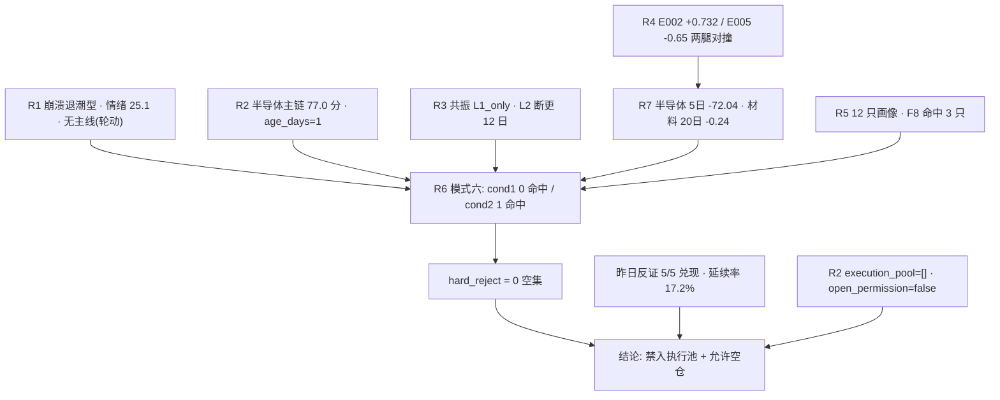

# 2026-11-18（周三）· **反证 / Devil's Advocate**

> **数据源新鲜度**: partial（R1/R3/R4/R7 均 degraded，R2/R5 完整）
> **降级状态**: true（模式四/七/十 覆盖不全）
> **置信度**: 0.45（公式 0.80 × 0.70 × 0.80 = 0.448）
> **反证总量**: 27 条 · strong_suggest 17 / soft_suggest 10 / **hard_reject 0**

## 一句话结论

**R2 唯一 77 分主线只有 1 天年龄、资金支撑是单日脉冲；模式六双条件全场无一票同时成立 → 硬拒为空，但「禁入执行池 + 允许空仓」的结论不动。**

## 一、今日反证的总体形状

今天反证的对象不是「某只票会不会涨」，而是一条**刚出生一天就被打了 77 分的主线**。R2 给「半导体设备·材料·光刻胶（国产替代主链）」77.0 分，比昨天那条 70.0 分的「擦线主线」还高 7 分；但同一份 R2 里，`lifecycle.metrics` 写的是 `age_days=1`、`leader_height=1`、`money_persist_days=1`、`confidence=0.6`。分数在往上走，证据强度停在最低档——这是今天所有反证的第一推力。

第二个推力是资金口径。R2 说「三腿齐正」（设备 +19.05 / 材料 +18.83 / 制造 +18.08 亿），但同一份 R7 的序列里：半导体大类 **5 日 -72.04 亿、20 日 -108.28 亿**；半导体材料 **20 日 -0.24 亿**（≈0），5 日 +5.53 亿里当日 +18.83 独占，其余 4 日合计 **-13.30 亿**；上位行业电子 **5 日 -377.25 亿、20 日 -795.76 亿**，5 日只有 2/5 天为正。所以「资金回流」的准确表述是**单日脉冲**，不是趋势确认。

第三个推力是昨天的账。昨日 R6 对影视传媒链下的反证 **5/5 全部兑现**：吉视传媒 -6.76%、华数传媒 -9.95%、慈文传媒 -9.98%、儒意电影 -4.12%、文投控股 -9.89%。R7 昨天 29 张卡片的延续率只有 **5/29 = 17.2%**（双负 11、反手转负 5）。在 17.2% 的延续率底下，任何「首板隔日」「人气跳升」「地天板」结构的默认赔率都必须按 1 日脉冲重算。

## 二、模式六 · 霸榜出货 hard_reject 逐条裁决

契约双条件：① 命中 R3 `distribution_alert`；② 个股 5 日主力净流出。**必须同时成立才签 hard_reject。**

| 票 | 角色 | 条件① alert | 条件② 5 日主力 | 裁决 |
|---|---|---|---|---|
| 有研新材 600206.SH | 龙一 | ❌ 不在名单 | ✅ 正 +9.88 亿（1/5 日为正） | not_triggered |
| 江化微 603078.SH | 龙二 | ❌ | ✅ 正 +0.87 亿 | not_triggered |
| 西陇科学 002584.SZ | 龙三 | ❌ | ✅ 正 +1.28 亿 | not_triggered |
| 北方华创 002371.SZ | 容量核心 | ❌ | ✅ 正 +19.48 亿（5/5 日正） | not_triggered |
| 中芯国际 688981.SH | 中军 | ❌ | ✅ 正 +8.01 亿 | not_triggered |
| 华东重机 002685.SZ | 身位股 3 板 | ❌ | ✅ 正 +3.07 亿 | not_triggered |
| 长川科技 300604.SZ | 设备二梯队 | ❌ | ✅ 正 +6.83 亿 | not_triggered |
| 联合化学 301209.SZ | 光刻胶首板 | ❌ | ✅ 正 +1.83 亿 | not_triggered |
| 双环科技 000707.SZ | 氯化铵首板 | ❌ | ✅ 正 +0.34 亿 | not_triggered |
| 长虹美菱 000521.SZ | 2 板中位 | ❌ | ✅ 正 +1.20 亿 | not_triggered |
| 小熊电器 002959.SZ | 2 板中位 | ❌ | ✅ 正 +0.75 亿 | not_triggered |
| **九阳股份 002242.SZ** | 家电情绪龙 | ❌ 不在名单 | ❌ **负 -6.59 亿（1/5 日正）** | **strong_suggest（近硬拒）** |

**结论：`hard_rejects = []`，但这不是「12 只都干净」**，是三层契约空转：

- **R2 全文 `execution_eligible` 出现 0 次**（grep 实测计数 0）→ 契约规定的触发对象集合按定义为空；
- **R2 `execution_pool=[]`、R3/R2 `open_permission=false`、R7 `execution_candidates=[]`** → 执行级对象本来就是 0；
- **R3 `distribution_alert` 是「个股级」5 条**（文投控股 / 中际旭创 / 宇树科技-W / 新易盛 / 阳光照明），而规则版实现 `src/research/r6_devil_advocate.py:404` 拿 leader 的 `sectors`（板块名）去撞这个**股票名集合**，两边天然不相交 → 代码层模式六永不命中。

⚠️ 顺带查明一个**契约冲突**：`src/research/r6_devil_advocate.py:443` 的 `_apply_red_line_3_guard` 仍在执行「候选 < 3 只时把 hard_reject 自动降级」的红线 3 凑数保护，而 skill v1.3 已明文删除该规则并改为「允许空仓、禁止杂毛替补」。**若走规则版，今天的硬拒会被自动降级** —— D1 侧须确认走的是 LLM 版契约。

**离硬拒最近的一票：九阳股份。** 条件②成立（5 日 -6.59 亿、20 日 -1.35 亿、1/5 日为正），叠加获利盘 99.7%、距 MA50 **+87.42%**、30 日区间位置 100%、PE 364（分位 100%）、净利 -41.75%、alpha C / 风险 C。它缺的只是条件①（不在 R3 告警名单）。按 v1.3 只能出 strong_suggest；**但 D1 今日即不得把它放进执行池**，若明日 R3 把它并入 alert，应立即升级 hard_reject。

## 三、模式七 · 基本面红旗裁决

R5 只透传了 6/12 条红旗的检出结果（F1/F2/F3/F4/F8/F9/F10/F11）与 2/10 条估值陷阱（V3/V4），F5/F6/F7/F12 与 V1/V2/V5–V10 无字段 → 模式七**必须标 degraded**，不得对外声称「无 ST/非标风险」。

| 票 | 原始命中 | 裁决成立 | P0 | 模式七档 |
|---|---|---|---|---|
| 有研新材 | F8 | **1** | ✅ | **strong_suggest** |
| 西陇科学 | F8 | **1** | ✅ | **strong_suggest** |
| 九阳股份 | F8 | **1** | ✅ | **strong_suggest** |
| 联合化学 | F3 | 1 | — | soft_suggest |
| 江化微 | F9 44.2% | **0（TTM 34.0% 不过线）** | — | soft_suggest |
| 长川科技 | F9 45.5% | **0（TTM 36.2% 不过线）** | — | soft_suggest |
| 双环科技 | S1 | 0（非附录 A） | — | soft_suggest |
| 中芯国际 | short_pressure | 0（非附录 A） | — | soft_suggest |
| 北方华创 / 长虹美菱 / 华东重机 / 小熊电器 | 无 | 0 | — | clean |

三条 F8 都是**真命中**（P0 单条即 strong）：有研新材 CFO -5.86 亿 vs 净利 +2.63 亿、毛利率仅 8.10%；西陇科学 CFO 两期为负；九阳股份 CFO 两期为负。**没有一只票达到 ≥4 条（hard_reject 门槛）**，所以模式七今天也签不出硬拒。

⚠️ 两条 F9 属**口径敏感项**：9M 累计分母过 40% 线，TTM 分母都不过线（江化微 34.0%、长川 36.2%）。我按 TTM 判「不成立」——因为对成长股用未完整年度分母会系统性高估应收占比。这个裁决意味着「江化微无强档财务红旗」这句话只在 TTM 口径下成立，引用时必须带口径。

## 四、三个核心对象的三问

### 有研新材（龙一）——「资金入口」还是「单日冲锋」？

- **大资金意图**：11-17 单日主力 +14.89 亿（全市场第一，东财独立通道复核差额 0.00），封单 2.56 亿链内最厚，龙虎榜净买 +2.62 亿（买 5.92 / 卖 3.30）。但 R7 hot_money 的读法是「**外资通道主导**」（hk_net +0.89、机构 0.00），不是游资合力。
- **为什么走强**：东财人气 44.0 → 4.5，全场最大跳升（39.5 个位次）。题材腿是 E002「工信部设备质量标准落地 + 光刻胶验证周期 1-2 年缩到 6-12 个月 + 先进封装 2026 收入首超传统」——三重硬证据，落点在设备/材料而不在设计/PCB。
- **逻辑够不够硬**：不够。5 日主力 +9.88 亿里**只有 1 天为正**（当日 +14.888，其余 4 日 -1.326 / -1.984 / -1.157 / -0.546，合计 **-5.013 亿**），这是当日一次性冲锋而非持续吸筹；8 次开板、封成比 0.054 是烂板型；PE 117.77（3 年分位 91.8%）、PS 分位 91.5%、F8 命中。四条独立证据都指向「资金入口 ≠ 板型龙头」。

### 江化微（龙二）——「板型最好」还是「筹码字段坏了」？

- **大资金意图**：当日主力仅 0.88 亿（龙一的 5.8%），龙虎榜 **0 次上榜** → 无游资席位确认，只有跟随档资金。
- **为什么走强**：全链唯一 0 开板（首封 10:28、封单 0.87 亿、换手 4.24%），距 60 日高 -35.56% 属低位，PE 分位 86.1% 偏贵但市值仅 94.6 亿弹性大。
- **逻辑够不够硬**：**筹码字段自相矛盾，结论必须先作废**。R5 同一段写「获利盘 68.1%、平均成本 25.30 已低于收盘价」，但收盘是 **24.54** —— 均价在收盘价之上，与「68.1% 获利」在数学上不可能同时成立。加上 RR 4.41 的目标 28.8 正好压在 MA60/牛熊线（R5 自注），这个「全批最高盈亏比」是**目标位口径幻觉**，不是结构空间。

### 北方华创（容量核心）——今天唯一「持续性」成立的一票

- **大资金意图**：5 日 +19.48 亿、**5/5 天全正**（0.09 / 5.30 / 3.12 / 5.09 / 5.87），20 日 +27.43 亿；所在子链半导体设备 5 日 +39.53 / 20 日 +71.46 / 4-5 日正，是**全场唯一 5 日与 20 日双正**的科技子链。
- **为什么走强**：设备总龙头容量 + 机构覆盖 104 篇，昨日 R7 卡片判「延续」并兑现（+4.09%）。
- **逻辑够不够硬**：资金侧最硬，但**板型侧为零**——+4.09% 未涨停，无身位。且平均成本 629.34 > 收盘 568.75（获利盘仅 41.2%），MA60 612.8 / 周 MA20 659 双重压制，RR 2.05 刚过线。这是一只「资金对、板型不对」的票：只能等回踩承接，不能按打板逻辑定价。

## 五、三个候选票的反证思维链

### 有研新材 600206.SH · 反证四段

1. **多方最强论点**：单日主力 +14.89 亿全市场第一 + 封单最厚 + 人气全场最大跳升 + 距 60 日高 -33% 低位 + 链内唯一龙虎榜大额净买 → 「材料链启动的资金入口」。
2. **反面证据**：5 日只 1 天净流入、8 次开板（封成比 0.054）、PE 分位 91.8%、F8（CFO -5.86 亿 vs 净利 +2.63 亿）、外资通道主导而非游资合力、半导体材料 20 日资金 -0.24 亿。
3. **证伪触发（止损条件）**：次日低开且主力净额转负、或材料链 10:00 前涨停家数跌回 ≤2 家 → 判「一日游」，整条线降出 main_lines（R2 自己也写了这一条）。
4. **可验证假设**：若真启动，次日 09:35 前电子化学/环保设备分支应再有 ≥3 家封板，且本票封成比 > 0.15。**假设不成立时，任何「烂板次日弱转强」的叙事都不该获得仓位。**

### 江化微 603078.SH · 反证四段

1. **多方最强论点**：全链唯一 0 开板、封单 0.87 亿、换手 4.24% 缩量快封、距 60 日高 -35.56% 低位、RR 4.41 全批最高。
2. **反面证据**：主力仅 0.88 亿（龙一的 5.8%）、龙虎榜 0 次、PE 100.93（分位 86.1%）、净利同比 -14.03%、**获利盘 68.1% 与平均成本 25.30 > 收盘 24.54 数学矛盾**、RR 目标压在 MA60。
3. **证伪触发**：09:25 竞价封单不能延续（缩量板无承接的老问题），或开盘后跌破 23.57（MA5）→ 缩量板直接转为无承接。
4. **可验证假设**：若真卡位，次日应出现「低开高走 + 再次封板」，且龙虎榜出现游资席位。**在此之前，它只是板型样本，不是资金样本。**

### 北方华创 002371.SZ · 反证四段

1. **多方最强论点**：5/5 天净流入 +19.48 亿、设备子链 5/20 日双正、财务最干净（无红旗、CFO 55.91 亿）、RR 2.05 过线、止损距 -7.3% 合规。
2. **反面证据**：未涨停无身位、平均成本 629.34 > 收盘（上方 40% 浮亏筹码）、MA60 612.8 与周 MA20 659 双重压制、PE 分位 86.3%、R5 判「研究首选逻辑、交易次选」。
3. **证伪触发**：跌破 MA20（约 528 一线）或设备子链单日转为净流出 → 唯一「持续性」证据失效。
4. **可验证假设**：若设备链真延续，本票应在 MA60 612.8 上方站稳且全市场设备分支涨停 ≥2 家。**若只是横盘消化，则「容量核心」等于「大市值不涨」。**

## 六、昨日反证兑现审计（模式五）

昨日 R6 出 39 条（strong 26 / soft 13 / hard 0）。用今天 R7 的 29 只卡片续表回验：

| 昨日反证 | 今日兑现 | 判定 |
|---|---|---|
| 影视传媒链只有 1 日脉冲（不接二板） | 影视链 **5/5 下跌**：吉视 -6.76 / 华数 -9.95 / 慈文 -9.98 / 儒意 -4.12 / 文投 -9.89 | ✅ 判对 |
| 文投控股为高位派发（19 天 11 板） | 跌停 -9.89%、主力 -5.06 亿、双负 | ✅ 判对 |
| 「低位前排」标签可作安全边际 | 低位票 **3/3 失败**（吉视/华数/慈文） | ✅ 判对（标签无效） |
| 「容量核心」= 承接强 | 华数传媒容量核心 **-9.95%** | ✅ 判对 |
| 主跌日「回踩均价线」条件买点期望为负 | 29 卡延续率仅 **17.2%**（双负 11 + 反手转负 5） | ✅ 判对 |
| 未拦北方华创（只列观察） | +4.09%、5/5 净流入、延续 | ✅ 方向正确（未误拦） |

**唯一不可验证项**：昨日对金逸影视 / 广百股份的 RR<1 否决，R7 续表未给新增结论 → 标 `unverifiable`，不编造。

## 七、关键证据

- 证据 1：**资金只在单日成立**——半导体大类 d1 +29.63 但 d5 **-72.04**、d20 **-108.28**；半导体材料 d5 +5.53（当日 +18.83 独占，其余 4 日 **-13.30**）、d20 **-0.24**；电子 d5 **-377.25** / d20 **-795.76** · 来源 R7 `main_force.key_sectors` / `sector_flows`
- 证据 2：**四源共识只有 2 源真**——R3 对同一条线自注 `真等级 L1_only`（L2 断更 12 日、L3 下线），R2 却记 `agreement_count=4 / cross_validation_score=1.00` · 来源 R3 `resonance_top_themes` + R2 `consensus_themes`
- 证据 3：**硬拒双条件全场无一票同时成立**——cond1 命中 0 只（alert 5 只全在 R2 池外）、cond2 命中 1 只（九阳 -6.59 亿）· 来源 R3 `distribution_alert` + R5 `chip_structure`
- 证据 4：**龙二筹码字段数学矛盾**——获利盘 68.1% 与平均成本 25.30（> 收盘 24.54）不可同时成立 · 来源 R5 `chip_structure`（江化微）
- 证据 5：**昨日延续率 17.2%**——29 卡：延续 5 / 反手转正 8 / 反手转负 5 / 双负 11 · 来源 R7 `main_force.yesterday_top10_5d_tracking`
- 证据 6：**杠杆与外资仍在撤**——融资融券概念 -220.06 亿（5 日 **-1615.03**）、深股通 -160.02 亿（5 日 -1069.58）、「昨日高振幅」-89.10 亿（5 日 -830.96）· 来源 R7 `concept_read`
- 证据 7：**T+1 赔率基线**——全市场主力 d1 -263.04 亿（第 4 个净流出日）、d5 **-1837.79** 亿、小单 +298.50 亿接盘 → 派发结构未变 · 来源 R7 `market_windows`

## 八、与 D1 的矛盾清单（按取严原则）

| # | 冲突项 | 取严结论 |
|---|---|---|
| 1 | 共识 ≠ 资格：R2 CV=1.00 vs R3 L1_only + R7 execution=0 + open_permission=false | 只认「2 源真」，不给主线资格 |
| 2 | 资金：R2 三腿齐正（单日）vs R7 半导体 5 日 -72.04 | 只认「单日脉冲」 |
| 3 | 主线：R1 无主线/仓位 0.10/持仓 1–2 日 vs R2 77 分/holding 3 日/12 只对象 | 取 R1：持仓 1–2 日、对象数不作为可买数量 |
| 4 | 江化微筹码：获利盘 68.1% vs 均价 25.30 > 收盘 24.54 | 筹码结论作废重算 |
| 5 | 有研估值：PE 117.77（91.8% 分位）+ F8 | 估值不提供安全垫 |
| 6 | 顺风最强是**设备**（5/20 双正）不是**材料**（20 日 -0.24） | 77 分押错子链，容量口径看设备 |
| 7 | 炸板率口径：R1 35.09% vs R7 36.67%（仅取严过 35% 线） | 「候选砍半」对口径敏感，取严成立 |
| 8 | 跌停家数：R1 67 vs R7 stk_limit 84（差 17 家） | 情绪=主跌 的强度表述须注明口径 |
| 9 | R2 无 `execution_eligible` 字段 + 规则版红线 3 保护仍存活 | 模式六契约空转，D1 须确认消费哪版 |

## 九、数据源审计

| 源 | 状态 | 抓取日期 | 记录数 | 备注 |
|---|---|---|---|---|
| R1 风格 | ⚠️ degraded | 2026-11-18 | 1 | 商品 skipped、DXY 缺、两融 T+1 → 模式十不可执行 |
| R2 主线 | ✅ ok | 2026-11-18 | 1 主线 + 5 龙头 + 7 观察 + 3 次线 | `execution_pool=[]`；无 `execution_eligible` 字段 |
| R3 情绪 | ⚠️ degraded | 2026-11-18 | 4 主题 + 5 告警 + 7 新进榜 | L2 断更 12 日、L3 下线 → 共振真等级 L1_only |
| R4 消息 | ⚠️ degraded | 2026-11-18 | 8 事件 + 9 首板候选 | 群聊 0 条、expectation_gap 无输入、news_major 仅标题 |
| R5 画像 | ✅ ok | 2026-11-18 | 12 只 | F8 命中 3 只；f9 两条为 9M 口径边界；覆盖 6/12 红旗 |
| R7 资金 | ✅ ok | 2026-11-18 | 496 板块 + 554 概念 + 29 卡 | 两融/ETF 滞后 1 日；美股为 US 盘中值 |
| 历史事件库 | ❌ 不存在 | — | 0 | 模式四只能做同源类比，标 degraded |
| 商品序列 | ❌ 不存在 | — | 0 | 模式十不给 true 也不给 false |
| E1 观察池追踪 | ❌ 当日无文件 | — | 0 | 模式五改走 R7 续表（29 卡），已注明来源替代 |

## 十、不确定性 / 反证（自我批判）

1. **今天最可能的误判方向：把「首日形成期」错判为「一日游」。** 20261113 半导体也是 70 分首日形成期，3 天后被剔出 main_lines；但也存在「首日脉冲 → 次日承接 → 二波」的路径。我用 17.2% 延续率作默认赔率，若今日三判据（广度 > 0.55、昨涨停红盘率 > 60%、板块级涨停潮 ≥3 只）成立，这个基线就该被推翻——R1 已经给出这套推翻条件，我没有否认它，只是拒绝在条件成立前给资格。
2. **模式六今天给不出硬拒，是我的判断还是数据不许？** 是数据不许：cond1 命中 0 只，这是 R3 名单的事实（5 只全在 R2 池外）。但「九阳条件②已成立」意味着风险是实打实的——若我把 cond1 理解为「板块级霸榜」（半导体/家电概念榜），结论会变成有票可拒。我选择按 skill 字面（个股级 alert）执行，不自行扩张口径，并把敏感性写在这里。
3. **模式七覆盖只有半个身子。** F5/F6/F7/F12 与 V1/V2/V5–V10 全无字段。这意味着「财务干净」的 4 只（北方华创/长虹美菱/华东重机/小熊电器）只是「已扫的 6 条红旗不命中」，不等于全 12 条干净。F12（审计师非标意见）尤其关键——它单条即 hard_reject，今天完全没核。
4. **模式八我判 no_trigger，但「反向假繁荣」的怀疑仍在。** 获利盘 >95% 的三只（九阳 99.7 / 西陇 97.4 / 小熊 96.0）意味着**上方零套牢也零承接**，任何分歧都无处消化。这比「解套盘假繁荣」更危险，我在 M8_01 里单列了，但它的量化阈值在附录 A 里没有定义 —— 这是 skill 的缺口，不是数据的问题。
5. **昨日 R6 也有假阳性的历史。** 20261027 记录里，被硬拒的大业股份当日仍 +8.08%（兑现形式是断板而非下跌）。所以今天我对「九阳近硬拒」的处理保持了 strong_suggest 而非硬拒：**位置高不等于必须否决**，硬拒只认契约双条件。

## 十一、与其他 R/D/E 的关系

- **依赖（只读）**：`R1_style.json`（风格/情绪/仓位上限/周期位）· `R2_main_sectors.json`（主线/龙头/次线/执行池）· `R3_sentiment.json`（共振等级/分布告警/负向主题）· `R4_news.json`（催化极性/首板候选）· `R5_stock_profiles.json`（六维/红旗/筹码/盈亏比）· `R7_capital_flow.json`（资金序列/龙虎榜/延续率）
- **被消费**：orchestrator 写入 `research_summary.json` 的 `counter_arguments` 与 `hard_rejects` → **D1（canghai-plan）**：`hard_reject` 无覆盖权、`strong_suggest` 须显式处理或写 `meta.d1_override[]`、`soft_suggest` 记 `r6_soft_notes`；**E1（canghai-review）**：盘后回验本日 27 条反证的兑现情况
- **不消费**：`chzl_kg/投研交易/*` 的 md 版本（若与 JSON 冲突以 JSON 为准）

## Sub-Agent 元数据

- skill: analyze_devil_advocate_v1@1.3
- artifact: `data/research/20261118/R6_devil_advocate.json`（53,181 B · status=complete · method=llm_v1）
- 生成耗时: 约 6 分钟
- model: deepseek-v4.1-flash
- 反证条目: 27（模式分布 M1×5 / M2×3 / M3×4 / M4×1 / M5×3 / M6×2 / M7×6 / M8×1 / M9×1 / M10×1）
- 四象限: Q1 资金 4 · Q2 情绪 5 · Q3 基本面估值 11 · Q4 结构 7
- 只读声明: 0 次 MCP、0 次 delegate、0 次联网、0 次 shell 抓数
