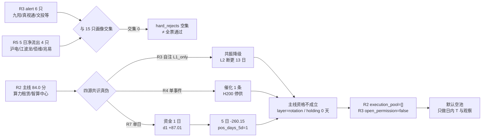

# 2026-11-19 · **反证 / Devil's Advocate**

> **数据源新鲜度**: partial
> **降级状态**: true（模式四无历史事件库、模式十无商品序列；R3 L2 断更）
> **置信度**: 0.45

## 一句话结论

**32 条反证：hard_reject 0 / strong_suggest 22 / soft_suggest 10；主线 84.0 分建立在 1 条硬催化 + 1 日资金 + 只到 L1 的共振上，主线资格不成立，今日默认执行池为空。**

## 详细分析

**第一条：84.0 分是本日最热轮动的分数，不是可交易主线的分数。** R2 把国产算力·算力租赁评为 84.0，但同一份 artifact 里 `layer=rotation`、`holding_days_max=0`、`layer_flag` 写的是「60 日无结构（龙一 r60 −0.78%、距高 −11.05%）→ 只记录，不给买点」；`stage=climax`、题材矩阵单日 22 家涨停（前一交易日仅 5 家，跳增 4.4 倍），R2 自己给出次日家数腰斩概率约 66%。而 R1 的判断是「无主线（轮动结构）、行业次日留存 32.0%、截面解释力 12.33%」。两件事合起来读：分数高是因为**当日热度和涨停数**（score_dims 热度 19 + 涨停 18 + 叙事 18），不是因为**可持有性**。任何把 84 分当加仓依据的下游动作，都是把温度当成了资格。

**第二条：四条证据链里只有两条是真的。** R2 记 `cross_validation_score=1.00`、`agreement_count=4`。逐源核对：R3 自己在主题条目里注明「真等级 L1_only（L2 真人话语层断更，L2b 仅观点代位，不计入等级）」；R4 的国产算力/昇腾链 `net_score +0.732` 但 `cross_events_count=1`，只有 E20261119_002（英伟达停供 H200）一条事件，且该事件在 11-18 盘中已被首板兑现过一日；R7 只有单日：算力概念 d1 +87.01 亿（概念榜第 3），但 d5 −260.15 亿、d20 −440.27 亿、`pos_days_5d=1`。华为概念同题材另一口径 d1 +57.59 / d5 −458.04，5 日失血是单日回补的 8 倍。「四源共识」的实质是**1 条催化 + 1 日资金 + 1 个当天的热榜**。

**第三条：昨天的反证全对，所以今天的同结构警报要升级。** 11-18 的 R6 反证 5/5 兑现：联合化学收盘 +13.31% 但 open→close −5.12%、永新光学 −9.82%、格林达 −5.26%、西陇科学 close→open −10.0%。`observation_tracking` 里 20 只观察池 open→close 均值 −1.90%（剔除一字 −2.24%），红盘 11 只、真正赚钱 6 只；执行池 3 只（江化微 −3.86 / 北方华创 +1.60 / 长川 +3.38）。R7 的 29 张卡里延续 10 张（34.5%）、反手转负 8 张、双负 7 张。结论很直接：**首板隔日这个结构 yesterday 的赔率是负的，今天不能用「大概率接力」的假设下注。**

**第四条：财务口径必须复算，否则会用错红旗。** R5 `flags_census` 记 F9（应收/营收 > 40%）命中 4 条。用 R5 自己落盘的财报 artifact 按 TTM 营收复算：常山北明 36.0%（R5 原值 52.3% 是 9M 分母）、生益电子 34.8%（原 44.5%）、沪电股份 33.7%（原 41.6%）、美利云 114.2%（原 145.9%）。**4 条里 3 条是 9M 分母造成的口径伪命中**，只有美利云真成立。反过来，真正被低估的是 V1 周期股低 PE 陷阱：利通电子 PE 21.34（3 年分位 0.4%）+ ROE 40.5% + 净利同比 +349%、兆易创新 13.29（分位 0.2%）+922%、江波龙 6.25（0.8%）+1910%、佰维存储 6.33（1.6%）+28728%、中微公司 46.46（2.3%）+241% —— 五只「低 PE」全部落在利润暴增的周期顶形态，低 PE 在这里是危险信号而不是安全边际。

**第五条：霸榜出货的硬否决今天签不出来，原因是触发集为空、不是标的干净。** R3 的 `distribution_alert` 有 6 只（九阳股份 high、真视通 high、东方海洋/阳光照明/文投控股/四川长虹 medium），其中九阳与真视通已在 R2 `blocked_pool`，文投/东方海洋/阳光照明属已死链，四川长虹属被丢弃的家电板块；与 R5 15 只画像的**交集为 0**。条件二（5 日主力净流出）在 15 只里命中 4 只：沪电 −2.82 亿、江波龙 −2.85 亿、佰维存储 −4.86 亿、兆易创新 −31.11 亿，四只都不在 alert 名单。两条件交集 0 → `hard_rejects` 空集。这个空集只能读成「未形成否决」，**不能读成「全票审核通过」**：R2 `execution_pool=[]`、R3 `open_permission=false`、R7 `execution_candidates=0` 三份 artifact 是同一个结论。

## 四象限负面识别

| 象限 | 条数 | 核心指控 |
|---|:--:|---|
| Q1 资金 | 7 | 全市场单日回补、5 日失血；算力概念 d1 +87.01 / d5 −260.15；华为概念 d5 −458.04；模式六两条件交集为 0 |
| Q2 情绪 | 9 | R1 判无主线 vs R2 给 84 分；炸板率 39.44% 连续 2 日在红线；首板次日实测 open→close −1.90%；候选口径 6→3 与实际 5+14 不符 |
| Q3 基本面估值 | 11 | 华胜天成估值维 30 分、首亏；常山北明商誉 36% + 有息负债 104.6% + PE 583；V1 低 PE 群 5 只；RR<2 六只；F9 口径 3 条伪命中 |
| Q4 结构 | 5 | 华胜天成身位三口径（4 天 3 板 / 连板 2 / R7「低位前排」）；R3 点名的低位首板 3 只里 2 只无画像；观察池 14 vs 32；holding 0 天 |

## 反证清单

| ID | 模式 | 象限 | 强度 | 反证对象 | 一句话 |
|---|:--:|:--:|:--:|---|---|
| R6_M1_01 | 数据源冲突 | Q1 | strong | 主线 cross_validation=1.00 | 四源里只有 R4 单事件 + R7 单日资金为真，R3 自注 L1_only |
| R6_M1_02 | 数据源冲突 | Q1 | strong | 主线资金维 14/20 | 算力概念单日回补仅占 5 日失血 33%，华为概念为 8% |
| R6_M1_03 | 数据源冲突 | Q1 | strong | 半导体材料链 | 昨日 +18.83 亿今日 −7.29 亿，一日游已证伪 |
| R6_M1_04 | 数据源冲突 | Q4 | strong | 华胜天成身位 | 4 天 3 板 / 连板高度 2 / R7 标低位前排，三口径互斥 |
| R6_M1_05 | 数据源冲突 | Q4 | strong | 低位首板池覆盖 | R3 点名中贝/润建/美利云，后两只未画像，一只被剔除 |
| R6_M1_06 | 数据源冲突 | Q4 | soft | 观察池口径 | R2 14 只 vs R7 32 只，华胜天成两池两标签 |
| R6_M2_01 | 一致性检查 | Q2 | strong | R1 无主线 vs R2 84 分 | 84 分与 holding_days_max=0 必须同时引用 |
| R6_M2_02 | 一致性检查 | Q2 | strong | 候选砍半口径 | 对外说 6→3，实际列 5 龙 + 14 观察 = 19 只 |
| R6_M2_03 | 一致性检查 | Q2 | strong | watch_pool 14 只 | open_permission=false + execution=0 下 watch 不是计划 |
| R6_M2_04 | 一致性检查 | Q2 | soft | 两套门槛 | R1 三判据与 R3 五条否决不是同一把尺 |
| R6_M2_05 | 一致性检查 | Q4 | soft | 持有天数 | 主线 0 天 / R1 1–2 日 / R2 climax，无波段依据 |
| R6_M3_01 | 估值×主线 | Q3 | strong | 华胜天成估值 30 | 首亏、PB 分位 85.4、获利盘 98.7% 无承接盘 |
| R6_M3_02 | 估值×主线 | Q3 | strong | 常山北明「低位」 | 583 倍 PE + 商誉 36% + 有息负债 104.6% |
| R6_M3_03 | 估值×主线 | Q3 | strong | V1 低 PE 群 | 5 只低分位 PE 全是利润暴增的周期顶 |
| R6_M3_04 | 估值×主线 | Q3 | strong | RR≥2 五只 | 华胜止损距收盘 −15.28%、宏景要 −5.8% 低吸，均不可执行 |
| R6_M3_05 | 估值×主线 | Q3 | soft | 深南电路 RR | R5 记 3.41 / R7 记 2.10，且上方 86.1% 套牢 |
| R6_M3_06 | 估值×主线 | Q3 | strong | 宏景科技 | 机构 −0.36 / 股通 −0.53 的 20cm 诱多 + 有息负债 413.2% |
| R6_M4_01 | 历史类比 | Q4 | soft | 概念首日登顶存活率 | 无事件库，仅提示前三次登顶次日全部掉队 |
| R6_M5_01 | 昨日错误连锁 | Q2 | strong | 首板隔日结构 | 昨日 5/5 兑现，20 只观察池 open→close −1.90% |
| R6_M5_02 | 昨日错误连锁 | Q2 | strong | 「低位前排」标签 | 有研新材当日 +5.82% 但主力 −5.86 亿，标签当日即失效 |
| R6_M5_03 | 昨日错误连锁 | Q2 | soft | 高位派发链 | 8 只名字辈/玄学跌停，只作温度计 |
| R6_M6_01 | 霸榜出货 | Q1 | strong | 模式六全量核验 | cond1 命中 0/15、cond2 命中 4/15、交集 0 → hard 0 |
| R6_M6_02 | 霸榜出货 | Q1 | strong | 沪电股份 | cond2 成立但 cond1 不成立；机构 +3.50 vs 股通 −1.10 对打 |
| R6_M6_03 | 霸榜出货 | Q1 | soft | 宏景科技 | R7 诱多 high，但 5 日主力 +2.12 亿 → 不签硬拒 |
| R6_M7_01 | 基本面红旗 | Q3 | strong | 常山北明 F2 | 商誉 18.73/52.04 = 36.0% + 有息负债 104.6%，2 条真 |
| R6_M7_02 | 基本面红旗 | Q3 | strong | 美利云 F8+F9 | CFO 连续为负但净利 +0.52 亿；应收/营收 TTM 114.2% |
| R6_M7_03 | 基本面红旗 | Q3 | strong | 佰维存储 4 红旗 | F10/F8/V4/V1 达标，但已在三重禁止外，不签根级硬拒 |
| R6_M7_04 | 基本面红旗 | Q3 | strong | R5 F9 计数 | 4 条里 3 条 9M 分母伪命中，TTM 33.7%–36.0% |
| R6_M7_05 | 基本面红旗 | Q3 | strong | 江波龙 | F8+V4+V1，趋势破位 + 上方套牢 85.1% |
| R6_M8_01 | 解套盘假繁荣 | Q2 | soft | 全市场涨停结构 | 涨停 43 < 100 不触发；华胜 98.7% / 美利云 95.0% 标 high_suspicion |
| R6_M9_01 | 高位触板 | Q2 | soft | 最高身位 | 最高 4 板无 8 板对象；climax + 3 板层空缺 |
| R6_M10_01 | 跨资产背离 | Q1 | soft | 存储涨价传导 | 商品序列 skipped，不判定 divergence |

## 推理深度三问

**TOP1 · 主线 84.0 分的资金成色**

- **大资金意图**: 11-18 的资金性质是「超大单由 −96.28 转正 +19.31、大单仍 −104.52、小单 +137.31」——机构单不再砸，但也没有主动买，回补主要由小单与被动资金完成；算力概念 +87.01 亿里没有一条机构席位集中买入的证据，龙一华胜天成机构净买 **0**。对手盘就是昨日的获利盘（获利盘 98.7%、上方套牢 1.3%），这是「无套牢盘的加速段」，不是「机构建仓段」。
- **为什么走强**: 位置=板块 60 日无结构、个股 4 天 3 板但连板高度仅 2（中间断过板）；催化=单条硬事件（H200 停供），且事件在 11-18 盘中已被兑现；筹码=龙虎榜全为游资席位（卖方前三 拉萨 −0.36 / 国信浙江 −0.35 / 中信建投安徽 −0.34 亿）。三维交叉的结论是「情绪+催化驱动的单日脉冲」，不是「资金+趋势驱动的波段起点」。
- **逻辑够不够硬**: 不硬。独立源只有 1 条硬催化（R4）+ 1 日资金（R7）；硬业绩（公司 2026H1 预告首亏 2.2–3.3 亿）与硬时间锚（无产业落地时点）都缺席；证伪路径极其清晰——次日竞价溢价转负、板块涨停家数从 22 腰斩到 10 以下，即为结构失效。

**TOP2 · 华胜天成（600410）为什么不能当「身位龙」**

- **大资金意图**: 机构席位 0 条，龙虎榜净买 +2.98 亿全部来自游资，两融 15 日融资 +6.64% 而融券 +35.97% —— 游资抬轿、空头同步加码；散户侧股东户数 +1.03% 微散。大资金没有意图，只有游资的博弈意图。
- **为什么走强**: 位置=收盘 16.82 高于平均成本 14.76，获利盘 98.7%、上方套牢 1.3%，属「零阻力加速」；催化=题材级承接，公司自身近 6 条公告全是减值/担保/业绩说明会；筹码=封单 2.84 亿（板块第 1）、开板 0 次，但换手 19.03% 说明分歧已经很大。
- **逻辑够不够硬**: 不硬，且是双口径矛盾。R2 说「4 天 3 板、高位加速」，R5 的 `leader_verdict` 是 `height=2.0、streak_days=2`，R7 又标「低位前排（2 板）」。三种身位描述指向三种不同打法（高位加速打板 / 二板接力 / 低位低吸），**没有一种可以在盘前被验证**。证伪路径：竞价成交额不足昨日同期、或高开 <3% 之后跌破均价线。

**TOP3 · F9 红旗为什么必须复算**

- **大资金意图**: 这条与资金无关，但决定 D1 会不会用错「财务干净」的结论。R5 的 F9 命中有 3 条落在 9M 累计营收分母上，而 A 股三季报分母天然比 TTM 小 25%–30%，等于系统性高估应收占比。
- **为什么走强**: 本条的「走强」指误判如何形成 —— 应收余额确实在增长（中微应收同比 +76.6% 是真实 F3）；催化=无；筹码=无。误判来源是分母口径，不是资产质量突然恶化。
- **逻辑够不够硬**: 复算后只有美利云（114.2%）成立，其余 3 只全部低于 40%。这个修正同时削弱了「常山北明/沪电/生益财务不干净」的叙事，也削弱了「存储链财务干净」的反向结论 —— 两边都不能用 9M 口径下判断。

## 关键证据

- **证据 1**: 算力概念 d1 +87.01 亿 / d5 −260.15 亿 / d20 −440.27 亿、pos_days_5d=1 · 来源 R7 concept_top_inflow
- **证据 2**: 电子 d1 +99.84 / d5 −454.82 / d20 −754.27；唯一 5/20 双正是半导体设备 +55.61/+104.57 · 来源 R7 sector_flows
- **证据 3**: 华胜天成获利盘 98.7%、平均成本 14.76、上方套牢 1.3%、机构净买 0 · 来源 R5 chip_structure / R7 hot_money
- **证据 4**: 常山北明商誉 18.73 亿 / 归母权益 52.04 亿 = 36.0%，有息负债 54.42 亿 / 52.04 亿 = 104.6% · 来源 R5 _r5_fin_stmt 复算
- **证据 5**: F9 四条 TTM 复算 36.0% / 34.8% / 33.7% / 114.2%，前三条不成立 · 来源 R5 is+bs 派生计算
- **证据 6**: 20 只观察池 open→close 均值 −1.90%、赚钱 6 只；29 张卡延续率 34.5% · 来源 observation_tracking 20261118 / R7 yesterday_top10_5d_tracking

## 每票思维链 · 华胜天成（R6 视角：禁入，不作为首推）

- **买入理由**（R2/R5 给出的多方理由，仅供审计，R6 不背书）: ①题材是当日唯一硬催化（H200 停供）的落点，算力租赁 13 只涨停同一天出现；②封单 2.84 亿板块第 1、开板 0 次、5 日主力 +15.45 亿（4/5 天净流入）、资金强度 8.38% 流通市值。
- **风险点**: ①纯游资对打、机构席位 0，次日承接是唯一验证，一旦断板无机构托底；②2026H1 预告首亏 2.2–3.3 亿，PE 分母失效，估值维仅 30 分；③获利盘 98.7% + 上方套牢 1.3%，分歧时无承接盘；④止损距收盘 −15.28%，超出纪律 −5~−10% 硬区间；⑤R2 明示 `climax` + 22 家涨停过热，次日腰斩概率约 66%。
- **止损条件**: 竞价成交额低于昨日同期 60%，或开盘 15 分钟内跌破昨日均价 16.35 且不能收回 → 结构失效，当日不进；已持仓者以 15.00 为硬止损（对应 −10.8%），跌破不留。
- **可验证假设**: 24 小时内可证真/证伪——①算力租赁概念次日涨停家数能否守住 10 家（22 → ≥10 为延续，<10 为腰斩）；②华胜竞价溢价能否 > +3%（低于则视为给昨日首板抬轿）；③板块内是否出现 2 只以上新的低位首板（出现=扩散，缺席=单点脉冲）。

## 数据源审计

| 源 | 日期 | 状态 | 备注 |
|---|---|---|:--:|
| tushare/R1 风格快照 | 2026-11-19 | 🟢 | 涨停 41 / 跌停 39 / 炸板 24 · 炸板率 36.92% · 行业留存 32.0% |
| tushare/R2 主线板块 | 2026-11-19 | 🟢 | 1 条主线 84.0 · 5 龙 + 14 观察 + 8 拦截 · execution_pool 空 |
| R3 情绪共振 | 2026-11-19 | 🟡 | L2 真人话语层 0 条（13 日断更）· 共振真等级 L1_only · 公众号 91 篇代位 |
| R4 消息面 | 2026-11-19 | 🟢 | 8 条 top 事件 · 16 板块极性 · 10 首板候选 · 国产算力单事件 +0.732 |
| R5 个股画像 | 2026-11-19 | 🟢 | 15 只全画像 · 六维齐备 · flags_census 记 F9:4（需 TTM 复算） |
| R7 资金面 | 2026-11-19 | 🟡 | 主力 −85.21 亿 · 龙虎榜 94/94 对齐 · 两融与 ETF 滞后 1 日 · 美股盘中 |
| observation_tracking | 2026-11-18 | 🟢 | 20 只观察池 · open→close 均值 −1.90% · 执行池 3 只 |
| R6 昨日反证 | 2026-11-18 | 🟢 | 27 条 · hard 0 · 5/5 关键反证兑现 |
| R5 财报明细（派生） | 2026-11-19 | 🟢 | 15 只 is/bs/cf · 仅用于 F2/F8/F9/F10 口径复算，未抓新数据 |
| wechat_cli 多群 | 2026-11-19 | 🔴 | 0 字节 · 本地库停在 2026-10-28 · L2 永久断更 |
| WeFlow | — | 🔴 | 2026-08-19 永久下线 · L3 缺位 |
| 商品序列（原油/铜/DRAM 现货） | — | 🔴 | skipped · 模式十不判定 |

## 不确定性 / 反证

本报告最大的不确定性来自「我的反证会过度悲观」。11-18 的结构确实出现了一次像样的修复：跌停:涨停从 2.21:1 收到 1.12:1，超大单本轮首次转正 +19.31 亿，半导体设备 5/20 日双正（+55.61 / +104.57），PCB 三票同日机构净买（沪电 +3.50 / 生益电子 +3.43 / 深南 +1.93）。如果今日算力链竞价承接住、涨停家数守住 10 家以上、且半导体设备延续资金，那么「轮动层不给买点」这个判断会被证伪——我接受这个证伪，但我不会在盘前把它当作基准情形。

第二个不确定性来自视角偏差：R6 只找反面证据，不给正面结论，因此这份报告**不能**作为「今天不能做任何交易」的依据。R1 明确写了第 6 天是连跌 5 天后的修复窗口，允许小额度做低位首板/低位补涨与尾盘试错。反证的作用是把「哪些看似能做的东西其实不能做」标出来，具体做不做、做多少，仍归 D1 逐票门禁。

第三个不确定性是覆盖缺口本身：R3 playbook 点名的中贝通信、润建股份，以及 R7 研究卡里的剑桥科技，都没有进入 R5 画像，所以我对它们只能给出「无画像 → 无执行资格」，而不能给出「结构不好」。这类缺口属于流程问题，不是标的结论——不应被读成对这些票的负面判断。

## 与其他 R/D/E 的关系

- 依赖: `R1_style.json` / `R2_main_sectors.json` / `R3_sentiment.json` / `R4_news.json` / `R5_stock_profiles.json` / `R7_capital_flow.json` / `20261118/R6_devil_advocate.json` / `20261118/observation_tracking.json` / `20261119/_r5_fin_stmt.json`
- 被消费: D1（`canghai-plan`，hard_reject 无覆盖权、strong_suggest 须 override 记录）、E1（`canghai-review`，反证兑现率回填）、orchestrator（写入 `research_summary.json` 的 `hard_rejects[]`）
- 交接要点: 今日 `hard_rejects=[]`；`strong_suggest` 22 条中，对执行有直接影响的是 R6_M2_03（watch ≠ 计划）、R6_M3_04（RR 不可执行）、R6_M6_02（沪电两条件不完全成立）、R6_M7_02（美利云被 R3 点名却带 2 红旗）

## Sub-Agent 元数据

- skill: analyze_devil_advocate_v1@1.3
- artifact: data/research/20261119/R6_devil_advocate.json（48,128 B · status=complete · confidence 0.45 = 0.80×0.70×0.80）
- 反证总量: 32 条（strong 22 / soft 10 / hard 0）· 四象限 Q1 7 / Q2 9 / Q3 11 / Q4 5
- candidates_evaluated: 15（R2 主线 leaders 5 + 次线 leaders 9 + watch 1）
- 数据获取: 未抓新数据（只读磁盘 artifact）；未调用 delegation；未调用 announcement-search
- 生成耗时: 约 12 分钟
- model: deepseek-v4.1-flash
