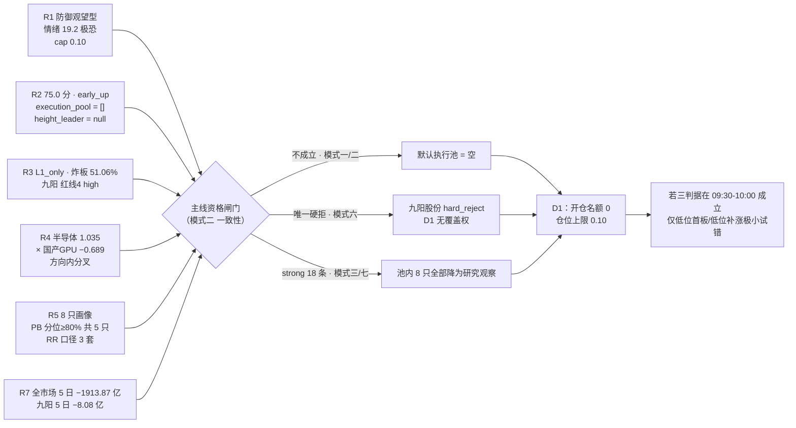

# 2026-11-20 · **反证 / Devil's Advocate**

> **数据源新鲜度**: partial
> **降级状态**: true（模式四无历史事件库、模式十无商品序列、R3 共振止于 L1_only）
> **置信度**: 0.45（0.80 × 0.70 × 0.80）

## 🧭 一句话结论

**32 条反证：hard_reject 1 / strong_suggest 18 / soft_suggest 13。唯一 75.0 分主线是「无高度核心 + 4/5 龙头非涨停 + 共振只到 L1_only + 母行业 5 日失血 96.28 亿」的窄口抱团，在情绪 19.2 极恐、capitulation 第 7 天下不授开仓资格；模式六双条件全市场只有九阳股份同时成立 —— 今日默认执行池为空，且「只拒 1 只」绝不等于其余 8 只过审。**

## 🔎 详细分析

**第一条：75.0 分是当下最热方向的分数，不是可交易主线的分数。** R2 把「半导体自主可控·国产Fab/设备/封测」评为 75.0，score_dims 拆开是 `热度 16 / 资金 16 / 涨停 14 / 叙事 19 / 共振 10` —— 五个维度里最高的两档是叙事与热度，最弱的是共振（10/20）。同一份 artifact 又写着 `stage=early_up（age_days 3 / money_persist_days 3）`，但 `stage_conflict_note` 自己承认「与 R1 无主线·capitulation 第 7 天冲突时以市场温度优先 → 阶段标签记录但不授权」。而 R1 的判词是防御观望型、情绪 19.2 极恐、仓位上限 0.10、行业次日留存 28.0%、行业截面解释力 9.83%、涨停溢价收盘中位 −0.71%、小盘桶 −3.26% vs 大盘桶 +0.04%。把这两组数字放在一起：分数高是因为**当天有多热**，不是因为**明天能拿**。任何把 75 分当资格的下游动作，都是把温度当成了许可证。

**第二条：四条证据链里，只有两条是"当天新鲜"的。** R2 记 `cross_validation_score=1.00`、`agreement_count=4`。逐源核对：R3 在自己的主题条目里注明「真等级 L1_only（L2 真人话语层断更 14 个交易日、L3 WeFlow 永久下线，L2b 公众号仅观点代位，不计等级）」；R4 的半导体设备/材料 `net_score 1.035` 是全表最强，但 `cross_events_count=2`，两条事件（E003 伯恩斯坦上调 2027 全球 WFE 支出至 2170 亿美元 +39%、E004 无锡 50 亿先进封装产线奠基）在 11-19 盘中被首板兑现过一次；R7 三条子行业腿双正（集成电路制造 +24.23、半导体设备 +18.55、封测 +14.94 亿），但母行业「半导体」当日 +30.51 亿而 5 日 −96.28 亿，「电子」5 日 −358.27 亿、20 日 −573.32 亿。**"四源共识"的实质是：1 条 BIS 反身性轴 + 2 条资本开支催化 + 3 条子行业资金腿，共振真等级只到 L1。**

**第三条：这条主线没有"身位"。** R2 的 5 只 leader 里，中芯国际 +6.21%、华虹宏力 +8.05%、北方华创 +3.13%、长电科技 +4.74%，四只都不是涨停；唯一涨停的中京电子是 `孤军`（板块广度 1 家），日换手 13.33%、距 60 日高 −40.58%、MA50 下方 18.95%。板块原本的最高身位是盛剑科技 3/3 板，但 R2 已以「龙虎榜净卖 −0.13 亿 + 封单 0.28 亿仅占成交 11.7%」把它移出候选池，于是 `height_leader=null`。按纪律「只做龙头或低位，躲中位和杂毛」，这条线现在的结构是：**容量票（不给打板通道）+ 孤军板（不追）+ 中位票（长电距 60 日高 −30.16%）**，能同时满足"龙头"与"低位"的身份为 0 只。

**第四条：三套盈亏比口径互斥，R5 的 RR 名单不能进执行。** 同一只中芯国际，R2 记 `rr=0.02`（20 日位置 98.6%、距 20 日高 −0.33%），R5 记 `rr=1.00`（买 119.0 / 目标 125.0 / 止损 113.0），R7 记 `rr5=0.02`（止损距 −14.25%）；华虹 R5 给 3.26（止损距 −6.83%），R7 watch_reserve 给 rr5 0.18（止损距 −22.45%）；北方华创 R5 1.34 vs R7 0.22。按纪律 §6「止损距 −5~−10% 硬区间 + RR≥2」取严：格林达（R5 自报止损距 −11.05%）、江化微（−13.37%）已经越界，中芯/华虹/北方华创在 R7 口径下越界 —— **5 只在至少一套口径下不过线，R5 的"RR≥2 名单"不能当作执行许可。**

**第五条：霸榜出货只有一只，但那一只必须硬拒。** 模式六双条件（①R3 `distribution_alert` 命中 ②近 5 日主力净流出）全市场同时成立的只有九阳股份：R3 判 high、红线 4 ——「dc+ths 双榜 #1 连续 3 个交易日，封单 2.23 → 0.64 亿衰减 71%，反复炸板，换手 23.74%」；R7 `series5` 显示 5 日主力 −8.08 亿（−2.71 / −0.34 / −0.22 / −7.71 / +2.90），单日反手 +2.90 亿不改 5 日派发方向；R7 诱多清单里它同时挂「反复开板烂板（13 次开板）」。**昨日它在 11-19 涨停反包（+10.01%，open→close +22.25%），但价格反包不改变封单衰减 71% + 5 日失血 8.08 亿的结构 —— 昨日 R6 的"派发链不参与"在价格上被打脸，在结构上被验证。** 这也是本日唯一 hard_reject。

**第六条：昨日反证 5 项兑现，但有两条必须自我认错。** 兑现侧：华胜天成 −0.71%（高开 +4.52% → 收 −0.71%，open→close −5.01%）、润泽科技 −8.65%（oc −7.87%）、宏景科技 −0.78%（oc −2.81%）、算力租赁/IDC 组 6 只平均 open→close −3.46%；11-19 涨停溢价收盘中位 −0.71%、红盘率 46.3%，与昨日"首板隔日按 1 日脉冲定价"同向。认错侧：①昨日判定「半导体材料链一日游已证伪」，11-19 江化微 +9.99%、格林达 +10.00%、西陇 +4.98%（oc +10.34%），材料链是**同轴补涨的第二棒**而不是余温；②昨日判定「沪电外资在卖 + 机构在买的二元对打」，11-19 沪电 +1.13%、oc +5.04%、最高 +6.02%，方向判断偏保守 —— 保留"不给仓位"的结论，但改用 rr5 1.37 / 止损距 −11.50% 的理由，不再用二元叙事。

## 🧩 四象限负面识别

| 象限 | 条数 | 最硬的一条 |
|---|---:|---|
| **Q1 资金** | 7 | 全市场 5 日 −1913.87 亿、20 日 −3929.82 亿（20 日仅 8 日为正），8 只候选 5 日主力却 8/8 为正 → 存量再分配；两融在撤（中芯融资 −16.84% / 融券 +84.32%，北方华创 −26.46% / +29.81%） |
| **Q2 情绪** | 8 | 情绪 19.2 极恐 + capitulation 第 7 天 + 炸板率取严 51.06% + 涨停溢价中位 −0.71%；「四源共识」只有 2 源真（R3 真等级 L1_only） |
| **Q3 基本面估值** | 12 | 5 只 PB 分位 ≥80%（华虹 89.4 / 江化微 88.1 / 长电 87.9 / 北方华创 87.1 / 中芯 80.4）；红旗复核后 中京 4→3 条、F9 计数 2→0 |
| **Q4 结构** | 5 | `height_leader=null`、4/5 龙头非涨停、盛剑（3 板）被剔出；RR 三口径互斥；最高身位仅 3 板且 2 板层只剩 2 只（断层） |

## 🕸️ 反证图谱

## 📌 关键证据

- **主导行业与子行业撕裂**：半导体当日 +30.51 亿（全市场第 1）但 5 日 −96.28 亿；电子 5 日 −358.27 亿 / 20 日 −573.32 亿；集成电路制造 +24.23（5 日 +42.58 / 20 日 +56.48）、半导体设备 +18.55（5 日 +56.83 / 20 日 +144.54）、封测 +14.94（5 日 +4.85 由负转正、20 日仍 −12.67）—— 来源 R7 `top_inflow_sectors` / `top5d_outflow_sectors`
- **全市场派发未结束**：主力 d1 −313.15 亿（前 −85.21，摆动 −227.94）、d5 −1913.87 亿、d20 −3929.82 亿；四档拆解 超大单 −115.13 / 大单 −198.02 / 中单 −39.13 / 小单 +340.52 —— 来源 R7 `main_force.market_windows`
- **情绪与广度**：上涨 649 / 下跌 4876（上涨占比 11.65%）、中位 −2.55%、成交 13145.8 亿（前值 13800.2）、涨停 28 / 跌停 83 / 炸板 25（权威口径）、最高 3 板、首板占比 78.26% —— 来源 R7 `breadth`、R1 `limit_structure`
- **九阳霸榜出货**：dc+ths 双榜 #1 连续 3 日、封单 2.23→0.64 亿（−71%）、13 次开板、换手 23.74%；5 日主力 −8.08 亿 —— 来源 R3 `hotlist_signals.distribution_alert`、R7 `watch_reserve`
- **华虹筹码单边**：获利盘 92.5%、上方套牢 7.5%、平均成本 176.80 vs 收盘 199.86、90% 筹码集中在 ±10% 内（96.8%）；股东户数 +11.93%；距 MA20 +23.90% —— 来源 R5 `chip_structure.cyq` / `technical_readiness`
- **中京电子财务轴**：应收增速 22.1% vs 收入增速 1.8%（F3）、有息负债/净资产 92.5%（F10，用资产负债表复算：短借 15.14 + 长借 12.22 = 27.36 亿 vs 净资产 29.58 亿）、净利 −1.17 亿 / ROE −4.38%（S1）；F9 按 TTM 分母 34.3% 不成立 —— 来源 R5 `fundamental_flags` + `_r5_fin_stmt.json` 复核
- **昨日兑现**：华胜天成 oc −5.01%、润泽科技 −8.65%、宏景科技 −0.78%、算力/IDC 组均 oc −3.46%（n=6）；watch_pool 21 只等权 oc −0.74%、execution_pool 4 只 oc +0.01% —— 来源 `data/reports/20261119/observation_tracking.json`
- **诱多总量**：R7 五类诱多共 93 条（反复开板烂板 45 / 拉高出货 20 / 诱多 13 / 重挫大额净卖 12 / 涨停但净卖 3），其中 中京电子（机构 −0.18 亿）、西陇科学（机构 −0.06 / 港资 −0.17 亿）、江化微（3d −0.96 / 港资 −1.36 亿）均在候选或次线池内 —— 来源 R7 `hot_money.distribution_alerts`

## 🧠 推理深度三问

### 对象一：主线「半导体自主可控·国产Fab/设备/封测」（R2 75.0）

- **大资金意图**：机构在做"国产 Fab 承接方"的单点下注 —— 大基金持股概念当日 +31.33 亿（5 日 +47.77 亿）、中芯概念 +30.79 亿（5 日 +32.56 / 20 日 +97.46），而中芯与华虹在 2445.7 亿 / 814.9 亿的流通盘上能拿到 5 日 +16.32 / +21.86 亿，这是有组织的容量票推升而非散户跟风。对手盘是两拨人：母行业撤退的存量资金（电子 5 日 −358.27 亿）与杠杆空头（中芯融券 +84.32%、北方华创 +29.81%）。
- **为什么走强**：位置（中芯 30 日区间 100%、华虹 100%）+ 催化（E001 BIS 穿透审查对海外流片是杀、对国产 Fab 是抬，E003 WFE 支出 +39%）+ 筹码（中芯获利盘 82.1%、华虹 92.5%，均已无套牢盘压制）三维全部指向"上方空旷但下方没有承接"。这是"能涨"的配置，不是"可爱"的配置。
- **逻辑够不够硬**：独立源只有 2 个是真新鲜的（R4 的两条资本开支事件 + R7 的三条子行业资金腿），R3 的共振停在 L1_only（公众号观点代位），R2 自己的 5 维里共振只给 10/20。硬政策（BIS 反身性）与硬时间锚（2027 WFE +39%）都在，但**证伪路径极短**：只要 09:30-10:00 三判据（开盘广度 >0.55 / 昨涨停红盘率 >60% / 板块级涨停潮 ≥3）不成立，或盛剑/江化微/格林达任一开板不回封且跌停仍 >50 家，这条线的"窄口"就会变成"孤岛"。

### 对象二：九阳股份 002242.SZ（唯一 hard_reject）

- **大资金意图**：没有配置意图，只有派发意图。dc+ths 双榜 #1 连续 3 个交易日（≥2 日阈值）说明名字辈套利的注意力被榨到极限；封单从 2.23 亿衰减到 0.64 亿（−71%）、13 次开板、换手 23.74% 是典型的"用涨停价换流动性"。对手盘就是接力盘：5 日主力 −8.08 亿，11-19 单日反手 +2.90 亿只是当天封板需要，不构成方向。
- **为什么走强**（昨日为何还能涨停）：位置（名字辈低位补涨）+ 情绪（人气榜残余关注度）+ 筹码（换手 23.74% 充分换手后浮筹变薄）—— 三维里只有"情绪残值"是真，位置与筹码都是派发的燃料。11-19 的 +10.01%（oc +22.25%）恰恰是最后一棒的形态。
- **逻辑够不够硬**：硬拒依据是两条独立证据（R3 红线 4 的封单衰减 / R7 的 5 日资金方向）+ 一条旁证（R7 反复开板 13 次），且 R2 独立地把它写进 `excluded`「名字辈套利末端，任何位置不参与」。证伪路径只有一条：次日竞价封单回到 1.5 亿以上且 5 日资金转正 —— 但今天盘前无法验证，所以按"未证伪即维持硬拒"处理。

### 对象三：华虹宏力 688347.SH（观察池六维综合最高 66.0 · alpha B / risk B+）

- **大资金意图**：真金白银的回购方案（10-30 董事长提议 → 11-13 董事会通过集中竞价回购方案）+ 连续三日 6-9 亿级主力净流入（11-17 +6.27 / 11-18 +8.91 / 11-19 +7.09 亿）—— 是"公司自己在买 + 场内资金在买"，30 日零龙虎榜、零大宗说明没有折价减持痕迹。对手盘是 92.5% 的获利盘与 +11.93% 的新进散户。
- **为什么走强**：位置（30 日区间 100%、距 MA20 +23.90%，本批最大乖离）+ 催化（BIS 反身性 + 回购推进）+ 筹码（获利盘 92.5%、上方套牢仅 7.5%）—— 三维都指向"涨得动但没人接"，PB 8.30（89.4 分位）、PS 19.68（88.2 分位）说明价格已经先把好消息花掉了。
- **逻辑够不够硬**：独立源 3 个（R4 点名华虹 / R5 回购硬事件 / R7 三日 6-9 亿级流入），硬事件（回购方案）在，但**证伪路径只有一个交易日**：距 20 日高仅 −3.82%（R7 口径）/ 0.0%（R5 30 日口径），rr5 0.18、止损距 −22.45% —— 在 T+1 结构下，赔率已经不在多头一侧。

## 🔗 每票思维链（观察池顶部 + 唯一硬拒）

### ① 华虹宏力 688347.SH · 观察（不进）

- **买入理由**：①产业逻辑 —— BIS 反向抬升国产 Fab，华虹是成熟制程 + 特色工艺纯正标的，单季净利同比 +136.14%、CFO/净利 4.6（含金量优于中芯）；②数据锚 —— 连续三日 6-9 亿级主力净流入（5 日 +21.86 亿，本批资金强度第一），且公司有推进中的集中竞价回购方案。
- **风险点**：①短期 —— 距 MA20 +23.90%、30 日区间 100%、PB/PS 89/88 分位，任何回调都是 92.5% 获利盘兑现的起点；②中期 —— 应收增速 51.4% vs 收入增速 14.1%（F3 soft）、股东户数 +11.93%（散户涌入托不住 814.9 亿流通盘），R7 口径 rr5 0.18 / 止损距 −22.45%。
- **止损条件**：若已持仓 —— 日线收盘价跌破 `197.5`（MA60，同时是 60 分钟多头排列的失效位）即离场一半；跌破 `186.2`（风险预算价）清仓。不设"灵活调整"。
- **可验证假设**：24-72h 内 ①次日不跌破 197.5 且 b1 缩量（量比 <1.0）→ 回踩承接成立；②若次日成交额 <60 亿（11-19 为 84.2 亿）且收红 → 获利盘未集中兑现；③若跌破 197.5 且成交额放大 → 派发确认，出观察池。

### ② 中京电子 002579.SZ · 观察（不进 · 孤军）

- **买入理由**：①产业逻辑 —— 半导体链当日唯一封板票（10:27 首封、0 开板、封单 1.01 亿），是主线内唯一的"涨停身位"；②数据锚 —— 30 日龙虎榜 12 次、全席位净额 +9.45 亿，游资在此票上反复做。
- **风险点**：①短期 —— `sector_breadth=1`（孤军），R7 判「机构净卖但股价大涨（诱多）」high（机构 −0.18 亿）；②中期 —— 净利 −1.17 亿 / ROE −4.38%、有息负债/净资产 92.5%、距 60 日高 −40.58%、MA50 下方 18.95%。
- **止损条件**：不作买入标的（孤军板纪律禁入）；若已持仓 —— 收盘跌破 `11.80`（60 分钟低吸位，同时是 5 日均线附近）离场，跌破 `11.30` 无条件清仓。
- **可验证假设**：24-72h 内 ①次日若开板且不能回封、板块涨停家数仍为 1 → 孤军结构确认，剔除研究池；②若次日缩量回踩 11.80 且承接（成交额 <8 亿）→ 结构未破，可续观察；③若机构净额次日继续为负 → 诱多成立。

### ③ 九阳股份 002242.SZ · **hard_reject（D1 无覆盖权）**

- **买入理由**：①情绪逻辑 —— dc+ths 双榜 #1 连续 3 日，名字辈套利末端仍有注意力残值；②价格锚 —— 11-19 涨停 +10.01%、open→close +22.25%，反包形态完整。**（以上两条只解释"为何会有人想买"，不构成买入依据。）**
- **风险点**：①短期 —— 封单 2.23 → 0.64 亿衰减 71%、13 次开板、换手 23.74%，封板质量全场最差档；②中期 —— 5 日主力 −8.08 亿、R2 已列 `excluded`「名字辈套利末端，任何位置不参与」，名字辈（海洋王 −9.80% / 大东方 −6.79% / 冰山冷热 −9.99%）整体已进入末段。
- **止损条件**：不设买点。存量持仓唯一口径 —— 竞价封单 <0.30 亿（11-19 为 0.64 亿）或开盘 15 分钟内跌破前收盘即视为派发确认，无条件离场；不得以"超跌反包"补仓。
- **可验证假设**：24h 内 ①次日封单 <0.30 亿 → 派发进入加速段；②次日若 5 日主力仍为净流出 → 硬拒维持；③若出现"封单 >1.5 亿 + 5 日主力转正 + 换手 <10%"三件同时成立，才允许把硬拒降级重估（缺一不可）。

## ⚠️ 不确定性 / 反证（自我批判）

1. **唯一 hard_reject 的合法性边界**：九阳不在 R2 `execution_eligible` 集合内（R2 本日 `execution_eligible` 字段出现 0 次、`execution_pool=[]`、九阳已被 `excluded`）。把它写进根级 `hard_rejects` 属"预防性硬拒"，目的是阻止 D1 以人气反包名义复活；若判定不适用，应降为 strong_suggest 下限，但无论如何不得授予仓位。这一条已在 JSON `threshold_note` 披露。
2. **R5 红旗的必要复核**：R5 原报 F9 两条（江化微 44.2%、中京 44.7%）均以 9M 累计营收作分母；按 TTM 复算为 33.9% / 34.3%，均不成立 → F9 计数应为 0、中京红旗 4→3。若不做这一步复核，中京会被误判为"≥4 条达硬拒门槛"。F10（92.5%）已用资产负债表复算确认，不存在敏感性争议。
3. **模式四/十明确降级**：无历史事件库 → 不给"半导体链次日延续概率"；R1 `commodities_status=skipped`、DXY 缺 → 不判 `commodity_divergence`（既不给 true 也不给 false）。这两个模式本轮不产生任何数字结论。
4. **昨日两条自我认错**：材料链"一日游已证伪"被 11-19 的二板证伪；沪电"二元对打"方向偏保守。本日已按新证据改写，D1 不得沿用旧口径。
5. **口径冲突未消解**：涨停/跌停家数（R1 23/68 vs R7 28/83）、炸板率（51.06% vs 47.17%）、华虹位置（R5 30 日 100% vs R7 20 日 89.9 / 距高 −3.82%）—— 本报告一律标注口径，不做跨源加总，也不替上游选出"唯一正确值"。

## 🧾 数据源审计

| 源 | 数据日 | 状态 | 备注 |
|---|---|:--:|---|
| R1_style | 2026-11-19 | 🟡 | status=degraded · conf 0.472 · 商品 skipped / DXY 缺 / 汇率单点 |
| R2_main_sectors | 2026-11-19 | 🟢 | 主线 1（75.0）/ 次线 1（54.0）/ execution_pool 0 · conf 0.58 |
| R3_sentiment | 2026-11-19 | 🟡 | degraded=true · conf 0.45 · L2 断更 14 日 · 共振 L1_only · distribution_alert 4 只 |
| R4_news | 2026-11-19 | 🟢 | top_events 8 / 极性矩阵 15 行 · conf 0.66 · 群聊 0 条 |
| R5_stock_profiles | 2026-11-19 | 🟢 | 画像 8 只（主线 5 + 次线 3）· conf 0.525 · 日线 207-212 根 |
| R7_capital_flow | 2026-11-19 | 🟡 | 主力/龙虎榜/涨跌停 ok；两融与 ETF 滞后至 2026-11-18；美股 2026-11-18 · conf 0.77 |
| observation_tracking | 2026-11-19 | 🟢 | 21 只 watch + 4 只 execution 对 11-19 收盘 · t1/t5 回滚齐 |
| R6_prev（20261119） | 2026-11-18 | 🟢 | 32 条反证用于模式五对照 |
| r5_fin_stmt（派生） | 2026-09-30 | 🟢 | 8 只三表，仅用于 F9/F10 TTM 复算，未抓新数据 |
| 群聊/WeFlow | — | 🔴 | L2 真人话语层连续 14 个交易日 0 条，WeFlow 永久下线 |

## 🔗 与其他 R/D/E 的关系

- **依赖**：R1_style、R2_main_sectors、R3_sentiment、R4_news、R5_stock_profiles、R7_capital_flow、R6(20261119)、observation_tracking(20261119)、_r5_fin_stmt（派生）
- **被消费**：`research_summary.json`（orchestrator 回填 `hard_rejects`）→ D1（main_decision / d1_algorithm：hard 剔除无覆盖权、strong 须 override）→ E1（复盘统计 confidence vs 兑现）

## 🛠 Sub-Agent 元数据

- skill: analyze_devil_advocate_v1（v1.3）
- artifact: `data/research/20261120/R6_devil_advocate.json`（status=complete，32 条反证，hard 1 / strong 18 / soft 13）
- 人读正文: `data/research/20261120/_body_R6.md`（由 `scripts/research/publish_unit_md.py` 发布到 KG）
- 模式状态: M1-M7 executed；M8/M9 no_trigger；M4/M10 degraded
- model: deepseek-v4.1-flash
