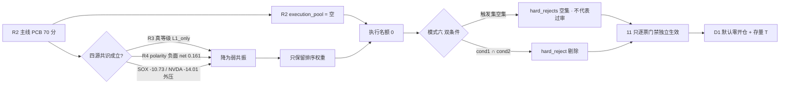

# 2026-11-23 · **反证 / Devil's Advocate**

> **数据源新鲜度**: partial · **降级状态**: true（模式四/八/十 degraded 或未触发）· **置信度**: 0.45（0.80 × 0.70 × 0.80）

## 🎯 一句话结论

**11 只全数不具备开仓资格；PCB 只有 3 日窄口，hard_reject 空集不等于过审。**

## 📊 反证全景 · 四象限分布

| 象限 | 条数 | strong | soft | 最硬的一条 |
|---|---:|---:|---:|---|
| Q1 资金 | 4 | 2 | 2 | 全市场主力 -521.86 亿、小单 +484.71 亿的派发日，板块级 +20 亿只是窄口 |
| Q2 情绪 | 7 | 4 | 3 | 涨停/跌停/炸板两口径差 11.82pp；昨涨停收盘溢价中位 -5.08% |
| Q3 基本面估值 | 7 | 3 | 4 | 中京 3 条红旗（F10 92.48% + F3 应收 +22.1% + S1 亏损） |
| Q4 结构 | 8 | 6 | 2 | RR 三口径取严后 4 只全 <2；龙一/龙二跨 artifact 相互冲突 |

**合计 26 条：strong_suggest 15 · soft_suggest 11 · hard_reject 0。**

## 🧭 模式六裁决 · 为什么 `hard_rejects` 是空集

| 条件 | 实测 | 结论 |
|---|---|---|
| 触发对象：R2 `execution_eligible` 的龙一/龙二 | 全文 `execution_eligible` 出现 **0 次**；`execution_candidates=0`、`execution_pool=[]`、`research_only=true` | 触发集按定义为空 |
| cond1：命中 R3 `distribution_alert` | 4 条告警（九阳股份 / 文投控股 / 襄阳轴承 / 九阳·东方·大东方名字辈）与 11 只候选**交集 0** | 无票同时落在两集合 |
| cond2：个股 5 日主力净流出 | 九阳 / 文投 / 襄阳 的资金额不在今日落盘 artifact（R5 仅 11 只、R7 watch_reserve 26 只不含），R6 只读禁抓 | **cond2 不可复核** |
| 昨日兑现 | 昨日（20261120 unit）九阳已被 hard_reject，11-20 收 **-7.21%**；今日 R3 仍列 excluded（红线 4） | 结构风险真实存在，但不是今日池内否决 |

**必须读对的两件事**：①`hard_rejects=[]` 只代表「今日未形成否决」，**不代表 11 只通过**；②今日默认执行名额仍为 0，D1 逐票门禁（RR / 禁止清单 / 7 项开仓资格）独立生效，不得用本报告的空集去解除禁新仓。

## 🔍 详细分析

**一、市场底色：主跌未破，修复判据三项全否。** R1 判 **崩溃退潮型 / 情绪 22.1 恐惧 / 无主线 / 仓位上限 0.10**，处于 capitulation 第 8 天（连跌 7 天 · repair_window）。11-20 权威口径涨停 30 / 跌停 **68**（2.27:1）、炸板 14 → **31.82%**、最高 4 板、涨 313:跌 5236（**5.62%**）、中位 **-5.08%**、成交 14311 亿。修复三判据（开盘广度 >0.55 / 昨涨停红盘率 >60% / 板块级涨停潮 ≥3 只）在上一交易日**全部不成立**，09:30-10:00 必须重新确认，不成立只留日内 T。

**二、PCB「四源共识」有四个裂缝。** R2 记 `agreement_count=4` / `cross_validation_score=1.00` / composite 0.775，但：①R3 真等级只是 **L1_only**（L2 真人层 0 字节断更、L3 永久下线），并明示下游不得当已确认主线；②R4 同板块 `polarity` 字段写「负面」，只因 E005 PCB 短缺 +0.602 与 E006 AI 硬件崩盘 -0.441 同轴对冲后 net 才 +0.161；③隔夜 **SOX -10.73% / NVDA -14.01% / 纳指 -5.28%** 属同一 AI 硬件敞口的外压；④R2 自己的「共振」维只给 8/20。结论：该线只保留排序权重，**不授开仓资格**。

**三、资金：3 日窄口 vs 全市场派发。** 印制电路板 d1 +20.39 / d3 +69.92 亿，但 **d5 -4.18 / d20 -234.58**；元件 d1 +18.72 / d3 +67.92，**d5 -17.87 / d20 -306.77**。同日全市场主力 **-521.86 亿**、5 日 -1830.02、20 日 -4460.02（20 日仅 7 日为正），四档 超大单 -172.89 / 大单 -348.98 / **小单 +484.71**，是教科书式派发日；两融 5 日 -485 亿。超声电子 10 日序列也证明这是「一日集中建仓」：11-09 +5.67 → 中间六跌两涨累计 -4.10 → 11-20 +8.11。

**四、赔率：三套口径取严后只剩一只「单源达标」。** 超声 R2 `rr5=0.00`/止损距 -11.99% vs R5 RR 1.88/止损 -7.89%；深南 0.24/-14.33% vs 0.91/-7.85%；中京 R2 未测算、R7 `rr5=0.00` vs R5 1.25/-12.62%；沪电 0.32/-10.64% vs 1.31/-7.86%。唯一 RR≥2 的澳弘（R5 2.34/止损 -7.85%）是**单源**、且在候补层（alpha C），按「候补不得升位 + cap 0.10 严档 alpha≥A」不许当赔率依据。

**五、基本面：中京 3 条红旗成立，F9 是 9M 口径伪红旗。** 中京 F10 有息负债/净资产 =(15.14+12.22+0.00)/29.58 = **92.48%**；F3 应收 +22.1% > 收入 +1.8%×1.5；S1 归母 **-1.17 亿**、ROE -4.38%。但 R5 标的 F9「44.7%」用 9M 累计营收 24.45 亿作分母，改 TTM 营收 31.8 亿复算 = **34.3%**，不成立；同批沪电 41.5%→33.7%、澳弘 40.1%→31.7% 亦不成立。若不复算，中京会被误抬到 4 条 → 触碰 hard_reject 门槛。

## 🧠 推理深度三问

### 反证点 1：PCB「四源共识」（Q1 资金 · strong）
- **大资金意图**: 20 亿级单日流入集中在超大单（印制电路板 超大单 +18.99 / 小单 -15.51、元件 +18.62 / -12.99），是机构在材料涨价链做「抢跑 + 换手」，对手盘是主跌段里割肉的散户与被动盘；但 20 日口径 -234.58 / -306.77 亿说明存量筹码仍在撤离，机构只买了一个窄口。
- **为什么走强**: 位置极低（板块中位 r60 -22.67%、距 60 日高 -45.11%、36/45 成员属 rebound）+ 硬催化（全球电子协会材料短缺至 2027H1）+ 筹码轻（超声获利盘 91.6%、均价 17.51 低于收盘）；三维只对了「催化 + 低位」，宽度与中期资金是反的。
- **逻辑够不够硬**: **不硬**。独立源实为 3 个（R3 L1_only / R4 对冲后 +0.161 / R7 单日与 3 日），硬事件只有一条（供应预警），硬业绩未验证（超声净利 +97.52% 靠去年低基数）；证伪路径明确——**次日涨停家数 ≤2 家或 5 日资金转负即降级**。

### 反证点 2：中京电子（Q3 基本面估值 · strong）
- **大资金意图**: 今日龙虎榜买方以游资营业部为主（开源证券西安西大街 +2.09、深股通 +1.10、国新证券北京 +0.52），机构专用只 +0.19，而机构专用席 53 日长窗 **-1.94 亿** → 机构在这个位置是**减仓方**，游资在赌 2 板高度的次日溢价。
- **为什么走强**: 板高最高（PCB 链唯一 2/2 板）、封单 2.04 亿最厚、0 开板、09:36 首封；但筹码是 **获利盘 98.9%、均价 12.07 远低于收盘 13.39、上方套牢仅 1.1%** → 全员浮盈，次日任何分歧都是集中兑现。
- **逻辑够不够硬**: **不硬**。硬业绩没有（归母 -1.17 亿、ROE -4.38%），硬事件是行业级而非公司级，硬时间锚无；估值 PS 89.7% 分位只能靠情绪定价。证伪路径：**开盘 15 分钟封单低于 1 亿或首次开板后 30 分钟不回封 → 逻辑当次作废**。

### 反证点 3：东方财富（Q1 资金 · soft）
- **大资金意图**: 主流资金在**撤**：今日 -0.90 亿、5 日 -6.35 亿（1/5 正）、10 日 -14.24（9 天为负）、20 日 -20.54；同时近 3 笔大宗均价折价 **-18.90%**（分销/减持信号）。政策三箭（融资保证金 100%→80% 自 11-30 施行）的受益者是**未来的增量杠杆**，不是现在的主力。
- **为什么走强**: 严格说没走强——+0.22%、量比 1.57、换手 1.68%、MA5/MA20/MA50 三线粘合（乖离 ±0.3%），只是「人气 dc 50→24」的相对抗跌；板块 0 涨停、证券红盘率 12.5%。
- **逻辑够不够硬**: **不硬**。政策是 11-30 才生效的**预期**（R4 自注「周一高开＝预期兑现不是资金确认」），资金与大宗两个独立源都反向。证伪路径：**10:00 前券商无 ≥2 只涨停且东财不站上 18.49 → 政策线当次按一日游处理**。

## 🔗 反证传导图

## 🧩 每票思维链（上游买入理由 · R6 复述对照，不构成背书）

### 超声电子 000823.SZ · 拦截（研究观察，不给开仓）
- **买入理由**: ①PCB 材料短缺链唯一「席位 + 封单 + 龙虎榜净买第一」的票（LHB 全席位 +4.41 亿、今日净买全场第 1）；②覆铜板 + PCB 双主业直接受益，Q3 净利 +97.52%、单季 +276.24%，业绩与题材同向。
- **风险点**: ①53 日 9 次涨停、龙虎榜 24 次 = 游资高频博弈票，机构专用席长窗 **-7.06 亿**，「机构承接」标签只在今日单日成立；②距 60 日高 -31.95%、MA50 上方压制 9.84%，上方解套盘厚；③融券 15 日 +116.58%，空头在加码。
- **止损条件**: 跌破 17.05（R5 止损位，距收盘 -7.89%）无条件走；若次日集合竞价涨停打开且 10:00 前未回封，按断板处理。
- **可验证假设**: 24 小时内 —— 次日涨停家数 ≥3 且超声封单 ≥1.5 亿 = 窄簇延续；涨停家数 ≤2 或封单 <0.8 亿 = 一日游证伪。

### 中京电子 002579.SZ · 拦截（研究观察，不给开仓）
- **买入理由**: ①PCB 链唯一 2/2 板、封单 2.04 亿最厚、0 开板、09:36 首封，板型最硬；②人气 ths 25→8（Δ+17）/ dc 5→3，R4 三源点名。
- **风险点**: ①获利盘 **98.9%**、上方套牢仅 1.1%，全员浮盈；②归母 -1.17 亿、ROE -4.38%，PS 89.7% 分位，估值无盈利支撑；③F10 有息负债/净资产 92.48%（>80%），F3 应收 +22.1% 远超收入 +1.8%；④止损距 -12.62% 越 -10% 硬区间，RR 1.25 <2。
- **止损条件**: 击穿 11.70（R5 止损位，距收盘 -12.62%）即走；断板当日不补仓、不做「换手回封」假设。
- **可验证假设**: 24 小时内 —— 次日竞价涨幅 ≥+3% 且 09:45 前封板 = 高度延续；竞价 ≤0 或首封前开板 ≥2 次 = 分歧兑现。

### 东方财富 300059.SZ · 拦截（政策线观察，不进）
- **买入理由**: ①政策三箭最直接受益端（融资保证金下限 100%→80%、做市、降费），R4 net 1.330 全表最强；②PE 19.56 处 3 年 2.3% 分位，PB 2.85（13.3%），是券商里唯一「便宜」的成长型标的。
- **风险点**: ①主力 10 日 9 天为负、20 日 -20.54 亿，资金单向撤退；②近 3 笔大宗均价折价 -18.90%（分销/减持）；③政策 11-30 才施行，本周买的是预期不是资金；④板块 0 涨停，无情绪载体。
- **止损条件**: 跌破 17.05（R5 止损位，距收盘 -7.39%）走；若 10:00 前券商无 ≥2 只涨停，当日不参与（不等止损）。
- **可验证假设**: 24 小时内 —— 券商板块出现 ≥2 只涨停且东财站上 18.49 = 政策线成立；仍 0 涨停或东财回落至 18.00 下方 = 预期兑现完毕。

## 🧾 关键证据

- **证据 1**：全市场主力 **-521.86 亿**、超大单 -172.89 / 小单 **+484.71**、5 日 -1830.02、20 日 -4460.02（20 日仅 7 日正）→ 派发日。来源 R7 `main_force`。
- **证据 2**：印制电路板 d1 +20.39 / d3 +69.92 但 **d5 -4.18 / d20 -234.58**；元件 d5 -17.87 / d20 -306.77。来源 R7 `top_inflow_sectors` / `key_sectors`。
- **证据 3**：PCB 宽度 印制电路板 42.6%（中位 -1.02）· 元件 34.9%（-2.40）· PCB 概念 10.7%（-5.88）→ 涨停簇不是板块行情。来源 R2 `breadth_matrix`。
- **证据 4**：昨涨停收盘溢价 均值 **-3.40%** / 中位 **-5.08%** / 红盘率 30.43% / 再涨停 3 只；30 日样本中位 -17.22%、正收益 6/42。来源 R1 `market_structure.premium` + `cycle_position.samples`。
- **证据 5**：RR 三口径 —— 超声 0.00/1.88、深南 0.24/0.91、中京 未测/0(0)/1.25、沪电 0.32/1.31，取严后全部 <2；澳弘 2.34 仅 R5 单源。来源 R2 `leaders.rr` + R5 `rr` + R7 `rr5`。
- **证据 6**：中京 F10 =(15.14+12.22+0.00)/29.58 = **92.48%**；F3 应收 +22.1% vs 收入 +1.8%；S1 归母 -1.17 亿；F9 44.7%→TTM 复算 **34.3%** 剔除。来源 `_r5_fin_stmt` 20260930 复算。
- **证据 7**：工行/中行 PE·PB·PS 三项 3 年分位 **均 100%**，融券 15 日 +553.98% / +68.24%。来源 R5 `valuation_safety`。
- **证据 8**：昨日反证已兑现 —— 九阳股份 11-20 **-7.21%**（昨日 hard_reject）、江化微 **-7.74%**（昨日判「尾盘板出货」）；昨日卡片池 25 只均涨 -2.99%、红盘 5/25。来源 `data/reports/20261120/observation_tracking.json`。
- **证据 9**：两套涨跌停口径 —— R1 28/58/7 (20.00%) vs R2/R3/R7 30/68/14 (**31.82%**)，差 11.82pp，落在 35% 红线两侧不同叙述。来源 R1 / R3 `discipline_gate` / R7 `emotion_basis`。

## 📐 D1 消费规则

| severity | 条数 | D1 义务 |
|---|---:|---|
| `hard_reject` | **0** | 无强制剔除对象；但空集≠通行证，执行名额仍为 0 |
| `strong_suggest` | 15 | 必须接受，或在 `meta.d1_override[]` 逐条记录理由（重点：M1_01 / M1_02 / M1_03 / M1_08 / M2_01 / M2_05 / M3_01 / M3_02 / M5_01 / M5_02 / M7_01 / M1_04 / M1_05 / M1_09） |
| `soft_suggest` | 11 | 记入 `r6_soft_notes`，可选项 |

**口径强制**：RR 引用必须带来源（R2 / R5 / R7 哪一套）；涨跌停数字统一用 R7 权威口径 30/68/14；「四源共识」只能写「三源同名 + 真等级 L1_only」；「机构承接」标签对超声不可用（长窗机构 -7.06 亿）。

## ⚠️ 不确定性 / 反证（自我批判）

- **空集不是干净的证明**：模式六触发集为空是契约结构决定的（R2 无 `execution_eligible`、执行池空），不是「11 只都被审核通过」。反过来，**也不能用本报告的空集去解除禁新仓**。
- **R6 只读的边界**：九阳/文投/襄阳 的 5 日主力额今日未落盘，cond2 无法复核；若明日 D1/R7 补录后 cond1∩cond2 成立，这些票应直接 hard_reject。
- **反向风险（本报告可能错的地方）**：情绪 22.1 恐惧 + 连跌 7 天 + 空头拥挤（买方反馈 AI 硬件多头仓位接近零）本身就是修复燃料；周末组合式政策底（融资保证金、做市、降费、韩台救市）若在 11-30 前提前发酵，PCB 这样的低位窄簇可能先走一波。若明日广度 >0.55、昨涨停红盘率 >60%、且出现 ≥8 家涨停行业簇，本报告 Q2 结论须整体重估。
- **模式四/十降级**：无历史事件库、商品序列 skipped + DXY 缺失 → 未做历史类比与跨资产背离，不编造。模式八（涨停 30 <100 家）与模式九（最高 4 板 <8 板）按定义未触发，但 4 板空心 + 3 板断层已单独记 1 条结构反证。
- **数据自身冲突未消解**：R4 印制电路板 `polarity` 写「负面」而 `net_polarity=+0.161`；R7 自述「不继承 R2」却与 R2 leaders 重合 2/5。两处都按「取严 + 标注」处理，未做人工改数。

## 数据源审计

| 源 | 日期 | 状态 | 备注 |
|---|---|:--:|---|
| tushare/limit_list_d + stk_limit | 2026-11-20 | 🟡 | 5572 只 · 两口径 U28/D58/Z7 vs U30/D68/Z14 |
| tushare/moneyflow_dc 个股+行业 | 2026-11-20 | 🟢 | 6035 只/日 × 21 日 · 四档拆解 |
| tushare/top_list + top_inst | 2026-11-20 | 🟢 | 29 张卡 · 席位净额与机构席分列 |
| tushare 财报三表（F9/F10 复算） | 2026-09-30 | 🟢 | 11 只 · TTM 营收重算 |
| 东财 DC 资金 + cyq 筹码 | 2026-11-20 | 🟢 | 11 只 · 与 R7 逐票精确对齐 |
| hotlist 双平台四榜 | 2026-11-20 | 🟡 | 93 行 · 周末 11-22 空榜无增量 |
| wechat_cli 焦点群（匿名） | — | 🔴 | 0 字节 / 7 群 0 条 · L2 断更 |
| wechat_official_rss 公众号池 | 2026-11-22 | 🟢 | 55 篇 · 官方 40 篇 |
| WeFlow L3 语义网络 | — | 🔴 | 2026-08-19 永久下线 |
| 商品序列 / DXY | — | 🔴 | skipped / 缺失 → 模式十降级 |
| observation_tracking（上一交易日） | 2026-11-20 | 🟢 | 46 条 · 兑现率字段缺 expected_direction |
| 昨日 R6 反证 artifact | 2026-11-20 | 🟢 | hard_reject 1 条已兑现 |

## 与其他 R/D/E 的关系

- **依赖**：`R1_style.json`（温度层）、`R2_main_sectors.json`（反证对象）、`R3_sentiment.json`（共振与 distribution_alert）、`R4_news.json`（消息一致性）、`R5_stock_profiles.json`（估值/筹码/红旗）、`R7_capital_flow.json`（资金面）、`_r5_fin_stmt.json`（红旗复算）、`data/reports/20261120/observation_tracking.json` + `data/research/20261120/R6_devil_advocate.json`（昨日兑现）。
- **被消费**：D1（canghai-plan）——`strong_suggest` 须显式处理或 override 留痕；E1（canghai-review）——本日 26 条反证条目将在 T+1 回填兑现率。

## Sub-Agent 元数据

- skill: analyze_devil_advocate_v1
- artifact: `data/research/20261123/R6_devil_advocate.json`（39,791 B）
- 反证条目: 26（strong 15 / soft 11 / hard 0）
- 生成耗时: 约 90 秒（只读 + 复算，未抓新数据）
- model: deepseek-v4.1-flash
