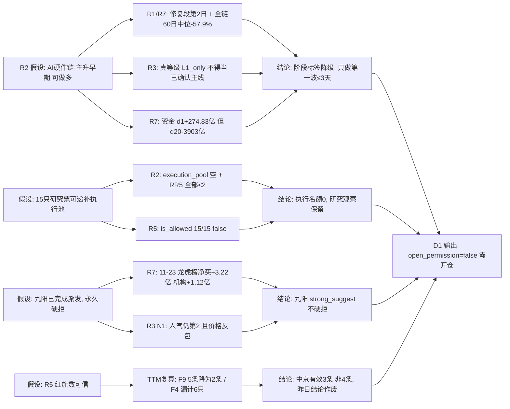

# 2026-11-24 · **反证 / Devil's Advocate**

> **数据源新鲜度**: partial（T-1 收盘；R3 仅 L1、两融 T-2）
> **降级状态**: true（模式四无历史库、模式十商品序列缺位、模式八仅 15/152 样本）
> **置信度**: 0.448 = 0.80 × 0.70 × 0.80

## 一句话结论

今日 29 条反证 · strong 23 / soft 6 / hard 0：模式六触发集为空（不是干净），碰 AI 硬件链前必须先解释"主升早期"与"深跌反弹"这句自相矛盾。

## 详细分析

### 一、四象限总量：反证集中在"估值＋结构"，不在"情绪"

| 象限 | 条数 | 主要矛头 |
|---|:--:|---|
| Q1 资金 | 4 | 资金维 19/20 只对应单日；模式六三重空转；凡拓诱多；钴股商品背离 |
| Q2 情绪 | 7 | 四源共识实为 L1_only；贪婪 72 与零开仓共存；九阳人气反包；152 家涨停的解套盘口径 |
| Q3 基本面估值 | 10 | 宇树 PE 510 倍 / 龙版 99 分位 / 凡拓亏损；F9 与 F4 计数口径错；F8 三只 |
| Q4 结构 | 8 | 阶段标签互斥；RR 三口径差 18.9 倍；R5 残文；5 板烂板 |

对比昨日（26 条 · strong 15 / soft 11），今日 strong 占比从 58% 升到 79%，不是因为行情变差，而是因为**口径缺陷被抓出来了**：红旗计数、RR 口径、阶段标签三处都能让下游把"研究候选"读成"可执行"。

### 二、模式六为什么是空集——这是契约空转，不是"15 票干净"

三层同时空转：

1. **R2 没有 `execution_eligible` 字段**（全文 0 次出现），`execution_pool=[]`、`execution_candidates=[]` → 触发对象集合按定义为空。
2. **R3 `hotlist_signals` 八个 key 里没有 `distribution_alert`**（本日未产出）。条件一被迫改用 R7 `hot_money.distribution_alerts`（今日 65 条：涨停但龙虎榜净卖 8 / 反复开板烂板 33 / 诱多 19 / 重挫日净卖 2 / 拉高出货 3）+ R5 `flags.distribution_alert` 代位。
3. **R7 `execution_candidates=[]`、R3 `open_permission=false`** → 没有可被否决的执行池。

双重条件实扫（条件一＝派发警报；条件二＝个股 5 日主力净流出）：

| 票 | 条件一 | 条件二 | 裁决 |
|---|:--:|---|:--:|
| 凡拓数创 301313 | ✅ 诱多 high（机构净卖 −0.78 亿） | ❌ 5 日 **+1.22 亿** | strong_suggest |
| 中京电子 002579 | ✅ 烂板 6 次开板 | ❌ 5 日 **+8.54 亿** | strong_suggest |
| 真视通 002771 | ✅ 诱多 high + 烂板 6 次 | ❌ 5 日 +1.14 亿 | strong_suggest |
| 九阳股份 002242 | ⚠️ 仅 R3 文本级 N1（字段缺失） | ✅ 5 日 **−3.07 亿** | strong_suggest |

→ 严格口径 **hard_rejects=[]**。九阳是唯一"实质双条件"候选，但 11-23 龙虎榜净买 **+3.22 亿**（机构专用 +1.12 亿、港股通 +0.91 亿、9 行席位）构成反向腿，按 v1.3 不写硬拒、只写 strong。**空集只代表"未形成否决"，不代表其余 11 只过审，今日默认执行名额仍为 0。**

### 三、模式七：红旗数被口径抬高又被漏计，两边都错

R5 `flags_census` 记 F9=5、F4=0。用 R5 自己落盘的财报三表做 TTM 复算后，两边都不对：

| 票 | F9（9M 分母） | F9（TTM 复算） | F4 复算（存货增速 vs 收入×1.5，周转率方向） | 有效红旗 |
|---|:--:|:--:|---|:--:|
| 沪电股份 | 41.5% | **33.7%（不成立）** | 98.7% vs 107.9%，周转 2.43→1.92 → 不成立 | V4 一条 |
| 中京电子 | 44.7% | **34.3%（不成立）** | 37.3% vs 2.7%，周转 3.16→2.45 → **成立** | F10+F3+F4 = 3 |
| 双环传动 | 41.3% | **30.1%（不成立）** | 18.5% vs 15.2%，周转 2.29→2.14 → **成立** | F3+F4 = 2 |
| 凡拓数创 | 87.3% | 53.7%（成立） | 不成立 | F9 一条 |
| 盛剑科技 | 108.1% | 78.8%（成立） | 31.8% vs −7.0% → **成立** | F9+F4 = 2 |
| 新易盛 | 23.5% | 18.6% | 163.7% vs 139.5%，周转 1.32→0.96 → **成立** | V4+F4 = 2 |

结论有三条：
1. **F9 由 5 条降为 2 条**（凡拓、盛剑仍在 40% 以上），其余三只是 9M 累计营收作分母的系统性抬升（7–13 个百分点）。
2. **F4 应成立 6 只**（新易盛、中京、宇树、双环、瑞芯微、盛剑），R5 一条没计——漏检方向与 F9 的误抬正好相反。
3. **中京电子有效红旗 3 条**（F10 有息负债 92.5% + F3 应收 +22.1% vs 收入 +1.8% + F4），**未达 ≥4 硬拒门槛**。昨日 R6_M7_01 判它"4 条触达 hard_reject"是把 S1（最新期净利为负，属 ST 财务轴观察非 12 红旗）与 F9（TTM 不成立）都算了进去 → 昨日结论被证伪，今日不得沿用。

### 四、模式五：昨日反证兑现率只有 0.20，九阳硬拒被行情打脸

`observation_tracking` 的 `r6_fulfillment`：total 10 / fulfilled 2 / partial 2 / **falsified 5 / violated 1 → rate 0.20**。最典型的一条是九阳：

- 2026-11-20 R6 以"distribution_alert(high·红线4) + 5 日主力 −8.08 亿"写 **hard_reject**；
- 2026-11-23 九阳 **+10.01%**、dc 人气仍第 2、龙虎榜净买 **+3.22 亿**（机构 +1.12 亿）。

硬拒的提前量不足，问题不在阈值，在**缺一条解除条件**：当派发警报之后出现"当日龙虎榜机构净买 > 1 亿且价格创 5 日新高"时，硬拒应降为 strong 并进入复核，而不是锁死。今日对九阳的处理按此修正（见思维链）。

### 五、今日最硬的四条反面证据

1. **阶段标签互斥**：R2 同一份 artifact 里 `stage=early_up / 主升早期`，`trend_layer=rebound`，全链 60 日中位 −57.9%。R2 自己写"只做第一波、持有 ≤3 天、破 5 日线无条件走"——那就不叫主升早期。
2. **资金只有单日**：电子 d1 +69.21 / d3 **−43.64** / d20 **−554.82**；全市场 d1 +274.83 / d5 **−908.42** / d20 **−3903.35**（20 日仅 8 日为正）。R7 自己判"今日是卖方消失而非买方凶猛"。
3. **共识只有 1.5 源**：R2 记 `agreement_count=4` / composite 0.83，R3 原文写"真等级 L1_only……下游不得当作已确认主线"，R7 写 `execution_candidates=0`。
4. **R5 的禁止清单解释字段是上一日残文**：`input_note` 硬编码 `emotion_phase=main_down（capitulation 补跌第 7 天 · 炸板率 51.06%）`，而同日闸门实参是 `EMO=main_up`、今日炸板率 15.08%。数值没算错，但**解释文本会把 D1 引到"今天是主跌第 7 天"的错误语境**。

## 关键证据

- 阶段冲突 · 来源 `R2_main_sectors.json` main_lines[0].stage / trend_layer + `R1_style.json` emotion_cycle_action
- 资金三日口径 · 来源 `R7_capital_flow.json` main_force.sector_flows / market_windows / concept_read
- 共识强度 · 来源 `R3_sentiment.json` resonance_strength_cap / discipline_gate + `R2` consensus_themes[0].note
- RR 三口径 · 来源 `R4_news.json` top_events 个股 risk_reward vs `R2` leaders[].rr.rr5 vs `R7` research_candidates.rr5
- 红旗复核 · 来源 `_r5_fin_stmt.json` 三表 TTM 复算（本单元自算，非外部数据）
- 派发警报 · 来源 `R7_capital_flow.json` hot_money.distribution_alerts（65 条）+ `R5` flags.distribution_alert
- 昨日兑现 · 来源 `data/reports/20261123/observation_tracking.json` r6_fulfillment / t1_rollup

## 推理深度三问

### 1）AI 硬件链（R2 主线，score 81 / 四源交集唯一线）

- **大资金意图**: 超大单净买、小单净卖（元件 elg +38.21 / sm −41.39，印制电路板 elg +33.17 / sm −36.63）＝机构在承接散户割出来的筹码。动机是英伟达事件后的**超跌修复弹性**，不是趋势加仓：全链 60 日中位 −57.9%，上方全是解套盘，机构拿的是"修复第一波"的 3 天窗口，不是估值重估。
- **为什么走强**: 位置极低（新易盛 30 日位置 12.0%、中际旭创 7.1%、沪电 22.6%）＋ 硬事件（费半 +14.03%、NVDA +31.31%）＋ 筹码（新易盛获利盘 64.5%、中际仅 36.5%）。三维里"位置"贡献最大，"筹码"仍是套牢盘主导。次日高开 >5% 属于利好兑现，R3 的盘前剧本已写死"高开 >7% 视为给 11-23 抬轿"。
- **逻辑够不够硬**: 独立源名义 4 个、实际 1.5 个（R3 只到 L1_only、R7 可执行 0 只）；硬业绩有（PCB 订单 +56.1% / 沪电前三季净利 +100.54%~+109.74%）但**只对沪电成立**，龙一新易盛的催化是跟随型、当日无独立公告。证伪路径极短：只要 11-24 缩量高开低走，3 日双正立刻归零，本线当日即失效。

### 2）九阳股份（人气反包 · 昨日被硬拒、今日人气仍第 2）

- **大资金意图**: 11-23 龙虎榜净买 +3.22 亿中，机构专用 +1.12 亿、港股通 +0.91 亿 —— 说明这一波不是纯游资对倒，有机构在接力。对手盘是前期 5 日净流出 −8.08 亿的那批卖盘（已出清部分），所以盘面变轻。
- **为什么走强**: 位置中高（9 日 9 次在榜、dc 人气第 2）＋ 催化是"名字辈/低价玄学"（纯情绪，R2 discarded score 36.0）＋ 筹码获利盘高但反复炸板（+10.02 → −9.99 → +10.01 的序列）。三维里只有情绪一维，产业与筹码都不支持。
- **逻辑够不够硬**: 0 个产业硬源，1 个情绪源（L1_only），R3 的红线 4 明确"不得作正向共振，R5/D1 不得当作接力标的"。逻辑不硬，但**硬拒的证据也不硬**——这就是今日改判 strong 的原因：不给任何档位参与，但不写死禁止，留一个"次日龙虎榜机构净买 ≥1 亿且收盘创新高"的观察口，避免重复 11-20 的提前量错误。

### 3）中京电子（3 连板身位 · PCB 全链资金第 4）

- **大资金意图**: 5 日主力 +8.54 亿、30 日龙虎榜 16 次上榜、当日封单 1.02 亿。这是**游资＋机构混合的接力盘**：烂板 6 次说明分歧极大，接力的是"3 板身位 + PCB 全链最强资金"的双重标签，而不是基本面。
- **为什么走强**: 位置 30 日 67.8% / 距 MA50 −1.94%（全链最贴决策线）＋ 硬事件（PCB 订单 +56.1% vs 出货 +13.3%，交期 16–20 周）＋ 筹码获利盘 98.9%（几乎无套牢盘，抛压轻）。
- **逻辑够不够硬**: 产业叙事硬（R4 E006 点名，主营 PCB 100%），但**业绩不硬**：最新期净利 −1.17 亿、ROE −4.38%、有息负债/净资产 92.5%、应收增速 22.1% 对收入 1.8%。三条有效红旗 + 6 次开板 = 身位可做、质地不可重仓。证伪路径：11-24 若断板且封单不足 0.5 亿，3 板结构当日瓦解。

## 候选票思维链（若 D1 要碰，必须先答这四段）

> R6 不给正向结论，以下四段是"碰它的前提条件"，不是买入建议。

### 新易盛 300502.SZ（龙一 · 非涨停容量核心）

- **买入理由**: ①CPO 是 AI 服务器互联弹性最大一环，主营光互联 99.87%、毛利率 48.5%，是英伟达事件最直接映射；②R7 认定 CPO 总龙——当日 +22.94 亿 / 5 日 +35.90 亿 / 20 日 +33.61 亿，三项链内第一，5 日强度占流通市值 1.58%。
- **风险点**: ①位置仍深跌（距 MA50 −39.63%、60 日 −58.97%），上方 35.5% 套牢盘未清；②30 日龙虎榜 **0 次**——没有席位可验，这波是"无席位资金"；③RR5 仅 0.08、止损距 −16.19%，两条都越纪律红线；④V4+F4（CFO/净利 0.13、存货 +163.7% 周转率降 27%）利润含金量差。
- **止损条件**: 跌破 MA5 166.33（对应约 −8.3%）无条件走；或收盘跌破 11-23 阳线实体中点，视为修复失败。
- **可验证假设**: 24 小时内——①11-24 若高开 >7% 且 10:00 前不能站上开盘价，判利好兑现；②主力当日净额转负且 < −5 亿，修复腿结束；③5 日净流入若跌破 +20 亿，说明这波是单日脉冲。

### 中京电子 002579.SZ（3 板身位 · 全链最贴决策线）

- **买入理由**: ①R4 E006 硬产业事实（PCB 订单同比 +56.1% / 出货 +13.3% / 交期 16–20 周），主营 PCB 100%；②5 日主力 +8.54 亿、距 MA50 仅 −1.94%（全链唯一贴着决策线的票）、获利盘 98.9% 无套牢抛压。
- **风险点**: ①有效红旗 3 条：有息负债/净资产 92.5%、应收 +22.1% vs 收入 +1.8%、存货 +37.3% 且周转率降；②最新期净利 −1.17 亿、ROE −4.38%，纯低毛利制造（刚性板毛利率 7.3%）；③6 次开板、封单仅 1.02 亿 = 分歧结构，R7 已标"反复开板烂板"；④止损距 −27.97%，RR 分母归零。
- **止损条件**: 断板即出（破 3 板启动位 13.26 一线，约 −10%）；不做低吸，只做竞价弱转强。
- **可验证假设**: ①11-24 竞价若低开 >3% 且 9:35 前不回封，判身位结束；②封单若 <0.5 亿，烂板结构重演；③当日主力净额若转负，说明 5 日流入是一日游堆积。

### 九阳股份 002242.SZ（人气反包 · 昨日硬拒今日降级）

- **买入理由**: ①11-23 龙虎榜净买 +3.22 亿、机构专用 +1.12 亿、港股通 +0.91 亿，9 行席位 = 有机构接力，不是纯对倒；②dc 人气 9 日 9 次在榜，是当前最强情绪载体。
- **风险点**: ①R3 N1 红线 4：人气顶格 + 反复炸板反包 = 派发末端的最后流动性，明令"不得作正向共振"；②5 日主力仍 −3.07 亿（当日 +8.86 亿是单日翻转），趋势账本未翻正；③名字辈/低价玄学簇（R2 discarded score 36.0），无产业逻辑；④R3 契约字段 distribution_alert 本日缺失，条件一只有文本级证据。
- **止损条件**: 不参与则不设止损；若被强制纳入观察，以 11-23 涨停价 −7% 为失效线，跌破即判反包失败。
- **可验证假设**: ①11-24 若不能维持 dc 人气前 5 且盘中炸板 ≥2 次，派发定性确认；②当日龙虎榜若转为净卖，条件二与反向腿同时消失，升级为可硬拒；③若机构净买连续两日 ≥1 亿且收盘创新高，视为派发证伪，允许解除禁令。

## 四象限负面识别总表（29 条逐条可审计）

| ID | 象限 | 目标 | 严重度 |
|---|---|---|:--:|
| R6_M1_01 | Q4 结构 | R2 主线 stage=early_up vs layer=rebound | strong |
| R6_M1_02 | Q2 情绪 | 四源共识实为 L1_only | strong |
| R6_M1_03 | Q1 资金 | 资金维 19/20 只对应 d1 单日 | strong |
| R6_M1_04 | Q4 结构 | RR 三口径差 18.9 倍 | strong |
| R6_M1_05 | Q2 情绪 | 涨停/炸板/跌停三套口径（146 vs 152） | soft |
| R6_M1_06 | Q4 结构 | R5 input_note 为上一日残文 | strong |
| R6_M2_01 | Q2 情绪 | 贪婪 72 / cap 0.95 与零开仓共存 | strong |
| R6_M2_02 | Q4 结构 | d1_gate 7/15 过闸 ≠ 可买 | strong |
| R6_M2_03 | Q2 情绪 | main_lines 1 vs 14 计数不可互换 | soft |
| R6_M3_01 | Q3 估值 | 宇树 PE 510.86 / 93.7 分位 | strong |
| R6_M3_02 | Q3 估值 | 龙版 PE 99 分位 + 主营不相关 | strong |
| R6_M3_03 | Q3 估值 | 有研 PE 119.77 / 92.6 分位 + F8 | strong |
| R6_M3_04 | Q3 估值 | 凡拓 PB 13.1 + 亏损 + F9 + 诱多 | strong |
| R6_M3_05 | Q3 估值 | 风华低分位≠便宜 + 减持期 + 尾盘板 | soft |
| R6_M5_01 | Q4 结构 | 昨日兑现率 0.20 | strong |
| R6_M5_02 | Q2 情绪 | 九阳昨日硬拒被证伪 | strong |
| R6_M5_03 | Q3 估值 | 昨日中京 4 红旗门槛被证伪 | strong |
| R6_M6_01 | Q1 资金 | 模式六触发集三层空转 | strong |
| R6_M6_02 | Q1 资金 | 凡拓条件一命中、条件二不成立 | strong |
| R6_M6_03 | Q2 情绪 | 九阳条件二成立 + 反向腿 | strong |
| R6_M7_01 | Q3 估值 | 新易盛 V4+F4（F4 被漏计） | strong |
| R6_M7_02 | Q3 估值 | 中京 F10+F3+F4=3 条 | strong |
| R6_M7_03 | Q3 估值 | F9 由 5 条降为 2 条 | soft |
| R6_M7_04 | Q4 结构 | 浙文唯一 RR5≥2 但 F8 | strong |
| R6_M7_05 | Q3 估值 | 上海电影 F8 / 盛剑 F9+孤军 | strong |
| R6_M8_01 | Q2 情绪 | 152 家涨停的解套盘样本不足 | soft |
| R6_M9_01 | Q4 结构 | 真视通 5 板双警报 | strong |
| R6_M9_02 | Q4 结构 | 盛剑 5 板孤军 + 位置 100% | strong |
| R6_M10_01 | Q1 资金 | 钴商品涨 vs 股端资金流出 | soft |

## 不确定性 / 反证（对本单元的自我批判）

1. **hard_rejects=[] 会被误读**。今日空集是"触发对象集合为空"，不是"15 票审计通过"。任何把空集读成"全票干净"的结论都是错的。
2. **F4 复算是我的口径**：用"期末存货 / 9M 营业成本"作周转率代理，未做期初期末平均；方向性（存货增速远超收入、周转下滑）是确定的，绝对数值不可引用。R5 若按均存货算，个别票可能翻转。
3. **模式八只有 15/152 样本**：以样本套牢盘均值约 26%、4 只 >50%，判 `high_suspicion=false`；全市场 152 只未逐一算 cyq，结论只能算"未发现假繁荣"，不能算"确认非假繁荣"。
4. **模式四、模式十、F5/F6/F7、V2/V5/V6/V8/V9/V10 全部 degraded**：无历史事件库、无商品/DXY 日序列、无研发资本化与关联交易字段。按红线不编造，宁可留缺口。
5. **本次反证大多指向"口径与标签"，不是"方向"**：我没有推翻任何一条主线的产业逻辑，只推翻它被授予的"可执行"资格。方向层面真正的反面证据只有三条：资金长周期为负、机器人链 5 日失血、AI 应用板块 5 日 −112.84 亿。

## 与其他 R/D/E 的关系

- **依赖**: `R1_style.json` / `R2_main_sectors.json` / `R3_sentiment.json` / `R4_news.json` / `R5_stock_profiles.json` / `R7_capital_flow.json` / `_r5_fin_stmt.json` / `data/reports/20261123/observation_tracking.json` / `data/research/20261123/R6_devil_advocate.json` / `data/research/20261120/R6_devil_advocate.json`
- **被消费**: D1（hard 强制剔除 / strong 须显式处理或 override 记录 / soft 记入 r6_soft_notes）；E1（T+N 回填本单元 29 条与三条思维链的可验证假设）

## 数据源审计

| 源 | 日期 | 状态 | 备注 |
|---|:--:|:--:|---|
| tushare/R1_style | 2026-11-24 | 🟢 | 风格 连板情绪型 · 情绪 72.0 · cap 0.95 |
| tushare/R2_main_sectors | 2026-11-24 | 🟡 | 1 主线 + 3 次线 + 5 丢弃；execution_pool 空、无 execution_eligible |
| 热榜双平台/R3_sentiment | 2026-11-23 | 🟡 | L1_only；L2 真人层断更 18 日；distribution_alert 字段缺失 |
| 公众号+快讯/R4_news | 2026-11-24 | 🟢 | 8 事件 · 15 只个股 · 12 板块极性 |
| tushare/R5_stock_profiles | 2026-11-23 | 🟡 | 15/15 画像 · 六维全 · 红旗计数两处口径缺陷 |
| tushare/R7_capital_flow | 2026-11-23 | 🟢 | 40 行业 + 概念 + 65 条派发警报；两融/ETF 为 2026-11-20 |
| tushare/财报三表 | 2026-09-30 | 🟢 | 15 票 BS/IS/CF · 本单元 TTM 复算用 |
| 东财 DC/龙虎榜 | 2026-11-23 | 🟢 | 龙虎榜席位去重 92/92 自检（R7 侧）；R6 未调用 |
| 观察追踪/E1 | 2026-11-23 | 🟢 | 24 只 T+1 回填 · r6_fulfillment rate 0.20 |
| 历史事件库 | — | 🔴 | 未建库 → 模式四 degraded |
| 商品/DXY 日序列 | — | 🔴 | 未入库 → 模式十 degraded |
| WeFlow/群聊 L2 | 2026-11-24 | 🔴 | 永久下线 + 7 群 0 条 → 情绪缺真人腿 |

## Sub-Agent 元数据

- skill: analyze_devil_advocate_v1@1.3
- artifact: `data/research/20261124/R6_devil_advocate.json`（43,589 B）
- 反证条数: 29（strong 23 / soft 6 / hard 0）
- 四象限: Q1 资金 4 / Q2 情绪 7 / Q3 估值 10 / Q4 结构 8
- 生成耗时: 约 8 分钟（含 TTM 复算与逐条口径核对）
- model: deepseek-v4.1-flash
- 红线自检: 未调用 MCP / 未拉新数据 / 未写 `chzl_kg/`
