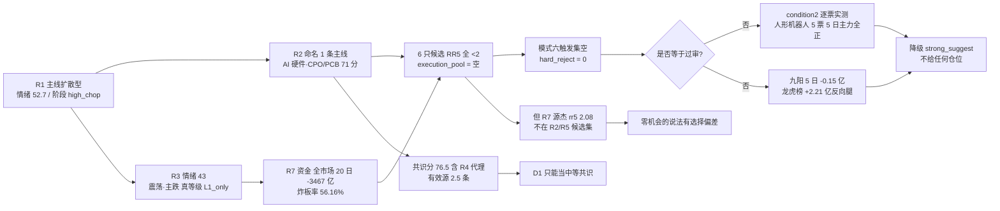

# 2026年11月25日 · **反证 / Devil's Advocate**

> **数据源新鲜度**: partial（R4 缺失，R1/R3/R5 三源 degraded）
> **降级状态**: true（模式四无历史库、模式六触发集为空、模式十以跨资产对标腿执行）
> **置信度**: 0.39 = 0.80 × 0.65 × 0.75

## 一句话结论

**今日 28 条反证里 0 条硬拒，但"零硬拒"不等于"可以开仓"——模式六条件二在 8 个对象上全部不成立，而执行名额本来就是 0；真正的风险是 R2 的"无主线"与 R1 的"轮动体制"被读成"随便挑一只试试"。**

---

## 详细分析

### 一、今日该问的第一个问题不是"买什么"，而是"零机会的说法站不站得住"

R2 给出的结论是"零开仓六条同时成立"，R7 给出 `execution_candidates=0`，R5 的账本模拟也只有 12/15 过档位闸门而无仓位可给。三份 artifact 在这件事上完全一致，但一致的**理由**分两种：一种是"没有主线，所以不开仓"（R1 的轮动体制判定），另一种是"全市场没有合规赔率"（R2 的 RR5 全 <2）。后者是一个更强的断言，需要全市场证据，而我们没有。

按 R7 的候选清单逐条比对：`research_candidates` 3 只中，**源杰科技 688498.SH** 的 `rr5=2.08`、`stop_dist_pct=-7.60%`、5 日主力 +8.31 亿、20 日 +12.75 亿、`pos20=14.0`（低位）—— 它是今日唯一同时过"止损距 −5~−10% 且 RR≥2"双条件的票，却**不在 R2 的 6 只主线候选里，也不在 R5 的 15 只画像里**。所以 R2 那句"6 只候选 RR5 全部 <2"是真的，但由此推出"全市场无赔率"是选择偏差。D1 若要宣布零机会，理由必须写成"无已确认可交易主线"，不能写成"没有一只票能算出生赔率"。

- **大资金意图**: 11-24 是 11-23 强修复的一日反转日，全市场主力 −37.32 亿（前日 +274.83，摆动 −312.15），5 日 −682.71 亿、20 日 −3467.06 亿且仅 8/20 日为正。钱没有换方向，仍在科技硬件内部换手（电子 +64.73 亿、CPO +62.72 亿、PCB +33.92 亿、元件 +30.47 亿），但四档结构是"大单接、小单抛"——这是**同一批筹码的换手，不是新钱进场**。对手盘是那些在 11-23 修复日追高、11-24 高开兑现的散户单。
- **为什么走强**: 答：走不强，今日是"资金正 / 价格负"的组合。位置（沪电距 MA50 −19.19%、生益 −42.63%、中际 −37.03% 都在深跌中反弹）+ 催化（隔夜 SOX −7.88%、NVDA −5.86%、MU −10.97%，外压直接定价开盘）+ 筹码（11-24 的 20 只观察票里 16 只高开、14 只收在开盘价下方、高开 ≥5% 的 7 只平均开→收 −2.88%）。
- **逻辑够不够硬**: 不硬。独立源只有 R7 资金一条腿是真的（R3 只到 L1_only、R4 缺失、R1 degraded），硬业绩与硬时间锚都没有，唯一可证伪路径是"今日 CPO/PCB 低开后能否站回 VWAP"。

### 二、模式六：为什么"霸榜出货"今天一个 hard_reject 都不该有

模式六是唯一硬否决权，它的两个条件是 AND 关系：①所属板块或本股命中霸榜/派发清单；②近 5 日主力净流出。逐对象实测结果如下——**条件一成立的对象不少，条件二一个都没真成立**。

| 对象 | 条件一（派发） | 条件二（5 日主力净流出） | 判定 |
|---|:--:|---|:--:|
| 人形机器人概念（886069.TI） | ✅ 概念榜 #1 连续两日、涨停 51→14 腰斩 | ❌ 在册 5 票全为正：三花 +1.43 / 拓普 +6.28 / 克来 +0.84 / 长华 +0.61 / 鸣志 +0.09 亿 | strong_suggest |
| 九阳股份 002242.SZ | ✅ R3 指名（dc 人气 #1 四日、11-24 回 #1） | ⚠️ −0.15 亿（3/5 日为正，≈流通市值 −0.05%）；同日龙虎榜净买 +2.21 亿为反向腿 | strong_suggest |
| 工业富联 601138.SH | ✅ R7"反复开板烂板"11 次（high） | ❌ 5 日 +33.12 亿 | strong_suggest |
| R7 派发清单 24 条 × R2 候选 15 票 | — | — | 交集 = 0 |

这里必须诚实写清楚：`hard_rejects=[]` **只代表"未形成否决"，不代表"15 票过审"**。三层契约同时空转——R2 没有 `execution_eligible` 字段、`execution_pool=[]`、R7 `execution_candidates=0`——触发对象集合本身为空。九阳昨天（11-20 unit）曾被 R6 硬拒，随后两次涨停把它证伪，昨日 R6 已留痕"提前量错误"。今日它的 5 日主力只是"技术性为负"，幅度约等于零，且龙虎榜净买构成反向腿，所以按 v1.3 出口降为 strong。**我不重复同一个错误，但 D1 也不得因此给它任何仓位。**

### 三、昨天的错题今天怎么改：强势型反证不能靠"位置高"立论

E1 在 11-24 复盘里记了 `error_case_20261124_002`（recurrence=true，prior=20261123_003）：R6 昨日对高位/人气票的统一看空**四连错**——凡拓数创 +16.64%、九阳股份 +10.01%、中京电子 4 板一字、浙文影业 +10.14%；而 6 条弱势型反证全对。E1 给出的修正规则是"R6 强势型反证在广度>50% 且昨涨停溢价>0 的日子自动降级为 soft"。

今日这条规则只满足一半：昨日涨停收盘溢价中位 +3.26%、红盘率 74.7%（溢价腿正），但**广度 35.01% < 50%**（广度腿不满足）。按取严原则，强势型反证保留 strong 档，但**取证方式必须换掉**——今天我对中京、克来、长华给的 strong，锚点不是"位置高"，而是三个可验证的量：

- 中京电子：`RR5=0.00`（收盘=5 日高，赔率分母直接失真）、距 MA20 +31.23%、止损距 −34.51%
- 克来机电：换手 0.59%、量比 0.33（缩量一字，无换手即无承接）、30 日大宗平均折价 −12.04%
- 长华集团：换手 1.06%、封单仅为克来的 1/4、PE 处 3 年 100.0% 分位

这些是数学事实，不是"我觉得高了"。若明日广度回到 50% 以上而溢价仍正，同一条逻辑就该自动降回 soft。

### 四、R5 的红旗数字不能用：F9 虚高、V1 误套、S1 不满足财务轴

这是今天最容易被误伤的一处。R5 的 `flags_census` 报 `F9=5 / V1=2 / S1=2`，若直接引用，中京电子（F10+F3+F9+S1 = 4 条）就会踩到"≥4 条 = hard_reject"的门槛，变成一次冤枉的硬拒。我按附录 A 定义用本地三表复算（未抓新数据）：

| 票 | R5 F9（9M 分母） | 复算 F9（TTM 分母） | 是否成立 | 其它复核 |
|---|:--:|:--:|:--:|---|
| 沪电股份 | 41.6% | **33.7%** | ❌ 不成立 | F10 43.4% / V4 成立 |
| 中京电子 | 44.7% | **34.3%** | ❌ 不成立 | F10 **92.5%** ✅ / F3 ✅ / S1 ❌（FY2025 净利 +0.27 亿、营收 31.41 亿） |
| 胜宏科技 | 44.6% | **34.9%** | ❌ 不成立 | — |
| 克来机电 | 47.9% | **32.6%** | ❌ 不成立 | F3 ✅ / 大宗折价 −12.04% ✅ / S1 ❌（FY2024 +0.55、FY2025 +0.28 亿） |
| 生益科技 | 51.0% | **41.3%** | ✅ 成立（边界） | V1 ❌ 阈值误套 |

另三条：V1 两条（中际 PE 18.96 / 生益 19.64）按附录 A.2 要求"上游资源/化工/钢铁 × PE<8"，这两只都是成长期硬件，**R5 自己就标了"阈值误套"**，不计入；S1 两条按附录 A.3 财务轴要求"连亏 2 年 或 净资产<0 或 营收<1 亿"，两票都不满足，不计入；F1 存贷双高 / F2 商誉炸弹 / F8 CFO 连两期为负 / F11 大股东质押 / F12 审计非标——全批 **0 命中**，因此模式七没有 hard_reject 来源。

重算后的有效红旗：中京 2 条（F10+F3）、克来 2 条（F3+大宗折价）、长华 1 条（大宗折价，叠加 PE 100% 分位升级 strong）、生益 1 条（F9 边界）、沪电/新易盛/中际/寒武纪各 1 条 V4（利润含金量软警示）。**没有一只到 4 条。**

### 五、思维链：中京电子 002579.SZ（今日被反证最重的票）

- **买入理由**（若要做，是什么在支撑）: ① 4 板 / 0 开板 / 封单 1.97 亿 / 09:25 首封，是全市场唯一当日生成情绪身位的票，PCB 板块当日另有 4 只涨停形成板块效应；② 5 日主力 +9.90 亿（5/5 日为正）、龙虎榜 30 日 16 次上榜、全席位净 +16.55 亿——但**机构专用席 −0.98 亿**，是"游资在抬、机构没接"的结构。
- **风险点**: ① `RR5=0.00`、`RR20=0.00`（收盘即 5 日与 20 日高，目标价与买点重合，赔率算不出来），止损距 −34.51% 远超 −10% 硬区间；② 估值维 24 分全批最低（PB 90.2% 分位、PS 95.5% 分位、中报净利 −1.17 亿、净利同比 −558.5%）+ 有息负债/净资产 92.5% + 应收增速 22.1% 而收入只增 1.8%；③ 中位顺位（R2 记 `mid_laggard`：板块内排名第 4），且它同时被算作"机器人兼题材"的一员，而机器人概念正处霸榜派发。
- **止损条件**: 若已持仓，跌破 15.00（前一日实体下沿与 5 日线附近）无条件走；若空仓，**不设买入止损，因为没有可放的止损位**——这就是拒做的理由本身。
- **可验证假设（24-72h）**: ① 明日 09:25 竞价封单是否 ≥1.5 亿，低于 1.0 亿即为承接转弱；② 明日能否在开板后 30 分钟内重新封回，不能则 4 板身位失效；③ 若明日晋 5 板，按模式九"5+ 板 100% 晋级叠加"条款自动升级复核是否转 hard_reject。

---

## 反证清单（按四象限）

### Q3 基本面估值 · 11 条

| ID | 对象 | 反证要点 | 档位 |
|---|---|---|:--:|
| M7_01 | R5 全批红旗计数 | F9 5→1、V1 2→0、S1 2→0，重算后无票达 ≥4 条 | strong |
| M7_02 | 中京电子 | 有效 2 条（F10 92.5% + F3），昨日"4 条"不沿用 | strong |
| M7_03 | 克来机电 | F3 + 大宗折价 −12.04%，叠加缩量一字 0.59% | strong |
| M7_04 | 长华集团 | 大宗折价 −8.03% + PE 100% 分位 + 净利 −96.95% | strong |
| M7_05 | V4 四票 | 中际 0.36 / 新易盛 0.13 / 沪电 0.48 / 寒武纪 0.06，利润未变现 | soft |
| M3_01 | 中京电子 | 估值维 24 分 + RR5=0 + 距 MA20 +31.23% | strong |
| M3_02 | 华虹宏力 | PE 308.99 / ROE 3.45% / 获利盘 97.2% / 距 MA20 +25.32% | strong |
| M3_03 | 长华集团 | PE 161.43 处 100% 分位 + 净利 −96.95% + 封单仅克来 1/4 | strong |
| M3_04 | 克来机电 | 净利 −0.05 亿 / ROE −0.49% / 大宗折价 −12.04% | strong |
| M10_01 | 半导体国产链 | 与隔夜 SOX −7.88% 背离，5 日行业 −24.36 亿，只能低开承接 | soft |
| M1_06 | R5 F9 计数 | 9M 分母系统性高估 7-10pct，有效数应为 1 | strong |

### Q4 结构 · 8 条

| ID | 对象 | 反证要点 | 档位 |
|---|---|---|:--:|
| M1_01 | R2 交叉验证 | `score=1.0` 含 R4 代理自证，独立源实为 3 | strong |
| M1_02 | R2 共识分 76.5 | `agreement_count=4` 形式计数，有效共识 2.5 源 | strong |
| M1_04 | 涨停/炸板口径 | R1·R2 55/2/68 vs R7 64/4/82，家数须统一到 stklist 权威 | soft |
| M2_01 | R1 无主线 vs R2 命名主线 | 轮动体制下不存在主线身份，71 分只够"唯一候选腿" | strong |
| M2_03 | R2 layer=rebound vs stage=mid_up | 标签互斥且连续两日未修，不得作趋势仓依据 | strong |
| M6_01 | 模式六触发集 | 三层契约空转，`hard_rejects=[]` ≠ 过审，名额仍为 0 | strong |
| M6_04 | R3 2 条 vs R7 24 条 | 两套派发口径不重叠，D1 须合并复核 | soft |
| M9_01 | 中京/克来/长华 | 未达 8 板硬线，但"缩量一字+位置 100%+赔率归零"属高危触板 | soft |

### Q1 资金 · 5 条

| ID | 对象 | 反证要点 | 档位 |
|---|---|---|:--:|
| M1_05 | R2 资金维 19/20 | PCB +33.92 亿但价 −0.42%、元件 +30.47 亿但价 −0.23%，钱在买价在卖 | strong |
| M5_02 | 九阳股份 | 5 日 −0.15 亿幅度≈0 + 龙虎榜净买 +2.21 亿反向腿，不硬拒但不给任何档 | strong |
| M5_03 | 源杰科技缺口 | R7 唯一双达标票（rr5 2.08 / −7.60%）不在 R2/R5 候选集 | strong |
| M6_02 | 人形机器人概念 | 概念霸榜派发成立、5 票 5 日主力全正，不整条否、但一律不接力 | strong |
| M6_03 | 工业富联 | 烂板 11 次（high）但 5 日 +33.12 亿，止损距 −14.53% + RR5 0.19 | strong |

### Q2 情绪 · 4 条

| ID | 对象 | 反证要点 | 档位 |
|---|---|---|:--:|
| M1_03 | 温度三源分裂 | R1 52.7 / R3 43 / R7 主跌，差 9.7 分，取严按"震荡/主跌" | strong |
| M2_02 | 主线扩散型 | 与阶段 high_chop 张力并存，不得按风格基准 0.75 用仓 | soft |
| M5_01 | 昨日强势型反证 4 连错 | 广度 35.01% < 50% → 保留 strong，但改赔率/筹码取证 | strong |
| M8_01 | 解套盘假繁荣 | 涨停 64 < 100 未触发，但 6 票 30 日位置 ≥93.8% 留痕 | soft |

---

## 关键证据

- 证据 1: 模式六条件二逐票实测——人形机器人 5 只在册票 5 日主力 +0.09~+6.28 亿全为正、九阳 −0.15 亿且龙虎榜 +2.21 亿反向腿 · 来源 `R5 chip_structure` + `R7 hot_money`
- 证据 2: F9 用 TTM 分母复算后由 5 条降为 1 条（仅生益 41.3%）、V1 两条属阈值误套、S1 两条不满足连亏 2 年 · 来源 本地 `_r5_fin_stmt.json` 三表复算
- 证据 3: 11-24 观察票开盘→收盘 20 只中 14 只收在开盘价下方，高开 ≥5% 的 7 只平均 −2.88% · 来源 `data/reports/20261124/observation_tracking.json`
- 证据 4: 全市场主力 20 日 −3467.06 亿、仅 8/20 日为正；R7 `execution_candidates=0` · 来源 `R7 main_force`
- 证据 5: 涨停 64 / 跌停 4 / 炸板 82（炸板率 56.16%）、广度 35.01%、中位 −0.67%、成交 16678 亿放量 1038.4 亿却普跌 · 来源 `R7 market_breadth`
- 证据 6: 昨日 R6 强势型反证 4 连错（凡拓 +16.64 / 九阳 +10.01 / 中京 4 板 / 浙文 +10.14），可判定 10 条兑现 6 条 · 来源 `E1_daily_review.md 7.3`

## 数据源审计

| 源 | 日期 | 状态 | 备注 |
|---|---|:--:|---|
| data/research/R1_style.json | 2026-11-24 | 🟡 | status=degraded，conf 0.472，gap_flags=[cross_asset, margin] |
| data/research/R2_main_sectors.json | 2026-11-24 | 🟢 | conf 0.60，主线 1 条 71 分，`execution_pool=[]`，cross_validation_degraded=true |
| data/research/R3_sentiment.json | 2026-11-24 | 🟡 | conf 0.43，degraded=true，真等级 L1_only，派发清单 2 条 |
| data/research/R4_news.json | — | 🔴 | **文件不存在**，R2/R5 用同源代理，本单元未使用任何 R4 结论 |
| data/research/R5_stock_profiles.json | 2026-11-24 | 🟡 | conf 0.525，profiles 15/15，红旗 8 类非零，vibe_trading MCP 未配置 |
| data/research/R7_capital_flow.json | 2026-11-24 | 🟢 | conf 0.77，执行候选 0 / 研究候选 3 / 观察储备 13 / 剔除 26 / 派发 24 |
| data/research/_r5_fin_stmt.json（R5 已抓） | 2026-09-30 | 🟢 | 三表复算 F3/F9/F10/S1，未抓新数据 |
| data/reports/observation_tracking.json | 2026-11-24 | 🟢 | 20 条观察票开高低收 + t1_rollup 22 条 + r6_fulfillment 6/10 |
| data/reports/E1_daily_review.md | 2026-11-24 | 🟢 | 错题本 3 条全部复发，含 R6 强势型反证 4 连错留痕 |
| data/research/R6_devil_advocate.json（昨日） | 2026-11-24 | 🟢 | 29 条反证、hard_rejects=[]、模式五留痕可对账 |

## 不确定性 / 反证

我在本文里最可能错的三处，先自己指出：

1. **"源杰科技是唯一双达标票"可能只是抽样口径**。R7 的候选池来自"5 日主力流入 top + 当日主力流入 top + 昨日前十延续"，本身也是一层筛选；全市场真达标数可能多于 1 只，也可能源杰只是因为 pos20=14.0 看起来低位而被捞进来。我没有它的画像（F9/F10/V4/筹码/赛道全未验），所以这条只能作为"R2 结论的边界提醒"，不能作为买入线索。
2. **模式六的空集判断依赖"5 日主力"这一单口径**。若改用 3 日或 10 日口径，九阳（10 日未知）、工业富联（20 日 −16.09 亿）的结论可能翻转。工业富联 20 日为负但 5 日为正，正好处在边界上。
3. **模式八/九未触发是阈值事实，不是风险事实**。涨停 64 < 100、最高 4 板 < 8 板，两条硬线都没到；但 15 票里 6 票 30 日位置 ≥93.8%、4 票是当日涨停/大涨，位置结构与"假繁荣"高度相似。若明日涨停家数回到 100+ 而位置结构不变，模式八应立即升级。

## 与其他 R/D/E 的关系

- 依赖: `R1_style.json`（风格/阶段/仓位上限）、`R2_main_sectors.json`（主线与候选）、`R3_sentiment.json`（温度/派发清单）、`R5_stock_profiles.json`（筹码/估值/红旗）、`R7_capital_flow.json`（资金/赔率/派发）、`data/reports/20261124/observation_tracking.json`（模式五兑现）、`data/research/20261124/R6_devil_advocate.json`（模式五连锁）
- 被消费: `D1 (canghai-plan)` 强制读 `hard_rejects[]`（今日为空，无强制剔除项）与 `counter_arguments[]`（21 条 strong 须显式处理或写入 `d1_override`）；`E1 (canghai-review)` T+1 回填本文档的可验证假设

## Sub-Agent 元数据

- skill: analyze_devil_advocate_v1
- artifact: data/research/20261125/R6_devil_advocate.json
- 生成耗时: 约 6 分钟（只读磁盘 artifact + 本地三表复算，无 MCP 调用）
- model: deepseek-v4.1-flash
- 覆盖: candidates_evaluated 15 · counter_arguments 28 · hard_rejects 0 · 模式四 degraded（无历史库）
