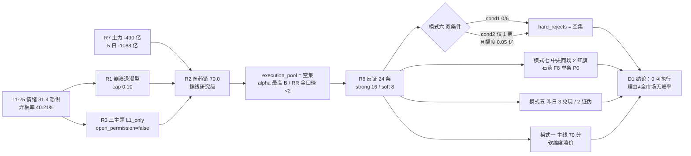

# 2026-11-26 · **反证 / Devil's Advocate**

> **数据源新鲜度**: partial · **降级状态**: true（模式四/十 部分 degraded）· **置信度**: 0.45（0.80 × 0.70 × 0.80）

## 🎯 一句话结论

今日 24 条反证中 **hard_reject 为 0 条**，但这不是「六只票干净」——是霸榜出货的三层契约同时空转；真正危险的是 R2 把「宽度不成立、5 日资金为负」的医药链打成 70 分主线，而把宽度成立、5 日资金为正的百货只给 52 分。

## 🧭 今日盘面底色（先把温度钉死，再谈个股）

| 维度 | 读数 | 口径 / 来源 | 反证含义 |
|---|---|---|---|
| 风格 | 崩溃退潮型（代价 0.2592 最小） | R1 五分法 | 与「震荡分化型 1.8095」不是一个量级的烂 |
| 情绪 | 31.9（恐惧）· 震荡/主跌 | R1 / R3 | 仓位上限 `0.10`，主跌下限生效 |
| 广度 | 涨 567 / 跌 4588 / 平 61，涨家占比 **10.51%**，中位 -3.68% | R1 / R7 | 单日击穿，不是普通调整 |
| 涨跌停 | 涨停 **58** / 跌停 **49** / 炸板 **39** → 炸板率 **40.21%** | R7 stk_limit（权威） | 涨停:跌停 = 1.18:1，退潮日 |
| 三口径差 | 37.04%（R1 limit_list_d 51/30）· 39.36%（xtick 57/37）· 40.21%（R7 58/39） | R1 / R3 / R7 | 官方漏收 7 涨停，引家数必须带口径 |
| 梯队 | 1 板 37 / 2 板 5 / 3 板 6 / 4 板 2 / 5 板 1 | R1 | 首板占 72.5%，高度是顶针不是底座 |
| 主力 | 当日 **-490.23 亿**（摆动 -452.91）· 5 日 **-1087.73** · 20 日 **-4194.29**（7/20 为正） | R7 moneyflow_dc | 全市场在撤，防御端只是零钱 |
| 昨日涨停溢价 | 均值 **-1.37%** / 中位 **-4.47%** / 红盘率 34.55% / 再涨停 14 只（25.5%） | R1 | 接力盘亏钱，首板隔日模板胜率腰斩 |
| 主线 | 医药链 70.0「擦线·研究级未确认」· tradable_today=false | R2 | 名字叫主线，权限是 0 |

## 🕸 反证传导图

## 🔍 24 条反证 × 四象限总表

| # | 编号 | 模式 | 严重度 | 象限 | 被质疑的假设（一句话） |
|---:|---|---|:--:|:--:|---|
| 1 | R6_M1_01 | 数据源冲突 | 🟠strong | Q1 资金 | 「三源确认」实为 1 个 L1 + 1 条单日资金腿 |
| 2 | R6_M1_02 | 数据源冲突 | 🟠strong | Q1 资金 | 主线资金五腿全正 = 资金确认（实为 d1 正 / d5 负） |
| 3 | R6_M1_03 | 数据源冲突 | 🟠strong | Q1 资金 | 防御端「接住」意味着有增量资金可切换 |
| 4 | R6_M1_04 | 数据源冲突 | 🟡soft | Q1 资金 | 次日修复窗口的资金前提（贴水/杠杆）已成立 |
| 5 | R6_M1_05 | 数据源冲突 | 🟠strong | Q1 资金 | R2 资金维排序把 5 日为正的线排在为负的线之后 |
| 6 | R6_M1_06 | 数据源冲突 | 🟡soft | Q1 资金 | 炸板率与涨跌停家数「三口径一致可直接互引」 |
| 7 | R6_M2_01 | 一致性检查 | 🟠strong | Q2 情绪 | high_chop 第 2 天 = 修复窗口，可做尾盘试错 |
| 8 | R6_M8_01 | 解套盘假繁荣 | 🟠strong | Q2 情绪 | 涨停 58 家代表赚钱效应可承接首板潮 |
| 9 | R6_M8_02 | 解套盘假繁荣 | 🟠strong | Q2 情绪 | 医药链封板质量整体优于前一交易日 |
| 10 | R6_M2_02 | 一致性检查 | 🟠strong | Q2 情绪 | consensus 4/4 源 · 0.82 = 高共识 |
| 11 | R6_M2_03 | 一致性检查 | 🟡soft | Q2 情绪 | R4 首板候选池可直接当模板对象 |
| 12 | R6_M3_01 | 估值×主线临界 | 🟠strong | Q3 估值 | 杭州解百 3 板 + 封单 2.46 亿 = 次线最硬可进攻 |
| 13 | R6_M3_02 | 估值×主线临界 | 🟠strong | Q3 估值 | 特一「封板质量全批最好」= 可给次日弱转强资格 |
| 14 | R6_M7_01 | 基本面红旗 | 🟠strong | Q3 估值 | 中央商场「低价 + 主力 5 日 +1.06 亿」可作低位补涨 |
| 15 | R6_M7_02 | 基本面红旗 | 🟠strong | Q3 估值 | 石药「09:32 首封 0 开板」是同链弹性备选 |
| 16 | R6_M7_03 | 基本面红旗 | 🟡soft | Q3 估值 | 亨迪/国芳估值无硬伤，可作弹性核心与龙二 |
| 17 | R6_M7_04 | 基本面红旗 | 🟡soft | Q3 估值 | R5 估值维分数可直接横截面排序 |
| 18 | R6_M2_04 | 一致性检查 | 🟠strong | Q4 结构 | R2 分数排序（医药 70 > 百货 52）代表跟踪优先级 |
| 19 | R6_M2_05 | 一致性检查 | 🟡soft | Q4 结构 | 医药链有龙一—弹性—候补三级身位梯队 |
| 20 | R6_M5_01 | 昨日错误连锁 | 🟠strong | Q4 结构 | 昨日反证框架整体有效，可沿用同档强度 |
| 21 | R6_M5_02 | 昨日错误连锁 | 🟠strong | Q4 结构 | 零机会 = 全市场无合格赔率 |
| 22 | R6_M5_03 | 昨日错误连锁 | 🟠strong | Q4 结构 | R5 gate 模拟自洽（实为 0.10 与残留的 0.60 并存） |
| 23 | R6_M9_01 | 高位触板赌博 | 🟡soft | Q4 结构 | 中京 5 板可当今日情绪温度计 |
| 24 | R6_M10_01 | 跨资产背离 | 🟡soft | Q1 资金 | 华为 HBM 正面叙事可对冲外盘支撑半导体 |

**分布**：Q1 资金 7 条 · Q2 情绪 5 条 · Q3 基本面估值 6 条 · Q4 结构 6 条；strong 16 / soft 8 / hard 0。

## 🔴 最硬的六条（带数字的那种）

**① R6_M2_04｜R2 的 70 分与 52 分之间差的是软维度，不是证据。** 医药链的得分构成是热度 16 + 叙事 16 + 资金 15 + 共振 12 + 涨停 11，而它唯一失败的两项恰是最硬的：THS 流感 185 只红盘率 43.8% / 中位 -0.35%、化学制药 161 只 30.8% / -1.10%（R2 自己的宽度门槛判「家数作废」）；5 日资金化学制药 -20.73 亿、20 日 -119.71 亿。同一天，百货 41 只红盘率 **61.0%**、中位 **+0.975%**、零跌停，5 日资金 **+6.62 亿**（本日唯一 3 日/5 日同为正的链条），却只拿 52 分、资金维 12/20。**排序与证据方向相反，这是今天最该被 D1 看见的一条。**

**② R6_M1_05｜同一把尺子量出两个结果。** 资金维给医药 15/20、造纸 14/20、百货 12/20；而 5 日口径是医药 -20.73 亿、造纸 +6.10 亿、百货 +6.62 亿。三者排序完全颠倒，说明该维实质只计了 d1。下游若按 R2 分数分配仓位，会系统性偏向「单日脉冲」而非「资金延续」。

**③ R6_M2_01｜「修复窗口」这个词今天不成立。** R1 的周期打法写着「第 2 天不是继续空仓，是修复窗口观察日」，但同一份 artifact 的风格结论是崩溃退潮型，crash_check 三条件已有 2 条为真（跌停 43-49 家、涨家占比 10.51%、创业板 -4.19%），只有「炸板率 >50%」未触发。R3 则直接给 `open_permission=false`。**语义层与结构层各说各话，D1 只能取严。**

**④ R6_M8_01｜涨停 58 家是浮盈兑现，不是新增接力。** 昨日 55 只涨停股的次日收盘溢价中位 **-4.47%**、红盘率 34.55%、再涨停 14 只（25.5%）；行业次日留存 16.0%（<35% 的轮动线）。筹码侧三项交叉验证：杭州解百获利盘 97.6%（平均成本 7.22，距收盘 -13.5%）、中央商场 70.2%、亨迪 67.0% —— **首板潮的对手盘是浮盈盘，不是套牢盘，兑现压力天然更大。**

**⑤ R6_M5_01｜昨天的台账，两条记错。** 兑现 3 条：华虹宏力 **-13.89%**（昨日被指「半导体进攻首选」，跌得最狠）、源杰科技 -4.72%（昨日指出「零机会是选择偏差」，R2 未纳入是对的）、中京电子 +10.00% 但 14:54 尾盘首封 + 龙虎榜净卖 0.55 亿（机制判断对，票仍封）。被证伪 2 条：工业富联 **-3.30%**（昨日以「单日 +22.93 亿 / 5 日 +33.12 亿 = 资金最强」为主线依据）、九阳股份 **+10.01%**（昨日把 5 日 -3.07 亿当硬拒依据，今日 7 次开板仍封、龙虎榜净买 0.63 亿 / 机构 +1.36 亿）。**「资金派发腿 → 即时硬拒」的提前量错误，在 11-20 之后第二次复发。**

**⑥ R6_M5_03｜R5 的仓位字段里有一句隔夜残留。** `position_cap_today=0.10`、`gate_rule` 写「cap ≤0.40 走严档（alpha≥A 且 risk≥B），6 只过闸门 0」，但同对象 `severity_provenance.note` 仍留着「R1 主线扩散型 / 修复段第 3 日 / cap=0.60 → 走放宽档（alpha≥B-）」。**若 D1 读 note 而非字段，会把 6 只全放行、上限抬到 0.60。** 本报告以 0.10 为唯一口径（R1 的 `position_cap_suggestion` 也是 0.10，双源一致）。

## 🧩 推理深度三问

### 对象一 · R2 主线假设「医药链是唯一可跟踪方向」

- **大资金意图**: 今日进医药的不是配置盘，是「跌市里找逆势孤岛」的短线博弈盘——证据是五条腿全部 d1 正 / d5 负（流感 +8.75 vs 5 日 -18.12），且超大单 +9.54 亿配小单 -8.88 亿（换手型而非收集型）。对手盘是 185 只流感成分股里 56.2% 的绿盘持仓者，以及 8.65/9.13 元两条均线上方的套牢盘。大资金在这里下注的理由是「流感季 + 官媒点名」的**一日叙事**，不是中期产业逻辑。
- **为什么走强**: 位置维度是「跌市逆势」——板块 +0.58% vs 全市场中位 -3.68%，但个股层面 30 日位置只有 39.7%（特一）与 34.9%（石药），属中低位反弹不是高位突破；催化是硬事件（流感进入流行季 + 化学制药 6 只与医药商业 4 只涨停 + 官方媒体点名 30 万手封板）；筹码维度是短板——特一 30 日龙虎榜 0 次、主力 5 日 +0.23 亿（占流通 0.55%），没有席位指纹。
- **逻辑够不够硬**: **不硬。** 三个独立源里只有 1 个是真 L1（热榜），R4 是事件级不是板块级，R7 是单日腿；硬事件有（流感季）但硬时间锚与硬业绩都没有（特一净利同比 -24.18%、Q3 -32.59%）。**最可能的证伪路径**：次日 09:30-10:00 若流感概念封板家数跌破 2 家、或红盘率跌破 43.8% 的原值，则为「个股点名」彻底落地，主线身份当日作废。

### 对象二 · 特一药业 002728.SZ（医药链龙一）

- **大资金意图**: 09:31 首封、0 开板、封单 0.74 亿（占成交额 **64.7%**、占流通 1.76%）——这是**锁筹型资金**，不是接力型；但同批 30 日龙虎榜 0 次、机构专用席 0，意味着这笔钱没有留下任何可追踪的席位指纹。对手盘是 48.5% 的上方套牢（90% 成本线 9.30）与 8.65（MA20）/9.13（MA60）两条压制线。
- **为什么走强**: 位置（30 日位置 39.7%、距 60 日高 -18.46%）= 中低位；催化（流感季 + 官媒点名 + 心智锚第一）= 硬事件但非硬业绩；筹码（获利盘 51.5%、平均成本 8.30 ≈ 收盘 8.35）= 成本正好重合，**没有获利盘可砸，也没有资金可加**。三维修正结论：走强靠「封单厚度 + 首封时点」，不靠资金或业绩。
- **逻辑够不够硬**: **半硬。** 硬的一面是身位与封板质量（医药链 12 只涨停里它是唯一 fd/成交额 64.7% 且 0 开板的）；软的一面是「心智锚第一」属辨识度而非带动性，13 只涨停是首板定序（09:25 天圣点板 → 09:31 特一 → 09:32 石药 → 09:33 亨迪 → 09:39 拓新），次日需重新验证带动性。**证伪路径**：竞价若跌破 8.35 板价、或 PE-TTM 65 处的估值在「净利 -24%」下继续被压，则封单厚度只是锁筹不是空间。

### 对象三 · 杭州解百 600814.SH（百货龙一 · 3 板）

- **大资金意图**: 09:30 首封、0 开板、封单 2.46 亿（占成交额 **73.9%**、占流通 4.00%）、龙虎榜 2 次净买 0.90 亿、主力 5 日 +1.66 亿（占流通 2.7%）——这是**唯一有真实资金腿的票**。但对手盘极其不利：获利盘 **97.6%**、平均成本 7.22 低于收盘 13.5%、上方套牢仅 2.4%，等于「人人都赚」，任何分歧都是集中兑现。
- **为什么走强**: 位置（30 日位置 **100.0%**、收盘 = 20 日高 = 60 日高、距 MA20 +17.49%）是**最贵的多头结构**；催化是「财神庙重开 + 本地消费」的玄学叙事，R4 无催化腿（catalyst 仅 40 分）；筹码是双刃——资金腿真，但浮盈结构极端。
- **逻辑够不够硬**: **不硬。** 独立源只有热榜（L1_only）+ R7 资金，叙事来自公众号观点代位；硬业绩没有（Q3 +33% 是修复，营收 -3.44%），硬政策没有。PS-TTM 3.71 处 3 年 **98.1%** 分位（历史最高分区），是全批里估值分位最极端的一只。**证伪路径**：明日只要出现一次开板且封单回落到 1 亿以下，3 板玄学链条即断；RR 0.31（止损距 -12.69% 越出硬区间）说明这里赔率根本不成立。

## 🧠 思维链 · 研究观察首位（特一药业，**无开仓资格**）

今日 execution_pool 为空，严格意义上不存在「首推票」。按研究序列把特一放首位，思维链照写，但结论先行：**观察，不进。**

- **买入理由**: ①身位真实——医药链 12 只涨停中唯一 0 开板 + 09:31 首封 + fd/成交额 64.7%，且是 R2/R3/R4 三方交叉认定的龙一（心智锚第一）；②催化有硬事件锚——流感进入流行季、化学制药 6 只与医药商业 4 只涨停、官方媒体点名 30 万手封板，不是纯情绪票。
- **风险点**: ①短期——获利盘 51.5% 但 90% 成本线 9.30 压着 48.5% 套牢盘，8.65（MA20）/9.13（MA60）双线未过，涨停只是回到中枢下沿；②中期——净利同比 -24.18%、Q3 单季 -32.59%、营收 -9.87%，「流感季需求兑现」与财报方向相反；商誉/净资产 28.7% 距 F2 的 30% 线仅 1.3pp；30 日龙虎榜 0 次 = 无席位背书。
- **止损条件**: 板价 **8.35** 为第一道（竞价跌破即放弃，不设缓冲）；若参与过夜，止损 **7.74**（-7.31%，R5 rr.stop_price），同时跌破 MA20 8.65 的次日不再补仓；R2 的 stop10 7.16（-14.25%）**已被否决**，越出 -5~-10% 硬区间，不得使用。
- **可验证假设**: ①竞价开盘价 ≤ +3%（≤8.60）且不破 8.35 → 弱转强假设成立，可继续观察；高开 >5% 视为 11-25 首板盘被兑现，当日零新增。②10:00 前流感概念封在板价的家数 ≥2 且红盘率 ≥43.8% → 板块级扩散假设成立；跌破 1 家即证伪。③当日主力净额占流通 <0.5%（延续 5 日的零轴状态）→ 「锁筹型资金」假设证伪，封单只是单日行为。

## 🚫 霸榜出货 hard_reject 裁决

| 检查层 | 实际命中 | 结论 |
|---|---|---|
| 触发对象集合 | R2 `execution_pool=[]` + `research_only=true` + `tradable_today=false`；全文无 `execution_eligible` 字段 | 按定义为空集 |
| 条件一（板块/个股命中 R3 霸榜告警） | R3 `distribution_alert` 仅 4 条（人形机器人概念 + 文投控股 / 北纬科技 / 东方海洋）→ 6 只候选命中 **0/6** | 不成立 |
| 条件二（个股 5 日主力净流出） | 仅石药景峰 -0.05 亿（占流通 -0.12%，3/5 日为正）→ **1/6**，且幅度不成立 | 不成立 |
| 双条件同时成立 | **0 只** | **hard_rejects = []** |

**为什么这个空集不能读成「六票过审」**：

1. 空集是三层契约空转的产物，不是审核通过的结果；
2. 板块级派发有旁证——R7 的 43 条告警里有 **5 只医药链同业**：康芝药业「机构净卖 -0.21 亿但股价 +20.05%」（核心诱多）、桂林三金 5 次开板、人民同泰 4 次开板、双鹭药业 7 次开板、葵花药业 5 次开板（炸板）。这是「链上有票在被派发」的直接证据，只是没落在 6 只画像票上；
3. 模式七最高只有 2 条红旗（中央商场 F10 + A3 财务轴），距 ≥4 条硬拒线还差 2 条；石药单条 P0（F8）只能到 strong；
4. 中京电子（5/5 板）虽有「涨停但龙虎榜净卖 -0.55 亿 + 14:54 尾盘首封 + 换手 42.49%」，但它的板块（PCB -5.35%）不在 R3 霸榜清单，条件一不满足 → 只能 soft（R6_M9_01），**不得**被写成硬拒。

## 📋 模式执行状态

| 模式 | 状态 | 条数 | 说明 |
|---|---|:--:|---|
| 1 数据源冲突 | executed | 6 | 三源确认 / 资金腿 / 全市场流出 / 贴水杠杆 / 打分尺子 / 炸板口径 |
| 2 一致性检查 | executed | 5 | R1 阶段语义 / consensus 等级 / R4 候选质量 / 主次线排序 / 身位层级 |
| 3 估值×主线临界 | executed | 2 | 杭州解百（PS 98.1% 分位）· 特一（PE 65 分位 + 净利 -24%） |
| 4 历史类比 | **degraded** | 0 | 无历史事件类比库，不编造 |
| 5 昨日错误连锁 | executed | 3 | 3 兑现 / 2 证伪 / 1 口径混用 / 1 字段残留 |
| 6 霸榜出货硬约束 | executed | 1 | cond1 0/6 · cond2 1/6 · hard 0（唯一硬否决权未触发） |
| 7 基本面红旗 | executed | 4 | 中央 2 条 / 石药 1 条 P0 / 亨迪+国芳 各 1 条 soft / 分数可排序性 |
| 8 解套盘假繁荣 | **partial** | 2 | 个股级 cyq 6/6 可用，全市场级无字段 |
| 9 高位触板赌博 | executed | 1 | 最高 5 板，未达 ≥8 板 extreme_tail_risk 阈值 |
| 10 跨资产背离 | **partial** | 1 | 商品腿 skipped，仅半导体/费半腿可验证 |

## 🧮 红旗复算记录（不采信 R5 计数，逐条重算）

| 项 | 复算口径 | 结果 | 与 R5 一致性 |
|---|---|---|---|
| F9 应收/营收 | 应收 / **TTM 营收**（9M + 上年 FY - 上年 9M） | 特一 12.2% / 亨迪 11.6% / 石药 15.5% / 杭州解百 1.4% / 国芳 1.4% / 中央 2.6% → 全 <40% | ✅ F9=0 维持（未出现 9M 分母高估） |
| F2 商誉 | 商誉 / 归属净资产 | 特一 5.18 / 18.01 = **28.7%** < 30% | ✅ 未触发 |
| F10 有息负债 | (短借 + 长借) / 归属净资产 | 中央 (40.11+4.19)/1.898 = **2334.6%**；特一 21.5%；亨迪 0% | ✅ 仅中央成立 |
| F8 经营现金流 | CFO 逐期连续为负 ∧ 净利为正 | 石药 Q1 -0.715 / H1 -1.252 / 9M -0.426 亿，净利 +0.0153 亿 → 成立 | ✅ P0 单条成立 |
| S1 / A3 财务轴 | 连亏 2 年需查 **FY 年度**净利，不是 9M | 中央 FY2024 -1.479 亿 / FY2025 -3.930 亿 → **真连亏 2 年** | ✅ 成立（非口径误套） |
| 封单双口径 | fd/成交额 与 fd/流通市值 | 特一 64.7%/1.76% · 亨迪 22.0%/0.99% · 石药 36.3%/0.45% · 杭州解百 73.9%/4.00% · 国芳 15.2%/1.06% · 中央 28.6%/1.62% | ⚠️ R3/R4 同名不同分母，横比会颠倒排序 |

## 📊 数据源审计

| 源 | 日期 | 状态 | 备注 |
|---|---|:--:|---|
| tushare/daily（全市场） | 2026-11-25 | 🟢 | 5573 只 · OHLCV 全量 |
| tushare/limit_list_d | 2026-11-25 | 🟡 | 124 行 = U 51 / D 43 / Z 30 · 官方漏收 7 涨停 / 6 跌停 / 9 炸板 |
| tushare/stk_limit（R7 权威口径） | 2026-11-25 | 🟢 | 涨停 58 / 跌停 49 / 炸板 39 → 40.21% |
| tushare/moneyflow_dc（个股） | 2026-11-25 | 🟢 | 22 日 × 6036 只/日 · 四档结构 |
| tushare/moneyflow_ind_dc | 2026-11-25 | 🟢 | 行业 496 + 概念 531 · 22 日序列 |
| tushare/top_list + top_inst | 2026-11-25 | 🟢 | 76/76 行与 net_amount 对齐（差额 0.0000 亿） |
| tushare/margin + margin_detail | 2026-11-24 | 🟡 | T+1 滞后 · 融资 21422 亿 · 5 日 -748.95 亿 |
| tushare/fut_daily（IF/IH/IC/IM） | 2026-11-25 | 🟢 | 四品种贴水同步加深（IF -1.904%，前值 -1.212%） |
| tushare/balancesheet+income+cashflow（逐票） | 2026-09-30 | 🟢 | 6 票 × 12 期 · 红旗复算用 |
| wechat_official_20（公众号） | 2026-11-26 | 🟢 | 86 篇 · L2b 语义归并（不计入共振等级） |
| wechat_cli_5groups（群聊，匿名） | 2026-10-28 | 🔴 | 0 字节 · 7 群 0 条 · L2 断更 19 个交易日 |
| weflow/analytics | 2026-08-19 | 🔴 | 永久下线 · profile 已移除 |
| dc_renqi 人气榜 | 2026-11-25 | 🔴 | 0 行 · 个股双平台校验降为单平台 |
| yahoo ↔ sina（美股双通道） | 2026-11-25 | 🟢 | 14/14 逐票一致（差值 ≤0.35%） |
| overseas/commodities | — | 🔴 | skipped · 商品腿（铜/油/锂）无序列 |

## ⚠️ 不确定性 / 反证（对本报告自身的反证）

1. **我可能低估了「首板定序」的价值**。医药链 12 只涨停里 7 只 0 开板、首封集中在 09:25-09:56，链层开板率 41.7% 与全市场 45.1% 基本同水平——这与 R3「封板质量优于前日」并不矛盾，我的 R6_M8_02 只否定了「链层优于平均」的说法，没有否定龙头层质量。若次日链层继续 2 家以上封板，我的宽度判死会被打脸。
2. **模式六空集的漏报风险仍在**。R7 的 43 条派发告警是按「烂板 / 诱多 / 涨停净卖」形态筛的，不是按「霸榜出货」；如果 D1 把「hard_rejects=[]」简化成「无派发风险」，会漏掉康芝那类「机构净卖 -0.21 亿但股价 +20.05%」的核心诱多样本。
3. **模式五的自我修正可能过度**。昨日两条被证伪后，我把「资金派发腿 → 硬拒」整体降为 strong；但九阳今日是 7 次开板 + 龙虎榜净买 0.63 亿（反向腿），属于「幅度不成立」而非「方向不成立」。若明日九阳断板，说明我今天的降档是对的；若它继续封，则是第三次复发。
4. **数据缺失项**：全市场 58 只涨停仅 6 只有筹码（cyq）数据，模式八无法给出全市场解套盘比例；商品腿 skipped，模式十只能验证半导体一条腿；L2 断更导致所有主题最高只能是 L1_only，本报告无法判断「人群是否在讨论」。

## 🔗 与其他 R/D/E 的关系

- **依赖（只读）**: `R1_style.json` / `R2_main_sectors.json` / `R3_sentiment.json` / `R4_news.json` / `R5_stock_profiles.json` / `R7_capital_flow.json` / `20261125/R6_devil_advocate.json` / `_r5_fin_stmt.json` / `raw/20261125/limit_list_20261125.json` / `raw/20261125/daily_20261125.json`
- **未调用**: 任何 MCP（tushare / xtick / weflow / hithink / vibe-trading 均未直连）、无 shell 抓数、无子 agent 派生
- **被消费**: D1（canghai-plan）—— `hard_reject` 无覆盖权、`strong_suggest` 须显式处理或记入 `meta.d1_override[]`；E1（canghai-review）—— 24 条条目可 T+1 回填兑现率

## 🧾 Sub-Agent 元数据

- skill: analyze_devil_advocate_v1
- artifact: data/research/20261126/R6_devil_advocate.json（41,084 B · status=complete · confidence 0.45）
- 生成耗时: 上游齐备 06:58 → 落盘 07:09（约 11 分钟，读盘 + 红旗复算 6 票 × 12 期 + 24 条反证）
- model: deepseek-v4.1-flash
- 反证总量: 24 条（strong 16 / soft 8 / hard 0）· 四象限 Q1 7 / Q2 5 / Q3 6 / Q4 6
- 红线自检: 未抓新数据 ✅ · 未给正向结论 ✅ · hard_reject 仅由模式六/七产生 ✅ · 未用低位票替补 ✅
