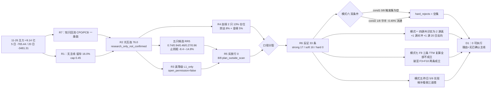

# 2026-11-27 · **反证 / Devil's Advocate**

> **数据源新鲜度**: partial · **降级状态**: true（R3 降级 + 模式四/十 + F12）· **置信度**: 0.45（0.80 × 0.70 × 0.80）
> **本文件只读 `data/research/20261127/` 六份 artifact 与 `data/reports/20261126/`，未调用任何 MCP、未抓一条新数据。**

## 🎯 一句话结论

今日 **33 条反证：strong 17 / soft 16 / hard_reject 0**。霸榜出货的 hard_reject 空集不是「8 只票干净」，而是**三层契约同时空转**；真正该被 D1 看见的不是哪只票，而是**流水线口径分裂**——R4 自授「可执行 2 只、合计 13% 仓位」，同龄的 R2 是空执行池、R3 是不许开仓、R5 实放行 0、R7 可执行 0，同一只票的赔率有三个数。

## 🧭 今日盘面底色（先把温度钉死，再谈个股）

| 维度 | 读数 | 口径 / 来源 | 反证含义 |
|---|---|---|---|
| 风格 | 震荡分化型（代价 0.7754）· 内部覆盖自「连板情绪型 0.7092」 | R1 五分法 | 覆盖理由「炸板率 ≥25%」用的是 30.85% 口径，而取严是 33.33% → 覆盖成立，但两口径在同一文件并存 |
| 情绪 | 54.9 中性（R1）/ 52.4 中性偏弱（R3） | R1 / R3 | 双源差 2.5，属可接受；R3 自评 conf 0.41 |
| 阶段 | 高位震荡 `high_chop` · 修复段第 2 个交易日 · cap 0.45 | R1 | 「不追开盘价，只做低开承接」——这条约束被 R2 次线的「可做补涨」冲掉了 |
| 广度 | 涨 1766 : 跌 3642（**31.66%**）· 中位 **-0.79%** | R1 / R7 | 指数靠权重护盘，个股中位仍负 → 指数修复 ≠ 赚钱效应修复 |
| 涨跌停 | 涨停 **70** / 跌停 **9** / 炸板 **35** → 炸板率 **33.33%** | R7 stk_limit（权威） | 未越 35% 砍半线；但元器件行业自身炸板率 44.4% |
| 三口径差 | 30.85%（limit_list_d 65/29）· 30.61%（xtick 68/30）· 33.33%（R7 70/35） | R1 / R3 / R7 | 官方漏收 5 涨停 / 6 炸板 / 4 跌停；R2 同一文件里 9 家与 7 家并存 |
| 梯队 | 1 板 53 / 2 板 10 / 3 板 5 / 4 板 1 / 5 板 1 | R7 height_distribution | 首板占 78.5%，5 板独苗（克来机电，已收监管工作函） |
| 主力 | 当日 **+9.14 亿**（摆动 +499.37）· 5 日 **-765.44** · 20 日 **-3481.31**（仅 8/20 日为正） | R7 moneyflow_dc | 单日反手，但 20 日仍是净流出 → 修复不是反转 |
| 昨日涨停溢价 | 收盘均值 **+3.22%** / 中位 **+5.07%** / 红盘率 66.7% / 再涨停 14 只 | R1 market_structure.premium | 溢价为正但未达修复三条件（浮盈盘在，接力未恢复） |
| 主线 | 光互连 76.0「研究级未确认」· `tradable_today=false` · execution_pool = 空集 | R2 | 名字叫主线，权限是 0 |

## 🕸 反证传导图

## 🔍 33 条反证 × 四象限总表

| # | 编号 | 模式 | 严重度 | 象限 | 被质疑的假设（一句话） |
|---:|---|---|:--:|:--:|---|
| 1 | R6_M1_01 | 数据源冲突 | 🟠strong | Q1 资金 | 「四源共识 4/4 · score 1.0」= 主线已确认（实为 2 源真 + 1 源对冲 + 1 源 20 日反向） |
| 2 | R6_M1_02 | 数据源冲突 | 🟡soft | Q4 结构 | R7 对同一候选集给出独立资金确认（R7 生成时 R2 尚未产出，池自建） |
| 3 | R6_M1_03 | 数据源冲突 | 🟠strong | Q1 资金 | 化工/化肥「资金维 11/20」支撑低位首板（三条子行业 5/10/20 日全负） |
| 4 | R6_M1_04 | 数据源冲突 | 🟠strong | Q2 情绪 | 太空算力 66 分排第二有观察价值（商业航天红盘率 38.9%、炸板率 47%） |
| 5 | R6_M1_05 | 数据源冲突 | 🟡soft | Q2 情绪 | R4 已与群聊/KOL 交叉比对（`kol_confirm` 全部为「未比对」） |
| 6 | R6_M1_06 | 数据源冲突 | 🟡soft | Q4 结构 | 涨停簇 9 家是稳定可比的计数（65/68/70 三口径，R2 内部 9 家与 7 家并存） |
| 7 | R6_M1_07 | 数据源冲突 | 🟠strong | Q4 结构 | R4「不授予开仓资格」与全流水线一致（同时给了 8%+5% 仓位模板） |
| 8 | R6_M2_01 | 一致性检查 | 🟠strong | Q4 结构 | R2 已按 R1 收敛输出，76 分代表最该跟踪的主线 |
| 9 | R6_M2_02 | 一致性检查 | 🟠strong | Q2 情绪 | 次线「可做龙头分歧低吸或后排补涨」已按当日温度校准 |
| 10 | R6_M2_03 | 一致性检查 | 🟡soft | Q4 结构 | 次线 stage 标签指示可执行打法（三条线全走 fallback，函数口径自认缺陷） |
| 11 | R6_M2_04 | 一致性检查 | 🟠strong | Q4 结构 | 候选池与 `size_tilt=large` 风格一致（5/8 流通 <120 亿） |
| 12 | R6_M2_05 | 一致性检查 | 🟠strong | Q4 结构 | 利君 3 板一字是太空算力线龙一（R5 判孤军、R4 判买不到） |
| 13 | R6_M3_01 | 估值×主线临界 | 🟠strong | Q3 估值 | 金牛 3 板 0 开板 = 本线唯一身位容量双具备（PE 88.9 分位 + 获利盘 99.3%） |
| 14 | R6_M3_02 | 估值×主线临界 | 🟠strong | Q3 估值 | 骏亚封板质量全批第一 = 次日弱转强首选（PE 84.1 分位 + RR 0.79） |
| 15 | R6_M3_03 | 估值×主线临界 | 🟠strong | Q3 估值 | 中际 PE 6% 分位 = 估值安全可低吸（V4 + 20 日 -13.9 亿 + 融资 -52.32%） |
| 16 | R6_M3_04 | 估值×主线临界 | 🟠strong | Q3 估值 | 利君 3 板一字占流通 2.36% = 空间票首选（PE 无效 + 位置 100%） |
| 17 | R6_M5_01 | 昨日错误连锁 | 🟠strong | Q2 情绪 | 「候补/低位看弱」成立（昨日三条全错：+9.93% / +7.02% / +9.67%） |
| 18 | R6_M5_02 | 昨日错误连锁 | 🟠strong | Q2 情绪 | 金牛 3 板 0 开板可接下一板（昨日同结构一字→炸板 -5.98% 开→收） |
| 19 | R6_M5_03 | 昨日错误连锁 | 🟡soft | Q2 情绪 | 半导体派发腿可直接否定国产算力全部观察（算力概念 d1 +41.3 / d5 +23.4 正） |
| 20 | R6_M5_04 | 昨日错误连锁 | 🟠strong | Q4 结构 | 零机会 = 全市场无赔率（9 只 watch_reserve + 襄阳轴承 5.74 亿净买从未画像） |
| 21 | R6_M6_01 | 霸榜出货 | 🟡soft | Q1 资金 | `hard_rejects` 为空 = 8 只票全部通过出货审查（三层契约同时空转） |
| 22 | R6_M6_02 | 霸榜出货 | 🟠strong | Q1 资金 | 华丰 5 日 -2.08 亿 = 出货确认应硬拒（占流通 -0.49%，10/20 日反向） |
| 23 | R6_M6_03 | 霸榜出货 | 🟡soft | Q2 情绪 | CPO 热榜 #1 是强度信号（连续居首仅 1 日，再居 1 日即触发霸榜） |
| 24 | R6_M7_01 | 基本面红旗 | 🟠strong | Q3 估值 | 骏亚财务与估值无硬伤（F3 + F10 两条成立） |
| 25 | R6_M7_02 | 基本面红旗 | 🟡soft | Q3 估值 | 东山 risk=B 财务风险可控（F10 有息负债/净资产 85.5%） |
| 26 | R6_M7_03 | 基本面红旗 | 🟡soft | Q3 估值 | 崇达 RR 2.51 唯一赔率达标可作执行首选（F3 边界 + 三口径赔率） |
| 27 | R6_M7_04 | 基本面红旗 | 🟡soft | Q3 估值 | R5 `flags_census` F9=2 成立（TTM 复算三条全部 <40% → 不成立） |
| 28 | R6_M7_05 | 基本面红旗 | 🟡soft | Q3 估值 | 泸天化 S1 = 财务轴 ST 风险（FY24 +0.76 / FY25 +0.32，不连亏） |
| 29 | R6_M7_06 | 基本面红旗 | 🟡soft | Q3 估值 | 金牛命中 F3 / V1 周期低 PE 陷阱（F3 绝对额 0.01 亿属噪音，PE 157 非低 PE） |
| 30 | R6_M7_07 | 基本面红旗 | 🟡soft | Q3 估值 | `flags_census_zero` 11 项 = 全批无硬伤（F12 无字段，降级） |
| 31 | R6_M8_01 | 解套盘假繁荣 | 🟡soft | Q2 情绪 | 涨停 70 家 = 赚钱效应可承接首板潮（广度 31.66%、中位 -0.79%） |
| 32 | R6_M9_01 | 高位触板赌博 | 🟡soft | Q4 结构 | 候选池未含极端尾部标的（未达 8 板，但 3 板 × 位置 100% × 获利盘 >96%） |
| 33 | R6_M10_01 | 跨资产背离 | 🟡soft | Q3 估值 | 板块与商品定价一致（序列缺失，degraded 不编造） |

**分布**：Q1 资金 4 条 · Q2 情绪 8 条 · Q3 基本面估值 12 条 · Q4 结构 9 条；strong 17 / soft 16 / hard 0。

## 🔴 最硬的六条（带数字的那种）

**① R6_M1_07｜今天最危险的错不在个股，在「谁有权给仓位」。** 同一批 artifact 对今天给出两组互斥结论：R2 `execution_pool=[]`、`tradable_today=false`；R3 `open_permission=false`；R5 8/8 命中 `plan_outside_scan`、**实放行 0**；R7 `execution_candidates=0`。而 R4 的 `execution_status.candidates` 写着「崇达技术 试错档 position_size **0.08**」「金禄电子 试错档 **0.05**」「最终可执行 2 只（合计 **13%** 仓位）」。三件具体的错：其一，**金禄电子 301282.SZ 从未被 R5 画像**（无六维、无禁止清单、无 R6 附录 A 复核），R4 却给了它 5% 与 RR 2.0；其二，崇达自己的 trigger 写「封成比回升至 **≥6%** 才成立」，而 R2 实测当日封单/成交只有 **5.5%**（`fd_ratio 0.055`）——当日数据连自己的门槛都没过；其三，同一票的赔率有三个数：崇达 R4 2.0 / R5 2.51 / R2 rr5 **0.27**（止损距 -14.81%），中际旭创 R4 0.51 / R5 1.65 / R7 0.74。**D1 若读 R4 得 13% 仓位，就与另外四家的 0 直接对立。本轮一律以最严口径 0 为准。**

**② R6_M1_01｜76 分的溢价买在软维度，卖在硬维度。** R2 给光互连的分数构成是热度 18 + 资金 19 + 涨停 13 + 叙事 14 + 共振 12 = 76，而它失守的两项恰是最硬的：**R3 自注真等级 `L1_only`**（L2 群聊连续 20 个交易日 0 字节、L3 WeFlow 永久下线、L2b 公众号按红线 3 不计入枚举），**R7 的 20 日累计** CPO -247.17 亿 / 光通信模块 -228.54 亿 / 通信设备 -136.92 亿 / 元件 -74.73 亿，全市场 20 日 -3481.31 亿且只有 8/20 日为正。R2 把 `r3/r4/r7 = true/true/true` 记成 `cross_validation_score = 1.0`，但 R4 侧「光模块/CPO」的净分只有 **+0.164**（+0.646 的正面腿被英伟达断供腿抵掉 74%）。**四源里一源是空的、一源是对冲、一源在 20 日维度反向 —— 共识成立，可执行性不成立。**

**③ R6_M5_01｜昨天的台账：三条看弱全错，而且错法一模一样。** 昨日 R6 的 24 条里可判定 9 条、兑现 5 条（55.6%）。兑现的是机制判断：特一药业一字 +10.06% → 炸板 → 收 +3.47%（开→收 **-5.98%**）、石药景峰 **-7.90%**、中京电子 5 板断板。被证伪的是**「低位候补票看弱」整族**：中央商场 **+9.93% 2 板封死**、亨迪药业 **+7.02%**、国芳集团 **+9.67%**（开→收 +9.07%），而昨日 26 只观察票 T+1 均值 +1.30%、中位 +1.58%、红盘 15/26。**规则层修正：今日对低位补涨票一律禁用「alpha C / 候补 / 低位」作看弱理由，只准用可验证量（封单绝对额、封单/成交、换手、5 日与 20 日主力净额、身位）。**

**④ R6_M1_03 + R6_M1_04｜两条次线的分数与证据方向相反。** 化工/化肥拿 53 分、资金维 11/20，但 R7 三条子行业 **5/10/20 日全负**：化学制品 d1 -0.37 / d5 **-33.73** / d10 -57.59 / d20 -87.03（5 日正天数 0），化学原料 d5 -10.34，农化制品 d5 -6.13；R4 对这 15 个板块条目里**根本没有化工/化肥**（零催化）。太空算力拿 66 分排第二，但商业航天 332 只成分**红盘率 38.86%、中位 -0.63%、9 家涨停 vs 8 家炸板 = 炸板率 47.06%**，且 9 家里 5 只跨 ≥3 标签（家数是标签计数）。**R2 自己的 `risks` 都写了「宽度不成立 → 家数结论作废」，分数却没扣。**

**⑤ R6_M2_05 + R6_M3_04｜利君股份一票三个互斥身份。** R2 记 `龙一(情绪)`（3 板、09:25 一字级、封单/成交 119%、流通 49.1 亿），R5 的 `leader_verdict` 记 **孤军**（「板块仅 1 家涨停，孤军板不追」），R4 把它放进 `rejected`：「一字板成交仅 **0.97 亿**，封单 **1.16 亿**买不到」。三个单元互斥，而底账是：成交 0.97 亿 < 封单 1.16 亿 → **次日只能靠竞价、且无人可卖给你**；获利盘 **96.1%**、位置 100%、TTM 净利 0.11 亿致 PE 无效、净利同比 -87.33%、RR 1.62。**它不是「最高身位」，是「买不到的身位」。**

**⑥ R6_M7_01 + R6_M7_04｜红旗要复算，不复算就把干净票抬到硬拒门口。** 复算后真正成立的是骏亚的两条：**F3** 应收增速 37.7% > 收入增速 17.6% × 1.5 = 26.4%；**F10** (短借 9.586 + 长借 2.231) / 归属净资产 14.063 = **84.0%** > 80% → 落在「2-3 条 = strong」档。被推翻的是 R5 的 F9=2：利君 43.9%（9M 口径）→ **TTM 30.1%**、华丰 49.5% → **TTM 34.8%**、崇达 36.7% → **TTM 29.2%**，三条全部 <40%；泸天化的 S1 也不成立（FY2024 **+0.76 亿**、FY2025 **+0.32 亿**，不构成「连亏 2 年」）；金牛的 F3 应收绝对额只有 **0.01 亿**，83.8% 的增速是四舍五入口径噪音，V1（PE<8 周期陷阱）在 PE 157 的票上也不适用。**全批 F1/F2/F8/F11 均为 0 条，F12 因无审计意见字段降级。**

## 🧩 推理深度三问

### 对象一 · R2 主线假设「光互连回流是可跟踪方向」

- **大资金意图**: 不是配置盘进场，是**抱团资金池被买回来**。证据是方向内四行业 d1 与 d5 同正、但 20 日全面为负（元件 -74.73 亿、通信设备 -136.92 亿、CPO 概念 -247.17 亿），且全市场 20 日只有 8/20 日为正。同一天超大单 +84.13 亿而大单 -75.00 亿 —— 机构接、游资退的结构，属于「昨日的钱今天买回来」，不是新钱开新仓。
- **为什么走强**: 三条腿同时给了理由——热榜 CPO #1（#4→#3→#1）、R4 的 6G 方案 + SpaceX FCC 正面腿、R7 的 d5 全链正（元件 +108.49 / 印制电路板 +109.91）。但 60 日结构否掉了趋势性：龙一 r60 **-49.15%**、距 60 日高 **-54.28%**，五只候选 60 日区间 -27.45%~-62.00% → `layer=rebound`。
- **逻辑够不够硬**: **不够。** 硬的是宽度（元器件 67 只红盘率 86.57%、中位 +2.86%）与当日资金；软的是持续性（R3 真等级 L1_only、R4 净分 +0.164、20 日仍净流出）与赔率（RR5 0.74/0.94/0.46/0.27/0.96，止损距 -8.39%~-14.81%，只有东山 -8.94% 与生益 -8.39% 勉强在 -5~-10% 硬区间且 RR5 <1）。**结论：可研究，不可开仓。**

### 对象二 · R2 次线假设「化工/化肥是唯一连续 2 日扩张的线」

- **大资金意图**: 没有大资金，只有**低位散户 + 小游资的扩散**。化学制品 5 日 -33.73 亿、10 日 -57.59 亿、20 日 -87.03 亿且 5 日 0 天为正；龙一金牛化工的 30 日龙虎榜 7 次净 **-3.60 亿**（机构专用席 0 = 游资对倒净卖），股东户数 **+79.28%**。
- **为什么走强**: 题材矩阵唯一「11-25 两家 → 11-26 八家」的扩张线 + 低位首板成簇（泸天化封单/成交 37.9%、0 开板；金牛 3 板 0 开板）。**是低位扩散的形态，不是资金推动的趋势。**
- **逻辑够不够硬**: **不硬，且方向自相矛盾。** R2 把 stage 记 `mid_up`（主升中期），同一条线 `holding_days_max=0`、`layer=rotation`，还在 `stage_fallback_note` 里自认「fallback 把 persist≥1 一律判 mid_up 是函数口径缺陷」。资金维 11/20 与实际 5/10/20 日全负、5 日正天数 0 直接冲突。**结论：只能当低位情绪读数，不能当主题。**

### 对象三 · R4 假设「崇达技术是唯一赔率达标可执行票」

- **大资金意图**: 这是本批唯一**真有资金主攻**的票 —— 主力今日 +6.27 亿、5 日 +11.66 亿（4/5 正）、10 日 +11.47 亿、20 日 +15.71 亿（三口径全正且 20 日净额全批最大），30 日龙虎榜 6 次净 +2.07 亿、机构专用席 **+0.83 亿**（有机构参与）。但同日股东户数 **+29.55%**（散户大幅涌入）+ 获利盘 90.5%。
- **为什么走强**: PCB 全链 5 日 +109.91 亿为全场第一 + R4 直接受益于 E005 6G 方案 + 10:11 首封。**封板质量是弱项**：封单/成交 5.5%、开板 1 次、换手 18.3% → 筹码在换手不在锁仓。
- **逻辑够不够硬**: **一半硬。** 资金腿是硬的（三口径全正 + 机构席位），赔率腿取决于口径：R5 买点 14.8 / 止损 14.06 / RR **2.51**（止损距收盘 -7.86%）成立；R2 的 rr5 **0.27**（止损距 -14.81%）不成立；R4 的 2.0 介于两者。同时命中边界红旗 F3（58.0% vs 53.25% 线）与 `plan_outside_scan`。**结论：不进；若要观察，唯一合法通道是「低开不破 15.26 + 30 分钟封单回补至 ≥6%」的弱转强确认。**

## 🧠 每票思维链（4 段 · 三只最高优先级对象）

> 今日无「首推票」——四家单元一致给出 0 可执行。以下三只按研究优先级展开，**买入理由一律写为「不成立的理由」**，避免被误读为授权。

### ① 中际旭创 300308.SZ（M1 龙一 · 容量核心 · alpha B- / risk B+）

- **买入理由（不成立版的正面面）**: 5 日主力 **+47.09 亿**全批第一、三腿资金 d1/d5 全正、PE 19.56（3 年 **6%** 分位）匹配净利同比 +211.81%、90 日 124 篇研报、+5.18% 且成交 197.06 亿为全市场第一。这些是「它为什么是这条线的心脏」。
- **风险点**: 20 日主力仍 **-13.9 亿**；融资余额 15 日 **-52.32%**、融券 -45.63%（杠杆双向撤退）；30 日龙虎榜 **0 次**（+47 亿的席位构成无法验证）；大宗 50 笔 9.11 亿、平均溢价 +0.01%（平价转让非折价分销）；获利盘仅 **47.0%**，平均成本 **489.59 高于收盘 430.18** → 上方 **53%** 套牢；V4 命中（ROE 35.83% 但 CFO/净利 **0.36**）。
- **止损条件**: R5 给的结构位是 405（跌破则反弹结构失效）；R2 的 stop10 = 377.96（止损距 **-12.14%**，已超 -10% 硬区间）；收盘位置 0.636 < 0.8、贴 VWAP +1.01% 未收上沿。
- **可验证假设**: 若 11-27 回踩 423（R5 识图低吸位）**缩量**承接且主力当日转正，则「五日回补可持续」成立；若跌破 405 或竞价高开 >2% 后 10:00 前封单不增，则按 R3 的 invalidator 判「回流一日游」，主题降级。

### ② 骏亚科技 603386.SH（M1 情绪龙一 · alpha B / risk B+）

- **买入理由（不成立版的正面面）**: 全场封板质量第一 —— 09:31:02 秒封、0 开板、封单/成交 **40.0%**（元器件 5 只里唯一 >30%）、封单/流通 1.54%、流通仅 47.4 亿；主力三口径持续小幅净流入（+1.88 / +1.96 / +1.78 亿）；股东户数 **-35.39%**（筹码显著集中）。
- **风险点**: **高度仅 1 板**，无身位；PE_ttm 95.82（3 年 **84.1%** 分位）、PB 76.9 分位 → 偏贵；F3（应收增速 37.7% > 26.4% 线）+ F10（有息负债/净资产 **84.0%**）**两条红旗**；获利盘 63.5%、90% 成本线 15.3（上方 **36.5%** 套牢）；60 日 -33.12%（`layer=rotation`）。
- **止损条件**: R5 买点 14.35 / 止损 13.63（止损距买点 -5.0%、距收盘 -6.13%）；R2 stop10 = 12.74（止损距 **-12.26%**，超硬区间）。RR **0.79**（目标 14.92 距买点仅 +4%）→ 赔率层面直接否决。
- **可验证假设**: 只有在「低开不破 14.52 且 30 分钟内回封」的弱转强成立时，才谈「板质第一」的意义；若开盘直接一字或高开 >7%，按 R2 原话放弃。**RR 0.79 是硬否决，任何观察都不改变这一点。**

### ③ 金牛化工 600722.SH（M3 龙一 · 3 板 · alpha C / risk B-）

- **买入理由（不成立版的正面面）**: 3 板 0 开板、封单 1.32 亿、首封 09:58；主力 5 日 **5/5 全正**（+4.30 亿，20 日 +3.03 亿）；本线家数 11-25 两家 → 11-26 八家扩张。
- **风险点**: 位置 **100%**、获利盘 **99.3%**（平均成本 12.41、90% 成本线 14.0）→ 没有套牢盘也就没有承接；PE 157.47（**88.9%** 分位）、PB **93.8%**、PS **94.4%** 分位；30 日龙虎榜 7 次净 **-3.60 亿**（机构 0 = 游资对倒净卖）；股东户数 **+79.28%**（散户接盘）；所属化学制品 5/10/20 日资金全负。
- **止损条件**: R5 买点 14.04 / 目标 14.80 / 止损 12.90（止损距买点 -8.1%、距收盘 -10.85%）；R2 的 leaders_preview 直接写「止损距 **-32.07%** → 赔率不可算」。RR **0.67**。
- **可验证假设**: 若次日低开回踩 13.3（R5 识图低吸位）缩量承接且封单回补，则「高度续」的假设才有一次检验机会；若开盘冲高后封单不再增（昨日同结构特一的一字→炸板剧本），立即按「3 板尾部兑现」处理。**RR 0.67 + 获利盘 99.3% 的组合，属禁止接力清单。**

## 🚫 霸榜出货 hard_reject 裁决（模式六）

**裁决：`hard_rejects = []`（count = 0）。但这是「三层契约同时空转」，不是「8 只票干净」。**

| 层 | 检查项 | 结果 | 依据 |
|---|---|---:|---|
| 触发集 | R2 是否有可执行标的 | **0** | `execution_pool=[]`；全文 `execution_eligible` 计数 = 0；`main_line_status=research_only_not_confirmed`；`tradable_today=false` |
| 条件一 | 所属板块是否命中 R3 霸榜出货告警 | **0/8** | `hotlist_signals.distribution_alert = []`；唯一霸榜退位对象是**人形机器人**（11-24 #1 → 11-25 #1 → 11-26 #6，R3 negative N1 判「霸榜结束 + 相对强度消失」），8 只画像票无一属机器人链 |
| 条件二 | 个股 5 日主力是否净流出 | **1/8** | 仅华丰科技 **-2.08 亿**（占流通 426.4 亿的 **-0.49%**、2/5 日为正、10 日 +7.38 亿 / 20 日 +10.30 亿为反向腿、30 日龙虎榜 0 次、大宗 2 笔溢价 +0.12% 非折价） |

**读法约定（D1 必须遵守）**：空 `hard_rejects` 只代表「未形成否决」，不代表其余票通过反证审查。R2/R3/R5/R7 四方给出 0 可执行的结论，不因 `hard_rejects` 为空而改变。

**near-miss（相邻预警）**：CPO 概念 11-26 登热榜 **#1**（前两日 #4 / #3，连续居首天数 = **1**）。若 11-27 再居 #1（连续第 2 日），即触发条件一，届时 CPO/PCB 全链 5 只候选须重跑模式六。今日不触发的唯一原因是天数不足 2。

## 📋 数据源审计

| 源 | 状态 | 抓取时间 | 记录数 | 备注 |
|---|---|---:|---:|---|
| R1 风格 | 🟢 ok | 2026-11-27 | 1 | `status=complete`，`input_freshness=partial`（商品/DXY 缺） |
| R2 主线 | 🟢 ok | 2026-11-27 | 8 | 1 主线 + 3 次线 + research_only 8；`execution_pool=[]` |
| R3 情绪 | 🟠 partial | 2026-11-27 | 3 | L2 群聊 0 字节（连续 20 个交易日）、L3 永久下线、THS 概念榜 0 行 → `degraded=true`，真等级 L1_only |
| R4 消息 | 🟠 partial | 2026-11-27 | 8 | `sector_polarity_matrix` 15 行极性字段全 null；`kol_confirm` 全为「未比对」 |
| R5 画像 | 🟢 ok | 2026-11-27 | 8 | 8/8 画像成功；`flags_census` F9=2 经 TTM 复算修正为 0 |
| R7 资金 | 🟠 partial | 2026-11-27 | 12 | 生成早于 R2（`r2_pool_inherited=12`）；两融/ETF T+1；北向 retired |
| limit_list_d | 🟠 partial | 2026-11-26 | 65 | 官方漏收 5 涨停 / 6 炸板 / 4 跌停；全市场口径改用 R7 stk_limit |
| r5_fin_stmt | 🟢 ok | 2026-11-27 | 8 | 三表 2025Q1 起，用于 F1/F2/F3/F8/F9/F10/F11 复算 |
| observation_tracking | 🟢 ok | 2026-11-26 | 9 | `r6_fulfillment` 24 条 / 可判定 9 / 兑现 5 |
| prev_R6 | 🟢 ok | 2026-11-26 | 24 | 模式五对照基准 |

## ⚠️ 不确定性 / 自我批判

1. **本次最强的判断（口径分裂）建立在「R4 的 position_size 不是授权」这一解读上。** R4 原文确实写了「本 JSON 不授予开仓资格」，我据此把它的 8%+5% 判为模板。若 D1 端另有明文解释该字段为可执行额度，本条强度需从 strong 降为 soft。
2. **F3 的三条里有两条是边界。** 崇达 58.0% vs 线 53.25%（超 4.75pp）、骏亚 37.7% vs 26.4% 用的是「收入增速 ×1.5」这一口径；若改用 TTM 收入增速，两票的判定都可能翻面。已在 `hard_rejects` 的阈值说明与 `evidence_against` 里披露，但**不保证稳健**。
3. **模式六的条件二只看 5 日净额，天然滞后。** 华丰的 5 日 -2.08 亿与 10/20 日 +7.38/+10.30 亿并存，说明「近五日撤退」可能是中期流入中的回吐；反过来，若明日某票 5 日转负已是第三日，本模式会来不及。这是设计层面的缺陷，不是本日判断的缺陷。
4. **R7 与 R2 非同一时点**（04:42 vs 07:05）。所有「R7 确认了 R2」的表述我都在本条里否掉了，但 R2 下游的 `cross_validation_score` 已把这条写进分数，无法在 R6 侧回滚。**这是流水线时序缺陷，建议 D1/orchestrator 侧记账。**
5. **昨日兑现率 55.6%（5/9）本身样本太小**，不能据此说「反证框架有效」。真正可用的结论只有一条：**「低位候补看弱」这一族在修复段是负 alpha，今日必须换判据。**

## 🔗 与其他 R/D/E 的关系

- **依赖（只读）**: `R1_style.json`（风格/阶段/仓位上限）· `R2_main_sectors.json`（主线/次线/候选/执行池）· `R3_sentiment.json`（霸榜告警/真等级/开仓权限）· `R4_news.json`（催化极性/首板候选/执行状态）· `R5_stock_profiles.json`（六维/筹码/红旗/RR/闸门）· `R7_capital_flow.json`（行业与概念资金/龙虎榜/涨跌停权威口径）· `_r5_fin_stmt.json`（三表复算）· `data/reports/20261126/observation_tracking.json` + `data/research/20261126/R6_devil_advocate.json`（模式五）
- **被消费**: D1（`main_decision_v1`）按 severity 消费 —— `hard_reject` 强制剔除且无覆盖权（本日空集）；`strong_suggest` 17 条须逐条接受或记 `meta.d1_override[]`；`soft_suggest` 16 条记 `r6_soft_notes`。E1（`canghai-review`）以本文件的 `counter_arguments[]` 做次日兑现判定。

## 🧾 Sub-Agent 元数据

- skill: `analyze_devil_advocate_v1`（v1.3 契约）
- artifact: `data/research/20261127/R6_devil_advocate.json`（57,203 bytes，`status=complete`）
- 人读件: `data/research/20261127/_body_R6.md`（由 `scripts/research/publish_unit_md.py` 发布至 `chzl_kg/投研交易/反证/20261127.md`）
- 反证条数: 33（strong 17 / soft 16 / hard 0）· 四象限 Q1 4 / Q2 8 / Q3 12 / Q4 9
- 候选覆盖: 画像 8 只（R2 主线 4 + research_only 4）· R2 网关剔除未画像 6 只 · 覆盖缺口 11 只（R7 watch_reserve 9 + 襄阳轴承 + 金禄电子）
- model: deepseek-v4.1-flash
- 生成耗时: 单轮会话内完成（JSON 与 md 同批落盘）
