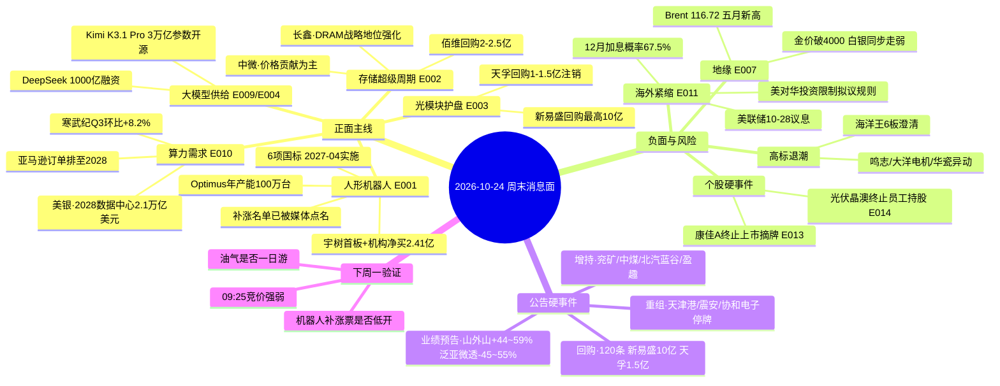

# 2026-10-24 · **消息面事件驱动（周末轻量档）**

> **数据源新鲜度**: partial · **降级状态**: true · **置信度**: 0.62
> **覆盖窗口**: 2026-10-23 20:45 → 2026-10-24 20:09（公众号 48 篇全文 + 快讯 2200 条 + 公告 3828 条 / 1344 家）
> **模式**: weekend —— **只做题材发酵与候选池，不给买卖点、不给点位**

## 一句话结论
周末发酵的两条主线是**机器人（唯一有产业+标准+资金三重证据）**和**存储（唯一涨价已在财报兑现）**；唯一的硬利空不是国内，是**美联储 12 月加息概率 67.5% + 美对华投资限制拟议规则**，它决定周一高开能不能站住。

## 🗺️ 周末消息面全景

## 🎯 催化事件清单（v1.6 口径 · weighted_score = score × e^(−0.15×days)）

| ID | 事件 | 类型 | 极性 | strength | raw | weighted | days | 独立源 |
|---|---|---|---|:--:|---|---|:--:|---|
| E20261024_001 | 人形机器人：宇树首个 20cm 涨停 + 6 项国标 + Optimus 量产 | sentiment/policy | 正面 | high | 0.86 | **0.740** | 1 | 3（官媒 2 + 龙虎榜/热榜） |
| E20261024_002 | 存储超级周期确认：长鑫表态 + 佰维回购 + 中微价格驱动 | earnings/policy | 正面 | high | 0.75 | **0.646** | 1 | 3 |
| E20261024_004 | DeepSeek 1000 亿融资，A 股三家间接入股 | earnings | 正面 | high | 0.72 | **0.620** | 1 | 2 |
| E20261024_006 | 三季报硬业绩分层（覆铜板/模拟/算力加速；有机硅/铜见顶） | earnings | 正面 | high | 0.70 | **0.603** | 1 | 2 |
| E20261024_010 | 亚马逊：AWS 2026 产能售罄、订单排至 2028 | sentiment | 正面 | high | 0.60 | **0.600** | 0 | 1（官方） |
| E20261024_007 | 中东升级：Brent 116.72 五月新高 + 金价破 4000 | macro | 负面→油气正面 | high | 0.65 | **0.559** | 1 | 3 |
| E20261024_009 | 月之暗面 Kimi K3.1 Pro：3 万亿参数开源模型 | sentiment | 正面 | medium | 0.55 | **0.550** | 0 | 2（官媒 2） |
| E20261024_005 | 《国家信息化"十五五"规划》印发：6G/量子/脑机/具身智能 | policy | 正面 | medium | 0.60 | **0.516** | 1 | 2 |
| E20261024_003 | 光模块龙头集体护盘：天孚 1-1.5 亿、新易盛最高 10 亿 | policy(回购) | 正面 | medium | 0.55 | **0.473** | 1 | 2 |
| E20261024_011 | 美联储 10-28 议息 + 12 月加息概率 67.5% + 美对华投资限制拟议规则 | macro/policy | **负面** | high | −0.45 | **−0.450** | 0 | 2（官方+快讯） |
| E20261024_008 | 国办发文减缓 AI 就业替代（就业友好型发展） | policy | **负面** | medium | −0.42 | **−0.361** | 1 | 2 |
| E20261024_012 | 协和电子（605258）控股股东筹划控制权变更，停牌 | insider | 中性偏正 | medium | 0.35 | **0.350** | 0 | 1（公告） |
| E20261024_015 | 证监会核准设立花旗证券（中国） | policy | 正面 | low | 0.30 | **0.300** | 0 | 1 |
| E20261024_013 | *ST康佳A（000016）终止上市暨摘牌 | 退市 | **负面** | low | −0.30 | **−0.300** | 0 | 1（公告） |
| E20261024_014 | 光伏：晶澳终止员工持股（考核难达）vs 爱旭 Q3 转正 | earnings | 分歧 | low | 0.10 | 0.094 | 0 | 2 |

> 门槛：`|raw| ≥ 0.2` 入清单；E014 因分数低于门槛只作背景（列在负面段）。
> 去重：`raw 15 → merged 13，dedup_rate 0.13`（周六事件稀疏，未强凑数量，`sparse_event_day=false` 但接近边界）。

## 🔍 三个必须展开讲的事件

### E001 · 人形机器人三重共振（产业+标准+资金）

**事件摘要**：宇树科技 10-23 收 20% 涨停（624 元、成交 47.7 亿、换手 28.08%，上市以来首个涨停板），龙虎榜机构专用净买 2.41 亿居全市场第一；同日 6 项人形机器人国家标准发布（2027-04-01 实施）；特斯拉 Optimus 弗里蒙特产线投产、规划年产能 100 万台、约一年爬坡至周产 2 万台；工信部：2026H1 整机超 400 款、产量超 4 万台、全年预计破 10 万台。

- **大资金意图**：机构在连续大涨后**仍单向净买**，买的是「明年量产爬坡」的确定性，不是当日涨幅；外资同日双边对打（高盛买 1.10 亿/卖 1.39 亿、瑞银净买 0.75 亿、摩根大通卖 0.83 亿）说明**话语权正从交易盘转向配置盘**，这种结构对应「高位换手」而非「直线加速」。
- **为什么走强**：周五机器人 14 家涨停、大业股份 5 板，梯队完整；国标把「能不能干」变成「可比较、可验证」，是产业从 demo 走向采购的必要条件；Optimus 产能指引给了「明年业绩能算出来」的锚。
- **逻辑够不够硬**：**产业硬、位置不硬**。硬在零部件先兑现（浙商：上游标准化+多客户复用，率先规模效应）；不硬在可靠性——野村口径工厂任务成功率约 60%，进生产系统需 98%，机器人目前是 **AlexNet 而非 ChatGPT 时刻**。这条只该用来压仓位上限，不该用来否定方向。

### E007 · 中东升级 + 金价破 4000（一个事件两个方向）

**事件摘要**：特朗普称可能再对伊朗发动「小规模史诗怒火」；伊朗革命卫队称两艘超大型油轮在霍尔木兹海峡以南触雷起火（载油超 450 万桶）；Brent 收 116.72（+3.14%，近六个月新高）、WTI 103.27（+3.82%）；同一夜金价跌破 4000 美元（三个多月新低）、白银同步走弱（暗盘日内跌超 1%）。

- **大资金意图**：**油涨、金跌同时发生**，说明买盘不是在避险，而是在交易「供给中断 + 紧缩延续」。真正被定价的是 12 月加息，不是战争。
- **为什么走强**：霍尔木兹日均通过量占全球海运原油约两成，油轮触雷是可量化的断供事件，油运/油服的事件弹性立刻可见。
- **逻辑够不够硬**：**事件硬、持续性软**。土耳其已主持八国外长会议呼吁外交解决，美伊均有接触意愿；一旦谈判窗口打开，溢价一周内回吐。**这条的正确用法是「不追」，不是「埋伏」。**

### E011 · 海外紧缩与投资限制（本周末唯一的硬利空）

**事件摘要**：美联储 10-27~28 议息，CME 显示 10 月维持不变概率 90.6%、**12 月累计加息 25bp 概率 67.5%**（路透调查 100 位经济学家全部预期 12 月加息）；美国 10 月消费者信心终值 48（同比 -10.4%），1 年通胀预期 4.6%→4.7%、长期 3.4%→3.5%；10-23 美财政部发布新版对外投资限制拟议规则，商务部回应「严重关切、坚决反对、保留采取措施权利」。

- **大资金意图**：外资在 A 股的边际定价权集中在算力/机器人/存储三条链，这三条链恰好是「对美敏感度最高」的赛道——限制规则即使是拟议阶段，也足以压制北向的风险偏好。
- **为什么是利空**：不是业绩利空，是**贴现率 + 准入不确定性**双重抬升；A 股历史上对「拟议规则」通常先跌一轮，等细则落地再修复。
- **逻辑够不够硬**：**政策方向硬、时间表软**。拟议规则还在征求意见，短期冲击偏情绪；但 12 月加息 67.5% 是真实概率，属于「可以量化」的压制项。

## 🧠 其余事件 · 三问速览

| 事件 | **大资金意图** | **为什么走强** | **逻辑够不够硬** |
|---|---|---|---|
| E002 存储 | 用存储做「科技仓位地基」，要确定性不要弹性 | 涨价已被三季报验证，佰维/长鑫周末主动释放信心＝公司层面隐性背书 | 硬，但已进「信的人很多」阶段；中微「价格贡献为主」是双刃剑，合约价环比一转平同比再高也没用 |
| E003 光模块回购 | 大股东用真金白银告诉市场「我认为便宜」，属护盘不是进攻 | 天孚 1-1.5 亿全注销、新易盛最高 10 亿，直接减少流通盘 | 中等：回购价上限 350 元 vs 现价 200.81 元，是估值表态；但主力 20 日持续流出，需右侧确认 |
| E004/E009 大模型 | 一级市场给国产模型重定价，A 股买股东名单不买业绩 | 开源+低价（Kimi 价格为 GPT-6 Astra 的 1/5）把叙事从追赶改成替代 | 偏软：完美世界/世纪华通/利通电子是基金份额间接持股，传导链长，情绪弹性 >> 业绩弹性 |
| E005 十五五信息化 | 政策定方向，资金做「远期贴现」 | 6G/量子/脑机/具身智能入列前沿，给了题材合法性 | 偏软：2030 年目标、无当期业绩，6G 历史多为脉冲行情 |
| E006 三季报分层 | 资金在科技内部做「从周期涨价切向真成长」的再平衡 | 覆铜板/模拟/算力环比仍加速，有机硅/铜环比转负 | 硬（分层本身是硬信息）：关键是看环比，同比党会在东岳硅材/洛阳钼业上被埋 |
| E010 亚马逊 2028 | 海外配置盘锚定「算力是长周期资本开支」 | 2026 产能售罄＋2027 基本售罄，把需求可见度续两年 | 硬（需求侧）：但 A 股光模块筹码在 MA20 下方，需求硬救不了套牢盘 |
| E008 国办 AI 就业文件 | 政策在给「AI 替代就业」踩刹车，属社会政策不是产业政策 | —（这是压制项） | 情绪压制 > 业绩压制：与机器人主线正面对撞，只影响仓位上限不影响方向 |
| E012 协和电子停牌 | 控制权变更＝壳资源重新定价，博弈资金最爱的确定性事件 | 流通 36.2 亿、周五 -3.9%，停牌前无抢筹 | 硬（公告级）：但复牌时间与方案未知，属「不可预判」类事件 |
| E013 康佳退市 / E015 花旗证券 | 存量博弈下的两端：一端出清、一端开放 | — | 康佳属风险教育样本；花旗证券是金融开放边际信号，对券商板块影响偏情绪 |

## 📋 公告硬事件（10-23 盘后 → 10-24 全窗口，3828 条 / 1344 家）

分类口径为 `anns_window.jsonl` 全量标题匹配，**已剔除股权激励回购注销类噪音**（这类占「回购 120 条」的绝大多数，不构成催化）。

| 类型 | 条数 | 关键标的（可直接进候选池的） | 方向 |
|---|:--:|---|:--:|
| 控制权变更/停牌 | 1 | **协和电子 605258**（控股股东筹划控制权变更，10-24 起停牌；周五 -3.9%、流通 36.2 亿） | 复牌博弈 |
| 重组/收购 | 16 | **天津港 600717**（发行股份购买资产报告书草案，构成关联交易但**不构成重大资产重组**）、震安科技 300767（筹划重大资产重组+收购意向）、万盛股份 603010（收购青岛金博行控制权）、中国神华 601088（收购国能新疆煤制气 50%）、朗特智能 300916、望变电气 603191、海汽集团 603069（进展）、建设机械 600984（进展） | 中性偏正 |
| 回购（非激励注销） | 约 25 | **新易盛 300502（最高 10 亿）**、天孚通信 300394（1-1.5 亿全注销）、佰维存储 688525（2-2.5 亿提议）、生益科技 600183、生益电子 688183、豪威集团 603501、澜起科技 688008（实施结果）、伊利股份 600887、科沃斯 603486、中贝通信 603220、广合科技 001389（董事长提议） | 正面 |
| 增持 | 24 | 兖矿能源 600188（控股股东进展）、中煤能源 601898（进展）、北汽蓝谷 600733（进展）、**盈趣科技 002925（控股股东新计划）**、先导基电 600641（董监高首次增持）、哈空调 600202（完成）、润泽科技 300442（触及 1%/5% 整数倍） | 正面 |
| 减持 | 19 | 白银有色 601212（触及 1% 整数倍，仍在减）、ST中珠 600568（减至 5%）、佳力图 603912、新益昌 688383、和辉光电 688538、赛分科技 688758 | **负面** |
| 业绩预告/快报 | 3（+三季报 642） | 山外山 688410（预增，扣非 +45%~60%）、**泛亚微透 688386（预减 45%~55%，原油/铜铝成本高企 + 汽车价格战）**、*ST天宜 688033（营收 -33%~-43%，减亏） | 分化 |
| ST/退市 | 9 | **\*ST康佳A 000016（终止上市暨摘牌）**、\*ST卓然 688121（市值低于 3 亿，第 8/9 次风险提示）、\*ST萃华 002731（进入退市整理期首日）、元道退 301139（整理期第 6 次）、\*ST瑞茂 600180 | **负面** |
| 定增/再融资 | 94 | 仕佳光子 688313、信科移动 688387、昀冢科技 688260、东方锆业 002167（问询回复） | 中性 |

## 🔥 周末发酵题材 → 下周一待验证清单

以下全部为 **"待周一竞价验证"** 状态，**不含买点、不含点位、不含仓位建议**（周末档纪律）。

| # | 发酵题材 | 发酵证据（窗口内新增） | 下周一验证什么 |
|:--:|---|---|---|
| 1 | **人形机器人/灵巧手** | 宇树首板+机构 2.41 亿净买、6 项国标、Optimus 产能指引、媒体已开始点名「13 只滞涨绩优潜力股」 | ❶ 高标（大业股份 5 板、福莱新材）是否低开/炸板；❷ 一致性过高时，真龙与补涨杂毛的分化；❸ 板块广度是否仍在 10 家以上 |
| 2 | **存储/DRAM** | 长鑫表态、佰维回购 2-2.5 亿、中微「价格贡献为主」、SK 海力士弃 Solidigm IPO | ❶ 涨价链（模组/分销）是否有新面孔；❷ 长鑫科技仍在 MA20 下方，看能否站上 |
| 3 | **AI 算力/光通信** | 亚马逊订单排至 2028、美银 2.1 万亿美元、天孚/新易盛回购护盘 | ❶ 中际旭创/新易盛能否站上 MA5（632/284 附近）；❷ 主力资金是否由流出转流入 |
| 4 | **大模型/AI 应用** | Kimi K3.1 Pro（3 万亿参数开源）、DeepSeek 1000 亿融资三家 A 股间接入股 | ❶ 映射票（完美世界/世纪华通/利通电子）是否只高开不接力；❷ 是否扩散到 IDC/算力租赁 |
| 5 | **油气/油运/军工** | Brent 116.72 五月新高、两艘 VLCC 触雷、特朗普再打伊朗表态 | ❶ 是否高开低走（事件型典型形态）；❷ 有无二次消息（谈判/停火）反转溢价 |
| 6 | **覆铜板/PCB/模拟芯片** | 三季报：华正新材、晶丰明源、生益科技、商络电子 +462%、金百泽 +468%、本川智能 Q3 +438% | ❶ 业绩是否已被提前反映（看预告日到周五的涨幅）；❷ 周一有无新的涨价函 |

## 💼 业绩预告交叉验证（Step 2.5 业绩极性协议已执行）

| 代码 | 名称 | 类型 | 同比 | 单季环比（拆解） | 极性判定 | 依据 |
|---|---|---|:--:|---|---|:--:|---|
| 688410.SH | 山外山 | 预增 | 扣非 +45.17%~+60.45% | 未拆（缺上季累计） | 🟢 正面 | 主业增长，非周期 |
| 688386.SH | 泛亚微透 | 预减 | −45%~−55% | — | 🔴 负面 | 原油/铜铝成本高 + 汽车价格战，毛利被双向挤压 |
| 688033.SH | *ST天宜 | 减亏 | 净利减亏 22.6%~39.8% | — | 🟡 中性 | 营收仍 −33%~−43%，减亏来自收缩而非复苏 |
| 300821.SZ | 东岳硅材 | 三季报 | 前三季 +19413% | **Q3 单季 1.29 亿，环比 −45.2%** | 🔴 **利好出尽** | 周期股看环比，同比是后视镜 |
| 603993.SH | 洛阳钼业 | 三季报 | 前三季 +68.21% | **Q3 单季 78.67 亿，环比 −6.3%** | 🟡 周期高位 | 铜价仍强，但环比已转平 |
| 688256.SH | 寒武纪 | 三季报 | 前三季 +131.49% | **Q3 环比 +13.50%（营收）/ +8.16%（净利）** | 🟢 正面 | 环比仍加速，非周期见顶形态 |
| 605358.SH | 立昂微 | 三季报 | 扭亏（1.74 亿） | Q3 单季 9018 万，同比 +373% | 🟢 正面 | 12 英寸硅片量产带动成本下降 |
| 000636.SZ | 风华高科 | 三季报 | +180.9% | Q3 单季 3.51 亿，同比 +470% | 🟢 正面 | 量价同升 |
| 002459.SZ | 晶澳科技 | 公告 | 2025 亏 46.08 亿 / 2026H1 亏 26.63 亿 | — | 🔴 负面 | 终止员工持股，2026 净利转正考核已不现实 |

> **本档最重要的一条经验**：东岳硅材同比 +19413%、洛阳钼业 +68%，都在**单季环比上露了馅**。周一如果这两只高开，那是给「同比党」的出货窗口，不是低吸机会。

## 🚫 首板候选池（仅名字与证据，**不含**买入条件）

来源：`data/research/20261026/R4_news.json` 的 `first_board_candidates[]`（34 只，`direct_name_match` 全市场股名命中，非东财 lead_stock 代理），叠加本窗口新增公告/新闻命中。全部标注「待周一竞价验证」。

| 分层 | 标的（代码） | 命中源数 | 备注 |
|---|:--:|:--:|---|
| **第一梯队（多源+高频命中）** | 宇树科技(688836) 兆威机电(003021) 寒武纪(688256) 长鑫科技(688825) 中际旭创(300308) | 2 源 × 6-9 次 | 均为「题材代表」，位置多在 MA20 下方或高位换手，只做参考锚 |
| **第二梯队（题材内高辨识度）** | 襄阳轴承(000678) 正裕工业(603089) 兆易创新(603986) 云汉芯城(301563) 大洋电机(002249) 鸣志电器(603728) 天孚通信(300394) 源杰科技(688498) | 2 源 × 3-4 次 | 大洋电机/鸣志电器已发异动澄清（机器人无收入/占比 9%），属**伪受益风险名单** |
| **第三梯队（业绩驱动）** | 华正新材(603186) 晶丰明源(688368) 生益科技(600183) 立昂微(605358) 风华高科(000636) 商络电子(300975) 金百泽(301041) 本川智能(300964) 骏亚科技(603386) | 1-2 源 × 2 次 | 三季报硬业绩，但要看预告日至周五的涨幅是否已透支 |
| **本窗口新增（周末公告/新闻命中）** | 新易盛(300502，最高 10 亿回购) 佰维存储(688525，2-2.5 亿提议) 完美世界(002624)/世纪华通(002602)/利通电子(603629)（DeepSeek 间接入股） | 1-2 源 | 回购类是**护盘信号不是买点**；DeepSeek 映射票传导链长，一日游概率高 |

**明确排除**：流通市值 < 20 亿的票（防庄股）；连续异动澄清且业务占比极低的票（海洋王 002724 已 6 连板并澄清与核电/深海无关，鸣志电器机器人业务仅占 9%，大洋电机机器人尚未形成收入）。

## 关键证据

- 证据 1：宇树科技 20cm 首板、机构专用净买 2.41 亿、换手 28.08% · 上海证券报 2026-10-23 20:56 · `wechat_official_20`
- 证据 2：6 项人形机器人国标发布（2027-04-01 实施）· 上海证券报 2026-10-23 20:56 · 同上
- 证据 3：AWS 2026 主要产能售罄、2027 基本售罄、2028 部分预订 · 上海证券报 2026-10-24 19:44 · 同上
- 证据 4：Kimi K3.1 Pro 3 万亿参数、100 万 token、权重 11-04 前发布 · 上海证券报 14:53 + 证券时报 15:32（双源）
- 证据 5：12 月累计加息 25bp 概率 67.5%、10 月按兵不动 90.6% · 证券时报 2026-10-24 16:39（引 CME/路透）
- 证据 6：商务部回应美新版对外投资限制拟议规则（10-23 美财政部发布）· 证券时报 2026-10-24 20:09
- 证据 7：协和电子控股股东筹划控制权变更停牌 · `anns_window` 20261024 公告
- 证据 8：\*ST康佳A 终止上市暨摘牌 · `anns_window` 20261023 公告
- 证据 9：东岳硅材 Q3 单季 1.29 亿（同比 +427%、环比 −45.2%）、洛阳钼业 Q3 78.67 亿（环比 −6.3%）· `eastmoney_earnings_predict` + 三季报公告
- 证据 10：泛亚微透预减 45%~55%，理由为原油/铜铝成本高企 + 汽车价格战 · `eastmoney_earnings_predict` 2026-10-24

## 数据源审计

| 源 | 日期 | 状态 | 记录数 | 备注 |
|---|---|:--:|---|---|
| 公众号 RSS（15 号） | 2026-10-23/24 | 🟢 | 48 | 5 号有更新（证券时报 24 / 上海证券报 20 / 傅里叶的猫 2 / 猫笔刀 1 / 李迅雷 1），10 号空（含财联社早知道、盘前纪要） |
| news_cls 财联社+新浪快讯 | 2026-10-24 | 🟢 | 2200 | 覆盖 10-23 09:03→10-24 08:59，周六 09:00 后无增量 |
| news_major 长篇要闻 | 2026-10-24 | 🟡 | 800 | 覆盖 10-23 18:02→10-24 09:00，标题多为机构点评/公告转发，信息密度低 |
| anns_window 盘前公告窗口 | 2026-10-23/24 | 🟢 | 3828（1344 家） | 业绩预告/财报 783、股权激励 199、回购 120、定增 95、增减持 79+、重组 44、风险提示 42、监管 29、ST 退市 8 |
| eastmoney 业绩预告 | 2026-09-30 报告期 | 🟢 | 500 | 覆盖 8-25→10-24 全部三季报预告披露，本档只用 10-23/24 新增 |
| Tushare daily（10-23 收盘） | 2026-10-23 | 🟢 | 5572 | 用于候选票位置与周五涨幅校验 |
| 焦点 5 群（wechat-cli） | 2026-10-24 | 🔴 | 0 | `wechat-cli init` 未完成——群内一手消息本档完全缺失 |
| XTick hot/news | — | ⚪ | 0 | 本档未调用（MCP 常掉，已用公众号+快讯替代，不置 degraded） |

## 不确定性 / 反证

1. **群聊缺失可能漏掉最锐的那一条**：5 群是券商研报即时转发+盘中新闻的入口，本期 0 条。若周末有群内讨论的一手产业链信息（例如某个零部件涨价、某家拿到 Optimus 定点），本报告看不到。
2. **机器人题材的最大反证不是野村，是自己**：媒体已经开始批量点「滞涨绩优潜力股」，这是**题材进入中后段的典型标志**；同时海洋王、鸣志电器、大洋电机、华瓷股份集体发异动澄清，说明资金炒到了「业务占比 9%」的票。补涨扩散≠主线强化。
3. **公告解读的边界**：天津港「发行股份购买资产」明确「不构成重大资产重组」，容易被标题党误读为重组大单；同理 120 条「回购」里绝大多数是股权激励注销，不含护盘含义——本档已剔除，但下游若只看标题仍会误判。
4. **中东是双向事件**：同一夜里 Brent 创五月新高、金价破 4000，说明市场在交易紧缩而非避险。若周一 12 月加息预期继续升温，油气涨、科技跌可能出现一天之内两次反转。
5. **三季报的「同比陷阱」在周末集中爆发**：东岳硅材 +19413%、商络电子 +462%、金百泽 +468% 这类极端同比，若只看标题，很容易在周一高开时把「利好出尽」读成「业绩爆发」。
6. **本档不落 `data/research/20261024/R4_news.json`**：周一交易日正式档（`data/research/20261026/R4_news.json`，已在 15:16 产出，含 8 个事件 + 34 只首板候选）为准，本文件是周末 24h 增量的补充，两者冲突时以正式档为准。

## 与其他 R/D/E 的关系

- 依赖：`data/raw/20261024/{wechat_official_20,news_cls,news_major,anns_window,eastmoney_earnings_predict,tushare_daily_1023}.jsonl`、`data/research/20261026/R4_news.json`（交易日正式档候选池）
- 被消费：D1 周一盘前预案（周末发酵题材优先级 + 待验证清单）、R2 主线确认、R6 反证（一致性预期/伪受益名单）、E1 复盘（验证周末事件是否兑现）
- 与 `data/research/20261026/R4_news.json` 的关系：**不冲突、不覆盖**，本档只补 10-24 15:16 之后的新增（Kimi K3.1、亚马逊 2028 订单、美联储议息、协和电子停牌、康佳退市、泛亚微透预减、花旗证券核准）

## Sub-Agent 元数据

- skill: analyze_news_impact_v1@1.6（weekend_light 变体：无买卖点 / 无 stop_loss / 事件按 weighted_score 排序）
- artifact: 本文件（周末档不落 `R4_news.json`，避免覆盖周一正式档）
- method: llm_v1（五源：公众号全文 + 快讯 + 公告 + 业绩预告 + 收盘行情）
- 生成时刻: 2026-10-24T21:15:00+08:00
