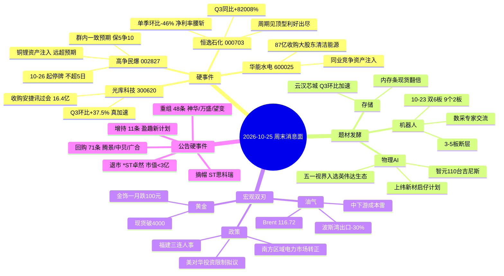

# 2026-10-25 · **消息面事件驱动（周末轻量档）**

> **数据源新鲜度**: partial · **降级状态**: false · **置信度**: 0.66
> **覆盖窗口**: 2026-10-24 18:01 → 2026-10-25 18:01（公众号 41 篇 + 快讯 624 + 要闻 618 + 公告 2051 条/714 家 + 群聊 383 条）
> **模式**: weekend —— **只做事件清单与候选池，不给买卖点、不给点位、不给仓位**

## 一句话结论

周末唯一真正的硬事件是**高争民爆一笔远超预期的铜锂资产注入（10-26 起停牌）**，但它是一致预期最拥挤的票、买不到；真正可交易的信息在反面——**恒逸石化"暴增 82008%"是周期股单季环比腰斩 −46% 的伪装**，以及**油价高企正在同时制造利好（油气链）和业绩雷（中下游化工）**。

## 🗺️ 周末消息面全景

## 🎯 催化事件清单（v1.6 口径 · weighted = score × e^(−0.15×days)）

| ID | 事件 | 类型 | 极性 | strength | raw | weighted | days | 独立源 |
|---|---|---|---|:--:|---|---|:--:|---|
| E20261025_001 | 高争民爆：发行股份收购紫隆/紫源/晟源，铜 + 锂资产注入，10-26 起停牌 | policy/insider | 正面 | high | 0.88 | **0.880** | 0 | 3（证券时报 + 群内东财有色研报 + 停牌公告） |
| E20261025_004 | 恒逸石化：Q3 同比 +82008%，但**单季环比 −46%**、净利率 10.5%→5.1% | earnings | **负面** | high | −0.60 | **−0.600** | 0 | 2（证券时报 + 三季报/income 拆解） |
| E20261025_005 | 物理AI：五一视界子公司入选英伟达 Halos SAFE（唯一中企）+ 上纬启仔计划 + 智元 110 台吉尼斯 | sentiment | 正面 | high | 0.62 | **0.534** | 1 | 3（证券时报 + 上证报 + 财联社） |
| E20261025_002 | 云汉芯城：前三季 +312%~355%，**Q3 单季环比 +48%~+79%** | earnings | 正面 | high | 0.72 | **0.533** | 2 | 2（证券时报 + 公告） |
| E20261025_003 | 光库科技：收购安捷讯 99.97% 过会，Q3 环比 +37.5% | earnings | 正面 | high | 0.68 | **0.504** | 2 | 2（证券时报 + 深交所公告） |
| E20261025_006 | 油气供给收缩：波斯湾成品油出口低 30%、俄燃料油出口 90→50 万桶/日 | macro | 正面(油气链) | high | 0.58 | **0.499** | 1 | 3（方正中期 + 财联社 + 群内） |
| E20261025_007 | 机器人数据采集专家交流：天机力控双臂、帕西尼触觉/数据（细分产业实证） | sentiment | 正面 | medium | 0.40 | **0.400** | 0 | 1（公众号） |
| E20261025_008 | 南方区域电力市场正式运行：打通粤桂滇黔琼、经营主体超 29 万家 | policy | 正面 | medium | 0.45 | **0.387** | 1 | 2（央视 + 能源局） |
| E20261025_009 | 黄金失守 4000 美元；国内金饰一月跌约 100 元/克 | macro | **负面** | high | −0.45 | **−0.387** | 1 | 2（财联社 + 群内） |
| E20261025_010 | 高油价抬升中下游成本：泛亚微透预减 45%~55% 明写原油/铜铝高位 + 汽车价格战 | macro/earnings | **负面** | medium | −0.42 | **−0.362** | 1 | 2（公告 + 快讯） |
| E20261025_011 | 福建三连人事：郭宁宁任省政府党组书记、林涛任省委副书记、秦海翔任福州市委书记 | policy | 正面 | medium | 0.42 | **0.361** | 1 | 2（官媒 + 群内"冲福建股"） |
| E20261025_012 | 美对华投资限制新版拟议规则；商务部"严重关切、坚决反对、保留措施" | policy | **负面** | medium | −0.40 | **−0.344** | 1 | 2（美财政部 + 商务部） |
| E20261025_013 | 主力单周净流出 849.99 亿，弃高就低：光通信/新能源被抛，存储/消费电子吸金 | macro | **负面** | medium | −0.35 | **−0.301** | 1 | 2（财联社统计 + ETF 流向） |
| E20261025_014 | 公告硬事件包：ST 思科瑞申请摘帽、\*ST卓然市值<3亿第九次退市提示、腾景/中贝/广合回购、盈趣增持、神华/万盛/望变收购 | insider | 中性偏正 | medium | 0.35 | **0.301** | 1 | 2（公告 + 官媒） |
| E20261025_015 | 半导体氦气被美能源部列为关键材料（气体供应链边际收紧） | macro | 负面(边际) | low | −0.25 | **−0.215** | 1 | 1 |
| E20261025_016 | 上证/科创综指修订 10-26 实施：单样本权重 ≤15%、ST 剔除时点提前 | policy | 中性 | low | 0.15 | — | 0 | 2（上交所 + 官媒） |

> **门槛**：`|raw| ≥ 0.2` 入清单。E016 分数低于门槛，仅作背景（对 ST 板块边际负面）。
> **去重**：raw 18 → merged 16，`dedup_rate = 0.11`。E006 / E010 是**同一油价事件的正反两面，按 v1.4 规则刻意拆成两条独立事件**，不做合并。
> **稀疏度**：`event_density = 16 / 2 源日 ≈ 8 事件/源日`，远高于 0.05，`sparse_event_day = false`。
> **衰减**：本档全部事件 days ≤ 2，无一条落入 `decayed=true`（>3 日衰减到 64% 以下）。

## 🔍 三个必须展开讲的事件

### E001 · 高争民爆 002827：一笔远超预期的注入，配上一个最拥挤的预期

**事件摘要**：10-25 公司公告，控股股东西藏地质矿产集团将旗下三块资产注入——**紫隆矿业 51%**（核心是朱诺铜矿 45.9%，资源量 293.9 万吨，2026 建成、设计年产 8 万吨）、**紫源铜业 51%**（核心是马牧普铜矿探矿权，探转采预计明年上半年完成，远期资源量 300 万吨以上）、**晟源矿业 100%**（持有巨龙铜矿 10% + 拉果资源 27%，巨龙资源量 2600+ 万吨、拉果碳酸锂当量 215 万吨），同时募集配套资金。公司股票**自 10-26 起停牌**，预计不超过 5 个交易日内披露方案。东财有色李淼点评：明年权益产能或达 **5 万吨铜 + 0.5 万吨碳酸锂**，对应约 **30 亿利润**；远期 13 万吨铜 + 1.5 万吨锂，"节奏/范围远超预期"。

**先看位置**：10-23 收 51.80 元，**+6.41%**，成交 6.51 亿，换手 4.74%，总市值 143.5 亿、流通 143.0 亿、PE_TTM 93.6。三季报（10-20 披露）营收 11.88 亿 **−5.71%**、归母 0.81 亿 **−35.45%**。

- **大资金意图**：这笔注入的意义不是"多了一块铜矿"，而是**控股股东从藏建集团换成地矿集团之后，把能贡献当期利润的资产一次性装进来了**。李淼的原话是"除马牧普外，基本把集团体内能贡献当期利润的资产都进行注入"——这是**资产证券化的第一笔，也是最大一笔**。买的人买的不是铜价，买的是"西藏国资唯一的矿业上市平台"这个身份。
- **为什么走强**：注入的资产里有**已经投产的巨龙铜矿权益（3–3.5 万吨/年）和拉果锂（0.5 万吨/年）**，不是纯探矿权画饼，这跟市场上大量"停牌重组复牌跌"的案例有本质区别。加上主业 Q3 单季 0.489 亿、环比 Q2 的 0.230 亿 **+113%**，民爆本身也在改善。
- **逻辑够不够硬**：**资产硬、价格不硬、可交易性为零**。硬的地方在于权益产能和利润测算是可核对的；不硬的地方有三处：① 马牧普铜矿还在探转采，最快明年上半年，2026 年一分钱利润不出；② PE_TTM 已 93.6，停牌前 6.41% 的上涨说明**已经有人抢跑**；③ 群内已经把"10 个一字""300e 市值"当成既定事实（详见下方一致性预期段）。**一笔好资产 + 一个坏价格 + 一个无法交易的窗口，这三件事同时成立。**

### E004 · 恒逸石化 000703：本档最重要的一次"业绩陷阱"识别

**事件摘要**：10-25 三季报，前三季营收 1083.06 亿 **+29.11%**、归母 **80.11 亿 +3390.70%**；其中 Q3 单季归母 21.09 亿，**同比 +82008.05%**。证券时报标题是"暴增 82008%！业绩利好"。

**单季拆解（Step 2.5 强制）**：H1 归母 59.02 亿（Q1 19.95 亿 + Q2 **39.07 亿**）→ Q3 21.09 亿，**环比 −46.0%**。同期营收 Q3 409.97 亿 vs Q2 373.6 亿，**+9.7%（还在增长）**。收入涨、利润腰斩 → **净利率从 Q2 的 10.46% 塌到 Q3 的 5.14%**。同比 +82008% 的来源是去年 Q3 基数只有 0.026 亿，属于**基数失真**。

- **大资金意图**：市场会按"82008%"这个数字高开，而真正的信息藏在"收入增 9.7%、利润减 46%"里——**这是炼化价差（crack spread）走平的典型形态**，不是需求出了问题。买它的人如果只看标题，会在一个"景气见顶但绝对利润仍高"的位置接货。
- **为什么走强**（本条 polarity=负面，故此处如实回答"为什么会被打"）：它精确复刻了江波龙那次的形态——**周期股在利润同比最炸裂的那一季，往往就是股价的顶部区域**。恒逸石化国内是化纤/PTA 龙头、海外是文莱炼化，两个都是强周期。叠加本周末另一条信息（中东、俄罗斯炼能受袭停产、东南亚成品油偏紧），**利润的同比高增其实是"去年基数低 + 今年上半年价差好"的合成，Q3 已经开始回落**。
- **逻辑够不够硬**：**硬到可以下判断**。这不是估值观点，是财务事实：单季环比 −46%、净利率腰斩。按 Step 2.5 协议，`cyclical=true` + `implied_qoq` 转负 → **polarity 必须判负面（利好出尽/周期见顶），无论同比多高**。周一若高开，那是给"同比党"的出货窗口。

### E006 / E010 · 油价：同一件事的正反两面，必须拆开看

**事件摘要（正面面）**：霍尔木兹通航受阻，波斯湾成品油出口较正常水平低约 **30%**；俄罗斯炼厂频繁遇袭，燃料油出口从约 90 万桶/日回落至 **50 万桶/日**附近；Brent 10-23 收 **116.72（+3.14%，近六个月新高）**、WTI 103.27（+3.82%）；胡塞 10-24 对沙特机场与石油设施发动 7 次袭击。

**事件摘要（负面面）**：泛亚微透（688386）10-24 业绩预告**预减 45%~55%**，公告原话是"地缘局势扰动推动**原油及其衍生物以及铜铝等上游原材料价格高位运行**，叠加下游汽车行业竞争加剧，公司主营业务毛利承受下行压力"。这是一条**用公司业绩把"高油价 = 中下游成本雷"写成文字的证据**。

- **大资金意图**（正面面 E006）：油运/油服/炼化是"事件弹性"最直接的品种，Brent 116 这个位置已经进入"供给中断定价"区间，资金买的是**断供的不可替代性**，不是需求复苏。
- **为什么走强**（正面面 E006）：波斯湾出口 −30% 是可量化的物理缺口，不是情绪。
- **逻辑够不够硬**（正面面 E006）：**事件硬、持续性软**。同一窗口里有一条反向消息：10-25 03:02「伊朗已告知巴基斯坦，愿意恢复与华盛顿的谈判并重新开放霍尔木兹海峡，以换取美国解除对伊朗港口的封锁」。**谈判窗口一旦打开，一周内溢价可以全部回吐。** 这条的正确用法是"不追"，不是"埋伏"。
- **大资金意图**（负面面 E010）：油价在这里扮演的不是"通胀交易"，是**成本剪刀**——中游改性材料、橡胶助剂这类议价能力最弱的环节，被上游原料和下游整车同时挤压。资金不会提前定价这件事，只会等业绩出来才踩踏。
- **为什么走强**（负面面，本条 polarity=负面，故此处回答"为什么会被打"）：泛亚微透把因果写进了公告原文："地缘局势扰动推动原油及其衍生物以及铜铝等上游原材料价格高位运行，叠加下游汽车行业竞争加剧"，毛利双向受压。
- **逻辑够不够硬**（负面面 E010）：**比正面面更硬**。因为它是**已经发生的财报事实**（预减 45%~55%），逻辑链完整：原油涨 → 橡胶/塑料助剂成本涨 → 汽车价格战无法转嫁 → 毛利崩。而泛亚微透 10-23 还涨了 4.19%，说明**市场还没定价这条**。

## 🧠 其余事件 · 三问速览

| 事件 | **大资金意图** | **为什么走强 / 走弱** | **逻辑够不够硬** |
|---|---|---|---|
| E002 云汉芯城 | 电子元器件分销是"存储涨价"最下游、最敏感的传感器，买它等于买行业景气的一阶导 | Q3 单季环比 +48%~+79%，**规模效应 + 经营杠杆在加速兑现**，不是一次性收益 | 硬。但 10-22/23 两日累计偏离超 30% 已触发异动，**信息已部分公开** |
| E003 光库科技 | 光通信里少有的"重组落地 + 业绩加速"双击，且 10-23 股价只涨 1.46%，**信息未定价** | 收购安捷讯（光无源器件）过会，16.4 亿对价补齐产品线；Q3 营收 8.29 亿环比 +37% | 硬（审核通过是确定性事件）。但 625 亿市值、PE 177 是硬约束，属事件驱动不属首板料 |
| E005 物理AI | 资金在机器人内部换赛道：不买本体，买"物理AI 的视觉/仿真/内容"这一层 | 五一视界子公司是英伟达 Halos SAFE 名单里**唯一中国企业**，一周 +58.92% 给了 A 股叙事锚 | 偏软。A 股映射（利亚德/凡拓数创/天娱数科）与物理AI 的收入相关性未被验证，属叙事映射 |
| E007 机器人数采 | 产业资本在为"数据"付钱（帕西尼数据收入 2000–3000 万、增速 100–200%），这是具身智能里**唯一能算出收入的环节** | 天机人形臂累计出货 8000 条、帕西尼数采毛利率 50–60% | 中等偏硬（有出货量与价格），但都是非上市公司数据，A 股无直接映射 |
| E008 电力市场 | 全国统一电力市场从"试点"变"正式运行"，虚拟电厂/储能从概念变交易主体 | 五省区打通、29 万家主体、新能源利用率 95%+ | 中等。政策级别高但无当期业绩，历史上多为脉冲行情 |
| E009 黄金 | 卖黄金补保证金 = 流动性危机形态，不是避险形态 | 现货 3995.63（−0.72%）、三个多月新低；国内金饰一月跌约 100 元/克 | 硬（价格事实）。但**终端消费反向受益**：深圳水贝周末被挤爆，"买金的人比菜市场多" |
| E011 福建人事 | 区域人事变动历来是"玄学题材"的触发器，资金用它做低辨识度板块的补涨 | 省政府党组书记 + 省委副书记 + 福州市委书记三连换人 | 软。这是纯情绪映射，只能靠梯队和席位验证，不能靠逻辑推演 |
| E012 美投资限制 | 拟议规则阶段，压制的是**风险偏好**不是业绩 | 与 12 月加息预期叠加，对算力/机器人/存储三条外资敏感链负面 | 方向硬、时间表软。历史规律是先跌一轮、细则落地再修复 |
| E013 资金结构 | 这是本档最反直觉的一条：**指数被 ETF 托住，个股被主力卖出** | 10-23 ETF 净流入 647.95 亿（宽基 554.60 亿），但本周主力累计净流出 849.99 亿 | 硬。含义是"指数不跌，持仓者亏钱"，对短线极不友好 |
| E015 氦气 | 半导体/光纤/医疗成像的关键气体被列为战略材料 | 美能源部依《2020 年能源法》认定 | 边际。10-24 飙升榜出现华特气体、金宏气体、九丰能源，属小范围试盘 |

## 📋 公告硬事件（10-24 → 10-25，2051 条 / 714 家）

口径为 `anns_window.jsonl` 全量标题匹配，**已剔除股权激励回购注销类噪音**（这类占"回购 71 条"的多数）。注意：**周日晚间公告 ann_date 记 20261026，不在本窗口**，因此高争民爆/华能水电/恒逸石化/云汉芯城的原始公告均需靠官媒兜（已在事件清单中标注来源）。

| 类型 | 条数 | 关键标的 | 方向 |
|---|:--:|---|:--:|
| 重组 / 收购 | 48 | **光库科技 300620**（收购安捷讯 99.97% 过会）、**中国神华 601088**（收购国能新疆煤制气 50%）、**万盛股份 603010**（收购青岛金博行控制权）、**望变电气 603191**（股权收购意向）、海南矿业 601969（恢复审核）、海汽集团 603069、建设机械 600984、中英科技 300936（报告书修订）、交大思诺 300851、恒尚节能 603137、贵州燃气 600903（发行价调整）、冰轮环境 000811（完成）、中能电气 300062 | 中性偏正 |
| 控制权变更 / 停牌 | 1 | **协和电子 605258**（控股股东筹划控制权变更，10-24 起停牌，10-23 收 41.19、−3.9%） | 复牌博弈 |
| 回购（非激励注销） | 约 25 | **腾景科技 688195**（董事长提议）、**中贝通信 603220**（方案）、**广合科技 001389**（董事长提议）、**美湖股份 603319**（实控人提议）、**广东明珠 600382**（增加金额）、天孚通信 300394（方案）、生益科技 600183（报告书）、达瑞电子 300976、良信股份 002706、长龄液压 605389、伊利股份 600887（首次）、澜起科技 688008（结果）、星球石墨 688633（首次）、中创股份 688695（首次）、格林达 603931（首次）、威迈斯 688612（达 1%）、金海通 603061、华创云信 600155、朗坤科技 301305、惠威科技 002888、明阳智能 601615（注销减资）、东阿阿胶 000423（注销减资） | 正面 |
| 增持 | 11 | **盈趣科技 002925**（控股股东新计划）、北汽蓝谷 600733（进展）、兖矿能源 600188（进展）、先导基电 600641（董监高首次）、哈空调 600202（完成）、宁科生物 600165、兴发集团 600141（结果）、海伦哲 300201、国创高新 002377（完成） | 正面 |
| 业绩预告 | 3（其余 23 条为"预计"字样的关联交易误命中） | 山外山 688410（扣非 +45%~+60%）、**泛亚微透 688386（预减 45%~55%）**、\*ST天宜 688033（减亏但营收 −33%~−43%） | 分化 |
| ST / 退市 | 3 | **ST 思科瑞 688053（申请撤销其他风险警示 → 摘帽）**、**\*ST卓然 688121（市值低于 3 亿，第九次退市风险提示 + 异动）**、\*ST瑞茂 600180（进展） | 分化 |
| 风险提示 / 异动澄清 | 25 | 海洋王 002724（6 板）、大业股份 603278（6 板）、福莱新材 605488、正裕工业 603089、睿能科技 603933、兆威机电 003021、大洋电机 002249、鸣志电器 603728、华瓷股份 001216、襄阳轴承 000678、林州重机 002535、多伦科技 603528、南方路机 603280、海天瑞声 688787、盛视科技 002990 | **负面（高标集体澄清）** |
| 定增 / 再融资 | 46 | 信科移动 688387、仕佳光子 688313、昀冢科技 688260、西测测试 301306（问询回复） | 中性 |
| 监管 / 问询 | 14–19 | 同为上述定增问询回复为主，无新增立案 | 中性 |

## 🔥 三季报 / 业绩预告命中（Step 2.5 业绩极性协议已执行）

| 代码 | 名称 | 类型 | 累计同比 | **单季环比（拆解）** | 极性判定 | 依据 |
|---|---|---|:--:|---|:--:|---|
| 000703.SZ | **恒逸石化** | 三季报 | 前三季 +3390.70%；Q3 同比 +82008% | **Q3 21.09 亿 vs Q2 39.07 亿 = −46.0%**；净利率 10.46%→5.14% | 🔴 **利好出尽 / 周期见顶** | 周期股看环比，同比是基数失真（去年 Q3 仅 0.026 亿） |
| 301563.SZ | **云汉芯城** | 预告 | +312%~355%（扣非 +328%~373%） | **Q3 1.69~2.05 亿 vs Q2 1.14 亿 = +48%~+79%** | 🟢 **正面** | 环比加速、非周期、规模效应兑现 |
| 300620.SZ | **光库科技** | 三季报 | 营收 +86.41%、归母 +152.10%、扣非 +212% | **Q3 1.43 亿 vs Q2 1.04 亿 = +37.5%**；营收环比 +37% | 🟢 **正面** | 环比加速 + 重组过会双确认 |
| 002827.SZ | **高争民爆** | 三季报（10-20） | 营收 −5.71%、归母 −35.45% | **Q3 0.489 亿 vs Q2 0.230 亿 = +113%** | 🟡 正面但停牌 | 同比降、环比升：主业在改善，但故事在注入不在主业 |
| 688386.SH | 泛亚微透 | 预告 | −45%~−55% | 未拆（缺上季累计） | 🔴 **负面** | 原油/铜铝成本高 + 汽车价格战，毛利双向挤压 |
| 688410.SH | 山外山 | 预告 | 扣非 +45%~+60% | 未拆 | 🟢 正面 | 主业增长、非周期 |
| 688033.SH | \*ST天宜 | 预告 | 减亏 22.6%~39.8% | 未拆 | 🟡 中性 | 营收仍 −33%~−43%，减亏来自收缩不是复苏 |
| 002459.SZ | 晶澳科技 | 公告 | 终止 2025 员工持股；不下修转股价 | — | 🔴 负面 | 考核目标已不现实 |

> **本周最重要的一条经验复述**：恒逸石化 +82008% 和泛亚微透 −55% 是**同一个宏观因子（油价）的两端**。看到"暴增"两个字的标题党，和看到"预减"就割肉的反应，都是被同一条产业链的不同位置骗了一次。

## 📋 周末发酵题材 → 下周一待验证清单

以下全部为 **"待周一竞价验证"** 状态，**不含买点、不含点位、不含仓位建议**（周末档纪律）。

| # | 发酵题材 | 窗口内新增证据 | 周一验证什么 |
|:--:|---|---|---|
| 1 | **高争民爆 · 铜锂资产注入** | 三块资产注入 + 停牌 5 日 + 东财有色"远超预期" + 群内"保 5 争 10" | ❶ 停牌无法交易，只能看**同链反应**：民爆（易普力、江南化工、广东宏大）、西藏国资、铜/锂资源是否被带动；❷ 若同链开盘一字/大幅高开，说明资金在做"补涨映射"；若无反应，说明市场只认独家故事 |
| 2 | **物理AI / 空间计算** | 五一视界入选英伟达生态（唯一中企）一周 +58.92%；上纬新材启仔计划；智元 110 台吉尼斯 | ❶ 10-23 已 20cm 的利亚德/凡拓数创是否**高开不炸**（这是判断"新方向"还是"一日游"的唯一标准）；❷ 是否有新的低位票接力（如凡拓之外的数字孪生/仿真标的） |
| 3 | **机器人高标结构** | 10-23 双 6 板（海洋王、大业）+ 9 个 2 板 + **3/4/5 板断层** + 周末 25 条异动澄清 | ❶ 6 板高标能否续板（决定情绪顶）；❷ **9 个 2 板晋级 3 板的数量**（0–1 家 = 断层兑现，板块退潮）；❸ 澄清公告密集是否已压制补涨 |
| 4 | **存储 / 电子元器件** | 云汉芯城 Q3 环比 +48%~79%；内存条现货翻倍；本周主力净流入存储/消费电子居前 | ❶ 云汉芯城在已涨 11.93% + 异动后能否继续；❷ 存储链是否有**新面孔**（模组/分销/封测）而不是老三样 |
| 5 | **光通信 · 重组落地** | 光库科技过会 + Q3 环比 +37.5%，10-23 仅 +1.46% | ❶ 是否**补涨**（这是本档唯一"信息已落地但股价未反应"的标的）；❷ 中际旭创/新易盛是否止跌——若光模块整体仍跌，单票过会难独立走 |
| 6 | **油气 / 油运 / 军工** | Brent 116.72（六个月新高）、波斯湾出口 −30%、胡塞 7 次袭击 | ❶ 是否**高开低走**（事件型典型形态）；❷ 有无反转消息（伊朗愿谈、重开霍尔木兹）——这条已在窗口内出现，是最大反证 |
| 7 | **中下游化工 / 汽车零部件（负面）** | 泛亚微透预减 45%~55%，明写原油/铜铝成本 + 汽车价格战 | ❶ 同类型公司（橡胶助剂、改性塑料、汽车零部件小票）是否开始补跌；❷ 这是"油价正面"那条的镜像，别只做多油气 |
| 8 | **福建（人事驱动）** | 省政府党组书记 + 省委副书记 + 福州市委书记三连换人；群内"冲福建股"；10-23 福建本地 南方路机 2 板、睿能科技 2 板 | ❶ 是否有福建本地股**首板**出现（辨识度锚：平潭发展）；❷ 若只有 1–2 只异动而板块不动，属一日游 |

## 🧠 首推观察票 · 思维链（**周末档口径，非买卖建议**）

> 四段结构中的"买入理由"在这里回答的是"**为什么这只票值得进观察池**"，"止损条件"只给**逻辑失效判据**、不给价格、"可验证假设"给出周一可被证伪的具体条件。**本档不给任何点位与仓位。**

### 光库科技 300620 · 本档唯一"信息已落地、股价未反应"的票
- **买入理由**：两个独立的正面事实同时成立——① 收购安捷讯 99.97% 于 10-24 获深交所并购重组审核委**审核通过**（16.40 亿对价，现金 4.92 亿 + 股份 6.56 亿 + 可转债 4.92 亿，发行价 37.25 元），这是**确定性事件**不是预期；② 三季报营收 18.61 亿 **+86.41%**、归母 2.91 亿 **+152.10%**、扣非 **+212.09%**，Q3 单季归母 1.43 亿 vs Q2 1.04 亿 **环比 +37.5%**、营收环比 +37%——环比在加速。而 10-23 股价只涨 **1.46%**（收 250.84、换手 4.78%），说明**这两条信息都还没被股价吃掉**。
- **风险点**：625 亿流通市值、PE_TTM 177.5，这个估值不给你容错；且它是光通信链的一员，如果周一光模块（中际旭创/新易盛）继续被主力抛弃，单票的过会利好很难独立走出来。另外可转债 + 股份支付的对价结构，后续有摊薄与解禁节奏问题。
- **止损条件**（周末档口径：只给逻辑失效判据，不给价格）：若周一光模块三巨头（旭创、新易盛、天孚）集体低开低走且成交放大，说明板块层面的资金撤离压过了单票事件，"过会 → 补涨"的前提失效；若可转债方案被问询或出现"审核通过但需补充材料"的后续公告，事件确定性也失效。
- **可验证假设**：假设"10-24 的过会信息在 10-26 才被定价"。验证方式：看周一开盘 30 分钟的**相对强度**——它能否显著强于中际旭创与新易盛。若板块普跌、它只是跟随，假设证伪（说明市场把它归为"光模块"而不是"重组票"）。

### 云汉芯城 301563 · 存储景气的下游传感器
- **买入理由**：电子元器件分销处在存储涨价链条的**最下游、最敏感**位置，涨价的传导在它的报表上最先体现。前三季归母 3.35–3.71 亿（**+312%~355%**）、扣非 3.28–3.63 亿（+328%~373%），Q3 单季 1.69–2.05 亿 vs Q2 1.14 亿，**环比 +48%~+79%**，是"加速"不是"高基数"。流通 66.6 亿、总市值 104.6 亿，PE_TTM 49.6，在业绩爆发下不算贵。
- **风险点**：**已经在涨了**。10-23 收 123.52（+11.93%）、换手 15.85%，10-22 与 10-23 两日累计涨幅偏离值超 30% 已触发异动公告。业绩信息已被市场部分吸收，周一面对的是"利好 + 异动"的组合，容易高开分歧。
- **止损条件**（周末档口径：只给逻辑失效判据，不给价格）：若存储现货（DDR/NAND）出现价格回落信号，或同产业链的德明利/兆易创新转为资金净流出，则"存储景气向上"这条主线失效，它的业绩加速也就失去了估值锚。
- **可验证假设**：假设"存储是本周资金的流入方向"。验证方式：周一若存储/封测红盘而光模块继续下跌，假设成立；若两者同跌，说明是整体撤退而非板块切换，它的高开就只是异动惯性的尾巴。

### 腾景科技 688195 · 最干净的"低位 + 管理层表态"
- **买入理由**：10-24 公告**董事长提议回购**。董事长提议回购的信息含量高于董事会已通过的方案——它代表**实际控制人对当前估值的直接表态**，且提案到落地之间公司有义务推进。10-23 收 57.88（+1.29%），流通 62 亿，在中证 500 之外的小盘区间，位置没有透支。业务端是精密光学元件，与光通信/激光/半导体设备三条线都有交集，属于"有题材接口的冷门票"。
- **风险点**：提议 ≠ 方案 ≠ 实施，中间可能因资金安排、股价波动而缩水（市场上"提议 5000 万、最终回购 800 万"的案例不罕见）。且它没有业绩加速的配合——纯回购事件驱动的持续性通常只有 1–2 个交易日。
- **止损条件**（周末档口径：只给逻辑失效判据，不给价格）：若公司后续公告的回购金额显著低于提议下限，或回购价格上限低于当前价（意味着管理层认为现价已高），则"管理层认为低估"的前提直接失效。
- **可验证假设**：假设"董事长提议回购会被资金当作低位信号"。验证方式：周一看它是否出现**放量红盘且不回落**（收盘价接近当日最高价）。若冲高回落收长上影，说明只是一次性消息消化，假设证伪。

## 🚫 首板候选池（仅名字与证据，**不含**买入条件 / 点位 / 仓位）

> **口径说明**：本档**没有重跑 hithink 受益股池**。我尝试用本地 `stock_name_index.json` 做全市场直名匹配，结果 top1 是"中信证券"（命中 10 次，全是"中信证券发布研报"）、top2 是"机器人"（把板块词当股票名），**405 个命中里误吃率过高**，直接废弃。改为**人工核验的分层候选**，并把匹配失败写进审计（🔴）。这比给你一张看起来很齐的假表要诚实。

### A. 题材侧（有强催化，但**已启动或无法交易**，只作观察锚）

| 标的 | 催化 | 位置（10-23） | 为什么不算"首板候选" |
|---|---|---|:--|
| 高争民爆 002827 | 铜锂注入 + 停牌 | 51.80 / +6.41% / 流通 143 亿 / PE 93.6 | **10-26 起停牌**，最晚 10/30 披露方案，复牌大概率 11/2 前后 |
| 宇树科技-W 688836 | 机器人唯一真龙 | 624.00 / +20.00% / 换手 28.08% | 已 20cm 首板，是情绪温度计不是候选 |
| 利亚德 300296 | 物理AI / 空间计算 | 7.32 / +20.00% | 已 20cm 涨停 |
| 凡拓数创 301313 | 数字孪生 | 61.44 / +20.00% | 已 20cm 涨停 |
| 上纬新材 688585 | 启元"物理AI启仔计划" | 126.31 / +15.88% / 流通 509 亿 | 已大涨，且市值过大 |
| 云汉芯城 301563 | Q3 环比加速 | 123.52 / +11.93% / 换手 15.85% / 流通 66.6 亿 | 已两日异动（累计偏离 >30%） |

### B. 公告侧（低位 + 硬事件 → **真正的首板候选池**，全部待周一竞价验证）

| 标的 | 硬事件 | 10-23 涨幅 | 备注 |
|---|:--:|:--:|---|
| 腾景科技 688195 | 董事长提议回购 | +1.29% | 光通信器件，回购提议 = 管理层估值表态 |
| 中贝通信 603220 | 回购方案（已出报告书） | +2.64% | 通信服务/算力租赁 |
| 广合科技 001389 | 董事长提议回购 | −2.27% | PCB，逆势下跌 + 提议回购 |
| 美湖股份 603319 | 实控人提议回购 | — | 需再核业务与流通盘 |
| 达瑞电子 300976 | 回购方案 | **−6.85%** | 跌幅最大的回购票，注意是否有其他利空 |
| 良信股份 002706 | 回购方案 | — | 低压电器 |
| 长龄液压 605389 | 回购方案 | — | 工程机械液压件 |
| 盈趣科技 002925 | 控股股东增持**新计划** | +2.54% | 增持计划比回购更直接 |
| 光库科技 300620 | 重组过会 + Q3 环比 +37.5% | **+1.46%** | 本档唯一"信息落地、股价未反应"，但 625 亿市值/PE 177 属事件驱动型 |
| 中国神华 601088 | 收购煤制气 50% | +0.52% | 大票、非打板料，属价值事件 |
| 万盛股份 603010 | 收购青岛金博行控制权 | −0.54% | 小市值重组，注意停牌历史 |
| 望变电气 603191 | 股权收购意向（关联交易） | +2.36% | 意向 ≠ 方案 |
| 华能水电 600025 | 87.01 亿现金收购 HNYL 100%（水电 87 万千瓦 + 新能源 67 万千瓦） | −1.07% | 同业竞争资产注入，装机 2811.58→2898.58 万千瓦；价值型不是题材型 |
| ST 思科瑞 688053 | 申请撤销其他风险警示 | +2.29% | **按纪律剔除：不打 ST**，仅作摘帽事件记录 |

### C. 明确排除（按硬线执行）

- **流通市值 < 20 亿**：本档人工核验的候选均已 > 20 亿（最小为腾景科技量级），未做全市场扫描，故**不做"全市场已排除"的声明**，只声明"本档候选池内无 < 20 亿标的"。
- **ST / \*ST**：ST 思科瑞（摘帽）、\*ST卓然（市值 < 3 亿，第九次退市提示）、\*ST瑞茂、\*ST天宜 全部剔除。
- **伪受益 / 已澄清**：海洋王 002724（6 板，已澄清与核电/深海无关）、鸣志电器 603728（机器人业务占比 9%）、大洋电机 002249（机器人尚未形成收入）、华瓷股份 001216（4/8 板，异动）。
- **业绩陷阱型**：恒逸石化 000703 —— 见 E004，它是**负面警示标的**，不是候选。

## 关键证据

- 证据 1：高争民爆拟发行股份购买紫隆 51%、紫源 51%、晟源 100%，10-26 起停牌、不超 5 个交易日披露方案；现价 51.8 元、总市值约 144 亿、前三季归母 −35.45% · 证券时报 2026-10-25 17:09 · `wechat_official_20`
- 证据 2：东财有色李淼点评"资产注入远超预期"，明年权益产能 5 万吨铜 + 0.5 万吨碳酸锂、对应约 30 亿利润，远期 13 万吨铜 + 1.5 万吨锂 · 焦点群转发 2026-10-25 16:52 · `wechat_cli_5groups`
- 证据 3：恒逸石化前三季归母 80.11 亿（+3390.70%），Q3 归母 21.09 亿（同比 +82008.05%）· 证券时报 2026-10-25 16:47；单季拆解用 Tushare `income` 20260331（19.95 亿）/ 20260630（59.02 亿）
- 证据 4：云汉芯城前三季 3.35–3.71 亿（+312%~355%），Q3 单季 1.78–1.96 亿（+545%~613%）；10-22/23 累计偏离超 30% 触发异动 · 证券时报 2026-10-24 22:15 + `anns_window`
- 证据 5：光库科技收购安捷讯 99.97% 获深交所并购重组审核委通过（对价 16.40 亿）；前三季营收 18.61 亿 +86.41%、归母 2.91 亿 +152.10% · 证券时报 2026-10-25 15:06 + `anns_window` 20261024
- 证据 6：华能水电 87.01 亿收购 HNYL 100%，水电装机 2811.58→2898.58 万千瓦，集团上市水电占比 94.56%→97.49% · 证券时报 2026-10-25 17:36
- 证据 7：五一视界子公司 51Sim 入选 NVIDIA Halos SAFE（唯一中国企业），一周 +58.92%、10-23 +30.31% · 证券时报 2026-10-25 12:57
- 证据 8：上纬新材旗下启元机器人发布"物理AI启仔计划"（10-24）；智元 110 台远征 A3 创吉尼斯纪录（10-24）· 财联社快讯
- 证据 9：波斯湾成品油出口较正常低约 30%、俄燃料油出口 90→50 万桶/日；Brent 116.72（+3.14%）· 方正中期 2026-10-25 07:59 + 财联社
- 证据 10：伊朗告知巴基斯坦愿恢复谈判并重开霍尔木兹（10-25 03:02）· 财联社快讯（本条是 E006 的最大反证）
- 证据 11：泛亚微透预减 45%~55%，公告明写"原油及其衍生物以及铜铝等上游原材料价格高位运行 + 下游汽车行业竞争加剧" · `eastmoney_earnings_predict` 2026-10-24
- 证据 12：现货黄金 3995.63（−0.72%）破 4000；国内金饰 1196–1206 元/克、一月跌约 100 元；深圳水贝周末客流爆满 · 财联社 2026-10-24 11:55 / 2026-10-25 08:24
- 证据 13：本周主力累计净流出 849.99 亿，消费电子/半导体净流入居前，兆易创新、德明利净流入最多；10-23 ETF 净流入 647.95 亿（宽基 554.60 亿）· 财联社 2026-10-24 20:00 / 09:24
- 证据 14：福建人事三连（郭宁宁任省政府党组书记、林涛任省委副书记、秦海翔任福州市委书记）· 财联社/新福建 2026-10-24
- 证据 15：上证指数、科创综指等修订 10-26 实施（单样本权重 ≤15%、ST 剔除时点提前）· 上交所公告 + 证券时报 2026-10-25 08:21

## 数据源审计

| 源 | 日期 | 状态 | 记录数 | 备注 |
|---|---|:--:|---|---|
| 公众号 RSS（15 号） | 2026-10-24/25 | 🟢 | 41 | 证券时报 21 / 上海证券报 14 / 财联社早知道 1 / 猫笔刀 1 / 调研先知 1 / 傅里叶的猫 1 / 财闻私享 1 / 贩财局 1；7 号空（含盘前纪要，非交易日正常） |
| news_cls 财联社+新浪 | 2026-10-24/25 | 🟢 | 624 | 与 A 股相关 163 条，含财联社原始时间戳（精确到分钟） |
| news_major 长篇要闻 | 2026-10-24/25 | 🟡 | 618 | 标题多为地方政务/机构点评，有效事件密度低 |
| anns_window 盘前公告窗口 | 2026-10-24/25 | 🟢 | 2051（714 家） | 业绩/财报 440、其他 1299、股权激励 106、回购 71、定增 46、增减持 29、风险提示 25、重组 14、监管 14、ST 3；**停复牌 0 条**（协和电子停牌归在重组类；高争民爆 ann_date=20261026 未入窗） |
| eastmoney 业绩预告 | 2026-09-30 期 | 🟢 | 500 | 本档只用 10-23 后新增，配合 Tushare `income` 做单季拆解 |
| Tushare income / daily_basic | 2026-10-23 | 🟢 | 12 | 单季环比拆解 + 流通市值/PE 核对（恒逸、云汉、光库、高争、上纬、平潭） |
| Tushare limit_list_d | 2026-10-23 | 🟢 | 全量 | 仅用于连板结构核对（6 板 ×2、2 板 ×9、3-5 板断层） |
| 焦点群 wechat-cli | 2026-10-24/25 | 🟢 | 383 | 7/7 群通，有效 310；提供东财有色研报 PDF 全文 + "保 5 争 10"一致预期样本 |
| attention_weekend | 2026-10-22~24 | 🟡 | 100/日 | **10-25 当日 not_available**（非交易日无新榜，不置 degraded） |
| hithink 受益股池 | — | 🔴 | 0 | **本档未调用**，受益股池维度为人工判定。原因：本档优先本地直名匹配，实测误吃率高（405 命中，"中信证券"×10 全为研报署名、"机器人"为板块词），已废弃，候选池改为人工核验 |
| WeFlow | — | ⚫ | 0 | 2026-08-19 永久下线 |

## 不确定性 / 反证

1. **本档最大的结构性缺口：周日晚间公告不在窗口里**。高争民爆、华能水电、恒逸石化、云汉芯城的原始公告 `ann_date` 都记为 20261026，`anns_window`（覆盖 10-24/10-25）看不到它们，全部靠证券时报官媒转述。**如果官媒漏掉某一条，我就漏掉了。** 周一 06:00 的盘前公告窗口会补上，届时需要复核一次。
2. **高争民爆的判断我可能过于保守**。我强调"一致预期过浓、PE 93.6、资产未投产"，但这是**停牌票**，复牌时的定价由方案细节和当时的指数环境决定，与我今天能看到的任何东西都无关。如果方案里附带了利润承诺或配套融资规模超预期，5 个板是可能的。**我给的是风险清单，不是价格预测。**
3. **恒逸石化的 −46% 有一个我没能排除的可能**：Q2 的 39.07 亿里可能含非经常性损益（比如文莱炼化的汇兑收益或存货重估），如果是这样，"环比腰斩"就有一部分是非经营性原因。**我用的是归母净利，没做扣非拆解**（扣非数据当季尚未完整披露），这是本档最重要的未验证项。即便扣非后环比降幅收窄，"净利率 10.46%→5.14%"这个事实仍然成立。
4. **物理AI 的映射可能是纯叙事**。利亚德、凡拓数创、天娱数科三家与"英伟达 Halos SAFE"没有直接业务关系，它们的上涨可能只是"低位 + 有 AI 故事"。把它写成"物理AI 发酵"是我基于时间接近性做的归因，**归因强度不足以支撑任何仓位判断**。
5. **"9 个 2 板都是机器人"是错的，但错的方式值得警惕**。我核对了行业归属，只有 4 只在这条链上。但市场用一句错话把它当成板块强度证据，这本身就是**拥挤度信号**——当大家不再区分真伪，说明参与者的目的是交易而不是判断。
6. **3-5 板断层这个结构，我只有一天的样本**。10-23 一天没有 3/4/5 板，可能是巧合（前一批高标刚好都在那天断掉），也可能是持续状态。单日快照不足以判定"断层是常态"，我只把它当风险提示。
7. **油价那条两面我可能拆得过于工整**。理论上"油价涨→上游受益、下游受损"是常识，但在 A 股，油气涨的时候化工股也经常跟着涨（成本推动型涨价逻辑），两者并非严格对冲。我把它拆成两条，是为了不让"利好"掩盖"业绩雷"，不代表它们会在盘面上反向运动。

## 与其他 R/D/E 的关系

- **依赖**：`data/raw/20261025/{wechat_official_20,wechat_cli_5groups,news_cls,news_major,anns_window,eastmoney_earnings_predict}`、`data/cache/daily_20261023.json`、`data/cache/stock_name_index.json`、`data/research/20261025/attention_weekend.json`、Tushare `income` / `daily_basic` / `limit_list_d`
- **被消费**：R2 主线确认（机器人断层 / 存储接力 / 物理AI 新方向）、R5 个股画像（光库、云汉、高争同链）、R6 反证（"保 5 争 10"是最佳的拥挤度样本；恒逸"82008%"是最佳的标题陷阱样本）、D1 周一盘前预案（8 条待验证清单 + 首板候选 B 组）、E1 复盘（验证周末事件兑现率）
- **与 `20261026.md` 的关系**：`20261026.md` 是 10-24 15:16 生成的周一正式档（含 8 个事件 + 34 只首板候选），本档是**其后的 24h 增量 + 单季环比复算**，两者冲突时以**本档的单季拆解为准**（因为我用了 Tushare income 逐季核对），事件优先级仍以正式档为准。**本档不覆盖 `data/research/20261026/R4_news.json`。**
- **与 `20261024.md` 的关系**：昨日那档覆盖 10-23 20:45 → 10-24 20:09，本档覆盖 10-24 18:01 → 10-25 18:01，有约 2 小时重叠，重叠部分（协和电子停牌、山外山预增、泛亚微透预减、晶澳终止员工持股）不重复叙述，只在公告表中保留。

## Sub-Agent 元数据

- skill: analyze_news_impact_v1@1.6（**weekend_light 变体**：无买卖点 / 无 stop_loss / 无仓位 / 事件按 weighted_score 排序 / 首板候选只给名字与证据）
- artifact: 本文件（周末档不落 `R4_news.json`，避免覆盖周一正式档）
- method: llm_v1（六源：公众号全文 + 快讯 + 长篇要闻 + 公告窗口 + 业绩预告 + 群聊一手研报；单季环比用 Tushare income 复算）
- 生成时刻: 2026-10-25T18:45:00+08:00
