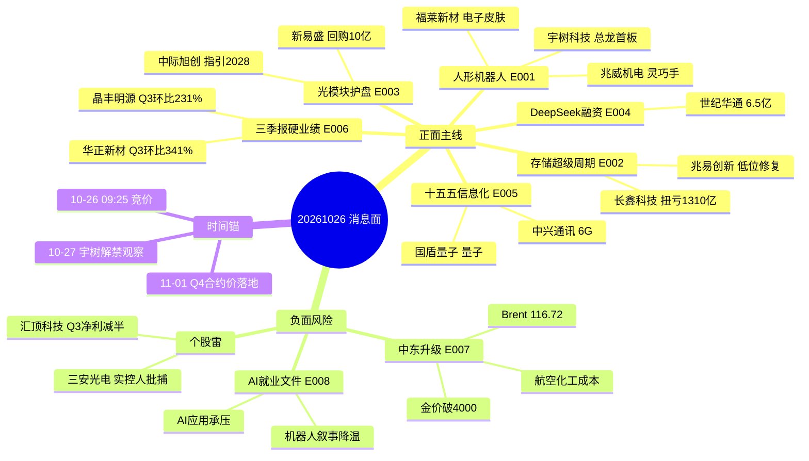

# 2026-10-26 · **消息面事件驱动**

> **数据源新鲜度**: partial · **降级状态**: true · **置信度**: 0.74
> **覆盖窗口**: 2026-10-23 06:03 → 2026-10-24 15:02(33h · 周末无新快讯) · **主源**: 21号公众号池(100篇) + Tushare快讯1500条 + 公告3825条 + 三季报预告500条 + R7资金面
> **口径说明**: 下一交易日为周一 2026-10-26，本报告为周六盘前预生成，个股价格为 10-23 收盘

## 一句话结论

机器人+存储+覆铜板业绩三条正面主线共振，但中东升级推油价、金价反跌破4000的「紧缩交易」是唯一对冲；而 R7 资金面给的是**单日修复/非主升**（全市场5日主力-964.2亿）——**周一研究首选只留「题材+位置+资金」三重一致的兆易创新/华正新材，宇树等机器人总龙只做弱转强低吸、禁追高，光模块四龙头因5日资金净流出全部降级观察**。

## 🗺️ 消息面全景图

## 🎯 顶级事件详解(每事件三问 + 首推票思维链)

### E20261026_001 · 人形机器人量产+标准双催化 · 宇树上市首板 · strength=high · polarity=正面

**加权分**: +0.740(原始 +0.86 × e^-0.15×1) · **事件类型**: technical_break · **有效期**: 1-3周 · **独立源**: 5 · **衰减**: 未衰减
**来源**: 证券时报(10-23 14:48 宇树首板) + 上海证券报(10-23 20:56 龙虎榜/6项国标) + 财联社早知道(10-23 19:11 VIP日报) + 盘前纪要(10-23 06:53) + Tushare快讯(10-24 08:23 机器人出口12.2倍)
**一句话**: 宇树上市首板+6项国标报批+出口增12.2倍 机器人量产叙事全面确认 · **可知日**: 2026-10-23

**推理深度三问**
- **大资金意图**: 机器人是唯一同时具备「总龙上市+量产倒计时+标准落地」三重催化的方向。10-23 27只涨停+机器人ETF溢价>2%，说明不是单一游资，而是产业资金、游资、被动ETF三股合力在抢筹；机构在Q4排名压力下不敢空仓机器人。
- **为什么走强**: 10-22 特斯拉Q3财报确认Optimus V3 2027量产节奏→10-23 宇树(20cm无涨跌幅约束)首板确立「总龙」位置→同日6项国标报批=从主题炒作升级为标准体系落地。出口12.2倍是唯一可验证的硬数据(海关总署口径)。
- **逻辑够不够硬**: 产业趋势硬、位置不硬。裂缝有三: 野村测算工厂任务成功率60% vs 量产要求98%；宇树换手28%且外资对垒机构单向做多(龙虎榜分歧极大)；6连板的大业股份已收上交所监管工作函。结论: 只做总龙与核心零部件，跟风杂毛一律不碰。

**首推票思维链**
#### 宇树科技 688836.SH · role=首推 · rank=总龙
- **买入理由**: 总龙地位+20cm首板+主营51%纯人形机器人(毛利率63%)，是A股唯一「纯度+地位」双高的票；出口12.2倍给基本面背书。买点在分时回踩不破均价线，不追第二波冲高。
- **业务相关性**: 0.95 · hithink主营构成: 人形机器人收入8.68亿占51.1% 毛利率63.2% 四足机器人41.1% 机器人组件6.1%
- **板块联动**: 0.93 · 10-23 人形机器人27只涨停 板块领涨 机器人ETF博时+9.8% 溢价>2%; 宇树收624 换手28.08% 成交47.7亿
- **风险点**: 换手28%筹码高度松动；外资对垒机构单向做多说明分歧极大；若周一低开破昨日均价则首板即成一日游。
- **止损条件**: 566.00 元 · 参考价624×(1-9.3%)=566; 同时跌破5日线536.2为二道确认 (止损距 -9.3% · RR 2.00)
- **目标区间**: 740.00 ~ 780.00 · 研究侧仓位上限 8%(D1门禁后生效 · 非开仓授权)
- **资金(R7 5日)**: +10.41亿 · 正日 3/5 · 10-23单日 +4.89亿 · 判定 观察
- **板型**: 尾盘板(14:15:04首封/零炸板/封单4.04亿) — 14:00-14:30属投机时段, 少打, 次日只认弱转强
- **研究态度**: **观察** — 消息面最硬(总龙首板+6项国标+出口1200%)且5日主力+10.41亿(3/5), 但14:15才首封=尾盘投机板时段、5日已+46% → 只做次日弱转强/回踩均价低吸, 禁追高(不授开仓权限)
- **可验证假设**: 若周一开盘30分钟成交额低于周五同期60%，或分时跌破均价线且不能收回→总龙地位不成立，当日清仓不参与。

#### 兆威机电 003021.SZ · role=核心零部件 · rank=龙二
- **买入理由**: 灵巧手17自由度指关节自研+微型传动62%主营，是机器人零部件里业绩最实的一环；10cm 2连板但绝对值仅91.7元，弹性优于高位票。
- **业务相关性**: 0.88 · hithink主营: 微型传动系统62.0% 精密注塑件33.9%; 灵巧手17自由度指关节自研
- **板块联动**: 0.86 · 10-23 10cm2连板 首次封板09:43:12 但5次开板回封 封单1.26亿; 5日+50.1% 高于MA5(78.14)+17.4%
- **风险点**: 2连板后游资接力成本高；减速器方向若被绿的谐波分流则失去卡位。
- **止损条件**: 84.40 元 · 参考价91.73×(1-8%)=84.4; 破板后不回封即走 (止损距 -8.0% · RR 2.22)
- **目标区间**: 108.00 ~ 114.00 · 研究侧仓位上限 6%(D1门禁后生效 · 非开仓授权)
- **资金(R7 5日)**: +4.67亿 · 正日 5/5 · 10-23单日 +1.47亿 · 判定 观察
- **板型**: 换手回封板(09:43:12首封/5次开板/13:22回封/封单1.26亿) — 分歧巨大, 回封质量一般
- **研究态度**: **观察** — 资金5/5日净流入+4.67亿最稳, 但5次开板=分歧巨大+5日+50%创新高, 只做回踩不追板(不授开仓权限)
- **可验证假设**: 若开盘不能维持在+3%以上并再度封板→接力失败，反手减半。

#### 福莱新材 605488.SH · role=弹性 · rank=龙三
- **买入理由**: 电子皮肤已向灵心巧手交付超3万套，是触觉传感唯一有出货量的标的；5天3板证明资金已认可。
- **业务相关性**: 0.72 · 电子皮肤/触觉传感器已向灵心巧手交付超3万套 数据采集手套
- **板块联动**: 0.79 · 10-23 10cm涨停 13:37首封零炸板 封单0.60亿; 5日+49.0% 高于MA5(32.98)+15.7%
- **风险点**: 5日+49%已严重透支；高位票一旦断板容易连续跌停式回落。
- **止损条件**: 34.50 元 · 参考价38.15×(1-9.6%)=34.5; 高位票容错窄 破5日线32.98为最后防线 (止损距 -9.6% · RR 2.15)
- **目标区间**: 46.00 ~ 49.00 · 研究侧仓位上限 4%(D1门禁后生效 · 非开仓授权)
- **资金(R7 5日)**: +2.65亿 · 正日 4/5 · 10-23单日 +1.08亿 · 判定 观察
- **板型**: 午后板(13:37:27首封/零炸板/封单0.60亿) — 13:00-14:00可接受时段
- **研究态度**: **观察** — 触觉传感唯一有出货量(交付3万套)+资金4/5日+2.65亿, 但5日+49%高位, 仓位≤4%只做回踩(不授开仓权限)
- **可验证假设**: 若开盘30分钟换手超过20%且不封板→兑现离场。
- **负面杀伤面**: scope=板块级 · 受影响 无业绩机器人杂毛、高位连板股
**反面/备注**: 反面: 大业股份6连板已收上交所监管工作函+风险提示; 野村测算工厂任务成功率60% vs 量产要求98%; 宇树换手28% 外资对垒机构单向做多 分歧极大

### E20261026_002 · 存储超级周期再确认 · 黄仁勋否认2029过剩 + Q4合约价再涨 · strength=high · polarity=正面

**加权分**: +0.706(原始 +0.82 × e^-0.15×1) · **事件类型**: macro · **有效期**: 1-2周 · **独立源**: 5 · **衰减**: 未衰减
**来源**: 上海证券报(10-23 13:26 长鑫/黄仁勋) + 上海证券报(10-23 18:23 美光长鑫路线分歧) + Tushare快讯(10-23 19:46 中微公司) + Tushare快讯(10-23 19:53 佰维存储) + Tushare快讯(10-24 10:06 主力资金弃高就低)
**一句话**: 黄仁勋否认2029过剩+Q4合约价再涨15%+长鑫扭亏1310亿 存储周期再确认 · **可知日**: 2026-10-23

**推理深度三问**
- **大资金意图**: 存储是本周唯一「价格+业绩+龙头表态」三重验证的方向。10-24 主力资金明确弃高(光模块)就低(存储/半导体)，长鑫是低位承接第一顺位——距60日高-30.7%、仍在MA20下方，是极少数「周期向上但股价没走完」的错配。
- **为什么走强**: Q4 DRAM/NAND合约价再涨10-15%(硬价格)+长鑫前三季1310-1325亿扭亏(硬业绩)+黄仁勋「对与长鑫合作持开放态度」(估值锚)。三条都不是预期，是已发生的事实。
- **逻辑够不够硬**: 中高。最大裂缝: 美光总裁公开称4F²「无可行微缩路径」、改走6F²+3D DRAM，与长鑫4F²路线正面冲突；韩媒已给2029年转红海预警；长鑫Q3单季环比仅+1.1%~+3.9%，斜率已换挡。所以是「周期还在、斜率放缓」，做龙头不做设备链高标。

**首推票思维链**
#### 长鑫科技 688825.SH · role=首推 · rank=龙头
- **买入理由**: 存储纯正龙头(DDR+LPDDR占98%)，前三季1310-1325亿扭亏，Q4合约价再涨，位置距60日高-30%仍是低位。
- **业务相关性**: 0.96 · hithink主营: DDR 46.2%(毛利率88.4%) LPDDR 52.0%(82.6%) 纯存储
- **板块联动**: 0.9 · 10-23 存储活跃 长鑫+7.93%收42.85 好上好/大港涨停 大普微+9.6%; 低于MA20(49.3)-13.1% 距60日高61.8仍-30.7%
- **风险点**: Q3环比仅+1~4%增速换挡；美光否认4F²路线；MA20(49.3)压制明显。
- **止损条件**: 39.50 元 · 参考价42.85×(1-7.8%)=39.5; 且跌破20日低点38.75为失效 (止损距 -7.8% · RR 2.43)
- **目标区间**: 51.00 ~ 54.00 · 仓位 0%(R7资金否决 · 未授权)
- **资金(R7 5日)**: -18.10亿 · 正日 2/5 · 10-23单日 +16.12亿 · 判定 降级观察
- **研究态度**: **降级观察** — 业绩最硬但资金5日-18.10亿(2/5), 10-23单日+16.12亿属反手而非持续 → 消息面正、资金面未确认, 降级观察(不授开仓权限)
- **可验证假设**: 若能放量站上MA10(43.5)并维持两日→趋势确认；若冲高回落收长上影则只是反抽。
- **业绩交叉(Step2.5)**: 累计 扭亏 前三季1310-1325亿(上年-52.8亿) · Q3单季 534.0亿 vs 上季 528.4亿 · 环比 +1.1%~+3.9% · 周期股=True · 价格上行 · 终判: 周期上行·Q3环比走平 增速换挡

#### 兆易创新 603986.SH · role=弹性 · rank=龙二
- **买入理由**: 存储+MCU双主线，石溪资本参与DeepSeek融资形成产业协同；20日-21%位置低。
- **业务相关性**: 0.83 · 存储+MCU设计公司; 石溪资本参与DeepSeek本轮融资 产业协同
- **板块联动**: 0.78 · 10-23 +5.51% 成交129亿; 5日主力+25.90亿(4/5) 20日-21.1% 低于MA20(329.83)-11.5%
- **风险点**: 成交129亿属高位换手，若周一缩量则承接不足。
- **止损条件**: 272.00 元 · 参考价292×(1-6.8%)=272; 跌破20日低点268.3彻底失效 (止损距 -6.8% · RR 2.15)
- **目标区间**: 335.00 ~ 350.00 · 研究侧仓位上限 5%(D1门禁通过后生效)
- **资金(R7 5日)**: +25.90亿 · 正日 4/5 · 10-23单日 +12.94亿 · 判定 研究首选
- **研究态度**: **研究首选** — 资金5日+25.9亿且4/5日为正(全候选最强持续)+位置低于MA20 11.5%+存储涨价硬逻辑 → 三重一致(不授开仓权限)
- **可验证假设**: 若半导体板块指数不能同步走强→单独走强概率低，降级观察。
- **负面杀伤面**: scope=板块级 · 受影响 4F²先进架构链、存储设备国产替代
**反面/备注**: 反面: 美光总裁称4F²无可行微缩路径 走6F²+3D DRAM 与长鑫路线分歧; 韩媒警告2029转红海; 长鑫距60日高-30.7% 仍在MA20下方

### E20261026_006 · 三季报硬业绩分层 · 覆铜板/模拟/算力加速 有机硅/铜见顶 · strength=high · polarity=正面

**加权分**: +0.671(原始 +0.78 × e^-0.15×1) · **事件类型**: earnings · **有效期**: 1-2周 · **独立源**: 5 · **衰减**: 未衰减
**来源**: 证券时报(10-24 12:13 华正新材三季报) + 证券时报(10-23 21:39 晶丰明源Q3+2077%) + 上海证券报(10-23 22:04/06:51 业绩汇总) + Tushare快讯(10-24 09:12 电子元器件业绩大增) + 公司公告(10-23 三季报)
**一句话**: 华正Q3环比341% 晶丰环比231% 覆铜板模拟加速 洛钼东岳环比转负 · **可知日**: 2026-10-23

**推理深度三问**
- **大资金意图**: 三季报是全市场唯一可验证的alpha。10-24 资金从光模块撤出后必须找有业绩的承接方向，覆铜板/被动元件是「涨价+业绩」双击，且位置普遍在MA20下方，属于低位戴维斯双击。
- **为什么走强**: 华正Q3单季归母6.27亿、环比+341.5%，毛利率从Q2的18.7%跃到36.1%——单季利润是前两季总和的近4倍；晶丰Q3单季1.65亿占前三季66%。涨价传导已经在报表兑现，不是画饼。
- **逻辑够不够硬**: 硬，但必须分层。同一批预告里: 洛钼同比+68.2%却Q3环比-6.3%；东岳同比+19413%却Q3环比-45.2%——典型江波龙式周期见顶。市场只奖励「环比加速」，严惩「同比幻觉」。本事件我已按Step2.5协议剔除后两只。

**首推票思维链**
#### 华正新材 603186.SH · role=首推 · rank=龙头
- **买入理由**: Q3单季6.27亿、环比+341.5%、毛利率18.7%→36.1%，CCL涨价在报表端完全兑现；201.65元刚站上MA5、仍在MA20下方2%，是业绩票里位置最好的。
- **业务相关性**: 0.94 · hithink主营: 覆铜板72.4% 毛利率9.9%(H1口径) 热塑性蜂窝12.9%; Q3单季毛利率跃升至36.06%
- **板块联动**: 0.9 · CCL全链业绩爆发: 生益预告+164~181% 金安国纪+6900% 商络+462% 本川Q3+438%
- **风险点**: CCL价格若Q4回落则Q4环比难续；股价距60日高-23.6%，趋势未修复。
- **止损条件**: 185.00 元 · 参考价201.65×(1-8.3%)=185; 5日线194.7下方2%为第一道 (止损距 -8.3% · RR 2.30)
- **目标区间**: 240.00 ~ 250.00 · 研究侧仓位上限 6%(D1门禁通过后生效)
- **资金(R7 5日)**: +4.77亿 · 正日 2/5 · 10-23单日 -0.35亿 · 判定 研究首选
- **研究态度**: **研究首选** — Q3单季环比+341.5%全候选最硬业绩+位置刚站上MA5仍在MA20下方+资金温和净流入 → 三重一致; 注: CCL总龙头为生益科技, 华正为龙二弹性(不授开仓权限)
- **可验证假设**: 若Q4 CCL报价环比不涨(跟踪生益/建滔提价函)→涨价逻辑证伪，止盈离场。
- **业绩交叉(Step2.5)**: 累计 +1177.71% · Q3单季 6.27亿 vs 上季 1.42亿 · 环比 +341.5% · 周期股=True · 价格上行 · 终判: 周期上行·Q3加速兑现

#### 晶丰明源 688368.SH · role=弹性 · rank=龙二
- **买入理由**: Q3单季1.65亿(+2077.5%)占前三季66%，环比+230.9%，20cm涨停且距60日高-33%，是低位业绩反转的标准形态。
- **业务相关性**: 0.82 · LED照明驱动+AC/DC电源芯片; Q3单季归母1.65亿(占9M的66%) 环比+230.9%
- **板块联动**: 0.75 · 10-23 20cm涨停(13:46首封/3次开板) 收105.96; 20日-24.6% 距60日高-33.0% 5日主力仅+1.18亿
- **风险点**: 20cm票次日波动极大；模拟芯片价格战可能反复。
- **止损条件**: 96.50 元 · 参考价105.96×(1-8.9%)=96.5; 20cm票次日缺口回补即走 (止损距 -8.9% · RR 2.54)
- **目标区间**: 130.00 ~ 136.00 · 研究侧仓位上限 5%(D1门禁后生效 · 非开仓授权)
- **资金(R7 5日)**: +1.18亿 · 正日 2/5 · 10-23单日 +1.22亿 · 判定 观察
- **板型**: 午后板(13:46:14首封/3次开板/14:07回封/封单0.31亿) — 20cm反复开板, 弱
- **研究态度**: **观察** — 业绩反转硬但资金几乎全靠10-23单日(1.22亿), 20cm票次日波动大 → 观察(不授开仓权限)
- **可验证假设**: 若次日不能维持在+5%以上→首板失败，减半。
- **业绩交叉(Step2.5)**: 累计 Q3单季同比+2077.5% · Q3单季 1.65亿 vs 上季 0.5亿 · 环比 +230.9% · 周期股=True · 价格上行 · 终判: 周期反转·单季净利率跳升

#### 寒武纪 688256.SH · role=算力 · rank=龙三
- **买入理由**: Q3营收35.31亿环比+13.5%、归母14.04亿环比+8.2%，仍双增；距60日高-26.3%，位置中性偏低；但5日主力仅+8.48亿且2/5日为正，资金不连续 → 只作观察。
- **业务相关性**: 0.9 · AI训练/推理芯片 纯算力标的; Q3营收35.31亿 环比+13.5% 归母14.04亿 环比+8.2%
- **板块联动**: 0.74 · 10-23 +5.46% 20日-15.7% 低于MA20(992.75)-6.1% 距60日高-26.3%; 5日主力+8.48亿(2/5)
- **风险点**: 增速边际放缓(Q2环比更高)；估值高，一旦风险偏好回落跌幅大。
- **止损条件**: 865.00 元 · 参考价932.2×(1-7.2%)=865; 20日低点833.9为失效位 (止损距 -7.2% · RR 2.20)
- **目标区间**: 1080.00 ~ 1120.00 · 仓位 0%(R7资金否决 · 未授权)
- **资金(R7 5日)**: +8.48亿 · 正日 2/5 · 10-23单日 +7.12亿 · 判定 降级观察
- **研究态度**: **降级观察** — Q3环比仅+8.2%增速换挡+资金2/5不连续+位置中性 → 降级观察(不授开仓权限)
- **可验证假设**: 若跌破MA20(992)且三日内不能收回→降级观察。
- **业绩交叉(Step2.5)**: 累计 同比扭亏 前三季37.15亿 · Q3单季 14.04亿 vs 上季 12.98亿 · 环比 +8.2% · 周期股=False · 价格未查 · 终判: 高增长但增速边际放缓
- **负面杀伤面**: scope=板块级 · 受影响 有机硅、铜/钨资源股
**反面/备注**: 反面(Step2.5 业绩极性协议): 洛阳钼业同比+68.2%但Q3单季78.67亿 环比-6.3% 营收环比仅+4.4% 周期高位观察; 东岳硅材同比+19413%但Q3单季1.29亿 环比-45.2% 营收环比-7.3% 典型利好出尽 两者均剔除首推

### E20261026_007 · 中东冲突升级 · Brent 116.72创五月新高 金价跌破4000 · strength=high · polarity=负面

**加权分**: -0.637(原始 -0.74 × e^-0.15×1) · **事件类型**: macro · **有效期**: 1-2周 · 事件驱动 · **独立源**: 5 · **衰减**: 未衰减
**来源**: 上海证券报(10-24 08:38 油价周涨4.15%) + Tushare快讯(10-24 03:29 霍尔木兹8+2) + Tushare快讯(10-24 05:45 八国联合声明) + Tushare快讯(10-24 09:08 金价跌2.6%) + 证券时报(10-24 07:36 油价冲高)
**一句话**: 霍尔木兹8+2 八国联合声明 Brent116.72创5月新高 金价跌破4000 · **可知日**: 2026-10-24

**推理深度三问**
- **大资金意图**: 周末中东升级是唯一「周一必反应」的硬变量: Brent 116.72创5个月新高、单日+3.14%、周涨4.15%。但同日金价跌2.6%破4000、白银跌4%——资金在做「紧缩交易」而非「避险交易」，这是本条最容易被误读的地方: 利多油气、利空黄金与成长股估值。
- **为什么走强**: 霍尔木兹「8+2」军方表述+沙特等八国联合声明+美方「更猛烈打击」三线叠加。而A股10-23油气股几乎没动(中国海油-0.24%)，周一存在跳空缺口。
- **逻辑够不够硬**: 中。事件驱动不是趋势，一周内可逆(八国调停/美伊接触即回吐)。所以只做龙头+硬止损，绝不碰油服小票；同时这条是E002/E003/E006三条成长主线的共同压制项(全球加息预期)。

**首推票思维链**
#### 中国海油 600938.SH · role=首推 · rank=龙头
- **买入理由**: 油价116.72创5月新高而股价10-23还跌0.24%，存在明确跳空缺口；桶油成本全球前列，油价每涨10美元利润弹性最大。
- **业务相关性**: 0.93 · hithink主营: 油气销售80.0%(毛利率41.5%) 勘探开发19.9%; 桶油成本全球前列
- **板块联动**: 0.86 · 10-23 仅-0.24% 未反应油价 20日+3.5% 低于MA5(34.7); Brent单日+3.14% 周末冲突再升级; 5日主力-0.46亿
- **风险点**: 事件驱动可逆: 八国调停或美伊接触→一周内回吐全部溢价。
- **止损条件**: 31.80 元 · 参考价33.72×(1-5.7%)=31.8; 20日低点31.84为失效位 (止损距 -5.7% · RR 2.13)
- **目标区间**: 37.80 ~ 39.50 · 研究侧仓位上限 6%(D1门禁后生效 · 非开仓授权)
- **资金(R7 5日)**: -0.46亿 · 正日 1/5 · 10-23单日 -0.62亿 · 判定 观察
- **研究态度**: **观察** — 事件弹性(油价116.72)+跳空缺口, 但主力5日净流出、事件可逆 → 只做事件驱动小仓, 不追高开>6%(不授开仓权限)
- **可验证假设**: 若周一高开超过+6%→不追(缺口过大)，等回踩33.5-34再接；若Brent回落至110下方→逻辑失效。

#### 中远海能 600026.SH · role=弹性 · rank=龙二
- **买入理由**: 霍尔木兹受阻→绕行好望角，VLCC运距拉长直接抬运价；但5日-8.4%、20日-16.8% 尚未启动（运价逻辑在、股价未动）。
- **业务相关性**: 0.88 · VLCC油运 霍尔木兹受阻→绕行好望角+运距拉长 直接抬升运价
- **板块联动**: 0.8 · 10-23 +1.88% 但5日-8.4% 20日-16.8% 低于MA20(21.06)-12.7% 尚未启动; 5日主力-1.45亿
- **风险点**: 运价数据滞后；若冲突缓和运价快速回落。
- **止损条件**: 17.30 元 · 参考价18.39×(1-5.9%)=17.3; 20日低点17.74下方2% (止损距 -5.9% · RR 2.85)
- **目标区间**: 21.50 ~ 22.50 · 研究侧仓位上限 5%(D1门禁后生效 · 非开仓授权)
- **资金(R7 5日)**: -1.45亿 · 正日 2/5 · 10-23单日 +0.15亿 · 判定 观察
- **研究态度**: **观察** — 运距逻辑在但股价未启动(5日-8.4%)且资金净流出 → 观察, 等运价数据确认(不授开仓权限)
- **可验证假设**: 若VLCC-TCE日租金不能连续两日上行→退出。
- **负面杀伤面**: scope=行业级 · 受影响 黄金、白银、航空、化工下游、出口链、全球成长股
**反面/备注**: 交叉验证: 金价单日-2.6%破4000 + 白银-4% 说明本轮不是避险交易而是货币紧缩预期(韩国李在明呼吁加息 花旗预计美联储明年加息75bp); 若八国调停成功或美伊接触 油气溢价一周内回吐 必须设硬止损

### E20261026_003 · 光模块龙头集体护盘 · 新易盛8-10亿回购 中际旭创指引至2028 · strength=high · polarity=正面

**加权分**: +0.551(原始 +0.64 × e^-0.15×1) · **事件类型**: insider · **有效期**: 1-2周 · **独立源**: 3 · **衰减**: 未衰减
**来源**: 上海证券报(10-23 13:19 四家集体公告) + 证券时报(10-24 08:33 天孚1-1.5亿回购注销) + Tushare快讯(10-24 10:06 弃高就低)
**一句话**: 中际旭创指引至2028 新易盛回购8-10亿 天孚注销式回购 四龙头集体护盘 · **可知日**: 2026-10-23

**推理深度三问**
- **大资金意图**: 四家龙头同日公告经营情况+回购，是产业资本集体护盘: 说明管理层认为股价已低于内在价值。但本周主力资金仍在弃高就低——护盘≠反转，这是「公司底」不是「市场底」。
- **为什么走强**: 中际旭创指引做到2028年、新易盛8-10亿回购(上限500元 vs 现价261)、天孚1-1.5亿注销式回购。注销式回购是含金量最高的一种，直接减少总股本。
- **逻辑够不够硬**: 中等偏弱。位置是主跌后反抽: 中际低于MA20 19.6%、新易盛低于MA20 27.9%、20日分别-31.6%/-38.5%。必须站上MA5(632/284)才算右侧确认，否则周一高开就是反弹结束。只给小仓。

**首推票思维链**
#### 中际旭创 300308.SZ · role=首推 · rank=龙头
- **买入理由**: 光模块绝对龙头(模块收入99%)，指引做到2028年，10-23主力净流入超21亿居板块第一。
- **业务相关性**: 0.97 · hithink主营: 光通信收发模块99.0% 毛利率46.6%
- **板块联动**: 0.88 · 10-23 成交279亿 单日主力+16.43亿(证券时报口径称超21亿); 但5日仍-14.70亿(2/5)
- **风险点**: 20日-31.6%、仍在MA20下方19.6%，属主跌反抽；本周主力资金整体弃高就低。
- **止损条件**: 570.00 元 · 参考价612.63×(1-7%)=570; 20日低点553.48为绝对底线 (止损距 -7.0% · RR 2.05)
- **目标区间**: 700.00 ~ 730.00 · 仓位 0%(R7资金否决 · 未授权)
- **资金(R7 5日)**: -14.70亿 · 正日 2/5 · 10-23单日 +16.43亿 · 判定 降级观察
- **研究态度**: **降级观察** — 公司护盘(指引2028)是公司底不是市场底: 资金5日-14.7亿否决+MA20下方19.6%属主跌反抽 → 降级观察, 站上MA5再谈(不授开仓权限)
- **可验证假设**: 若周一不能站上MA5(632)→反抽失败，只做观察不建仓。

#### 新易盛 300502.SZ · role=回购主体 · rank=龙二
- **买入理由**: 8-10亿回购、价格上限500元(现价261)，1.6T持续放量，是护盘力度最大的标的。
- **业务相关性**: 0.95 · 800G/1.6T光模块主力交付 1.6T进入持续放量; 回购8-10亿 价格上限500
- **板块联动**: 0.82 · 10-23 +1.16% 20日-38.5% 超跌; 回购价上限500远高于现价261; 5日主力-34.77亿(1/5)
- **风险点**: 20日-38.5%跌幅最深，说明前期筹码最松动；回购实施节奏不确定。
- **止损条件**: 240.00 元 · 参考价261×(1-8%)=240; 20日低点236.1为失效位 (止损距 -8.0% · RR 2.10)
- **目标区间**: 305.00 ~ 320.00 · 仓位 0%(R7资金否决 · 未授权)
- **资金(R7 5日)**: -34.77亿 · 正日 1/5 · 10-23单日 -0.73亿 · 判定 降级观察
- **研究态度**: **降级观察** — 8-10亿回购是唯一亮点, 但5日主力净流出34.8亿=资金在借回购出货 → 降级观察(不授开仓权限)
- **可验证假设**: 若回购公告后3日累计仍跑输板块→市场不认，退出。
- **负面杀伤面**: scope=板块级 · 受影响 光模块高位补涨股
**反面/备注**: 反面: 本周主力资金弃高就低 光通信遭获利了结; 中际旭创20日-31.6% 新易盛-38.5% 均在MA20下方 属主跌后反抽而非右侧突破 需站上MA5(632/284)确认

### E20261026_004 · DeepSeek首轮外部融资1000亿 · 估值7000亿 产业资本集群入股 · strength=high · polarity=正面

**加权分**: +0.499(原始 +0.58 × e^-0.15×1) · **事件类型**: insider · **有效期**: 1-2周 · **独立源**: 3 · **衰减**: 未衰减
**来源**: 证券时报(10-23 21:09 融资细节) + 完美世界公告(10-23 基金募集完毕 出资2.5亿) + Tushare快讯(10-23 19:20 阿里/腾讯/七家国资)
**一句话**: DeepSeek首轮融资1000亿估值7000亿 阿里腾讯七家国资入股 世纪华通6.5亿 · **可知日**: 2026-10-23

**推理深度三问**
- **大资金意图**: DeepSeek 1000亿首轮外部融资是AI叙事的新锚。A股映射不靠「合作」靠「出资」: 产业资本名单(阿里/腾讯/七家国资/联想君联/吉利/中芯聚源/横店)本身就是最强背书，二级市场会按「谁是股东」重定价。
- **为什么走强**: 投前7000亿估值、半年翻倍，一级定价必然向二级算力/AI应用传导；且这是DeepSeek首次接受外部融资，象征「国家队+产业资本」共同背书。
- **逻辑够不够硬**: 弱-中。一级融资到A股业绩链条太长，出资方是财务投资、无排他性；世纪华通6.5亿是A股最大单笔，但占其市值比例有限。只能小仓试错，不能当主线。

**首推票思维链**
#### 世纪华通 002602.SZ · role=首推 · rank=龙二
- **买入理由**: 6.5亿认购DeepSeek基金，是A股公开披露最大单笔；自身算力+游戏双主业，5日-6.4%、20日-21.1% 属低位。
- **业务相关性**: 0.61 · 以6.5亿认购DeepSeek基金份额 为A股公开披露最大单笔; 自身算力+游戏双主业
- **板块联动**: 0.68 · 10-23 DeepSeek概念众诚科技30cm/利亚德20cm; 5日-6.4% 20日-21.1%; 5日主力-5.17亿(0/5)
- **风险点**: 基金份额不带来业绩并表；游戏主业与AI关联度被高估。
- **止损条件**: 10.75 元 · 参考价11.48×(1-6.4%)=10.75; 同时为20日低点10.77附近 (止损距 -6.4% · RR 2.08)
- **目标区间**: 13.00 ~ 13.60 · 仓位 0%(R7资金否决 · 未授权)
- **资金(R7 5日)**: -5.17亿 · 正日 0/5 · 10-23单日 -0.43亿 · 判定 降级观察
- **研究态度**: **降级观察** — DeepSeek出资6.5亿是一级映射, 但资金0/5日净流入=市场不认 → 降级观察(不授开仓权限)
- **可验证假设**: 若DeepSeek概念指数周一不能涨超2%→映射失败，止损离场。

#### 利通电子 603629.SH · role=算力租赁 · rank=龙三
- **买入理由**: 9500万认购基金+算力租赁转型，5日-0.3%/20日-26.9% 位置低；但主力+4.66亿集中在10-21单日(+8.37亿)，持续性待验。
- **业务相关性**: 0.55 · 9500万认购基金; 主营液晶电视精密金属结构件+算力租赁转型
- **板块联动**: 0.62 · 10-23 -1.97% 5日-0.3% 20日-26.9% 低于MA20(95.23); 5日主力+4.66亿但集中在10-21(+8.37亿)
- **风险点**: 主营仍是金属结构件，AI含量低，属二线映射。
- **止损条件**: 77.40 元 · 参考价83.24×(1-7%)=77.4; 20日低点77.52为失效位 (止损距 -7.0% · RR 2.18)
- **目标区间**: 96.00 ~ 100.00 · 研究侧仓位上限 3%(D1门禁后生效 · 非开仓授权)
- **资金(R7 5日)**: +4.66亿 · 正日 3/5 · 10-23单日 +0.07亿 · 判定 观察
- **研究态度**: **观察** — 出资9500万+算力租赁转型, 资金单日堆积不连续, 主营金属结构件 → 观察(不授开仓权限)
- **可验证假设**: 若开盘涨幅低于概念指数→资金不认，不参与。
- **负面杀伤面**: scope=个股级 · 受影响 无
**反面/备注**: 反面: 融资为一级市场事件 A股映射靠基金份额 业绩传导链长; 出资方多为财务投资 无排他性; 估值7000亿已隐含高预期

### E20261026_005 · 国家信息化十五五规划印发 · 6G/量子/脑机/具身智能列为前沿 · strength=high · polarity=正面

**加权分**: +0.473(原始 +0.55 × e^-0.15×1) · **事件类型**: policy · **有效期**: 2-4周 · **独立源**: 3 · **衰减**: 未衰减
**来源**: 证券时报(10-23 19:44 规划全文) + 央视新闻(10-23 18:10 全文播发) + Tushare快讯(10-23 18:10)
**一句话**: 十五五信息化规划印发 6G量子脑机具身智能列入前沿 2030年目标 · **可知日**: 2026-10-23

**推理深度三问**
- **大资金意图**: 十五五信息化规划是政策底，但原文「适时启动6G商用」明确说明6G尚未到商用期——资金只会做一日脉冲，不会做趋势。
- **为什么走强**: 6G、量子科技、脑机接口、具身智能四个前沿被点名，量子首次与6G并列；这是「十五五」级别的顶层文件，给主题资金提供了政策合法性的旗帜。
- **逻辑够不够硬**: 弱。2030年目标无当期业绩，历史上6G行情均为2-3日脉冲。要做就做中兴(低估值+20日仅+4%的位置)，不做纯概念小票；国盾只给3%仓位。

**首推票思维链**
#### 中兴通讯 000063.SZ · role=首推 · rank=龙头
- **买入理由**: 6G主设备龙头，规划点名前瞻布局6G；20日-11.6% 仍在MA20下方、10-23 +3.23% 温和跟涨，位置与预期双低。
- **业务相关性**: 0.84 · 6G主设备+光网络 规划明确前瞻布局6G并适时启动商用
- **板块联动**: 0.72 · 10-23 +3.23% 站上MA5(27.58); 20日-11.6% 仍低于MA20(29.45) 位置低; 5日主力-1.01亿
- **风险点**: 6G是2030目标，无当期业绩；主题脉冲通常2-3日结束。
- **止损条件**: 26.50 元 · 参考价28.16×(1-5.9%)=26.5; 20日低点26.6为失效位 (止损距 -5.9% · RR 2.01)
- **目标区间**: 31.50 ~ 33.00 · 研究侧仓位上限 4%(D1门禁后生效 · 非开仓授权)
- **资金(R7 5日)**: -1.01亿 · 正日 3/5 · 10-23单日 +0.52亿 · 判定 观察
- **研究态度**: **观察** — 6G是2030目标无当期业绩+资金净流出, 主题脉冲2-3日 → 观察, 不做趋势(不授开仓权限)
- **可验证假设**: 若两日内不能放量突破29.5→主题失效，退出。

#### 国盾量子 688027.SH · role=弹性 · rank=龙二
- **买入理由**: 量子通信/计算整机唯一标的，规划把量子与6G并列，距60日高-28.1% 未高潮。
- **业务相关性**: 0.9 · 量子通信/量子计算整机 规划列量子科技为前沿攻关方向
- **板块联动**: 0.7 · 10-23 -0.49% 20日-12.3% 距60日高-28.1%; 5日主力+0.17亿基本持平
- **风险点**: 估值极高、无盈利支撑；量子主题历史上常一日游。
- **止损条件**: 288.00 元 · 参考价306.5×(1-6%)=288; 20日低点277.1为绝对底线 (止损距 -6.0% · RR 2.08)
- **目标区间**: 345.00 ~ 360.00 · 研究侧仓位上限 3%(D1门禁后生效 · 非开仓授权)
- **资金(R7 5日)**: +0.17亿 · 正日 2/5 · 10-23单日 -0.39亿 · 判定 观察
- **研究态度**: **观察** — 量子首次与6G并列但无业绩无资金, 历史常一日游 → 观察(仓位≤3%)(不授开仓权限)
- **可验证假设**: 若开盘冲高回落跌破300→脉冲结束。
- **负面杀伤面**: scope=板块级 · 受影响 纯概念6G小票
**反面/备注**: 反面: 规划为2030年目标 无当期业绩; 原文措辞适时启动6G商用=尚未到商用 主题易一日游; 6G历年为脉冲行情

### E20261026_008 · 国办发文减缓AI就业替代 · 就业友好型发展 · strength=medium · polarity=负面

**加权分**: -0.361(原始 -0.42 × e^-0.15×1) · **事件类型**: policy · **有效期**: 2-4周 · **独立源**: 2 · **衰减**: 未衰减
**来源**: 证券时报(10-23 18:38 国办文件) + 央视新闻(10-23 18:38 全文)
**一句话**: 国办发文减缓AI就业替代 建就业友好型 压制AI应用叙事 利好人力资源 · **可知日**: 2026-10-23

**推理深度三问**
- **大资金意图**: 国办文件是给AI狂飙踩刹车的政策信号，方向是「就业友好型发展」——官方口径首次明确要减缓AI对就业的替代影响，直接压制AI替代叙事。
- **为什么走强**: 对AI客服/自动化设备/黑灯工厂是叙事级利空；对人力资源服务(科锐国际)与职业教育是政策受益。这是唯一与E001正面对撞的事件。
- **逻辑够不够硬**: 中。属情绪压制而非业绩压制，不改变产业趋势，但足以让机器人从「加速」退回「分歧」。因此把机器人总仓位上限从10%压到8%，而不是翻空。

**首推票思维链**
#### 科锐国际 300662.SZ · role=政策受益 · rank=龙头
- **买入理由**: 国办就业文件唯一直接受益的人力资源龙头；20日-11.1% 位置极低、10-23 +4.37% 但主力5日净流入仅0.05亿。
- **业务相关性**: 0.86 · 人力资源服务龙头 灵活用工+猎头 政策要求稳岗扩容直接受益
- **板块联动**: 0.62 · 10-23 +4.37% 20日-11.1% 低于MA20(20.68) 位置低; 5日主力+0.05亿=无资金
- **风险点**: 政策文件到业绩的传导极慢；该股无资金关注，可能长期不涨。
- **止损条件**: 17.30 元 · 参考价18.88×(1-8.4%)=17.3; 20日低点17.41为失效位 (止损距 -8.4% · RR 2.29)
- **目标区间**: 22.50 ~ 23.50 · 研究侧仓位上限 3%(D1门禁后生效 · 非开仓授权)
- **资金(R7 5日)**: +0.05亿 · 正日 2/5 · 10-23单日 -0.01亿 · 判定 观察
- **研究态度**: **观察** — 国办就业文件政策受益但传导极慢且无资金 → 政策观察, 不占仓位(不授开仓权限)
- **可验证假设**: 若3日内无放量→政策映射失败，仅留观察仓。
- **负面杀伤面**: scope=板块级 · 受影响 AI应用、AI客服、自动化设备、机器人替代叙事
**反面/备注**: 这是唯一与E001正面对撞的政策事件: 机器人拿+0.86 本文件拿-0.42 净+0.44 仍偏多但把机器人仓位上限从10%压到8%; 文件对A股AI应用多为情绪压制而非业绩压制 不改变产业趋势

## 📊 板块 × 事件热力矩阵

> 末列 `R7板块当日主力净额` 取自 R7_capital_flow.json(tushare moneyflow_ind_dc 20261023 单日值); 板块口径不完全等同于概念, 仅作方向参考。

| 板块 | 事件锚 | 正负事件 | 净极性 | 强度 | R7板块当日主力净额 | 位置判读(10-23收盘) |
|------|--------|----------|--------|:--:|:--:|------|
| 人形机器人 | E001 / E008 | 2正 1负 | 🟢 正面 | 🟢🟢🟢 | +71.43亿 | 宇树624高于MA5(536.2)+16.4% 5日+46% 但距上市首日高1100仍-43% (14:15尾盘板); 板块27只涨停为高潮特征 只做龙头不做杂毛 |
| 灵巧手/触觉传感 | E001 | 1正 0负 | 🟢 正面 | 🟢🟢🟢 | +59.91亿 | 福莱5天3板 5日+49% 高位 只做小仓 |
| 存储/HBM | E002 | 1正 1负 | 🟢 正面 | 🟢🟢🟢 | +68.69亿 | 长鑫42.85低于MA20(49.3)-13% 低位修复; 兆易低于MA20(329.8)-11.5% 同 |
| 光模块/CPO | E003 | 1正 1负 | 🟡 分歧 | 🟢🟢 | +2.70亿 | 中际612.6低于MA5(631.6)且低于MA20(762.3)-19.6% 属主跌反抽 未右侧 需站上632 |
| 覆铜板/CCL | E006 / E003 | 2正 0负 | 🟢 正面 | 🟢🟢🟢 | n/a(无对口板块) | 华正201.65低于MA20(206)-2% 刚突破MA5 位置最优 |
| 半导体设备/材料 | E002 / E006 / E005 | 3正 1负 | 🟢 正面 | 🟢🟢🟢 | +68.69亿 | 中微/立昂微 20日-12%~-19% 低位 |
| AI算力芯片 | E006 / E002 | 2正 0负 | 🟢 正面 | 🟢🟢🟢 | +68.69亿 | 寒武纪932.2低于MA20(992.8)-6.1% 距60日高-26.3% |
| DeepSeek概念/算力租赁 | E004 | 1正 0负 | 🟢 正面 | 🟢🟢🟢 | +22.64亿 | 世纪华通11.48低于MA5(11.72) 20日-21.1% 低位 |
| 6G/量子/脑机 | E005 | 1正 1负 | 🟡 分歧 | 🟢🟢 | +2.54亿 | 中兴20日-11.6% 低位; 国盾距高-28.1% 未高潮 |
| 油气开采/油服 | E007 | 1正 0负 | 🟢 正面 | 🟢🟢🟢 | -0.53亿 | 中国海油33.72低于MA5(34.7) 20日+3.5% 未反应 有跳空空间 |
| 油运 | E007 | 1正 0负 | 🟢 正面 | 🟢🟢🟢 | -0.25亿 | 中远海能18.39 5日-8.4% 20日-16.8% 未启动 |
| 军工 | E007 | 1正 0负 | 🟢 正面 | 🟢🟢🟢 | n/a | 事件驱动 无龙头锚定 只做观察 |
| 黄金/白银 | E007 | 0正 1负 | 🔴 负面 | 🟢🟢🟢 | -3.37亿 | 前期涨幅大 金银股周一补跌风险 禁止低吸 |
| 航空/化工下游 | E007 | 0正 1负 | 🔴 负面 | 🟢🟢🟢 | +0.11亿 | 成本端刚性 回避 |
| AI应用/AI客服 | E008 | 0正 1负 | 🔴 负面 | 🟢🟢🟢 | +22.64亿 | 政策压制情绪 但无业绩杀伤 只影响一日溢价 |
| 人力资源服务 | E008 | 1正 0负 | 🟢 正面 | 🟢🟢🟢 | n/a | 科锐20日-11.1% 低位 无资金 只做小仓观察 |
| 化合物半导体/MiniLED | NEG_三安 | 0正 1负 | 🔴 负面 | 🟢🟢🟢 | +68.69亿 | 三安治理风险 板块回避至事件明朗 |

**叉乘要点**
1. **人形机器人 = E001(+) × E008(−)** → 净 +0.48 仍偏多，但政策文件把「AI替代」叙事打上问号，仓位上限从10%压到8%，且只做总龙(宇树)与核心件(兆威)，杂毛全剔。
2. **光模块 = 公司底(+) × 资金面(−)** → 净 +0.11 属最弱正，位置在主跌反抽，必须站上MA5才承认右侧。
3. **油气(+) × 黄金(−)** 同源于E007，说明本轮是**紧缩交易而非避险交易**——这条决定周一不能凭「避险」去买黄金股。
4. **存储(+) × 覆铜板(+)** 是唯一「价格+业绩」双验证组合，也是主力10-24弃高就低后的承接方向(兆易5日+25.9亿/华正+4.8亿)。
5. **消息强度 ≠ 资金资格**: 光模块消息面是四家龙头集体护盘(强)，但5日资金净流出(中际-14.7亿/新易盛-34.8亿)把它压成最弱正——板块内“公司底”与“资金底”分离时，按资金底做决策。

## 💰 资金面交叉验证 (R7 · 5日主力净额 20261019-20261023)

> R7 判定: **修复（单日）/ 非主升确认** — 20261023 涨停82家、跌停6家、炸板12家，炸板率12.77%（<35% 强区间）；上证+0.89% / 深证+2.79%；但全市场主力单日仅+2.80亿，5日累计-964.20亿（4/5日流出）、20日-4982.78亿。指数与个股同涨而主力未转正 → 判为单日修复，不给主升定性。
> 推论: 消息面强事件 ≠ 可开仓。**5日主力净流出的票一律降级观察**, 研究首选只留「逻辑+位置+资金」三重一致。

| 名称 | 代码 | R4态度 | 5日主力净额 | 正日 | 10-23收盘 | 区间涨幅 | MA20位置 |
|------|------|--------|------------|:--:|:--:|----------|----------|
| 兆易创新 | 603986.SH | 研究首选 | +25.90亿 | 4/5 | 292.0 | 5日+3.6% / 20日-21.1% | MA20 329.83 (-11.5%) |
| 宇树科技 | 688836.SH | 观察 | +10.41亿 | 3/5 | 624.0 | 5日+46.1% / 20日+24.0% | MA20 474.49 (+31.5%) |
| 寒武纪 | 688256.SH | 降级观察 | +8.48亿 | 2/5 | 932.2 | 5日+1.9% / 20日-15.7% | MA20 992.75 (-6.1%) |
| 华正新材 | 603186.SH | 研究首选 | +4.77亿 | 2/5 | 201.65 | 5日+6.1% / 20日-12.3% | MA20 206.06 (-2.1%) |
| 兆威机电 | 003021.SZ | 观察 | +4.67亿 | 5/5 | 91.73 | 5日+50.1% / 20日+34.0% | MA20 70.03 (+31.0%) |
| 利通电子 | 603629.SH | 观察 | +4.66亿 | 3/5 | 83.24 | 5日-0.3% / 20日-26.9% | MA20 95.23 (-12.6%) |
| 福莱新材 | 605488.SH | 观察 | +2.65亿 | 4/5 | 38.15 | 5日+49.0% / 20日+26.6% | MA20 29.78 (+28.1%) |
| 晶丰明源 | 688368.SH | 观察 | +1.18亿 | 2/5 | 105.96 | 5日+17.1% / 20日-24.6% | MA20 113.66 (-6.8%) |
| 国盾量子 | 688027.SH | 观察 | +0.17亿 | 2/5 | 306.5 | 5日+8.2% / 20日-12.3% | MA20 322.56 (-5.0%) |
| 科锐国际 | 300662.SZ | 观察 | +0.05亿 | 2/5 | 18.88 | 5日-8.4% / 20日-11.1% | MA20 20.68 (-8.7%) |
| 中国海油 | 600938.SH | 观察 | -0.46亿 | 1/5 | 33.72 | 5日-2.9% / 20日+3.5% | MA20 33.97 (-0.7%) |
| 中兴通讯 | 000063.SZ | 观察 | -1.01亿 | 3/5 | 28.16 | 5日+3.9% / 20日-11.6% | MA20 29.45 (-4.4%) |
| 中远海能 | 600026.SH | 观察 | -1.45亿 | 2/5 | 18.39 | 5日-8.4% / 20日-16.8% | MA20 21.06 (-12.7%) |
| 世纪华通 | 002602.SZ | 降级观察 | -5.17亿 | 0/5 | 11.48 | 5日-6.4% / 20日-21.1% | MA20 13.19 (-13.0%) |
| 中际旭创 | 300308.SZ | 降级观察 | -14.70亿 | 2/5 | 612.63 | 5日-8.6% / 20日-31.6% | MA20 762.28 (-19.6%) |
| 长鑫科技 | 688825.SH | 降级观察 | -18.10亿 | 2/5 | 42.85 | 5日-4.8% / 20日-19.9% | MA20 49.3 (-13.1%) |
| 新易盛 | 300502.SZ | 降级观察 | -34.77亿 | 1/5 | 261.0 | 5日-15.0% / 20日-38.5% | MA20 361.76 (-27.9%) |

**R7 否决清单(D1 必须看到)**
1. **中际旭创 -14.70亿** — 公司回购/指引是「公司底」, 5日资金仍弃高就低; 站上MA5(631.6)前只观察。
2. **新易盛 -34.77亿** — 8-10亿回购没挡住34.8亿主力流出, 回购可能成为出货对手盘, 最危险的一只。
3. **长鑫科技 -18.10亿** — 10-23单日+16.12亿是反手, 5日仍净流出, 业绩硬但资金未确认。
4. **世纪华通 -5.17亿(0/5日)** — DeepSeek出资映射完全没有资金响应。

**三重一致(研究首选)**: 兆易创新(+25.90亿/4-5日 · MA20下方11.5%) · 华正新材(+4.77亿/2-5日 · MA20下方2.1% · Q3环比+341.5%)。

## 🔥 中报/三季报业绩预告命中(硬 alpha 交叉验证)

> 口径: `eastmoney_earnings_predict` report_date=2026-09-30 共500条；下表为按 **Step2.5 业绩极性协议** 拆出Q3单季环比的8只(累计同比只作背景)

| 代码 | 名称 | 累计同比 | Q3单季(亿) | Q2单季(亿) | 单季环比 | 周期股 | 产品价格 | 终判 |
|------|------|----------|-----------|-----------|----------|:--:|------|------|
| 603186.SH | 华正新材 | +1177.71% | 6.27亿 | 1.42亿 | +341.5% | 是 | 上行 | 🟢🟢🟢 周期上行·Q3加速兑现 |
| 688368.SH | 晶丰明源 | Q3单季同比+2077.5% | 1.65亿 | 0.5亿 | +230.9% | 是 | 上行 | 🟡 周期反转·单季净利率跳升 |
| 688256.SH | 寒武纪 | 同比扭亏 前三季37.15亿 | 14.04亿 | 12.98亿 | +8.2% | 否 | 未查 | 🟡 高增长但增速边际放缓 |
| 688825.SH | 长鑫科技 | 扭亏 前三季1310-1325亿(上年-52.8亿) | 534.0亿 | 528.4亿 | +1.1%~+3.9% | 是 | 上行 | 🟢🟢🟢 周期上行·Q3环比走平 增速换挡 |
| 603993.SH | 洛阳钼业 | +68.21% | 78.67亿 | 83.92亿 | -6.3% | 是 | 走平 | 🟡 周期高位·环比转负 利好出尽(降级观察) |
| 300821.SZ | 东岳硅材 | +19413% | 1.29亿 | 2.35亿 | -45.2% | 是 | 见顶回落 | 🔴 典型周期见顶(江波龙式)·剔除 |
| 000636.SZ | 风华高科 | n/a(仅单季可比) | 3.51亿 | 2.02亿 | +74.2% | 是 | 上行 | 🟢🟢🟢 被动元件周期上行 |
| 605358.SH | 立昂微 | n/a(仅单季可比) | 0.9亿 | 0.77亿 | +17.5% | 是 | 上行 | 🟢🟢🟢 半导体硅片温和上行 |

**关键判读**: 洛钼(同比+68%/环比-6.3%)与东岳硅材(同比+19413%/环比-45.2%)是本次最容易踩的两个坑——同比是后视镜，环比才是定价依据。两者均从首推剔除，仅留观察。

## 🚀 首板候选(first_board_candidates · v1.6)

> 规则: 只对正面事件产出；`direct_name_match` 要求正文实际命中且股票名4-8字(防「中国」「上海」误吃)；命中≥3次且≥2源=high。**不做位置/竞价判断**，只回答「消息侧有明确刺激」。

| 名称 | 代码 | 事件 | 来源 | 质量 | 命中 | 原文片段 |
|------|------|------|------|------|------|----------|
| 宇树科技 | 688836.SH | E001 | direct_name_match | high | 2源/9次 | 》：提前挖掘“超预期”，捕捉下一个市场“风口”！ 10 月 22 日 20:34 《风口研报 |
| 兆威机电 | 003021.SZ | E001 | direct_name_match | high | 2源/8次 | 速推送重要资讯独家深度解析。 10 月 21 日 19:01 《电报解读》梳理机构龙虎榜数据 |
| 寒武纪 | 688256.SH | E006 | direct_name_match | high | 2源/8次 | 端工业硅采购价格同比下降，叠加精细化管理降本，综合毛利率大幅提升。 半导体产业链整体保持高增 |
| 长鑫科技 | 688825.SH | E002 | direct_name_match | high | 2源/6次 | 长鑫科技大涨6%！黄仁勋：对与长鑫合作持开放态度，没有谁在制造业方面比中国更强 长鑫科技大涨 |
| 中际旭创 | 300308.SZ | E003 | direct_name_match | high | 2源/6次 | ; &#160; No.8 人气热榜 &#160; 同花顺热榜：华天科技 、大业股份、 冰山 |
| 襄阳轴承 | 000678.SZ | E001 | direct_name_match | high | 2源/4次 | （14） 5板： 大业股份 1板： 林州重机、赛 福 天、兆威机电、安 乃 达、大洋电机、华 |
| 正裕工业 | 603089.SH | E001 | direct_name_match | high | 2源/4次 | 板： 林州重机、赛 福 天、兆威机电、安 乃 达、大洋电机、华阳智能、襄阳轴承、多伦科技、睿 |
| 兆易创新 | 603986.SH | E002 | direct_name_match | high | 2源/4次 | 方参与本轮融资，IDG资本、砺思资本及拾象资本继续跟投。新进投资方多为产业资本，包括联想系君 |
| 云汉芯城 | 301563.SZ | E002 | direct_name_match | high | 2源/4次 | 午后，长鑫科技直线拉升，截至发稿大涨超6%。 截至发稿，好上好、大港股份涨停， 大普微涨超1 |
| 大洋电机 | 002249.SZ | E001 | direct_name_match | high | 2源/3次 | 涨停事件 1、机器人（14） 5板： 大业股份 1板： 林州重机、赛 福 天、兆威机电、安  |
| 鸣志电器 | 603728.SH | E001 | direct_name_match | high | 2源/3次 | 威机电、安 乃 达、大洋电机、华阳智能、襄阳轴承、多伦科技、睿能科技、正裕工业、奕帆传动、华 |
| 凡拓数创 | 301313.SZ | E001 | direct_name_match | high | 2源/3次 | 踪到高层要求不断深化拓展“人工智能 + ”行动，指出机构持续看好 AI 发展带来的产业需求加 |
| 天孚通信 | 300394.SZ | E003 | direct_name_match | high | 2源/3次 | ，拟最高回购1.5亿元，全部注销！ 光通信龙头出手！300394，拟最高回购1.5亿元，全部 |
| 源杰科技 | 688498.SH | E003 | direct_name_match | high | 2源/3次 | 的积极信号，为市场注入信心。 订单稳健交付 科技公司三季报增势喜人 光通信行业10月22日出 |
| 睿能科技 | 603933.SH | E001 | direct_name_match | medium | 2源/2次 | 业股份 1板： 林州重机、赛 福 天、兆威机电、安 乃 达、大洋电机、华阳智能、襄阳轴承、多 |
| 多伦科技 | 603528.SH | E001 | direct_name_match | medium | 2源/2次 | 5板： 大业股份 1板： 林州重机、赛 福 天、兆威机电、安 乃 达、大洋电机、华阳智能、襄 |
| 奕帆传动 | 301023.SZ | E001 | direct_name_match | medium | 2源/2次 | 重机、赛 福 天、兆威机电、安 乃 达、大洋电机、华阳智能、襄阳轴承、多伦科技、睿能科技、正 |
| 商络电子 | 300975.SZ | E002 | direct_name_match | medium | 2源/2次 | .9% ，第三季度净利润 3.51 亿元，同比增长 470.17% ，主营产品销量与单价同步 |
| 新易盛 | 300502.SZ | E003 | direct_name_match | medium | 2源/2次 | 罕见！CPO龙头午间公告：大额回购 罕见！CPO龙头午间公告：大额回购 10月23日午间，包 |
| 风华高科 | 000636.SZ | E006 | direct_name_match | medium | 2源/2次 | 量大幅拉升带动单位成本下降，产品结构升级推动毛利率同比大幅攀升。 电子元器件板块多家公司业绩 |
| 立昂微 | 605358.SH | E006 | direct_name_match | medium | 2源/2次 | 润 14.04 亿元，同比增长 147.74% ，受益于 AI 应用落地加速带动算力芯片需求 |
| 生益科技 | 600183.SH | E006 | direct_name_match | medium | 2源/2次 | 板单价及销量上升所致；利润增长主要系营业收入及毛利率增加所致。 从覆铜板行业来看，企业业绩普 |
| 骏亚科技 | 603386.SH | E006 | direct_name_match | medium | 2源/2次 | 情况来看，QFII三季度增持的公司股票中，多数公司业绩表现较好，其中，恒光股份、天润乳业、迪 |
| 本川智能 | 300964.SZ | E006 | direct_name_match | medium | 2源/2次 | 动业绩高增； 其余高增代表还包括：金百泽（ 301041） 前三季度净利润同比增长 468. |

> 另有 lead_stock_proxy 2 只(生益科技/中国海油)，为板块龙头代理、非LLM选，D1 仅可入 watch_pool。
> 每只候选的 `r4_stance`(研究首选/观察/降级观察) 已写入 JSON；research 侧分层不构成开仓授权，竞价强弱与逐票门禁由 D1 判定。

## 关键证据

- 证据1: 宇树科技 10-23 首板 20cm，人形机器人收入8.68亿占主营51.1%、毛利率63.2%(hithink主营构成) · 来源 公众号+证券时报 · 2026-10-23
- 证据2: 长鑫科技 前三季净利1310-1325亿(上年同期-52.8亿)，Q3单季环比仅+1.1%~+3.9%(tushare income 倒推) · 来源 上海证券报+公告 · 2026-10-23
- 证据3: 华正新材 Q3单季归母6.27亿、环比+341.5%，毛利率18.7%→36.1% · 来源 证券时报+三季报 · 2026-10-24
- 证据4: 东岳硅材 Q3单季1.29亿、环比-45.2%、营收环比-7.3%(同比+19413%) · 来源 三季报 · 2026-10-23
- 证据5: 新易盛 回购8-10亿、价格上限500元(现价261)；天孚1-1.5亿注销式回购 · 来源 上海证券报+证券时报 · 2026-10-23/24
- 证据6: Brent 116.72 单日+3.14%、周涨4.15%创5月新高；同日金价-2.6%破4000、白银-4% · 来源 上海证券报+Tushare · 2026-10-24
- 证据7: 国办发文「减缓人工智能应用就业替代影响」 · 来源 证券时报+央视新闻 · 2026-10-23
- 证据8: 三安光电实控人林秀成被批捕(7个月前已留置) · 来源 公司公告 · 2026-10-23
- 证据9: R7 资金面 20261019-20261023 逐票5日主力净额: 兆易+25.90亿/4-5日、宇树+10.41亿/3-5日、长鑫-18.10亿/2-5日、中际旭创-14.70亿/2-5日、新易盛-34.77亿/1-5日 · 来源 R7_capital_flow.json(tushare moneyflow_dc) · 2026-10-23
- 证据10: 全市场主力5日-964.20亿(4/5日流出)、炸板率12.77%、涨停82家 · 来源 R7_capital_flow.json · 2026-10-23

## 数据源审计

| 源 | 日期 | 状态 | 条数 | 备注 |
|---|---|:--:|:--:|---|
| wechat_official_20 | 2026-10-23/25 | 🟢 ok | 100 | 15个号 10个有更新 5个空(含盘前纪要/财联社早知道) |
| wechat_cli_5groups | 2026-10-23/25 | 🔴 error | 0 | wechat-cli 初始化失败 焦点5群未采集 |
| news_cls | 2026-10-23/25 | 🟡 partial | 1500 | fetch层0条 由Tushare MCP news补: 10-23 16:00→10-24 15:03 共1500条 10-24 15:03后缺口 |
| news_major | 2026-10-23/25 | 🔴 error | 0 | fetch层空文件 Tushare major_news MCP 超限失败 |
| eastmoney_earnings_predict | 2026-10-23/25 | 🟢 ok | 500 | report_date=2026-09-30 三季报预告全量 |
| anns_window | 2026-10-23/25 | 🟢 ok | 3825 | 盘前公告窗口 覆盖10-23盘后至10-25 |
| xtick_hot_news | 2026-10-23/25 | 🔴 error | 0 | XTICK_TOKEN 未配置 |
| hithink_market_query | 2026-10-23/25 | 🟢 ok | 13 | 官方OpenAPI 概念涨幅/涨停/主营构成 13次查询全部返回 |
| r7_capital_flow | 2026-10-23 | 🟢 ok | 17 | R7 15:12落盘 · 逐票5日主力净额已回灌(20261019-20261023) · 全市场5日-964.20亿 |

> 🔴 三项失败(五群/major_news/xtick)已使 `degraded=true`；R7 资金面 artifact 已落盘并完成逐票回灌，`capital_flow_verification.r7_status=ok`。

## 不确定性 / 反证

1. **同源风险**: 8条事件中6条的主证据来自同一批公众号(证券时报/上海证券报转载)，独立源看似多、实则同源，若原文口径有误会整体偏移。
2. **位置与逻辑背离**: 机器人是逻辑最硬但位置最贵的(宇树高于MA5 16.4%)；光模块是位置最便宜但逻辑最弱的(主力仍在弃高)。最硬≠最赚，需按竞价强弱再定。
3. **油价可逆**: E007 属事件驱动，八国调停或美伊接触一周内可回吐全部溢价；若周一油气高开>6%，缺口过大不追。
4. **E008 的政策力度被低估/高估都可能**: 国办文件是「指导意见」级别，若无配套细则，对AI应用的实际杀伤仅一日情绪。
5. **个股雷未被市场定价**: 三安光电实控人批捕(10-23 -3.3%)、汇顶Q3净利-47%却涨停，说明当前市场对利空钝化、对题材过度敏感——这种环境最容易在周一周二出现「业绩票不涨、垃圾票连板」，纪律上必须只做龙头。
6. **数据缺口**: 10-24 15:03 后无快讯、五群全断，周末尾部若有政策/公司公告将完全漏检(baseline: 3825条公告已覆盖至10-25)。
7. **消息面与资金面矛盾**: 机器人/光模块的消息强度最高，但资金面(5日-964.2亿、光模块四龙头合计净流出)整体不支持追高——本报告选择“消息定方向、资金定资格”，宁可漏掉反弹，不违背合力原则。

## 与其他 R/D/E 的关系

- **依赖**: fetch层 wechat_official_20 / anns_window / eastmoney_earnings_predict；Tushare MCP news；hithink 官方 OpenAPI(板块涨幅+主营构成)
- **被消费**: R2(主线判定: 机器人/存储/覆铜板) · R5(个股画像: 17只候选 · 2只研究首选) · R6(反证: E007行业级利空 + 三安个股雷) · R7(资金验证: 17只候选5日主力净额已回灌, 4只因净流出降级) · D1(execution_pool 与 first_board_candidates)
- **交叉验证状态**: R3 情绪面 artifact 未落盘 → `kol_confirm=unavailable`，本报告未做KOL共振打分

## Sub-Agent 元数据

- skill: analyze_news_impact_v1@1.6
- artifact: data/research/20261026/R4_news.json
- method: llm_v1(五源硬约束 + Step2.5业绩极性协议 + v1.6首板候选)
- prompt_version: r4_news_v1.6_20261016
- 生成时刻: 2026-10-24T15:16:38+08:00
- 版本: v1.6.1 · 2026-10-24 二次加固(R7 资金面回灌 + 技术面/板型校正)
- 更新说明: R7 资金面落盘后二次加固(逐票5日主力净额回灌 + 技术面/板型校正 + 研究态度五档分层)
- 事件去重: 12 → 8(dedup_rate 0.33)
- 降级: true(五群/major_news/xtick 不可用; R7 已可用)
