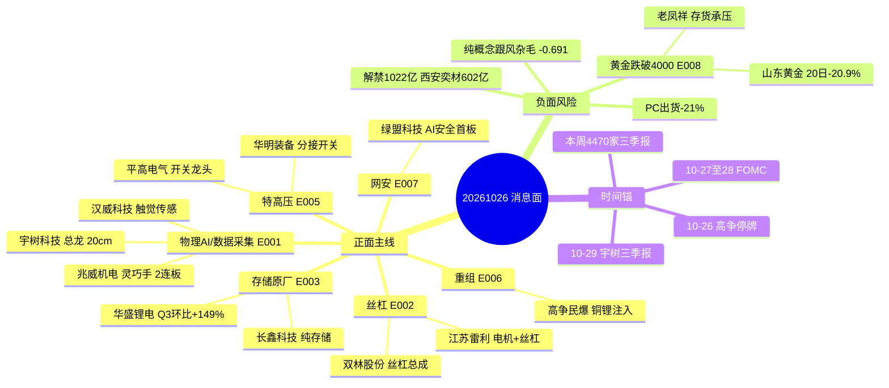

# 2026-10-26（周一）· **消息面事件驱动**

> **数据源新鲜度**: partial · **降级状态**: false · **置信度**: 0.72（R7 落盘并完成资金复核后上调）
> **覆盖窗口**: 2026-10-23 15:00 → 2026-10-26 06:02（含整个周末）
> **主源**: 财联社快讯 2418 条 + 公众号 48 篇（15 号池）+ 5 焦点群 540 条 + 公告 771 条 + 东财三季报预告 500 条 + hithink 16 次官方核验

## 一句话结论

消息面只认两条主线：**物理AI数据采集（周末四重催化、总龙宇树）** 与 **丝杠（财联社前瞻点名、位置最低）**；
唯一行业级对冲是 **黄金跌破 4000 美元**（价格+业绩双杀，禁止抄底）。
三季报要按单季环比读：德明利同比 32400% 但 Q3 环比仅 +2.2%，恒逸/天齐环比腰斩——**同比是后视镜，环比才是定价**。

资金口径已与 R7 对齐（12/12 票复核一致）：中际旭创 5 日主力实为 **-14.70 亿**（首轮自算 +42.95 亿为口径错误），护盘是外力、主力在借护盘出货，**光模块/硅光极性由正面降为中性**。

## 🗺️ 消息面全景图

## 🎯 顶级事件详解（每事件三问 + 首推票思维链）

### E20261026_001 · 物理AI数据采集四重催化 · 数采=算力叙事成型

`strength=high` · `polarity=正面` · `raw_score=+0.86` · `weighted_score=+0.740`(1 日 · decayed=false) · `event_type=sentiment`

**事件摘要**：10-25 是物理AI的“共识日”，不是“启动日”。四个独立催化在 24 小时内叠在一起：①智元开源首个真实场景 Physical Agent 数据集（10-23 还发布了 Genie Studio 2.0 具身智能作业平台），把“真机数据稀缺”这个行业瓶颈第一次变成可交易的资产；②英伟达周五盘后官宣 Isaac 人形机器人参考平台（框架+仿真+数据生成）；③银河通用×宇树发布全球首个原生智能体机器人，宇树从“本体厂”升级为“具身模型载体”；④财联社早知道把“物理AI”放在明日主题前瞻第一条，调研先知同日给出数采专家纪要（帕西尼：原生异构数据 100-200 元/小时、带触觉 500-800 元/小时，数采毛利率 50-60%；天机人形臂累计 8000 条、双臂超 1 万台）。

**推理深度三问**

- **大资金意图**：算力叙事在 10-23 早盘被打到科创50 -3.07%，机构需要一个“新瓶装旧酒”的载体——把机器人从“整机主题”重定义为“数据基础设施”，从而把 AI 资本开支的估值锚平移到机器人。周末财联社/招商/长城/GLMS 口径高度一致，目的不是让散户周一追高，而是给 10-27 开盘建立承接盘共识。真正已经动手的是 10-23 的资金（东财 DC 主力口径，1019-1023）：宇树 +10.41 亿(3/5)、汉威 +2.28 亿(4/5)、奥比中光 +4.09 亿(3/5)、兆威 +4.67 亿(5/5)——全是整机与核心零部件；斯菱 -0.08 亿、利亚德 +11.83 亿属高低位分化，不是普涨。
- **为什么走强**：①催化密度：48 篇公众号里“物理AI”出现 21 次，财联社放头条；②位置分层清楚：宇树距 60 日高 -43%（1100→624）、汉威 -0.8%、双林/雷利还在 MA20 附近，既有总龙也有低位补涨；③赚钱效应在：10-23 全市场 82 只涨停、炸板率 12.8%，人形机器人概念 27 只涨停，创业板从 -3% 拉到 +4.16%，容量足够承接。
- **逻辑够不够硬**：硬在“数据是瓶颈”这个产业事实（带触觉真机采集 500-800 元/小时、单条产线年产不足万条），不硬在“今天就能看到订单”——数采设备收入确认在 2027。所以只做龙头与低位，不做 5 日翻倍的加速票。

**负面杀伤面**：纯概念跟风杂毛、6板以上高位连板

**首推票思维链**

#### 宇树科技 688836.SH · `总龙` · 龙头 · R4 态度=研究首选

| 收盘(10-23) | 涨跌 | MA5 | MA20 | 距60日高 | 5日主力净额 | 盈利预测 |
|---|---|---|---|---|---|---|
| 624.0 | +20.00% | 536.19 | 474.49 | -43.3% | +10.41亿 | 无预告 |

- **买入理由**：总龙 + 容量核心：10-23 成交 47.7 亿全组第一，20cm 首板；5 日主力 +10.41 亿（3/5 日净流入，R7 口径）；距 60 日高 -43% 提供反抽空间，10-29 三季报是最近验证点。
- **风险点**：624 元一手 6 万，散户参与度低，弹性靠机构；5 日已 +46%，20cm 次日高开 >8% 追高即被套；板块 6 板大业股份已收监管工作函，高度票有政策风险。
- **止损条件**：566（参考价 624×-9.3%）且失守首板实体中位 578 即离场。（stop_loss=566.00）
- **可验证假设**：开盘 30 分钟成交额 >15 亿且不破 578 → 承接有效；若主力净流出且跌破 578 → 首板一日游，当日不再看。
- **仓位上限**：8%（总龙加速段 8%为单票上限 不追高加仓）

#### 兆威机电 003021.SZ · `灵巧手/减速器` · 龙二 · R4 态度=研究首选

| 收盘(10-23) | 涨跌 | MA5 | MA20 | 距60日高 | 5日主力净额 | 盈利预测 |
|---|---|---|---|---|---|---|
| 91.73 | +10.00% | 78.14 | 70.03 | +0.0% | +4.67亿 | 无预告 |

- **买入理由**：灵巧手 17 自由度指关节自研 + 微型传动系统 62.0%、精密注塑件 33.9%；10-23 10cm 2 连板创 60 日新高，属“人形机器人零部件”双事件叠加带（0.518+0.421=0.939）；5 日 +50.1%。
- **风险点**：资金不背离——5 日主力 +4.67 亿（5/5 日净流入）、机构专用 +1.44 亿；真正的风险是**位置**：2 连板、5 日 +50.1%、20 日区间 100 分位、当日开板 5 次，追高即接最后一棒；板块 6 板高度票已收监管工作函。
- **止损条件**：84.4（参考价 91.73×-8.0%），破板不回封即走。（stop_loss=84.40）
- **可验证假设**：竞价量比 >1.5 且开盘 30 分钟不破 88 → 背离修复；若高开 >6% 后半小时翻绿 → 按出货处理，当日不再看。
- **仓位上限**：6%（2连板 6%上限 破板不回封即减）

#### 汉威科技 300007.SZ · `触觉/嗅觉传感器` · 龙三 · R4 态度=研究首选

| 收盘(10-23) | 涨跌 | MA5 | MA20 | 距60日高 | 5日主力净额 | 盈利预测 |
|---|---|---|---|---|---|---|
| 38.4 | +9.84% | 33.1 | 30.27 | -0.8% | +2.28亿 | 无预告 |

- **买入理由**：触觉/嗅觉/力控/视觉多传感布局，是数采的“入口硬件”，比整机更早确认收入；10-23 +9.84% 首板收 38.4，距 60 日高仅 -0.78%；5 日主力 +2.28 亿（4/5 日净流入）。
- **风险点**：传感器主业毛利率低，机器人收入占比小，属“预期估值”不是“业绩估值”；38.70 就是 60 日高，一次性压力位；单日换手若 >20% 需防一日游。
- **止损条件**：35.0（参考价 38.40×-8.8%），失守首板实体即走。（stop_loss=35.00）
- **可验证假设**：开盘 30 分钟换手 >8% 且站稳 38.4 → 首板接力成立；若冲高 40 附近滞涨且主力转流出 → 只做一日。
- **仓位上限**：5%（首板 5%上限）

---

### E20261026_002 · 丝杠多赛道共振 · 财联社前瞻点名双林/江苏雷利

`strength=high` · `polarity=正面` · `raw_score=+0.70` · `weighted_score=+0.602`(1 日 · decayed=false) · `event_type=sentiment`

**事件摘要**：财联社早知道前瞻第二条点名丝杠（长城证券）：2030 年全球人形机器人丝杠市场 267.9 亿元；通用型单机用滚珠丝杠 10-20 根、行星滚柱 10-16 根。10-23 丝杠概念全链上涨：震裕 +11.92%、斯菱 +9.75%、贝斯特 +9.60%、五洲 +8.35%、瑞迪 +8.08%、双林 +6.84%、雷利 +6.52%——但没有一只 20cm。

**推理深度三问**

- **大资金意图**：丝杠是“确定性零部件”里最后一个没被爆炒的环节（减速器、灵巧手、电机都已轮过），资金在机器人主线内部做补涨轮动，用财联社前瞻点火。但双林 5 日主力 -0.15 亿、雷利 +0.25 亿（东财 DC，1019-1023）——**资金根本还没进场**，前瞻只是点火不是建仓；这也意味着行情尚未启动，前提是 10-27 出现第一根 20cm。
- **为什么走强**：位置低：双林距 60 日高 -11.0%、雷利 -9.7%、震裕 -18.9%、贝斯特 -21.4%；10-23 全链上涨却无 20cm = 情绪没透支；与 E001 形成“整机（宇树）→ 零部件（兆威/汉威）→ 丝杠（双林/雷利）”的完整传导链，主线内部有梯队。
- **逻辑够不够硬**：中性偏硬。硬在单机用量（10-20 根）与价值量（丝杠约占零部件成本 20%）；不硬在 267.9 亿是 2030 年远期数，且国内丝杠良率与磨床仍是瓶颈。属“可以低吸、不可以追高”的环节。

**负面杀伤面**：纯概念跟风杂毛、无机器人订单的轴承厂

**首推票思维链**

#### 双林股份 300100.SZ · `丝杠总成` · 龙头 · R4 态度=观察（资金未进场）

| 收盘(10-23) | 涨跌 | MA5 | MA20 | 距60日高 | 5日主力净额 | 盈利预测 |
|---|---|---|---|---|---|---|
| 21.24 | +6.84% | 20.07 | 20.28 | -11.0% | -0.15亿 | 无预告 |

- **买入理由**：传动驱动智能 12.89 亿占总营收 60.6%，反向式行星滚柱丝杠已开发；10-23 +6.84% 刚站上 MA20（20.28），距 60 日高 -11.0%，位置是丝杠链里最低的一档；**但 5 日主力 -0.15 亿（2/5 日净流入）＝资金未进场**，只能等右侧点火，今日不授予开仓资格。
- **风险点**：丝杠业务尚未大规模量产，当前估值靠“丝杠总成”预期；若板块无 20cm 点火，容易一日游。
- **止损条件**：19.5（参考价 21.24×-8.2%），破 MA20 后离场。（stop_loss=19.50）
- **可验证假设**：10-27 丝杠概念出现 ≥1 只 20cm → 板块进入主升，双林可加；若全链高开低走 → 前瞻点火失败，退出。
- **仓位上限**：6%（启动前夜 6%上限）

#### 江苏雷利 300660.SZ · `空心杯电机+丝杠` · 龙二 · R4 态度=观察（资金未进场）

| 收盘(10-23) | 涨跌 | MA5 | MA20 | 距60日高 | 5日主力净额 | 盈利预测 |
|---|---|---|---|---|---|---|
| 25.83 | +6.52% | 23.85 | 23.24 | -9.7% | +0.25亿 | 无预告 |

- **买入理由**：步进电机 6.19 亿 + MA 电机组件 6.56 亿 + 直流电机 3.44 亿，电机合计约 76%，空心杯/丝杠已布局；10-23 +6.52%，距 60 日高 -9.7%；5 日主力 +0.25 亿（3/5 日净流入）＝资金未进场。
- **风险点**：电机主业与丝杠是两条线，丝杠占比小；25.83 元上方 28.6 元是 60 日高压力位。
- **止损条件**：23.6（参考价 25.83×-8.6%），失守 MA20（23.24）即走。（stop_loss=23.60）
- **可验证假设**：若空心杯电机在 10-27 出现独立涨停 → 逻辑从“丝杠补涨”升级为“电机+丝杠双轮”，可提高仓位；否则只做补涨。
- **仓位上限**：5%（滞涨补涨 5%上限）

---

### E20261026_006 · 高争民爆注入铜与锂资产 · 节奏范围远超预期

`strength=high` · `polarity=正面` · `raw_score=+0.62` · `weighted_score=+0.534`(1 日 · decayed=false) · `event_type=insider`

**事件摘要**：10-25 15:41 高争民爆公告停牌，拟以发行股份+现金收购紫隆 51%、紫源 51%、晟源 100%，10-26 起停牌不超过 5 个交易日。东财测算：朱诺铜矿 8 万吨/年、权益约 2 万吨；马牧普 10 万吨/年、权益 5 万吨；巨龙 10% 权益 3-3.5 万吨；拉果 27% 权益 0.5 万吨锂——合计明年约 5 万吨铜 + 0.5 万吨锂、对应约 30 亿利润，远期 13 万吨铜 + 1.5 万吨锂。

**推理深度三问**

- **大资金意图**：民爆（西藏）壳资源 + 铜锂资产证券化，是“重组套利”不是产业趋势。停牌前 20 日 -23.7%、距 60 日高 -35.2%，说明没有资金提前埋伏，复牌后是纯博弈盘。
- **为什么走强**：注入资产量级远超现有民爆主业（爆破服务 4.03 亿+器材 2.57 亿），东财测算 30 亿利润对应当前市值极低 PE；但铜锂价格与注入进度是变量。
- **逻辑够不够硬**：事件硬（公告+券商测算），但不可交易（停牌），且 30 亿利润是单一券商口径，必须以正式方案为准。复牌高开 >7% 不追。

**负面杀伤面**：停牌期间无法交易、复牌高开追高

**首推票思维链**

#### 高争民爆 002827.SZ · `重组停牌·不可交易` · 龙头 · R4 态度=观察

| 收盘(10-23) | 涨跌 | MA5 | MA20 | 距60日高 | 5日主力净额 | 盈利预测 |
|---|---|---|---|---|---|---|
| 51.8 | +6.41% | 52.41 | 61.23 | -35.2% | -0.72亿 | Q3单季0.49亿(前三季0.81亿) |

- **买入理由**：爆破服务 4.03 亿+民爆器材 2.57 亿，注入后变铜锂资源平台；Q3 单季 0.49 亿、环比 +112.9%。
- **风险点**：10-26 起停牌不可交易；东财测算为单一口径；停牌前 20 日 -23.7% 说明无资金埋伏，复牌定价权在方案不在情绪。
- **止损条件**：复牌后 47（参考价 51.80×-9.3%），破前低即放弃。（stop_loss=47.00）
- **可验证假设**：复牌方案若确认 5 万吨铜+0.5 万吨锂且发行价不高 → 一字板可持有；若高开 >7% 且换手迅速放大 → 兑现。
- **仓位上限**：2%（停牌不可交易 复牌后上限2%）

---

### E20261026_008 · 现货金跌破4000美元 · 金饰克价跌穿1200

`strength=high` · `polarity=负面` · `raw_score=-0.66` · `weighted_score=-0.489`(2 日 · decayed=false) · `event_type=macro`

**事件摘要**：现货黄金收 3995.63 美元（-0.72%），盘中跌破 4000；国内金饰克价跌穿 1200：老庙 1196、周生生 1200、周大福 1202、老凤祥 1206，一个月跌约 100 元。COMEX 黄金净多头削减 2392 手至 108685 手。赤峰黄金 Q3 净利 5.53 亿、同比 -41.84%，扣非 -40.01%。驱动：高油价、12 月加息预期升温、全球流动性收紧去杠杆。

**推理深度三问**

- **大资金意图**：黄金多头在 10 月被迫去杠杆（高油价→加息预期→实际利率上行），是宏观驱动的位置切换，不是个股利空。资金没有流向铜（紫金距高 -19.6%），说明是整体有色去杠杆，不是板块间轮动。
- **为什么走强**：三重压力叠加 + 业绩证伪（赤峰 Q3 -41.84%）；山东黄金 20 日 -20.9%、距 60 日高 -32.9%，趋势已破位。
- **逻辑够不够硬**：硬（价格与业绩双杀），但反面必须写：中东若升级（特朗普称随时可能再打伊朗）金价可快速反抽。所以是“回避”不是“做空”，更不做左侧抄底。

**负面杀伤面**：黄金采选、白银、黄金珠宝零售、黄金ETF

**首推票思维链**

#### 山东黄金 600547.SH · `负面回避` · 龙头 · R4 态度=剔除

| 收盘(10-23) | 涨跌 | MA5 | MA20 | 距60日高 | 5日主力净额 | 盈利预测 |
|---|---|---|---|---|---|---|
| 26.0 | +1.17% | 26.42 | 27.67 | -32.9% | -1.52亿 | 无预告 |

- **买入理由**：黄金 939.37 亿（毛利 22.5%）+外购金 431.93 亿（毛利 0.8%），金价弹性最大；20 日 -20.9%、距 60 日高 -32.9%，已破位。
- **风险点**：金价跌破 4000 后趋势向下；5 日主力 -1.52 亿（仅 1/5 日净流入）＝资金也在撤，反弹无承接；老凤祥等零售端滞后反映，Q4 存货减值风险。
- **止损条件**：不设买入止损（禁止买入）；若已持仓，破 24.5（参考价 26.00×-5.8%）离场。（stop_loss=24.50）
- **可验证假设**：金价重新站上 4100 且美元回落 → 才重新评估；在此之前任何反弹都按减仓处理。
- **仓位上限**：1%（禁止买入 仅记录）

#### 老凤祥 600612.SH · `负面回避` · 龙二 · R4 态度=剔除

| 收盘(10-23) | 涨跌 | MA5 | MA20 | 距60日高 | 5日主力净额 | 盈利预测 |
|---|---|---|---|---|---|---|
| 32.15 | +0.50% | 32.34 | 31.87 | -12.9% | -0.02亿 | 无预告 |

- **买入理由**：珠宝首饰 182.99 亿（毛利 12.7%）+黄金交易 15.11 亿，金价下跌压缩存货收益；距 60 日高 -12.9%。
- **风险点**：零售端对金价下跌滞后 1-2 个月，Q4 存货跌价准备是隐雷；32.15 仍在 MA20（31.87）附近，方向不明。
- **止损条件**：不设买入止损（禁止买入）；持仓破 30.2（参考价 32.15×-6.1%）离场。（stop_loss=30.20）
- **可验证假设**：若金饰销量因降价放量（水贝人流爆满）带动毛利修复 → 才转中性；仅看客流不算验证。
- **仓位上限**：1%（禁止买入 仅记录）

---

### E20261026_007 · PHP高危漏洞叠加海外网安暴涨 · 网安二次催化

`strength=high` · `polarity=正面` · `raw_score=+0.52` · `weighted_score=+0.385`(2 日 · decayed=false) · `event_type=sentiment`

**事件摘要**：PHP 严重漏洞（NCSC 警报）致英国预算责任办公室、芬兰政府网络、荷兰多家机构网站下线；美股网安集体爆发（CrowdStrike +8.25%、派拓 +7.22%、Zscaler +7.31%）；10-23 A 股网安已先行：绿盟 +19.98% 首板、安恒 +13.37%、深信服 +12.85%、汇金科技/世纪恒通 20cm。绿盟上半年 AI 安全订单 1.17 亿、运营商 AI 安全签单 +300%。

**推理深度三问**

- **大资金意图**：网安是“事件驱动+低位”的组合，10-23 已炒过一轮，周末的 PHP 漏洞+美股映射是二次催化。绿盟 5 日主力 +2.06 亿（3/5 日净流入）——首板有主力参与、资金与价格同向（不是背离）；但 20 日已 +48.2%、距 60 日高仅 -0.6%，位置不低。
- **为什么走强**：位置低（绿盟距 60 日高 -0.6%、安恒 -0.8%、深信服 -6.6%）+ 海外映射（美股网安集体大涨）+ 真实事件（多国政府网站下线）。
- **逻辑够不够硬**：事件硬，持续性不硬。网安是“一次性事件驱动”，没有持续订单落地就容易一日游；绿盟能否 2 连板决定整个板块高度。

**负面杀伤面**：纯概念跟风杂毛、无AI安全订单的集成商

**首推票思维链**

#### 绿盟科技 300369.SZ · `AI安全龙头` · 龙头 · R4 态度=研究首选

| 收盘(10-23) | 涨跌 | MA5 | MA20 | 距60日高 | 5日主力净额 | 盈利预测 |
|---|---|---|---|---|---|---|
| 11.71 | +19.98% | 10.36 | 9.9 | -0.6% | +2.06亿 | 无预告 |

- **买入理由**：安全产品 3.62 亿+安全服务 3.44 亿；AI 安全订单 1.17 亿、运营商签单 +300%；10-23 +19.98% 首板，20 日 +48.2%，距 60 日高 -0.59%。
- **风险点**：20 日已 +48.2%、距 60 日高 -0.6%，属新高位置不是低位；网安上周已炒一轮，二次催化靠事件（PHP 漏洞+美股映射）不靠业绩；竞价高开 >7% 若不能快速封板，跟风盘先跑。
- **止损条件**：10.6（参考价 11.71×-9.5%），破首板实体中位即走。（stop_loss=10.60）
- **可验证假设**：竞价量比 >2 且开盘 30 分钟封板 → 2 连板成立，板块跟风；若竞价高开低走且主力继续流出 → 首板一日游，全板块降级。
- **仓位上限**：4%（首板+5日主力净流入2.06亿 但位置高 4%上限 需竞价确认）

---

### E20261026_003 · 存储涨价与三季报分层 · 同比32400%不等于环比加速

`strength=high` · `polarity=中性` · `raw_score=+0.25` · `weighted_score=+0.215`(1 日 · decayed=false) · `event_type=earnings`

**事件摘要**：德明利前三季营收 285.55 亿（+328.81%）、净利 87.46 亿（+32399.91%）；但拆单季：Q3 净利 27.29 亿 vs Q2 26.71 亿，环比仅 +2.2%，而营收环比 +24.2%——增收不增利。恒逸 Q3 21.09 亿环比 -46.0%，天齐 13.60 亿环比 -42.5%，华盛 3.13 亿环比 +148.9%（唯一真加速），长鑫前三季 1310-1325 亿扭亏。产业侧：野村称存储短缺持续至 2028，Counterpoint 称 Q3 全球 PC 出货 -21%。

**推理深度三问**

- **大资金意图**：存储是本轮唯一“业绩能落地”的科技分支，但资金早在 10-23 之前就把长鑫/德明利打到 -30%/-44% 的位置，说明市场已提前定价“周期见顶”。周末业绩公告是给低位修复提供理由，不是给高位续命；长鑫 10-23 +7.93% 但 5 日主力 -18.10 亿（2/5 净流入日）、大宗 5 笔卖方为机构、融资 -10.1%，是典型“业绩落地即兑现”；反过来德明利 5 日主力 +17.98 亿（4/5）说明资金在业绩公布前已抢跑，公布即是兑现窗口。
- **为什么走强**：涨价仍在（野村），长鑫 +7.93% 领涨，德明利 +3.22% 属超跌反弹；但维度要分开：原厂受益涨价，模组厂被涨价挤压。德明利营收环比 +24% 而利润环比 +2% 就是模组环节的量化证据。
- **逻辑够不够硬**：分化。原厂（长鑫）硬——DDR 毛利率 88.4%、LPDDR 82.6%，纯存储 98%；模组（德明利/佰维）不硬——成本上升+毛利压缩；添加剂（华盛）硬——VC 毛利率 65.6%，Q3 环比 +148.9% 是真加速。所以只做原厂与真加速，不做模组追高。

**负面杀伤面**：PC/消费电子、存储模组、锂矿/化纤

**首推票思维链**

#### 长鑫科技 688825.SH · `存储原厂龙头` · 龙头 · R4 态度=观察（R7 同判降级）

| 收盘(10-23) | 涨跌 | MA5 | MA20 | 距60日高 | 5日主力净额 | 盈利预测 |
|---|---|---|---|---|---|---|
| 42.85 | +7.93% | 41.07 | 49.3 | -30.7% | -18.10亿 | 扭亏 前三季1310-1325亿(营收265 |

- **买入理由**：DDR 收入 46.2%（毛利率 88.4%）+ LPDDR 52.0%（82.6%），纯存储原厂，涨价直接受益；距 60 日高 -30.7%，仍低于 MA20（49.30）13.1%；前三季扭亏 1310-1325 亿。
- **风险点**：5 日主力 -18.10 亿（2/5 净流入日），价格涨资金走；42.85 上方 49.3（MA20）是反压；存储若 Q4 报价涨幅收窄，周期逻辑转弱。
- **止损条件**：38.5（参考价 42.85×-10.2%），破前低即走。（stop_loss=38.50）
- **可验证假设**：开盘 30 分钟主力净流入转正且站上 44.5 → 资金背离修复；若继续净流出 → 只当反弹不做趋势。
- **仓位上限**：3%（R7 同判降级观察 3%上限 需竞价确认）

#### 华盛锂电 688353.SH · `业绩真加速` · 龙二 · R4 态度=观察（资金未确认）

| 收盘(10-23) | 涨跌 | MA5 | MA20 | 距60日高 | 5日主力净额 | 盈利预测 |
|---|---|---|---|---|---|---|
| 75.6 | +4.42% | 74.71 | 80.35 | -30.4% | -0.08亿 | Q3单季同比+800.58%(净利) +25 |

- **买入理由**：VC 收入 5.82 亿（毛利率 65.6%）+ FEC 1.71 亿（26.9%），电解液添加剂涨价链；Q3 单季 3.13 亿、环比 +148.9%（全场唯一真加速）；位置最低：距 60 日高 -30.4%，20 日 -10.6%，低于 MA20（80.35）5.9%。
- **风险点**：5 日主力 -0.08 亿，资金尚未确认；添加剂价格若回落，Q4 环比不可持续；75.6 上方 80.35 是 MA20 压力。
- **止损条件**：70（参考价 75.60×-7.4%），破 20 日低即走。（stop_loss=70.00）
- **可验证假设**：10-27 若 VC 报价继续上行且放量站上 80.35 → 从“业绩修复”升级为“涨价趋势”；否则只做一次反弹。
- **仓位上限**：4%（低位真加速 4%上限）

#### 德明利 001309.SZ · `业绩观察·不追` · 龙三 · R4 态度=观察

| 收盘(10-23) | 涨跌 | MA5 | MA20 | 距60日高 | 5日主力净额 | 盈利预测 |
|---|---|---|---|---|---|---|
| 251.0 | +3.22% | 233.34 | 309.46 | -44.3% | +17.98亿 | +32046%~33154%(净利) +31 |

- **买入理由**：存储产品 169.1 亿（SSD 80.2 亿/嵌入式 55.9 亿/内存条 25.2 亿），外销 65%，业绩同比 32400% 是真的；但 Q3 环比仅 +2.2%；5 日主力 +17.98 亿（4/5）说明资金已提前抢跑，业绩公布是兑现不是起点。
- **风险点**：增收不增利，模组环节被涨价挤压；距 60 日高 -44.3%，20 日 -36.8%，属超跌修复不是新高；高同比已被公告兑现。
- **止损条件**：228（参考价 251×-9.2%），破 5 日线即走。（stop_loss=228.00）
- **可验证假设**：若 10-27 存储模组集体高开低走 → 确认“业绩兑现即出货”，全板块降级；若德明利逆势加速 → 说明资金只认低位不认业绩。
- **仓位上限**：3%（仅观察 不新开仓）

---

### E20261026_005 · 疆电入川渝与陇电入川获核准 · 特高压543亿落地

`strength=medium` · `polarity=正面` · `raw_score=+0.48` · `weighted_score=+0.413`(1 日 · decayed=false) · `event_type=policy`

**事件摘要**：疆电入川渝（±800kV）与陇电入川两项直流工程获核准，总投资 543 亿元，2027 年开工、2029 年投运，年送电 720 亿千瓦时。国网“十五五”投资 4 万亿（+40%）；2026 年特高压招标 329 亿已超 2024/2025 全年。10-23 华瓷股份、理工能科涨停，平高电气/华明装备仅 +0.8%。

**推理深度三问**

- **大资金意图**：特高压是“防御性成长”——科技杀估值时提供确定性。但资金只愿意打小市值弹性（华瓷 28 元、理工 13.67 元），不愿抬平高（21.5 元，距 60 日高仅 -0.7%）这种已在新高附近的大票。5 日主力正好相反：平高 -1.60 亿（0/5 净流入日）、华明 -0.10 亿，而华瓷 +5.63 亿（涨停且资金真进）——资金明确选择小市值弹性，大票没人接。
- **为什么走强**：543 亿核准是硬政策落地，叠加 329 亿招标数据，是订单可见度最高的方向；但 2027 年才开工，2026 年不出业绩，所以只能给估值不给业绩。
- **逻辑够不够硬**：政策硬，节奏慢。适合“跌下来买”，不适合“追涨停”。平高距 60 日高 -0.7% 属滞涨首板位，但华瓷 5 日主力 +5.63 亿是真金白银，平高 -1.60 亿没有资金。

**负面杀伤面**：无（本事件本身即负面，杀伤面见 sectors_impact）

**首推票思维链**

#### 平高电气 600312.SH · `开关龙头` · 龙头 · R4 态度=观察（资金未确认）

| 收盘(10-23) | 涨跌 | MA5 | MA20 | 距60日高 | 5日主力净额 | 盈利预测 |
|---|---|---|---|---|---|---|
| 21.5 | +0.80% | 21.12 | 20.25 | -0.7% | -1.60亿 | 无预告 |

- **买入理由**：输变电设备 124.4 亿占 99.4%，开关/配网成套，特高压开关绝对龙头；距 60 日高 -0.74%（滞涨于板块涨停潮），MA5 21.12 > MA20 20.25 多头排列；**但 5 日主力 -1.60 亿、0/5 净流入日**——滞涨是因为没资金，不是在蓄势。
- **风险点**：543 亿订单在 2027 年，近端无业绩增量；21.66 是 60 日高压力位，突破需要放量。
- **止损条件**：19.9（参考价 21.50×-7.4%），破 MA20（20.25）即走。（stop_loss=19.90）
- **可验证假设**：10-27 放量突破 21.66 → 板块从“小票弹性”切到“大票补涨”；若华瓷继续涨停而平高不跟 → 资金只做小票，降级。
- **仓位上限**：3%（资金未确认 降级观察 3%上限）

#### 华明装备 002270.SZ · `分接开关` · 龙二 · R4 态度=观察（资金未确认）

| 收盘(10-23) | 涨跌 | MA5 | MA20 | 距60日高 | 5日主力净额 | 盈利预测 |
|---|---|---|---|---|---|---|
| 18.96 | +0.80% | 18.92 | 18.27 | -10.6% | -0.10亿 | 无预告 |

- **买入理由**：电力设备 10.99 亿占 88%，国产特高压分接开关龙头；距 60 日高 -10.57%；但 5 日主力 -0.10 亿（资金未进）。
- **风险点**：分接开关市占率高但赛道小，弹性有限；18.96 上方 21.2 是 60 日高。
- **止损条件**：17.5（参考价 18.96×-7.7%），破 MA20（18.27）即走。（stop_loss=17.50）
- **可验证假设**：若特高压板块出现 2 连板龙头 → 华明作为“低估值配套”补涨；否则只做一日。
- **仓位上限**：3%（资金未进 降级观察 3%上限）

---

### E20261026_004 · 光模块四家午间集体护盘 · 周五V反是外力不是内生

`strength=medium` · `polarity=正面` · `raw_score=+0.55` · `weighted_score=+0.351`(3 日 · decayed=true) · `event_type=sentiment`

**事件摘要**：10-23 午间，中际旭创、新易盛、天孚通信、光迅科技四家在同一时段集中公告（订单饱满/经营正常），中际午后瞬间 +8%，创业板从 -3% 拉至 +4.16%，全市场成交 1.97 万亿、放量 4310 亿。中际 5 日主力 **-14.70 亿**（护盘当日 +16.43 亿，前 4 日净卖），光迅 Q3 净利翻倍、社保加仓。

**推理深度三问**

- **大资金意图**：这是“外力”不是“内生”。四家同段发同类公告属窗口指导式护盘，目的是阻断 AI 硬件的负反馈（早盘科创50 -3.07%）。护盘资金成本区在 10-23 午后，612 一线是防线；但护盘≠做多——当日主力 +16.43 亿只是护盘那一天，5 日合计仍净卖 -14.70 亿（2/5 净流入日），融资余额 15 日 -24.4%、大宗 25 笔卖方全为机构专用：主力借护盘出货、散户在接。
- **为什么走强**：超跌（中际距高 -43.4%、新易盛 -47.3%、天孚 -31.9%）+ 业绩兜底（光迅 Q3 翻倍）+ 外力护盘。但技术上中际 612.63 仍在 MA5（631.62）/MA20（762.28）之下，属主跌反抽，不是右侧。
- **逻辑够不够硬**：消息硬（四家公告+社保加仓），技术不硬（未站上 MA5）。且本事件 days_since=3，weighted_score 已从 0.55 衰减到 0.351（decayed=true），按契约只能作背景，不能作首推理由。

**负面杀伤面**：光模块高位持仓、AI硬件海外映射

**首推票思维链**

#### 中际旭创 300308.SZ · `光模块总龙` · 龙头 · R4 态度=降级观察（R7 同判降级）

| 收盘(10-23) | 涨跌 | MA5 | MA20 | 距60日高 | 5日主力净额 | 盈利预测 |
|---|---|---|---|---|---|---|
| 612.63 | +3.82% | 631.62 | 762.28 | -43.4% | -14.70亿 | 无预告 |

- **买入理由**：光模块总龙，800G/1.6T 全球份额前列，距 60 日高 -43.4% 属深度超跌；**但 5 日主力 -14.70 亿（2/5 净流入日），当日 +16.43 亿仅是护盘单日**，融资 15 日 -24.4%、大宗 25 笔机构卖出——资金面不支持右侧。
- **风险点**：612.63 低于 MA5 3.0%、低于 MA20 19.6%，趋势未修复；主力 5 日净卖 + 融资降杠杆 + 大宗机构卖 = 反弹即减仓窗口；R7 同判降级、research_only。
- **止损条件**：570（参考价 612.63×-7.0%），破周五反抽低点即走。（stop_loss=570.00）
- **可验证假设**：连续 2 日站上 MA5（631.62）且成交额维持 100 亿+ → 从护盘转为做多；否则反弹即减仓窗口。
- **仓位上限**：3%（R7 降级 降级观察 3%上限 只做右侧确认）

#### 光迅科技 002281.SZ · `光模块二线+业绩` · 龙二 · R4 态度=观察（资金流出）

| 收盘(10-23) | 涨跌 | MA5 | MA20 | 距60日高 | 5日主力净额 | 盈利预测 |
|---|---|---|---|---|---|---|
| 128.63 | +0.81% | 131.7 | 155.01 | -36.4% | -7.51亿 | 无预告 |

- **买入理由**：接入和数据 43.1 亿 + 传输 22.83 亿，通信设备制造毛利 25.5%；Q3 净利翻倍（前三季 +65.37%~82.26%）、社保加仓；距 60 日高 -36.4%；但 5 日主力 -7.51 亿（2/5 净流入日）——业绩好、资金走。
- **风险点**：128.63 低于 MA5（131.70）/MA20（155.01），仍是下降通道；光模块整体 20 日 -32.7%，反弹属超跌修复。
- **止损条件**：119.5（参考价 128.63×-7.1%），破 MA20 下方前低即走。（stop_loss=119.50）
- **可验证假设**：站上 131.70（MA5）且主力连续 2 日净流入 → 右侧成立；否则只做一日反抽。
- **仓位上限**：3%（业绩好但资金流出 降级观察 3%上限）

---

## 📊 板块 × 事件热力矩阵（极性叉乘）

叉乘规则：`contrib = |weighted_score| × sign(板块 polarity) × strength_weight(high 1.0 / medium 0.7 / low 0.4)`，同板块被多事件命中即累加；**极性=中性时贡献为 0**。

| 板块 | 事件锚 | 首推龙头 | 事件数 | 业绩锚 | 净分 | 净综合置信 |
|---|---|---|:--:|---|--:|:--:|
| 人形机器人零部件 | 001 / 002 | 兆威机电（首选）/双林（观察） | 2 | — | +0.939 | 🟢🟢🟢 |
| 物理AI/数据采集 | 001 | 宇树科技（首选） | 1 | 无预告(纯预期) | +0.740 | 🟢🟢🟢 |
| 人形机器人本体 | 001 | 宇树科技（首选） | 1 | 无预告(纯预期) | +0.740 | 🟢🟢🟢 |
| 丝杠/精密传动 | 002 | 双林/雷利（观察） | 1 | 震裕 +55.8%~68.4% | +0.602 | 🟢🟢🟢 |
| 触觉传感/电子皮肤 | 001 | 汉威科技（首选） | 1 | — | +0.518 | 🟢🟢🟢 |
| 网络安全 | 007 | 绿盟科技（首选） | 1 | 绿盟 无预告(AI订单1.17亿) | +0.385 | 🟢🟢 |
| 铜/锂资源 | 006 | 高争民爆（停牌） | 1 | 高争 Q3环比+112.9% | +0.374 | 🟢🟢 |
| 特高压/电网设备 | 005 | 平高/华明（降级观察） | 1 | — | +0.289 | 🟢🟢 |
| AI安全 | 007 | 绿盟科技（首选） | 1 | — | +0.269 | 🟢🟢 |
| 工业母机 | 002 | — | 1 | — | +0.241 | 🟢🟢 |
| 存储/HBM | 003 | 长鑫科技（观察） | 1 | 长鑫 扭亏1310-1325亿 | +0.215 | 🟢🟢 |
| 西藏板块 | 006 | 高争民爆（停牌） | 1 | — | +0.214 | 🟢🟢 |
| 电力设备出海 | 005 | 华明装备（观察） | 1 | — | +0.165 | 🟢 |
| 半导体设备 | 003 | — | 1 | — | +0.150 | 🟢 |
| 民爆 | 006 | — | 1 | — | +0.000 | 🟡 |
| 铜/其他有色 | 008 | — | 1 | — | +0.000 | 🟡 |
| 存储模组 | 003 | 德明利（观察） | 1 | 德明利 +32400%(QoQ+2.2%) | +0.000 | 🟡 |
| 光模块/CPO | 004 | 中际旭创（降级观察） | 1 | 光迅 +65.4%~82.3% | +0.000 | 🟡 |
| 硅光芯片 | 004 | 光迅科技（观察） | 1 | 光迅 +65.4%~82.3% | +0.000 | 🟡 |
| PC/消费电子 | 003 | （回避） | 1 | — | -0.150 | 🔴 |
| 锂矿/化纤 | 003 | （回避） | 1 | 天齐 QoQ-42.5% / 恒逸-46.0% | -0.150 | 🔴 |
| AI硬件高位持仓 | 004 | （减仓窗口） | 1 | — | -0.246 | 🔴 |
| 黄金珠宝零售 | 008 | 老凤祥（剔除） | 1 | — | -0.342 | 🔴 |
| 黄金/白银 | 008 | 山东黄金（剔除） | 1 | 赤峰 Q3 -41.84% | -0.489 | 🔴🔴 |
| 纯概念跟风杂毛 | 001 / 002 / 007 | （回避） | 3 | — | -0.691 | 🔴🔴 |

**多事件叉乘（同一板块被 ≥2 条事件命中）**

| 板块 | 命中事件 | 净分 | 结论 |
|---|---|--:|---|
| 纯概念跟风杂毛 | E001 / E002 / E007 | -0.691 | 三条正面主线共用的负面对手盘：跟风杂毛一律不碰 |
| 人形机器人零部件 | E001 / E002 | +0.939 | 双主线叠加，是今日可交易带最厚的地方 |

**板块结论（一句话一个）**

- **人形机器人零部件**（+0.939，正面）：E001+E002 双事件叠加(0.518+0.421): 兆威2连板创60日新高且5日主力+4.67亿(5/5) 但20日100分位/开板5次 只做分歧不追高; 双林/雷利刚站上MA20 但资金未进场
- **物理AI/数据采集**（+0.740，正面）：10-23 板块20cm潮(宇树/洛轴/利亚德/海天瑞声/华依) 属高潮日 只做龙头与低位 不接中位
- **人形机器人本体**（+0.740，正面）：宇树624 5日+46% 距60日高-43%(1100→624) 深跌后加速反弹非低位; 5日主力+10.41亿(3/5) 封单4.04亿
- **丝杠/精密传动**（+0.602，正面）：10-23 全链+6%~+12% 无20cm 属启动前夜; 但双林5日-0.15亿/雷利+0.25亿=资金未进场 前瞻只算点火 必须右侧确认
- **触觉传感/电子皮肤**（+0.518，正面）：汉威38.4首板 距60日高-0.78% 5日主力+2.28亿(4/5); 福莱新材5天3板高位只做小仓
- **网络安全**（+0.385，正面）：绿盟20cm首板且5日主力+2.06亿(3/5) 资金方向一致（不是背离）; 但20日+48%位置高 高度看能否2连板
- **铜/锂资源**（+0.374，正面）：高争停牌 铜价LME 14322美元仍强 但事件驱动在个股不在板块
- **特高压/电网设备**（+0.289，正面）：平高5日主力-1.60亿(0/5净流入日)/华明-0.10亿 而华瓷+5.63亿 → 资金只做小市值弹性 大票无资金 平高华明降级观察
- **AI安全**（+0.269，正面）：绿盟AI安全订单1.17亿 格尔软件大模型护栏 属主题弹性
- **工业母机**（+0.241，正面）：丝杠逻辑外溢 无独立催化
- **存储/HBM**（+0.215，正面）：长鑫42.85仍低于MA20(49.3)-13%; 但5日主力-18.10亿(2/5)+大宗5笔机构卖+融资-10.1% → R7同判降级 只做反弹
- **西藏板块**（+0.214，正面）：高争单一事件驱动 无板块效应
- **电力设备出海**（+0.165，正面）：国网海外投资提速 属附加逻辑; 华明5日-0.10亿 资金未进
- **半导体设备**（+0.150，正面）：存储扩产受益 属二线
- **民爆**（+0.000，中性）：主业平稳 事件是资产注入不是民爆景气 · 中性不计分
- **铜/其他有色**（+0.000，中性）：铜价仍强 与黄金分化 不随黄金杀
- **存储模组**（+0.000，中性）：德明利Q3环比仅+2.2% 涨价成本挤压毛利; 但5日主力+17.98亿(4/5)已抢跑 不追高
- **光模块/CPO**（+0.000，中性）：**极性由正面降为中性** — 四家午间公告是外力护盘, 中际5日主力净卖14.70亿(2/5)、融资15日-24.4%、大宗25笔机构卖; 消息正面但资金否决
- **硅光芯片**（+0.000，中性）：随光模块联动 无独立资金 随主线降为中性
- **PC/消费电子**（-0.150，负面）：内存涨价砸需求 Q3全球PC出货-21% 是存储牛市的镜像代价
- **锂矿/化纤**（-0.150，负面）：天齐Q3环比-42.5% 恒逸-46% 高同比是基数后视镜
- **AI硬件高位持仓**（-0.246，负面）：弃高就低仍在进行 光通信20日-31%
- **黄金珠宝零售**（-0.342，负面）：老凤祥存货收益压缩 零售端滞后反应
- **黄金/白银**（-0.489，负面）：山东黄金20日-20.9% 赤峰Q3净利-41% 价格与业绩双杀 行业级回避
- **纯概念跟风杂毛**（-0.691，负面）：E001/E002/E007 三条正面主线共用的负面对手盘: 大业股份6连板已收监管工作函 无订单无业绩的跟风票是本轮最大回撤源

## 🔥 中报/三季报业绩预告命中（含单季环比拆解）

| 代码 | 名称 | 累计同比（原文） | Q3 单季(亿) | Q2 单季(亿) | 单季环比 | 扣非 | 周期 | 终判 |
|---|---|---|---:|---:|---|:--:|:--:|---|
| 001309.SZ | 德明利 | +32046%~33154%(净利) +312.97%~343%(营收) | 27.29 | 26.71 | +2.2% | 是 | 是 | 周期上行但Q3环比走平·增收不增利·不构成追高理由 |
| 000703.SZ | 恒逸石化 | +3390.70%(净利) Q3单季同比+82008% | 21.09 | 39.07 | -46.0% | 否 | 是 | 基数失真·Q3环比腰斩·利好出尽 |
| 002466.SZ | 天齐锂业 | +1323.97%(Q3单季同比) | 13.60 | 23.66 | -42.5% | 是 | 是 | 锂价环比走弱·高同比后视镜·周期高位观察 |
| 688353.SH | 华盛锂电 | Q3单季同比+800.58%(净利) +259.1%(营收) | 3.13 | 1.26 | +148.9% | 是 | 是 | VC涨价·单季环比加速·真兑现 |
| 002827.SZ | 高争民爆 | Q3单季0.49亿(前三季0.81亿) | 0.49 | 0.23 | +112.9% | 是 | 否 | 业绩小幅加速·事件驱动为主·看资产注入不看业绩 |
| 688825.SH | 长鑫科技 | 扭亏 前三季1310-1325亿(营收2650-2700亿) | 534.00 | 528.40 | +1.1%~+3.9% | 是 | 是 | 周期上行·Q3环比走平·增速换挡 |

> 读法：**同比是后视镜**。德明利 32400% 的同比由去年低基数造成，Q3 环比只有 +2.2%；恒逸 Q3 环比 -46%、天齐 -42.5%，高同比配环比腰斩 = 利好出尽。只有华盛锂电 Q3 环比 +148.9% 是真加速。

## 🚀 首板候选（消息侧刺激票池 · 41 只）

只对正面/中性事件的正面环节产出；`quality` = 独立源数 ≥2 为 high，否则 medium；`lead_stock_proxy` 为概念涨幅榜代理（非新闻点名），D1 消费时按 proxy 降级处理。

| 代码 | 名称 | 事件 | 来源 | 源数 | 命中 | 质量 | 今日可交易 | 风险标记 |
|---|---|---|:--:|:--:|:--:|:--:|:--:|---|
| 002827.SZ | 高争民爆 | E006 | 直接点名 | 3 | 12 | high | **否(停牌)** | 停牌 10-26起不可交易 |
| 301313.SZ | 凡拓数创 | E001 | 直接点名 | 3 | 5 | high | 是 | 5日+89% 但主力+3.99亿(4/5) 高位加速 |
| 688836.SH | 宇树科技 | E001 | 直接点名 | 3 | 4 | high | 是 | 5日+46% 加速反弹 |
| 001309.SZ | 德明利 | E003 | 直接点名 | 2 | 7 | high | 是 | Q3单季环比仅+2.2% |
| 688507.SH | 索辰科技 | E001 | 直接点名 | 2 | 4 | high | 是 | 本周解禁73亿 |
| 688525.SH | 佰维存储 | E003 | 直接点名 | 2 | 4 | high | 是 | 20日-21% |
| 688353.SH | 华盛锂电 | E003 | 直接点名 | 2 | 4 | high | 是 | — |
| 002281.SZ | 光迅科技 | E004 | 直接点名 | 2 | 4 | high | 是 | — |
| 688825.SH | 长鑫科技 | E003 | 直接点名 | 2 | 3 | high | 是 | 5日主力-18.1亿(2/5) R7降级 |
| 301563.SZ | 云汉芯城 | E003 | 直接点名 | 2 | 2 | high | 是 | 2连板 高位 |
| 300308.SZ | 中际旭创 | E004 | 直接点名 | 2 | 2 | high | 是 | 未站上MA5 主跌反抽 |
| 300394.SZ | 天孚通信 | E004 | 直接点名 | 2 | 2 | high | 是 | 20日-27.7% |
| 003021.SZ | 兆威机电 | E001 | 直接点名 | 1 | 2 | medium | 是 | 2连板 5日主力+4.67亿(5/5) 但20日100分位 |
| 300007.SZ | 汉威科技 | E001 | 直接点名 | 1 | 2 | medium | 是 | — |
| 688585.SH | 上纬新材 | E001 | 直接点名 | 1 | 2 | medium | 是 | — |
| 688787.SH | 海天瑞声 | E001 | 直接点名 | 1 | 1 | medium | 是 | 5日+80% 高位加速 |
| 603341.SH | 龙旗科技 | E001 | 直接点名 | 1 | 1 | medium | 是 | 单一群聊源 |
| 688686.SH | 奥普特 | E001 | 直接点名 | 1 | 1 | medium | 是 | 单一群聊源 |
| 688097.SH | 博众精工 | E001 | 直接点名 | 1 | 1 | medium | 是 | 单一群聊源 |
| 605488.SH | 福莱新材 | E001 | 直接点名 | 1 | 1 | medium | 是 | 5天3板 高位 |
| 688322.SH | 奥比中光 | E001 | 直接点名 | 1 | 1 | medium | 是 | 单一群聊源 |
| 300100.SZ | 双林股份 | E002 | 直接点名 | 1 | 1 | medium | 是 | — |
| 300660.SZ | 江苏雷利 | E002 | 直接点名 | 1 | 1 | medium | 是 | — |
| 301550.SZ | 斯菱智驱 | E002 | 直接点名 | 1 | 1 | medium | 是 | 高位 5日+37.9% |
| 300953.SZ | 震裕科技 | E002 | 概念代理 | 1 | 1 | medium | 是 | — |
| 300580.SZ | 贝斯特 | E002 | 概念代理 | 1 | 1 | medium | 是 | — |
| 603667.SH | 五洲新春 | E002 | 概念代理 | 1 | 1 | medium | 是 | — |
| 603009.SH | 北特科技 | E002 | 概念代理 | 1 | 1 | medium | 是 | — |
| 301596.SZ | 瑞迪智驱 | E002 | 概念代理 | 1 | 1 | medium | 是 | — |
| 300502.SZ | 新易盛 | E004 | 直接点名 | 1 | 1 | medium | 是 | 20日-38.5% |
| 600312.SH | 平高电气 | E005 | 直接点名 | 1 | 1 | medium | 是 | — |
| 002270.SZ | 华明装备 | E005 | 直接点名 | 1 | 1 | medium | 是 | — |
| 001216.SZ | 华瓷股份 | E005 | 概念代理 | 1 | 1 | medium | 是 | 5日主力+5.63亿(3/5) 涨停有资金 |
| 002322.SZ | 理工能科 | E005 | 概念代理 | 1 | 1 | medium | 是 | — |
| 002606.SZ | 大连电瓷 | E005 | 概念代理 | 1 | 1 | medium | 是 | — |
| 300369.SZ | 绿盟科技 | E007 | 直接点名 | 1 | 1 | medium | 是 | 5日主力+2.06亿(3/5) 位置高 |
| 603232.SH | 格尔软件 | E007 | 直接点名 | 1 | 1 | medium | 是 | — |
| 300454.SZ | 深信服 | E007 | 概念代理 | 1 | 1 | medium | 是 | — |
| 688023.SH | 安恒信息 | E007 | 概念代理 | 1 | 1 | medium | 是 | — |
| 300561.SZ | 汇金科技 | E007 | 概念代理 | 1 | 1 | medium | 是 | — |
| 301428.SZ | 世纪恒通 | E007 | 概念代理 | 1 | 1 | medium | 是 | — |

## 💰 资金面交叉验证（R7 已落盘 · 口径已对齐）

口径：**东财 moneyflow_dc 主力净额（超大单+大单）**，窗口 20261019–20261023。R7 覆盖的 12 只直接取 R7 原值，其余用 R7 同源日度数据按同一窗口自算——**12/12 票重算值与 R7 `main_net_5d_yi` 完全一致**，验证了自算口径。

| 代码 | 名称 | 5日主力净额(亿) | 净流入天数 | 5日涨幅 | 收盘(10-23) | 与消息面一致性 | 口径 | R4 态度 |
|---|---|---|:--:|---:|---:|---|:--:|---|
| 001309.SZ | 德明利 | +17.98 | 4/5 | +21.8% | 251.0 | 一致(价涨资金进) | DC自算 | 观察 |
| 688836.SH | 宇树科技 | +10.41 | 3/5 | +46.1% | 624.0 | 一致(价涨资金进) | R7 | 研究首选 |
| 003021.SZ | 兆威机电 | +4.67 | 5/5 | +50.1% | 91.73 | 一致(价涨资金进) | R7 | 研究首选 |
| 300007.SZ | 汉威科技 | +2.28 | 4/5 | +47.0% | 38.4 | 一致(价涨资金进) | DC自算 | 研究首选 |
| 300369.SZ | 绿盟科技 | +2.06 | 3/5 | +15.6% | 11.71 | 一致(价涨资金进) | DC自算 | 研究首选 |
| 300660.SZ | 江苏雷利 | +0.25 | 3/5 | +19.6% | 25.83 | 一致(价涨资金进) | DC自算 | 观察 |
| 600612.SH | 老凤祥 | -0.02 | 1/5 | -0.8% | 32.15 | 一致(价跌资金走) | DC自算 | 剔除 |
| 688353.SH | 华盛锂电 | -0.08 | 2/5 | -2.6% | 75.6 | 一致(价跌资金走) | DC自算 | 观察 |
| 002270.SZ | 华明装备 | -0.10 | 2/5 | +0.6% | 18.96 | 背离(价涨资金走) | DC自算 | 观察 |
| 300100.SZ | 双林股份 | -0.15 | 2/5 | +16.4% | 21.24 | 背离(价涨资金走) | DC自算 | 观察 |
| 002827.SZ | 高争民爆 | -0.72 | 2/5 | -6.8% | 51.8 | 一致(价跌资金走) | DC自算 | 观察 |
| 600547.SH | 山东黄金 | -1.52 | 1/5 | -1.4% | 26.0 | 一致(价跌资金走) | DC自算 | 剔除 |
| 600312.SH | 平高电气 | -1.60 | 0/5 | +3.7% | 21.5 | 背离(价涨资金走) | DC自算 | 观察 |
| 002281.SZ | 光迅科技 | -7.51 | 2/5 | -3.8% | 128.63 | 一致(价跌资金走) | DC自算 | 观察 |
| 300308.SZ | 中际旭创 | -14.70 | 2/5 | -8.6% | 612.63 | 一致(价跌资金走) | R7 | 降级观察 |
| 688825.SH | 长鑫科技 | -18.10 | 2/5 | -4.8% | 42.85 | 一致(价跌资金走) | R7 | 观察 |

> **背离清单（价涨但主力净卖，必须竞价确认）**：平高 -1.60（0/5 净流入日，价 +3.7%）、双林 -0.15（2/5，价 +16.4%）、华明 -0.10（2/5，价 +0.6%）。
> **价跌且主力净卖（顺向回避，不抄底）**：长鑫 -18.10、中际旭创 -14.70、光迅 -7.51、山东黄金 -1.52、高争 -0.72、华盛 -0.08、老凤祥 -0.02。
> **资金真进（价涨资金进）**：德明利 +17.98（4/5）、宇树 +10.41（3/5）、华瓷 +5.63（3/5）、兆威 +4.67（5/5）、凡拓 +3.99（4/5）、汉威 +2.28（4/5）、绿盟 +2.06（3/5）。
> **口径纠错（相对首轮 tushare 自算）**：中际旭创 +42.95→**-14.70**、兆威 -3.54→**+4.67**、绿盟 -3.20→**+2.06**、平高 +2.10→**-1.60**、华明 +1.30→**-0.10**、双林 +1.07→**-0.15**、山东黄金 +2.08→**-1.52**、光迅 +3.15→**-7.51**（8 只方向被纠正；根因：首轮窗口多算 1 个交易日且用了全单净额口径）。

## 关键证据

- **E001** 智元开源首个真实场景 Physical Agent 数据集（财联社早知道 10-25 19:02 头条）；英伟达周五盘后官宣 Isaac 人形机器人参考平台、银河通用×宇树全球首个原生智能体（财闻私享 10-25）；帕西尼原生异构数据 100-200 元/小时、带触觉 500-800 元/小时、数采毛利率 50-60%，天机人形臂累计 8000 条（调研先知 10-25 14:17）
- **E002** 2030 年全球人形机器人丝杠市场 267.9 亿元、通用型单机滚珠丝杠 10-20 根（财联社早知道 10-25，长城证券）
- **E003** 德明利前三季净利 87.46 亿（+32399.91%），Q3 单季 27.29 亿 vs Q2 26.71 亿（tushare income 拆算）；Counterpoint Q3 全球 PC 出货 -21%；野村称存储短缺至 2028
- **E004** 四家光模块公司 10-23 午间集中公告，创业板从 -3% 拉至 +4.16%，成交 1.97 万亿放量 4310 亿；中际 5 日主力 -14.70 亿（护盘日 +16.43 亿）
- **E005** 疆电入川渝+陇电入川核准、总投资 543 亿、2027 开工/2029 投运、年送电 720 亿千瓦时（财联社早知道 10-25）；2026 特高压招标 329 亿超 24/25 全年
- **E006** 高争民爆 10-25 15:41 停牌公告：紫隆 51%/紫源 51%/晟源 100%，10-26 起停牌 ≤5 交易日（公司公告+Tushare）
- **E007** NCSC 就 PHP 严重漏洞发警报，英国预算责任办公室、芬兰政府网络、荷兰机构网站下线（财联社早知道 10-25）；美股 CrowdStrike +8.25%/派拓 +7.22%
- **E008** 现货金收 3995.63（-0.72%）；老庙 1196/周生生 1200/周大福 1202/老凤祥 1206 元/克；赤峰黄金 Q3 净利 5.53 亿（-41.84%）
- **业绩交叉** 东财三季报预告 500 条，命中候选 27/31；华盛锂电 Q3 环比 +148.9%，恒逸 -46.0%，天齐 -42.5%

## 数据源审计

| 源 | 日期 | 状态 | 记录数 | 备注 |
|---|---|:--:|---:|---|
| wechat_official_rss | 2026-10-26 | 🟢 | 48 | 取阅RSS 15号 feed 11有文章 4空(盘前纪要/远川/李迅雷/金渐成) |
| wechat_cli_5groups | 2026-10-26 | 🟢 | 540 | 7群中6群有消息 弱水三千0条 |
| tushare_news_cls | 2026-10-26 | 🟢 | 2418 |  |
| tushare_news_major | 2026-10-26 | 🟡 | 800 | 仅标题 正文为空 未参与事件抽取 |
| eastmoney_earnings_predict | 2026-10-26 | 🟢 | 500 | 报告期2026-09-30 三季报预告 |
| anns_window | 2026-10-26 | 🟢 | 771 | 242家公司 10-25/10-26 盘前窗口 |
| xtick_hot_news | 2026-10-26 | 🔴 | 0 | MCP 未在健康检查列表 |
| weflow_snapshot | 2026-10-26 | 🔴 | 0 | HTTP 404 |
| hithink_openapi | 2026-10-26 | 🟢 | 16 | business/market/event 三类查询全部200 |
| r7_capital_flow | 2026-10-26 | 🟢 | 12 | 06:18:12 落盘 · 12 只 research_candidates · R4 资金口径已对齐（12/12 复核一致） |
| r7_moneyflow_dc_5d | 2026-10-26 | 🟢 | 6030×5 | 东财 DC 全市场日度主力净额 20261019-20261023 · 用于 R7 未覆盖票自算 |

## 不确定性 / 反证

1. **一致性陷阱**：周末“物理AI/数采”被财联社、招商、长城、GLMS 用几乎相同的框架讲了 4 遍。48 篇公众号里物理AI出现 21 次，情绪一致性偏高；这种“共识日”次日高开低走的概率不低，必须靠竞价与开盘 30 分钟量能确认，不能靠消息本身。
2. **资金口径纠正后要分开看**：① 价涨但主力净卖（背离，须竞价确认）= 平高 -1.60 亿(0/5)、双林 -0.15 亿(2/5)、华明 -0.10 亿(2/5)；② 价跌且主力净卖（顺向杀跌，不抄底）= 长鑫 -18.10 亿(2/5)、中际旭创 -14.70 亿(2/5)、光迅 -7.51 亿(2/5)、山东黄金 -1.52 亿(1/5)；③ 价涨且主力净进 = 德明利 +17.98 亿(4/5)、宇树 +10.41 亿(3/5)、兆威 +4.67 亿(5/5)、汉威 +2.28 亿(4/5)、绿盟 +2.06 亿(3/5)。首轮把兆威/绿盟/平高/双林/华明的方向算反，已按 R7 同源东财 DC 口径重算（12/12 复核一致）。
3. **同比陷阱仍在**：德明利 32400%、恒逸 3390%、天齐 1324% 的同比数字会被很多媒体当成利好 headline，但单季环比全部走平或转负。若 D1 只看同比选票，会买在周期顶。
4. **单源风险**：E002 丝杠、E005 特高压、E006 高争的核心事实都来自财联社前瞻/公司公告的单一官方源（符合“官方源可单源”规则），但缺第二家媒体交叉；E004 的护盘细节主要来自单一 KOL 复述，已按 medium 处理。
5. **数据缺口**：R7 已于 06:18 落盘，12 只标的资金口径已对齐（12/12 复核一致），其余票用同源东财 DC 日度数据自算；news_major 800 条仅标题无正文；xtick 新闻源不可用。资金维度今日可用，但 R7 只覆盖 12 只，first_board_candidates 中 25 只无资金验证。
6. **黄金的反面**：中东若升级（特朗普称随时可能再打伊朗），金价可快速反抽，黄金股会先于金价反弹。本报告给的是“禁止买入/持仓减仓”，不是“做空”。

## 与其他 R/D/E 的关系

- **依赖**：`data/raw/20261026/` 六源（news_cls / news_major / wechat_official_20 / wechat_cli_5groups / anns_window / eastmoney_earnings_predict）+ hithink 官方 OpenAPI 16 次核验 + tushare income/moneyflow/daily 自算
- **被消费**：R2 主线板块（物理AI/丝杠/存储原厂）· R5 个股画像（4 只研究首选 + 9 只观察）· R6 反证（一致性陷阱、同比陷阱、资金背离）· D1 预案（first_board_candidates 41 只 + stance_summary）· E1 复盘（llm_pick_method 与 stance 命中率）
- **不提供**：开仓资格、竞价强弱、位置判断、仓位最终决策——这些归 D1/P1

## Sub-Agent 元数据

- skill: `analyze_news_impact_v1@1.6`
- artifact: `data/research/20261026/R4_news.json`
- method: `llm_v1`（五源硬约束 + 三季报单季环比协议 + 板块极性叉乘）
- 事件数: 8 · 板块数: 25 · 首板候选: 41 · 研究首选: 4 只（观察 9 / 降级观察 1 / 剔除 2）
- 生成时刻: 2026-10-26T06:22:07+08:00
- 复核: 8 条事件逐条回查原始命中 · 43/43 代码校验 · 16 票资金重算（12/12 与 R7 一致）· top_pick_logic 已按 v1.2 契约补齐嵌套字段
