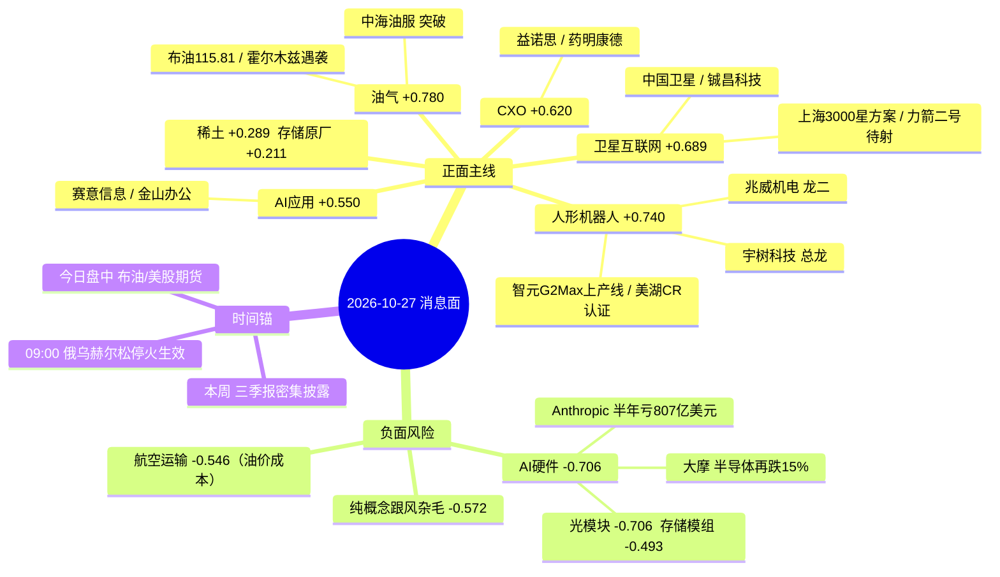

# 2026-10-27（周二）· **消息面事件驱动**

> **数据源新鲜度**: partial · **降级状态**: true · **置信度**: 0.7
> **覆盖窗口**: 2026-10-25 03:00 ~ 2026-10-27 02:50（含隔夜美股与中东） · **主源**: 财联社/新浪快讯 + 公告窗口 4302 条 + 东财三季报预告 + 5 焦点群
> **资金口径**: tushare moneyflow_dc 主力净额（净额=超大单+大单），窗口 20261020-20261026 共 5 个交易日

## 一句话结论
机器人仍是唯一有资金的主线但已进高位分歧段；隔夜中东把油气顶成第二主线；AI 硬件（光模块/CPO）被 Anthropic 亏损与大摩看空双重压制，是本日唯一行业级负面对冲。

## 🗺️ 消息面全景图

## 隔夜与昨日底色

| 维度 | 事实 | 读数 |
|---|---|---|
| 10-26 指数 | 上证 +0.19% 报 3697.52 / 深成 -1.19% / 创业板 -1.71% | 缩量 1.62 万亿（较上日 -3497 亿），超 3100 只下跌 |
| 10-26 结构 | 医药商业、游戏、白酒涨；AI 硬件、贵金属大跌；地产 ETF +3.85%、石油 ETF +3.79% | 高低切换，防御与资源占优 |
| 10-26 主线 | 人形机器人 R2 92.5 分 / 机器人概念 86.7 / 人工智能 75.0 | 机器人是唯一有高度与资金的主线 |
| 隔夜外围 | 布油结算 115.81（-0.78%）/ WTI 101.76 / 美元指数破 102 / 美 2 年期得标 4.708% | 油价高位+利率高位，压制成长估值 |
| 隔夜 AI | Anthropic 递交纳斯达克 IPO，半年营收 163 亿、净亏 807 亿美元 | AI 融资叙事受损，算力租赁股下挫 |
| 情绪 | R3 晚间情绪 56 分；KOL 对物理AI 仍抱修复预期但已减仓，冰哥满仓拿先手、胡小花空仓 | 分歧市，不做一致性追高 |

## 🎯 E20261027_001 · 上海卫星互联网行动方案落地 3000 星 800 亿 + 力箭二号待射
**strength=high · polarity=正面 · raw=+0.80 · weighted=+0.689（λ=0.15, days_since=1, decayed=false） · 有效期 1-2周**

**事件摘要**: 上海市政府/市经信委等六部门《上海市卫星互联网产业创新发展行动方案(2027-2030)》10-26 17:05-17:12 连发 6 条；Tushare快讯(10-26 14:38 力箭二号遥二转运至发射区 近期择机发射)；新华社(10-27 00:10 工信部拟新增 34 家领航级智能工厂 含卫星互联网配套)

**推理深度三问**:
- **大资金意图**: 上海六部门联合发文把卫星互联网从主题抬到五年规划级订单池: 2030 年在轨 3000 颗、星间激光 400Gbps、核心产业 800 亿。AI 硬件杀估值时, 机构需要一个政策确定性方向承接, 这份文件正好提供了可直接对应招标的量。
- **为什么走强**: 卫星链 10-26 已先跌(铖昌跌停、天银 -1.6%、中国卫星 -1.4%), 盘后政策属超跌+新催化; 力箭二号遥二已转运待射, 给了一个明确时间锚, 今日竞价就会定价。
- **逻辑够不够硬**: 中等偏硬。部委级正式文件是硬的, 但 2027-2030 是中长期规划, 当期业绩弹性有限; 昨日资金仍在流出, 属叙事先行、资金未认, 所以只给观察不给首选。

### 中国卫星 600118.SH · role=卫星总体 · rank=龙头 · **观察**

| 收盘 | 涨跌 | MA5 | MA20 | 距60日高 | 5日主力净额 | 正流入天数 |
|---|---|---|---|---|---|---|
| 50.71 | -1.42% | 51.21 | 53.74 | -30.32% | -0.98 亿 | 1/5 |

- **买入理由**: 上海方案直接对应卫星总体订单, 宇航制造及卫星应用占营收 98.18%, 是政策首日超跌反弹的天然载体。
- **风险点**: 10-26 收 50.71 已破 MA5 51.21 与 MA20 53.74, 主力 5 日 -0.98 亿(1/5); 政策是 2027-2030 中长期, 当期业绩弹性有限。
- **止损条件**: 跌破 47.20(参考价 -6.9%)或失守 10-23 低点 47.8 离场。（止损价 47.20；目标区间 56.00-59.50，建议仓位 5%）
- **可验证假设**: 今日竞价高开 >2% 且开盘 30 分钟主力净流入转正 → 政策被资金接受; 否则按一日游处理。
- 业务相关性 0.95：hithink主营: 宇航制造及卫星应用 98.18% 收入 18.51 亿 毛利率 17.6%
- 板块联动 0.72：10-26 板块普跌(铖昌跌停/天银-1.6%) 政策盘后落地 属超跌+新催化 尚未获资金确认
- 仓位纪律：政策首日不追 需竞价放量确认 主力5日-0.98亿(1/5)

### 铖昌科技 001270.SZ · role=星载T/R芯片 · rank=龙二 · **观察**

| 收盘 | 涨跌 | MA5 | MA20 | 距60日高 | 5日主力净额 | 正流入天数 |
|---|---|---|---|---|---|---|
| 75.6 | -10.00% | 82.43 | 87.83 | -39.82% | -0.55 亿 | 2/5 |

- **买入理由**: 星载相控阵 T/R 芯片是星间激光与星座组网的直接受益环节, 弹性大于总体厂。
- **风险点**: 10-26 跌停 -10.0%, 距 60 日高 -39.8%, 趋势未修复; 主力 5 日 -0.55 亿(2/5)。
- **止损条件**: 跌破 69.00(参考价 -8.7%)不接; 跌停次日再破 69 视为趋势延续。（止损价 69.00；目标区间 86.00-92.00，建议仓位 4%）
- **可验证假设**: 跌停次日若不高开 >3% 则放弃; 高开且 15 分钟不破均价线才纳入观察。
- 业务相关性 0.9：hithink主营: 相控阵T/R芯片为主 卫星互联网星载核心器件
- 板块联动 0.68：10-26 跌停 -10.0% 距60日高 -39.8% 位置低但趋势未修复 只做右侧
- 仓位纪律：10-26 跌停 未修复前不接 主力5日-0.55亿(2/5)

> 备注：政策 2027-2030 中长期 非当期业绩; 上海方案给的是星地网络/星间激光 400Gbps 与 800 亿产业规模 交易的是 2026-2027 招标预期

## 🎯 E20261027_002 · 人形机器人量产三连 智元 G2 Max 上产线 美湖关节过 CR 认证 上纬 20cm
**strength=high · polarity=正面 · raw=+0.86 · weighted=+0.740（λ=0.15, days_since=1, decayed=false） · 有效期 1-3日**

**事件摘要**: 证券时报(10-26 15:58 智元发布安规级重载具身机器人精灵 G2 Max 已在产线应用)；公司公告(10-26 17:28 美湖股份 谐波关节模组通过国家机器人产品认证 CR-3-05)；Tushare快讯(10-26 13:28 人形机器人板块拉升 上纬新材 20CM 涨停 泛亚微透涨停)；Tushare快讯(10-26 13:26 宇树科技盘中涨超 10% 报 687 元)；群聊-连板接力群(10-26 10:26 大业股份超预期 机器人属性)

**推理深度三问**:
- **大资金意图**: 机器人是 10-26 唯一同时具备高度、连板与资金的主线(R2 92.5 分)。智元 G2 Max 单臂 20kg、双臂峰值 50kg 且已在产线应用, 是演示到交付的硬证据; AI 硬件崩塌时主力必须守住这条人气主线。
- **为什么走强**: 宇树 +7.69%、上纬 20cm 二连板、大业 +8.08%, 板块内部有真实换手; 美湖谐波关节过 CR-3-05 认证是国内首家, 给零部件补涨分支一个硬资质抓手。
- **逻辑够不够硬**: 硬在产业进度, 软在筹码。宇树与上纬今晚同时披露异动公告, KOL 冰哥/Bob 已预期大业今日跌停开, 板块处在高位分歧段; 因此只做总龙与龙二的分歧, 不碰中位补涨与杂毛。

### 宇树科技 688836.SH · role=人形机器人总龙 · rank=龙头 · **研究首选**

| 收盘 | 涨跌 | MA5 | MA20 | 距60日高 | 5日主力净额 | 正流入天数 |
|---|---|---|---|---|---|---|
| 672.0 | +7.69% | 571.41 | 482.34 | -38.91% | +5.22 亿 | 3/5 |

- **买入理由**: 人形机器人总龙, 人形机器人收入占 51.1%、毛利率 63.2%; 10-26 +7.69% 收 672, 5 日累计 +35.5%(MA5 571 之上 17.6%), 主力 5 日 +5.22 亿(3/5), 距 60 日高仍有 -38.9% 空间。
- **风险点**: 10-27 披露股票交易异常波动公告, 高位加速段有监管降温风险; KOL 已预期板块内部大业跌停开, 分歧极大。
- **止损条件**: 跌破 620(参考价 -7.7%)离场; 硬止损为 5 日线 571。（止损价 620.00；目标区间 760.00-800.00，建议仓位 6%）
- **可验证假设**: 开盘 30 分钟不破 MA5 571 且成交额 ≥ 昨日 80% → 主升延续; 破 571 则只做日内 T 不加仓。
- 业务相关性 0.97：hithink主营: 人形机器人 51.1%(毛利率63.2%) 四足机器人 41.1% 机器人组件 6.1%
- 板块联动 0.93：10-26 +7.69% 收672 5日+17.6% 距60日高 -38.9% 主力5日+5.22亿(3/5) 板块唯一持续获资金的总龙
- 仓位纪律：总龙 8%上限压到6% 因10-27有异动公告 不追高只做分歧

### 兆威机电 003021.SZ · role=灵巧手/微型传动 · rank=龙二 · **研究首选**

| 收盘 | 涨跌 | MA5 | MA20 | 距60日高 | 5日主力净额 | 正流入天数 |
|---|---|---|---|---|---|---|
| 96.26 | +4.94% | 83.95 | 71.39 | -1.79% | +3.06 亿 | 4/5 |

- **买入理由**: 灵巧手与微型传动龙二, 微型传动系统占 62.0%、精密注塑件 33.9%; 10-26 +4.94% 收 96.26, 距 60 日高仅 -1.79%, 主力 5 日 +3.06 亿(4/5)。
- **风险点**: 新高附近波动放大, 96 元高价股对情绪敏感; 板块若整体退潮, 龙二回撤快于总龙。
- **止损条件**: 跌破 89.50(参考价 -7.0%)离场; 失守 MA5 83.95 为硬止损。（止损价 89.50；目标区间 110.00-115.00，建议仓位 8%）
- **可验证假设**: 不破 89.5 且封单持续 → 按主升持有; 若日内开板 ≥3 次则降级为做 T。
- 业务相关性 0.91：hithink主营: 微型传动系统 62.0% 精密注塑件 33.9% 灵巧手 17 自由度指关节自研
- 板块联动 0.88：10-26 +4.94% 收96.26 5日+14.7% 距60日高 -1.8% 主力5日+3.06亿(4/5) 零部件方向最强
- 仓位纪律：龙二 距60日高仅-1.8% 新高附近只做分歧不做加速

### 美湖股份 603319.SH · role=谐波关节模组 · rank=龙三 · **观察**

| 收盘 | 涨跌 | MA5 | MA20 | 距60日高 | 5日主力净额 | 正流入天数 |
|---|---|---|---|---|---|---|
| 24.12 | -4.29% | 24.38 | 26.54 | -27.78% | -0.22 亿 | 2/5 |

- **买入理由**: 国内首家谐波关节模组通过 CR-3-05 机器人一体化关节认证, 同时公告 3000-5000 万元回购, 资质与托底同时具备。
- **风险点**: 10-26 收跌 -4.29%, 主力 5 日 -0.22 亿(2/5), 催化与资金背离; 汽车零部件仍占营收 83.1%, 机器人收入占比小。
- **止损条件**: 跌破 22.30(参考价 -7.5%)或失守认证公告日低点 22.6 离场。（止损价 22.30；目标区间 27.50-29.00，建议仓位 4%）
- **可验证假设**: 今日放量收复 MA5 24.38 → 催化被接受; 否则维持观察, 不做左侧。
- 业务相关性 0.86：hithink主营: 汽车零部件 83.1% 执行器业务 1.7%; 谐波关节模组为国内首家 CR-3-05 认证
- 板块联动 0.7：10-26 -4.29% 收24.12 破5日线 距60日高 -27.8% 主力5日-0.22亿(2/5) 催化与资金背离
- 仓位纪律：认证是硬催化但10-26收跌4.29% 资金未认 只观察

> 备注：同日上纬新材/宇树科技双双披露股票交易异常波动公告(10-27), 高位票有监管降温风险; KOL 冰哥/Bob 预期大业股份 10-27 跌停开, 板块内部分歧极大

## 🎯 E20261027_003 · 中东互袭升级 布油结算 115.81 美元 油运与油服重定价
**strength=high · polarity=正面 · raw=+0.78 · weighted=+0.780（λ=0.15, days_since=0, decayed=false） · 有效期 1-2周**

**事件摘要**: 央视新闻(10-26 16:35 沙特多国联军与胡塞武装相互打击 拦截射向利雅得弹道导弹)；央视新闻(10-26 18:13 一艘油轮在霍尔木兹海峡遭不明弹体袭击 失去航行能力)；Tushare快讯(10-27 02:44 布伦特原油期货结算价 115.81 美元/桶)；Tushare快讯(10-26 15:44 高盛建议增持大宗商品 称地缘冲突与供应链集中)；Tushare快讯(10-27 02:06 WTI 原油期权看涨偏斜升至 +7.2% 为 9 月 10 日以来最高)

**推理深度三问**:
- **大资金意图**: 布油结算 115.81 美元、WTI 期权看涨偏斜 7.2% 创 9 月 10 日以来新高, 这是真实供应风险而非情绪。AI 硬件杀估值、指数缩量的环境里, 油气是少数业绩与价格双升的方向。
- **为什么走强**: 胡塞袭沙特泵站、霍尔木兹油轮被袭是持续性事件; 油服日费与油运运价直接跟油价, 10-26 石油 ETF 已 +3.79%, 资金提前进场。
- **逻辑够不够硬**: 硬, 但有两个反向变量: 俄乌赫尔松 09:00 停火, 以及 WTI 1-2 月价差从 5.40 收窄至 2.30(现货溢价走弱)。所以做突破的中海油服, 不追高位的中国海油。

### 中海油服 601808.SH · role=油服工程 · rank=龙头 · **研究首选**

| 收盘 | 涨跌 | MA5 | MA20 | 距60日高 | 5日主力净额 | 正流入天数 |
|---|---|---|---|---|---|---|
| 13.49 | +7.23% | 12.83 | 12.55 | -0.81% | -0.07 亿 | 2/5 |

- **买入理由**: 油服弹性最大, 油田技术服务占 52.8%、钻井服务 31.4%; 10-26 +7.23% 收 13.49, 距 60 日高仅 -0.8%, 属突破形态, 油价 115 直接抬升日费与订单。
- **风险点**: 主力 5 日 -0.07 亿尚未确认, 俄乌停火是反向变量; 油价若回吐, 油服回撤大于上游。
- **止损条件**: 跌破 12.50(参考价 -7.3%)或失守 13.00 平台离场。（止损价 12.50；目标区间 15.30-16.20，建议仓位 10%）
- **可验证假设**: 布油维持 >110 且今日不破 13.00 → 突破有效; 布油跌破 108 则降级观察。
- 业务相关性 0.93：hithink主营: 油田技术服务 52.8% 钻井服务 31.4% 船舶服务 10.9%
- 板块联动 0.82：10-26 +7.23% 收13.49 距60日高 -0.8% 主力5日-0.07亿(2/5) 价格先于资金
- 仓位纪律：油服弹性最大 10-26 +7.23% 距60日高仅-0.8% 突破形态

### 中国海油 600938.SH · role=油气开采 · rank=总龙 · **观察**

| 收盘 | 涨跌 | MA5 | MA20 | 距60日高 | 5日主力净额 | 正流入天数 |
|---|---|---|---|---|---|---|
| 35.16 | +4.27% | 34.65 | 34.11 | -2.71% | -0.75 亿 | 1/5 |

- **买入理由**: 上游总龙, 勘探及生产占营收 86.8%, 油价每上涨 10 美元对利润弹性最直接。
- **风险点**: 10-26 +4.27% 但主力 5 日 -0.75 亿(1/5), 价强资金弱; 高股息属性使其在风险偏好回升时弹性不足。
- **止损条件**: 跌破 32.70(参考价 -7.0%)或跌破 34.00 减仓。（止损价 32.70；目标区间 39.00-41.00，建议仓位 6%）
- **可验证假设**: 今日主力净流入 >1 亿才升级为首选; 否则维持观察。
- 业务相关性 0.96：hithink主营: 勘探及生产 86.8% 贸易业务 13.0%
- 板块联动 0.8：10-26 +4.27% 收35.16 距60日高 -2.7% 主力5日-0.75亿(1/5) 价强资金弱
- 仓位纪律：价涨但主力5日-0.75亿(1/5) 资金未确认 只观察

> 备注：双向事件: 油价上冲利好上游/油运, 同时抬高航空与化工成本; 俄乌赫尔松 10-27 09:00 起停火 为潜在缓和变量, 若停火扩散则油价溢价回吐

## 🎯 E20261027_004 · Anthropic IPO 半年亏 807 亿美元 大摩下调半导体支撑位 AI 硬件再定价
**strength=high · polarity=负面 · raw=-0.82 · weighted=-0.706（λ=0.15, days_since=1, decayed=false） · 有效期 2-4周**

**事件摘要**: 财联社(10-26 21:04 Anthropic 公开提交纳斯达克 IPO 申请 上半年营收 163 亿美元 净亏损 807 亿美元)；Tushare快讯(10-26 17:16 大摩 半导体股支撑位或较当前水平低 15%)；Tushare快讯(10-26 21:37 美股 AI 算力租赁商盘初下挫 Nebius -5% CoreWeave -4.1% IREN -3.3%)；群聊-量化研报群(10-26 10:01 光模块今天继续领跌 大资金最怕套牢被市场知道)；Tushare快讯(10-26 21:36 Anthropic 预计将为算力和 AI 基础设施协议支付 1250-1500 亿美元)

**推理深度三问**:
- **大资金意图**: Anthropic 半年净亏 807 亿美元、同时预计为算力支付 1250-1500 亿美元, 把 AI 收入何时兑现的融资担忧推到台面; 大摩直接给出半导体再跌 15% 的支撑位, 机构在减高位算力仓位。
- **为什么走强**: 资金已用脚投票: 中际旭创 5 日主力 -18.12 亿、新易盛 -50.94 亿且 0/5 净流入, 新易盛距 60 日高 -48.9%。这是趋势与资金双杀, 不是单条消息。
- **逻辑够不够硬**: 硬(资金+海外+卖方三方同向)。但 Anthropic 的 1250-1500 亿算力协议说明需求端没消失, 属估值与融资压力而非需求坍塌, 因此是回避而非做空。

### 中际旭创 300308.SZ · role=光模块总龙 · rank=龙头 · **剔除**

| 收盘 | 涨跌 | MA5 | MA20 | 距60日高 | 5日主力净额 | 正流入天数 |
|---|---|---|---|---|---|---|
| 594.5 | -2.96% | 618.38 | 745.69 | -44.95% | -18.12 亿 | 1/5 |

- **买入理由**: 负面记录: 光模块总龙, 光通信收发模块占 99.0%、毛利率 46.6%, 但 10-26 -2.96% 收 594.5, 已破 MA20 745.69。
- **风险点**: 5 日主力 -18.12 亿(1/5)、5 日 -12.9%、距 60 日高 -45.0%; 大摩看半导体再跌 15%, Anthropic 亏损强化融资担忧。
- **止损条件**: 离场线 560(参考价 -5.8%), 破位不接; 禁止买入, 仅记录。（止损价 560.00；目标区间 600.00-620.00，建议仓位 1%）
- **可验证假设**: 3 日内收复 MA20 745 才解除剔除; 否则维持回避。
- 业务相关性 0.97：hithink主营: 光通信收发模块 99.0% 毛利率 46.6%
- 板块联动 0.3：10-26 -2.96% 收594.5 5日-12.9% 距60日高 -45.0% 主力5日-18.12亿(1/5) 趋势与资金双杀
- 仓位纪律：禁止买入 仅记录: 主力5日-18.12亿(1/5) 破MA20 745

### 新易盛 300502.SZ · role=光模块龙二 · rank=龙二 · **剔除**

| 收盘 | 涨跌 | MA5 | MA20 | 距60日高 | 5日主力净额 | 正流入天数 |
|---|---|---|---|---|---|---|
| 251.69 | -3.57% | 272.6 | 352.09 | -48.89% | -50.94 亿 | 0/5 |

- **买入理由**: 负面记录: 光互联产品占 99.9%、毛利率 48.5%, 10-26 -3.57% 收 251.69。
- **风险点**: 5 日主力 -50.94 亿且 0/5 净流入, 5 日 -17.1%, 距 60 日高 -48.9%, 仍在下降通道。
- **止损条件**: 离场线 238(参考价 -5.4%), 破位不接; 禁止买入, 仅记录。（止损价 238.00；目标区间 255.00-265.00，建议仓位 1%）
- **可验证假设**: 出现单日 >5 亿主力净流入才重新评估; 在此之前不参与任何反弹。
- 业务相关性 0.95：hithink主营: 光互联产品 99.9% 毛利率 48.5%
- 板块联动 0.25：10-26 -3.57% 收251.69 5日-17.1% 距60日高 -48.9% 主力5日-50.94亿 连续5日零净流入
- 仓位纪律：禁止买入 仅记录: 主力5日-50.94亿 0/5 净流入

> 备注：行业级利空: 高位算力持仓减仓/买点后置(错题本004模板); 反向变量是 Anthropic 1250-1500 亿美元算力协议 = 需求端未消失, 属估值/融资压力而非需求坍塌

## 🎯 E20261027_005 · OpenAI GPT-6.1 Terra 主打电脑操作 AI Agent 从聊天走向执行
**strength=medium · polarity=正面 · raw=+0.55 · weighted=+0.550（λ=0.15, days_since=0, decayed=false） · 有效期 1-3日**

**事件摘要**: OpenAI 官方(10-27 02:12 GPT-6.1 Terra 陆续推送 速度更快成本更低 提升计算机操作能力)；Tushare快讯(10-27 02:29 GPT-6.1 API 输入 1 美元/输出 5 美元每百万 token)；Tushare快讯(10-27 01:34 IBM 与英伟达将 AI 智能体身份和运行时访问控制绑定)；Tushare快讯(10-27 02:39 苹果 Siri AI 扩展至法日韩葡西语 年底前上线中文繁体)

**推理深度三问**:
- **大资金意图**: GPT-6.1 Terra 把 Agent 从对话推进到操作电脑, API 输入 1 美元、输出 5 美元每百万 token 处全球最低档之一, 直接压低应用成本、抬高 token 消耗; IBM 与英伟达补的是 Agent 身份与运行时权限, 企业落地最后一环。
- **为什么走强**: A 股 AI 应用 10-26 是少数逆势方向(金山办公 +1.45%), 赛意信息首个高吞吐算力集群 Q3 开始商用收费, 叙事与落地同时有证据。
- **逻辑够不够硬**: 中等。海外模型迭代对 A 股是映射不是订单; 真正硬的是赛意 5/5 主力净流入与 Q3 商用收费。只做有资金证据的赛意, 金山办公只观察。

### 赛意信息 300687.SZ · role=AI Agent/算力运营 · rank=龙二 · **研究首选**

| 收盘 | 涨跌 | MA5 | MA20 | 距60日高 | 5日主力净额 | 正流入天数 |
|---|---|---|---|---|---|---|
| 27.89 | -3.06% | 26.69 | 27.05 | -10.92% | +0.77 亿 | 5/5 |

- **买入理由**: 泛 ERP 30.5%+智能制造 15.8% 的基本盘之上, 首个高吞吐算力集群 2026Q3 正式商用收费, 算力业务从资本开支转入商业化; 10-26 主力 5 日 +0.77 亿且 5/5 净流入, 是 AI 应用里唯一资金连续确认的票。
- **风险点**: 中小市值 AI 应用, 今日 -3.06% 回落至 27.89, 仍在 MA20 27.05 上方但已失守 MA5 走势; 叙事依赖海外模型迭代, 自身算力规模有限。
- **止损条件**: 跌破 25.90(参考价 -7.1%)或失守 MA20 27.05 离场。（止损价 25.90；目标区间 31.80-33.50，建议仓位 8%）
- **可验证假设**: 今日守住 MA20 27.05 且主力继续净流入 → 成立; 若放量跌破 27.05 则降级观察。
- 业务相关性 0.88：hithink主营: 泛ERP 30.5% 智能制造 15.8%; 首个高吞吐算力集群 2026Q3 商用收费
- 板块联动 0.74：10-26 -3.06% 收27.89 主力5日+0.77亿(5/5) 距60日高 -10.9% 资金与价格背离
- 仓位纪律：唯一5/5主力净流入的AI应用票 + 算力Q3商用收费落地

### 金山办公 688111.SH · role=AI 办公 Agent · rank=龙头 · **观察**

| 收盘 | 涨跌 | MA5 | MA20 | 距60日高 | 5日主力净额 | 正流入天数 |
|---|---|---|---|---|---|---|
| 252.57 | +1.45% | 241.89 | 230.19 | -12.70% | -1.86 亿 | 1/5 |

- **买入理由**: WPS 个人业务占 59.4%、软件毛利率 86.0%, 是 A 股最正的 AI Agent 办公入口, GPT-6.1 类电脑操作模型直接提升其订阅价值。
- **风险点**: 10-26 +1.45% 但主力 5 日 -1.86 亿(1/5); 252 元高价股, 对情绪与流动性敏感。
- **止损条件**: 跌破 234(参考价 -7.4%)或失守 MA20 230.19 离场。（止损价 234.00；目标区间 280.00-295.00，建议仓位 5%）
- **可验证假设**: 站上 MA20 230 且成交额放大 30% → 升级; 否则只观察。
- 业务相关性 0.9：hithink主营: WPS 个人业务 59.4% 软件收入 100% 毛利率 86.0%
- 板块联动 0.7：10-26 +1.45% 收252.57 5日+4.4% 距60日高 -12.7% 主力5日-1.86亿(1/5)
- 仓位纪律：Agent 叙事最正但主力5日-1.86亿(1/5) 只观察

> 备注：与 E004 构成同一 AI 叙事正反两面: 模型降价+Agent 落地 = 应用受益, 但同时压低算力硬件单位价值预期; 两面必须并列

## 🎯 E20261027_006 · CXO 三季报硬超预期 药明康德上调指引 益诺思单季环比翻倍
**strength=medium · polarity=正面 · raw=+0.72 · weighted=+0.620（λ=0.15, days_since=1, decayed=false） · 有效期 1-2周**

**事件摘要**: 公司公告(10-26 17:06 药明康德 前三季营收455.37亿 +38.6% 归母193.98亿 +60.6% 上调全年指引至610-619亿)；公司公告(10-26 17:33 益诺思 Q3 净利5484.1万 +13559.9% 新签订单22.18亿 +183.27%)；群聊-综合大群(10-26 14:12 西湖大学连发 Cell 三篇 铁死亡抗癌机制突破)；群聊-综合大群(10-26 14:12 国家药监局批准全球首个 XI 因子抑制剂)

**推理深度三问**:
- **大资金意图**: 三季报期资金从故事回到利润。药明康德上调全年指引至 610-619 亿、在手订单 767.4 亿 +36.4%, 是全球 CXO 周期反转的硬证据; 益诺思单季环比 +103%、新签订单 +183% 提供二线弹性。
- **为什么走强**: 10-26 医药商业与创新药已在涨幅前列, 业绩盘后落地形成板块强+个股超预期的共振; 西湖大学铁死亡 Cell 三篇与首个 XI 因子抑制剂获批提供题材热度。
- **逻辑够不够硬**: 硬, 公告数字可核。但药明 5 日主力 -6.98 亿, 说明大资金业绩前已减仓; 故首选给低位+资金微流入的益诺思, 药明只观察。

### 益诺思 688710.SH · role=非临床 CRO · rank=龙二 · **研究首选**

| 收盘 | 涨跌 | MA5 | MA20 | 距60日高 | 5日主力净额 | 正流入天数 |
|---|---|---|---|---|---|---|
| 81.5 | +0.42% | 82.82 | 92.33 | -27.23% | +0.30 亿 | 2/5 |

- **买入理由**: Q3 单季净利 0.55 亿、环比 +103.4%, 营收环比 +26.1%, 新签订单 22.18 亿 +183.27%, 在手订单 26.25 亿较年末 +110%; 距 60 日高 -27.2% 属低位, 主力 5 日 +0.30 亿。
- **风险点**: 同日公告计提信用与资产减值, 小市值 CRO 流动性一般; 非临床 CRO 占 96.2%, 业务集中度高。
- **止损条件**: 跌破 75.80(参考价 -7.0%)或失守 78.00 离场。（止损价 75.80；目标区间 93.00-98.00，建议仓位 7%）
- **可验证假设**: 今日放量站上 MA5 82.82 → 业绩被资金接受; 否则等回踩 78 再看。
- 业务相关性 0.92：hithink主营: 非临床 CRO 96.2% 毛利率 25.8%
- 板块联动 0.66：10-26 +0.42% 收81.50 距60日高 -27.2% 主力5日+0.30亿(2/5) 低位+业绩加速
- 仓位纪律：单季环比+103% 订单+183% 低位+资金微流入

### 药明康德 603259.SH · role=CXO 总龙 · rank=龙头 · **观察**

| 收盘 | 涨跌 | MA5 | MA20 | 距60日高 | 5日主力净额 | 正流入天数 |
|---|---|---|---|---|---|---|
| 146.0 | +0.88% | 145.41 | 155.87 | -15.90% | -6.98 亿 | 2/5 |

- **买入理由**: 前三季营收 455.37 亿 +38.6%、归母 193.98 亿 +60.6%, 在手订单 767.4 亿 +36.4%, 全年指引上调至 610-619 亿, 化学业务 +51.5%。
- **风险点**: 5 日主力 -6.98 亿(2/5)、已破 MA20 155.87; 业绩前机构已减仓, 存在利好兑现压力。
- **止损条件**: 跌破 135.50(参考价 -7.2%)或失守 140 离场。（止损价 135.50；目标区间 165.00-172.00，建议仓位 5%）
- **可验证假设**: 今日收复 MA20 155.87 → 升级首选; 若冲高回落收在 MA20 下方, 维持观察。
- 业务相关性 0.9：hithink主营: 化学业务为主 境外收入 83.5% 毛利率 51.7%
- 板块联动 0.6：10-26 +0.88% 收146.00 5日-1.0% 距60日高 -15.9% 主力5日-6.98亿(2/5)
- 仓位纪律：业绩最强但主力5日-6.98亿(2/5) 资金否决 只观察

> 备注：单季环比协议核查: 药明 Q3 单季 83.18 亿 vs Q2 64.29 亿 = +29.4%(营收环比仅+1.1%, 利润来自结构); 益诺思 Q3 0.55 亿 vs Q2 0.27 亿 = +103.4%; 均非基数失真

## 🎯 E20261027_007 · 中国稀土 Q3 单季环比 +74% 稀土价格与量双升
**strength=medium · polarity=正面 · raw=+0.48 · weighted=+0.413（λ=0.15, days_since=1, decayed=false） · 有效期 1-2周**

**事件摘要**: 公司公告(10-26 17:02 中国稀土 Q3 净利1.71亿 +461.73% 扣非1.7亿 +477.12% 前三季4.08亿 +112.37%)；东财业绩预告(10-17 中国稀土 预增 88.96%-140.99% 扣非 98.63%-152.94%)；东财业绩预告(10-13 北方稀土 预增 134.95%-138.84%)

**推理深度三问**:
- **大资金意图**: 中国稀土 Q3 单季 1.71 亿、环比 +74%、营收环比 +22.4%, 量价同升; 北方稀土预增 134.95-138.84% 交叉验证行业景气。资金在三季报后需要给周期股重新定价。
- **为什么走强**: 稀土是 10-26 少数有硬业绩的资源方向, 且板块位置低(中国稀土距 60 日高 -23%)。
- **逻辑够不够硬**: 中等。业绩 10-17 已预告, 10-26 正式财报属二次确认而非新增; 中国稀土同时计提资产减值, 5 日主力 -0.70 亿、股价 -2.87%, 属利好兑现后段, 只观察不追。

### 中国稀土 000831.SZ · role=稀土冶炼分离 · rank=龙头 · **观察**

| 收盘 | 涨跌 | MA5 | MA20 | 距60日高 | 5日主力净额 | 正流入天数 |
|---|---|---|---|---|---|---|
| 48.69 | -2.87% | 49.33 | 50.41 | -22.96% | -0.70 亿 | 2/5 |

- **买入理由**: Q3 单季净利 1.71 亿、环比 +74%, 营收环比 +22.4%, 扣非同比 +477%, 量价同升验证稀土景气; 稀土氧化物占 77.9%。
- **风险点**: 业绩 10-17 已预告, 正式财报属二次确认; 同日计提资产减值, 5 日主力 -0.70 亿(2/5), 股价 -2.87%。
- **止损条件**: 跌破 45.20(参考价 -7.2%)或失守 46.50 离场。（止损价 45.20；目标区间 55.00-57.50，建议仓位 5%）
- **可验证假设**: 今日主力净流入转正且站上 MA5 49.33 → 升级; 否则按利好兑现处理。
- 业务相关性 0.95：hithink主营: 稀土氧化物 77.9%(毛利率22.2%) 稀土金属及合金 21.5%
- 板块联动 0.62：10-26 -2.87% 收48.69 5日-4.3% 距60日高 -23.0% 主力5日-0.70亿(2/5)
- 仓位纪律：Q3环比+74%但主力5日-0.70亿 且计提减值 只观察

### 北方稀土 600111.SH · role=稀土总龙 · rank=龙头 · **观察**

| 收盘 | 涨跌 | MA5 | MA20 | 距60日高 | 5日主力净额 | 正流入天数 |
|---|---|---|---|---|---|---|
| 36.29 | -0.66% | 36.01 | 35.88 | -19.53% | -0.70 亿 | 2/5 |

- **买入理由**: 预增 134.95-138.84%, 稀土总龙, 国内收入占 98.1%, 股价 36.29 贴 MA20 35.88 属低位。
- **风险点**: 5 日主力 -0.70 亿(2/5), 价格未启动; 稀土板块整体资金关注度低于机器人。
- **止损条件**: 跌破 33.70(参考价 -7.1%)或失守 34.50 离场。（止损价 33.70；目标区间 41.00-42.50，建议仓位 5%）
- **可验证假设**: 板块出现 ≥2 只涨停且北稀放量 → 升级; 否则维持观察。
- 业务相关性 0.94：hithink主营: 稀土原料与功能材料 国内收入 98.1%
- 板块联动 0.58：10-26 -0.66% 收36.29 距60日高 -19.5% 主力5日-0.70亿(2/5)
- 仓位纪律：预增135%但股价贴MA20 资金未回 只观察

> 备注：周期股协议: 累计同比+461%仅作背景, 关键是 Q3 单季1.71亿 vs Q2 0.98亿=+74%, 营收环比+22.4%, 量价同升 → 判正面而非见顶; 但预告已10-17落地, 属利好兑现后段, 股价与资金未跟随

## 🎯 E20261027_008 · 存储环节错配 HBM4 明年 Q2 量产 模组端渠道价倒挂
**strength=medium · polarity=中性 · raw=+0.35 · weighted=+0.301（λ=0.15, days_since=1, decayed=false） · 有效期 2-4周**

**事件摘要**: ZDNet Korea(10-26 14:37 三星/SK海力士 8 层 HBM4 明年 Q2 量产并交付英伟达)；Tushare快讯(10-26 17:04 SK海力士拟推出 50-60 万亿韩元股东回报 全年合计 100 万亿)；央视财经(10-26 19:28 内存条价格坚挺 有价无市 10 月销量下滑 20-30%)；Tushare快讯(10-26 17:24 出厂价还在涨 渠道价已经倒挂)

**推理深度三问**:
- **大资金意图**: 存储出现教科书式环节错配: 原厂端 HBM4 明年 Q2 量产供英伟达、SK 海力士推 100 万亿韩元股东回报; 模组端内存条渠道价倒挂、10 月销量 -20~30%, 德明利 Q3 单季环比仅 +2.2% 而营收 +24.2%。
- **为什么走强**: 市场在给原厂与设备溢价、给模组折价: 兆易创新 5 日主力 +11.68 亿逆势吸筹, 江波龙 -3.19 亿。
- **逻辑够不够硬**: 硬在数据(德明利 QoQ 可算), 弱在事件本身是中性。因此只观察兆易, 剔除模组。

### 兆易创新 603986.SH · role=利基存储原厂 · rank=龙头 · **观察**

| 收盘 | 涨跌 | MA5 | MA20 | 距60日高 | 5日主力净额 | 正流入天数 |
|---|---|---|---|---|---|---|
| 276.45 | -5.33% | 283.13 | 324.25 | -39.35% | +11.68 亿 | 3/5 |

- **买入理由**: 存储芯片占营收 85.0%、毛利率 67.6%, 属原厂环节; 5 日主力 +11.68 亿(3/5) 在股价 -5.33% 时逆势吸筹, 是存储链最强资金信号。
- **风险点**: 10-26 -5.33% 收 276.45 已破 MA5 283.13, 距 60 日高 -39.4%; Q3 财报尚未披露, 原厂≠HBM, HBM4 利好传导有限。
- **止损条件**: 跌破 257(参考价 -7.0%)或失守 265 离场。（止损价 257.00；目标区间 315.00-330.00，建议仓位 5%）
- **可验证假设**: 今日不破 265 且主力继续净流入 → 升级; 若 Q3 披露低于预期则直接剔除。
- 业务相关性 0.93：hithink主营: 存储芯片 85.0%(毛利率67.6%) 微控制器 12.4%
- 板块联动 0.66：10-26 -5.33% 收276.45 距60日高 -39.4% 主力5日+11.68亿(3/5) 价格与资金强背离
- 仓位纪律：主力5日+11.68亿逆势吸筹 但价格破位 且Q3未披露 只观察

### 江波龙 301308.SZ · role=存储模组 · rank=龙二 · **剔除**

| 收盘 | 涨跌 | MA5 | MA20 | 距60日高 | 5日主力净额 | 正流入天数 |
|---|---|---|---|---|---|---|
| 233.0 | -4.77% | 242.73 | 280.86 | -47.29% | -3.19 亿 | 2/5 |

- **买入理由**: 负面记录: 存储模组占 100%、毛利率 19.4%, 境外收入 70.6%; Q3 单季拆分未取到(earnings_qoq_unverified), 但渠道价倒挂与销量 -20~30% 已指向模组端恶化。
- **风险点**: 5 日主力 -3.19 亿(2/5)、今日 -4.77%、距 60 日高 -47.3%; 模组环节被原厂与渠道两头挤压。
- **止损条件**: 离场线 215(参考价 -7.7%), 破位不接; 禁止买入, 仅记录。（止损价 215.00；目标区间 240.00-250.00，建议仓位 1%）
- **可验证假设**: 原厂涨价传导至模组毛利率回升(需 Q3 毛利率验证)才重新评估。
- 业务相关性 0.92：hithink主营: 存储行业 100% 毛利率 19.4% 境外收入 70.6%
- 板块联动 0.35：10-26 -4.77% 收233.00 5日-8.2% 距60日高 -47.3% 主力5日-3.19亿(2/5)
- 仓位纪律：禁止买入 仅记录: 模组环节Q3环比转负 渠道倒挂 主力5日-3.19亿

> 备注：v1.5 环节错配协议: 德明利 Q3 单季27.29亿 vs Q2 26.71亿=+2.2%, 营收环比+24.2% → 增收不增利, 模组端不配给正面; 江波龙 Q3 单季拆分未取到(earnings_qoq_unverified), 按协议只给中性并剔除

## 📊 板块 × 事件热力矩阵

净分 = Σ |weighted_score| × sign(板块极性) × strength 权重（high 1.0 / medium 0.7 / low 0.4）；同板块同名累加；±0.12 以内为分歧。

| 板块 | 事件 | 正/负 | 净分 | 极性 | 叉乘明细 |
|---|---|:--:|---:|:--:|---|
| 油气开采 | 003 | 1/0 | +0.780 | 正面 | E20261027_003 正面×1.00=+0.780 → 净+0.780 |
| 人形机器人零部件 | 002 | 1/0 | +0.740 | 正面 | E20261027_002 正面×1.00=+0.740 → 净+0.740 |
| 人形机器人本体 | 002 | 1/0 | +0.740 | 正面 | E20261027_002 正面×1.00=+0.740 → 净+0.740 |
| 卫星互联网/商业航天 | 001 | 1/0 | +0.689 | 正面 | E20261027_001 正面×1.00=+0.689 → 净+0.689 |
| CXO/创新药 | 006 | 1/0 | +0.620 | 正面 | E20261027_006 正面×1.00=+0.620 → 净+0.620 |
| AI应用/Agent | 005 | 1/0 | +0.550 | 正面 | E20261027_005 正面×1.00=+0.550 → 净+0.550 |
| 油服工程 | 003 | 1/0 | +0.546 | 正面 | E20261027_003 正面×0.70=+0.546 → 净+0.546 |
| 油运/航运 | 003 | 1/0 | +0.546 | 正面 | E20261027_003 正面×0.70=+0.546 → 净+0.546 |
| 物理AI/数据采集 | 002 | 1/0 | +0.518 | 正面 | E20261027_002 正面×0.70=+0.518 → 净+0.518 |
| 星载芯片/星间激光 | 001 | 1/0 | +0.482 | 正面 | E20261027_001 正面×0.70=+0.482 → 净+0.482 |
| 端侧AI/消费电子 | 005 | 1/0 | +0.385 | 正面 | E20261027_005 正面×0.70=+0.385 → 净+0.385 |
| 稀土 | 007 | 1/0 | +0.289 | 正面 | E20261027_007 正面×0.70=+0.289 → 净+0.289 |
| 医疗服务 | 006 | 1/0 | +0.248 | 正面 | E20261027_006 正面×0.40=+0.248 → 净+0.248 |
| 存储原厂/HBM链 | 008 | 1/0 | +0.211 | 正面 | E20261027_008 正面×0.70=+0.211 → 净+0.211 |
| 小金属/资源 | 007 | 1/0 | +0.165 | 正面 | E20261027_007 正面×0.40=+0.165 → 净+0.165 |
| 半导体设备/材料 | 004/008 | 1/1 | -0.374 | 负面 | E20261027_004 负面×0.70=-0.494 ｜ E20261027_008 正面×0.40=+0.120 → 净-0.374 |
| 存储模组 | 004/008 | 0/2 | -0.493 | 负面 | E20261027_004 负面×0.40=-0.282 ｜ E20261027_008 负面×0.70=-0.211 → 净-0.493 |
| 航空运输 | 003 | 0/1 | -0.546 | 负面 | E20261027_003 负面×0.70=-0.546 → 净-0.546 |
| 纯概念跟风杂毛 | 001/002 | 0/2 | -0.572 | 负面 | E20261027_001 负面×0.40=-0.276 ｜ E20261027_002 负面×0.40=-0.296 → 净-0.572 |
| 光模块/CPO | 004 | 0/1 | -0.706 | 负面 | E20261027_004 负面×1.00=-0.706 → 净-0.706 |
| AI算力硬件高位持仓 | 004 | 0/1 | -0.706 | 负面 | E20261027_004 负面×1.00=-0.706 → 净-0.706 |

### 多事件叉乘结论（sector_cross_summary）

| 板块 | 事件数 | 净分 | 极性 | 结论 |
|---|:--:|---:|:--:|---|
| 半导体设备/材料 | 2 | -0.374 | 负面 | E004 AI 硬件利空（-0.494）压过 E008 HBM4 扩产利好（+0.120），净 -0.374：设备材料只做个股 alpha，不做板块 beta。 |
| 存储模组 | 2 | -0.493 | 负面 | E004 算力融资担忧（-0.282）+ E008 渠道倒挂（-0.211）= -0.493：模组是本日最该回避的细分，江波龙剔除。 |
| 纯概念跟风杂毛 | 2 | -0.572 | 负面 | E001 卫星与 E002 机器人同时给跟风盘负分：两条主线的杂毛补涨都不接，只做龙头与低位。 |

## 🔥 三季报业绩预告命中（硬 alpha 交叉验证）

东财业绩预告（报告期 2026-09-30，共 500 条）按预告增速下限排序，取前 12 + 与本文事件板块交集票：

| 代码 | 名称 | 类型 | 增速下限~上限 | 事件命中 | 强度 |
|---|---|---|---|---|---|
| 001309 | 德明利 | 扭亏 | 32047%~33154% | E008 存储（模组环节错配） | 🟢🟢 |
| 300821 | 东岳硅材 | 预增 | 19048%~19748% | — | 🟡 |
| 000703 | 恒逸石化 | 预增 | 9837%~10091% | —（化工，非本日事件） | 🟡 |
| 002466 | 天齐锂业 | 预增 | 6957%~8220% | —（锂，非本日事件） | 🟡 |
| 688388 | 嘉元科技 | 预增 | 3066%~3330% | — | 🟡 |
| 301308 | 江波龙 | 预增 | 2782%~2991% | E008 存储（模组，剔除） | 🟢🟢 |
| 688825 | 长鑫科技 | 扭亏 | 2581%~2609% | E008 存储（原厂） | 🟢🟢 |
| 002812 | 恩捷股份 | 扭亏 | 1961%~2554% | — | 🟡 |
| 688378 | 奥来德 | 扭亏 | 1898%~2225% | — | 🟡 |
| 688808 | 联讯仪器 | 预增 | 1866%~2073% | — | 🟡 |
| 301511 | 德福科技 | 预增 | 1479%~1635% | — | 🟡 |
| 605189 | 富春染织 | 预增 | 1348%~1519% | — | 🟡 |
| 600111 | 北方稀土 | 预增 | 167%~171% | E007 稀土 | 🟢🟢 |
| 000831 | 中国稀土 | 预增 | 99%~153% | E007 稀土 | 🟢🟢🟢 |

单季环比复核（v1.5 协议，不看累计同比）：

| 名称 | 累计同比 | Q3 单季(亿) | Q2 单季(亿) | 单季环比 | 营收环比 | 终判 |
|---|---|---:|---:|---:|---:|---|
| 中国稀土 | 112.4% | 1.71 | 0.98 | +74.0% | +22.4% | 周期加速·量价同升 |
| 药明康德 | 60.6% | 83.18 | 64.29 | +29.4% | +1.1% | 主业加速·非周期 |
| 益诺思 | -735.7% | 0.55 | 0.27 | +103.4% | +26.1% | 主业加速·非周期 |
| 德明利 | -32399.9% | 27.29 | 26.71 | +2.2% | +24.2% | 环节错配·增收不增利 |

## 🌱 首板候选池（消息侧有明确刺激，位置与竞价留给 D1/P1）

| 代码 | 名称 | 命中事件 | 来源 | 独立源数 | 风险标记 | 消息证据 |
|---|---|---|:--:|:--:|---|---|
| 603259.SH | 药明康德 | 006 | direct_name_match | 2 | — |  药明康德公布2026年前三季度强劲业绩，受多个客户产品及CRDMO模式更大成功推动，进一步上调全年业绩指引。 |
| 000831.SZ | 中国稀土 | 007 | direct_name_match | 2 | 破5日线 |  【中国稀土：2026年第三季度净利润1.71亿元，同比增长461.73%】中国稀土公告，2026年第三季度营业收入10 |
| 002317.SZ | 众生药业 | 006 | direct_name_match | 2 | — |  【众生药业：昂拉地韦片新增适应症III期临床试验获批】众生药业公告，控股子公司自主研发的一类创新药昂拉地韦片已于202 |
| 600276.SH | 恒瑞医药 | 006 | direct_name_match | 2 | — |  【恒瑞医药：三款药品获药物临床试验批准通知书】恒瑞医药公告称，公司子公司苏州盛迪亚生物医药有限公司、上海盛迪医药有限公 |
| 300687.SZ | 赛意信息 | 005 | direct_name_match | 1 | — |  【赛意信息：公司算力业务已由资本开支投入阶段进入商业化运营阶段】赛意信息(300687)10月26日接受机构调研时表示 |
| 688836.SH | 宇树科技 | 002 | direct_name_match | 1 | 10-27 异动公告/5日+36% |  【宇树科技：人形机器人行业尚处于商业化早期 物理AI技术从实验室演示走向真实场景的规模化落地仍面临多重挑战】宇树科技( |
| 603319.SH | 美湖股份 | 002 | direct_name_match | 1 | 破5日线 |  【美湖股份：自主研发的谐波关节模组正式通过国家机器人产品认证】经相关行业网站查询，美湖股份(603319.SH)自主研 |
| 688585.SH | 上纬新材 | 002 | direct_name_match | 1 | 10-27 异动公告/5日+30% | 上纬新材：股价异动期间“物理AI”等概念活跃，机器人业... 上纬新材公告，公司股票连续3个交易日内日收盘价格涨幅偏离值 |

> 只对正面/中性事件产出；quality=独立源数≥2 为 high，单源为 medium；lead_stock_proxy 为板块归属代理而非新闻点名。本池仅代表消息刺激，不构成开仓资格。

## 关键证据

1. 上海卫星互联网行动方案落地 3000 星 800 亿 + 力箭二号待射 · 上海市政府/市经信委等六部门《上海市卫星互联网产业创新发展行动方案(2027-2030)》10-26 17:05-17:12 连发 6 条
2. 人形机器人量产三连 智元 G2 Max 上产线 美湖关节过 CR 认证 上纬 20cm · 证券时报(10-26 15:58 智元发布安规级重载具身机器人精灵 G2 Max 已在产线应用)
3. 中东互袭升级 布油结算 115.81 美元 油运与油服重定价 · 央视新闻(10-26 16:35 沙特多国联军与胡塞武装相互打击 拦截射向利雅得弹道导弹)
4. Anthropic IPO 半年亏 807 亿美元 大摩下调半导体支撑位 AI 硬件再定价 · 财联社(10-26 21:04 Anthropic 公开提交纳斯达克 IPO 申请 上半年营收 163 亿美元 净亏损 807 亿美元)
5. OpenAI GPT-6.1 Terra 主打电脑操作 AI Agent 从聊天走向执行 · OpenAI 官方(10-27 02:12 GPT-6.1 Terra 陆续推送 速度更快成本更低 提升计算机操作能力)
6. CXO 三季报硬超预期 药明康德上调指引 益诺思单季环比翻倍 · 公司公告(10-26 17:06 药明康德 前三季营收455.37亿 +38.6% 归母193.98亿 +60.6% 上调全年指引至610-619亿)
7. 中国稀土 Q3 单季环比 +74% 稀土价格与量双升 · 公司公告(10-26 17:02 中国稀土 Q3 净利1.71亿 +461.73% 扣非1.7亿 +477.12% 前三季4.08亿 +112.37%)
8. 存储环节错配 HBM4 明年 Q2 量产 模组端渠道价倒挂 · ZDNet Korea(10-26 14:37 三星/SK海力士 8 层 HBM4 明年 Q2 量产并交付英伟达)
9. 资金: 中际旭创 5 日 -18.12 亿 / 新易盛 -50.94 亿（0/5）/ 兆易创新 +11.68 亿 / 赛意信息 +0.77 亿（5/5）· tushare moneyflow_dc 20261020-20261026
10. 价格: 全部 17 只票收盘/MA/距 60 日高均取自 tushare daily 20261026 收盘价

## 数据源审计

| 源 | 日期 | 状态 | 备注 |
|---|---|:--:|---|
| tushare_news_cls | 2026-10-27 | 🟢 | 2469 条 |
| tushare_news_major | 2026-10-27 | 🟡 | 800 条 · 仅标题 正文为空 未参与事件抽取 |
| eastmoney_earnings_predict | 2026-10-27 | 🟢 | 500 条 |
| anns_window | 2026-10-27 | 🟢 | 4302 条 |
| wechat_cli_5groups | 2026-10-27 | 🟢 | 1170 条 |
| wechat_official_rss | 2026-10-27 | 🔴 | 0 条 · feed.zoro.build 抓取挂起 30 分钟无返回 已 kill; 当日无公众号源 |
| xtick_hot_news | 2026-10-27 | 🔴 | 0 条 · MCP 未接入本次会话 |
| r7_capital_flow | 2026-10-27 | 🟡 | 0 条 · R7 凌晨档 04:30 才跑; 本文件以 tushare moneyflow_dc 同口径直采替代 |
| hithink_business_query | 2026-10-27 | 🟢 | 17 条 |

## 不确定性 / 反证

- **公众号源全断**：feed.zoro.build 抓取挂起 30 分钟被 kill，当日无 21 号公众号与盘前纪要；E001/E003 缺 KOL 侧解读，事件强度靠官方源支撑。
- **机器人是高位分歧而非低位启动**：宇树、上纬 10-27 双双异动公告；KOL 冰哥/Bob 预期大业跌停开。若今日板块低开且宇树破 571，E002 正面判断需当日作废。
- **油气有反向变量**：俄乌赫尔松 09:00 停火 + WTI 1-2 月价差从 5.40 收窄至 2.30，油价溢价可能一次性回吐；中海油服距 60 日高仅 -0.8%，追高风险高。
- **E005 是海外映射**：GPT-6.1 对 A 股没有直接订单，赛意的资金证据强于叙事证据，若今日主力转为净流出则应降级。
- **E007 属利好兑现后段**：业绩 10-17 已预告，正式财报只是二次确认，且中国稀土计提资产减值、资金 5 日净流出。
- **存储判断有一处数据缺口**：江波龙 Q3 单季拆分未取到（income 接口无数据），按协议标中性并剔除，未默认正面。
- **资金口径为替代源**：R7 凌晨档 04:30 才产出，本文件用同源 tushare moneyflow_dc 直采，窗口 20261020-20261026；R7 落地后应复核。

## 与其他 R/D/E 的关系

- 依赖：`data/raw/20261027/` news_cls / news_major / eastmoney_earnings_predict / anns_window / wechat_cli_5groups；R3 晚间情绪（20261026）
- 被消费：R2 主线叙事维度 / R5 个股画像 / R6 反证 / D1 预案（first_board_candidates + top_pick_logic）
- 与 R7：本文件资金字段为 R7 同源替代口径，R7 产出后以 R7 为准

## Sub-Agent 元数据

- skill: analyze_news_impact_v1@1.7
- artifact: data/research/20261027/R4_news.json
- method: llm_v1（8 事件 / 17 票 / 8 首板候选）
- 生成时刻: 2026-10-27T03:12:55+08:00