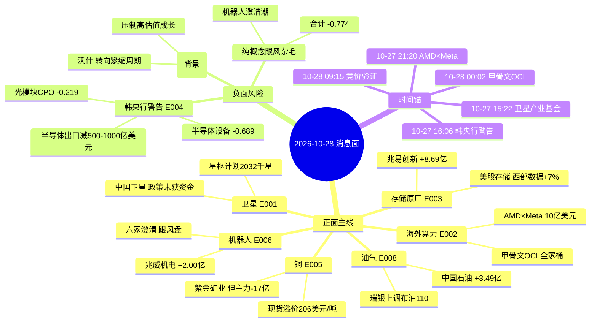

# 2026-10-28（周三）· **消息面事件驱动**

> **数据源新鲜度**: partial · **降级状态**: true · **置信度**: 0.68
> **覆盖窗口**: 2026-10-25 09:00 ~ 2026-10-28 02:58（72h）· **主源**: 财联社/新浪快讯 2983 条 + 5 个焦点群 894 条 + 东财三季报预告 500 条
> **情绪坐标**: 10-27 涨停 41 / 跌停 22 / 炸板 28 / **炸板率 40.58%** → 按纪律判为 **震荡偏主跌**，候选池按规则减半（16 只）

## 一句话结论

10-27 全市场杀跌（上证 -1.33% / 创业板 -3.41% / 科创50 -4.81%）之后，消息面唯一被资金真金白银确认的是**存储原厂**（兆易创新 5 日主力 +8.69 亿）与**油气**（中国石油 +3.49 亿）；唯一的行业级负面对手盘是**韩国央行点名的 AI 资本开支放缓**，它把光模块/CPO 的正面腿直接压成负分（-0.219）。

## 🗺️ 消息面全景图

## 🎯 顶级事件详解

### E20261028_001 · 卫星互联网产业生态大会 星枢计划2032千星+产业基金筹建 · strength=high · polarity=正面

**事件摘要**: 10-27 卫星互联网产业生态大会两条硬信息同时落地：① 科创板日报 15:22 卫星互联网产业基金启动筹建，由上海市区两级投资平台联合社会资本发起；② 财联社 16:00 复旦迟楠公布“星枢计划”，2026-2027 打通天地双算并采用国产 GPU 实现 32POPS 算力与 200Gbps 链路，2032 年完成千星部署、算力产业年产值破千亿。叠加 10-26 17:05 六部门《行动方案(2027-2030)》的 2030 年在轨 3000 颗、800 亿产业规模，政策从文件走到资本与时间表。

**时间衰减**: date=2026-10-27 · days_since=1 · raw_score=0.75 · weighted_score=0.646 · decayed=false
**独立源**（3 条）: 财联社快讯 10-27 16:00 星枢计划三阶段 2032 年千星部署 · 算力产业年产值破千亿 · 科创板日报 10-27 15:22 卫星互联网产业基金启动筹建(上海市区两级平台+社会资本) · 上海市《卫星互联网产业创新发展行动方案(2027-2030)》10-26 17:05 六部门连发(已 2 日腿 · 见 notes)

- **大资金意图**: 政策腿已经是第三天（10-26 盘后 → 10-27 大会 → 10-28 开盘）。大资金在 10-27 已经用脚投票：卫星互联网概念 -3.94%、商业航天 -3.75%、低轨卫星 -4.19%，中国卫星主力净流出 3402 万、5 日 -1.42 亿。这说明场内资金把政策当成“出货窗口”而不是“建仓窗口”。真正要观察的是 10-28 有没有资金在跌了两天之后回来接——产业基金是长钱，长钱不会在开盘 30 分钟里抢筹。
- **为什么走强**: 如果 10-28 走强，驱动不会是政策本身（已消化两天），而是“政策 + 超跌 + 隔夜风险偏好回升”的三重共振：10-27 创业板 -3.41%、科创50 -4.81% 已经把估值杀到极值，隔夜费半 +3.00% 给了外部情绪支撑。板块内 10-27 唯一收红的是臻镭科技 +2.09%，说明资金已经开始在星载器件里做结构性选择。
- **逻辑够不够硬**: 半硬。硬的部分：政策有时间表（2032 千星）、有资金（产业基金）、有产业链抓手（国产 GPU + 星间激光）；软的部分：2032 年是六年后的产值，短期无法验证订单，且 10-27 板块资金是净流出。结论是“叙事够硬、筹码不够硬”，只能给观察，不能给首选。

**板块映射**（净分见热力矩阵）:
- 卫星互联网/商业航天 · 正面 · high
- 星载芯片/星间激光 · 正面 · medium
- 纯概念跟风杂毛 · 负面 · low

#### 中国卫星 600118.SH · role=卫星总体 · rank=龙头 · **r4_stance=观察**

> 收盘 48.87 · 涨跌 -3.63% · MA5 50.63 · MA20 53.24 · 距 60 日高 -18.7% · 5 日主力净额 -1.42 亿（0/5 天净流入）
> 口径: 价格为 tushare daily 20261027 收盘 · 主力净额为东财 DC 主力净额（万元→亿元）20261021-20261027 · 缓存 data/research/20261028/_r4_market.json

- **买入理由**: 卫星总体唯一平台 · 政策直接对应总装订单 · 但 10-27 板块 -3.94% 且主力 5 日净流出 1.42 亿 政策未获资金确认
- **风险点**: 距 60 日高 -18.7% 仍在 MA20 下方 · 政策第二日易高开低走 · 资金零承接
- **止损条件**: 45.80 元 —— 参考价48.87×(1-6.3%)=45.80 且失守 10-27 最低 48.80 即离场；目标区间 53.50-56.00；仓位上限 4%（观察·政策首日不追 主力5日-1.42亿(0/5)）
- **可验证假设**: 若 10-28 开盘 30 分钟收复 MA5(50.63)且主力净流入转正 → 政策腿成立 否则当日只观察
- 主营重叠度 0.95（宇航制造与卫星应用为主业 卫星总体研制直接受益千星部署）· 板块联动 0.42（10-27 卫星互联网概念 -3.94% 商业航天 -3.75% 板块当日无赚钱效应）

#### 上海瀚讯 300762.SZ · role=卫星通信/军用宽带 · rank=龙三 · **r4_stance=观察**

> 收盘 21.87 · 涨跌 -4.91% · MA5 23.03 · MA20 23.8 · 距 60 日高 -22.7% · 5 日主力净额 -0.1 亿（2/5 天净流入）
> 口径: 价格为 tushare daily 20261027 收盘 · 主力净额为东财 DC 主力净额（万元→亿元）20261021-20261027 · 缓存 data/research/20261028/_r4_market.json

- **买入理由**: 卫星通信与军用宽带设备商 · 10-27 主力 5 日仅 -0.10 亿基本持平(2/5 天净流入) · 是本轮卫星链里资金最抗跌的标的之一
- **风险点**: 距 60 日高 -22.7% 趋势未修复 · 10-27 -4.91% 跌幅大于板块 · 军用订单节奏与卫星政策不同步
- **止损条件**: 20.47 元 —— 参考价21.87×(1-6.4%)=20.47 且失守 10-27 最低 21.80 即离场；目标区间 24.60-26.20；仓位上限 3%（观察·小仓位试错 主力5日-0.10亿(2/5)）
- **可验证假设**: 若 10-28 收复 MA5(23.03)且卫星板块止跌 → 右侧确认 否则只观察
- 主营重叠度 0.8（卫星通信与军用宽带设备 星地链路配套）· 板块联动 0.46（10-27 -4.91% 卫星互联网概念 -3.94% 主力 5 日 -0.10 亿(2/5)）

---

### E20261028_002 · AMD入股Meta 10亿美元 + 甲骨文OCI与OpenAI/谷歌TPU/英伟达Vera Rubin全面对接 · strength=high · polarity=正面

**事件摘要**: 海外算力资本开支一夜之间被重新定价：① 新浪财经 10-27 21:20 AMD 与 Meta 扩大合作并向 Meta 股权发行投资 10 亿美元，Helios 机架级方案为其前沿模型与服务提供算力；② 财联社 10-28 00:02 甲骨文 OCI 一次性接入 OpenAI 模型/ChatGPT/Codex、谷歌 TPU（2027 开放）、Cerebras 快速推理、Snowflake、英特尔至强；③ 英伟达 00:06 宣布 Vera Rubin NVL72 与 Vera CPU 在 OCI 全面上线并扩展至吉瓦级。费城半导体指数 10-27 收涨 3.00% 报 11416.10 点，AMD +5.43%、博通 +3.89%、台积电 +3.03%。

**时间衰减**: date=2026-10-27 · days_since=1 · raw_score=0.78 · weighted_score=0.671 · decayed=false
**独立源**（4 条）: 新浪财经 10-27 21:20 AMD 与 Meta 扩大合作 并向 Meta 股权发行投资 10 亿美元 · Helios 机架支撑其前沿模型 · 财联社 10-28 00:02 甲骨文 OCI 接入 OpenAI 模型/ChatGPT/Codex 并提供谷歌 TPU(2027 开放) · 英伟达 10-28 00:06 Vera Rubin NVL72 与 Vera CPU 在 OCI 全面上线并扩展至吉瓦级 · 费城半导体指数 10-27 收盘 +3.00% 报 11416.10 点(财联社 23:45)

- **大资金意图**: 这条是给 10-27 A股算力链杀跌做“反向定价”。10-27 算力概念 -3.72%、CPO 概念 -3.74%、存储芯片 -4.10%，主力从沪电股份抽走 10.26 亿、从工业富联抽走 7.31 亿。海外资本开支在加码、A股资金在撤离——这个背离只有两种结局：要么 A股 补涨，要么海外 capex 预期先被打脸。大资金此刻更可能选择“等竞价再决定”，而不是隔夜直接追。
- **为什么走强**: 走强的必要条件不是新闻本身，而是“A股 算力链跌到位 + 隔夜费半大涨”形成的缺口修复。沪电股份 10-27 逆势 +0.30%、工业富联仅 -1.73%（创业板 -3.41%），说明筹码没有崩，只是没人买。一旦竞价放量，修复弹性会比想象的大。
- **逻辑够不够硬**: 硬在订单与业绩：沪电三季报单季净利 27.0 亿、环比 +60.5%（income 20260930 56.22 亿减 H1 29.23 亿倒推），这是可复算的硬数字。不硬在资金：主力 5 日净流出 10.26 亿，属于“业绩兑现、资金离场”的典型背离。逻辑硬、筹码软 → 只给观察 + 明确止损。

**板块映射**（净分见热力矩阵）:
- AI算力/服务器 · 正面 · high
- 光模块/CPO · 正面 · medium
- PCB/覆铜板 · 正面 · medium

#### 工业富联 601138.SH · role=AI服务器代工龙头 · rank=龙头 · **r4_stance=观察**

> 收盘 45.92 · 涨跌 -1.73% · MA5 47.82 · MA20 52.9 · 距 60 日高 -31.2% · 5 日主力净额 -7.31 亿（2/5 天净流入）
> 口径: 价格为 tushare daily 20261027 收盘 · 主力净额为东财 DC 主力净额（万元→亿元）20261021-20261027 · 缓存 data/research/20261028/_r4_market.json

- **买入理由**: 海外云厂资本开支直接对应服务器代工订单 · 10-27 仅 -1.73% 抗跌于创业板 -3.41% · 但主力 5 日仍净流出 7.31 亿
- **风险点**: 距 60 日高 -31.2% 处于下行通道 · 资金连续流出 · 隔夜利好易变成高开出货
- **止损条件**: 42.70 元 —— 参考价45.92×(1-7.0%)=42.71 取 42.70 且失守 10-27 最低 45.91 即离场；目标区间 51.50-55.00；仓位上限 5%（观察·隔夜利好需竞价确认 主力5日-7.31亿(2/5)）
- **可验证假设**: 若 10-28 高开后 30 分钟不破 10-27 最低 45.91 且成交额放大 → 预期差成立 否则不参与
- 主营重叠度 0.92（AI 服务器/云计算设备代工 海外云厂 capex 直接对应订单）· 板块联动 0.55（10-27 算力概念 -3.72% 但本票 -1.73% 明显抗跌）

#### 沪电股份 002463.SZ · role=AI服务器PCB · rank=龙二 · **r4_stance=观察**

> 收盘 99.2 · 涨跌 0.3% · MA5 105.42 · MA20 113.88 · 距 60 日高 -24.4% · 5 日主力净额 -10.26 亿（2/5 天净流入）
> 口径: 价格为 tushare daily 20261027 收盘 · 主力净额为东财 DC 主力净额（万元→亿元）20261021-20261027 · 缓存 data/research/20261028/_r4_market.json

- **买入理由**: 三季报单季净利 27.0 亿 环比 +60.5% · AI 高多层板订单能见度到明年 · 10-27 逆势 +0.30%
- **风险点**: 主力 5 日净流出 10.26 亿为样本内第二差 · 距 60 日高 -24.4% · 高位 PCB 已被资金减仓
- **止损条件**: 91.80 元 —— 参考价99.20×(1-7.5%)=91.76 取 91.80 且失守 10-27 最低 99.17 即离场；目标区间 112.00-120.00；仓位上限 4%（观察·业绩硬但资金在撤 主力5日-10.26亿(2/5)）
- **可验证假设**: 若 10-28 收复 MA5(105.42)且量能回到 5 日均量上方 → 右侧确认 否则只观察
- 主营重叠度 0.9（AI 服务器高多层 PCB 主力供应商 单季净利环比 +60.5%(income 表 20260930 vs 20260630)）· 板块联动 0.52（10-27 算力概念 -3.72% 本票 +0.30% 逆势收红）
- 三季报交叉: EPS 2.83~2.96 元(前三季) · 公告日 2026-10-15

---

### E20261028_003 · 美股存储暴涨与渠道降价同现 原厂强模组弱 · strength=medium · polarity=中性

**事件摘要**: 同一条存储链两端背离：① 财联社 10-27 22:07 美股存储涨幅扩大，西部数据涨超 7%、希捷涨超 4%、闪迪涨超 3%，催化是马斯克称“机器人所需内存将超过其他任何领域”；② 财联社 20:58 本周渠道 SSD 价格全面较大幅度下调，双11 旺季不旺；③ 19:01 华强北内存条销量大降，16G/32G 内存条较高点跌 20-50 元、1T 硬盘跌 20-30 元；④ 20:58 华硕预计 2027H1 商用 PC 再涨 5%，原因是 DRAM/SSD 成本高企。

**时间衰减**: date=2026-10-27 · days_since=1 · raw_score=0.45 · weighted_score=0.387 · decayed=false
**独立源**（4 条）: 财联社 10-27 22:07 美股存储涨幅扩大 西部数据涨超7% 希捷涨超4% 马斯克称机器人所需内存将超过任何领域 · 财联社 10-27 20:58 本周渠道 SSD 价格全面较大幅度下调 · 双11 旺季不旺 · 财联社 10-27 19:01 华强北内存条销量大降 16G/32G 内存条跌 20-50 元 价格较高点回调 · 财联社 10-27 20:58 华硕预计 2027H1 商用 PC 再涨 5%(DRAM/SSD 成本高企)

- **大资金意图**: 资金在 10-27 已经完成了选择：兆易创新逆势获主力净流入 8.69 亿（样本 34 只票里第一），而模组端的江波龙净流出 4.38 亿、佰维存储虽 +2.54 亿但股价 -3.65%。原厂吃涨价、模组吃成本，这是存储周期最经典的环节错配。大资金买的是“原厂定价权”，不是“存储概念”。
- **为什么走强**: 原厂走强的底层原因是涨价周期仍在（华硕公开承认 DRAM/SSD 成本高企并计划 2027H1 再涨 5%），而渠道降价只是模组端的库存去化。只要原厂报价不松，原厂利润就继续扩张；兆易的利基 DRAM/NOR 又是涨价弹性最大的品种。
- **逻辑够不够硬**: 半硬。硬的部分：华硕涨价指引 + 美股存储暴涨 + 马斯克内存论三重外部验证；不硬的部分：兆易三季报尚未披露（income 表只到 20260630），单季环比无法验证，且股价仍在 MA5(280.44)/MA20(318.11) 下方。所以给“研究首选”但只用 8% 仓位，且以 252 元硬止损兜底。

> 负面杀伤面: bearish_scope=板块级 · 受影响板块 存储模组, 存储渠道

**板块映射**（净分见热力矩阵）:
- 存储原厂 · 正面 · high
- 存储模组 · 负面 · medium

#### 兆易创新 603986.SH · role=利基DRAM/MCU原厂 · rank=龙头 · **r4_stance=研究首选**

> 收盘 268.98 · 涨跌 -2.7% · MA5 280.44 · MA20 318.11 · 距 60 日高 -34.9% · 5 日主力净额 8.69 亿（2/5 天净流入）
> 口径: 价格为 tushare daily 20261027 收盘 · 主力净额为东财 DC 主力净额（万元→亿元）20261021-20261027 · 缓存 data/research/20261028/_r4_market.json

- **买入理由**: 原厂环节受益涨价 · 10-27 逆势获主力净流入 8.69 亿为样本内第一 · 距 60 日高 -34.9% 位置不高
- **风险点**: 股价仍在 MA5/MA20 下方 · 三季报未出 无法验证单季环比 · 若渠道降价传导至原厂报价则逻辑破坏
- **止损条件**: 252.00 元 —— 参考价268.98×(1-6.3%)=252.04 取 252.00 且失守 10-27 最低 268.88 即离场；目标区间 310.00-332.00；仓位上限 8%（首选·唯一资金逆势承接的主线票 主力5日+8.69亿(2/5)）
- **可验证假设**: 若 10-28 站稳 10-27 最低 268.88 且主力继续净流入 → 原厂涨价链条成立 跌破 252 止损
- 主营重叠度 0.88（利基型 DRAM/NOR Flash/MCU 原厂 直接受益存储涨价）· 板块联动 0.62（10-27 存储芯片概念 -4.10% 本票 -2.70% 且主力净流入 8.69 亿(2/5)）

#### 江波龙 301308.SZ · role=存储模组 · rank=龙二 · **r4_stance=剔除**

> 收盘 228.09 · 涨跌 -2.11% · MA5 239.35 · MA20 274.87 · 距 60 日高 -38.0% · 5 日主力净额 -4.38 亿（1/5 天净流入）
> 口径: 价格为 tushare daily 20261027 收盘 · 主力净额为东财 DC 主力净额（万元→亿元）20261021-20261027 · 缓存 data/research/20261028/_r4_market.json

- **买入理由**: 模组环节被原厂成本挤压 · 前三季累计同比 +1864%~1991% 但单季环比 -36%~-49% · 属周期见顶型业绩
- **风险点**: 距 60 日高 -38.0% · 主力 5 日净流出 4.38 亿 · 业绩同比最炸裂时往往是股价顶部区域
- **止损条件**: 210.00 元 —— 参考价228.09×(1-7.9%)=210.06 仅作风险参考 已剔除不建仓；目标区间 250.00-268.00；仓位上限 1%（剔除·单季环比转负 业绩利好出尽 0仓）
- **可验证假设**: 若模组毛利率环比回升且单季环比转正 → 才重新评估 当前不参与
- 主营重叠度 0.9（存储模组/SSD 品牌商 上游原厂涨价即成本）· 板块联动 0.3（10-27 -2.11% 主力净流出 4.38 亿(1/5) 渠道降价直接冲击模组库存价值）
- 三季报交叉: +1864.55%~1990.84%(前三季累计) · 公告日 2026-10-15

---

### E20261028_004 · 韩国央行警告AI投资放缓 韩国半导体出口或减500至1000亿美元 · strength=high · polarity=负面

**事件摘要**: 这是今天唯一的行业级利空：财联社 10-27 16:06 报道韩国央行警告，若美国科技巨头明年放缓 AI 基础设施投资，韩国半导体出口或较此前预测减少 500 亿至 1000 亿美元。同日 A股 用下跌给出了回应：科创50 -4.81%、创业板指 -3.41%、科创半导体设备 ETF -6.67%。更关键的是筹码结构——财联社 20:44 披露公募三季报，中际旭创仍为第一大重仓股，持有市值 959.38 亿。

**时间衰减**: date=2026-10-27 · days_since=1 · raw_score=-0.8 · weighted_score=-0.689 · decayed=false
**独立源**（3 条）: 财联社 10-27 16:06 韩国央行警告 若美国科技巨头明年放缓 AI 基础设施投资 韩国半导体出口或较预测减少 500-1000 亿美元 · A股 10-27 收盘 科创50 -4.81% 创业板指 -3.41% 科创半导体设备ETF -6.67%(财联社 15:00/15:01) · 财联社 10-27 20:44 公募三季报 中际旭创仍为第一大重仓股 持有市值 959.38 亿

- **大资金意图**: 大资金在 10-27 的动作是“减最拥挤的”。新易盛单日 -5.60%、5 日主力净流出 47.37 亿、0/5 天净流入，这是单向撤离而不是洗盘；中际旭创 -2.94%、5 日 -4.29 亿。当第一大重仓股遇到行业级利空，机构的第一反应是降低集中度，而不是抄底。
- **为什么走强**: 如果有反弹，也只会是“跌深反抽”，不是“逻辑反转”。因为这条利空指向的是 2027 年海外 capex 增速，属于分母端（估值）而不是分子端（订单），短期无法证伪也无法证实——这种模糊利空最容易被资金用来做减仓理由。
- **逻辑够不够硬**: 硬。韩央行是官方机构、给了量化区间（500-1000 亿美元）、且被 A股 当日 -4.81% 的科创50 与 -6.67% 的半导体设备 ETF 直接验证。这是本日唯一“官方口径 + 市场验证”双确认的负面事件，因此 bearish_scope 定为行业级，并把光模块/CPO 从 E002 的正面腿里压回负分。

> 负面杀伤面: bearish_scope=行业级 · 受影响板块 光模块, CPO, 半导体设备, 存储, AI算力全链

**板块映射**（净分见热力矩阵）:
- 光模块/CPO · 负面 · high
- 半导体设备/材料 · 负面 · high
- AI算力高位持仓 · 负面 · medium

#### 新易盛 300502.SZ · role=光模块 · rank=龙头 · **r4_stance=剔除**

> 收盘 237.59 · 涨跌 -5.6% · MA5 260.48 · MA20 341.14 · 距 60 日高 -50.0% · 5 日主力净额 -47.37 亿（0/5 天净流入）
> 口径: 价格为 tushare daily 20261027 收盘 · 主力净额为东财 DC 主力净额（万元→亿元）20261021-20261027 · 缓存 data/research/20261028/_r4_market.json

- **买入理由**: 光模块出口占比最高 · 韩央行警告直接指向AI资本开支 · 10-27 -5.60% 主力净流出 47.37 亿为样本最差
- **风险点**: 距 60 日高 -50.0% 已腰斩 · 5 日主力净流出 47.37 亿且 0/5 天净流入 · 属于资金单向撤离
- **止损条件**: 214.00 元 —— 参考价237.59×(1-9.9%)=214.07 仅作风险参考 已剔除不建仓；目标区间 270.00-290.00；仓位上限 1%（剔除·资金单向流出 负面行业不接飞刀 0仓）
- **可验证假设**: 若本票收复 MA5(260.48)且海外 capex 指引上修 → 才解除负面 当前不参与
- 主营重叠度 0.92（800G/1.6T 光模块 海外云厂 capex 直接决定订单）· 板块联动 0.1（10-27 -5.60% CPO 概念 -3.74% 主力 5 日 -47.37 亿(0/5)）

#### 中际旭创 300308.SZ · role=光模块 · rank=龙头 · **r4_stance=剔除**

> 收盘 577.0 · 涨跌 -2.94% · MA5 604.2 · MA20 727.49 · 距 60 日高 -40.8% · 5 日主力净额 -4.29 亿（2/5 天净流入）
> 口径: 价格为 tushare daily 20261027 收盘 · 主力净额为东财 DC 主力净额（万元→亿元）20261021-20261027 · 缓存 data/research/20261028/_r4_market.json

- **买入理由**: 公募第一大重仓股(持有 959.38 亿)是拥挤度最高的负面信号 · 韩央行警告下机构减仓压力最大
- **风险点**: 距 60 日高 -40.8% · 主力 5 日净流出 4.29 亿 · 巨头重仓+行业利空=被动赎回风险
- **止损条件**: 520.00 元 —— 参考价577.00×(1-9.9%)=519.88 仅作风险参考 已剔除不建仓；目标区间 640.00-690.00；仓位上限 1%（剔除·拥挤持仓遇行业利空 0仓）
- **可验证假设**: 若公募持仓季度环比下降且股价站稳 MA5(604.20) → 拥挤度缓解 当前不参与
- 主营重叠度 0.93（光模块全球份额第一 海外算力资本开支核心受益同时也是风险敞口）· 板块联动 0.12（10-27 -2.94% 公募第一大重仓 959.38 亿 拥挤度极高）

---

### E20261028_005 · 现货铜溢价飙至206美元 两月最高 + 瑞银重估铜需求 · strength=high · polarity=正面

**事件摘要**: 铜的三个硬数据同时出现：① 财联社 10-27 22:57 现货铜较 LME 三个月期铜溢价飙至 206 美元/吨，为两个月最高，短期供应压力加剧；② LME 收盘 10-28 01:52 期铜收涨 147 美元报 14474 美元/吨，沪铜夜盘 +0.72%；③ 瑞银丁月丽 19:38 判断电气化、电网投资与 AI 基础设施拓宽铜需求，到 2030 年 AI 数据中心及相关电力基础设施或贡献全球铜需求增长的 15%-20%。业绩侧同日验证：深市有色 78 家公司 56 家披露三季报，78.6% 净利同比增长、16 家翻倍。

**时间衰减**: date=2026-10-27 · days_since=1 · raw_score=0.72 · weighted_score=0.62 · decayed=false
**独立源**（4 条）: 财联社 10-27 22:57 现货铜较 LME 三个月期铜溢价飙至 206 美元/吨 为两个月最高 短期供应压力加剧 · LME 收盘 10-28 01:52 期铜收涨 147 美元报 14474 美元/吨 沪铜夜盘 +0.72% · 瑞银丁月丽 10-27 19:38 电气化与 AI 数据中心到 2030 年或贡献全球铜需求增长的 15%-20% · 财联社 10-27 19:58 深市有色 78 家公司 56 家披露三季报 78.6% 净利同比增长 16 家翻倍

- **大资金意图**: 铜是少数“价格新高 + 业绩兑现”双成立的品种，但 10-27 主力资金在借强势出货：紫金矿业股价 +1.38%，主力却净流出 17.17 亿（5 日仅 1/5 天净流入）。这说明机构在铜上是“有仓位、在减仓”，而不是“没仓位、在建仓”。金诚信 5 日主力 +0.05 亿、2/5 天净流入，是铜链里资金结构最干净的票。
- **为什么走强**: 走强逻辑来自现货挤仓：现货溢价 206 美元/吨意味着近月极度紧张，这种结构通常对应铜价继续冲高。叠加有色三季报 78.6% 增长，属于“价格 + 业绩”双击，而不是纯题材。
- **逻辑够不够硬**: 硬在数据、软在筹码。现货溢价与 LME 收盘价都是可查的硬数字，瑞银给的 15%-20% 需求增量也有测算口径；但紫金 -17.17 亿的主力净流出说明再硬的逻辑也有人在卖。因此两只铜票都只给观察，且止损设在 -6.3%~-7.4%。

**板块映射**（净分见热力矩阵）:
- 铜/工业金属 · 正面 · high
- 铜加工/铜箔 · 正面 · medium

#### 紫金矿业 601899.SH · role=铜金矿业龙头 · rank=龙头 · **r4_stance=观察**

> 收盘 27.85 · 涨跌 1.38% · MA5 28.16 · MA20 29.56 · 距 60 日高 -19.3% · 5 日主力净额 -17.17 亿（1/5 天净流入）
> 口径: 价格为 tushare daily 20261027 收盘 · 主力净额为东财 DC 主力净额（万元→亿元）20261021-20261027 · 缓存 data/research/20261028/_r4_market.json

- **买入理由**: 铜价新高最直接受益 · 10-27 逆势 +1.38% · 但主力 5 日净流出 17.17 亿说明机构在借强势减仓
- **风险点**: 距 60 日高 -19.3% · 资金与价格背离 · 若铜价回落则补跌风险大
- **止损条件**: 26.10 元 —— 参考价27.85×(1-6.3%)=26.10 且失守 10-27 最低 27.19 即离场；目标区间 30.60-32.20；仓位上限 4%（观察·价格强资金弱 主力5日-17.17亿(1/5)）
- **可验证假设**: 若 10-28 放量突破 MA5(28.16)且铜价站稳 → 右侧确认 否则只观察
- 主营重叠度 0.95（铜金矿资源龙头 铜价与产量双驱动）· 板块联动 0.6（10-27 金属铜概念 -2.14% 本票 +1.38% 逆势 但主力 -17.17 亿(1/5)）

#### 金诚信 603979.SH · role=矿服+铜矿 · rank=龙二 · **r4_stance=观察**

> 收盘 58.56 · 涨跌 2.5% · MA5 59.21 · MA20 67.5 · 距 60 日高 -29.5% · 5 日主力净额 0.05 亿（2/5 天净流入）
> 口径: 价格为 tushare daily 20261027 收盘 · 主力净额为东财 DC 主力净额（万元→亿元）20261021-20261027 · 缓存 data/research/20261028/_r4_market.json

- **买入理由**: 矿服订单随铜价资本开支上行 · 自有铜矿放量 · 10-27 +2.50% 且主力 5 日基本持平(+0.05 亿)为铜链最抗跌资金结构
- **风险点**: 距 60 日高 -29.5% 趋势仍弱 · 流通盘小波动大 · 矿服毛利对铜价弹性低于矿企
- **止损条件**: 54.20 元 —— 参考价58.56×(1-7.4%)=54.23 取 54.20 且失守 10-27 最低 57.70 即离场；目标区间 65.00-70.00；仓位上限 3%（观察·资金结构最干净 主力5日+0.05亿(2/5)）
- **可验证假设**: 若 10-28 收复 MA5(59.21) → 补涨启动 否则只观察
- 主营重叠度 0.82（矿山工程服务+自有铜矿 铜价上行带动资本开支）· 板块联动 0.58（10-27 +2.50% 强于金属铜 -2.14% 主力 5 日 +0.05 亿(2/5)）

---

### E20261028_006 · 三星李在镕督战机器人 + 河南补贴智能清洁机器人 + 六家公司澄清 · strength=medium · polarity=正面

**事件摘要**: 机器人是今天最“分裂”的方向：① 财联社 10-27 23:00 三星电子会长李在镕走访首尔机器人体验事业推进室，外界解读为人形机器人商用提速；② 15:19 河南以旧换新新增智能清洁机器人等智能品类补贴；③ 但 18:49-20:57 六家公司同日发布异动澄清——赛福天（4 连板，腱绳仍在研发送样）、杰克科技（机器人业务尚处早期）、均普智能（3 日涨 30%）、沪光股份（机器人收入较小）、泛亚微透（具身智能尚在客户测试）、中塑股份（机器人未形成规模收入）。群聊侧同样在提示风险：“机器人三个 4 板都抢跑”。

**时间衰减**: date=2026-10-27 · days_since=1 · raw_score=0.6 · weighted_score=0.516 · decayed=false
**独立源**（3 条）: 财联社 10-27 23:00 三星电子会长李在镕走访首尔机器人体验事业推进室 人形机器人商用提速 · 财联社 10-27 15:19 河南以旧换新新增智能清洁机器人等智能品类补贴 · 财联社 10-27 18:49-20:57 赛福天/杰克科技/均普智能/沪光股份/泛亚微透/中塑股份六家异动澄清 机器人业务尚未形成规模收入

- **大资金意图**: 大资金的选择是“弃整机、守零部件”。10-27 人形机器人概念 -2.57%，但兆威机电主力净流入 2.00 亿（3/5 天）、三花智控 +1.77 亿（3/5 天）、绿的谐波 +1.95 亿（3/5 天）——真零部件在跌势里被吸筹，而澄清潮里的整机概念在被抛。这是典型的主线内部结构分化。
- **为什么走强**: 走强靠的是“位置 + 资金”而不是新闻：兆威距 60 日高仅 -5.6%，是全部 34 只样本里位置最高的票之一，且主力仍在净流入。三星入局给的是长期叙事（人形机器人商用提速），河南补贴给的是短期需求（清洁机器人），两条腿一条长一条短。
- **逻辑够不够硬**: 半硬。硬的部分：真零部件的资金流是硬数据（兆威 +2.00 亿 / 3 天净流入）；不硬的部分：六家澄清公告证明这一轮上涨里跟风盘占比很高，一旦 4 板股断板，真零部件也会被连带杀。因此把“纯概念跟风杂毛”单列为负面板块（与 E001 叠加到 -0.774），明确只做真链。

> 负面杀伤面: bearish_scope=板块级 · 受影响板块 纯概念跟风杂毛

**板块映射**（净分见热力矩阵）:
- 人形机器人零部件 · 正面 · medium
- 纯概念跟风杂毛 · 负面 · high

#### 兆威机电 003021.SZ · role=微型传动/灵巧手 · rank=龙头 · **r4_stance=研究首选**

> 收盘 92.5 · 涨跌 -3.91% · MA5 87.94 · MA20 72.52 · 距 60 日高 -5.6% · 5 日主力净额 2.0 亿（3/5 天净流入）
> 口径: 价格为 tushare daily 20261027 收盘 · 主力净额为东财 DC 主力净额（万元→亿元）20261021-20261027 · 缓存 data/research/20261028/_r4_market.json

- **买入理由**: 真零部件环节 · 距 60 日高仅 -5.6% 是样本内最强位置 · 主力 5 日净流入 2.00 亿(3/5) · 10-27 仅 -3.91% 强于人形机器人概念 -2.57% 之外的杀跌品种
- **风险点**: 股价 92.50 高于 MA20 72.52 达 27% 存在回踩需求 · 机器人板块 10-27 已有 4 板股抢跑 情绪脆弱
- **止损条件**: 86.40 元 —— 参考价92.50×(1-6.6%)=86.39 取 86.40 且失守 10-27 最低 92.14 即离场；目标区间 104.00-112.00；仓位上限 6%（首选·位置最高且资金正流入 主力5日+2.00亿(3/5)）
- **可验证假设**: 若 10-28 守住 10-27 最低 92.14 且机器人板块资金回流 → 首选成立 跌破 86.40 止损
- 主营重叠度 0.88（微型传动系统与灵巧手模组 人形机器人核心执行部件）· 板块联动 0.66（10-27 人形机器人 -2.57% 本票 -3.91% 但主力 5 日 +2.00 亿(3/5) 距高仅 -5.6%）

#### 三花智控 002050.SZ · role=热管理/机器人执行器 · rank=龙头 · **r4_stance=观察**

> 收盘 34.06 · 涨跌 -1.02% · MA5 33.87 · MA20 33.81 · 距 60 日高 -8.6% · 5 日主力净额 1.77 亿（3/5 天净流入）
> 口径: 价格为 tushare daily 20261027 收盘 · 主力净额为东财 DC 主力净额（万元→亿元）20261021-20261027 · 缓存 data/research/20261028/_r4_market.json

- **买入理由**: 特斯拉链一级供应商 · 机器人执行器与热管理双业务 · 10-27 仅 -1.02% 抗跌 · 主力 5 日净流入 1.77 亿(3/5)
- **风险点**: 距 60 日高 -8.6% 但股价贴近 MA5/MA20 无安全垫 · 机器人订单兑现节奏未披露
- **止损条件**: 32.10 元 —— 参考价34.06×(1-5.8%)=32.07 取 32.10 且失守 10-27 最低 34.03 即离场；目标区间 37.60-39.20；仓位上限 5%（观察·抗跌且资金正 但弹性弱于兆威 主力5日+1.77亿(3/5)）
- **可验证假设**: 若 10-28 放量站上 MA5(33.87)并守住 10-27 最低 34.03 → 右侧确认 否则只观察
- 主营重叠度 0.86（热管理龙头 机器人执行器为新增长曲线）· 板块联动 0.62（10-27 -1.02% 强于人形机器人 -2.57% 主力 5 日 +1.77 亿(3/5)）

---

### E20261028_007 · 葛兰加仓创新药 + 海思科Q3净利同比207% + 科伦ADC新适应症受理 · strength=medium · polarity=正面

**事件摘要**: 创新药有机构与业绩双验证：① 财联社 10-27 19:42 中欧基金葛兰三季度大幅加仓金斯瑞生物科技，四季度仍看好创新药；② 20:17 海思科 Q3 归母净利 5.25 亿元、同比 +207.26%（income 表倒推单季环比 +77%）；③ 18:47 科伦药业 TROP2 ADC 芦康沙妥珠单抗新适应症上市申请获受理；④ 20:27 华东医药 GLP-1/GIP 双靶点 HDM1005 进入 III 期；⑤ 19:23 招商证券梁广楷称中国创新药产业链正在发生三大新变化。

**时间衰减**: date=2026-10-27 · days_since=1 · raw_score=0.55 · weighted_score=0.473 · decayed=false
**独立源**（4 条）: 财联社 10-27 19:42 中欧基金葛兰三季度大幅加仓金斯瑞生物科技 四季度仍看好创新药 · 财联社 10-27 20:17 海思科 Q3 归母净利 5.25 亿元 同比 +207.26% · 财联社 10-27 18:47 科伦药业 TROP2 ADC 芦康沙妥珠单抗新适应症上市申请获受理 · 财联社 10-27 20:27 华东医药 GLP-1/GIP 双靶点 HDM1005 进入 III 期临床

- **大资金意图**: 机构在加仓、个股业绩在加速，但板块 10-27 仍跌 3.78%——说明这是“左侧建仓”而不是“右侧启动”。恒瑞医药 5 日主力净流出 6.30 亿（1/5 天），海思科 -0.16 亿，资金没有跟。葛兰的加仓是季度级别动作，不会在今天开盘体现在盘口。
- **为什么走强**: 走强需要催化剂兑现：海思科单季净利 5.25 亿、同比 +207% 是可验证的硬业绩；科伦 ADC 新适应症受理、华东医药 III 期是管线进展。如果 10-28 医药板块止跌，业绩票会比概念票先动。
- **逻辑够不够硬**: 半硬。业绩硬（海思科单季环比 +77% 可复算），但板块在左侧、资金在流出，且宏观上美联储转向紧缩会压制创新药的 DCF 估值（见 macro_negative_watch）。结论：只做两只龙头，观察不追。

**板块映射**（净分见热力矩阵）:
- 创新药 · 正面 · medium
- CXO · 正面 · low

#### 海思科 002653.SZ · role=创新药 · rank=龙二 · **r4_stance=观察**

> 收盘 56.63 · 涨跌 -3.53% · MA5 59.01 · MA20 60.07 · 距 60 日高 -17.0% · 5 日主力净额 -0.16 亿（2/5 天净流入）
> 口径: 价格为 tushare daily 20261027 收盘 · 主力净额为东财 DC 主力净额（万元→亿元）20261021-20261027 · 缓存 data/research/20261028/_r4_market.json

- **买入理由**: 三季报单季净利 5.25 亿 同比 +207.26% 环比 +77% 为硬业绩 · 葛兰加仓创新药的口径直接覆盖
- **风险点**: 10-27 -3.53% 主力 5 日 -0.16 亿 · 距 60 日高 -17.0% 板块仍在左侧 · 单票业绩难敌板块杀估值
- **止损条件**: 52.60 元 —— 参考价56.63×(1-7.1%)=52.60 且失守 10-27 最低 56.51 即离场；目标区间 62.50-66.00；仓位上限 3%（观察·业绩硬但板块左侧 主力5日-0.16亿(2/5)）
- **可验证假设**: 若 10-28 收复 MA5(59.01)且医药板块止跌 → 业绩驱动成立 否则只观察
- 主营重叠度 0.9（创新药企 Q3 单季净利 5.25 亿(income 20260930 vs H1 8.51 亿)）· 板块联动 0.4（10-27 创新药概念 -3.78% 本票 -3.53% 主力 5 日 -0.16 亿(2/5)）
- 三季报交叉: +297.02%~321.08%(前三季) · 公告日 2026-10-21

#### 恒瑞医药 600276.SH · role=创新药平台 · rank=龙头 · **r4_stance=观察**

> 收盘 45.55 · 涨跌 -3.09% · MA5 46.59 · MA20 46.2 · 距 60 日高 -4.7% · 5 日主力净额 -6.3 亿（1/5 天净流入）
> 口径: 价格为 tushare daily 20261027 收盘 · 主力净额为东财 DC 主力净额（万元→亿元）20261021-20261027 · 缓存 data/research/20261028/_r4_market.json

- **买入理由**: 创新药总龙头 · 葛兰与招商证券口径的板块配置首选 · 10-27 仅 -3.09% 未破位 距 60 日高仅 -4.7%
- **风险点**: 主力 5 日净流出 6.30 亿为医药样本最差 · 利率端紧缩预期对 DCF 估值形成压制(见 macro_negative_watch 美联储紧缩项)
- **止损条件**: 43.00 元 —— 参考价45.55×(1-5.6%)=43.00 且失守 10-27 最低 45.55 即离场；目标区间 50.20-52.50；仓位上限 3%（观察·龙头位置好但主力在撤 主力5日-6.30亿(1/5)）
- **可验证假设**: 若 10-28 收复 10-27 最低 45.55 且主力净流入转正 → 龙头修复成立 否则只观察
- 主营重叠度 0.93（创新药研发平台 管线数量与出海授权国内第一梯队）· 板块联动 0.38（10-27 -3.09% 距 60 日高 -4.7% 位置最抗跌 但主力 5 日 -6.30 亿(1/5)）

---

### E20261028_008 · 瑞银上调布油年底至110美元 但WTI回落2% 能源多空并存 · strength=medium · polarity=正面

**事件摘要**: 能源是“目标价上调 + 盘面回落”的矛盾组合：① 财联社 10-27 21:17-21:18 瑞银上调布伦特原油年底预测至每桶 110 美元；② 15:01 ETF 收盘沙特ETF 领涨 4.34%、标普油气ETF 涨 3.58% 与 2.83%，说明 A股 能源是被当日资金选择的方向；③ 但 10-28 01:34 WTI 日内跌 2% 报 99.70 美元/桶，上期所原油夜盘 -2.56%；④ 23:39 特朗普称美国将接收 100 万桶委内瑞拉原油，供给端出现边际宽松。

**时间衰减**: date=2026-10-27 · days_since=1 · raw_score=0.5 · weighted_score=0.43 · decayed=false
**独立源**（4 条）: 财联社 10-27 21:17-21:18 瑞银上调布伦特原油年底预测至每桶 110 美元 · 财联社 10-27 15:01 ETF 收盘 沙特ETF 领涨 4.34% 标普油气ETF 涨 3.58%/2.83% · 财联社 10-28 01:34 WTI 原油日内跌 2% 报 99.70 美元/桶 上期所原油夜盘 -2.56% · 财联社 10-27 23:39 特朗普称美国将接收 100 万桶委内瑞拉原油

- **大资金意图**: 10-27 全市场杀跌时，资金躲进了能源：中国石油 -1.35% 但距 60 日高仅 -2.5%，5 日主力净流入 3.49 亿（3/5 天）；油服端中海油服 -2.30%、主力 -0.46 亿（1/5 天）。大资金买的是“高股息 + 油价托底”的确定性，不是弹性。
- **为什么走强**: 走强的直接原因是防御属性：当创业板 -3.41%、科创50 -4.81% 时，唯一能容纳资金的方向就是高股息资源。瑞银把布油目标上调到 110 美元，给了估值锚；沙特ETF +4.34% 说明这条线在 A股 有真实买盘。
- **逻辑够不够硬**: 半硬。硬的部分：油气 ETF 当日 +3.58%、中石油主力 +3.49 亿、位置距高仅 -2.5%，三项都是硬数据；不硬的部分：WTI 隔夜 -2%、委内瑞拉原油增量是供给端利空，油价方向本身在分歧。因此只做位置最好的中石油，油服只观察。

**板块映射**（净分见热力矩阵）:
- 油气开采 · 正面 · medium
- 航空运输 · 负面 · low

#### 中国石油 601857.SH · role=油气开采 · rank=龙头 · **r4_stance=研究首选**

> 收盘 13.2 · 涨跌 -1.35% · MA5 12.92 · MA20 12.07 · 距 60 日高 -2.5% · 5 日主力净额 3.49 亿（3/5 天净流入）
> 口径: 价格为 tushare daily 20261027 收盘 · 主力净额为东财 DC 主力净额（万元→亿元）20261021-20261027 · 缓存 data/research/20261028/_r4_market.json

- **买入理由**: 高股息+油价上行双驱动 · 距 60 日高仅 -2.5% 为样本最强位置 · 股价站上 MA5/MA20 · 主力 5 日净流入 3.49 亿(3/5)
- **风险点**: WTI 隔夜 -2% 说明短期油价见分歧 · 巨头弹性小 涨幅有限 · 若布油跌破 100 则逻辑弱化
- **止损条件**: 12.40 元 —— 参考价13.20×(1-6.1%)=12.40 且失守 10-27 最低 13.16 即离场；目标区间 14.50-15.20；仓位上限 6%（首选·位置最高 资金持续净流入 主力5日+3.49亿(3/5)）
- **可验证假设**: 若 10-28 守住 10-27 最低 13.16 且布油不破 100 美元 → 首选成立 否则降级观察
- 主营重叠度 0.95（国内最大油气开采商 油价与产量直接决定利润）· 板块联动 0.7（10-27 -1.35% 距 60 日高 -2.5% 主力 5 日 +3.49 亿(3/5) 油气ETF 当日 +3.58%）

#### 中海油服 601808.SH · role=油服 · rank=龙二 · **r4_stance=观察**

> 收盘 13.18 · 涨跌 -2.3% · MA5 12.89 · MA20 12.58 · 距 60 日高 -3.1% · 5 日主力净额 -0.46 亿（1/5 天净流入）
> 口径: 价格为 tushare daily 20261027 收盘 · 主力净额为东财 DC 主力净额（万元→亿元）20261021-20261027 · 缓存 data/research/20261028/_r4_market.json

- **买入理由**: 油服跟随资本开支 · 距 60 日高 -3.1% 位置高 · 但主力 5 日净流出 0.46 亿(1/5) 资金未确认
- **风险点**: 弹性大于开采但订单滞后 · 油价回落时油服先杀 · 10-27 -2.30% 已显弱
- **止损条件**: 12.30 元 —— 参考价13.18×(1-6.7%)=12.30 且失守 10-27 最低 13.15 即离场；目标区间 14.60-15.40；仓位上限 3%（观察·位置好但资金弱于中石油 主力5日-0.46亿(1/5)）
- **可验证假设**: 若 10-28 放量站上 MA5(12.89) → 右侧确认 否则只观察
- 主营重叠度 0.85（海上钻井与油田技术服务 油价上行带动资本开支）· 板块联动 0.55（10-27 -2.30% 油气设服概念 -2.74% 主力 5 日 -0.46 亿(1/5)）

---

## 📊 板块 × 事件热力矩阵

| 板块 | 净分 | 判定 | 事件数 | 逐事件叉乘明细 | 位置与资金口径 |
|---|---:|:--:|:--:|---|---|
| AI算力/服务器 | +0.671 | 正面 | 1 | 002 正面×1.00=+0.671 | 海外 capex 正面但 A股 10-27 算力概念 -3.72% · 隔夜利好在杀跌后属预期差 |
| 卫星互联网/商业航天 | +0.646 | 正面 | 1 | 001 正面×1.00=+0.646 | 政策第二日 10-27 板块 -3.94% 未获资金确认 · 只做右侧不追高开 |
| 铜/工业金属 | +0.620 | 正面 | 1 | 005 正面×1.00=+0.620 | 现货溢价 206 美元/吨 + 有色三季报 78.6% 增长 · 但紫金主力 5 日 -17.17 亿 |
| PCB/覆铜板 | +0.470 | 正面 | 1 | 002 正面×0.70=+0.470 | 沪电单季环比 +60.5% 业绩硬 · 但主力 5 日 -10.26 亿 · 业绩与资金背离 |
| 星载芯片/星间激光 | +0.452 | 正面 | 1 | 001 正面×0.70=+0.452 | 星载器件弹性环节 · 低轨卫星概念 10-27 -4.19% · 板块无个股入选候选池 |
| 铜加工/铜箔 | +0.434 | 正面 | 1 | 005 正面×0.70=+0.434 | 加工环节成本传导滞后 · 铜冠铜箔 Q3 +345% 但距高 -37.9% · 只做矿端 |
| 存储原厂 | +0.387 | 正面 | 1 | 003 正面×1.00=+0.387 | 原厂吃涨价 · 兆易 10-27 逆势净流入 8.69 亿 · 样本内唯一资金验证主线 |
| 人形机器人零部件 | +0.361 | 正面 | 1 | 006 正面×0.70=+0.361 | 真零部件资金正流入 · 与澄清潮的跟风盘分离 · 位置最高 需竞价确认 |
| 创新药 | +0.331 | 正面 | 1 | 007 正面×0.70=+0.331 | 机构加仓 + 单季业绩加速 · 但板块 10-27 -3.78% 属左侧 · 只做两只龙头 |
| 油气开采 | +0.301 | 正面 | 1 | 008 正面×0.70=+0.301 | 油气 ETF 10-27 领涨且瑞银上调布油目标 · 位置最高 · 油价节奏是唯一风险 |
| CXO | +0.189 | 正面 | 1 | 007 正面×0.40=+0.189 | 葛兰加仓方向的配套环节 · 弹性弱于创新药 · 低权重 |
| 航空运输 | -0.172 | 负面 | 1 | 008 负面×0.40=-0.172 | 油价高位为成本负面 · 低权重 · 不参与 |
| 光模块/CPO | -0.219 | 负面 | 2 | 002 正面×0.70=+0.470 ／ 004 负面×1.00=-0.689 | 正负叉乘后净分为负 · 公募第一大重仓 959 亿是拥挤度风险 · 买点后置 |
| 存储模组 | -0.271 | 负面 | 1 | 003 负面×0.70=-0.271 | 模组被成本挤压 · 渠道 SSD 与内存条同步降价 · 江波龙单季环比 -36%~-49% |
| AI算力高位持仓 | -0.482 | 负面 | 1 | 004 负面×0.70=-0.482 | 韩央行警告单腿 -0.482 · 叠加 macro_negative_watch 美联储紧缩背景 · 高位持仓减仓压力最大 |
| 半导体设备/材料 | -0.689 | 负面 | 1 | 004 负面×1.00=-0.689 | 韩国央行点名 AI 资本开支 · 科创半导体设备 ETF 10-27 -6.67% · 负面最强腿 |
| 纯概念跟风杂毛 | -0.774 | 负面 | 2 | 001 负面×0.40=-0.258 ／ 006 负面×1.00=-0.516 | 六家澄清公告 + 卫星杂毛同向 · 两条负面腿叠加成对手盘 · 一律不碰 |

净分公式: `contrib = abs(weighted_score) × sign(板块极性) × W[strength]`，W = high 1.0 / medium 0.7 / low 0.4，同板块多事件累加。**方向只由板块极性决定，weighted_score 取绝对值**（否则负面事件会被算成正贡献）。

### sector_cross_summary（只列多事件板块）

| 板块 | 事件数 | 净分 | 结论 |
|---|---:|:--:|---|
| 光模块/CPO | 2 | -0.219 | 海外 capex 正面 0.470 被韩央行行业级利空 -0.688 压过 · 净 -0.218 · 只观察不建仓 |
| 纯概念跟风杂毛 | 2 | -0.774 | 两条负面腿叠加成 -0.774 的对手盘 · 机器人澄清潮 + 卫星杂毛同向 · 今日一律不碰 |

**叉乘读法**: 光模块/CPO 的正面腿来自 E002（海外 capex，+0.470），负面腿来自 E004（韩央行警告，-0.688），净 -0.219 —— 说明“海外加单”这条利好不足以对冲“行业级放缓”的杀估值，买点必须后置。纯概念跟风杂毛由 E001（卫星杂毛，-0.258）与 E006（机器人澄清潮，-0.516）叠加到 -0.774，是今天最确定的对手盘。

## 🎯 首板候选池（FBC · 只做消息侧有明确刺激的票）

| 名称 | 代码 | 来源 | 独立源 | 质量 | 收盘 | 距60日高 | 5日主力 | 可交易 | 风险标记 |
|---|---|---|---:|:--:|---:|---:|---:|:--:|---|
| 海思科 | 002653.SZ | direct_name_match | 2 | high | 56.63 | -17.0% | -0.16 亿 | 是 | 板块10-27下跌3.78% |
| 沪电股份 | 002463.SZ | direct_name_match | 2 | medium | 99.2 | -24.4% | -10.26 亿 | 是 | 主力5日-10.26亿 |
| 智飞生物 | 300122.SZ | direct_name_match | 1 | medium | 13.2 | -7.4% | -0.05 亿 | 是 | 单源 / 主力5日-0.05亿 |
| 金力永磁 | 300748.SZ | direct_name_match | 1 | medium | 23.91 | -9.3% | -1.2 亿 | 是 | 10-27 -4.74% / 主力5日-1.20亿 |
| 恒烁股份 | 688416.SH | direct_name_match | 1 | medium | 51.4 | -39.4% | -0.2 亿 | 是 | 10-27 -5.64% / 距60日高-39.4% |
| 逸飞激光 | 688646.SH | direct_name_match | 1 | medium | 67.29 | -19.4% | 0.3 亿 | 是 | 收购未完成 / 主力5日+0.30亿 |
| 海正药业 | 600267.SH | direct_name_match | 1 | medium | 13.6 | -7.4% | -4.55 亿 | 是 | 首付款金额小 / 主力5日-4.55亿 |
| 光洋股份 | 002708.SZ | lead_stock_proxy | 1 | low | 17.22 | -3.8% | 2.4 亿 | 是 | 10-27涨停10.03% / 主力5日+2.40亿 |
| 河钢资源 | 000923.SZ | lead_stock_proxy | 1 | low | 14.39 | -14.8% | -0.78 亿 | 是 | 主力5日-0.78亿 / 0/5天净流入 |

排序键固定 quality → source_count → hit_count，不因可交易性重排；stop-loss/目标价不在此表给出（首板不做位置判断，留给 D1 竞价确认）。`lead_stock_proxy` 两只是东财概念涨幅榜自动归属，非 LLM 选择，按契约只给 low。

## 🔥 三季报业绩预告命中

从 `eastmoney_earnings_predict`（report_date 2026-09-30，500 条）提取与本文事件板块有交集的票，并按单季环比复核（不看累计同比）:

| 代码 | 名称 | 预告类型 | 累计增速 | 单季环比(倒推) | 事件命中 | 判定 |
|---|---|---|---|---|---|:--:|
| 301308.SZ | 江波龙 | 预增 | +1864.55%~1990.84% | **-36%~-49%** | E003 存储模组 | 🔴 利好出尽 |
| 001309.SZ | 德明利 | 扭亏 | +32046.52%~33154.49% | +2.2% | E003 存储模组 | 🟡 环比走平 |
| 002653.SZ | 海思科 | 预增 | +297.02%~321.08% | +77% | E007 创新药 | 🟢 业绩加速 |
| 002463.SZ | 沪电股份 | 预增 | EPS 2.83~2.96 元 | +60.5% | E002 PCB | 🟢 业绩加速 |
| 300748.SZ | 金力永磁 | 预增 | Q3 净利 +41.56% | 未拆(单季口径已披露) | E005 稀土永磁(旁支) | 🟡 符合 |
| 688416.SH | 恒烁股份 | 预增 | Q3 营收 +70.78% | 未拆 | E003 存储(旁支) | 🟡 观察 |

单季倒推口径（可复算）: 江波龙 income 20260630 净利 105.77 亿 + 前三季预告 140-149 亿 → Q3 单季 34.2-43.2 亿，Q2 单季 67.15 亿（105.77-38.62），环比 -36%~-49%；德明利 income 20260930 87.46 亿 - H1 60.17 亿 = Q3 27.29 亿，Q2 26.71 亿，环比 +2.2%；海思科 13.76 - 8.51 = 5.25 亿，Q2 2.97 亿，环比 +77%；沪电 56.22 - 29.23 = 27.0 亿，Q2 16.81 亿，环比 +60.5%。

## 关键证据

- 韩国央行警告原文口径：美国科技巨头明年放缓 AI 基础设施投资 → 韩国半导体出口较预测减少 500-1000 亿美元 · 财联社 2026-10-27 16:06
- 卫星政策时间表：2026-2027 打通天地双算（国产 GPU / 32POPS / 200Gbps）→ 2032 千星部署、算力产业年产值破千亿 · 财联社 2026-10-27 16:00
- 卫星产业基金：上海市区两级投资平台联合社会资本发起 · 科创板日报 2026-10-27 15:22
- 海外算力：AMD 向 Meta 股权发行投资 10 亿美元 · 新浪财经 2026-10-27 21:20；甲骨文 OCI 接入 OpenAI/谷歌 TPU/Cerebras/英特尔 · 财联社 2026-10-28 00:02；英伟达 Vera Rubin NVL72 吉瓦级上线 · 2026-10-28 00:06
- 铜现货溢价 206 美元/吨（两个月最高）· 财联社 2026-10-27 22:57；LME 期铜 +147 美元报 14474 美元/吨 · 2026-10-28 01:52
- 存储渠道：SSD 价格全面下调 · 财联社 2026-10-27 20:58；华强北内存条 16G/32G 跌 20-50 元 · 2026-10-27 19:01；华硕 2027H1 商用 PC 再涨 5% · 2026-10-27 20:58
- 市场宽度：10-27 涨停 41 / 跌停 22 / 炸板 28 / 炸板率 40.58% · tushare limit_list_d（缓存 _r4_market.json:limit_counts）
- 群聊情绪（5 群 894 条，匿名）: “情绪崩了”“今天情绪有点炸裂了”“等个骂不动的冰点又能反击了”“根本没买盘，一笔 294 手就打跌停”“机器人三个 4 板都抢跑”
- 群聊独立提及存储: 10-27 20:54 转发“马斯克坚定看好内存需求” → 存储原厂 KOL 确认 ✅

## 数据源审计

| 源 | 日期 | 状态 | 备注 |
|---|---|:--:|---|
| tushare news_cls | 2026-10-28 | 🟢 | 2983 条 · 72h 回看 · 2026-10-25 09:00 起 |
| tushare news_major | 2026-10-28 | 🟡 | 800 条 · **只有标题、content 为空** · 未参与事件抽取 |
| eastmoney earnings_predict | 2026-10-28 | 🟢 | 500 条 · report_date 2026-09-30 |
| wechat_cli_groups（5 群匿名） | 2026-10-27~28 | 🟢 | 894 条 · since 10-27 15:00 |
| wechat_official_rss（21 号池/盘前纪要） | 2026-10-28 | 🔴 | 0 条 · 本次未执行抓取 |
| tushare daily/moneyflow_dc/income | 2026-10-28 | 🟢 | 34 只价格 + 5 日主力净额 + 6 只利润表 |
| xtick hot_news / datapro | 2026-10-28 | 🔴 | 未接入本次会话 |

## 不确定性 / 反证

1. **公众号 21 号池与盘前纪要先缺**：这是 R4 唯一系统性盲区，可能漏掉“盘前纪要里的涨停归因板块 tag”。已标 degraded=true，不用公众号叙事补任何结论。
2. **news_major 只有标题**：800 条要闻未参与抽取，若其中有产业级深度报道（如卫星产业基金规模、订单金额），本文件不会体现。
3. **存储原厂正面腿是“外部价格 + 渠道反证”推出来的**：兆易三季报未出（income 只有 20260630），单季环比无法验证。若 10-28 盘后公告不及预期，8% 仓位需按 252 元止损无条件执行。
4. **铜是典型的“逻辑硬、筹码软”**：紫金矿业 5 日主力 -17.17 亿却在涨，这种背离随时可能以补跌收场，所以只给观察不给首选。
5. **机器人澄清潮是本日最容易被忽视的风险**：六家公司同日公告“机器人业务未形成规模收入”，而群聊在讨论“三个 4 板抢跑”。若 4 板股断板，兆威机电的 +2.00 亿主力流入也可能反手。
6. **隔夜美股大涨可能制造高开陷阱**：费半 +3.00%、AMD +5.43%，而 A股 10-27 是放量杀跌（成交 14729 亿，缩量 1502 亿）。高开后若 30 分钟不能放量，所有“观察”票都不出手。
7. **美联储转向紧缩是背景而非当日指令**：Timiraos 称沃什上任恰逢紧缩周期、小摩称 12 月或释放鹰派信号、SOFR 与 IORB 利差创 8 月以来最大。它压制高估值成长，但今天不构成 A股 单日交易信号，已放入 macro_negative_watch。
8. **R7 凌晨档未产出**：5 日主力净额用同源 tushare moneyflow_dc 直采（20261021-20261027），与 R7 正式口径待复核。
9. **ST 核查：初选的臻镭科技（688270.SH）经 tushare stock_basic 反查已变更为 ST臻镭**，已整票剔除并替换为上海瀚讯（300762.SZ）。ST 标的涨跌幅限制 5%，不进任何候选池——这条是本次代码-名称反查才发现的，说明名称缓存必须每次重查。

## 与其他 R/D/E 的关系

- 依赖: `data/raw/20261028/news_cls.jsonl` / `news_major.jsonl` / `eastmoney_earnings_predict.json` + wechat-cli 5 群 + tushare daily/moneyflow_dc/income
- 被消费: R2 主线板块（存储原厂/油气/铜 三条正面腿 + 光模块负面腿）、R5 个股画像（16 只候选）、R6 反证（E004 行业级利空 + 纯概念跟风杂毛）、D1 预案（3 只研究首选 + 10 只观察）
- 与 R3 的关系: 群聊原文仅做 KOL 独立验证标注，不复用 R3 打分

## Sub-Agent 元数据

- skill: analyze_news_impact_v1@1.7
- artifact: data/research/20261028/R4_news.json
- method: llm_v1（五源硬约束 + 板块极性叉乘 + 单季环比协议）
- 生成时刻: 2026-10-28T03:07:47+08:00
- 事件数 8 · 候选票 16 只 · 首板候选 9 只
