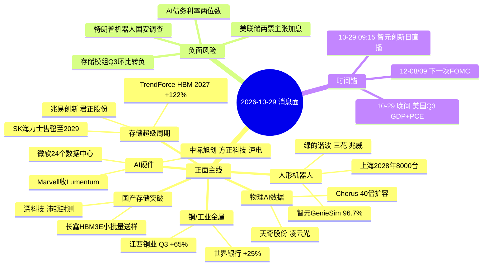

# 2026-10-29 · **消息面事件驱动**

> **数据源新鲜度**: partial · **降级状态**: true · **置信度**: 0.72
> **覆盖窗口**: 2026-10-28 06:00 ~ 2026-10-29 06:00 · **主源**: 财联社快讯 2984 条 + 公众号 95 篇 + 7 个焦点群 186 条 + 东财三季报预告 500 条 + 盘前公告窗口 8598 条

## 一句话结论

存储原厂、人形机器人零件、AI 硬件三线共振，但 10-28 炸板率 48.94% 只能做龙头；唯一硬对冲是特朗普机器人国安调查与 AI 债务收紧。

## 🗺️ 消息面全景图

## 🎯 顶级事件详解

### E20261029_001 · SK海力士Q3营业利润同比+600%且称内存售罄至2029 · TrendForce料2027年HBM均价+122% · strength=high · polarity=正面 · w=+0.775

**事件摘要**: 原厂口径确认存储紧缺到 2028 年 · 但模组环节 Q3 单季环比已转负 产业链两端背离。上海证券报(10-28 08:38 SK海力士三季报) + 财联社(10-28 09:10 日韩存储双雄拉升) + 调研先知(10-28 13:00 TrendForce 内存专家会) + 财闻私享(10-28 20:40 营业利润+600%)（date 2026-10-28 · days_since 1 · raw +0.90 → 衰减后 +0.775）

**负面杀伤面**: scope=板块级 · 存储模组 / 存储分销

**推理深度三问**:
- **大资金意图**: 机构在 10-27 主跌后需要一条“业绩已验证”的旗帜。SK 海力士把“供不应求到 2029/2030”写进财报、TrendForce 把 2027 年 HBM 均价上修到 +122%，两份都是可核验的硬资料，不是卖方吹票。大资金要的是“这轮跌是估值杀不是景气杀”的证据，原厂口径正好给出。
- **为什么走强**: 10-28 电子主力 +149.86 亿、半导体 +68.91 亿是 20 日窗口第 3 个正日，钱是踩着实钱进场的：兆易单日 +17.64 亿、5 日 +19.43 亿，是存储链唯一 5 日净流入的龙头。反包首日资金只买“有业绩的硬件”，这是 10 月以来的固定模式。
- **逻辑够不够硬**: 硬在两点：一是原厂自述产能售罄到 2029 且 2027-2028 年 50% 以上产能已签长协，供给端锁死；二是国内三季报已经能算出环比——君正 Q3 单季 14.18 亿环比 +61%。缺陷同样明确：模组三条腿（江波龙 -36~-49%、佰维 -62.5%、德明利 +2.2%）环比全部转负，说明涨价红利集中在原厂，模组只赚了个“同比好看”。

**首推票思维链**:

#### 兆易创新 603986.SH · role=存储设计( NOR/DRAM )龙头 · rank=龙头 · stance=研究首选

| 收盘 10-28 | 涨跌 | 10-28 最低 | MA5 | MA20 | 距60日高 | 5日主力净额 | 5日正天数 | 盈亏比 |
|---|---|---|---|---|---|---|---|---|
| 289.88 | +7.77% | 276.72 | 280.81 | 312.50 | -36.4% | +19.43 亿 | 2/5 | 1.79 |

- **买入理由**: 设计与原厂同吃涨价 · 三季报未出 预期差仍在 · 5 日主力 +19.43 亿是存储链唯一净流入龙头；主营相关性 0.95（存储芯片收入占比 85.0% 毛利率 67.6% (hithink 2026 中报主营构成)）；板块联动 0.92（10-28 +7.77% 成交 122.78 亿 主力单日 +17.64 亿 5 日 +19.43 亿(2/5)）；业绩催化 未出预告/未命中；仓位 0.120
- **风险点**: 距 60 日高 -36.4% 上方 MA20 312.5 压着 · 三季报若环比走弱即证伪
- **止损条件**: 275.34（参考价289.88 的 10-28 最低 276.72 与 MA5 280.81 取低再让 1.5% → 止损 275.34 (距参考价 -5.0%)）
- **可验证假设**: 若 10-29 高开不破 280.81(MA5) 且半小时主力净流入为正 → 主升第二段成立 否则只做观察

#### 君正股份 300223.SZ · role=存储设计( DRAM/NOR )弹性 · rank=龙二 · stance=观察

| 收盘 10-28 | 涨跌 | 10-28 最低 | MA5 | MA20 | 距60日高 | 5日主力净额 | 5日正天数 | 盈亏比 |
|---|---|---|---|---|---|---|---|---|
| 111.98 | +18.37% | 104.00 | 102.40 | 113.62 | -30.7% | +4.10 亿 | 2/5 | 0.71 |

- **买入理由**: Q3 单季 14.18 亿 vs Q2 8.79 亿 环比 +61% 是全链唯一加速的设计公司 · 但 10-28 已 +18.37%；主营相关性 0.90（存储芯片占比 66.5% 毛利率 48.1% 集成电路设计 99.8% (hithink)）；板块联动 0.88（10-28 +18.37% 主力单日 +6.80 亿 5 日 +4.10 亿(2/5) · 三季报 Q3 单季 14.18 亿 环比 +61%）；业绩催化 未出预告/未命中；仓位 0.050
- **风险点**: 单日 18% 后接力盘成本极高 · 追高即被埋 · 且 MA20 113.62 尚未收复
- **止损条件**: 100.86（参考价111.98 的 10-28 最低 104.00 与 MA5 102.40 取低再让 1.5% → 止损 100.86 (距参考价 -9.9%)）
- **可验证假设**: 若 10-29 回踩 104.00(10-28 最低)不破且量能缩至 10-28 六成 → 可低吸 否则放弃

#### 江波龙 301308.SZ · role=存储模组(嵌入式/SSD) · rank=龙三 · stance=剔除

| 收盘 10-28 | 涨跌 | 10-28 最低 | MA5 | MA20 | 距60日高 | 5日主力净额 | 5日正天数 | 盈亏比 |
|---|---|---|---|---|---|---|---|---|
| 239.20 | +4.87% | 233.36 | 237.39 | 269.42 | -45.9% | -4.95 亿 | 1/5 | 0.91 |

- **买入理由**: 按 v1.5 协议拆单季 Q3 单季 34.2-43.2 亿 vs Q2 67.15 亿 环比 -36%~-49% · 周期见顶特征；主营相关性 0.92（存储模组为主 · 三季报预告累计净利 140-149 亿 同比 +1865%~1991%）；板块联动 0.55（10-28 +4.87% 5 日主力 -4.95 亿(1/5) 距 60 日高 -45.9%）；业绩催化 未出预告/未命中；仓位 0.010
- **风险点**: 累计同比炸裂但单季环比转负 = 利好出尽典型 · 模组被原厂涨价挤压毛利
- **止损条件**: 226.04（参考价239.20 的 10-28 最低 233.36 与 MA5 237.39 取低再让 1.5% → 止损 226.04 (距参考价 -5.5%)）
- **可验证假设**: 若三季报正式披露 Q3 单季 ≥ 50 亿(环比转正) 才解除剔除 否则不碰

#### 佰维存储 688525.SH · role=存储模组/封测 · rank=龙三 · stance=剔除

| 收盘 10-28 | 涨跌 | 10-28 最低 | MA5 | MA20 | 距60日高 | 5日主力净额 | 5日正天数 | 盈亏比 |
|---|---|---|---|---|---|---|---|---|
| 164.00 | +8.36% | 155.71 | 159.38 | 174.08 | -37.5% | +2.21 亿 | 2/5 | 0.90 |

- **买入理由**: Q3 单季 16.02 亿 vs Q2 单季 42.67 亿 环比 -62.5% 营收环比 -30% · 环节错配最典型；主营相关性 0.92（集成电路(存储模组)97.5% · Q3 单季净利 16.02 亿 同比 +525%）；板块联动 0.45（10-28 +8.36% 5 日主力 +2.21 亿(2/5) 距 60 日高 -37.5%）；业绩催化 未出预告/未命中；仓位 0.010
- **风险点**: 同比 +525% 与环比 -62.5% 方向相反 · 市场定价边际 不在同比
- **止损条件**: 154.93（参考价164.00 的 10-28 最低 155.71 与 MA5 159.38 取低再让 1.5% → 止损 154.93 (距参考价 -5.5%)）
- **可验证假设**: 若 Q4 指引毛利率回升且原厂涨价传导到模组报价 再评估

### E20261029_002 · 上海拟2028年推动8000台人形机器人进工厂 · 智元Genie Sim一致性96.7% · 特斯拉Optimus接管Robotaxi插枪 · strength=high · polarity=正面 · w=+0.757

**事件摘要**: 政策给量+平台给数据+整机给场景 · 机器人是 10-28 涨停最多方向。财联社(10-28 14:19 智元 Genie Sim) + 财联社(10-28 18:40 特斯拉 Optimus) + 财闻私享(10-28 20:40 上海 8000 台政策) + 财联社(10-28 19:20 钱塘-宇树基地)（date 2026-10-28 · days_since 1 · raw +0.88 → 衰减后 +0.757）

**负面杀伤面**: scope=板块级 · 纯概念跟风杂毛

**推理深度三问**:
- **大资金意图**: 机器人是 10-28 涨停最多的方向（减速器：宁波东力/五洲新春/光洋股份/襄阳轴承），资金在这里做的是“政策给量 + 平台给数据 + 整机给场景”的三段式叙事。上海 2028 年 8000 台进工厂是最直接的量的指引，智元 Genie Sim 96.7% 一致性解决的是“数据不够”的卡点。
- **为什么走强**: 绿的谐波 5 日 4 天净流入 +4.57 亿、已收复 MA20(266.15)，是全链唯一“资金 + 技术形态”双确认的龙头；兆威机电距 60 日高仅 -4.3%，属强势股回踩而非低位。板块已经从“普涨”进入“分化”，这时候只有前排有意义。
- **逻辑够不够硬**: 政策腿偏软：8000 台只有财闻私享一个公众号源，未见官方文件，我已把该腿降为 medium 并标 single_source。硬的是产业进度（智元仿真一致性 96.7%、特斯拉 Optimus 接管 Robotaxi 插枪、钱塘-宇树五方签约）。反面证据同样硬：宇树 Q3 净利 1.13 亿同比 -17.37%，销量增长没有转化成利润，所以杂毛腿必须是负面。

**首推票思维链**:

#### 绿的谐波 688017.SH · role=谐波减速器 · rank=龙头 · stance=研究首选

| 收盘 10-28 | 涨跌 | 10-28 最低 | MA5 | MA20 | 距60日高 | 5日主力净额 | 5日正天数 | 盈亏比 |
|---|---|---|---|---|---|---|---|---|
| 291.98 | +6.05% | 272.88 | 281.83 | 266.15 | -24.2% | +4.57 亿 | 4/5 | 1.28 |

- **买入理由**: 机器人链唯一 5 日 4 天净流入 + 已收复 MA20 的龙头 · 8000 台政策直接对应减速器用量；主营相关性 0.90（工业及服务机器人零部件 74.0% 毛利率 34.9% (hithink 主营构成)）；板块联动 0.90（10-28 +6.05% 成交 37.70 亿 5 日主力 +4.57 亿(4/5) 已站上 MA20 266.15）；业绩催化 未出预告/未命中；仓位 0.120
- **风险点**: 距 60 日高 -24.2% 仍有套牢盘 · 10-28 日内高潮后已有分化
- **止损条件**: 271.52（参考价291.98 的 10-28 最低 272.88 与 MA5 281.83 取低再让 1.5% → 止损 271.52 (距参考价 -7.0%)）
- **可验证假设**: 若 10-29 不破 281.83(MA5) 且板块涨停家数 ≥ 5 → 主升延续 否则只留底仓

#### 三花智控 002050.SZ · role=机电执行器/热管理 · rank=龙二 · stance=观察

| 收盘 10-28 | 涨跌 | 10-28 最低 | MA5 | MA20 | 距60日高 | 5日主力净额 | 5日正天数 | 盈亏比 |
|---|---|---|---|---|---|---|---|---|
| 35.64 | +4.64% | 34.18 | 34.42 | 33.78 | -11.9% | +5.08 亿 | 4/5 | 1.27 |

- **买入理由**: 特斯拉链最直接标的 · 但股价离 60 日高仅 -11.9% 属高位 · 特朗普进口调查对其美国收入有扰动；主营相关性 0.70（制冷业务 61.8% 毛利率 28.4% · 机器人执行器为新业务(hithink)）；板块联动 0.72（10-28 +4.64% 5 日主力 +1.12 亿(2/5) 距 60 日高 -11.9% 位置最高）；业绩催化 未出预告/未命中；仓位 0.050
- **风险点**: 美国收入暴露 + 关税调查 · 高位票在炸板率 48.9% 的环境下容错低
- **止损条件**: 33.68（参考价35.64 的 10-28 最低 34.18 与 MA5 34.42 取低再让 1.5% → 止损 33.68 (距参考价 -5.5%)）
- **可验证假设**: 若 10-29 回踩 34.42(MA5)不破且主力净流入为正 → 可参与 否则放弃

#### 兆威机电 003021.SZ · role=微型传动系统/灵巧手 · rank=龙三 · stance=观察

| 收盘 10-28 | 涨跌 | 10-28 最低 | MA5 | MA20 | 距60日高 | 5日主力净额 | 5日正天数 | 盈亏比 |
|---|---|---|---|---|---|---|---|---|
| 97.41 | +5.31% | 90.65 | 92.26 | 73.79 | -4.3% | +2.55 亿 | 3/5 | 0.95 |

- **买入理由**: 灵巧手/丝杠方向弹性核心 · 已接近 60 日新高 属强势股回踩买点而非低位；主营相关性 0.72（微型传动系统 62.0% 毛利率 25.4% · 精密注塑件 33.9%(hithink)）；板块联动 0.68（10-28 +5.31% 5 日主力 +0.92 亿(3/5) 距 60 日高 -4.3% 位置极高）；业绩催化 未出预告/未命中；仓位 0.050
- **风险点**: 位置太高(-4.3%) 一旦机器人退潮首当其冲
- **止损条件**: 90.20（参考价97.41 的 10-28 最低 90.65 与 MA5 92.26 取低再让 1.5% → 止损 90.20 (距参考价 -7.4%)）
- **可验证假设**: 若 10-29 缩量回踩 92.26(MA5) 不破 → 低吸 破 MA5 直接出

#### 襄阳轴承 000678.SZ · role=纯概念跟风(轴承·5连板) · rank=杂毛 · stance=剔除

| 收盘 10-28 | 涨跌 | 10-28 最低 | MA5 | MA20 | 距60日高 | 5日主力净额 | 5日正天数 | 盈亏比 |
|---|---|---|---|---|---|---|---|---|
| 17.61 | +9.99% | 16.66 | 14.69 | 11.95 | +0.0% | +4.41 亿 | 4/5 | 0.50 |

- **买入理由**: 5 板妖股无业绩支撑 · 正是纪律 §3 要躲的杂毛 · 高位接力风险极大；主营相关性 0.35（轴承主业 · Q3 单季净亏 556 万元 · 无机器人减速器实质收入(hithink 主营 + 三季报)）；板块联动 0.15（10-28 5 连板 涨停 额 8.26 亿 流通 81 亿 距 60 日高 0%）；业绩催化 未出预告/未命中；仓位 0.010
- **风险点**: Q3 亏损 + 5 连板 + 流通盘小 → 退潮首日即一字跌停
- **止损条件**: 15.85（参考价17.61 的 10-28 最低 16.66 与 MA5 14.69 取低再让 1.5% → 止损 15.85 (距参考价 -10.0%)）
- **可验证假设**: 不参与 · 仅作情绪温度计 若它炸板则机器人板块同步降级

### E20261029_003 · 长鑫科技启动HBM3E小批量生产并向国内AI芯片厂送样 · 同日纳入上证指数成第一大权重 · strength=high · polarity=正面 · w=+0.732

**事件摘要**: 国产 HBM 从样品走向小批量 · 存储主线获得国产替代第二引擎。财联社(10-28 19:29 路透 长鑫 HBM3E) + 证券时报(10-28 16:57 纳入上证指数第一大权重) + 上海证券报(10-28 10:49 高开低走市值跌破3万亿)（date 2026-10-28 · days_since 1 · raw +0.85 → 衰减后 +0.732）

**推理深度三问**:
- **大资金意图**: 长鑫 3 万亿市值、纳入上证指数成第一大权重，是被动资金的必配项；HBM3E 送样则给了主动资金一个“国产算力最卡脖子环节被突破”的产业叙事。两条腿一起用，是为了让存储主线从“涨价周期”升级为“国产替代 + 周期”双逻辑。
- **为什么走强**: 10-28 长鑫 +3.16%、5 日主力 +18.08 亿，但当日主力是 -1.81 亿、盘中高开低走跌破 3 万亿——被动配置已完成的特征很明显。真正有弹性的是给它做封测配套的深科技（沛顿），位置 -33.7%、资金还没来。
- **逻辑够不够硬**: 产业逻辑硬（HBM3E 已向国内 AI 芯片设计企业送样，属可验证进度），但交易逻辑不硬：3 万亿的体量在炸板率 48.9% 的环境里做不出超短弹性，且 Q3 单季环比未披露，业绩无法交叉验证。所以事件给正面、个股只给观察。

**首推票思维链**:

#### 长鑫科技 688825.SH · role=国产 DRAM/HBM 唯一规模厂 · rank=龙头 · stance=观察

| 收盘 10-28 | 涨跌 | 10-28 最低 | MA5 | MA20 | 距60日高 | 5日主力净额 | 5日正天数 | 盈亏比 |
|---|---|---|---|---|---|---|---|---|
| 44.36 | +3.16% | 42.36 | 42.51 | 47.29 | -25.9% | +18.08 亿 | 3/5 | 1.25 |

- **买入理由**: HBM3E 送样 = 国产算力最硬的一条产业进度 · 但 3 万亿市值 + 新股 波动结构不适合做超短主仓；主营相关性 0.98（LPDDR 系列 52.0% + DDR 系列 46.2% 毛利率 82.6%/88.4% (hithink 主营构成)）；板块联动 0.60（10-28 +3.16% 主力单日 -1.81 亿 5 日 +18.08 亿(3/5) 距 60 日高 -25.9%）；业绩催化 未出预告/未命中；仓位 0.050
- **风险点**: 入指后被动资金已完成配置 · 10-28 高开低走显示获利盘兑现 · 换手极大
- **止损条件**: 41.87（参考价44.36 的 10-28 最低 42.36 与 MA5 42.51 取低再让 1.5% → 止损 41.87 (距参考价 -5.6%)）
- **可验证假设**: 若 10-29 站稳 42.51(MA5) 且主力净流入回正 → 国产存储第二段 否则只做存储链的情绪锚

#### 深科技 000021.SZ · role=DRAM 封测配套(沛顿) · rank=龙二 · stance=观察

| 收盘 10-28 | 涨跌 | 10-28 最低 | MA5 | MA20 | 距60日高 | 5日主力净额 | 5日正天数 | 盈亏比 |
|---|---|---|---|---|---|---|---|---|
| 28.62 | +3.25% | 27.89 | 28.48 | 30.66 | -33.7% | +0.81 亿 | 2/5 | 1.27 |

- **买入理由**: 长鑫 HBM 扩产最直接的外溢环节(封测) · 位置低 但资金尚未进场；主营相关性 0.62（存储半导体业务占 25.8% 毛利率 22.7% (hithink 主营构成)）；板块联动 0.58（10-28 +3.25% 5 日主力 -1.12 亿(2/5) 距 60 日高 -33.7%）；业绩催化 未出预告/未命中；仓位 0.050
- **风险点**: 封测毛利率仅 22.7% 弹性有限 · 板块启动第二日才轮到配套
- **止损条件**: 27.05（参考价28.62 的 10-28 最低 27.89 与 MA5 28.48 取低再让 1.5% → 止损 27.05 (距参考价 -5.5%)）
- **可验证假设**: 若长鑫连续两日放量上攻且深科技主力转正 → 补涨成立

### E20261029_004 · 世界银行预计2026年金属价格上涨25%创纪录 · 江西铜业Q3净利+65% · LME铜库存再降1275吨 · strength=high · polarity=正面 · w=+0.646

**事件摘要**: 机构上修金属价格+铜Q3业绩兑现+库存去化 · 基本面最硬但资金全在电子链。财联社(10-28 21:31 世界银行) + 财联社(10-28 18:14 LME库存) + 公告(10-28 18:07 江西铜业三季报)（date 2026-10-28 · days_since 1 · raw +0.75 → 衰减后 +0.646）

**推理深度三问**:
- **大资金意图**: 世界银行把 2026 年金属价格上修到 +25% 创纪录、LME 铜库存再降 1275 吨，加上江铜 Q3 +65.22%、北方铜业前三季 +142.96%，这是基本面最扎实的一条线。大资金没进，是因为钱都在电子链的反包上。
- **为什么走强**: 10-28 江铜只涨 1.84%、紫金涨 0.36%，5 日主力分别 -1.63 亿 / -13.94 亿。反包首日资金只做弹性最大的科技，资源股要等第二波轮动——这是 A 股缩量反弹的固定顺序。
- **逻辑够不够硬**: 基本面硬，交易面不硬。江铜冶炼加工毛利率仅 6.9%，铜价上涨大部分被加工费与原料端吃掉，它不是铜价最纯的载体；紫金矿端更纯但被机构持续减仓。按纪律 §2，没有资金确认的主线不给开仓资格，只入观察。

**首推票思维链**:

#### 江西铜业 600362.SH · role=铜冶炼/加工龙头 · rank=龙头 · stance=观察

| 收盘 10-28 | 涨跌 | 10-28 最低 | MA5 | MA20 | 距60日高 | 5日主力净额 | 5日正天数 | 盈亏比 |
|---|---|---|---|---|---|---|---|---|
| 36.56 | +1.84% | 36.18 | 36.32 | 39.74 | -28.1% | -1.63 亿 | 2/5 | 1.27 |

- **买入理由**: Q3 净利 +65.22% 且是世界银行涨价受益方 · 但冶炼加工毛利率仅 6.9% 铜价弹性弱于矿端；主营相关性 0.75（工业及其他非贸易收入 80.6% 但毛利率仅 6.9% 贸易 19.0% 毛利率 1.2%(hithink)）；板块联动 0.30（10-28 +1.84% 5 日主力 -1.63 亿(2/5) 距 60 日高 -28.1% 跑输大盘）；业绩催化 未出预告/未命中；仓位 0.050
- **风险点**: 毛利率结构决定其不是铜价最优载体 · 资金 5 日净流出 1.63 亿 完全不认这条线
- **止损条件**: 34.55（参考价36.56 的 10-28 最低 36.18 与 MA5 36.32 取低再让 1.5% → 止损 34.55 (距参考价 -5.5%)）
- **可验证假设**: 若 10-29 铜板块出现 ≥2 只涨停且江铜放量 → 补涨确认 否则只记录不做

#### 紫金矿业 601899.SH · role=矿山端(铜金双主业) · rank=龙头 · stance=降级观察

| 收盘 10-28 | 涨跌 | 10-28 最低 | MA5 | MA20 | 距60日高 | 5日主力净额 | 5日正天数 | 盈亏比 |
|---|---|---|---|---|---|---|---|---|
| 27.95 | +0.36% | 27.67 | 27.98 | 29.39 | -21.9% | -13.94 亿 | 1/5 | 0.91 |

- **买入理由**: 矿端才是铜价最纯的载体 · 但 5 日主力净流出 13.94 亿 是全场最大流出之一；主营相关性 0.80（矿山产金-金锭 10.1% 境外收入 56.9% 毛利率 26.9% (hithink 主营构成)）；板块联动 0.25（10-28 +0.36% 5 日主力 -13.94 亿(1/5) 距 60 日高 -21.9% · 资金持续撤）；业绩催化 未出预告/未命中；仓位 0.020
- **风险点**: 与金价/铜价背离 · 大票被机构减仓 · 反包日几乎不涨
- **止损条件**: 26.41（参考价27.95 的 10-28 最低 27.67 与 MA5 27.98 取低再让 1.5% → 止损 26.41 (距参考价 -5.5%)）
- **可验证假设**: 若紫金主力单日转正 5 亿以上再评估 否则维持降级

### E20261029_005 · 微软本季新增24个数据中心+谷歌对外卖TPU+Marvell洽购Lumentum · 同日AI债务收益率升至两位数 · strength=high · polarity=中性 · w=+0.300

**事件摘要**: 需求侧再确认 融资侧开始收紧 · 光模块/PCB 有业绩 无业绩高位算力承压。财联社(10-29 05:47 微软) + 财联社(10-29 05:20 谷歌TPU) + 财联社(10-29 05:09 Marvell/Lumentum) + 财联社(10-29 04:07 AI债务)（date 2026-10-29 · days_since 0 · raw +0.30 → 衰减后 +0.300）

**负面杀伤面**: scope=板块级 · AI算力高位持仓 / 无业绩算力概念

**推理深度三问**:
- **大资金意图**: 需求侧当晚给了三重确认：微软本季新增 24 个数据中心、谷歌开始对外卖 TPU、Marvell 洽购 Lumentum（后者盘后 +11%）。但同一晚另一条腿是 AI 债务利率飙到两位数、惠誉警告数据中心评级——大资金在“买有业绩的硬件、卖靠融资的高位算力”。
- **为什么走强**: 中际旭创单日主力 +31.97 亿、成交 235.73 亿全市场第一，5 日 +29.72 亿；而新易盛同日主力 -19.25 亿、5 日 -24.54 亿。同一板块内部出现 50 亿级别的跷跷板，说明资金不是在买“光模块”，是在买“龙头 + 有业绩”。方正科技 Q3 净利 +327%、环比 +80% 且牛散新进，PCB 这条腿是业绩驱动。
- **逻辑够不够硬**: 硬件腿硬（订单、出货、业绩都能查），融资腿也硬（收益率两位数是可观测的价格）。真正不硬的是“AI 总需求”这个总量叙事——所以事件整体只能是中性，靠板块两条腿分开定价。

**首推票思维链**:

#### 中际旭创 300308.SZ · role=光模块龙头 · rank=龙头 · stance=研究首选

| 收盘 10-28 | 涨跌 | 10-28 最低 | MA5 | MA20 | 距60日高 | 5日主力净额 | 5日正天数 | 盈亏比 |
|---|---|---|---|---|---|---|---|---|
| 636.30 | +10.28% | 588.55 | 602.11 | 712.92 | -38.5% | +29.72 亿 | 3/5 | 1.13 |

- **买入理由**: Marvell 收购 Lumentum 给光器件重定价 · 中际是 A 股唯一有 800G/1.6T 量产与业绩的龙头 · 资金单日 31.97 亿最猛；主营相关性 0.97（光通信收发模块 99.0% 毛利率 46.6% (hithink 主营构成)）；板块联动 0.95（10-28 +10.28% 成交 235.73 亿全市场第 1 主力单日 +31.97 亿 5 日 +29.72 亿(3/5)）；业绩催化 未出预告/未命中；仓位 0.120
- **风险点**: 距 60 日高 -38.5% 属深跌反包第二日 · 炸板率 48.9% 环境下反包次日易高开低走
- **止损条件**: 585.61（参考价636.30 的 10-28 最低 588.55 与 MA5 602.11 取低再让 1.5% → 止损 585.61 (距参考价 -8.0%)）
- **可验证假设**: 若 10-29 高开不破 602.11(MA5) 且半小时成交额 > 100 亿 → 反包成立 破 MA5 即撤

#### 方正科技 600601.SH · role=PCB(业绩+牛散) · rank=龙二 · stance=观察

| 收盘 10-28 | 涨跌 | 10-28 最低 | MA5 | MA20 | 距60日高 | 5日主力净额 | 5日正天数 | 盈亏比 |
|---|---|---|---|---|---|---|---|---|
| 10.32 | +10.02% | 9.70 | 9.97 | 11.77 | -34.7% | +2.07 亿 | 2/5 | 1.07 |

- **买入理由**: Q3 净利 +327% 环比 +80% 且有章建平配偶方文艳新进第七大股东 · 业绩与筹码双催化 首板；主营相关性 0.85（PCB 主业 · Q3 单季净利 6.16 亿 同比 +327.49% 环比 +80%(三季报)）；板块联动 0.85（10-28 涨停 +10.02% 主力单日 +6.33 亿 5 日 +2.07 亿(2/5) 距 60 日高 -34.7%）；业绩催化 未出预告/未命中；仓位 0.050
- **风险点**: 首板 + 34.7% 深跌 · 次日承接不确定 · 涨停后追高 RR 差
- **止损条件**: 9.65（参考价10.32 的 10-28 最低 9.70 与 MA5 9.97 取低再让 1.5% → 止损 9.65 (距参考价 -6.5%)）
- **可验证假设**: 若 10-29 竞价高开 3%-6% 且 9:35 前不破 10.00 → 打板/半路 否则放弃

#### 沪电股份 002463.SZ · role=PCB(高速板龙头) · rank=龙二 · stance=观察

| 收盘 10-28 | 涨跌 | 10-28 最低 | MA5 | MA20 | 距60日高 | 5日主力净额 | 5日正天数 | 盈亏比 |
|---|---|---|---|---|---|---|---|---|
| 104.57 | +5.41% | 101.70 | 103.34 | 112.85 | -20.3% | -9.13 亿 | 2/5 | 1.27 |

- **买入理由**: 三季报预告净利翻倍 · 高速板直接吃 AI 服务器放量 · 位置在 PCB 里较低；主营相关性 0.88（PCB 90.3% 毛利率 40.5% 国外收入 81.6% (hithink 主营构成)）；板块联动 0.80（10-28 +5.41% 5 日主力 -0.21 亿(2/5) 距 60 日高 -20.3% 三季报预告 +100.5%~109.7%）；业绩催化 未出预告/未命中；仓位 0.050
- **风险点**: 国外收入 81.6% → 关税与海外 capex 波动双敏感 · 5 日主力尚未转正
- **止损条件**: 98.82（参考价104.57 的 10-28 最低 101.70 与 MA5 103.34 取低再让 1.5% → 止损 98.82 (距参考价 -5.5%)）
- **可验证假设**: 若 10-29 站上 103.34(MA5) 且主力转正 → 跟随 AI 硬件 否则等回踩

#### 新易盛 300502.SZ · role=光模块(海外收入97.9%) · rank=龙三 · stance=降级观察

| 收盘 10-28 | 涨跌 | 10-28 最低 | MA5 | MA20 | 距60日高 | 5日主力净额 | 5日正天数 | 盈亏比 |
|---|---|---|---|---|---|---|---|---|
| 256.79 | +8.08% | 243.26 | 253.02 | 331.23 | -45.9% | -24.47 亿 | 1/5 | 0.87 |

- **买入理由**: 同样是光模块 但 5 日主力净流出 24.54 亿 · 资金明确弃 B 选 A(中际)；主营相关性 0.95（光互联产品 99.9% 毛利率 48.5% 国外收入 97.9% (hithink 主营构成)）；板块联动 0.55（10-28 +8.08% 5 日主力 -24.54 亿(2/5) 单日 -19.25 亿 距 60 日高 -45.9%）；业绩催化 未出预告/未命中；仓位 0.020
- **风险点**: 单日主力净流出 19.25 亿 = 拉高派发特征 · 与中际 29.72 亿净流入形成跷跷板
- **止损条件**: 242.04（参考价256.79 的 10-28 最低 243.26 与 MA5 253.02 取低再让 1.5% → 止损 242.04 (距参考价 -5.7%)）
- **可验证假设**: 若 10-29 主力净流入连续两小时为正才解除降级 否则不参与

### E20261029_006 · 特朗普签署公告将进口机器人与工业机械列为国家安全风险并要求USTR谈判 · strength=medium · polarity=负面 · w=-0.600

**事件摘要**: 机器人被纳入232式国安调查 · 未立即征税但出口链估值要打折扣。财联社(10-29 04:05 白宫公告) + 财联社(10-29 04:52 特朗普指示 USTR 谈判)（date 2026-10-29 · days_since 0 · raw -0.60 → 衰减后 -0.600）

**负面杀伤面**: scope=行业级 · 机器人/工业机械出口链 / 人形机器人(海外收入占比高标的)

**推理深度三问**:
- **大资金意图**: 特朗普把机器人/工业机械纳入 232 式国安调查，但明确“未立即征收关税”——这是留谈判筹码的典型做法。大资金的意图是给出口链估值打折，而不是现在就砍订单。
- **为什么走强**: 这条对 A 股是情绪压制而非业绩打击：埃斯顿工业机器人出口美国占比有限，10-28 还涨 5.94%、5 日主力 +2.16 亿。真正的风险在于它会在机器人板块情绪高潮时提供一个“高位砸盘”的借口。
- **逻辑够不够硬**: 方向硬、力度软。硬的是一条行业级负面（行业级 bearish_scope，必须进 top_events，不能被利好挤出）；软的是没有落地税率，随时可能被解读成“国产替代加速”反向炒。所以它只降机器人出口链的估值上限，不作为做空理由。

**首推票思维链**:

#### 埃斯顿 002747.SZ · role=工业机器人(出口暴露) · rank=龙三 · stance=观察

| 收盘 10-28 | 涨跌 | 10-28 最低 | MA5 | MA20 | 距60日高 | 5日主力净额 | 5日正天数 | 盈亏比 |
|---|---|---|---|---|---|---|---|---|
| 30.14 | +5.94% | 27.95 | 28.98 | 27.28 | -24.7% | +2.16 亿 | 3/5 | 0.91 |

- **买入理由**: 国产工业机器人出海标的 · 美国市场直接暴露于国安调查 · A 股同类出口链情绪受抑；主营相关性 0.80（工业机器人及成套设备 83.0% 毛利率 31.7% (hithink 主营构成)）；板块联动 0.45（10-28 +5.94% 5 日主力 +2.16 亿(3/5) 距 60 日高 -24.7% 已站上 MA20 27.28）；业绩催化 未出预告/未命中；仓位 0.050
- **风险点**: 调查未立即征税 → 属估值折价而非业绩打击 · 短线可能被当成国产替代利好反向炒
- **止损条件**: 27.81（参考价30.14 的 10-28 最低 27.95 与 MA5 28.98 取低再让 1.5% → 止损 27.81 (距参考价 -7.7%)）
- **可验证假设**: 若 10-29 机器人板块低开高走且埃斯顿不破 28.98(MA5) → 市场解读为国产替代 本腿作废

### E20261029_007 · 物理AI数据成最稀缺底层资源 · 行元智能Chorus实现40倍训练数据扩容 · 信通院建议建国家级实训场 · strength=medium · polarity=正面 · w=+0.559

**事件摘要**: 机器人预算先花在数据与采集设备 · 数据侧涨幅远超零部件 资金已投票。财联社早知道(10-28 19:03 明日主题前瞻头条) + 财闻私享(10-28 20:40 信通院) + 傅里叶的猫(10-28 19:57 物理AI复盘)（date 2026-10-28 · days_since 1 · raw +0.65 → 衰减后 +0.559）

**推理深度三问**:
- **大资金意图**: 物理 AI 的钱不是花在整机，是先花在“数据 + 采集设备 + 仿真”。10-19 以来海天瑞声/奥比中光/索辰/凡拓平均 +63.8%，而传统零部件只有 +12%~27%，资金已经用涨幅投票选出了“预算最先落地”的环节。
- **为什么走强**: 财联社早知道把它放上明日主题前瞻头条，点名天奇股份、凌云光，等于给全市场一个统一的次日交易脚本；信通院的“国家级实训场”建议则提供了政策想象空间。这类“前瞻 + 政策建议”组合在题材真空期最容易形成合力。
- **逻辑够不够硬**: 中等偏软。真实现状是：全球高质量真实数据仅数十万至百万小时级，而具身基础模型要千万小时级，缺口是量级差——逻辑成立。但 A 股标的的数据业务收入占比普遍未单列（天奇主营仍是汽车物流装备 47%），业绩无法证伪，属于纯预期交易。

**首推票思维链**:

#### 天奇股份 002009.SZ · role=工业具身智能数据采集 · rank=龙二 · stance=观察

| 收盘 10-28 | 涨跌 | 10-28 最低 | MA5 | MA20 | 距60日高 | 5日主力净额 | 5日正天数 | 盈亏比 |
|---|---|---|---|---|---|---|---|---|
| 17.62 | +0.97% | 16.74 | 17.05 | 15.72 | -7.4% | +2.15 亿 | 3/5 | 1.28 |

- **买入理由**: 财联社前瞻直接点名 · 位置接近 60 日高 说明已被资金做过一轮；主营相关性 0.55（汽车物流输送装备 47.0% + 锂电循环 36.7% · 具身智能数据采集为新增业务 收入占比未单列(hithink)）；板块联动 0.62（10-28 +0.97% 5 日主力 +0.50 亿(3/5) 距 60 日高 -7.4%）；业绩催化 未出预告/未命中；仓位 0.050
- **风险点**: 数据业务收入占比未披露 → 业绩弹性无法证伪也无法证实
- **止损条件**: 16.66（参考价17.62 的 10-28 最低 16.74 与 MA5 17.05 取低再让 1.5% → 止损 16.66 (距参考价 -5.4%)）
- **可验证假设**: 若 10-29 放量突破 19.00(60 日高) → 数据主线第二段 否则只观察

#### 凌云光 688400.SH · role=光学动捕/机器视觉 · rank=龙三 · stance=观察

| 收盘 10-28 | 涨跌 | 10-28 最低 | MA5 | MA20 | 距60日高 | 5日主力净额 | 5日正天数 | 盈亏比 |
|---|---|---|---|---|---|---|---|---|
| 45.42 | +3.94% | 43.30 | 45.45 | 41.90 | -11.5% | +2.05 亿 | 3/5 | 1.36 |

- **买入理由**: FZMotion 动捕已用于人形机器人数据采集与量产检测 · 华为/机器人双客户；主营相关性 0.60（智能视觉装备 22.8% + 可配置视觉系统 14.1% 毛利率 34.5%/40.2% (hithink)）；板块联动 0.55（10-28 +3.94% 5 日主力 -0.01 亿(3/5) 距 60 日高 -11.5%）；业绩催化 未出预告/未命中；仓位 0.050
- **风险点**: 视觉装备主业仍受消费电子资本开支拖累 · 数据收入体量小
- **止损条件**: 43.08（参考价45.42 的 10-28 最低 43.30 与 MA5 45.45 取低再让 1.5% → 止损 43.08 (距参考价 -5.2%)）
- **可验证假设**: 若 10-29 站上 45.45(MA5) 且主力转正 → 跟随数据主线

### E20261029_008 · 美联储10月维持利率3.75-4.00%不变·两票主张加息·12月加息概率50% · strength=medium · polarity=负面 · w=-0.350

**事件摘要**: 不降息且两票主张加息 · 外部流动性不构成 A 股增量 只提供喘息窗口。财联社(10-29 02:15 FOMC声明) + 财联社(10-29 03:38 彭博 12月加息概率50%) + 财联社(10-29 03:21 沃什发布会要点)（date 2026-10-29 · days_since 0 · raw -0.35 → 衰减后 -0.350）

**负面杀伤面**: scope=行业级 · A股高估值成长(无业绩题材) / 外资重仓高PE / AI算力高位持仓

**推理深度三问**:
- **大资金意图**: 10 票赞成 2 票反对、两位反对者主张加息 25bp，等于把“降息交易”挪到 12 月之后。外资定价的 A 股高估值资产要重新算折现率，但美股当晚三大指数仍收涨——说明市场把它读成“暂停”而不是“转向”。
- **为什么走强**: 对 A 股的实际影响不是杀跌而是封顶：外部没有增量流动性，反弹只能靠内部资金在板块间轮动。这也是为什么 10-28 的普涨是“反包”而不是“反转”——成交 1.64 万亿放量但宽度靠的是超跌股回补。
- **逻辑够不够硬**: 半硬。硬的是一致预期被推迟（12 月加息概率 50%），软的是没有直接打击任何一条 A 股产业链。金价 04:00 反而破 4080 美元、山东黄金 5 日主力 -6.24 亿(0/5) 股端不跟，说明“加息压制金价”的直觉这次不成立，所以贵金属腿只能记分歧。

**首推票思维链**:

#### 山东黄金 600547.SH · role=贵金属对照(金价 vs 黄金股背离) · rank=龙三 · stance=降级观察

| 收盘 10-28 | 涨跌 | 10-28 最低 | MA5 | MA20 | 距60日高 | 5日主力净额 | 5日正天数 | 盈亏比 |
|---|---|---|---|---|---|---|---|---|
| 24.99 | -0.91% | 24.72 | 25.48 | 26.63 | -35.5% | -6.24 亿 | 0/5 | 0.91 |

- **买入理由**: 金价创高但黄金股 5 日主力连续 5 天净流出、黄金 ETF 9 月以来缩水 180 亿 → 股端不跟；主营相关性 0.85（黄金占 63.7% 毛利率 22.5% (hithink 主营构成)）；板块联动 0.35（10-28 -0.91% 5 日主力 -6.24 亿(0/5) 距 60 日高 -35.5% · 现货金 10-29 04:00 破 4080 美元）；业绩催化 未出预告/未命中；仓位 0.020
- **风险点**: 金价与金股背离 · 加息路径未定 · 股端已先行杀估值
- **止损条件**: 23.62（参考价24.99 的 10-28 最低 24.72 与 MA5 25.48 取低再让 1.5% → 止损 23.62 (距参考价 -5.5%)）
- **可验证假设**: 若金价站稳 4080 且山东黄金主力转正 → 背离修复 否则不参与

## 📊 板块 × 事件热力矩阵

| 板块 | 净分 | 判定 | 命中事件数 | 类型 | 逐事件叉乘明细 | 位置/资金说明 |
|---|---:|:--:|:--:|---|---|---|
| 存储原厂/设计 | +1.507 | 正面 | 2 | 多事件叠加 | 001 正面×1.00=+0.775 + 003 正面×1.00=+0.732 | 10-28 电子主力 +149.86 亿 半导体 +68.91 亿 · 5 日仍 -42.24 亿 反包首日 位置距 60 日高 -36% |
| 人形机器人零部件 | +0.757 | 正面 | 1 | 单事件 | 002 正面×1.00=+0.757 | 10-28 减速器/丝杠批量涨停(宁波东力/五洲新春/光洋股份) · 绿的 5 日 4 天净流入 |
| 纯概念跟风杂毛 | -0.754 | 负面 | 2 | 多事件叠加 | 002 负面×0.70=-0.530 + 007 负面×0.40=-0.224 | 襄阳轴承 5 连板但 Q3 净亏 556 万 · 宇树 Q3 净利 -17.37% 增收不增利 |
| 铜/工业金属 | +0.646 | 正面 | 1 | 单事件 | 004 正面×1.00=+0.646 | 世界银行 +25% 与 Q3 业绩都在 但江铜 5 日 -1.63 亿 紫金 -13.94 亿 · 基本面与资金背离 |
| 存储模组 | -0.542 | 负面 | 1 | 单事件 | 001 负面×0.70=-0.542 | 三条模组腿 Q3 单季环比 -36%~-62% · 涨价红利被原厂拿走 资金只做原厂/设计 |
| 半导体设备/材料 | +0.512 | 正面 | 1 | 单事件 | 003 正面×0.70=+0.512 | 长鑫 HBM3E 扩产外溢 · 但 10-28 半导体设备未进主力前 5 板块 资金未确认 |
| 机器人/工业机械出口链 | -0.420 | 负面 | 1 | 单事件 | 006 负面×0.70=-0.420 | 特朗普国安调查未立即征税 · 属估值折价 短线可能被反向解读为国产替代 |
| 物理AI数据/传感器 | +0.391 | 正面 | 1 | 单事件 | 007 正面×0.70=+0.391 | 10-19 以来数据侧平均 +63.8% vs 零部件 +12%~27% · 已走完第一波 |
| AI算力高位持仓 | -0.350 | 负面 | 2 | 多事件叠加 | 005 负面×0.70=-0.210 + 008 负面×0.40=-0.140 | AI 债务利率两位数 + 惠誉警告 + 新易盛单日主力 -19.25 亿 · 高位无业绩算力先破 |
| AI算力硬件 | +0.300 | 正面 | 1 | 单事件 | 005 正面×1.00=+0.300 | 中际旭创单日主力 +31.97 亿全市场最猛 · 方正 Q3 +327% · 有业绩的硬件被重新定价 |
| A股高估值成长 | -0.140 | 负面 | 1 | 单事件 | 008 负面×0.40=-0.140 | 美联储两票主张加息 + 12 月加息概率 50% → 只压制估值上限 不构成杀跌 |
| 贵金属 | +0.000 | 分歧 | 1 | 单事件 | 008 中性×0.70=+0.000 | 现货金 10-29 04:00 破 4080 美元 vs 山东黄金 5 日主力 -6.24 亿(0/5) · 股端不跟 记分歧 |

**叉乘口径**: contrib = |weighted_score| × sign(板块极性) × W(high 1.0 / medium 0.7 / low 0.4)，同板块多事件累加；>+0.12 正面、<-0.12 负面、其余分歧。

### 🔀 多事件叠加板块（sector_cross_summary）

- **存储原厂/设计** 净分 +1.507（正面，2 条腿）: 001 正面×1.00=+0.775 + 003 正面×1.00=+0.732。10-28 电子主力 +149.86 亿 半导体 +68.91 亿 · 5 日仍 -42.24 亿 反包首日 位置距 60 日高 -36%
- **纯概念跟风杂毛** 净分 -0.754（负面，2 条腿）: 002 负面×0.70=-0.530 + 007 负面×0.40=-0.224。襄阳轴承 5 连板但 Q3 净亏 556 万 · 宇树 Q3 净利 -17.37% 增收不增利
- **AI算力高位持仓** 净分 -0.350（负面，2 条腿）: 005 负面×0.70=-0.210 + 008 负面×0.40=-0.140。AI 债务利率两位数 + 惠誉警告 + 新易盛单日主力 -19.25 亿 · 高位无业绩算力先破

## 🔥 三季报业绩预告命中

`eastmoney_earnings_predict` 2026-09-30 报告期 500 条，与本文事件板块交集逐票拆单季（环比优先于累计同比）：

| 代码 | 名称 | 累计同比（仅背景） | Q3 单季(亿) | Q2 单季(亿) | 单季环比 | 扣非 | 周期股 | 价格趋势 | 终判 |
|---|---|---|---:|---:|---:|:--:|:--:|---|---|
| 688525.SH | 佰维存储 | +525.34%(Q3 单季同比) | 16.02~16.02 | 42.67 | -62.5% | 是 | 是 | 上行(原厂) / 模组传导滞后 | 环比断崖 · 模组环节错配 |
| 301308.SZ | 江波龙 | +1864.55%~1990.84% | 34.2~43.2 | 67.15 | -36%~-49% | 是 | 是 | 上行(原厂) / 模组被挤压 | 周期见顶·利好出尽 |
| 300223.SZ | 君正股份 | 前三季净利 26.16 亿 | 14.18~14.18 | 8.79 | +61.3% | 是 | 是 | 上行(NOR/DRAM 涨价) | 环比加速·设计端受益 |
| 001309.SZ | 德明利 | 扭亏 +17128%~17722% | 27.29~27.29 | 26.71 | +2.2% | 是 | 是 | 上行(原厂)/模组 | 营收 +24% 而净利 +2% · 增收不增利 |
| 688825.SH | 长鑫科技 | 前三季扭亏 +2581%~2609% | 未披露 | 未披露 | 未披露 | — | 是 | 上行 | earnings_qoq_unverified · 仅有前三季预告 不臆测单季 |

同板块其余命中：沪电股份预告净利 +100.54%~109.74%（PCB，AI硬件正面腿）；北方铜业前三季 +142.96%、Q3 单季 2.78 亿 +37.74%（铜，金属正面腿）；方正科技 Q3 净利 6.16 亿 +327.49% 环比 +80%（PCB，AI硬件正面腿）；广合科技 Q3 净利 5.33 亿 +129.29%（PCB）；摩尔线程 Q3 营收 15.52 亿 +1773.92%、归母 4926 万扭亏（国产算力）；宇树科技 Q3 营收 +69.93% 但净利 -17.37%（机器人，反证腿）。

## 首板候选池（消息侧直接点名）

| 名称 | 代码 | 来源 | 源数 | 质量 | 收盘 | 涨跌 | 距60日高 | 5日主力 | 风险标记 |
|---|---|---|---:|:--:|---:|---:|---:|---:|---|
| 宇树科技 | 688836.SH | direct_name_match | 3 | high | 695.90 | +8.74% | -36.7% | +6.90 亿 | 三季报增收不增利(净利同比-17.37%)；距60日高-36.7% 高位回落 |
| 摩尔线程 | 688795.SH | direct_name_match | 3 | high | 381.50 | +5.84% | -36.4% | +7.96 亿 | Q3 扣非仅 2007 万 体量小；距60日高-36.4% |
| 天孚通信 | 300394.SZ | direct_name_match | 3 | high | 201.43 | +6.79% | -31.7% | -0.36 亿 | 5日主力-0.36亿 单日+8.96亿 波动极大 |
| 广合科技 | 001389.SZ | direct_name_match | 3 | high | 103.00 | +3.99% | -49.6% | -4.80 亿 | 港股开盘涨5.75% A股联动；PCB 板块第二梯队 |
| 奥士康 | 002913.SZ | direct_name_match | 2 | high | 63.10 | +5.27% | -35.7% | +0.00 亿 | 距60日高-35.7%；5日主力0.00亿(数据仅覆盖至10-28前5日) |
| 襄阳轴承 | 000678.SZ | direct_name_match | 2 | medium | 17.61 | +9.99% | +0.0% | +4.41 亿 | 5连板妖股；Q3净亏556万；无机器人实质收入；禁止买入-仅作情绪温度计 |
| 天奇股份 | 002009.SZ | direct_name_match | 1 | medium | 17.62 | +0.97% | -7.4% | +2.15 亿 | 单一公众号源 quality 顶格 medium；数据业务收入占比未披露 |
| 凌云光 | 688400.SH | direct_name_match | 1 | medium | 45.42 | +3.94% | -11.5% | +2.05 亿 | 单一公众号源 quality 顶格 medium；视觉装备主业受消费电子拖累 |
| 金安国纪 | 002636.SZ | direct_name_match | 1 | medium | 58.59 | +10.01% | -36.3% | -0.62 亿 | 单一官方源(上证报)；涨停首板 次日承接未知；5日主力-3.42亿 |

排序固定 quality → source_count → hit_count，不因可交易性重排；单一公众号/官方源 quality 顶格 medium。襄阳轴承列为反面样本，禁止买入。

## 关键证据

- 证据 1: SK 海力士三季报供不应求延续到 2030 年，韩股当日大涨 · 来源 上海证券报 10-28 08:38
- 证据 2: TrendForce 2027 年 HBM 综合 ASP 同比 +122% 至 3.7 美元/Gb，行业营收 +230% 破 2000 亿美元 · 来源 调研先知 10-28 13:00
- 证据 3: 路透称长鑫科技启动 HBM3E 小批量生产并向国内 AI 芯片设计企业送样 · 来源 财联社 10-28 19:29
- 证据 4: FOMC 维持 3.75%-4.00%，10 票赞成 2 票反对（库克、哈马克主张加息 25bp）· 来源 财联社 10-29 02:15
- 证据 5: 特朗普签署公告将进口机器人与工业机械列为国安风险，未立即征税 · 来源 财联社 10-29 04:05-04:52
- 证据 6: 微软本季新增 24 个数据中心；Marvell 洽购 Lumentum，后者盘后 +11% · 来源 财联社 10-29 05:09-05:47
- 证据 7: 世界银行预计 2026 年金属价格 +25% 创纪录；LME 铜库存 -1275 吨 · 来源 财联社 10-28 21:31 / 18:14
- 证据 8: 10-28 涨停 72 家、炸板 69 家、炸板率 48.94%，宽度 4156 涨 / 1239 跌，成交 16421 亿 · 来源 data/research/20261029/R7_capital_flow.json

## 数据源审计

| 源 | 日期 | 状态 | 备注 |
|---|---|:--:|---|
| tushare/news_cls | 2026-10-29 | 🟢 | 2984 条 · 24h 回看 |
| tushare/news_major | 2026-10-29 | 🟡 | 800 条 · 仅标题无正文 |
| eastmoney/earnings_predict | 2026-10-29 | 🟢 | 500 条 · 2026-09-30 报告期 |
| wechat_official_rss | 2026-10-29 | 🟢 | 17 feed / 95 篇 · 盘前纪要仅 10-28 版 |
| wechat_cli_5groups | 2026-10-29 | 🟢 | 7 群 186 条（群名匿名） |
| anns_window | 2026-10-29 | 🟢 | 8598 条 · 覆盖 10-28/10-29 |
| tushare daily/moneyflow_dc/income | 2026-10-29 | 🟢 | 33 只价格 + 5 日东财 DC 主力净额 + 利润表 |
| hithink/business-query | 2026-10-29 | 🟢 | 18 只主营构成（官方 OpenAPI） |
| weflow | 2026-10-29 | 🔴 | HTTP 404 · swl888aaa.ngrok.app 挂起 |
| xtick/hot_news | 2026-10-29 | 🟡 | 本次未接入 · 由 news_cls 覆盖 |

## 不确定性 / 反证

1. **上海 8000 台政策只有一个公众号源**（财闻私享 10-28 20:40），未见官方文件；该腿已降为 medium 并标 single_source，D1 不得把它当作硬政策。
2. **存储模组可能被错杀**：佰维 Q3 环比 -62.5% 是按“前三季 - H1”倒推，若 Q3 有一次性减值或费用前置，实际经营环比可能好于表观；资金在原厂与模组之间的流向也可能过度一致。
3. **机器人是日内高潮后分化**：10-28 减速器批量涨停，安静拆主线明确写“日内高潮并转分化”，后排次日风险高；宇树 Q3 净利 -17.37% 说明销量不等于利润，杂毛腿的负面判断可能在情绪高潮期被无视一天。
4. **铜的基本面与资金背离**：世界银行 +25% 与江铜 Q3 +65% 都是真的，但 5 日主力江铜 -1.63 亿、紫金 -13.94 亿。若 10-29 资源股补涨，本文“只观察”的判断会显得保守。
5. **美联储腿方向可能反转**：美股当晚收涨、金价破 4080，市场读成“暂停”而非“转鹰”；若 A 股把它当靴子落地，负面腿直接作废。
6. **KOL 交叉缺失**：R3 10-29 未产出、weflow 404，本文没有独立的群聊情绪验证，情绪判断只依赖 R7 的炸板率与宽度。
7. **news_major 只有标题**，长文要闻里的产业链细节无法交叉，可能漏掉非财经媒体的深度催化。

## 与其他 R/D/E 的关系

- 依赖: `data/raw/20261029/*`（news_cls / news_major / 公众号 / 群聊 / 业绩预告 / 公告窗口）、tushare 日线与 moneyflow_dc、hithink 主营构成、`data/research/20261029/R7_capital_flow.json`（情绪与板块资金口径）
- 被消费: R2 主线（存储原厂/机器人/AI 硬件三线）、R5 个股画像（20 只票）、R6 反证（AI 债务 + 模组环比 + 机器人杂毛三条负面腿）、D1 预案（stance 与止损位）

## Sub-Agent 元数据

- skill: analyze_news_impact_v1@1.7
- artifact: data/research/20261029/R4_news.json
- method: llm_v1（五源硬约束 + 时间衰减 λ=0.15 + 板块极性叉乘）
- 生成时刻: 2026-10-29T06:45:00+08:00
