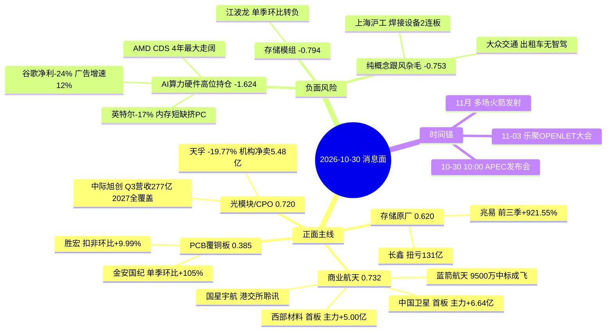

# 2026-10-30（周五） · **消息面事件驱动**

> **数据源新鲜度**: partial · **降级状态**: true · **置信度**: 0.62
> **覆盖窗口**: 2026-10-28 08:00 ~ 2026-10-30 07:00（美股 10-29 21:30~10-30 04:00 CST）· **主源**: 财联社快讯 2994 条 + 取阅 RSS 公众号 86 篇 + 公告窗口 9858 条 + 东财三季报预告 500 条
> **情绪前提（R1/R7 口径）**: 10-29 涨停 39 / 跌停 41 / 炸板 25（炸板率 39.06%）· 宽度 781 涨 / 4728 跌 · 成交 15707 亿 · 主力单日 -703.84 亿（20 日最差）→ **崩溃退潮 · 无主线 · 仓位上限 10%**

## 一句话结论

消息侧是「百家业绩炸裂 + 美股AI链隔夜杀跌」的对撞，唯一拿到资金的是商业航天（航天装备主力 +10.00 亿）；8 条事件里 3 条负面腿全部指向 AI 硬件高位持仓（净分 -1.624），今日不做科技右侧，只留 1 只观察级首选（中国卫星 55.90 / RR 2.00）并等竞价确认。

## 🗺️ 消息面全景图

## 板块极性叉乘（净分重算口径）

| 板块 | 净分 | 判定 | 事件数 | 逐事件叉乘明细 |
|---|---:|:--:|:--:|---|
| AI算力硬件高位持仓 | -1.624 | 负面 | 3 | E20261030_001 负面×1.00=-0.900 + E20261030_003 负面×0.70=-0.504 + E20261030_004 负面×0.40=-0.220 |
| 存储模组 | -0.794 | 负面 | 2 | E20261030_001 负面×0.40=-0.360 + E20261030_002 负面×0.70=-0.434 |
| 纯概念跟风杂毛 | -0.753 | 负面 | 2 | E20261030_005 负面×0.70=-0.512 + E20261030_007 负面×0.70=-0.241 |
| 商业航天 | +0.732 | 正面 | 1 | E20261030_005 正面×1.00=+0.732 |
| 光模块/CPO | +0.720 | 正面 | 1 | E20261030_003 正面×1.00=+0.720 |
| 存储原厂/设计 | +0.620 | 正面 | 1 | E20261030_002 正面×1.00=+0.620 |
| PCB/覆铜板 | +0.385 | 正面 | 1 | E20261030_004 正面×0.70=+0.385 |
| 人形机器人零部件 | +0.315 | 正面 | 1 | E20261030_006 正面×0.70=+0.315 |
| 自动驾驶/智驾 | +0.241 | 正面 | 1 | E20261030_007 正面×0.70=+0.241 |
| 传媒/短剧 | +0.140 | 正面 | 1 | E20261030_008 正面×0.40=+0.140 |

**多事件叉乘结论（只列 ≥2 事件）**

- **AI算力硬件高位持仓** -1.624（负面 · 3 事件）: E20261030_001 负面×1.00=-0.900 + E20261030_003 负面×0.70=-0.504 + E20261030_004 负面×0.40=-0.220 · 位置: 10-29 电子主力-309.22亿 半导体-136.40亿 通信设备-111.15亿 印制电路板-82.49亿 · 5日全线净流出 · 位置距60日高-36%~-44%
- **存储模组** -0.794（负面 · 2 事件）: E20261030_001 负面×0.40=-0.360 + E20261030_002 负面×0.70=-0.434 · 位置: 江波龙-7.40%/德明利-6.58% 5日主力-7.99/-3.47亿 · 模组吃不到原厂涨价 单季环比转负
- **纯概念跟风杂毛** -0.753（负面 · 2 事件）: E20261030_005 负面×0.70=-0.512 + E20261030_007 负面×0.70=-0.241 · 位置: 上海沪工2连板(焊接设备)/上海港湾一字(地基) · 大众交通(出租车) · 主业与题材无关 只靠情绪

> 单事件行不构成叉乘价值：今日 8 条事件里 7 条是彼此独立的单事件，唯一的「负面共识」是 AI 硬件高位持仓被三条事件同时砸（001 行业级 + 003 光模块位置 + 004 PCB位置）。这正是主跌日的消息面特征——利好分散、利空共振。

## 🎯 顶级事件详解（三问 + 逐票思维链）

### E20261030_001 · 隔夜美股AI链集体杀跌 谷歌净利-24%广告增速降至12% 英特尔-17% 纳指-1.36%且纳指100期货再跌超2% · strength=high · polarity=负面 · weighted=-0.900

**事件摘要**: 美股AI硬件与平台同时杀跌 · AI举债成本抬升 · 今日开盘AI硬件链先按防守处理

| 字段 | 值 |
|---|---|
| 可知日 / days_since | 2026-10-30 / 0 |
| event_type | macro |
| raw_score → weighted | -0.90 → -0.900（λ=0.15） |
| 独立源数 | 7 |
| valid_period | 1-2交易日 |
| bearish_scope | 行业级 |
| 杀伤面 | 光模块、CPO、PCB、存储、半导体、AI算力硬件 |

**推理深度三问**

- **大资金意图**: 隔夜不是「资金撤离AI」，而是给AI重新定价「谁付钱、谁先收钱」。纳指-1.36%、纳指100期货-2%的同时，微软250亿发债拿到1150亿认购、英伟达在谈为云厂450亿美元Anthropic交易提供数十亿信贷、亚马逊Q3物业设备支出超770亿美元——上游仍在被抢，被杀的是平台变现端（谷歌净利261亿同比-24%、搜索广告增速12%，前两季17%/19%）与被AI挤出的非AI业务（英特尔-17%，CFO明说内存短缺推高成本压制PC需求）。
- **为什么走强**: 杀的是「AI之外也要为AI付账」的部分。英特尔的内存短缺+PC需求疲软，说明这轮存储涨价正在以挤出下游的方式传导；AMD高级CDS扩11个基点创四年最大，是债市在给AI资本开支上利率。A股10-29已经先演一遍：电子主力-309.22亿、半导体-136.40亿、通信设备-111.15亿、印制电路板-82.49亿，四块全砸。
- **逻辑够不够硬**: 硬，三条独立信号同向：平台变现崩塌（财报级）、硬件端挤出（公司口径）、信用端走阔（CDS）。反证也清晰——若今晚到下周硬件财报继续超预期，这轮只是估值清洗，逻辑不破；若云厂下调capex指引，才是逻辑破坏。今日开盘只能按防守处理，不能赌清洗。

**证据链**

- 财联社 10-30 04:00 美股收盘 道指-0.25% 标普500 -0.31% 纳指-1.36%
- 财联社 10-30 04:07 纳斯达克100指数期货跌超2%
- 财联社 10-30 04:15 英特尔业绩指引承压 盘后大跌
- 财联社 10-30 00:53 Alphabet债务风险指标上升 财报令AI举债担忧再起
- 财联社 10-30 04:44 AMD高级CDS利差扩大11个基点 创最近四年最大涨幅
- 猫笔刀 10-29 22:24 谷歌Q3净利261亿美元同比-24% 搜索广告增速掉到12%(前两季17%/19%)
- 上海证券报 10-29 23:09 谷歌超5000亿美元市值蒸发

**口径备注**: 负面强制入榜：同一晚谷歌(平台变现崩)与英特尔(PC需求崩)+AMD CDS走阔构成行业级利空 · 按v1.4规则与存储/光模块正面业绩条并列 · 不因利空被挤出

**逐票思维链**

#### 工业富联 601138.SH · role=AI服务器代工(算力硬件最大代工票) · rank=龙头 · stance=降级观察

| 收盘 | 当日 | MA5 | MA20 | 距60日高 | 5日主力净额 | 当日主力 | RR |
|---:|---:|---:|---:|---:|---:|---:|---:|
| 45.22 | -7.03% | 47.07 | 51.28 | -36.3% | -10.91 亿 | -10.68 亿 | 1.34 |

- **买入理由**: 英伟达链代工订单仍是核心收入 · 但隔夜美股AI链集体杀跌且今日主力口径见流出
- **风险点**: 英特尔-17%与纳指期货-2%说明AI硬件估值端在杀 · 代工是最后一个补跌环节
- **止损条件**: 跌破 42.51 即离场（参考价45.22 × (1-6.0%) = 42.51；失守 5 日线 47.07 为二次确认）
- **可验证假设**: 若开盘30分钟主力净额转正且守住45元则只按超跌反弹处理 不追

#### 新易盛 300502.SZ · role=光模块(海外收入占比97.9%) · rank=杂毛 · stance=剔除

| 收盘 | 当日 | MA5 | MA20 | 距60日高 | 5日主力净额 | 当日主力 | RR |
|---:|---:|---:|---:|---:|---:|---:|---:|
| 228.40 | -11.06% | 247.09 | 320.08 | -51.9% | -36.02 亿 | -11.55 亿 | 1.33 |

- **买入理由**: 海外收入占比最高 · 对美股AI资本开支预期最敏感
- **风险点**: 10-29 -11.06% 主力单日-11.55亿 5日-36.02亿 · Q3单季净利环比-19.1%
- **止损条件**: 跌破 214.70 即离场（参考价228.40 × (1-6.0%) = 214.70；失守 5 日线 247.09 为二次确认）
- **可验证假设**: 不参与 除非Q4订单口径被公司再次确认

#### 沪电股份 002463.SZ · role=PCB高速板 · rank=杂毛 · stance=剔除

| 收盘 | 当日 | MA5 | MA20 | 距60日高 | 5日主力净额 | 当日主力 | RR |
|---:|---:|---:|---:|---:|---:|---:|---:|
| 94.11 | -10.00% | 100.77 | 111.15 | -28.3% | -21.97 亿 | -12.84 亿 | 1.33 |

- **买入理由**: AI服务器高速板受益但已被资金抛弃
- **风险点**: 10-29 -10.00% 跌停 主力单日-12.84亿 5日-21.97亿 · 印制电路板板块单日-82.49亿
- **止损条件**: 跌破 88.46 即离场（参考价94.11 × (1-6.0%) = 88.46；失守 5 日线 100.77 为二次确认）
- **可验证假设**: 不参与

### E20261030_005 · 商业航天订单落地 蓝箭航天9500万中标成飞研究所运载火箭发射服务 中科宇航第二候选 国星宇航通过港交所聆讯 11月多场发射 · strength=high · polarity=正面 · weighted=+0.732

**事件摘要**: 政府采购中标+港股IPO聆讯+11月密集发射三重催化 · 商业航天是10-29唯一逆势资金净流入方向

| 字段 | 值 |
|---|---|
| 可知日 / days_since | 2026-10-29 / 1 |
| event_type | policy |
| raw_score → weighted | +0.85 → +0.732（λ=0.15） |
| 独立源数 | 5 |
| valid_period | 1-2周 |
| bearish_scope | null |
| 杀伤面 | — |

**推理深度三问**

- **大资金意图**: 10-29 全市场主力-703.84亿（20日最差单日）、宽度781涨/4728跌，而航天装备Ⅲ单日主力+10.00亿、5日+10.92亿、20日窗口仅第2次转正。钱不是新增的，是从-5.34%的电子板块挪过来的——这是典型的高低切，落点选在低位有事件、有政策、有订单的方向。
- **为什么走强**: 三条腿同时落地：成飞研究所某飞行器运载火箭发射服务中标候选人公示，蓝箭航天9500万第一、中科宇航第二；国星宇航（太空算力第一股）通过港交所聆讯；11月还有多场火箭发射。叠加板块前期超跌（中国卫星20日-3.2%、距60日高-23.2%），刚好凑成「超跌+事件+资金」三条件。
- **逻辑够不够硬**: 中等偏硬。订单是真金白银但体量相对板块市值不大（9500万），国星宇航是港股IPO不是A股业绩；真正的硬伤在封板质量——中国卫星10:24首封、14:08最后封、盘中开板8次、封单仅占成交2.66%，是纸封。所以定位只能是「当前唯一有资金合力的方向」，不能写成「已确认主线」。

**证据链**

- 财联社 10-29 13:04 成飞研究所某飞行器运载火箭发射服务中标候选人公示 蓝箭航天9500万第一 中科宇航第二
- 证券时报 10-29 13:29 蓝箭航天中科宇航入围成飞研究所飞行器运载火箭发射服务
- 上海证券报 10-29 11:17 商业航天概念多股涨停
- 财闻私享 10-29 21:23 太空算力第一股国星宇航通过港交所上市聆讯 11月还有多场火箭发射
- 财联社 10-29 10:27 商业航天板块活跃 中国卫星上海沪工飞沃科技航天晨光上海港湾等涨停

**口径备注**: 复合事件：中标公示10-28发布/10-29 13:04报道(主腿) + 国星宇航聆讯10-29 21:23(盘后) + 11月发射计划(背景) · 取10-29为共识形成日 days_since=1

**逐票思维链**

#### 中国卫星 600118.SH · role=卫星总装/宇航制造龙头 · rank=龙头 · stance=研究首选

| 收盘 | 当日 | MA5 | MA20 | 距60日高 | 5日主力净额 | 当日主力 | RR |
|---:|---:|---:|---:|---:|---:|---:|---:|
| 55.90 | +10.00% | 51.55 | 52.75 | -23.2% | +6.06 亿 | +6.64 亿 | 2.00 |

- **买入理由**: 宇航制造及卫星应用收入占比98.18% 毛利率17.58% · 首板涨停 主力单日+6.64亿 净额率21.33% · 板块主力+10.00亿为20日第2次转正
- **风险点**: 封板质量差：10:24首封 14:08最后封 盘中开板8次 封单仅占成交2.66%(纸封) · 距60日高-23.2% · 55.90元位置中位
- **止损条件**: 跌破 52.55 即离场（参考价55.90 × (1-6.0%) = 52.55；失守 5 日线 51.55 为二次确认）
- **可验证假设**: 若次日高开不破55.00且10:00前封单>2亿 则高低切主线确认 反之只按一日游处理

#### 西部材料 002149.SZ · role=航天钛材/稀有金属 · rank=龙二 · stance=观察

| 收盘 | 当日 | MA5 | MA20 | 距60日高 | 5日主力净额 | 当日主力 | RR |
|---:|---:|---:|---:|---:|---:|---:|---:|
| 32.31 | +10.01% | 29.13 | 30.50 | -27.9% | +4.78 亿 | +5.00 亿 | 1.33 |

- **买入理由**: 钛制品收入占比56.8% 稀有金属压延100% · 首板涨停 主力单日+5.00亿 5日+4.78亿
- **风险点**: 封单0.99亿占成交5.4% 开板1次 · 距60日高-27.9% · 小金属属性 航天收入占比未披露
- **止损条件**: 跌破 30.37 即离场（参考价32.31 × (1-6.0%) = 30.37；失守 5 日线 29.13 为二次确认）
- **可验证假设**: 若航天订单口径在Q3报表中被确认 则弹性可继续 否则按材料周期股对待

#### 飞沃科技 301232.SZ · role=航天/风电紧固件 · rank=龙三 · stance=降级观察

| 收盘 | 当日 | MA5 | MA20 | 距60日高 | 5日主力净额 | 当日主力 | RR |
|---:|---:|---:|---:|---:|---:|---:|---:|
| 80.30 | +17.09% | 68.36 | 72.27 | -38.2% | +1.95 亿 | +1.97 亿 | 1.33 |

- **买入理由**: 军品紧固件有航天配套 · 10-29 +17.09% 主力单日+1.97亿 5日+1.95亿
- **风险点**: 距60日高-38.2% 当日+17%已透支 · 5日主力仅1.95亿 承接弱
- **止损条件**: 跌破 75.48 即离场（参考价80.30 × (1-6.0%) = 75.48；失守 5 日线 68.36 为二次确认）
- **可验证假设**: 若次日缩量回踩不破5日线68.36 再看二次启动

#### 航天晨光 600501.SH · role=特种装备(航天配套) · rank=龙三 · stance=降级观察

| 收盘 | 当日 | MA5 | MA20 | 距60日高 | 5日主力净额 | 当日主力 | RR |
|---:|---:|---:|---:|---:|---:|---:|---:|
| 16.89 | +10.03% | 16.00 | 15.13 | -0.3% | +1.11 亿 | +1.48 亿 | 1.34 |

- **买入理由**: 专用设备 毛利率仅7.2% · 首板涨停 封单0.68亿占成交11.9%
- **风险点**: 毛利率7.2% 属低质量品种 · 2次开板 · 距60日高-0.3%(高位)
- **止损条件**: 跌破 15.88 即离场（参考价16.89 × (1-6.0%) = 15.88；失守 5 日线 16.00 为二次确认）
- **可验证假设**: 若站稳16.94前高再看

#### 上海沪工 603131.SH · role=焊接设备(商业航天概念跟风) · rank=杂毛 · stance=剔除

| 收盘 | 当日 | MA5 | MA20 | 距60日高 | 5日主力净额 | 当日主力 | RR |
|---:|---:|---:|---:|---:|---:|---:|---:|
| 15.95 | +10.00% | 14.11 | 13.57 | -2.1% | +1.64 亿 | +0.77 亿 | 1.33 |

- **买入理由**: 自动化焊接切割设备收入占比97.9% 与火箭发射无直接收入关系 · 2连板秒板属情绪
- **风险点**: 业务相关度极低(高端装备配套仅1.1% 毛利率-95.8%) · 5日主力1.64亿 封单1.34亿
- **止损条件**: 跌破 14.99 即离场（参考价15.95 × (1-6.0%) = 14.99；失守 5 日线 14.11 为二次确认）
- **可验证假设**: 不参与 纯情绪票

#### 上海港湾 605598.SH · role=地基处理(纯概念跟风) · rank=杂毛 · stance=剔除

| 收盘 | 当日 | MA5 | MA20 | 距60日高 | 5日主力净额 | 当日主力 | RR |
|---:|---:|---:|---:|---:|---:|---:|---:|
| 24.90 | +9.98% | 22.86 | 23.04 | -17.4% | +0.29 亿 | +0.31 亿 | 1.34 |

- **买入理由**: 专业工程/地基处理 与商业航天无关 · 一字板封单0.49亿占成交35.7%
- **风险点**: 无业务相关度 · 5日主力仅0.29亿 小盘易被反向利用
- **止损条件**: 跌破 23.41 即离场（参考价24.90 × (1-6.0%) = 23.41；失守 5 日线 22.86 为二次确认）
- **可验证假设**: 不参与 纯跟风

### E20261030_003 · 光模块业绩会 中际旭创Q3营收277亿环比+25%毛利率46.6%扣非环比+22% 2027订单已覆盖全年 新易盛确认发货延迟已于10月补回 · strength=high · polarity=正面 · weighted=+0.720

**事件摘要**: 龙头口径确认2027年订单全覆盖 · 但10-29光模块全线杀跌 · 业绩兑现日即出货日

| 字段 | 值 |
|---|---|
| 可知日 / days_since | 2026-10-30 / 0 |
| event_type | earnings |
| raw_score → weighted | +0.72 → +0.720（λ=0.15） |
| 独立源数 | 5 |
| valid_period | 1-2周 |
| bearish_scope | 板块级 |
| 杀伤面 | CPO、光器件、AI算力硬件 |

**推理深度三问**

- **大资金意图**: 业绩会在给2027年确定性，资金在卖2028年不确定。中际旭创管理层说主要客户订单已覆盖2027全年、未见砍单，2028只有少数客户给了指引；而10-29股价-8.53%，新易盛-11.06%、天孚-19.77%。主力口径：天孚单日-21.72亿（4家机构席位净卖5.48亿）、新易盛-11.55亿、旭创-9.65亿。
- **为什么走强**: 基本面在走强，股价在走弱——这是Ⅱ象限（业绩兑现+高位持仓）。唯一逆势的证据是旭创5日主力仍+20.07亿（10-28反包日大额流入），说明筹码没有整体瓦解，只是高位换手。
- **逻辑够不够硬**: 基本面硬：Q3营收277亿环比+25%、毛利率46.6%环比+0.2pct、扣非环比+22%、DSP靠长协与预付款锁量、2027订单可见度到年底。股价逻辑不硬：距60日高-43.7%、FCC政策仍在提案阶段。硬基本面+软位置=只给降级观察，不给参与。

**证据链**

- 调研先知 10-30 06:35 中际旭创 Q3营收277亿环比+25% 毛利率46.6% 净利93.6亿 扣非环比+22% 2027订单已覆盖全年
- 调研先知 10-29 20:22 新易盛 Q3发货延迟(泰国洪水) 存货+50多亿 一半可直售 10月已确认大部分收入
- 财联社 10-29 14:53 天孚通信尾盘触及20cm跌停 新易盛跌超10% 中际旭创跌超8%
- 财联社 10-29 16:23 天孚通信龙虎榜 4家机构净卖出5.48亿
- 上海证券报 10-29 10:51 1700亿元市值光通信龙头大跌

**口径备注**: 复合事件：新易盛纪要10-29 20:22(盘后) + 中际旭创纪要10-30 06:35(盘前新增) · 取共识形成日10-30 · 同日天孚-19.77%属板块位置风险不是基本面证伪

**逐票思维链**

#### 中际旭创 300308.SZ · role=光模块全球龙头 · rank=龙头 · stance=降级观察

| 收盘 | 当日 | MA5 | MA20 | 距60日高 | 5日主力净额 | 当日主力 | RR |
|---:|---:|---:|---:|---:|---:|---:|---:|
| 582.05 | -8.53% | 600.50 | 695.89 | -43.7% | +20.07 亿 | -9.65 亿 | 1.33 |

- **买入理由**: 光通信收发模块占收入99.0% 毛利率46.6% · Q3营收277亿环比+25% 扣非环比+22% · 2027全年订单已覆盖 2028部分客户给指引
- **风险点**: 10-29 -8.53% 主力单日-9.65亿(仅5日仍+20.07亿) · 距60日高-43.7% · 非经-4.5亿+汇兑-3亿扰动净利
- **止损条件**: 跌破 547.13 即离场（参考价582.05 × (1-6.0%) = 547.13；失守 5 日线 600.50 为二次确认）
- **可验证假设**: 若11-12月客户陆续给2028指引且股价站回MA5 600.50 则业绩与股价背离修复成立

#### 天孚通信 300394.SZ · role=光器件/CPO核心配套 · rank=杂毛 · stance=剔除

| 收盘 | 当日 | MA5 | MA20 | 距60日高 | 5日主力净额 | 当日主力 | RR |
|---:|---:|---:|---:|---:|---:|---:|---:|
| 161.60 | -19.77% | 189.89 | 220.51 | -45.2% | -22.08 亿 | -21.72 亿 | 1.33 |

- **买入理由**: CPO概念核心但业绩未验证
- **风险点**: 10-29 -19.77%触及20cm跌停 主力单日-21.72亿 4家机构净卖5.48亿 5日-22.08亿
- **止损条件**: 跌破 151.90 即离场（参考价161.60 × (1-6.0%) = 151.90；失守 5 日线 189.89 为二次确认）
- **可验证假设**: 不参与 机构出货未结束

### E20261030_002 · 存储三季报炸裂 兆易创新前三季净利+921.55% Q3单季归母42.09亿同比+728.93% 长鑫科技前三季扭亏131亿 普冉Q3净利+38倍 · strength=high · polarity=正面 · weighted=+0.620

**事件摘要**: 原厂与设计端累计同比全面炸裂 · 但兆易单季环比已转弱 · 设计端确定性仍高于模组

| 字段 | 值 |
|---|---|
| 可知日 / days_since | 2026-10-30 / 0 |
| event_type | earnings |
| raw_score → weighted | +0.62 → +0.620（λ=0.15） |
| 独立源数 | 5 |
| valid_period | 1-2周 |
| bearish_scope | 板块级 |
| 杀伤面 | 存储模组、存储分销 |

**推理深度三问**

- **大资金意图**: 资金在做「业绩落地前买、落地后卖」的兑现交易：兆易前三季归母110.66亿同比+921.55%、Q3单季42.09亿同比+728.93%，10-29股价却-4.79%、主力单日-7.67亿；5日主力仍+11.76亿，说明买盘是前一天进的、当天在出。
- **为什么走强**: 涨价是真的（长鑫前三季营收265-270亿同比+726%~742%、归母131-132.5亿扭亏；普冉Q3净利7.28亿环比+26.5%），但边际在弱：兆易Q3单季归母42.09亿 vs Q2 53.96亿（环比-22.0%），扣非45.51亿 vs 48.83亿（环比-6.8%）。营收环比+18.4%而利润环比-22%，是毛利或费用开始承压的第一个信号。
- **逻辑够不够硬**: 同比硬、环比软。按v1.5业绩极性协议，周期股以单季环比与产品价格为锚——DRAM现货仍在涨但公司单季利润已走平向下，判定为「累计炸裂+单季见顶观察」，只能给观察，不给首选；模组端（江波龙-7.40%、德明利-6.58%）按环节错配直接剔除。

**证据链**

- 财联社 10-29 17:08 兆易创新 Q3营收87.32亿+225.65% 归母42.09亿+728.93% 扣非45.51亿+814.39% 前三季归母110.66亿+921.55%
- 上海证券报 10-29 19:23 兆易创新业绩炸裂 朱一明葛卫东没卖
- 证券时报 10-29 19:41 兆易创新净利增逾9倍 葛卫东持股未动
- 财联社 10-29 21:20 普冉股份Q3净利同比增超38倍 存储涨价叠加收购并表
- 东财业绩预告 10-17 长鑫科技前三季营收265-270亿+726%~742% 归母131-132.5亿扭亏

**口径备注**: 业绩极性按v1.5协议拆单季：兆易Q3单季归母42.09亿(Q2 53.96亿, 环比-22.0%)、扣非45.51亿(Q2 48.83亿, 环比-6.8%) → 累计炸裂但边际转弱 只给观察不给首选；周期属性标记见 earnings_breakdown_map

**逐票思维链**

#### 兆易创新 603986.SH · role=存储设计(NOR/DRAM)龙头 · rank=龙头 · stance=观察

| 收盘 | 当日 | MA5 | MA20 | 距60日高 | 5日主力净额 | 当日主力 | RR |
|---:|---:|---:|---:|---:|---:|---:|---:|
| 275.99 | -4.79% | 280.66 | 306.36 | -39.5% | +11.76 亿 | -7.67 亿 | 1.33 |

- **买入理由**: 存储芯片收入占比85.0% 毛利率67.6% · 前三季净利+921.55% 扣非+805% · 涨价直接进利润表
- **风险点**: 归母单季环比-22.0%(Q2单季53.96亿→Q3 42.09亿) 扣非单季环比-6.8%(48.83亿→45.51亿) · 10-29 -4.79% 主力单日-7.67亿 · 距60日高-39.5%
- **止损条件**: 跌破 259.43 即离场（参考价275.99 × (1-6.0%) = 259.43；失守 5 日线 280.66 为二次确认）
- **可验证假设**: 若11月DRAM现货报价继续上行且Q4扣非环比转正 则本轮回调只是估值消化 反之为周期见顶

#### 普冉股份 688766.SH · role=存储设计(小容量NOR/EEPROM)弹性 · rank=龙二 · stance=观察

| 收盘 | 当日 | MA5 | MA20 | 距60日高 | 5日主力净额 | 当日主力 | RR |
|---:|---:|---:|---:|---:|---:|---:|---:|
| 270.50 | -7.37% | 278.94 | 308.39 | -44.7% | +2.88 亿 | -0.66 亿 | 1.33 |

- **买入理由**: Q3单季净利7.28亿 vs Q2 5.76亿 环比+26.5% · 存储涨价+收购并表
- **风险点**: 并表贡献不可拆 内生增速存疑 · 10-29 -7.37% 距60日高-44.7%
- **止损条件**: 跌破 254.27 即离场（参考价270.50 × (1-6.0%) = 254.27；失守 5 日线 278.94 为二次确认）
- **可验证假设**: 若Q4单季环比继续为正且扣非占比提升 则并表质疑解除

#### 长鑫科技 688825.SH · role=国产DRAM原厂(次新) · rank=龙头 · stance=降级观察

| 收盘 | 当日 | MA5 | MA20 | 距60日高 | 5日主力净额 | 当日主力 | RR |
|---:|---:|---:|---:|---:|---:|---:|---:|
| 42.87 | -3.36% | 43.15 | 46.50 | -30.6% | +10.40 亿 | -7.68 亿 | 1.33 |

- **买入理由**: 前三季营收265-270亿同比+726%~742% 归母131-132.5亿扭亏 · 国产HBM3E送样
- **风险点**: 次新股 10-29 -3.36% 主力单日-7.68亿 · 距上市后高位回落明显 换手结构不稳
- **止损条件**: 跌破 40.30 即离场（参考价42.87 × (1-6.0%) = 40.30；失守 5 日线 43.15 为二次确认）
- **可验证假设**: 若守住42.87元且存储板块资金回流 才会给出交易价值

#### 江波龙 301308.SZ · role=存储模组(嵌入式/SSD) · rank=杂毛 · stance=剔除

| 收盘 | 当日 | MA5 | MA20 | 距60日高 | 5日主力净额 | 当日主力 | RR |
|---:|---:|---:|---:|---:|---:|---:|---:|
| 221.51 | -7.40% | 233.30 | 263.19 | -49.9% | -7.99 亿 | -3.04 亿 | 1.33 |

- **买入理由**: 模组吃不到涨价弹性
- **风险点**: 10-29 -7.40% 5日主力-7.99亿 · 前三季+1864%~1991%属累计口径 单季环比已转负(v1.5协议)
- **止损条件**: 跌破 208.22 即离场（参考价221.51 × (1-6.0%) = 208.22；失守 5 日线 233.30 为二次确认）
- **可验证假设**: 不参与

#### 德明利 001309.SZ · role=存储模组(移动存储) · rank=杂毛 · stance=剔除

| 收盘 | 当日 | MA5 | MA20 | 距60日高 | 5日主力净额 | 当日主力 | RR |
|---:|---:|---:|---:|---:|---:|---:|---:|
| 215.40 | -6.58% | 232.70 | 272.59 | -52.2% | -3.47 亿 | -4.05 亿 | 1.33 |

- **买入理由**: 扭亏+32046%为低基数
- **风险点**: 10-29 -6.58% 5日主力-3.47亿 距60日高-52.2%
- **止损条件**: 跌破 202.48 即离场（参考价215.40 × (1-6.0%) = 202.48；失守 5 日线 232.70 为二次确认）
- **可验证假设**: 不参与

### E20261030_004 · PCB与覆铜板三季报分化 胜宏Q3扣非12.76亿环比+9.99%创同期新高 金安国纪Q3单季净利11.58亿环比+105% 沪电Q3单季环比+60.5% · strength=medium · polarity=正面 · weighted=+0.550

**事件摘要**: 覆铜板与高阶PCB扣非环比加速 · 但归母被非经与高位杀跌扭曲 · 只看扣非口径

| 字段 | 值 |
|---|---|
| 可知日 / days_since | 2026-10-30 / 0 |
| event_type | earnings |
| raw_score → weighted | +0.55 → +0.550（λ=0.15） |
| 独立源数 | 5 |
| valid_period | 1-2周 |
| bearish_scope | 板块级 |
| 杀伤面 | PCB、覆铜板 |

**推理深度三问**

- **大资金意图**: 覆铜板是这条涨价链里唯一量价齐升的环节：金安国纪Q3单季营收31.45亿环比+47%、净利11.58亿环比+105%，而资金10-29把整个印制电路板砸了-82.49亿、元件-90.04亿。资金把「有业绩的周期品」和「高位AI硬件」当同一类资产在卖。
- **为什么走强**: 金安国纪10-29只跌1.19%（板块-7.97%），是链内唯一抗跌，说明有资金在区分「涨价兑现」与「估值透支」。胜宏归母暴跌但扣非12.76亿环比+9.99%创同期新高、AI收入占比约40%、M-SAP月产能1500-2000㎡良率近80%，主业仍在扩张期。
- **逻辑够不够硬**: 覆铜板硬：涨价直接进毛利，Q4若继续提价则Q4环比还能正。胜宏软：非经7.46亿（捐赠1.95亿+股票投资亏损5亿）把归母砸成5.27亿，管理层用「扣非新高」回应「财务洗澡」质疑，且明确约束在交付而非需求。周期品一旦涨价见顶就杀，所以只给观察不给首选。

**证据链**

- 调研先知 10-30 06:35 胜宏科技 前三季营收184.61亿+30.7% 扣非36.94亿+13.74% Q3扣非12.76亿环比+9.99% 归母5.27亿(非经7.46亿)
- 财联社 10-29 20:01 AI算力引爆PCB产业链 覆铜板涨价 金安国纪净利暴增10倍 鹏鼎深南入账超百亿
- 财联社 10-29 23:36 多股净利十倍级增长 覆铜板三季度集体翻身
- 证券时报 10-29 18:16 覆铜板概念股三季度净利大增逾2500%
- 上证早知道 10-29 06:49 002913拟投60亿扩产高端PCB

**口径备注**: 业绩极性按v1.5扣非检验：胜宏归母环比-66%但扣非环比+9.99%(非经7.46亿)判正面但降级；金安国纪单季环比+105%为链上最硬

**逐票思维链**

#### 金安国纪 002636.SZ · role=覆铜板(涨价弹性) · rank=龙头 · stance=观察

| 收盘 | 当日 | MA5 | MA20 | 距60日高 | 5日主力净额 | 当日主力 | RR |
|---:|---:|---:|---:|---:|---:|---:|---:|
| 57.89 | -1.19% | 56.92 | 67.33 | -37.1% | -3.35 亿 | -2.73 亿 | 1.67 |

- **买入理由**: 电子元器件制造(覆铜板)占收入97.9% · Q3单季净利11.58亿 vs Q2 5.64亿 环比+105% 单季营收31.45亿环比+47% · 单价与量双升
- **风险点**: 10-29 -1.19%逆势抗跌但主力单日-2.73亿 5日-3.35亿 · 距60日高-37.1% · 覆铜板是周期品 涨价见顶即杀
- **止损条件**: 跌破 54.42 即离场（参考价57.89 × (1-6.0%) = 54.42；失守 5 日线 56.92 为二次确认）
- **可验证假设**: 若11月覆铜板报价继续上调且Q4单季环比仍正 则这轮是业绩驱动而非纯周期

#### 胜宏科技 300476.SZ · role=高阶PCB(AI板) · rank=龙头 · stance=降级观察

| 收盘 | 当日 | MA5 | MA20 | 距60日高 | 5日主力净额 | 当日主力 | RR |
|---:|---:|---:|---:|---:|---:|---:|---:|
| 160.38 | -11.05% | 177.25 | 192.74 | -44.3% | -12.25 亿 | -11.39 亿 | 1.33 |

- **买入理由**: 前三季扣非36.94亿+13.74% · Q3扣非12.76亿环比+9.99%创新高 · AI收入占比约40% · M-SAP月产能1500-2000㎡良率近80%
- **风险点**: Q3归母仅5.27亿 环比-66%(Q2 15.68亿) 非经7.46亿(捐赠1.95亿+股票投资亏损5亿) · 10-29 -11.05% 5日主力-12.25亿
- **止损条件**: 跌破 150.76 即离场（参考价160.38 × (1-6.0%) = 150.76；失守 5 日线 177.25 为二次确认）
- **可验证假设**: 若Q4营收利润+40%股权激励目标兑现且归母与扣非缺口收窄 则非经质疑解除

#### 生益科技 600183.SH · role=覆铜板龙头 · rank=杂毛 · stance=剔除

| 收盘 | 当日 | MA5 | MA20 | 距60日高 | 5日主力净额 | 当日主力 | RR |
|---:|---:|---:|---:|---:|---:|---:|---:|
| 94.12 | -8.17% | 101.06 | 117.45 | -40.2% | -27.91 亿 | -8.76 亿 | 1.33 |

- **买入理由**: 覆铜板龙头 业绩预告前三季归母64.6亿+
- **风险点**: 10-29 -8.17% 主力单日-8.76亿 5日-27.91亿 · 距60日高-40.2%
- **止损条件**: 跌破 88.47 即离场（参考价94.12 × (1-6.0%) = 88.47；失守 5 日线 101.06 为二次确认）
- **可验证假设**: 不参与 资金流出最重

#### 奥士康 002913.SZ · role=PCB(60亿扩产高端板) · rank=杂毛 · stance=剔除

| 收盘 | 当日 | MA5 | MA20 | 距60日高 | 5日主力净额 | 当日主力 | RR |
|---:|---:|---:|---:|---:|---:|---:|---:|
| 56.79 | -10.00% | 63.55 | 80.84 | -42.2% | -2.99 亿 | -0.76 亿 | 1.33 |

- **买入理由**: 公告拟投60亿扩产高端PCB
- **风险点**: 10-29 -10.00% 跌停 5日主力-2.99亿 5日跌幅-29.6%
- **止损条件**: 跌破 53.38 即离场（参考价56.79 × (1-6.0%) = 53.38；失守 5 日线 63.55 为二次确认）
- **可验证假设**: 不参与

### E20261030_006 · 智元上半年营收近20亿超宇树优必选 发布物理AI价值度量Worken 携手开放原子共建人形机器人开源社区 乐聚11月3日办OPENLET · strength=medium · polarity=正面 · weighted=+0.450

**事件摘要**: 智元用营收与全球份额给物理AI定价 · 但机器人板块10-29未获资金 · 属于事件未发酵

| 字段 | 值 |
|---|---|
| 可知日 / days_since | 2026-10-30 / 0 |
| event_type | sentiment |
| raw_score → weighted | +0.45 → +0.450（λ=0.15） |
| 独立源数 | 5 |
| valid_period | 1-2周 |
| bearish_scope | null |
| 杀伤面 | — |

**推理深度三问**

- **大资金意图**: 智元在用财务与标准给物理AI定价（上半年营收近20亿、2万台/43%全球份额、发布Worken度量单位、携手开放原子建开源社区），但10-29机器人没有资金：三花-3.20%主力-2.28亿、兆威-3.62%，板块未进主力净流入前十。叙事还没有变成筹码。
- **为什么走强**: 事件密度高且同向：开源社区（标准）+Worken（度量）+乐聚11月3日OPENLET大会（订单预期），叠加「十五五」规划纲要把人形机器人列为战略性新兴产业。这是产业叙事与政策叙事的共振，但缺资金共振。
- **逻辑够不够硬**: 叙事硬、财务软。三花机器人执行器收入未单列（制冷61.8%/汽零38.2%），兆威20日已涨32.7%位置偏高，宇树Q3净利-17.37%增收不增利。属「未发酵事件」，只观察，等资金给出方向。

**证据链**

- 上海证券报 10-29 20:28 智元携手开放原子开源基金会共建中国人形机器人开源社区
- 上海证券报 10-29 14:12 从Token到Worken 智元提出物理AI度量衡
- 财联社 10-29 21:22 2万台20亿元43%全球份额 智元彭志辉 机器人越多不等于生产力越多
- 财联社 10-29 18:39 智元上半年营收近20亿元 回应AI击穿具身智能
- 财闻私享 10-29 21:23 11月3日乐聚机器人将在京参与主办OPENLET具身智能开发者大会

**口径备注**: 事件为盘后(10-29 18:39-21:23)发布 按可知日顺延至10-30 · 机器人板块10-29主力未见净流入 属未发酵事件 不给首选

**逐票思维链**

#### 三花智控 002050.SZ · role=机电执行器/热管理 · rank=龙头 · stance=观察

| 收盘 | 当日 | MA5 | MA20 | 距60日高 | 5日主力净额 | 当日主力 | RR |
|---:|---:|---:|---:|---:|---:|---:|---:|
| 34.50 | -3.20% | 34.74 | 33.70 | -14.7% | +2.80 亿 | -2.28 亿 | 1.33 |

- **买入理由**: 通用设备制造100% 制冷61.8%/汽零38.2% 毛利率28.1% · 机器人执行器是汽零业务延伸
- **风险点**: 10-29 -3.20% 主力单日-2.28亿 5日+2.80亿 · 机器人收入未单独披露 相关度靠预期
- **止损条件**: 跌破 32.43 即离场（参考价34.50 × (1-6.0%) = 32.43；失守 5 日线 34.74 为二次确认）
- **可验证假设**: 若Q4机器人执行器订单在公告中量化 则估值切换成立

#### 兆威机电 003021.SZ · role=微型传动系统/灵巧手 · rank=龙二 · stance=降级观察

| 收盘 | 当日 | MA5 | MA20 | 距60日高 | 5日主力净额 | 当日主力 | RR |
|---:|---:|---:|---:|---:|---:|---:|---:|
| 93.88 | -3.62% | 94.36 | 74.95 | -7.7% | +1.24 亿 | -1.31 亿 | 1.33 |

- **买入理由**: 微型传动系统 灵巧手核心零部件
- **风险点**: 20日涨幅+32.7% 位置偏高(距60日高-7.7%) · 10-29 -3.62% 主力单日-1.31亿 5日+1.24亿
- **止损条件**: 跌破 88.25 即离场（参考价93.88 × (1-6.0%) = 88.25；失守 5 日线 94.36 为二次确认）
- **可验证假设**: 若回踩MA20 74.95 不破再看

#### 宇树科技 688836.SH · role=人形机器人整机(次新) · rank=杂毛 · stance=剔除

| 收盘 | 当日 | MA5 | MA20 | 距60日高 | 5日主力净额 | 当日主力 | RR |
|---:|---:|---:|---:|---:|---:|---:|---:|
| 662.39 | -4.82% | 658.85 | 508.50 | -39.8% | +4.41 亿 | -2.49 亿 | 1.33 |

- **买入理由**: 整机龙头但业绩证伪
- **风险点**: Q3营收6.65亿+69.93% 净利1.13亿-17.37% 增收不增利 · 10-29 -4.82% 距60日高-39.8%
- **止损条件**: 跌破 622.65 即离场（参考价662.39 × (1-6.0%) = 622.65；失守 5 日线 658.85 为二次确认）
- **可验证假设**: 不参与

### E20261030_008 · 字节跳动即梦短剧工作室上线 红果短剧用户破4亿成国内第四大App AI短剧行业规模有望延续高速扩容 · strength=medium · polarity=正面 · weighted=+0.350

**事件摘要**: 字节用即梦工作室与红果4亿用户把AI短剧做成流量入口 · 传媒低位但无资金合力

| 字段 | 值 |
|---|---|
| 可知日 / days_since | 2026-10-30 / 0 |
| event_type | sentiment |
| raw_score → weighted | +0.35 → +0.350（λ=0.15） |
| 独立源数 | 4 |
| valid_period | 1-2周 |
| bearish_scope | null |
| 杀伤面 | — |

**推理深度三问**

- **大资金意图**: 中文在线5日主力+2.61亿、10-29单日-1.41亿——资金进得早，当天在减。红果4亿用户、国内第四大App是平台侧数据，不直接等于上市公司订单；字节即梦短剧工作室上线是产能供给，不是需求确认。
- **为什么走强**: 影视娱乐10-29逆势+0.3%（猫笔刀口径），在756涨/4399跌的环境里属防御性低位方向，叠加字节系催化，出现了「低位+题材」的组合，但没有龙头封板。
- **逻辑够不够硬**: 弱。只有主题前瞻（财联社早知道）与平台数据，缺个股订单与资金合力，mapping confidence 低。只作观察，不进候选。

**证据链**

- 财联社早知道 10-29 19:44 字节跳动旗下即梦短剧工作室上线 AI短剧行业规模有望延续高速扩容
- 财联社 10-29 17:11 抖音副总裁李亮再谈短剧 希望行业在阳光下竞争
- 财联社 10-29 17:45 红果上线健康观剧提醒 短剧行业探索长期经营
- 财闻私享 10-29 21:23 红果成国内第四大App 用户破4亿

**口径备注**: 事件弱于前七条：仅为主题前瞻+平台侧数据 · mapping confidence 低 · 只作观察不下单

**逐票思维链**

#### 中文在线 300364.SZ · role=短剧及IP衍生 · rank=龙头 · stance=观察

| 收盘 | 当日 | MA5 | MA20 | 距60日高 | 5日主力净额 | 当日主力 | RR |
|---:|---:|---:|---:|---:|---:|---:|---:|
| 24.52 | -3.01% | 24.23 | 24.18 | -18.0% | +2.61 亿 | -1.41 亿 | 1.33 |

- **买入理由**: 短剧及IP衍生品业务收入占比71.2% 毛利率48.6% · 网络文学25.2% · 5日主力+2.61亿
- **风险点**: 10-29 -3.01% 主力单日-1.41亿 · 短剧监管与推广费收紧是长期压制 · 距60日高-18.0%
- **止损条件**: 跌破 23.05 即离场（参考价24.52 × (1-6.0%) = 23.05；失守 5 日线 24.23 为二次确认）
- **可验证假设**: 若红果/即梦相关订单或合作在公告中落地 则题材升级为主线

#### 欢瑞世纪 000892.SZ · role=影视制作(短剧转型) · rank=杂毛 · stance=剔除

| 收盘 | 当日 | MA5 | MA20 | 距60日高 | 5日主力净额 | 当日主力 | RR |
|---:|---:|---:|---:|---:|---:|---:|---:|
| 4.45 | -0.22% | 4.36 | 4.69 | -26.9% | -0.40 亿 | -0.10 亿 | 1.33 |

- **买入理由**: 影视制作转型短剧 · 4.45元低价
- **风险点**: 5日主力-0.40亿 成交清淡 · 无业绩支撑
- **止损条件**: 跌破 4.18 即离场（参考价4.45 × (1-6.0%) = 4.18；失守 5 日线 4.36 为二次确认）
- **可验证假设**: 不参与

### E20261030_007 · 上海拟立法推动自动驾驶进出租车 《上海市出租汽车条例(草案)》公开征求意见 大众交通涨停后开板 · strength=medium · polarity=中性 · weighted=+0.344

**事件摘要**: 地方立法为Robotaxi opening · 传统出租车运营方涨停属误读 · 正反两面必须分开看

| 字段 | 值 |
|---|---|
| 可知日 / days_since | 2026-10-29 / 1 |
| event_type | policy |
| raw_score → weighted | +0.40 → +0.344（λ=0.15） |
| 独立源数 | 4 |
| valid_period | 1-2周 |
| bearish_scope | 板块级 |
| 杀伤面 | 传统出租车、网约车运营 |

**推理深度三问**

- **大资金意图**: 资金自己也不信这个逻辑：大众交通盘中涨停后开板、收+5.30%、主力仅+1.20亿，锦江在线+1.58%、主力+0.20亿。若真是利好，出租车运营方不会封不住。
- **为什么走强**: 异动的起因是真的：《上海市出租汽车条例（草案）》公开征求意见，提出依法有序推动自动驾驶技术在出租汽车行业安全应用。但受益方是智驾技术与整车方（本地无纯正上市标的），传统出租车运营方是被替代的一方。
- **逻辑够不够硬**: 方向反了。对出租车/网约车运营是长期替代利空，对智驾链是政策利好但缺标的与资金。判中性事件：只作政策观察，不给票；大众交通、锦江在线进剔除。

**证据链**

- 财联社 10-29 09:47 上海市出租汽车条例(草案)公开征求意见 依法有序推动自动驾驶技术在出租汽车行业安全应用
- 上海证券报 10-29 21:21 上海拟推动自动驾驶在出租车应用
- 财联社 10-29 09:50 网约车板块异动 大众交通涨停 锦江在线世纪恒通兴民智通龙洲股份跟涨
- 上海证券报 10-30 00:05 上海拟立法推动自动驾驶进出租车 智能驾驶概念股异动 大众交通盘中涨停后开板

**口径备注**: 事件极性判中性：对智驾产业链是正面 对出租车运营是长期替代负面 · 同一事件正反两面拆为自动驾驶/智驾(正)与纯概念跟风杂毛(负)两个板块行

**逐票思维链**

#### 大众交通 600611.SH · role=出租车运营(无智驾业务) · rank=杂毛 · stance=剔除

| 收盘 | 当日 | MA5 | MA20 | 距60日高 | 5日主力净额 | 当日主力 | RR |
|---:|---:|---:|---:|---:|---:|---:|---:|
| 4.37 | +5.30% | 4.16 | 4.21 | -22.9% | +1.31 亿 | +1.20 亿 | 1.35 |

- **买入理由**: 出租车/交通运营 与自动驾驶技术无关 · 10-29 +5.30% 盘中涨停后开板 主力+1.20亿
- **风险点**: 立法对传统出租车是替代而非利好 · 无智驾收入 · 距60日高-22.9%
- **止损条件**: 跌破 4.11 即离场（参考价4.37 × (1-6.0%) = 4.11；失守 5 日线 4.16 为二次确认）
- **可验证假设**: 不参与 逻辑方向相反

#### 锦江在线 600650.SH · role=客运/出租车(无智驾业务) · rank=杂毛 · stance=剔除

| 收盘 | 当日 | MA5 | MA20 | 距60日高 | 5日主力净额 | 当日主力 | RR |
|---:|---:|---:|---:|---:|---:|---:|---:|
| 10.30 | +1.58% | 10.07 | 10.13 | -13.7% | +0.20 亿 | +0.18 亿 | 1.32 |

- **买入理由**: 客运与出租车运营 · 10-29 +1.58% 主力+0.20亿
- **风险点**: 无智驾业务 跟风属性 · 成交不足
- **止损条件**: 跌破 9.68 即离场（参考价10.30 × (1-6.0%) = 9.68；失守 5 日线 10.07 为二次确认）
- **可验证假设**: 不参与

## 📊 板块 × 事件热力矩阵

| 板块 | 事件锚 | 首推/观察龙头 | 独立源数 | 三季报口径 | 净分 |
|---|---|---|---:|---|:--:|
| 商业航天 | E005 中标+聆讯 | 中国卫星 / 西部材料 | 4 | 中国卫星宇航制造98.18% | +0.732 |
| 光模块/CPO | E003 业绩会 | 中际旭创（降级观察） | 4 | 旭创Q3营收277亿 扣非环比+22% | +0.720 |
| 存储原厂/设计 | E002 三季报 | 兆易创新 / 普冉 | 5 | 兆易前三季+921.55% 单季环比-22.0% | +0.620 |
| PCB/覆铜板 | E004 涨价链 | 金安国纪 / 胜宏 | 5 | 金安单季环比+105% | +0.385 |
| 人形机器人零部件 | E006 物理AI | 三花智控 / 兆威 | 4 | 三花机器人未单列 | +0.315 |
| 自动驾驶/智驾 | E007 上海立法 | 无（剔除出租车） | 3 | — | +0.241 |
| 传媒/短剧 | E008 即梦+红果 | 中文在线 | 4 | 短剧及IP衍生71.2% | +0.140 |
| AI算力硬件高位持仓 | E001+E003+E004 | 工业富联（降级观察） | 7 | — | **-1.624** |
| 存储模组 | E001+E002 | 江波龙 / 德明利（剔除） | 6 | 江波龙单季环比转负 | **-0.794** |
| 纯概念跟风杂毛 | E005+E007 | 上海沪工 / 大众交通（剔除） | 6 | 沪工焊接设备97.9% | **-0.753** |

## 🔥 业绩预告命中（东财 2026Q3 · 500 条 · 归母口径 187 条 · 预增 156 条）

| 代码 | 名称 | 预告类型 | 增速下限~上限 | 事件命中 | 强度 |
|---|---|---|---|---|---|
| 688825.SH | 长鑫科技 | 扭亏 | +2581.06%~+2609.47% | E002 存储原厂/设计 | 🟢🟢🟢 |
| 001309.SZ | 德明利 | 扭亏 | +32046.52%~+33154.49% | E002 存储模组(负面腿) | 🔴 |
| 301308.SZ | 江波龙 | 预增 | +1864.55%~+1990.84% | E002 存储模组(负面腿) | 🔴 |
| 688808.SH | 联讯仪器 | 预增 | +1866%~+2072.95% | E003 高速光通信(数据中心) | 🟢🟢 |
| 688388.SH | 嘉元科技 | 预增 | +1196.6%~+1318.92% | E004 铜箔(PCB上游) | 🟢 |
| 300821.SZ | 东岳硅材 | 预增 | +19047.97%~+19748.08% | 无事件命中(硅化工涨价) | — |
| 000703.SZ | 恒逸石化 | 预增 | +3318.59%~+3405.13% | 无事件命中(炼化) | — |
| 002466.SZ | 天齐锂业 | 预增 | +2734.97%~+3235.26% | 无事件命中(锂价) | — |
| 002812.SZ | 恩捷股份 | 扭亏 | +1884%~+2474.8% | 无事件命中(隔膜) | — |
| 603991.SH | 领先股份 | 扭亏 | +1238.57% | 无事件命中(半导体引线框架) | — |
| 603026.SH | 石大胜华 | 扭亏 | +968.14%~+1032.45% | 无事件命中(电解液) | — |
| 000626.SZ | 远大控股 | 预增 | +890%~+1018% | 无事件命中(大宗贸易) | — |
| 002493.SZ | 荣盛石化 | 预增 | +777.93%~+822.95% | 无事件命中(炼化) | — |
| 301536.SZ | 星宸科技 | 预增 | +663.13%~+697.75% | 无事件命中(视觉芯片) | — |
| 301511.SZ | 德福科技 | 预增 | +560.72%~+620.78% | E004 铜箔(PCB上游) | 🟢 |

交叉要点：长鑫（+2581%）与兆易是存储原厂口径的硬业绩，但按 v1.5 协议拆单季后兆易单季环比已转负；德明利（扭亏 +32046%）与江波龙（+1864%）是模组端，属「累计同比炸裂、单季环比负」的环节错配，直接剔除；联讯仪器（+1866%）与嘉元/德福（铜箔）分别落在光通信设备与 PCB 上游，是本文事件链的外溢，未给仓位。

## 关键证据

- 兆易创新公告（财联社 10-29 17:08）：Q3 营收 87.32 亿 +225.65%、归母 42.09 亿 +728.93%、扣非 45.51 亿 +814.39%；前三季归母 110.66 亿 +921.55% · 来源 news_cls 2026-10-29
- 调研先知 10-30 06:35 中际旭创业绩会：Q3 营收 277 亿环比 +25%、毛利率 46.6%（+0.2pct）、净利 93.6 亿、扣非环比 +22%、2027 订单已覆盖全年 · 来源 wechat_official_rss 2026-10-30
- 调研先知 10-30 06:35 胜宏科技业绩会：Q3 扣非 12.76 亿（同比 +16.16%、环比 +9.99%）、归母 5.27 亿、非经 7.46 亿、毛利率 34.17%（环比 +2pct） · 来源 wechat_official_rss 2026-10-30
- 财联社 10-29 13:04：成飞研究所某飞行器运载火箭发射服务中标候选人，蓝箭航天 9500 万第一、中科宇航第二 · 来源 news_cls 2026-10-29
- R7 资金（2026-10-29 收盘）：航天装备Ⅲ +10.00 亿（5 日 +10.92 亿、20 日窗口第 2 次转正）· 电子 -309.22 亿 · 半导体 -136.40 亿 · 通信设备 -111.15 亿 · 印制电路板 -82.49 亿 · 全市场主力 -703.84 亿 · 来源 data/research/20261030/R7_capital_flow.json
- 涨停质量（tushare limit_list_d 20261029）：中国卫星首封 10:24:58 / 末封 14:08:04 / 开板 8 次 / 封单 0.83 亿 vs 成交 31.13 亿（2.66%）；上海沪工 2 连板 09:50:29 秒板 封单 1.34 亿 · 来源 tushare 2026-10-29
- 主营构成（hithink business-query 2026-10-30）：中国卫星宇航制造及卫星应用 98.18%（毛利率 17.58%）；上海沪工自动化焊接切割设备 97.9%（毛利率 19.0%）；金安国纪电子元器件制造 97.9%；中文在线短剧及 IP 衍生 71.2%

## 数据源审计

| 源 | 日期 | 状态 | 备注 |
|---|---|:--:|---|
| tushare/news_cls | 2026-10-30 | 🟢 | 2994 条 · 72h 回看 |
| tushare/news_major | 2026-10-30 | 🟡 | 800 条 · 多为标题无正文 |
| eastmoney/earnings_predict | 2026-10-30 | 🟢 | 500 条 · 2026Q3 |
| wechat_official_rss | 2026-10-30 | 🟢 | 86 篇 · 17 feed（14 有文章） |
| 盘前纪要（当日） | 2026-10-30 | 🔴 | 07:00 发布 / fetch 06:26 早于发布 · 未抓到 |
| wechat_cli_5groups | 2026-10-30 | 🔴 | 7 群全部 0 条 · 文件 0 字节 |
| anns_window | 2026-10-30 | 🟢 | 9858 条 · 盘前公告窗口 |
| weflow-analytics | 2026-10-30 | 🔴 | HTTP 404 |
| tushare 行情/资金/涨停 | 2026-10-29 | 🟢 | daily + moneyflow_dc + income + fina_indicator + limit_list_d |
| hithink business-query | 2026-10-30 | 🟢 | 8 次主营构成核验 |

## 不确定性 / 反证

1. **中国卫星是纸封**：开板 8 次、封单占成交 2.66%，若次日竞价不能高开在 55.00 上方，商业航天这条「唯一有资金的方向」退化为一日游，本文的 1 只研究首选直接归零。
2. **五中全会公报正文不在本地源**：只有证券时报 18:08 / 上证报 17:57 / 新闻联播 20:03 的标题级信息，十五五规划建议全文未见，按红线 2 未进 top_events，只作政策背景。若 10-30 上午发布会给出具体产业表述，政策映射需要重跑。
3. **业绩与股价背离可能是价值而非陷阱**：光模块扣非环比仍 +22%、2027 订单全覆盖，若 11-12 月客户陆续给 2028 指引，本轮杀跌是估值清洗；本文按「位置决定结果」只给降级观察，可能漏掉龙头右侧。
4. **存储链条两端背离未解决**：原厂涨价（长鑫扭亏 131 亿）与模组单季转负（江波龙）同时存在，兆易自己单季扣非也已 -6.8%。若 DRAM 现货在 11 月见顶，本文 0 首选存储的判断正确；若继续涨价，兆易 39.5% 的回撤就是低吸位——本文按纪律不抄底。
5. **数据源缺口**：焦点 5 群全空（0 条）+ weflow 404 + 当日盘前纪要缺失，意味着群聊侧的突发催化与 07:00 盘前纪要的结构化归因整体缺席；本文的「8 条事件」可能漏掉群内小作文级别的新题材。
6. **胜宏非经 7.46 亿的定性未定**：管理层称「扣非创新高洗不出澡」，但捐赠 1.95 亿 + 股票投资亏损 5 亿的口径需要 Q4 报表验证，本文按扣非给正面、按归母给降级，两个结论同时保留。

## 与其他 R/D/E 的关系

- 依赖: `data/raw/20261030/*`（news_cls / news_major / wechat_official_rss / anns_window / eastmoney_earnings_predict）+ `data/research/20261030/R1_style.json`（情绪 premise）+ `R7_capital_flow.json`（资金验证）+ tushare 行情
- 被消费: R2 主线（商业航天是否成立为新一轮主线）、R5 个股画像（中国卫星/兆易/金安国纪）、R6 反证（AI 硬件高位持仓 -1.624）、D1 预案（今日 0~1 只观察级）

## Sub-Agent 元数据

- skill: analyze_news_impact_v1@1.7
- artifact: data/research/20261030/R4_news.json
- method: llm_v1（五源硬约束 + 板块极性叉乘 abs() 口径）
- 生成时刻: 2026-10-30T07:48:00+08:00
