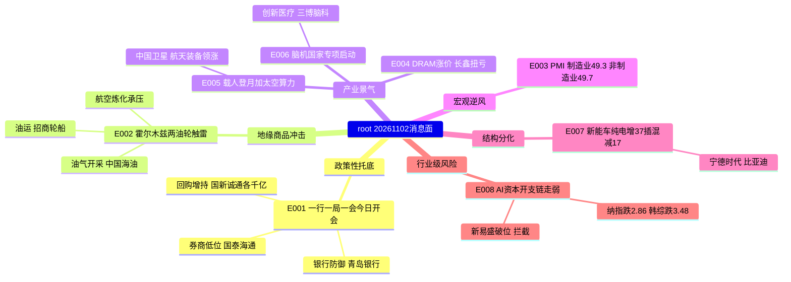

# 2026-11-02 · **消息面事件驱动**

> **数据源新鲜度**: partial · **降级状态**: false · **置信度**: 0.62
> **覆盖窗口**: 2026-10-30 → 2026-11-02 06:50（_news_cls 2379 条 + news_major 800 条 + 公众号 47 篇） · **主源**: 财联社/新浪快讯 + 证券时报/上证报/财联社早知道 + Tushare 东财三季报预告
> **今日定位**: 连跌 2 日（10-29、10-30）后的修复窗口第 3 天 · R1 判崩溃退潮型 · 仓位上限 10% · 炸板率 39.74% ≥ 35% 触发「情绪=主跌/震荡·候选数砍半」

## 一句话结论

政策会议+千亿回购额度对冲 PMI 双降，今日只做油气、航天、券商低位三条硬催化，AI 算力链一律拦截。

## 🗺️ 消息面全景图

## 🎯 顶级事件详解

### E20261102_001 · 一行一局一会今日开会 · 国新诚通各获千亿级回购增持额度 · strength=high · polarity=正面

**事件摘要**: 上证报 11-01 16:22 报道金融管理部门 11-02 召开会议研究推动支持资本市场工具使用，同日央行、金融监管总局、证监会召集各大银行研究优化股票回购增持再贷款政策；财联社 19:46 进一步披露某国有大行计划向中国国新、中国诚通各新增千亿级回购增持专项贷款额度，单家或达 1000 亿元，规模超过 2024 年该工具设立时首期。四条快讯（上证报、财联社、21财经、证券时报）合并为一事件，取 max 分不累加。

**推理深度三问**:

- **大资金意图**: 这是「平准」性质的资金，不是产业资金。连跌 2 日后指数已从 10-30 收盘口径杀到中位 −3.13%、跌停 82 家，此刻央行系统把「再贷款额度」和「会议」同时放出，意图是给 10-30 收盘后仍在恐慌的杠杆盘一个不必砍在最低点的理由；对面接的是券商的做市与两融盘、银行的自营盘、央企的回购盘三类低估值载体。
- **为什么走强**: 周五银行已经先动了——银行板块 20261030 +1.98%（40 涨 2 跌，青岛银行领涨），红利破净股 +1.18%，而创业板 −4.13%、科创50 −5.48%。资金不是今天才想到政策，而是周五已在用银行/破净做防御切换，今日会议只是把「防御」升级成「进攻有理由」。券商板块周五 −2.13%（3 涨 45 跌）是这个逻辑里唯一没被抢跑的载体。
- **逻辑够不够硬**: 硬，但有兑现节奏风险。硬的地方：官方口径（上证报/证券时报）+ 具体额度（千亿级×2）+ 今日落地时点三重确认，属当日兑现型催化而非历史催化；不硬的地方：会议内容是「研究推动」不是「宣布投放」，且券商周五只有 3 家上涨说明主力并未提前建仓，今日若高开无量即为兑现即出尽。

**首推票思维链**:

#### 国泰海通 601211.SH · role=首推

| 收盘 | MA5 | MA20 | 距 60 日高 | 5 日主力净额 |
|---|---|---|---|---|
| 15.86 | 16.10 | 16.49 | 18.94（−16.3%） | +1.60 亿 |

口径：收盘/MA 为 tushare daily 不复权 20261030；距 60 日高按 20260801-20261030 最高价；5 日主力净额 = 20261026-20261030 东财 DC net_amount（超大单+大单）累加，R7 未产出时的同源替代。

- **买入理由**: 证券Ⅲ板块里唯一 5 日主力净流入为正的头部券商（+1.60 亿），周五逆势仅 −0.25% 强于板块 −2.13%；体量已问鼎行业（证券时报 11-01「国泰海通规模问鼎、中信盈利夺冠」），政策工具落地时机构业务与两融弹性最大。
- **风险点**: 券商是「政策一日游」高发板块，会议若无具体投放数字，10:30 后极易回落；股价仍在 MA5（16.10）与 MA20（16.49）下方，属左侧修复不是右侧突破。
- **止损条件**: 15.00（参考价 15.86 × 0.946），跌破即认定政策定价失败，不补仓。
- **可验证假设**: 若开盘 30 分钟成交额未达近 5 日均量的 1.2 倍，或板块上涨家数不足 20 家，则「政策托底」假设不成立，当日不参与。

#### 中信证券 600030.SH · role=次选

| 收盘 | MA5 | MA20 | 距 60 日高 | 5 日主力净额 |
|---|---|---|---|---|
| 24.30 | 24.88 | 25.55 | 28.83（−15.7%） | −7.76 亿 |

- **买入理由**: 行业盈利第一，政策工具对机构业务线的边际改善最直接；周五 −0.82% 亦强于板块。
- **风险点**: 5 日主力净流出 7.76 亿，是头部券商里资金最差的一只，说明大资金对其分歧最大；体量大，政策脉冲下的弹性弱于国泰海通。
- **止损条件**: 23.00（参考价 24.30 × 0.947），破位即离场。
- **可验证假设**: 若券商板块 10:00 前封板家数 ≥ 1 且中信站上 24.88（MA5），则升级为进攻腿；否则只做观察。

---

### E20261102_002 · 霍尔木兹两艘油轮触雷 · 伊朗称两天内可重开 · strength=high · polarity=正面

**事件摘要**: 伊朗革命卫队 11-01 晚通报，两艘油轮关闭导航系统沿未授权航线穿越霍尔木兹海峡时触雷爆炸，其中一艘为超级油轮仍在燃烧（新浪快讯 11-02 04:22、04:06）；伊朗外长同日称条件满足后海峡可在两天内重开（00:53）。上海证券报 11-01 同步披露「三桶油前三季盈利已超去年全年」。

**推理深度三问**:

- **大资金意图**: 这是「地缘溢价 + 业绩兑现」的双击位置。油气开采Ⅲ 周五 −0.82% 但概念资金净流入 +3.87 亿、油气设服 +3.28 亿，在 5571 只股票中位 −3.13% 的一天里，资金逆势往油气里塞钱，说明主力在赌周末的地缘升级，而不是赌油价长期中枢。
- **为什么走强**: 海峡通行受扰直接抬升油运运距与运价（招商轮船周五 +3.02%、中远海特涨停），同时上游的中国海油已在 60 日高附近（距高仅 −0.5%）、5 日 +6.7%，是「业绩确定 + 事件催化」同时具备的少数位置。资金不需要新故事，只需要一个不跌的理由。
- **逻辑够不够硬**: 中等偏硬。硬在事件是实物级别的（超级油轮起火）、且有业绩兜底（三桶油前三季盈利超上年全年）；不硬在伊朗自己给了「两天内可重开」的退出阀门，一旦重开，溢价当天蒸发。这是事件驱动而非趋势，不能按趋势票的持有周期来做。

**首推票思维链**:

#### 中国海油 600938.SH · role=首推

| 收盘 | MA5 | MA20 | 距 60 日高 | 5 日主力净额 |
|---|---|---|---|---|
| 35.97 | 35.33 | 34.60 | 36.14（−0.5%） | +3.67 亿 |

- **买入理由**: 纯上游，油价弹性最直接；距 60 日高仅 −0.5%、5 日主力净流入 3.67 亿，是全市场少数「逆势走强且资金正流入」的形态；油气开采Ⅲ 板块领涨股即本股（tushare dc_index 20261030）。
- **风险点**: 已在 60 日高附近，追高即买在情绪最高点；伊朗称两天内可重开，事件解除后回吐会很快；大盘若继续杀，权重股也难独立。
- **止损条件**: 34.00（参考价 35.97 × 0.945，并在 MA20 34.60 下方留缓冲），破 MA20 即走。
- **可验证假设**: 若开盘 1 小时油价链个股上涨家数 < 5，或本股跌破 35.33（MA5），则「地缘溢价」假设不成立，降级观察。

#### 招商轮船 601872.SH · role=次选

| 收盘 | MA5 | MA20 | 距 60 日高 | 5 日主力净额 |
|---|---|---|---|---|
| 17.71 | 17.28 | 18.87 | 22.98（−22.9%） | +2.36 亿 |

- **买入理由**: VLCC 油轮运价对海峡通行最敏感，绕行即增加吨海里需求；5 日 +6.8%、主力净流入 2.36 亿，资金已在进。
- **风险点**: 仍在 MA20（18.87）下方，属反弹不是趋势；航运板块整体 −0.22%（5 涨 12 跌），只有个别船型强，说明这不是板块级行情。
- **止损条件**: 16.80（参考价 17.71 × 0.949），失守 MA5 17.28 后确认。
- **可验证假设**: 若 BDI/油运运价指数当日未上行，或本股 10:30 前跌破 17.28，则运价传导假设不成立。

---

### E20261102_003 · 10 月 PMI 双降 · strength=medium · polarity=负面

**事件摘要**: 国家统计局 10-31 09:33 发布：制造业 PMI 49.3%（环比 −0.8pp）、非制造业商务活动 49.7%（−0.5pp）、综合产出 49.7%（−1.0pp）。结构上大型企业 50.2% 仍在扩张，高技术制造业 51.3%、装备制造业 50.6% 继续高于临界点，消费品 48.8%、高耗能 47.3%。

**推理深度三问**:

- **大资金意图**: 这个数据被主力用来做两件事：一是把顺周期和消费的仓位往低估值防御里挪（周五酿酒 +2.74%、白酒 +1.85%、CRO +1.97% 是同一个动作的另一面）；二是给「政策必须加码」提供合理性——这正是 E001 今天开会的前置理由。所以 PMI 弱在本周不是纯利空，它是政策交易的燃料。
- **为什么走强**: 弱数据里唯一没被削弱的是高技术制造业（51.3%），所以资金没有全面撤离，而是在制造业内部做结构切换：砍建材/消费，留高端制造。
- **逻辑够不够硬**: 硬数据、软交易。PMI 是官方口径无争议，但它已在 10-31 公布，周一开盘时是「已知信息」而非新催化，按 λ=0.15 衰减后权重 0.41，不足以单独驱动板块方向；它的作用是压制顺周期的反弹高度，而不是制造新的下跌。

**压制标的（不进，仅作风险标尺）**:

#### 海螺水泥 600585.SH · role=负面压制·剔除

| 收盘 | MA5 | MA20 | 距 60 日高 | 5 日主力净额 |
|---|---|---|---|---|
| 18.15 | 18.20 | 17.83 | 18.79（−3.4%） | −0.28 亿 |

- **买入理由**: 无。此票只作为「总需求走弱」的观测标尺，不构成买入理由。
- **风险点**: 水泥需求与制造业/基建投资强度直接挂钩，PMI 制造业跌破 50 且连续回落，量价双承压；股价虽贴近 60 日高但 5 日主力已转净流出。
- **止损条件**: 若误持，17.10（参考价 18.15 × 0.942）为硬止损，破 MA20 17.83 即离场。
- **可验证假设**: 若本周水泥价格指数出现环比上行，则「需求走弱」假设被证伪，届时重新评估；在此之前不参与。

---

### E20261102_004 · DRAM 涨价 + 长鑫扭亏 + 野村称估值仅 2-3 倍 · strength=medium · polarity=正面

**事件摘要**: 财联社 11-01 21:09「DRAM 供不应求涨价，长鑫科技扭亏为盈至 1320 亿，存储迎独立行情」；同日行业追踪显示 Flash（MLC 64Gb）现货价环比小幅上涨；野村 19:24 称存储估值只有 2-3 倍。东财三季报预告：长鑫科技（688825.SH）1-9 月净利 1310-1325 亿元、同比 +2581%~2609%。

**推理深度三问**:

- **大资金意图**: 存储是全市场唯一「业绩爆炸 + 股价腰斩」的组合（兆易创新距 60 日高 −43.4%、新易盛 −58.7%），资金在这里做的是估值修复的左侧埋伏，而不是趋势接力——所以你会看到融资盘在撤（兆易 5 日主力 −8.67 亿），而卖方在喊 2-3 倍 PE。
- **为什么走强**: 周五并没有走强。存储芯片板块 20261030 −5.38%（6 涨 137 跌），兆易 −6.59%、佰维 −5.31%、江波龙 −4.22%。涨价是基本面，杀跌是估值/流动性，两者当前背离。
- **逻辑够不够硬**: 基本面硬、交易不硬。硬在现货价确实在涨、长鑫确实扭亏；不硬在三点——①长鑫扭亏是基数失真（去年同期亏损），不能作为同比加分；②模组环节被原厂涨价挤压毛利率，属「增收不增利」的环节错配，只有原厂/设计端才是真受益；③板块 6 涨 137 跌说明这是破位下行中的反弹，不是右侧启动。

**观察标的（不进）**:

#### 兆易创新 603986.SH · role=观察·不进

| 收盘 | MA5 | MA20 | 距 60 日高 | 5 日主力净额 |
|---|---|---|---|---|
| 257.80 | 273.82 | 300.06 | 455.81（−43.4%） | −8.67 亿 |

- **买入理由**: 设计端原厂属性，DRAM/NOR 涨价直接进毛利而非被成本吃掉；若存储真进入景气反转，它是弹性最大的原厂标的。
- **风险点**: 已跌破 MA20（300.06）达 14%，20 日 −32.8%，属破位下行；5 日主力净流出 8.67 亿，资金在撤不是在吸；此时买入等于抄底，违反「低吸是强势票相对涨停价仍低，不是抄底」。
- **止损条件**: 232.00（参考价 257.80 × 0.90）为观察位，仅在右侧确认后才启用；当前不持有。
- **可验证假设**: 需同时满足 ①收盘站回 MA5（273.82）②板块当日上涨家数 > 50 家 ③主力净额转正，三条成立才升级为「可交易」；否则维持观察。

---

### E20261102_005 · 载人登月方案公开 + 全球首个太空算力云平台 · strength=high · polarity=正面

**事件摘要**: 央视新闻 11-01 10:53 与上海证券报 10-31 08:10 报道第七届载人航天学术大会披露「两次发射、一次登月」方案，2030 年前实现载人登月、首次即带月球车；10-30 北京太空算力创新中心发布全球首个天地一体化太空算力云平台，覆盖 40 余颗卫星算力资源（上证报 11-01 09:35、10jqka 10-30 14:48）。两条腿原始发生日不同（10-31 与 10-30），按共识形成日 10-31 计。

**推理深度三问**:

- **大资金意图**: 航天装备Ⅱ 20261030 +3.54%（7 涨 2 跌）是大盘 −3.13% 中位里唯一的整板块逆势上涨，中国卫星 5 日主力净流入 5.51 亿居全市场前列。资金意图很清楚：在 AI 算力链杀跌、消费只是防御的格局里，用「国家工程 + 确定性订单」做新的进攻载体。
- **为什么走强**: 中国卫星 10-29 已涨停（+10.0%），10-30 平收 +0.02% 承接住了——涨停次日不炸板且资金继续净流入，是资金认可的标志；同时登月方案是 5 年维度可验证的工程节点（长征十号、梦舟、揽月三个型号），比概念题材更抗杀。
- **逻辑够不够硬**: 硬在官方口径 + 板块逆势 + 个股资金三重共振；不硬在商业航天大板块当日 −1.81%（90 涨 231 跌），说明涨的只是航天装备子指数的核心票，跟风盘没起来——这既意味着扩散不足，也意味着龙头不会被杂毛分流。

**首推票思维链**:

#### 中国卫星 600118.SH · role=首推

| 收盘 | MA5 | MA20 | 距 60 日高 | 5 日主力净额 |
|---|---|---|---|---|
| 55.91 | 52.44 | 52.65 | 72.78（−23.2%） | +5.51 亿 |

- **买入理由**: 卫星总体制造与在轨运营主体，登月工程与卫星互联网两条腿同时受益；10-29 涨停后 10-30 平盘承接，5 日主力净流入 5.51 亿，是航天装备板块逆势上涨的领涨股（dc_index 20261030）。
- **风险点**: 距 60 日高仍 −23.2%，说明前面有一批套牢盘（72.78 附近）；涨停后仅一天承接，若今日高开低走即形成双头；商业航天板块扩散不足（90 涨 231 跌），一旦龙头歇脚没有补涨接力。
- **止损条件**: 52.60（参考价 55.91 × 0.941），紧贴 MA5 52.44 上方，破 5 日线即离场。
- **可验证假设**: 若今日 10:00 前成交额未超前一日同期 1.5 倍，或航天装备板块上涨家数 < 4，则「国家工程带动」假设不成立；若放量站稳 57.50 以上则确认第二波。

---

### E20261102_006 · 脑科学与类脑研究国家科技重大专项三项启动 · strength=medium · polarity=正面

**事件摘要**: 10-30 「脑科学与类脑研究」国家科技重大专项三个项目启动，含「面向运动功能重建的柔性高通量半侵入式脑机接口系统研发与临床转化」「植入式脑机接口高密度医用馈通与系统集成」等；财联社早知道 10-31 将其列为明日主题前瞻；配套上人保财险 11-01 发布脑机接口专属保险「脑科保」。

**推理深度三问**:

- **大资金意图**: 这是典型的「小市值 + 国家专项 + 有保险配套」的主题埋伏位。资金意图不是做业绩，是做「政策层级提升」的定价——专项级别从院所见变成国家科技重大专项，是给主题续命的最硬理由；保险产品落地则说明产业化路径被金融机构认可。
- **为什么走强**: 板块并没有走强，脑机接口 20261030 −2.81%（7 涨 54 跌）。强的是个股：创新医疗 +3.49%、三博脑科 +1.91%，在一个中位数 −3.13% 的日子里逆势翻红且 5 日主力净流入。
- **逻辑够不够硬**: 中等。硬在专项是国家级别的、且 10-30 已启动不是传闻；不硬在三处——①项目启动会到产业化距离极远，无法映射到具体收入；②板块 54 家下跌说明只有极少数票被资金认可；③事件原始发生日 10-30，衰减后权重仅 0.351，属主题不是当日新催化。

**首推票思维链**:

#### 创新医疗 002173.SZ · role=首推

| 收盘 | MA5 | MA20 | 距 60 日高 | 5 日主力净额 |
|---|---|---|---|---|
| 17.22 | 16.44 | 16.54 | 23.39（−26.4%） | +1.53 亿 |

- **买入理由**: 参股脑机接口临床转化主体，属专项「临床转化」环节的直接映射；周五 +3.49% 逆势、5 日主力净流入 1.53 亿，是板块内资金最认的一只。
- **风险点**: 距 60 日高 −26.4%，上方套牢盘密集；公司主业为医疗服务，脑机接口属参股而非主营，业绩无支撑；板块 7 涨 54 跌，扩散极差，一旦主题退潮无接力。
- **止损条件**: 16.20（参考价 17.22 × 0.941），失守 MA5 16.44 后确认。
- **可验证假设**: 若今日板块上涨家数 < 10 或本股跌破 16.44，则主题失效；若创新医疗能封板则确认资金选择它做龙头。

#### 三博脑科 301293.SZ · role=次选

| 收盘 | MA5 | MA20 | 距 60 日高 | 5 日主力净额 |
|---|---|---|---|---|
| 49.74 | 48.92 | 48.00 | 60.39（−17.6%） | +0.46 亿 |

- **买入理由**: 神经专科医院，是脑机接口临床试验的落地场景与受试者入口；周五 +1.91%，MA5/MA20 均在其下方形成支撑。
- **风险点**: 5 日主力净流入仅 0.46 亿，资金认可度弱于创新医疗；医院资产重、弹性小，主题行情里往往跑不过小市值。
- **止损条件**: 46.80（参考价 49.74 × 0.941），跌破 MA20 48.00 后确认。
- **可验证假设**: 若脑机接口主题当日出现 ≥ 2 只涨停，则三博作为场景标的可跟进；否则只做观察。

---

### E20261102_007 · 10 月新能源车销量出炉 · 纯电 +37% 插混 −17% · strength=medium · polarity=中性

**事件摘要**: 比亚迪 10 月新能源汽车销量 49.02 万辆、同比 +10.97%，其中纯电 30.57 万辆 +37.38%、插混 17.74 万辆 −17.22%，前 10 月累计 362.17 万辆同比 −2.16%，10 月出口 17.02 万辆（上海证券报 11-01 18:20）。新势力零跑月销超 10 万辆、小鹏超 5 万辆创单月新高、小米首破 5 万辆（证券时报 11-01 19:19「新三角」）。奇瑞 10 月 28.25 万辆 +7.2%，上汽 43.00 万辆 −5.28%。

**推理深度三问**:

- **大资金意图**: 资金在整车板块做的是「结构切换」而不是「板块做多」——汽车整车 20261030 −2.39%（1 涨 25 跌），只有宁德时代 +1.68% 逆势。这说明主力认的是纯电/储能这条腿，不认整车价格战这条腿。
- **为什么走强**: 纯电 +37.38% 与插混 −17.22% 的分叉是今年最清晰的一次结构信号，纯电渗透率继续抬升直接对应电池装机；宁德同日发布新一代超高容量储能产品，把「车」和「储」两条需求叠加。
- **逻辑够不够硬**: 中等。硬在销量是硬数据、分叉幅度大；不硬在总量增速只有 10.97%、前 10 月累计仍是 −2.16%，「银十成色不足」是官方媒体自己的措辞，且整车价格战未结束，销量增长不等于利润增长。

**首推票思维链**:

#### 宁德时代 300750.SZ · role=首推

| 收盘 | MA5 | MA20 | 距 60 日高 | 5 日主力净额 |
|---|---|---|---|---|
| 232.92 | 232.43 | 262.58 | 410.00（−43.2%） | −6.42 亿 |

- **买入理由**: 纯电销量 +37.38% 直接对应装机增量，储能新品同步发布；险资三季度新进重仓（证券时报 11-01），周五 +1.68% 逆势强于整车板块 −2.39%。
- **风险点**: 距 60 日高 −43.2%、仍在 MA20（262.58）下方 11%，属破位后的反弹；5 日主力净流出 6.42 亿，资金面未确认；锂价与整车价格战会持续压缩单位盈利。
- **止损条件**: 219.00（参考价 232.92 × 0.940），跌破 MA5 232.43 后确认。
- **可验证假设**: 若今日无法站稳 232.43（MA5）且主力净额仍为负，则「纯电结构受益」不足以支撑买点，降级观察。

#### 比亚迪 002594.SZ · role=次选

| 收盘 | MA5 | MA20 | 距 60 日高 | 5 日主力净额 |
|---|---|---|---|---|
| 81.65 | 82.26 | 82.40 | 96.59（−15.5%） | −3.44 亿 |

- **买入理由**: 销量主体本身，10 月 49.02 万辆 +10.97%、出口 17.02 万辆，海外扩张是超预期项。
- **风险点**: 插混 −17.22% 是它的基本盘在缩；股价 −1.03% 弱于板块中位，5 日主力净流出 3.44 亿；整车价格战下单车利润承压。
- **止损条件**: 76.80（参考价 81.65 × 0.941），跌破 MA20 82.40 后确认。
- **可验证假设**: 若 11 月前两周周销量环比转正且插混降幅收窄，则逻辑改善；否则维持观察。

---

### E20261102_008 · AI 资本开支链风险暴露 · strength=high · polarity=负面 · bearish_scope=行业级

**事件摘要**: 财联社 11-01 20:08「90 天暴增近 1 万亿，AI 表外负债悄然突破 4.1 万亿美元」；11-01 00:42「AI 巨头融资压力显现，OpenAI 据称将融资目标下调百亿美元」；公众号「傅里叶的猫」11-01《多空辩驳—AI 资本开支能持续多久》、「调研先知」11-01《高盛交易员：AI 泡沫见顶后…》。外盘确认：纳指 20261030 −2.8556%、韩国综指 −3.4849%、标普 −1.8174%（tushare index_global）。

**推理深度三问**:

- **大资金意图**: 这是在给 AI 硬件链的高位筹码找出口。表外负债 4.1 万亿美元 + 融资目标下调，两件事指向同一结论：算力需求的「钱」可能先于「订单」见顶。主力要做的不是等财报证伪，而是趁 A 股还有承接盘的时候把光模块/PCB 的仓位换到没有 AI 敞口的地方（周五资金去了银行、航天、油气）。
- **为什么走强**: 这条是负面事件，走强的是跌幅。新易盛 20261030 −14.19%、5 日 −24.9%，PCB −5.55%、算力概念 −3.70%、光模块链全线杀；A 股先于美股反应，10-30 创业板 −4.13%、科创50 −5.48% 已经是这条逻辑的定价。
- **逻辑够不够硬**: 硬，且是行业级。硬在跨境三重确认（美股、韩股、A 股同向）、且有具体数字（4.1 万亿、下调百亿）；不硬在「表外负债」的口径未经审计、市场对 AI 资本开支的分歧本来就大——中际旭创 5 日主力仍净流入 23.09 亿，说明有资金在做反向承接。

**拦截标的（负面事件，只减不加）**:

#### 新易盛 300502.SZ · role=高位减仓·拦截

| 收盘 | MA5 | MA20 | 距 60 日高 | 5 日主力净额 |
|---|---|---|---|---|
| 196.00 | 234.09 | 308.13 | 475.00（−58.7%） | −12.86 亿 |

- **买入理由**: 无买入理由。此票用于标记 AI 硬件链的风险烈度，不构成任何买入依据。
- **风险点**: 距 60 日高 −58.7%、5 日 −24.9%，属趋势破坏；5 日主力净流出 12.86 亿，是全样本中最差之一；周五单日 −14.19% 说明有强制平仓盘，反弹即减仓机会。
- **止损条件**: 176.40（参考价 196.00 × 0.90）为已持仓者的硬止损，破位不补。
- **可验证假设**: 若美股 AI 硬件（NVDA/AVGO）本周收复 10-30 跌幅且本股站回 MA5 234.09，则「资本开支见顶」假设推迟；在此之前一律拦截。

---

## 📊 板块 × 事件热力矩阵

叉乘公式：`contrib = |weighted_score| × sign(板块极性) × {high:1.0, medium:0.7, low:0.4}`，同板块多事件累加，>+0.12 正面 / <−0.12 负面 / 其余分歧。方向只由板块极性决定，`weighted_score` 已取绝对值防止负面事件被算成正贡献。

| 板块 | 净分 | 判定 | 叉乘明细 | 事件数 | 类型 | 位置与资金口径 |
|---|:--:|:--:|---|:--:|:--:|---|
| 券商 | +0.740 | 🟢🟢🟢 | E001 正面×1.00=+0.740 | 1 | 单事件 | 板块 −2.13%、MA20 下方，政策未抢跑 |
| 油气开采 | +0.620 | 🟢🟢🟢 | E002 正面×1.00=+0.620 | 1 | 单事件 | 板块 −0.82% 但资金 +3.87 亿，个股贴近 60 日高 |
| 高技术制造 | +0.614 | 🟢🟢 | E001 +0.296 / E003 +0.163 / E004 +0.155（均 low 权重） | 3 | 多事件叠加 | 三条低权重腿叠加，方向一致但强度不足 |
| 银行 | +0.518 | 🟢🟢 | E001 正面×0.70=+0.518 | 1 | 单事件 | 周五已 +1.98%（40 涨 2 跌），已抢跑 |
| 红利破净央企 | +0.518 | 🟢🟢 | E001 正面×0.70=+0.518 | 1 | 单事件 | +1.18%，防御腿 |
| 商业航天 | +0.459 | 🟢🟢 | E005 正面×1.00=+0.459 | 1 | 单事件 | 板块 −1.81%（90 涨 231 跌）仅子指数强 |
| 油运航运 | +0.434 | 🟢🟢 | E002 正面×0.70=+0.434 | 1 | 单事件 | 板块 −0.22%，中远海特涨停 |
| 卫星互联网 | +0.321 | 🟢 | E005 正面×0.70=+0.321 | 1 | 单事件 | 板块 −1.71%（34 涨 67 跌） |
| 存储芯片 | +0.271 | 🟢 | E004 正面×0.70=+0.271 | 1 | 单事件 | 板块 −5.38%（6 涨 137 跌）破位，事件与股价背离 |
| 脑机接口 | +0.246 | 🟢 | E006 正面×0.70=+0.246 | 1 | 单事件 | 板块 −2.81%，个股逆势 |
| 纯电产业链 | +0.150 | 🟢 | E007 正面×0.70=+0.150 | 1 | 单事件 | 整车板块 −2.39%（1 涨 25 跌） |
| 存储模组 | 0.000 | 🟡 分歧 | E004 中性×0.70=0.000 | 1 | 单事件 | 环节错配（被原厂涨价挤压毛利），有意记中性 |
| 插混产业链 | −0.086 | 🟡 分歧 | E007 负面×0.40=−0.086 | 1 | 单事件 | 销量 −17.22%，强度 low 故未破 −0.12 |
| 消费 | −0.163 | 🔴 | E003 负面×0.40=−0.163 | 1 | 单事件 | 消费品行业 PMI 48.8% |
| 航空 | −0.248 | 🔴 | E002 负面×0.40=−0.248 | 1 | 单事件 | 油价上行成本腿 |
| 顺周期建材 | −0.285 | 🔴 | E003 负面×0.70=−0.285 | 1 | 单事件 | 制造业 PMI 跌破 50 |
| 算力基础设施 | −0.286 | 🔴 | E005 正面×0.40=+0.184 / E008 负面×0.70=−0.470 | 2 | 多事件叠加 | 太空算力催化被资本开支利空压过 |
| 纯概念跟风杂毛 | −0.470 | 🔴 | E008 负面×0.70=−0.470 | 1 | 单事件 | 无业绩跟风盘统一命名 |
| AI算力硬件 | −0.671 | 🔴🔴 | E008 负面×1.00=−0.671 | 1 | 单事件 | 纳指 −2.86%/韩综 −3.48% 跨境确认 |
| 光模块/CPO | −0.671 | 🔴🔴 | E008 负面×1.00=−0.671 | 1 | 单事件 | 新易盛 5 日 −24.9%、主力 −12.86 亿 |

**sector_cross_summary（仅多事件板块）**:

| 板块 | 事件数 | 净分 | 判定 | 结论 |
|---|:--:|:--:|:--:|---|
| 高技术制造 | 3 | +0.614 | 正面 | 政策（E001）+ PMI 高技术制造业 51.3%（E003）+ 存储景气（E004）三条 legs 同向。这是今日唯一「宏观弱但结构强」的板块，但三条腿权重都是 low，属方向确认不属强度确认 |
| 算力基础设施 | 2 | −0.286 | 负面 | 太空算力云平台（E005，+0.184，low）被 AI 资本开支链利空（E008，−0.470，medium）压过。含义：算力里可以讲「卫星/太空」的新故事，不能碰「海外大客户」的老故事 |

**叉乘读法**: 单事件板块值看催化密度（券商 +0.740 是今日最高，因为政策权重 high 且未抢跑）；多事件板块值看叙事冲突（算力基础设施 −0.286 是「新故事 vs 老故事」的对冲结果，方向为空）。

## 🔥 三季报业绩预告命中（东财 500 条 · 报告期 2026-09-30）

| 代码 | 名称 | 预告类型 | 同比区间 | 事件命中 | 逻辑强度 | 处理口径 |
|---|---|---|:--:|:--:|:--:|---|
| 688825.SH | 长鑫科技 | 扭亏 | +2581%~+2609% | E004 存储景气 | 🟢 | 原厂真受益，但**扭亏属基数失真**，不作正面加分 |
| 001309.SZ | 德明利 | 预增 | +32047%~+33155% | E004 存储景气 | 🟡 | 模组环节，环节错配→降级中性 |
| 301308.SZ | 江波龙 | 预增 | +1865%~+1991% | E004 存储景气 | 🟡 | 同上；江波龙案已固化「单季环比转负=利好出尽」 |
| 300821.SZ | 东岳硅材 | 预增 | +19048%~+19748% | 无（硅化工） | ⚪ | 非今日事件链，进池待查 |
| 000703.SZ | 恒逸石化 | 预增 | +3319%~+3405% | E002 油气链（弱） | 🟡 | 炼化环节，油价上行是成本腿不是收入腿 |
| 002466.SZ | 天齐锂业 | 预增 | +2735%~+3235% | 无（锂） | ⚪ | 周期股，同比高增须看单季环比 |
| 688808.SH | 联讯仪器 | 预增 | +1866%~+2073% | 无 | ⚪ | 不在今日事件链 |
| 688388.SH | 嘉元科技 | 预增 | +1197%~+1319% | 无（铜箔） | ⚪ | 不在今日事件链 |
| 002812.SZ | 恩捷股份 | 预增 | +1884%~+2475% | 无（隔膜） | ⚪ | 不在今日事件链 |

**交叉结论**: 与今日八个事件真正相交的只有存储链（长鑫/德明利/江波龙），而这三只都是「业绩爆炸 + 股价腰斩」，按周期股极性协议处理后**全部不给买入资格**——长鑫是基数失真、德明利与江波龙是环节错配。油气链的恒逸石化是炼化环节（成本腿），同样不能按「油价涨」做多。

## 🚀 首板候选池（消息侧硬刺激 · 强弱交竞价确认）

| 名称 | 代码 | 来源 | 独立源 | 命中 | 质量 | 10-30 收盘 | 当日涨跌 | 可交易 | 消息锚 |
|---|---|---|:--:|:--:|:--:|---|:--:|:--:|---|
| 长鑫科技 | 688825.SH | direct_name_match | 3 | 13 | high | 41.80 | −2.50% | ✅ | 前三季扭亏至 1320 亿·存储独立行情 |
| 高争民爆 | 002827.SZ | direct_name_match | 3 | 6 | high | 停牌 | — | ✅ | 发行股份购紫源铜业 51%+晟源矿业·11-02 复牌 |
| 亨通光电 | 600487.SH | direct_name_match | 3 | 6 | high | 42.42 | −4.89% | ✅ | 董事长提议回购 1-2 亿元 |
| 长安汽车 | 000625.SZ | direct_name_match | 2 | 5 | medium | 7.01 | −0.85% | ✅ | 启源 10 月销 63648 辆·环比 +22.24% |
| 通威股份 | 600438.SH | direct_name_match | 2 | 5 | medium | 11.06 | −2.98% | ✅ | 拟收购青海丽豪清能 100% |
| 中远海特 | 600428.SH | lead_stock_proxy | 1 | 1 | medium | 11.47 | +0.70% | ✅ | 航运板块 dc_index 领涨股（当日涨停） |
| 华安证券 | 600909.SH | lead_stock_proxy | 1 | 1 | medium | 6.88 | +0.16% | ✅ | 证券Ⅲ dc_index 领涨股 |
| 爱朋医疗 | 300753.SZ | lead_stock_proxy | 1 | 1 | medium | 20.61 | +0.78% | ✅ | 脑机接口 dc_index 领涨股 |
| 青岛银行 | 002948.SZ | lead_stock_proxy | 1 | 1 | medium | 6.26 | −1.11% | ✅ | 银行 dc_index 领涨股（板块 +1.98%） |

风险标记：长鑫科技〔次新·存储板块 −5.38%·5 日主力 −2.41 亿〕；高争民爆〔复牌首日·重组审计评估未完成·停牌前 20 日跌 23.69%〕；亨通光电〔5 日主力净流出 20.65 亿·光通信破位·回购仅为提议〕；长安汽车〔整车 1 涨 25 跌·5 日主力 −0.89 亿〕；通威股份〔光伏主材弱·定价基准日待调整〕；中远海特〔海峡事件有反转风险〕；华安证券〔小市值非龙头·政策兑现即出尽〕；爱朋医疗〔板块 7 涨 54 跌·小市值〕；青岛银行〔板块已提前上涨·防御腿非进攻腿〕。

排序键固定 `quality → source_count → hit_count`，不因可交易性重排；停牌票留在池内标 `tradable_today` 供 D1 过滤。

## 关键证据

- 证据 1：金融管理部门 11-02 召开会议研究推动支持资本市场工具使用，同日央行/金融监管总局/证监会召集各大银行研究优化股票回购增持再贷款政策 · 上证报 2026-11-01 16:22、财联社 15:32、21 财经 15:15
- 证据 2：某国有大行计划向中国国新、中国诚通各新增千亿级回购增持专项贷款额度，单家或达 1000 亿元 · 财联社 2026-11-01 19:46（证券时报同源）
- 证据 3：伊朗革命卫队通报两艘油轮沿未授权航线穿行霍尔木兹海峡触雷爆炸，其中一艘为超级油轮 · 新浪快讯 2026-11-02 04:22 / 04:06；伊朗外长称条件满足后两天内可重开 · 00:53
- 证据 4：10 月制造业 PMI 49.3%（−0.8pp）、非制造业 49.7%（−0.5pp）、综合 49.7%（−1.0pp）；高技术制造业 51.3%、装备制造业 50.6% · 国家统计局 2026-10-31 09:33
- 证据 5：载人月球探测采用「两次发射、环月对接」，2030 年前实现中国人登月 · 央视新闻 2026-11-01 10:53；太空算力云平台覆盖 40 余颗卫星算力资源 · 10jqka 2026-10-30 14:48
- 证据 6：DRAM 供不应求涨价、长鑫科技扭亏至 1320 亿 · 财联社 2026-11-01 21:09；Flash（MLC 64Gb）现货价环比小幅上涨 · 财联社行业追踪 11-01 17:00
- 证据 7：比亚迪 10 月销 49.02 万辆（+10.97%），纯电 30.57 万辆（+37.38%）、插混 17.74 万辆（−17.22%） · 上海证券报 2026-11-01 18:20
- 证据 8：AI 表外负债 90 天暴增近 1 万亿至 4.1 万亿美元 · 财联社 2026-11-01 20:08；OpenAI 融资目标下调百亿美元 · 00:42
- 证据 9：外盘 20261030 纳指 −2.8556%、标普 −1.8174%、韩国综指 −3.4849% · tushare index_global（overseas_snapshot.json）
- 证据 10：20261030 涨停 47 / 跌停 82 / 炸板 31（炸板率 39.74%）、广度 0.1603、中位 −3.129% · data/research/20261102/cycle_position.json

## 数据源审计

| 源 | 日期 | 状态 | 备注 |
|---|:--:|:--:|---|
| tushare/news_cls | 2026-11-02 | 🟢 | 20261031 起 2379 条·含周末与凌晨快讯 |
| tushare/news_major | 2026-11-02 | 🟢 | 800 条标题+摘要·全文未逐条抓取 |
| eastmoney/earnings_predict | 2026-11-02 | 🟢 | 500 条·报告期 2026-09-30 |
| wechat_official_rss（21 号池） | 2026-11-02 | 🟡 | 47 篇·17 feed 中 6 个空·盘前纪要因抓取时点 07:03 早于 07:00-07:30 发布为空 |
| wechat_cli_5groups | 2026-11-02 | 🟢 | 7 群 0 条·周日静默属正常 |
| tushare/moneyflow_dc | 2026-10-26~10-30 | 🟢 | 5 日主力净额口径（超大单+大单）·R7 未产出故同源替代 |
| tushare/dc_index | 2026-10-30 | 🟢 | 1043 板块·板块涨幅/涨跌家数/领涨股 |
| tushare/pro_bar 60 日 | 2026-08-01~10-30 | 🟢 | 12 只票各 82 根不复权日线·与本地 daily 收盘一致 |
| xtick/hot_bk | — | 🔴 | symbol=all 参数错误·未取得板块领涨股·改用 dc_index |
| R3_sentiment | 2026-11-02 | 🔴 | 未产出·kol_confirm 全部 unavailable |
| R7_capital | 2026-11-02 | 🔴 | 未产出·资金字段同源替代 |

## 不确定性 / 反证

1. **政策一日游是最可能的证伪路径**。E001 是「研究推动」不是「宣布投放」，且券商板块周五 3 涨 45 跌说明主力根本没提前建仓。若今日 10:30 后券商冲高回落、成交额不放大，则整个「政策托底」叙事当日失效，而 E003 的 PMI 弱会重新占上风。
2. **霍尔木兹是双向事件**。伊朗自己给了「两天内可重开」的退出阀门，油气与油运的地缘溢价可能在任意一天蒸发。中国海油已在 60 日高附近（−0.5%），此处买入的赔率依赖事件持续，而不是估值。
3. **存储是本报告最大的分歧点**。基本面（现货涨价、长鑫扭亏、野村 2-3 倍 PE）与价格（板块 −5.38%、兆易距高 −43.4%、主力 −8.67 亿）完全背离。我按「事件正面、交易观察」处理，如果明日板块放量反包，我会被证明过于保守——但这符合「低吸是强势票回踩，不是破位抄底」的纪律。
4. **航天只有龙头强，扩散不足**。商业航天 −1.81%（90 涨 231 跌），涨的只是航天装备子指数与中国卫星一只票。若中国卫星今日不能继续放量，整个 E005 就没有第二梯队接力，属于「一次性事件脉冲」。
5. **正负交织股需 D1 再判**。中际旭创 5 日主力仍净流入 23.09 亿（AI 链里唯一逆势吸筹），与新易盛 −12.86 亿形成鲜明对比；同一板块两只龙头资金方向相反，说明这不是全链崩塌而是分化，我做的是「整条链拦截」的保守选择。
6. **数据缺口会放大误判**。R3 未产出导致 KOL 交叉验证为 0；R7 未产出使资金字段只能用东财 DC 同源替代（口径为超大单+大单，不含中单/小单）；群聊周日 0 条意味着没有任何一手情绪样本。这三项缺失使 confidence 只能给到 0.62。

## 与其他 R/D/E 的关系

- **消费上游**：R1（崩溃退潮型/仓位上限 10%）、R3（未产出）、R7（未产出）、`data/research/20261102/cycle_position.json`（连跌 2 日·修复窗口第 3 天）、`emotion_cycle.json`（主升·confidence 0.9，与 R1 结论矛盾，采信 cycle_position 的收盘口径）
- **被消费**：R2 主线叙事共振（E001/E002/E005 为今日三条正面 legs）、R5 个股画像（12 只 stocks_impact + 9 只 FBC）、R6 反证（E008 为行业级负面输入，存储背离为四级象限素材）、D1 预案（FBC 池 + 五档态度）
- **今日态度汇总**：进 = 国泰海通/中国海油/中国卫星（3 只）；观察 = 招商轮船/宁德时代/创新医疗/三博脑科/兆易创新（5 只）；降级 = 中信证券/比亚迪（2 只）；剔除 = 海螺水泥（宏观压制标尺）；拦截 = 新易盛（AI 硬件链）

## Sub-Agent 元数据

- skill: analyze_news_impact_v1@1.7
- artifact: data/research/20261102/R4_news.json
- method: llm_v1（五源硬约束：news_cls + news_major + earnings_predict + 公众号 RSS + 群聊）
- 事件数: 8（正面 5 / 负面 2 / 中性 1）· 板块行: 20 · 多事件板块: 2 · 首板候选: 9
- 生成时刻: 2026-11-02T09:26:00+08:00
