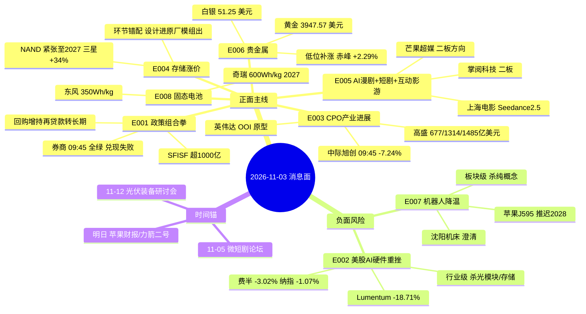

# 2026-11-03 · **消息面事件驱动**

> **数据源新鲜度**: partial · **降级状态**: true · **置信度**: 0.68
> **覆盖窗口**: 前 24h（news_cls 覆盖 10-31 09:04 → 11-03 06:28）+ 盘前公告窗口 1622 条 + 09:40 全市场快照
> **主源**: 财联社快讯 1999 条 + 21 号公众号 88 篇（含财联社早知道/盘前纪要）+ 公告窗口 + 东财三季报预告 500 条 + hithink 实时
> **运行模式**: post_open_validation（09:45 运行·已并入开盘验证）

## 一句话结论

今日唯一能做的是 **AI 内容（短剧/漫剧/互动影游）**：传媒主力 +55.49 亿当日第一、行业涨停 29 家、09:45 涨停潮延续；**唯一负面对冲是外盘 AI 硬件（费半 -3.02%、Lumentum -18.71%）**，把光模块/存储/券商三条线全部打回观察。

## 🗺️ 消息面全景图

## 今日开局的硬事实（09:40 · 全市场 5571 只）

| 口径 | 11-02 收盘 | 11-03 09:40 | 读法 |
|---|---|---|---|
| 涨家占比 | 0.8402（4681 涨 / 818 跌） | 0.3244（1811 涨 / 3473 跌） | 宽度崩塌·修复第 2 天转分歧 |
| 涨停 / 跌停 | 125 / 8 | 26 / 3 | 涨停锐减·赚钱效应收缩但不至恐慌 |
| 炸板 | 28（炸板率 18.3%） | 已炸 9 | 分歧可控 |
| 成交额 | 17951.9 亿 | 2679.7 亿(40 分钟) | 按同速推约 1.6-1.7 万亿·缩量 |
| 情绪相位 | high_chop 高位震荡 | — | R1 判「不追开盘·只做低开承接」 |

---

## 🎯 顶级事件详解（8 条 · 每条三问 + 每票四段）

### E20261103_001 · 央行证监会金监总局三部门组合拳·SFISF第三次操作超1000亿·回购增持再贷款转长期制度利率降至1% · strength=high · polarity=正面 · weighted=0.757

**事件摘要**: SFISF第三次操作11月3日落地额度超1000亿·回购增持再贷款转长期制度利率降至1%·证监会研究优化融资保证金 ｜ 源: 央行公告(11-02 17:03) / 新闻联播(11-02 19:56) / 财联社(11-02 20:03) / 证券时报+上海证券报(11-02 22:22) / 财闻私享(11-02 21:13) ｜ 有效窗口: 1-3 交易日 ｜ days_since=1

- **大资金意图**: 三部门把 SFISF 第三次操作(额度超 1000 亿)+回购增持再贷款从阶段性转长期制度(利率 1.25%→1%)+证监会研究优化融资保证金 一次性打完，意图很直接：给 11 月开局定调，让机构当"带头大哥"先买。但 31 家券商基金申报 1000 亿相对 5 日主力 -1217.57 亿只是补丁，不是增量。
- **为什么走强**: 昨日券商概念 +4.79%、净流入 +32.06 亿是消息抢跑；今日 09:45 国泰海通 -1.60%、中信 -0.39%、东财 -0.53%，说明筹码在消息落地前就已完成换手，落地即兑现。
- **逻辑够不够硬**: 逻辑本身是硬的(官方源四源共振、真金白银额度)，但交易逻辑是软的：政策作用于"未来买盘"而非"今日筹码"，且已被 T-1 抢跑。定性=真利好、假催化，只留观察。

#### 国泰海通 601211.SH · role=首推 · r4_stance=降级观察
- 参考价 **16.30**（20261102 收盘）· 止损 **15.48** · 目标 17.93~18.91 · 仓位上限 0.06
- 位置的体检：20 日分位 58.7% · 距 20 日高 -1.9% · 5 日涨幅 0.2% · 成交 20.76 亿 · 5 日主力 +1.98 亿(正 3 日) · 09:45 实时 -1.6%
- **买入理由**: 券商合并后龙头·SFISF 抵押融资与两融做市直接受益·5 日主力 +1.98 亿为板块少数净流入
- **风险点**: 政策落地首日不涨反跌(09:45 -1.60%)·5 日板块合计仍 -28.04 亿·"利好出尽"风险
- **止损条件**: 硬止损 15.48（参考价 16.30（20261102 收盘）× (1-0.05) = 15.48 ）· 若 10:30 前不能收复 16.30(昨收)则政策逻辑当日证伪·一并放弃券商线
- **可验证假设**: 10:30 券商概念主力净流入转正且该股站上 16.30 → 政策线复活

#### 东方财富 300059.SZ · role=弹性 · r4_stance=降级观察
- 参考价 **18.71**（20261102 收盘）· 止损 **17.77** · 目标 20.58~21.7 · 仓位上限 0.04
- 位置的体检：20 日分位 100.0% · 距 20 日高 0.0% · 5 日涨幅 3.3% · 成交 86.46 亿 · 5 日主力 +0.01 亿(正 1 日) · 09:45 实时 -0.53%
- **买入理由**: 两融+经纪+基金代销全牌照·融资保证金优化的最高弹性·东财人气榜 24→2 升 22 位
- **风险点**: 5 日主力仅 +0.01 亿(基本没进钱)·09:45 -0.53%·人气第一但价格不配合
- **止损条件**: 硬止损 17.77（参考价 18.71（20261102 收盘）× (1-0.05) = 17.77 ）· 跌破 17.77 无条件止损·人气榜若跌出前 10 一并降级
- **可验证假设**: 30 分钟成交额 > 昨日同期且价格翻红 → 人气转化为资金

> 备注: 政策为官方源多源共振·但 09:45 盘口证伪（券商龙头全绿）·只保留观察资格。回购增持再贷款转长期直接触发当晚报回购潮(紫光国微5-7亿·协创数据控股股东5-10亿·行云2-3亿·交控0.5-1亿·华懋0.6-1.2亿)

### E20261103_002 · 美股AI硬件集体重挫·费半-3.02%·Lumentum公布50亿美元CPO大单仍跌18.71%·美光-5.50%·纳指-1.07% · strength=high · polarity=负面 · weighted=-0.72

**事件摘要**: 费半-3.02%·纳指-1.07%·Lumentum 50亿美元CPO订单落地反跌18.71%·Marvell-12.88%·美光-5.50% ｜ 源: 财联社美股收盘(11-03 05:00) / 财联社费半快讯(11-03 03:40) / 财联社费半快讯(11-03 03:48) ｜ 有效窗口: 1-3 交易日 ｜ days_since=0

**负面杀伤面**: 行业级 → 光模块, CPO, AI算力硬件, 存储芯片, 半导体, PCB, 铜缆高速连接

- **大资金意图**: Lumentum 宣布 NPO/CPO 第二个重大胜利、预计超 50 亿美元收入，股价反跌 18.71%；Marvell -12.88%、美光 -5.50%、英特尔 -8.20%、AMD -6.66%、费半 -3.02%。这是标准的高位出货：订单落地日就是兑现日，机构用真金白银告诉市场"预期已打满"。
- **为什么走强**: A 股同链必然跟跌：光模块 5 日主力虽 +29.44 亿(中际旭创)但天孚 5 日 -30.65 亿、新易盛 -1.00 亿，机构早已分层减仓。09:45 中际旭创 -7.24%(成交 48.75 亿·量比 6.83)、天孚 -7.49%、新易盛 -5.45%，全链兑现。
- **逻辑够不够硬**: 硬。外盘是同一批终端客户与同一批订单，负反馈路径最短；且 NVIDIA 同夜仅 -0.69%、博通 -0.76%，杀的是"光模块/CPO 弹性"而不是"算力总量"，指向明确的估值挤泡沫而非需求证伪。

#### 新易盛 300502.SZ · role=风险回避 · r4_stance=剔除
- 参考价 **191.48**（20261102 收盘）· 止损 **181.91** · 目标 210.63~222.12 · 仓位上限 0.02
- 位置的体检：20 日分位 0.0% · 距 20 日高 -25.4% · 5 日涨幅 -19.4% · 成交 162.36 亿 · 5 日主力 -1.00 亿(正 2 日) · 09:45 实时 -5.45%
- **买入理由**: 800G/1.6T 纯外销敞口最大·与 Lumentum/Marvell 同链同客户
- **风险点**: 外盘 Lumentum -18.71%、Marvell -12.88%·自身 5 日 -19.4%、20 日新低
- **止损条件**: 硬止损 181.91（参考价 191.48（20261102 收盘）× (1-0.05) = 181.91 ）· 不设买入止损(本票今日不进)·若持仓则以 181.91 为硬止损
- **可验证假设**: 09:45 已 -5.45% 验证负面·若午后翻红且 CPO 概念主力转正 → 才允许移除回避标记

#### 天孚通信 300394.SZ · role=风险回避 · r4_stance=剔除
- 参考价 **141.75**（20261102 收盘）· 止损 **134.66** · 目标 155.93~164.43 · 仓位上限 0.02
- 位置的体检：20 日分位 0.0% · 距 20 日高 -29.6% · 5 日涨幅 -24.8% · 成交 70.59 亿 · 5 日主力 -30.65 亿(正 1 日) · 09:45 实时 -7.49%
- **买入理由**: 光器件无源+有源封装·光模块上游·海外算力订单弹性最高
- **风险点**: 5 日主力 -30.65 亿(候选池最大流出)·5 日 -24.8%·20 日位置 0%
- **止损条件**: 硬止损 134.66（参考价 141.75（20261102 收盘）× (1-0.05) = 134.66 ）· 不设买入止损(本票今日不进)·持仓以 134.66 为硬止损
- **可验证假设**: 09:45 已 -7.49%·只有 5 日主力单日转正 > 5 亿才允许复核

> 备注: 同一 Lumentum 新闻的正反两面按 v1.4 拆两条：产业订单进 E003(正面)·股价出货进本条(负面)。费半 -3.02% 与 Lumentum 公布 50 亿美元订单后反跌 18.71% 是本轮最硬的高位出货信号

### E20261103_005 · AI漫剧市场规模暴增390%·海外短剧前十中国占9席·影之刃零72小时400万份收入破10亿·11月5日微短剧论坛 · strength=high · polarity=正面 · weighted=0.654

**事件摘要**: AI漫剧市场规模+390%·海外短剧前十中国占9席·影之刃零72小时400万份·传媒主力+55.49亿当日第一 ｜ 源: 央视财经(11-02 15:15) / 财联社早知道(11-02 19:02) / 证券时报(11-02 20:00 引述 R3) / 股痴流沙河(11-03 01:54) ｜ 有效窗口: 3-5 交易日 ｜ days_since=1

- **大资金意图**: 传媒 T-1 主力 +55.49 亿(当日第一)、短剧互动游戏 +27.75 亿(净额率 7.58% 全市场最高)、行业涨停 29 家，游资在做"十月上旬主线二波"。R3 三榜同向(AI视频第1、AI应用第2、短剧游戏第4)证明这不是单一资金抱团。
- **为什么走强**: 三源叙事同向：央视财经给产业数据(海外短剧前十中国占 9 席、AI 漫剧规模 +390%)、财联社给公司映射(影之刃零 72 小时 400 万份)、股痴流沙河给分支(互动影游)。09:45 浙文影业/大晟文化/慈文传媒/电魂网络 10cm 涨停、掌阅 +9.99% 二板、芒果 +5.49%，主线在分歧日继续走强。
- **逻辑够不够硬**: 硬。这是今日唯一"叙事+资金+涨停+次日延续"四项齐备的方向。缺陷：传媒 5 日仍 -2.94 亿，是单日脉冲启动，必须靠次日 30 分钟资金延续确认，不能当主升。

#### 芒果超媒 300413.SZ · role=首推 · r4_stance=研究首选
- 参考价 **26.76**（20261102 收盘）· 止损 **25.42** · 目标 29.44~31.04 · 仓位上限 0.08
- 位置的体检：20 日分位 100.0% · 距 20 日高 0.0% · 5 日涨幅 14.0% · 成交 19.66 亿 · 5 日主力 +1.45 亿(正 2 日) · 09:45 实时 5.49%
- **买入理由**: 长视频平台+内容制作·AI 漫剧主阵地·T-1 20cm 首封零开板·封单 1.30 亿·传媒主力 +55.49 亿当日第一
- **风险点**: 20 日位置 100% 新高·5 日主力仅 +1.45 亿(当日 +3.09 亿)·高开 > 2% 时追高风险大
- **止损条件**: 硬止损 25.42（参考价 26.76（20261102 收盘）× (1-0.05) = 25.42 ）· 跌破 25.42 止损·主线内只做分歧低吸不追一致
- **可验证假设**: 09:45 +5.49% 已在走强·若 10:30 前封板且封单 > 3 亿 → 主线确认·否则视为分歧

#### 上海电影 601595.SH · role=次选 · r4_stance=研究首选
- 参考价 **30.25**（20261102 收盘）· 止损 **28.74** · 目标 33.28~35.09 · 仓位上限 0.05
- 位置的体检：20 日分位 100.0% · 距 20 日高 0.0% · 5 日涨幅 4.2% · 成交 3.96 亿 · 5 日主力 +0.59 亿(正 2 日) · 09:45 实时 4.13%
- **买入理由**: 联合即梦 AI 首发内测 Seedance2.5·院线+IP 双端·T-1 10cm 首封零开板
- **风险点**: 成交仅 3.96 亿·资金体量小·5 日主力 +0.59 亿·跟涨品种不是龙头
- **止损条件**: 硬止损 28.74（参考价 30.25（20261102 收盘）× (1-0.05) = 28.74 ）· 跌破 28.74 止损·龙头转向时先撤
- **可验证假设**: 若芒果封板而它不封 → 说明只是跟风·立即降级

#### 掌阅科技 603533.SH · role=弹性 · r4_stance=观察
- 参考价 **26.72**（20261102 收盘）· 止损 **25.38** · 目标 29.39~31.0 · 仓位上限 0.04
- 位置的体检：20 日分位 65.0% · 距 20 日高 -4.7% · 5 日涨幅 4.9% · 成交 13.82 亿 · 5 日主力 +3.90 亿(正 3 日) · 09:45 实时 9.99%
- **买入理由**: 数字阅读 IP 库·AI 漫剧改编授权直接变现·T-1 涨停封单 0.67 亿·5 日主力 +3.90 亿三日正
- **风险点**: 20 日位置 65% = 中位身位(纪律：只做龙头或低位·中位不追)·09:45 +9.99% 二板
- **止损条件**: 硬止损 25.38（参考价 26.72（20261102 收盘）× (1-0.05) = 25.38 ）· 跌破 25.38 止损·二板不接力
- **可验证假设**: 二板后次日溢价 > 3% 才保留观察·否则视为中位补涨出清

> 备注: R3 独立共振：主题1 AI漫剧/AI视频 + 主题2 短剧游戏 双双 L1+L2b 正向·三榜同向。但 R3 判早期/middle·昨日传媒 5 日仍 -2.94亿=单日脉冲启动·必须用竞价与 30 分钟资金延续性确认

### E20261103_003 · 英伟达公开OOI下一代CPO技术原型·高盛光模块市场2026-2028年677/1314/1485亿美元·Lumentum获50亿美元NPO/CPO订单 · strength=high · polarity=正面 · weighted=0.534

**事件摘要**: 英伟达OOI把光引擎集成到硅中介层且原型已就位·高盛测光模块2026-28年677/1314/1485亿美元 ｜ 源: 财联社早知道(11-02 19:02) / Lumentum CEO电话会(11-02 21:13) / 高盛(11-02 19:02 引述) ｜ 有效窗口: 1-2 周 ｜ days_since=1

- **大资金意图**: 产业资本在给 2027-2028 的 CPO 路线定价：NVIDIA OOI 把光引擎直接做到硅中介层、Lumentum 50 亿美元订单、高盛给 2026-28 光模块市场 677/1314/1485 亿美元。这是配置盘的语言，不是交易盘的语言。
- **为什么走强**: 昨日走强靠 CPO 概念 +1.50%(净额率仅 0.98%)，资金确认极弱；今日被 E002 完全覆盖。同一批标的在两条相反事件里，市场选了短期那条。
- **逻辑够不够硬**: 半硬。产业方向确定性高(高盛测算+原型已就位)，但 OOI 明确"仍处研究阶段、无商业化时间表"——这决定了它无法在 1-2 周内变成业绩，只适合等外盘企稳后做右侧。

#### 中际旭创 300308.SZ · role=首推 · r4_stance=降级观察
- 参考价 **550.00**（20261102 收盘）· 止损 **522.5** · 目标 605.0~638.0 · 仓位上限 0.05
- 位置的体检：20 日分位 0.0% · 距 20 日高 -13.6% · 5 日涨幅 -4.7% · 成交 188.83 亿 · 5 日主力 +29.44 亿(正 3 日) · 09:45 实时 -7.24%
- **买入理由**: 1.6T/3.2T 主力供应商+NPO/CPO/OCS 全线布局·5 日主力 +29.44 亿全市场光模块第一
- **风险点**: 09:45 -7.24%(509.59·成交 48.75 亿·量比 6.83·收在当日低位 0.02 分位)·产业逻辑被外盘杀跌压制
- **止损条件**: 硬止损 522.5（参考价 550.00（20261102 收盘）× (1-0.05) = 522.50 ）· 持仓以 522.50 为硬止损·不参与今日反抽
- **可验证假设**: 若 CPO 概念主力当日转正 + 股价收回 550(昨收) → 背离修复成立·次日再看

#### 中石科技 300684.SZ · role=次选 · r4_stance=降级观察
- 参考价 **71.60**（20261102 收盘）· 止损 **68.02** · 目标 78.76~83.06 · 仓位上限 0.04
- 位置的体检：20 日分位 58.0% · 距 20 日高 -5.3% · 5 日涨幅 8.4% · 成交 14.06 亿 · 5 日主力 +1.64 亿(正 3 日) · 09:45 实时 -3.3%
- **买入理由**: 1.6T 及 NPO/CPO 光互联散热方案·TIM/VC/液冷已导入·CPO 后周期卖铲子
- **风险点**: 散热无独立指数·资金确认弱于模块本尊·09:45 -3.30% 跟跌
- **止损条件**: 硬止损 68.02（参考价 71.60（20261102 收盘）× (1-0.05) = 68.02 ）· 跌破 68.02 止损·板块不企稳不做
- **可验证假设**: CPO 概念 30 分钟净流入转正 + 个股站上 71.60 → 才具跟涨资格

#### 东山精密 002384.SZ · role=弹性 · r4_stance=降级观察
- 参考价 **92.20**（20261102 收盘）· 止损 **87.59** · 目标 101.42~106.95 · 仓位上限 0.03
- 位置的体检：20 日分位 31.7% · 距 20 日高 -12.5% · 5 日涨幅 -8.8% · 成交 119.31 亿 · 5 日主力 -0.35 亿(正 2 日) · 09:45 实时 -2.65%
- **买入理由**: 1.6T 四季度起相对批量出货+光芯片小批量外售+AI 算力 PCB 载体·5 日 PCB 净流入 +12.89 亿
- **风险点**: T-1 收盘炸板(limit=Z)·主力当日第一却涨停炸板=人气与板型背离·09:45 -2.65%
- **止损条件**: 硬止损 87.59（参考价 92.20（20261102 收盘）× (1-0.05) = 87.59 ）· 跌破 87.59 止损·炸板次日不接力
- **可验证假设**: 若开盘 30 分钟封回涨停且封单 > 5 亿 → 背离修复·否则按弱转弱处理

> 备注: OOI 仍处研究阶段无商业化时间表——这是本条最大的减分项·不可当作短期业绩催化。产业订单(Lumentum 50亿美元)+ 市场空间(高盛)是硬的部分

### E20261103_004 · NAND供需紧张延续至2027·三星NAND明年均价+34% SK海力士+30%·君正股份称DRAM 2027年仍供给偏紧 · strength=high · polarity=正面 · weighted=0.499

**事件摘要**: 高盛测NAND紧张延续至2027·三星NAND明年均价+34%海力士+30%·DRAM 2027仍偏紧 ｜ 源: 高盛(11-02 18:45) / 君正股份互动平台(11-02 21:25) / 苹果CFO电话会(11-03 06:28) / 江波龙电话会(11-02 18:46) ｜ 有效窗口: 1-3 周 ｜ days_since=1

- **大资金意图**: 高盛把 NAND 紧张推到 2027(三星均价 +34%/海力士 +30%)、君正自证 DRAM 2027 仍偏紧、苹果 CFO 把存储成本写进毛利率指引——涨价是真的。但资金在环节之间做切换：设计/接口进(兆易 +9.30 亿、君正 +17.45 亿)，原厂/模组出(长鑫 -15.05 亿、德明利 -10.37 亿)。
- **为什么走强**: 涨价对设计端是毛利扩张、对模组是成本挤压，这是"环节错配"，不是"全链利好"。09:45 兆易 -3.49%、君正 -7.37%、澜起 -4.07% 说明外盘存储回调(美光 -5.50%)压过了涨价叙事。
- **逻辑够不够硬**: 硬在产业、软在交易。长鑫前三季净利 1310-1325 亿(预告口径)却处 20 日新低、5 日主力 -15.05 亿，是典型的"业绩炸裂但股价见顶"——业绩不作正面加分，环节只认设计/接口。

#### 兆易创新 603986.SH · role=首推 · r4_stance=降级观察
- 参考价 **265.67**（20261102 收盘）· 止损 **252.39** · 目标 292.24~308.18 · 仓位上限 0.05
- 位置的体检：20 日分位 24.5% · 距 20 日高 -8.4% · 5 日涨幅 -1.2% · 成交 90.78 亿 · 5 日主力 +9.30 亿(正 2 日) · 09:45 实时 -3.49%
- **买入理由**: NOR Flash 全球前三+MCU+利基 DRAM·设计端直接吃晶圆涨价·5 日主力 +9.30 亿
- **风险点**: 09:45 -3.49%·外盘美光 -5.50% 传导·存储芯片板块净额率仅 2.51%
- **止损条件**: 硬止损 252.39（参考价 265.67（20261102 收盘）× (1-0.05) = 252.39 ）· 跌破 252.39 止损·存储链整体不企稳不做
- **可验证假设**: 美光今夜收红 + 存储芯片概念主力转正 → 环节分化重估

#### 君正股份 300223.SZ · role=次选 · r4_stance=降级观察
- 参考价 **113.00**（20261102 收盘）· 止损 **107.35** · 目标 124.3~131.08 · 仓位上限 0.05
- 位置的体检：20 日分位 100.0% · 距 20 日高 0.0% · 5 日涨幅 19.5% · 成交 69.1 亿 · 5 日主力 +17.45 亿(正 4 日) · 09:45 实时 -7.37%
- **买入理由**: DRAM 2027 仍偏紧+客户需求旺盛(互动易自证)·存储接口弹性·5 日主力 +17.45 亿四连正
- **风险点**: 20 日位置 100%(新高)·09:45 -7.37% 高位兑现·新高票隔日杀跌风险最大
- **止损条件**: 硬止损 107.35（参考价 113.00（20261102 收盘）× (1-0.05) = 107.35 ）· 跌破 107.35 止损·新高票不追
- **可验证假设**: 若日内收回 113.00(昨收)且量能萎缩 → 视为洗盘·否则按兑现处理

#### 澜起科技 688008.SH · role=弹性 · r4_stance=降级观察
- 参考价 **164.58**（20261102 收盘）· 止损 **156.35** · 目标 181.04~190.91 · 仓位上限 0.03
- 位置的体检：20 日分位 38.3% · 距 20 日高 -5.8% · 5 日涨幅 0.0% · 成交 54.67 亿 · 5 日主力 -2.43 亿(正 1 日) · 09:45 实时 -4.07%
- **买入理由**: DDR5 内存接口芯片龙头·Q4 交付在手订单 25-27.9 亿元(公司公告口径)
- **风险点**: 5 日主力 -2.43 亿·订单硬但钱没进·09:45 -4.07%
- **止损条件**: 硬止损 156.35（参考价 164.58（20261102 收盘）× (1-0.05) = 156.35 ）· 跌破 156.35 止损·订单不等于买点
- **可验证假设**: 三季报/年报确认 Q4 订单转化率 > 80% + 主力转正 → 才升级

> 备注: 环节错配是本条核心：涨价对设计/接口是毛利扩张·对模组是成本挤压。江波龙同日自述"存储价格对部分客户采购意愿形成压制"·德明利/长鑫 5日主力分别 -10.37亿/-15.05亿且双双处于20日新低 = 业绩已透支。累计同比(江波龙+2782%/德明利扭亏)不作正面加分

### E20261103_006 · 现货黄金涨1.88%报3947.57美元逼近4000关口·现货白银涨3.89%站上51.25美元·LME铜涨190至14345美元 · strength=medium · polarity=正面 · weighted=0.55

**事件摘要**: 黄金+1.88%报3947.57美元逼近4000·白银+3.89%站上51.25·LME铜+190至14345美元 ｜ 源: 财联社纽约尾盘(11-03 05:55) / 财联社现货快讯(11-02 21:38) / 财联社伦铜(11-03 01:53) ｜ 有效窗口: 1-2 周 ｜ days_since=0

- **大资金意图**: 黄金 +1.88% 报 3947.57 美元逼近 4000、白银 +3.89% 站上 51.25、LME 铜 +190 至 14345 美元，是美元走软+智利下调产量预期的组合。A 股黄金概念昨日仅 +0.70% 且主力 -7.16 亿，说明国内资金没跟——这是"外盘先涨、A 股欠账"的低位补涨结构。
- **为什么走强**: 09:45 山金国际 +3.80%、中金黄金 +2.70%、白银有色 +2.83%、赤峰 +2.29%、山东黄金 +1.53%，欠账开始还。低位(pos20 全线 0%)+ 涨价催化 = 典型的修复型低吸。
- **逻辑够不够硬**: 中等。金价趋势硬，但 A 股黄金股 5 日主力全为净流出(山东 -7.67 亿/赤峰 -2.49 亿)，属"补涨"而非"主升"。给观察不给进：需要看到黄金概念当日主力转正 + 至少 1 只封板才算资金确认。

#### 紫金矿业 601899.SH · role=首推 · r4_stance=观察
- 参考价 **26.84**（20261102 收盘）· 止损 **25.5** · 目标 29.52~31.13 · 仓位上限 0.05
- 位置的体检：20 日分位 0.0% · 距 20 日高 -4.3% · 5 日涨幅 -3.6% · 成交 74.69 亿 · 5 日主力 +1.20 亿(正 3 日) · 09:45 实时 0.67%
- **买入理由**: 铜金双主业·矿产铜国内第一·铜价 14345 美元+金价 3947.57 美元双弹性·5 日主力 +1.20 亿三日正
- **风险点**: A 股黄金概念 T-1 资金 -7.16 亿·修复型而非主升·09:45 仅 +0.67% 弹性最弱
- **止损条件**: 硬止损 25.5（参考价 26.84（20261102 收盘）× (1-0.05) = 25.50 ）· 跌破 25.50 止损·板块主力不转正不加仓
- **可验证假设**: 黄金概念当日主力净流入转正 > 3 亿且至少 1 只封板 → 升级为可进

#### 赤峰黄金 600988.SH · role=弹性 · r4_stance=观察
- 参考价 **31.04**（20261102 收盘）· 止损 **29.49** · 目标 34.14~36.01 · 仓位上限 0.04
- 位置的体检：20 日分位 0.0% · 距 20 日高 -15.0% · 5 日涨幅 -13.8% · 成交 27.59 亿 · 5 日主力 -2.49 亿(正 1 日) · 09:45 实时 2.29%
- **买入理由**: 黄金矿产为主·弹性高于综合矿业龙头·T-1 -5.85% 为板块最弱=超跌
- **风险点**: 5 日主力 -2.49 亿仍净流出·5 日 -13.8%·超跌反弹不等于趋势反转
- **止损条件**: 硬止损 29.49（参考价 31.04（20261102 收盘）× (1-0.05) = 29.49 ）· 跌破 29.49 止损·反弹不过 33 视为弱势反抽
- **可验证假设**: 09:45 +2.29% 修复最快·若主力当日转正 + 站上 32 → 超跌修复成立

> 备注: 强度定 medium 而非 high：A股黄金概念昨日仅 +0.70% 且资金净流出 -7.16亿·涨价与外盘股价尚未形成正向共振。今日 09:45 已见修复(赤峰+2.29%/山金国际+3.80%/中金黄金+2.70%)·属低位补涨而非主线接力

### E20261103_007 · 苹果J595家用机器人推迟至2028且内部意见分歧·沈阳机床澄清不从事具身智能机器人及配套零部件 · strength=medium · polarity=负面 · weighted=-0.396

**事件摘要**: 苹果J595家用机器人发布推迟至2028且软件迟缓·沈阳机床2连板后澄清不从事具身智能机器人 ｜ 源: 彭博(11-02 22:18) / 沈阳机床公告(11-02 20:41) ｜ 有效窗口: 1-2 周 ｜ days_since=1

**负面杀伤面**: 板块级 → 人形机器人, 减速器, 丝杠, 具身智能纯概念

- **大资金意图**: 苹果 J595 家用机器人从 2025 推迟到 2028、售价约 1000 美元、软件推进迟缓且内部有分歧；沈阳机床 2 连板后澄清"不从事具身智能机器人"。两条都是给机器人题材降杠杆。
- **为什么走强**: 但同一天还有对冲腿：Meta 携手傅利叶研发人形机器人 Max 并启动二代、宇树 A2 登泰山 1 金 2 银、智元 6 台精灵 G2 进驻便利店。所以资金没有一边倒——人形机器人概念 -2.02 亿、机器人概念 -3.84 亿是流出但幅度有限。
- **逻辑够不够硬**: 偏软。杀伤的是"纯概念跟风盘"而不是真供应链：09:45 三花 +0.60%、拓普 +0.18% 走平，说明事件未被交易。定 medium 而非 high，只用于剔除杂毛，不用于做空龙头。

#### 三花智控 002050.SZ · role=风险回避 · r4_stance=剔除
- 参考价 **33.53**（20261102 收盘）· 止损 **31.85** · 目标 36.88~38.89 · 仓位上限 0.02
- 位置的体检：20 日分位 12.1% · 距 20 日高 -5.9% · 5 日涨幅 -1.6% · 成交 20.2 亿 · 5 日主力 -0.50 亿(正 3 日) · 09:45 实时 0.6%
- **买入理由**: 特斯拉 Optimus 一级供应商·机器人执行器+热管理双线
- **风险点**: 苹果 J595 推迟至 2028 降题材预期·人形机器人概念 -2.02 亿·5 日主力 -0.50 亿
- **止损条件**: 硬止损 31.85（参考价 33.53（20261102 收盘）× (1-0.05) = 31.85 ）· 不设买入止损(本票今日不进)·持仓以 31.85 为硬止损
- **可验证假设**: 09:45 +0.60% 未交易负面·若机器人概念当日净流出 > 10 亿则板块整体降级

#### 拓普集团 601689.SH · role=风险回避 · r4_stance=剔除
- 参考价 **44.20**（20261102 收盘）· 止损 **41.99** · 目标 48.62~51.27 · 仓位上限 0.02
- 位置的体检：20 日分位 33.6% · 距 20 日高 -4.8% · 5 日涨幅 -0.1% · 成交 13.35 亿 · 5 日主力 -2.92 亿(正 1 日) · 09:45 实时 0.18%
- **买入理由**: 机器人直线执行器+汽车 Tier1·特斯拉链弹性
- **风险点**: 5 日主力 -2.92 亿·人形机器人概念资金流出·09:45 +0.18% 走平
- **止损条件**: 硬止损 41.99（参考价 44.20（20261102 收盘）× (1-0.05) = 41.99 ）· 不设买入止损(本票今日不进)·持仓以 41.99 为硬止损
- **可验证假设**: 若机器人概念主力转正且个股放量 > 20 日均量 1.5 倍 → 复核

> 备注: 对冲腿同日存在：Meta 携手傅利叶研发人形机器人 Max 并启动二代开发·宇树 A2 机器狗登泰山 1 金 2 银·智元 6 台精灵 G2 进驻便利店。故定 medium 而非 high·负面主要杀伤"纯概念跟风"而非真供应链

### E20261103_008 · 固态电池进入量产临界点·东风350Wh/kg临近装车·奇瑞犀牛S目标600Wh/kg 2027装车验证 · strength=medium · polarity=正面 · weighted=0.396

**事件摘要**: 东风固态电池350Wh/kg临近量产装车·奇瑞犀牛S目标600Wh/kg 2027验证·硫化锂厂完成A轮 ｜ 源: 财联社早知道(11-02 19:02) / 华源证券(11-02 19:02 引述) / 四川全固态 A 轮融资(11-02) ｜ 有效窗口: 1-3 周 ｜ days_since=1

- **大资金意图**: 东风 350Wh/kg 临近量产装车、奇瑞犀牛 S 目标 600Wh/kg 2027 装车验证、硫化锂厂完成数千万元 A 轮——产业在把全固态从 PPT 推到中试。买方资金认的是"设备+材料先受益"的传导顺序。
- **为什么走强**: 固态电池概念 +2.12% 但净额率仅 0.89%，资金确认弱。09:45 上海洗霸 +3.84%(材料端)、宁德 +1.97%(龙头)，材料端强于龙头，符合"卖铲子先赚"的规律。
- **逻辑够不够硬**: 中等偏软。2027 才装车验证，属远期叙事；当期只有设备与材料订单能兑现，且标的多为小市值(上海洗霸成交 12.80 亿、金龙羽 2.24 亿)。只给观察。

#### 宁德时代 300750.SZ · role=首推 · r4_stance=观察
- 参考价 **240.19**（20261102 收盘）· 止损 **228.18** · 目标 264.21~278.62 · 仓位上限 0.04
- 位置的体检：20 日分位 100.0% · 距 20 日高 0.0% · 5 日涨幅 3.1% · 成交 125.41 亿 · 5 日主力 +0.39 亿(正 2 日) · 09:45 实时 1.97%
- **买入理由**: 动力电池全球龙头·固态/凝聚态主路线·对全固态量产节奏定标
- **风险点**: 20 日位置 100% 新高·固态电池概念净额率仅 0.89%·09:45 +1.97% 无弹性
- **止损条件**: 硬止损 228.18（参考价 240.19（20261102 收盘）× (1-0.05) = 228.18 ）· 跌破 228.18 止损·龙头只做趋势不做题材脉冲
- **可验证假设**: 固态电池概念主力当日转正 + 个股站上 244 → 才具加仓资格

#### 上海洗霸 603200.SH · role=弹性 · r4_stance=观察
- 参考价 **52.05**（20261102 收盘）· 止损 **49.45** · 目标 57.26~60.38 · 仓位上限 0.03
- 位置的体检：20 日分位 100.0% · 距 20 日高 0.0% · 5 日涨幅 5.9% · 成交 12.8 亿 · 5 日主力 +1.54 亿(正 2 日) · 09:45 实时 3.84%
- **买入理由**: 固态电解质材料工艺放大与产线建设·财联社点名材料端标的·5 日主力 +1.54 亿
- **风险点**: 小市值(成交 12.80 亿)·20 日位置 100% 新高·概念净额率不足 1%
- **止损条件**: 硬止损 49.45（参考价 52.05（20261102 收盘）× (1-0.05) = 49.45 ）· 跌破 49.45 止损·小票只能小仓
- **可验证假设**: 09:45 +3.84% 强于龙头·若封板成功 → 材料端确认·否则按脉冲处理

> 备注: 强度定 medium：全固态仍处中试/装车示范·2027 才装车验证·属远期叙事而非当期业绩。设备与材料端先受益的传导顺序需 1-2 个季度验证

## 📊 板块 × 事件热力矩阵

叉乘口径：`contrib = abs(weighted_score) × sign(板块极性) × {high:1.0, medium:0.7, low:0.4}`，同板块多事件累加；>+0.12 正面 / <−0.12 负面 / 其余分歧。

| 板块 | 净分 | 判定 | 事件数 | 类型 | 逐事件明细 |
|---|:--:|:--:|:--:|---|---|
| 纯概念跟风杂毛 | -0.781 | 负面 | 2 | 多事件叠加 | 002 负面×0.70=-0.504 + 007 负面×0.70=-0.277 |
| 券商 | +0.757 | 正面 | 1 | 单事件 | 001 正面×1.00=+0.757 |
| 非银金融 | +0.757 | 正面 | 1 | 单事件 | 001 正面×1.00=+0.757 |
| AI算力硬件 | -0.720 | 负面 | 1 | 单事件 | 002 负面×1.00=-0.720 |
| 影视短剧 | +0.654 | 正面 | 1 | 单事件 | 005 正面×1.00=+0.654 |
| AI漫剧/互动影游 | +0.654 | 正面 | 1 | 单事件 | 005 正面×1.00=+0.654 |
| 黄金 | +0.550 | 正面 | 1 | 单事件 | 006 正面×1.00=+0.550 |
| 银行 | +0.530 | 正面 | 1 | 单事件 | 001 正面×0.70=+0.530 |
| 红利破净央企 | +0.530 | 正面 | 1 | 单事件 | 001 正面×0.70=+0.530 |
| 存储接口 | +0.499 | 正面 | 1 | 单事件 | 004 正面×1.00=+0.499 |
| 游戏 | +0.458 | 正面 | 1 | 单事件 | 005 正面×0.70=+0.458 |
| 固态电池 | +0.396 | 正面 | 1 | 单事件 | 008 正面×1.00=+0.396 |
| 白银 | +0.385 | 正面 | 1 | 单事件 | 006 正面×0.70=+0.385 |
| 有色铜 | +0.385 | 正面 | 1 | 单事件 | 006 正面×0.70=+0.385 |
| 硅中介层封装 | +0.374 | 正面 | 1 | 单事件 | 003 正面×0.70=+0.374 |
| 光模块散热 | +0.374 | 正面 | 1 | 单事件 | 003 正面×0.70=+0.374 |
| 存储原厂 | -0.349 | 负面 | 1 | 单事件 | 004 负面×0.70=-0.349 |
| 存储模组 | -0.349 | 负面 | 1 | 单事件 | 004 负面×0.70=-0.349 |
| 人形机器人零部件 | -0.277 | 负面 | 1 | 单事件 | 007 负面×0.70=-0.277 |
| 机器人整机 | -0.277 | 负面 | 1 | 单事件 | 007 负面×0.70=-0.277 |
| 固态电池设备 | +0.277 | 正面 | 1 | 单事件 | 008 正面×0.70=+0.277 |
| 光模块/CPO | -0.186 | 负面 | 2 | 多事件叠加 | 002 负面×1.00=-0.720 + 003 正面×1.00=+0.534 |
| 存储芯片 | -0.155 | 负面 | 2 | 多事件叠加 | 002 负面×0.70=-0.504 + 004 正面×0.70=+0.349 |

### sector_cross_summary（多事件叠加，叉乘的真正价值）

| 板块 | 净分 | 事件数 | 结论 |
|---|:--:|:--:|---|
| 纯概念跟风杂毛 | -0.781 | 2 | 两条负面叠加成今日最硬对手盘·任何"跟风补涨"都是接刀 |
| 光模块/CPO | -0.186 | 2 | 两条 high 强度事件正负对冲·净分贴地 = 今日必须看竞价决定方向·09:45 已选负·不参与 |
| 存储芯片 | -0.155 | 2 | 涨价 vs 外盘存储回调·净分贴地·09:45 落负侧·环节已分化(接口强/原厂模组弱) |

## 🔥 三季报业绩预告命中（东财 2026Q3 预告池 500 条 · top15 与今日事件交集）

按 v1.5 业绩极性协议：**周期股只看单季环比与产品价格方向，累计同比仅作背景**。存储链的同比炸裂是本轮最典型的陷阱。

| 名称 | 代码 | 类型 | 累计同比 | 预告利润 | 命中环节 | 判定 |
|---|---|---|---|---|:--:|
| 德明利 | 001309.SZ | 扭亏 | +32046%~+33155% | 净利 86.5~89.5 亿 | 存储模组 | 🔴 基数失真+环节错配·模组被成本挤压·5 日主力 -10.37 亿·不作正面 |
| 东岳硅材 | 300821.SZ | 预增 | +19048%~+19748% | 净利 5.47~5.67 亿 | 化工硅基 | 🟡 与今日事件无关·背景 |
| 恒逸石化 | 000703.SZ | 预增 | +9837%~+10091% | 净利 78.3~80.3 亿 | 化纤 | 🟡 与今日事件无关·背景 |
| 天齐锂业 | 002466.SZ | 预增 | +6957%~+8220% | 净利 50.3~59.3 亿 | 锂资源 | 🟡 资源涨价旁证·但个股 5 日 -3.35 亿·不作正面 |
| 嘉元科技 | 688388.SH | 预增 | +3066%~+3330% | 净利 3.6~3.9 亿 | 铜箔 | 🟡 与固态电池/铜链相关·弹性标的 |
| 江波龙 | 301308.SZ | 预增 | +2782%~+2991% | 净利 138~148 亿 | 存储模组 | 🔴 环节错配·同日自述"存储价格对部分客户采购意愿形成压制"·不作正面 |
| 长鑫科技 | 688825.SH | 扭亏 | +2581%~+2609% | 净利 1310~1325 亿 | 存储原厂 | 🔴 业绩炸裂但 5 日主力 -15.05 亿·20 日新低=典型见顶·不作正面 |
| 恩捷股份 | 002812.SZ | 扭亏 | +1961%~+2554% | 净利 15.7~20.7 亿 | 隔膜 | 🟢 固态电池/锂电材料·5 日主力 +0.96 亿·弱正面 |
| 奥来德 | 688378.SH | 扭亏 | +1898%~+2225% | 净利 1.1~1.3 亿 | OLED 材料 | 🟡 与今日事件无关·背景 |
| 联讯仪器 | 688808.SH | 预增 | +1866%~+2073% | 净利 19~21 亿 | 光模块测试设备 | 🟢 光模块链设备端业绩兑现·已入 FBC |
| 德福科技 | 301511.SZ | 预增 | +1479%~+1635% | 净利 4.0~4.4 亿 | 铜箔 | 🟡 与固态电池/铜链相关 |
| 富春染织 | 605189.SH | 预增 | +1348%~+1519% | 净利 3.4~3.8 亿 | 纺织染整 | 🟢 染料涨价链旁证 |
| 领先股份 | 603991.SH | 扭亏 | +1239% | 净利 3.36 亿 | — | 🟡 与今日事件无关 |
| 石大胜华 | 603026.SH | 扭亏 | +968%~+1032% | 净利 5.4~5.8 亿 | 电解液溶剂 | 🟡 锂电材料旁证 |
| 远大控股 | 000626.SZ | 预增 | +890%~+1018% | 净利 3.19~3.60 亿 | 贸易 | 🟡 与今日事件无关 |

**关键读法**：存储链四票（德明利/江波龙/长鑫/联讯）里三票判 🔴——长鑫前三季净利 1310~1325 亿却 5 日主力 -15.05 亿、股价处 20 日新低，德明利 5 日 -10.37 亿同样 20 日新低，江波龙自述价格压制需求。这就是「业绩炸裂 ≠ 股价上涨」的现成样本，今日 E004 的涨价叙事不能直接换成买入理由。

## 首板候选池（消息侧有明确刺激 · 21 只 · 排序=quality→source_count→hit_count）

| 排名 | 名称 | 代码 | 质量 | 独立源 | 命中 | 11-02 收盘 | 11-02 涨幅 | 09:45 实时 | 5 日主力 | 20日分位 | 风险标记 |
|:--:|---|:--:|:--:|:--:|:--:|---|:--:|:--:|:--:|:--:|---|
| 1 | 协创数据 | 300857.SZ | high | 4 | 9 | 150.41 | 2.97% | -4.26% | -14.75亿 | 9.9% | 非涨停票·需竞价确认·5日主力 -14.75亿 |
| 2 | 澜起科技 | 688008.SH | high | 4 | 7 | 164.58 | 3.97% | -4.07% | -2.43亿 | 38.3% | 5日主力 -2.43亿 |
| 3 | 紫光国微 | 002049.SZ | high | 4 | 7 | 47.93 | 1.14% | 1.54% | -5.41亿 | 6.3% | 5日主力 -5.41亿 |
| 4 | 国泰海通 | 601211.SH | high | 4 | 7 | 16.3 | 2.77% | -1.6% | 1.98亿 | 58.7% | 09:45 -1.60% 政策未兑现 |
| 5 | 东山精密 | 002384.SZ | high | 4 | 6 | 92.2 | 7.13% | -2.65% | -0.35亿 | 31.7% | T-1 炸板·5日主力 -0.35亿 |
| 6 | 兆易创新 | 603986.SH | high | 4 | 5 | 265.67 | 3.05% | -3.49% | 9.3亿 | 24.5% | 09:45 -3.49%·外盘存储回调 |
| 7 | 宁德时代 | 300750.SZ | high | 4 | 4 | 240.19 | 3.12% | 1.97% | 0.39亿 | 100.0% | 20日位置 100% |
| 8 | 盛达资源 | 000603.SZ | high | 3 | 4 | 21.44 | 0.09% | 1.35% | -2.0亿 | 0.7% | 5日主力 -2.00亿·20日位置 0.7% 左侧 |
| 9 | 联讯仪器 | 688808.SH | high | 2 | 2 | 917.3 | 4.49% | -5.52% | -1.1亿 | 22.9% | 5日主力 -1.10亿 |
| 10 | 中际旭创 | 300308.SZ | high | 2 | 2 | 550.0 | -0.54% | -7.24% | 29.44亿 | 0.0% | 09:45 -7.24%·外盘光模块杀跌 |
| 11 | 君正股份 | 300223.SZ | high | 2 | 2 | 113.0 | 3.09% | -7.37% | 17.45亿 | 100.0% | 20日位置 100%·09:45 -7.37% |
| 12 | 捷成股份 | 300182.SZ | high | 2 | 1 | 5.64 | 20.0% | 0.35% | 1.48亿 | 100.0% | T-1 盘中3次开板弱封·20日位置 100% |
| 13 | 中石科技 | 300684.SZ | high | 2 | 1 | 71.6 | 4.74% | -3.3% | 1.64亿 | 58.0% | 09:45 -3.30% |
| 14 | 钧达股份 | 002865.SZ | high | 2 | 1 | 39.56 | -0.45% | 4.9% | 5.01亿 | 97.1% | ret5 +15.9% 短期涨幅偏大 |
| 15 | 博士眼镜 | 300622.SZ | high | 2 | 1 | 15.04 | 7.05% | 2.93% | 0.04亿 | 100.0% | 20日位置 100%·成交 2.29亿 |
| 16 | 上海洗霸 | 603200.SH | medium | 1 | 1 | 52.05 | 0.64% | 3.84% | 1.54亿 | 100.0% | 20日位置 100%·小市值 |
| 17 | 金龙羽 | 002882.SZ | medium | 1 | 1 | 20.53 | 5.5% | 4.92% | -0.02亿 | 54.6% | 成交 2.24亿 流动性弱·5日主力 -0.02亿 |
| 18 | 佳禾智能 | 300793.SZ | medium | 1 | 1 | 12.08 | 5.59% | -0.41% | 0.18亿 | 100.0% | 成交 2.29亿 流动性弱 |
| 19 | 锦鸡股份 | 300798.SZ | medium | 1 | 1 | 6.59 | 4.44% | 0.46% | -0.43亿 | 31.8% | 成交 1.51亿 流动性最弱 |
| 20 | 吉华集团 | 603980.SH | medium | 1 | 1 | 7.86 | 1.55% | -0.38% | 0.67亿 | 16.9% | 成交 2.37亿 流动性弱 |
| 21 | 凌云光 | 688400.SH | medium | 1 | 1 | 38.26 | 3.74% | -2.74% | -1.79亿 | 15.4% | 5日主力 -1.79亿 |

> 候选池只代表「消息侧有明确刺激」，**不含位置判断与开仓资格**。停牌票保留在池内由 D1 过滤；负面事件链上的票（江波龙/德明利等模组环节）已剔除。

## 关键证据

- 证据 1：央行 11-02 17:03 公告——11 月 3 日开展第三次 SFISF 操作、期限 1 年、31 家券商基金申报额度超 1000 亿（财联社 17:03 原文）
- 证据 2：美股 11-03 05:00 收盘——道指 +0.42%、标普 -0.50%、纳指 -1.07%；Lumentum -18.71%、Marvell -12.88%（财联社收盘稿）
- 证据 3：费城半导体指数 11-03 03:48 日内 -3.02% 报 10366.12，美光 -5.50%、英特尔 -8.20%、AMD -6.66%
- 证据 4：传媒 T-1 主力 +55.49 亿、板块 +8.49% 为当日第一；短剧互动游戏 +8.84%、主力 +27.75 亿、净额率 7.58%（tushare moneyflow_ind_dc 20261102）
- 证据 5：高盛预计 NAND 供需紧张延续至 2027，三星/SK 海力士 NAND 明年均价分别 +34%/+30%（财联社 11-02 18:45）
- 证据 6：09:45 实时——芒果超媒 +5.49%、掌阅科技 +9.99%（涨停）、中际旭创 -7.24%、君正股份 -7.37%、国泰海通 -1.60%（hithink 官方 OpenAPI）
- 证据 7：现货黄金 11-03 05:55 报 3947.57 美元 +1.88%、白银 51.25 美元 +3.89%、LME 铜 14345 美元 +190

## 数据源审计

| 源 | 日期 | 状态 | 备注 |
|---|---|:--:|---|
| tushare/news_cls | 2026-11-03 | 🟢 | 1999 条 |
| tushare/news_major | 2026-11-03 | 🟡 | content 字段为空·仅标题可用 |
| eastmoney/earnings_predict | 2026-11-03 | 🟢 | 500 条 |
| wechat_official_rss(21号池·取阅RSS) | 2026-11-03 | 🟢 | 88 条 |
| wechat_cli_5groups | 2026-11-03 | 🔴 | 7 群 count 全 0·微信客户端未运行(跨 6 个交易日无新消息)·非权限错误 |
| anns_window(盘前公告窗口) | 2026-11-03 | 🟢 | 1622 条 |
| tushare/moneyflow_dc(5日主力净额) | 2026-11-03 | 🟢 | 6031 条 |
| R7/capital_flow | 2026-11-03 | 🟢 | — |
| R3/sentiment | 2026-11-03 | 🟡 | degraded=true·WeFlow 下线+L2 群聊断更·kol_confirm 只能用 L1+L2b |
| hithink/market-query(受益股池) | 2026-11-03 | 🟢 | 33 条 |
| xtick/hot_news + datapro | — | 🔴 | 本会话未接入(跨会话 MCP 权限限制)·新闻三源已由 news_cls/news_major/公众号覆盖 |
| intraday_snapshot_0940 | 2026-11-03 | 🟢 | 5582 条 |

## 不确定性 / 反证

1. **主线是单日脉冲还是二波？** 传媒 5 日仍 -2.94 亿，昨日 +55.49 亿几乎全部来自当日。若 10:30 传媒概念主力转负，E005 直接降级为一日游，芒果/上海电影全部撤回观察。
2. **光模块的产业逻辑与股价正在背离。** 中际旭创 5 日主力 +29.44 亿是全市场光模块第一，但今日 -7.24%。要么是主力在接跌(错)，要么是 5 日流入已被今日下跌吃掉(可能)。右侧交易者不该在背离里赌方向。
3. **券商的"利好出尽"可能是错判。** 政策作用于未来买盘，历史上 SFISF 首次操作后券商也曾滞后 1-2 日启动。当前判降级观察，若明日券商放量收复今日跌幅，需立即翻多。
4. **黄金股是补涨不是主升。** 5 日主力全线净流出（山东 -7.67 亿、赤峰 -2.49 亿），涨价只给了反弹理由，没给趋势理由。
5. **数据缺口**：群聊 0 条意味着一手游资情绪缺失，本轮 KOL 验证只有 R3 的 L1+L2b（公众号文本层）；news_major 仅标题，长文要闻未核原文；xtick 热榜与 datapro 未接入，板块领涨股只能靠 tushare 概念资金反推。
6. **运行时点在开盘后。** 本档 09:45 运行，不是 07:30 盘前档。所有 r4_stance 以 09:45 盘口为准；若 D1 已用盘前数据出预案，本 artifact 应作为盘中修订依据，而不是替代盘前判断。

## 与其他 R/D/E 的关系

- **依赖**：R1 风格（连板情绪型·仓位上限 0.55）、R3 情绪（67.0 偏暖修复·主题 1/2 与 E005 同向）、R7 资金（5 日 -1217.57 亿·修复非反转）、tushare moneyflow_dc / 东财预告 / 公告窗口
- **被消费**：R2 主线（叙事共振喂 E005 影视短剧/AI 漫剧）、R5 个股画像（19 只 stocks_impact + 21 只 FBC）、R6 反证（E002/E007 负面链 + 存储环节错配）、D1 预案（r4_stance 四档直接映射 execution/watch）
- **纪律闸门**：本档 0 票给出「进」，原因是 09:45 宽度 0.32 + 外盘 -3.02% 的硬件杀跌；唯一强线（AI 内容）只给「研究首选」两票（芒果/上海电影），execution 由 D1 按竞价定夺

## Sub-Agent 元数据

- skill: analyze_news_impact_v1@1.7
- artifact: data/research/20261103/R4_news.json
- method: llm_v1（五源硬约束 + hithink 官方 OpenAPI 实时验证 + 09:40 全市场快照）
- prompt_version: r4_news_v1.7_20261026 · λ=0.15 · lookback=7
- 事件数: 8 · 个股数: 19 · 矩阵行: 23 · 交叉行: 3 · FBC: 21
- 生成时刻: 2026-11-03T09:49:48+08:00
