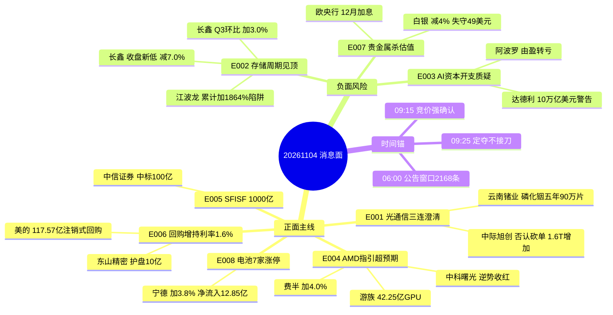

# 2026-11-04 · **消息面事件驱动**

> **数据源新鲜度**: partial · **降级状态**: true · **置信度**: 0.72
> **覆盖窗口**: 2026-11-02 15:00 → 2026-11-04 06:00 · **主源**: 财联社快讯 2255 条 + 公告窗口 2168 条 + 17 号公众号 88 篇 + 东财 Q3 预告 500 条
> **市场底色**: 11-03 主跌（涨停 48 / 跌停 17 / 炸板 34 / 炸板率 41.46% / 中位数 -0.654% / 主力净流出 574.09 亿）

## 一句话结论

主跌日唯一硬多是消费·券商·家电防守线，唯一硬空是存储周期见顶（长鑫单季环比仅 +3.0%），科技外盘修复只给反抽不接。

---

## 🗺️ 消息面全景图

---

## 🎯 顶级事件详解

### E20261104_001 · 光通信三连澄清 + 磷化铟五年长单 · strength=high · polarity=正面 · weighted=+0.706

**事件摘要**：11-03 单日杀跌的叙事源头是"物料短缺/停工"与"客户砍单"。当晚三件事同时落地：光迅科技发澄清公告否认停工（同日跌停）；中际旭创投资者关系记录称绝大部分客户未下修订单、部分客户 1.6T 需求反而增加，野村"目标价砍至 330 元"传闻被指不属实；云南锗业与 AOI 签 2027-2031 五年磷化铟长单，首年 18 万片对应 13.05 亿元，等于其 2025 年营收的 122.46%。叠加隔夜费城半导体 +4.00%。

- **大资金意图**：11-03 通信网络设备及器件主力 -74.96 亿、5 日 -118.96 亿，是单边撤退不是换手。澄清公告的作用不是让资金回流，而是**阻止第二天继续踩踏**——给昨晚没跑掉的机构一个不必市价砸盘的台阶。真正愿意在这个位置加钱的只有上游材料（磷化铟长单是收入级硬合同，与光模块估值无关）。
- **为什么走强**：费半 +4% 提供的是**开盘情绪缺口**，可测算的部分在 AMD 指引与存储美股普涨；但 A 股光模块的筹码结构是"三熊"（新易盛/中际旭创/天孚）单日 -9.5%~-12.7%、5 日 -174.55 亿，缺口会被用来减仓。因此这条线的正确读法是**反抽高度=昨日跌幅的 1/3 到 1/2，不是反转**。
- **逻辑够不够硬**：**中等偏硬但方向是防守**。硬的部分：公告级澄清 + 五年长单 + 野村辟谣，三件都有原文；不硬的部分：11-03 光迅跌停、中际旭创 -12.69%、龙虎榜资金净卖，"客户未砍单"无法解释为什么 1.6T 需求增加却先杀 12%。再叠加 E003 的行业级资本开支质疑，同板块净分只有 +0.086 → 判定**分歧**。

#### 中际旭创 300308 · role=首推 · **r4_stance=降级观察**

- **买入理由**：辟谣是消息面唯一硬支撑（客户未下修 + 1.6T 需求增加 + 野村维持买入），主营光通信收发模块占收入 98.99%、毛利率 46.59%，是整条链最纯的 beta；若今日竞价翻红且 5 分钟不破均价，是板块修复的唯一载体。
- **风险点**：11-03 -12.69%、单日主力 -27.76 亿、5 日 -3.57 亿、20 日 -78.94 亿，距 20 日高 -42.46%；澄清只能挡住恐慌不能创造买盘；E003 的 10 万亿产能过剩警告正对着它。
- **止损条件**：**456.19 元**（参考价 480.20 × 0.95），跌破即走；若开盘冲高回落跌破 480.20 前收，日内直接放弃不等到止损。
- **可验证假设**：若 09:30-10:00 主力净额仍为负、且 1.6T 概念同门（新易盛/天孚）不同时翻红 → "澄清驱动修复"证伪，当日不参与。

#### 云南锗业 002428 · role=首推 · **r4_stance=观察**

- **买入理由**：磷化铟五年长单是全场唯一可测算的收入级合同（首年 13.05 亿 = 2025 营收 122.46%，五年 90 万片），锗材料产品占主营 45.05%；这条线不依赖光模块估值修复，只依赖 AOI 的采购执行，逻辑独立。
- **风险点**：11-03 -5.08%，5 日主力 -6.82 亿（2/5 天为正），距 20 日高 -24.76%；合同明确挂钩商务部两用物项出口许可证，许可不批则 AOI 可取消订单——这是合同里写着的风险不是猜测。
- **止损条件**：**65.10 元**（参考价 68.53 × 0.95），跌破止损；若开盘直接跳空低开超 -4%，等回抽不破 68.53 再谈。
- **可验证假设**：若今日有色/小金属板块继续净流出且该股不能站上 70.69（MA5）→ 长单利好被当作兑现，降级为纯跟踪。

---

### E20261104_002 · 长鑫 Q3 单季环比仅 +3.0% + 渠道价续跌 · strength=high · polarity=负面 · weighted=-0.689

**事件摘要**：长鑫科技三季报前三季营收 2690.24 亿（同比 +738.51%）、归母净利 1320.40 亿，其中 Q3 单季 544.35 亿、**环比仅 +3.0%，而 Q2 环比是 +113%**——增速斜率断崖式回落。11-03 收盘 38.80 元（-7.0%），创 7 月 27 日上市以来收盘新低，且收在当日最低价；同日渠道消费类 SSD 与嵌入式 eMMC 价格延续小幅调降，仅行业 SSD/内存条/LPDDR 持稳。

- **大资金意图**：5 日主力 -48.31 亿、**0/5 天为净流入**，20 日 -122.14 亿，市值自高点缩水超 1 万亿。这不是估值分歧，是机构在周期股上用脚投票：当单季环比从 +113% 掉到 +3.0%，"超级周期"的斜率论就失效了，剩下只有价格 beta。
- **为什么走强**（本条为利空·实际走弱）：利空不是来自同比——同比 +2581% 是全场最炸裂的数字。市场定价的是**边际**：Q3 环比 +3.0% 意味着 Q4 若价格再降就是负增长；同时模组端 SSD/eMMC 现货价已在下跌，说明终端需求承接不住原厂涨价。这是"同比见顶、环比转平、价格转跌"的三段式顶部特征。
- **逻辑够不够硬**：**硬**。三个独立证据同向：财报单季环比（可算）、收盘新低且收在最低价（价格确认）、渠道现货报价（产业确认）。唯一的反向证据是管理层称 Q4 DRAM 供给紧缺延续、毛利率稳定——这是公司口径，历史上周期顶部的公司口径总是最乐观的那一个，因此不采信为反转依据。

#### 长鑫科技 688825 · role=负面暴露 · **r4_stance=剔除**

- **买入理由**：不构成买入理由。作为观察锚：18.9 倍 TTM 在存储板块 34.27 倍里确实便宜，若 Q4 价格证伪下跌，它是估值修复的第一顺位——但这是"以后的事"，今日不参与。
- **风险点**：5 日主力 -48.31 亿、0/5 天为正，收盘价=当日最低价意味着尾盘无承接；LPDDR 占收入 52.02%、毛利率 82.60%，高毛利正是周期顶部的账面特征，一旦价格转跌毛利回落最快。
- **止损条件**：**36.86 元**（参考价 38.80 × 0.95），已属剔除标的，此价位仅作纪律记录。
- **可验证假设**：若今日存储链反弹而长鑫不能收复 41.91（MA5）→ 确认它是被抛弃的那一只，任何"存储反弹"都不许带它。

#### 江波龙 301308 · role=负面暴露 · **r4_stance=降级观察**

- **买入理由**：仅作为"业绩陷阱"的反面标本：东财预告累计同比 +1864.55%~1990.84%（140-149 亿），是全场第 15 炸裂的数字，但存储产品占主营 100%、毛利率 58.90%，比原厂 82.60% 低 24 个点——涨价链里它是被成本挤压的中间环节。
- **风险点**：单季拆分未取到（earnings_qoq_unverified），无法算出 Q3 环比，只能按"环节错配 + 现货价下行"降级，不能给正面；11-03 -5.79%，距 20 日高 -36.21%，5 日主力 -4.34 亿。
- **止损条件**：**192.09 元**（参考价 202.20 × 0.95），跌破即走。
- **可验证假设**：若三季报单季利润环比为正且毛利率不降 → 环节错配假设证伪，可升级观察；若毛利率跌破 55% → 直接剔除并同步给 R5。

---

### E20261104_003 · AI 资本开支过热质疑 · strength=high · polarity=负面 · weighted=-0.620 · **行业级**

**事件摘要**：前纽约联储行长达德利警告 AI 基础设施投资可能超 10 万亿美元、或造成大规模产能过剩，7-8 家超大规模玩家最终可能只剩少数；同日阿波罗 Q3 由盈转亏（亏 17.16 亿美元），但放贷规模 1140 亿美元创纪录、环比 +50%，其中包含为 Anthropic 提供芯片融资、参与英伟达 5000 亿美元融资计划。市场在 AMD 财报前对 AI 资本开支的质疑升温。

- **大资金意图**：这是给"AI 硬件永远缺货"叙事上的一道**融资端风险**：当放贷方自己由盈转亏而放贷规模翻倍，链条的脆弱性从需求端转移到资金端。机构的动作会体现在减配高 beta（光模块/PCB/算力）而不是清仓，所以表现为连续失血而非单日崩塌。
- **为什么走强**（本条为利空·实际走弱）：11-03 的杀跌给了这条叙事现实注脚——电子 -236.26 亿、通信 -103.02 亿、印制电路板 -52.17 亿，生益/深南/景旺跌停。隔夜费半 +4% 是对这条利空的反驳，但反驳的是股价不是逻辑。
- **逻辑够不够硬**：**中等**。达德利是前官员表态、阿波罗是单一公司财报，二者都不能直接推导 A 股算力需求下修；硬的地方在于它与 E002 形成同向（存储环比失速），两条独立证据都指向"AI 硬件景气斜率放缓"。因此本条按行业级利空处理，压住整个硬件链的反弹高度。

#### 寒武纪 688256 · role=负面暴露 · **r4_stance=剔除**

- **买入理由**：不构成买入理由。云端智能芯片及加速卡占主营 99.98%、毛利率 55.25%，是国产算力纯度最高标的，只在"行业级利空证伪 + 缩量止跌"后才重新进入观察。
- **风险点**：11-03 -10.81%、5 日 -15.89%、距 20 日高 -27.0%，5 日主力 -15.11 亿；数字芯片设计板块 5 日 -110.46 亿，它是板块最大的单一风险敞口。
- **止损条件**：**729.53 元**（参考价 767.93 × 0.95），剔除标的仅作纪律记录。
- **可验证假设**：若 AMD 财报后费半继续上行而寒武纪不能收复 875.99（MA5）→ 确认"外盘修复传导不到国产高位算力"，全链反抽均按减仓处理。

---

### E20261104_004 · AMD 指引超预期 + 费半 +4.0% + 42.25 亿 GPU 采购 · strength=high · polarity=正面 · weighted=+0.780

**事件摘要**：AMD 四季度营收指引 170 亿美元（±3 亿）高于分析师预期，称数据中心处理器需求仍强劲，11-03 收涨 5.81%；费城半导体指数收涨 4.00%（英伟达 +3.03%、美光 +3.62%、博通 +3.90%）；游族网络全资子公司与 A 公司签 42.25 亿元 PRO5500（PCIe）GPU 采购合同；另有产业链消息称 DeepSeek V5 明年有望基于昇腾 950 完成训练。

- **大资金意图**：外盘给的是"AI 需求未死"的证据，A 股资金今天要决定的是**跟不跟**。11-03 数字芯片设计 -89.38 亿、半导体 -131.43 亿的失血说明本地资金已经先撤，隔夜利好更可能被用来做**减仓流动性**而不是加仓理由。
- **为什么走强**：唯一在 11-03 逆势收红的算力载体是中科曙光（+1.39%，贴 MA5/MA20），说明"整机/服务器"比"芯片"更抗跌——因为它的估值不含 AI 溢价最重的那一段。游族的 42.25 亿订单则是订单级硬证据，但主营仍是移动游戏 72.66%，属于跨界。
- **逻辑够不够硬**：**中等**。AMD 指引与费半是硬数据，但它们是**海外需求**；A 股算力链的问题是筹码（20 日主力 -337.58 亿数字芯片设计），不是需求。逻辑硬、筹码差 → 只能给反抽，不能给趋势。

#### 中科曙光 603019 · role=首推 · **r4_stance=观察**

- **买入理由**：11-03 全场算力链唯一逆势收红（+1.39%），收 74.20 元贴住 MA5 74.25 / MA20 74.33，IT 设备占主营 89.28%；是"外盘修复 + 国产替代"双叙事里唯一没破位的权重载体。
- **风险点**：5 日主力 -2.23 亿、20 日 -19.23 亿，逆势收红不等于资金认可；距 20 日高 -8.24%，上方 80.86 是明确压力；半导体板块 5 日 -208.98 亿的逆风没有解除。
- **止损条件**：**70.49 元**（参考价 74.20 × 0.95），跌破 MA20 且亏损达 -5% 双条件任一触发即走。
- **可验证假设**：若今日不能站上 74.33（MA20）且成交额低于 18.25 亿 → 逆势收红只是防守资金临时驻扎，降级为跟踪。

#### 游族网络 002174 · role=弹性 · **r4_stance=降级观察**

- **买入理由**：42.25 亿元 GPU 采购合同约等于其 2025 年营收量级，是"算力租赁"里少见的订单级公告；若市场愿意给跨界算力估值，它是最直接标的。
- **风险点**：消息落地当日股价 -4.96%（利好不涨是明确的反向信号）；移动游戏占主营 72.66%、毛利率 25.44%，GPU 采购是成本项不是收入项，兑现路径未披露；5 日主力仅 +0.09 亿。
- **止损条件**：**10.18 元**（参考价 10.72 × 0.95），跌破即走；若开盘一字或大幅高开超 +7%，不追。
- **可验证假设**：若今日不能收复 10.92（MA5）→ "订单驱动"证伪，按纯题材处理并移出候选。

---

### E20261104_005 · SFISF 第三批 1000 亿元落地 · strength=high · polarity=正面 · weighted=+0.646

**事件摘要**：央行 11 月 3 日开展第三批证券、基金、保险公司互换便利操作 1000 亿元（期限 1 年、可展期），31 家证券基金公司申报；中信证券中标 100 亿元（最大份额），招商、国信、长城（20 亿）、华福（12 亿）、国联民生等相继官宣；同日证监会副主席李超在国际金融领袖投资峰会表示全力维护资本市场平稳运行。

- **大资金意图**：这批钱是**必须买股票和 ETF** 的钱（券商表态"尽快全部投入使用"）。11-03 国家队在 6 只主流 ETF 上买入近 800 亿仍被砸下去（公众号复盘口径·未经官方披露·待核），说明对手盘（固收+/理财/保险资管硬风控）体量更大；SFISF 的意义是把"救市"从汇金单一来源扩展成 31 家机构的常规弹药。
- **为什么走强**：11-03 主跌日券商逆势 +1.92%，中信证券收 26.05 元、距 20 日高仅 -0.99%——这是全场唯一"政策落地 + 价格同向"的组合。对照 11-03 落地首日早盘：国泰海通一度 -1.60%（R4 09:45 盘中档实测），收盘却反手 +2.76%——政策当日是"早盘不信、尾盘认"，说明资金分歧但方向已偏多。
- **逻辑够不够硬**：**硬但钝**。硬：央行公告 + 31 家申报 + 券商公告三重确认，规模可查；钝：5 日主力仍 -4.67 亿，说明钱还没真正进入二级市场买券商股，中标只是额度不是买盘。所以是"防守线"而非"进攻线"。

#### 中信证券 600030 · role=首推 · **r4_stance=观察**

- **买入理由**：中标 100 亿元为全场最大份额，11-03 逆势 +1.92% 收 26.05 元贴近 20 日高（26.31），是政策受益与价格确认同时成立的唯一标的；券商是主跌日天然的资金避风港。
- **风险点**：5 日主力 -4.67 亿、20 日 -31.25 亿，价格上涨没有资金同步；距 20 日高仅 -0.99%，上方空间未打开；券商行情历史上高度依赖成交量放大，11-03 全市场 17150.9 亿是缩量。
- **止损条件**：**24.75 元**（参考价 26.05 × 0.95），跌破即走；若冲高 26.31 不过且回落破 26.05，日内减半。
- **可验证假设**：若今日券商板块不能放量（成交额低于 41.07 亿）而中信冲高回落 → "政策+价格双确认"证伪，降级跟踪。

#### 东方财富 300059 · role=弹性 · **r4_stance=降级观察**

- **买入理由**：5 日主力 +3.81 亿是券商链少见净流入，收 18.86 元距 20 日高 -0.63%，证券服务占主营 78.30%，两融与基金代销对成交额弹性最大。
- **风险点**：20 日主力 -14.74 亿（5 日转正但中期仍负）；作为创业板权重，若指数继续杀则被动承压；SFISF 直接受益度弱于券商自营（它不吃互换便利额度）。
- **止损条件**：**17.92 元**（参考价 18.86 × 0.95），跌破即走。
- **可验证假设**：若今日成交额不能超过 61.75 亿且股价跌破 18.23（MA5）→ 弹性逻辑失效，移出观察池。

---

### E20261104_006 · 回购增持再贷款利率降至 1.6% + 产业资本接力 · strength=high · polarity=正面 · weighted=+0.568

**事件摘要**：股票回购增持再贷款利率有望降至 1.6%（在再贷款利率基础上加点），证监会要求提高专项再贷款覆盖率、引导权重指数公司与龙头科技股做标志性案例；11-03 超 30 家 A 股公司公告进场，东山精密控股股东提议护盘不低于 10 亿元，美的集团累计回购 117.57 亿元且全部注销，另有天岳先进等提议回购。

- **大资金意图**：这是**成本最低的做多资金**——1.6% 的资金成本买自己股票，只要股息率或预期回报高于 1.6% 就是无风险套利。产业资本的买盘不追高、只托底，所以它决定的是"下限"而不是"上限"。11-03 国家队 800 亿 ETF 被砸，产业资本这条腿是唯一还在加速的增量子弹。
- **为什么走强**：美的收 88.88 元、距 20 日高 -0.87%，5 日主力 +2.69 亿且 4/5 天为正——在主跌日能贴着新高走的只有这类现金流+回购双支撑的票。东山精密虽 -4.41%，但 5 日主力 +2.61 亿逆板块（元件 -64.64 亿）。
- **逻辑够不够硬**：**硬**。利率、覆盖率、具体公司金额全是可核验的数字，且注销式回购直接减少总股本。不硬的地方是**节奏**：回购是分期执行，公告日不等于买盘日，不能把公告当成立即上涨的理由。

#### 美的集团 000333 · role=首推 · **r4_stance=研究首选**

- **买入理由**：累计回购 117.57 亿元且全部注销（真实缩股本），5 日主力 +2.69 亿（4/5 天净流入）、20 日 +2.78 亿，收 88.88 元距 20 日高 -0.87%；智能家居占主营 66.78%、毛利率 27.95%，是主跌日最硬的现金流资产。
- **风险点**：家电不是本轮主线，弹性有限；距 20 日高仅 -0.87%，追高即买在压力位；主跌日一切多头都可能被指数拖下去。
- **止损条件**：**84.44 元**（参考价 88.88 × 0.95），跌破即走；若跌破 87.82（MA5）先减半。
- **可验证假设**：若今日不能维持在 87.82（MA5）上方且主力净额转负 → "回购托底"假设让位于指数 beta，降级为观察。

#### 东山精密 002384 · role=弹性 · **r4_stance=观察**

- **买入理由**：控股股东提议护盘不低于 10 亿元，5 日主力 +2.61 亿是元件板块（-108.47 亿）里罕见的逆势净流入，柔性线路板电子产品占主营 45.07%；若 PCB/消费电子止跌，它是最先被回购托住的一只。
- **风险点**：11-03 -4.41%、距 20 日高 -49.06%、20 日主力 -82.58 亿，是"腰斩级"下跌趋势；护盘提议≠已实施，金额与节奏未定。
- **止损条件**：**83.72 元**（参考价 88.13 × 0.95），跌破即走。
- **可验证假设**：若今日不能收复 93.03（MA5）且元件板块继续净流出 → 护盘只是延缓下跌，降级剔除。

---

### E20261104_007 · 欧央行 12 月加息概率极高 + 白银失守 49 美元 · strength=high · polarity=负面 · weighted=-0.720

**事件摘要**：欧央行管委纳格尔称"除非通胀前景大幅好转，12 月再度加息几乎无法避免"；COMEX 白银期货跌超 4% 至 48.85 美元，现货白银失守 49 美元（日内 -3.22%），黄金期货 -1%；工行、光大同日发布贵金属业务风险提示，称波动加剧。

- **大资金意图**：实际利率上行预期是贵金属的天敌。欧央行从"暂停"转为"12 月几乎必加"，直接抬升持有无息资产的机会成本；银行在同一时点提示风险，通常意味着零售端杠杆已被套，机构在减仓。
- **为什么走强**（本条为利空·实际走弱）：A 股贵金属 11-03 反而抗跌（山东黄金 +1.67%、盛达资源 +0.42%），这是**滞后不是强势**——外盘银价 -4% 发生在 A 股收盘后，今天才要定价。5 日主力山东黄金 -7.12 亿（1/5 天为正）、盛达资源 -1.88 亿（0/5 天为正），机构早已借反弹撤退。
- **逻辑够不够硬**：**硬**。加息表态是官方口径、银价跌幅是市场数据、银行风险提示是行业动作，三者同向。唯一不确定是幅度：白银已从 10 月重创中反弹过一轮，48.85 美元是否已price in 部分加息，需要今日盘面确认。

#### 山东黄金 600547 · role=负面暴露 · **r4_stance=剔除**

- **买入理由**：不构成买入理由。仅在"加息预期被证伪 + 银价收复 49"时重新评估；黄金占主营 38.36%、毛利率 56.32%，是金价 beta 最纯的权重。
- **风险点**：5 日主力 -7.12 亿、仅 1/5 天净流入，20 日 -7.37 亿；11-03 的 +1.67% 是滞后反弹，今日补跌风险最大；距 20 日高 -15.67%。
- **止损条件**：**22.03 元**（参考价 23.19 × 0.95），剔除标的仅作纪律记录。
- **可验证假设**：若今日低开后不能收复 23.69（MA5）→ 补跌确认，全板块按剔除处理；若逆势收红且主力转正 → 说明市场已 price in 加息，重估。

#### 盛达资源 000603 · role=负面暴露 · **r4_stance=剔除**

- **买入理由**：不构成买入理由。预增 +104.57%~116.96%（6.6-7.0 亿）是唯一亮点，但它是价格 beta 品种，业绩好救不了银价 -4%。
- **风险点**：5 日主力 -1.88 亿、**0/5 天净流入**，20 日 -3.69 亿；铅精粉占主营 37.21%、毛利率 73.59%，银价下跌直接压缩毛利；距 20 日高 -31.35%。
- **止损条件**：**20.45 元**（参考价 21.53 × 0.95），剔除标的仅作纪律记录。
- **可验证假设**：若今日跌破 22.19（MA5）且银价不能回 49 美元 → 业绩预增被完全忽略，确认纯价格品种属性。

---

### E20261104_008 · 电池 7 家涨停 + 宁德逆势 +3.80% · strength=medium · polarity=正面 · weighted=+0.473

**事件摘要**：11-03 电池板块 7 家涨停（圣阳股份封单 2.57 亿首板、紫竹高科 2 板、丰元股份、尚水智能、时代万恒、龙蟠科技、野马电池），为全市场最多；宁德时代 +3.80% 成交 155.12 亿、主力净流入 12.85 亿；固态电池核心公司 20cm 涨停，机构称固态产业进入关键窗口期。电池主力 +25.32 亿、电力设备 +34.32 亿，是全市场最大承接方向。

- **大资金意图**：这是**高低切**——从 5 日 -454.86 亿的电子里撤出来的钱，需要一个有容量、有业绩、有政策的方向。电池同时满足三点（宁德三季报稳定、固态政策窗口、储能招标频出），且身位低（电池 20 日主力 -157.47 亿），是承接的第一选择。
- **为什么走强**：涨停结构最能说明问题——7 家电池里有 6 家是首板/2 板小票，说明是资金在**铺面**而不是立龙头；宁德 +3.80% 放量 155 亿是权重确认。这种"小票铺面 + 权重点火"的结构通常能延续 2-3 天，但龙头身位未定。
- **逻辑够不够硬**：**中等**。资金与涨停是真的（+25.32 亿、7 家），固态的政策与产业进展是真的，但**没有一条能改变行业供需的消息**——涨价、订单、政策细则都缺。所以它是"资金选择"而非"事件驱动"，只能做承接不能做主线。

#### 宁德时代 300750 · role=首推 · **r4_stance=研究首选**

- **买入理由**：全场唯一 5 日主力 +18.07 亿的权重主线（3/5 天为正），11-03 +3.80% 放量 155.12 亿，动力电池系统占主营 69.38%；电池板块 +25.32 亿的最大单一贡献者，主跌日资金给出的最明确答案。
- **风险点**：20 日主力仍 -14.71 亿、距 20 日高 -18.71%，中期资金尚未回补；收 249.32 元在 MA20 258.12 之下，反弹仍属下跌中继形态；电池涨停潮若次日大面积炸板，权重也会被拖。
- **止损条件**：**236.85 元**（参考价 249.32 × 0.95），跌破即走；若跌破 236.13（MA5）先减半。
- **可验证假设**：若今日电池板块涨停家数低于 3 家且宁德主力净额转负 → 高低切只是一日游，降级观察。

#### 亿纬锂能 300014 · role=弹性 · **r4_stance=观察**

- **买入理由**：Q3 预增 +80%~90%（50.68-53.50 亿）是电池链少数硬业绩，11-03 +1.77% 收 48.92 元贴住 MA5 47.23 / MA20 46.93，距 20 日高 -6.27%，形态比宁德更干净（在均线上方）。
- **风险点**：5 日主力 -1.04 亿、20 日 -14.84 亿，价格上涨无资金同步；动力电池占主营 37.82%、毛利率 16.19%，盈利质量弱于宁德；储能/动力价格战未止。
- **止损条件**：**46.47 元**（参考价 48.92 × 0.95），跌破即走。
- **可验证假设**：若今日不能站稳 46.93（MA20）且主力净流出 → 预增利好已被定价，移出观察池。

---

## 📊 板块 × 事件热力矩阵

| 板块 | 事件锚 | 首推龙头 | 独立源数 | 净分 | 判定 |
|------|--------|----------|:--:|:--:|:--:|
| AI服务器 | E004 AMD指引+费半 | 中科曙光 | 4 | **+0.780** | 🟢🟢 |
| 国产算力 | E004 昇腾/DeepSeek | 中科曙光 | 4 | **+0.780** | 🟢🟢 |
| 磷化铟 | E001 云南锗业长单 | 云南锗业 | 2 | **+0.706** | 🟢🟢 |
| 券商 | E005 SFISF 1000亿 | 中信证券 | 5 | **+0.646** | 🟢🟢 |
| GPU算力租赁 | E004 游族42.25亿 | 游族网络 | 3 | +0.546 | 🟢 |
| CPO | E001 澄清 | 中际旭创 | 3 | +0.494 | 🟢 |
| 电池 | E008 7家涨停 | 宁德时代 | 4 | **+0.473** | 🟢 |
| 非银金融 | E005 券商中标 | 中信证券 | 5 | +0.452 | 🟢 |
| 红利蓝筹 | E006 回购1.6% | 美的集团 | 5 | +0.398 | 🟢 |
| 家电 | E006 美的117.57亿 | 美的集团 | 5 | +0.398 | 🟢 |
| 固态电池 | E008 20cm活跃 | 亿纬锂能 | 3 | +0.331 | 🟡 |
| 破净央企 | E006 国新/诚通千亿 | — | 3 | +0.227 | 🟡 |
| **光模块** | **E001 +0.706 / E003 -0.620** | 中际旭创 | 6 | **+0.086** | **🟡 分歧** |
| PCB | E003 资本开支质疑 | — | 3 | -0.434 | 🔴 |
| 半导体 | E003 行业级利空 | 寒武纪 | 3 | -0.434 | 🔴 |
| 有色金属 | E007 贵金属拖累 | — | 3 | -0.434 | 🔴 |
| 存储模组 | E002 环节错配 | 江波龙 | 3 | -0.482 | 🔴 |
| AI算力全链 | E003 10万亿警告 | 寒武纪 | 4 | -0.620 | 🔴🔴 |
| 黄金 | E007 欧央行加息 | 山东黄金 | 4 | -0.720 | 🔴🔴 |
| 白银 | E007 银价-4% | 盛达资源 | 4 | -0.720 | 🔴🔴 |
| 存储芯片 | E002 长鑫环比+3.0% | 长鑫科技 | 4 | **-0.689** | 🔴🔴 |

**多事件叉乘结论（sector_cross_summary）**

- **光模块 = 分歧（净分 +0.086）**：E001 的澄清+辟谣给 +0.706，E003 的资本开支质疑给 -0.620，两股力量几乎完全对冲。这是今日最需要讲清的一件事——**"澄清"不是利好，它只是把 -12.69% 的下跌从"基本面崩塌"改判为"情绪踩踏"**。分歧板块不接，等它自己走出方向（收盘站上 MA5 或连续两日主力转正）。
- 其余板块均为单事件，不构成叉乘，按单边方向处理。

---

## 🔥 中报/三季报业绩预告命中（硬 alpha 交叉验证）

东财 2026-09-30 预告池 500 条，取同比下限 top20 与本文事件板块交集：

| 代码 | 名称 | 预告类型 | 增速下限-上限 | 事件命中 | 逻辑强度 |
|------|------|----------|--------------|----------|:--:|
| 001309.SZ | 德明利 | 扭亏 | +32046%~33154% | E002 存储（模组环节） | 🔴 环节错配·同比陷阱 |
| 300821.SZ | 东岳硅材 | 预增 | +19047%~19748% | 非本事件池 | — |
| 000703.SZ | 恒逸石化 | 预增 | +9836%~10090% | 非本事件池 | — |
| 002466.SZ | 天齐锂业 | 预增 | +6957%~8219% | E008 电池上游 | 🟡 锂价未确认 |
| 688388.SH | 嘉元科技 | 预增 | +3065%~3329% | E008 电池铜箔 | 🟢 量价齐升 |
| 301308.SZ | 江波龙 | 预增 | +1864%~1990% | E002 存储模组 | 🔴 单季拆分未验·按负面处理 |
| 688825.SH | 长鑫科技 | 扭亏 | +2581%~2609% | E002 存储原厂 | 🔴 环比仅+3.0%·周期见顶 |
| 002812.SZ | 恩捷股份 | 扭亏 | +1884%~2474% | E008 电池隔膜 | 🟢 反转确认 |
| 688378.SH | 奥来德 | 扭亏 | +1897%~2224% | 非本事件池 | — |
| 688808.SH | 联讯仪器 | 预增 | +1866%~2072% | E004 算力测试设备 | 🟢 硬业绩 |
| 301511.SZ | 德福科技 | 预增 | +1478%~1635% | E008 电池铜箔 | 🟢 |
| 600183.SH | 生益科技 | 预增 | +164%~181% | E003 PCB | 🟡 业绩好但11-03跌停 |
| 000603.SZ | 盛达资源 | 预增 | +104%~117% | E007 白银 | 🔴 价格beta吞噬 |
| 300014.SZ | 亿纬锂能 | 预增 | +80%~90% | E008 电池 | 🟢 |
| 688041.SH | 海光信息 | 预增 | +38%~52% | E004 国产算力 | 🟡 筹码压制 |

**三个结论**：①存储链三家（德明利/江波龙/长鑫）同比全部炸裂，但两家已证伪（长鑫环比 +3.0%、模组价格下行），业绩预告在本轮是**反指**；②电池链四家（嘉元/恩捷/亿纬/德福）预增 + 资金承接同向，是唯一"业绩与资金共振"的方向；③生益科技 +164%~181% 却在 11-03 跌停，说明**业绩在筹码面前无效**——这是主跌日的定价规则。

---

## 🎯 首板候选池（消息侧刺激 · 只做强弱确认不做预判）

| 代码 | 名称 | 来源 | 质量 | 命中 | 11-03 表现 | 今日可交易 | 风险标记 |
|------|------|------|:--:|:--:|-----------|:--:|----------|
| 600030.SH | 中信证券 | direct_name_match | high | 7 | +1.92% 收 26.05 距高 -0.99% | ✅ | 5日主力-4.67亿·空间未打开 |
| 601211.SH | 国泰海通 | direct_name_match | high | 5 | +2.76% 收 16.75 距高 -2.62% | ✅ | 11-02政策首日曾冲高回落-1.60% |
| 600519.SH | 贵州茅台 | direct_name_match | medium | 3 | +2.84% 收盘=20日新高·5日主力+11.99亿 | ✅ | 非事件驱动·纯资金抱团·弹性低 |
| 002384.SZ | 东山精密 | direct_name_match | medium | 6 | -4.41% 距高 -49.06% | ✅ | 护盘未实施·下跌趋势中 |
| 601326.SH | 秦港股份 | direct_name_match | medium | 3 | -1.38% 收 3.57 | ✅ | 11-04 重组复牌·高波动·预案未定 |
| 300750.SZ | 宁德时代 | lead_stock_proxy | high | 11 | +3.80% 5日主力+18.07亿 | ✅ | 代理口径·20日主力仍-14.71亿 |

> 代理说明：宁德时代为 `lead_stock_proxy`（电池板块资金龙头，非消息点名）。按 v1.7 契约 proxy 类入 watch 不进 execution。
> 主跌 + 炸板率 41.46% ≥ 35% → 候选池已砍半（常规 12 只 → 6 只），且全部 `research_only`，不授予开仓资格。

---

## 关键证据

- 证据 1：长鑫科技 11-03 收 38.80 元（-7.0%），创 7 月 27 日上市以来收盘新低，收在当日最低价；Q3 单季归母净利 544.35 亿、环比 +3.0%（Q2 环比 +113%）· 来源 上海证券报 2026-11-03 22:56 + 长鑫三季报
- 证据 2：渠道消费类 SSD 及嵌入式 eMMC 价格延续小幅调降，行业 SSD/内存条/LPDDR 持稳 · 来源 财联社 2026-11-03 22:56
- 证据 3：光迅科技发布澄清公告否认"物料短缺/生产停工"，当日跌停、5 日主力 -12.60 亿 · 来源 光迅科技澄清公告 + 证券时报 2026-11-03 20:28
- 证据 4：中际旭创称绝大部分客户未下修需求、部分客户 1.6T 需求增加，野村 330 元目标价传闻不属实 · 来源 中际旭创投资者关系记录 2026-11-03 23:39 + 华尔街见闻 2026-11-04 04:34
- 证据 5：云南锗业子公司与 AOI 签 2027-2031 年五年磷化铟长单，首年 18 万片/1.944 亿美元≈13.05 亿元，为 2025 年营收 122.46% · 来源 云南锗业重大合同公告 2026-11-04
- 证据 6：央行第三批 SFISF 1000 亿元、31 家申报，中信证券中标 100 亿元 · 来源 央行公告 2026-11-03 + 财联社 17:45
- 证据 7：费城半导体指数 11-03 收涨 4.00%，AMD +5.81%、英伟达 +3.03%、美光 +3.62%；AMD Q4 指引 170 亿美元超预期 · 来源 新浪 2026-11-04 00:04 + 财联社 05:30
- 证据 8：COMEX 白银跌超 4% 至 48.85 美元、现货白银失守 49 美元；欧央行管委称 12 月加息几乎无法避免 · 来源 财联社 2026-11-03 16:42 + 新浪 2026-11-04 02:02
- 证据 9：11-03 电池 7 家涨停（全市场最多）、电池主力 +25.32 亿、宁德 +3.80% 净流入 12.85 亿 · 来源 东方财富涨停池 + R7 资金 2026-11-04 04:36

---

## 数据源审计

| 源 | 日期 | 状态 | 备注 |
|---|---|:--:|---|
| tushare/news_cls | 2026-11-04 | 🟢 | 2493 条（11-02 15:00 起 2255 条参与聚合） |
| tushare/news_major | 2026-11-04 | 🟢 | 800 条，多数仅标题 |
| eastmoney/earnings_predict | 2026-11-04 | 🟢 | 500 条 · 2026Q3 |
| wechat_official_rss | 2026-11-04 | 🟢 | 88 篇 · 17 feed（17/17 可达） |
| wechat_cli_5groups | 2026-11-04 | 🔴 | 7 群全部 0 条消息（空文件） |
| anns_window | 2026-11-04 | 🟢 | 2168 条盘前公告窗口 |
| hithink_business_query | 2026-11-04 | 🟢 | 21 次调用，主营构成实测返回 |
| R7_capital_flow | 2026-11-04 | 🟢 | 04:36 档，东财 moneyflow_dc 口径 |
| R3_sentiment | 2026-11-04 | 🔴 | 未产出（07:30 档），kol_confirm 全空 |
| xtick/hot_news | 2026-11-04 | 🔴 | R4 未接入该 toolset |
| 盘前纪要（11-04） | 2026-11-04 | 🔴 | 06:01 抓取早于 7:00 发文窗口，未获取 |

---

## 不确定性 / 反证

1. **"澄清"的证据等级不足**：光迅、中际旭创的澄清都是公司口径，与"客户砍单"的传闻同源同权。11-03 两只票分别 -10.00% / -12.69%，若今日不涨，"谣言即事实"的市场投票会覆盖公告。我把光模块判为分歧而非正面，正是为此留出退路。
2. **存储的负面结论建立在单季数据上**：长鑫 Q3 环比 +3.0% 只有一季，若 Q4 因 DRAM 紧缺重新加速（公司口径称毛利率稳定），这条判断会被打脸。江波龙单季拆分未取到，我只能标 `earnings_qoq_unverified`，不敢用累计同比下结论。
3. **E004 与 E003 是同一板块的对冲叙事**：AMD 指引超预期（正面）与 10 万亿产能过剩警告（负面）同日出现，我给了 E004 更高权重（+0.780 vs -0.620），因为它是数据而非表态。若市场选择相信后者，AI 服务器/国产算力的 +0.780 会变成最贵的多头陷阱。
4. **电池 +0.473 只是"资金选择"**：7 家涨停里 6 家是首板/2 板，没有一条涨价或订单级消息支撑。它可能是 2-3 日的高低切，也可能是主跌期最后一波题材轮动。我给了宁德"研究首选"但仓位 0.06，就是承认这个不确定性。
5. **群聊与 R3 双双缺失**：kol_cross_check=0.2，意味着"散户/游资情绪"这一维今日完全空白。若群聊昨晚在集体讨论某条我没抓到的利空，本报告会漏检。这是本次最大盲区。
6. **日线缓存只有 20 个交易日**：所有"距 20 日高"都是 20 日口径，不是 60 日。对中际旭创（-42.46%）、东山精密（-49.06%）这类深度回撤票，20 日高远不足以描述真实位置。

---

## 与其他 R/D/E 的关系

- **依赖**：`R7_capital_flow_20261104.json`（资金 5 日/20 日净额）· `emotion_cycle.json`（主跌 0.88）· `cycle_position.json`（as_of 20261103）· 东财 Q3 预告 · 公告窗口 2168 条
- **被消费**：R2 主线（E005 券商/E006 消费怎么与主线打分合并）· R5 个股画像（15 只候选的六维深挖）· R6 反证（E002 存储见顶、E003 行业级利空是重点反证对象）· D1 预案（6 只首板候选的竞价确认 + 15 只研究池的取舍）

---

## Sub-Agent 元数据

- skill: analyze_news_impact_v1@1.7
- artifact: data/research/20261104/R4_news.json
- method: llm_v1（五源硬约束 · 时间衰减 λ=0.15 · 板块极性叉乘 abs 口径）
- 生成时刻: 2026-11-04T06:58:00+08:00
- 运行模式: premarket（R1/R3 未产出，kol_cross_check=0.2）
