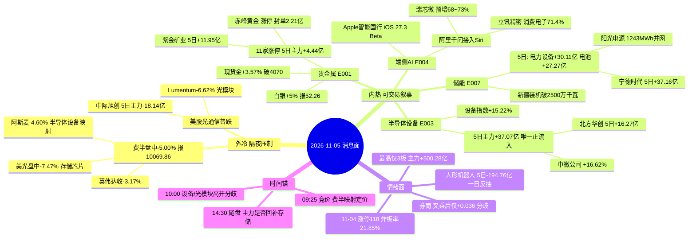

# 2026-11-05 · **消息面事件驱动**

> **数据源新鲜度**: partial · **降级状态**: true · **置信度**: 0.70
> **覆盖窗口**: 2026-11-02 09:02 → 2026-11-05 05:56（72h） · **主源**: 财联社快讯 2953 条 + 21 号公众号 85 篇 + 盘前公告 1680 条 + 东财三季报预告 500 条
> **价格/资金口径**: 20261104 收盘（tushare daily） + 东财 moneyflow_dc 主力净额（超大单+大单）5 日累计 20261029-20261104

## 一句话结论

消息面读作「外冷内热」：**贵金属**（现货金 +3.57% 破 4070 / 白银 +5%）与**端侧AI**（Apple 智能国行落地并接入阿里千问）是今日仅有的两条内外共振叙事；对手盘是**隔夜费半盘中 -5.00%、美光盘中 -7.47%** 对光模块/存储/半导体的直接压制。执行口径只有一条：只做 5 日主力为正的**半导体设备（+37.07 亿）**与**电池（+27.27 亿）**，16 只票里只有 3 只过 RR≥2 闸门。

## 🗺️ 消息面全景图

## 🎯 顶级事件详解

### E20261105_001 · 中期选举民主党大胜驱动金银双涨 · strength=high · polarity=正面 · weighted +0.850

**事件摘要**：多家美媒预测民主党在 11-03 中期选举中大获全胜，美元与美债收益率同步走低。现货黄金 11-05 02:08 突破 4070 美元/盎司、日内 +3.57%；现货白银 22:45 报 52.26 美元、日内 +5%；沪银主力 01:32 报 12631 元、+5%。花旗 23:14 给出 0-3 月目标 4500 / 6-12 月 5000。A股 11-04 已先行反应：贵金属行业 +10.45%、11 家涨停（赤峰黄金/盛达资源/山金国际/招金黄金/四川黄金/山东黄金/西部黄金/湖南白银/湖南黄金等），行业 5 日主力 +4.44 亿（ind_20261104 + moneyflow_dc）。

**推理深度三问**

- **大资金意图**：民主党拿下参议院等于掐断"白宫重塑美联储"的通道，美元与美债收益率的下行是**制度性定价**而非一次性情绪；黄金是这条逻辑的唯一直接多头载体。A股这边 11-04 有 11 家贵金属涨停，说明内资已经在盘前抢跑外盘，今天开盘的溢价是"二次确认"而不是"首日发现"。
- **为什么走强**：11-03 A股贵金属还在被"欧央行加息+白银失守 49 美元"压制（昨日 R4 E007 判负面），11-04 直接反向 —— 这种 24 小时内 180 度反转只能由**外部定价变量（美元/实际利率）** 解释，不是资金内部博弈，因此持续性比普通题材强。
- **逻辑够不够硬**：**硬，但位置不便宜**。硬在三点：外盘现货 +3.57%/+5% 是实时价不是预期、花旗目标价 4500 有机构背书、A股 11 家涨停有广度。不便宜的在于 11-04 已涨停、今日是接力段，若竞价溢价超 3% 则盈亏比直接跌破 1。**结论：做回踩不做追板。**

**票卡**

#### 紫金矿业 601899 · 降级观察 · 仓位上限 3%

行情：11-04 收 29.25 元 +6.56% · MA5 27.84 / MA20 28.84 · 距 60 日高 -18.30% · 20 日位置 65% · 5 日主力 **+11.95 亿（4/5 天为正）** · 10 日振幅 4.88%

- **买入理由**：贵金属链唯一"5 日 4 天净流入"的龙头（+11.95 亿），主营矿产品+冶炼，金价上行直接放大矿端利润；11-04 板块普涨中它是资金最集中的大市值载体。
- **风险点**：涨停的是赤峰/盛达这些弹性票，紫金只涨 6.56% 说明大资金在"配置"不在"进攻"；上方 31.06 是 20 日高，距现价仅 +6.2%，空间被压住。
- **止损条件**：27.49（参考价 29.25 × (1-6.0%)，同时位于 5 日线 27.84 下方 1.3%），跌破即认外盘逻辑失效。
- **可验证假设**：若 09:25 竞价贵金属板块溢价 < 1% 且紫金集合竞价成交额 < 3 亿 → "配置型资金"假设不成立，今日不做；若开盘 30 分钟主力净额转负 → 直接放弃。

#### 赤峰黄金 600988 · 观察 · 仓位上限 6%

行情：11-04 涨停收 34.54 元 · 封单 2.21 亿 · MA5 32.99 / MA20 37.59 · 距 60 日高 -33.56% · 20 日位置 36% · 5 日主力 **-1.32 亿（仅 11-04 当日 +1.77 亿）** · 10 日振幅 6.48%

- **买入理由**：自产金占主营 88.1%，是 A 股金价弹性最纯的标的之一；涨停 + 2.21 亿封单说明有资金愿意在涨停价接货；位置低（20 日位置 36%）意味着上方套牢盘不重。
- **风险点**：5 日主力仍净流出 1.32 亿 —— **涨停是单日行为，不是 5 日建仓**；振幅 6.48%，一旦金价不续创新高，这类弹性票的回撤会比紫金快一倍。
- **止损条件**：32.29（参考价 34.54 × (1-6.5%)），同时是 11-04 涨停板下方约 1 个价位，破板即离场。
- **可验证假设**：若今日竞价高开 > 4% 且首笔封单 < 5000 万 → 视为一日游兑现，不参与；若平开/低开且 10:00 前回踩 33 元获承接 → 可按 6% 仓位试错。

### E20261105_002 · 美股极端分化：道指 +3.03% 但费半盘中 -5.00% · strength=high · polarity=负面 · weighted -0.820

**事件摘要**：11-04 美股收盘道指 +3.03%、纳指 +1.46%、标普 +1.58%，但结构极度分化：英伟达收 **-3.17%**、特斯拉 **-3.32%**；费城半导体指数 11-05 00:06 盘中最低 **-5.00% 报 10069.86**，美光盘中 **-7.47%**、英特尔 -6.18%、阿斯麦 -4.60%；美股光通信开盘普跌（Lumentum -6.62%、Ciena -3.16%）。同期 A股 5 日主力：CPO **-295.72 亿**、算力 **-209.62 亿**、存储芯片 **-76.13 亿**、半导体 -82.00 亿、特斯拉链所在的机器人概念 -326.25 亿。

**推理深度三问**

- **大资金意图**：道指涨的是"民主党胜选→关税/伊朗战争降温→传统经济修复"，费半跌的是"民主党州长收紧数据中心审批→AI 资本开支预期下修"（CoreWeave 债券创新低、德州 AI 园区前景蒙阴）。这是**同一场选举的两条相反交易**，A股半导体/光模块 11-04 的暴涨踩在了错误的那条腿上。
- **为什么走强**：负面不需要"走强"，需要的是"传导"。传导路径很清晰：费半 -5% → A股半导体/光模块高开幅度被压缩 → 11-04 单日 +17.4 亿的中际旭创、+11.77 亿的兆易创新面临兑现盘。11-04 是周五级别的一日反抽（5 日资金仍全面净流出），今天才是检验承接的第一天。
- **逻辑够不够硬**：**硬，且是今日最强反证**。三个独立数据点同向：海外同链杀跌、A股 5 日资金净流出、11-04 属单日脉冲而非趋势。任何"半导体第二波"的叙事今天都必须先回答：为什么费半 -5% 的情况下 A股能独立走强？答不出来就不做。

**票卡**

#### 兆易创新 603986 · 剔除 · 仓位上限 1%

行情：11-04 收 271.38 元 +8.48% · MA5 264.20 / MA20 285.43 · 距 60 日高 -40.46% · 20 日位置 22% · 5 日主力 **-4.81 亿** · 10 日振幅 6.22%

- **买入理由**：不成立。存储芯片占主营 85.0%，本该是长鑫回购 50 亿的直接受益者，但 DDR5 16Gb 现货 -0.27%、DDR4 16Gb -0.96%、DDR4 8Gb -1.22%（TrendForce 18:30）说明**涨价逻辑已经证伪**，回购只是护盘不是景气。
- **风险点**：11-04 单日 +11.77 亿 vs 5 日 -4.81 亿 = 典型"单日抢筹+五日派发"；隔夜美光盘中 -7.47% 会把今日高开变成出货窗口。
- **止损条件**：253.74（参考价 271.38 × (1-6.5%)）。给出止损仅为风险刻度，本票不进任何买入池。
- **可验证假设**：若今日高开后 30 分钟内主力净额转为净流出 ≥ 2 亿 → 确认 11-04 是诱多，存储链当周不再参与。

#### 中际旭创 300308 · 剔除 · 仓位上限 1%

行情：11-04 收 533.38 元 +11.07% · 成交 306.69 亿居全市场第一 · MA5 539.73 / MA20 635.11 · 距 60 日高 -48.41% · 20 日位置 18% · 5 日主力 **-18.14 亿** · 10 日振幅 8.67%

- **买入理由**：不成立。光通信收发模块占主营 100%，但 11-03 单日 -27.76 亿、11-04 单日 +17.40 亿，5 日合计仍 -18.14 亿；摩根大通 H 股持股 10-30 从 14.03% 降至 13.90%（均价 677.12 港元），外资在减不在加。
- **风险点**：成交额全市场第一 = 分歧最大，隔夜 Lumentum -6.62% 直接打击今日情绪；20 日位置 18% 说明它仍在下跌通道里，反抽到 MA5（539.73）就是压力位。
- **止损条件**：496.04（参考价 533.38 × (1-7.0%)）。仅供风险刻度，不进买入池。
- **可验证假设**：若今日开盘价高于 MA5 539.73 且 10:00 前回落跌破 533 → 反抽结束，光模块本周只观察不参与。

### E20261105_003 · 半导体设备 +15.22% 涨停潮与长鑫 50 亿回购 · strength=high · polarity=正面 · weighted +0.620

**事件摘要**：11-04 半导体设备行业 **+15.22%**（ind_20261104 排名 12），拓荆科技/芯源微/中科飞测/华峰测控/京仪装备 20cm 涨停、北方华创 10cm 涨停、江丰电子 20cm 涨停、盛美上海 +19.82%；催化是长鑫科技 08:39 公告拟将回购上限提至 **50 亿元**（科创板单笔最大），中科飞测/臻宝科技/天岳先进等跟进回购。资金面：半导体设备 **d1 +42.47 亿 / d5 +37.07 亿 / d20 -36.02 亿**，是电子链（d5 -292.09 亿）里**唯一 5 日净流入**的子行业，R7 标注 leader=中微公司。

**推理深度三问**

- **大资金意图**：11-04 全市场主力 +500.28 亿（近 20 日最大单日），但电子整体 5 日仍 -292.09 亿 —— 钱不是回流电子，是**在电子内部换仓到设备**。设备是"资本开支受益"环节，长鑫 50 亿回购 + 存储扩产是订单来源，比设计/模组更抗价格波动。
- **为什么走强**：设备同时具备三个当日成立的买点：涨停潮（广度）、5 日资金唯一为正（深度）、位置低（距 60 日高 -31.86%，20 日位置 40%）。这不是"追高"，是"从底部第一根放量阳线里选最强的分支"。
- **逻辑够不够硬**：**硬，但有一个明确的对手盘**。硬在 5 日资金 +37.07 亿是 20 日口径里唯一转正的电子子行业；对手盘是隔夜阿斯麦 -4.60%、美光 -7.47%，海外设备股杀跌会给今日高开直接压力。因此定性为"可做但只做回踩"，不做竞价追板。

**票卡**

#### 北方华创 002371 · 研究首选 · 仓位上限 10%

行情：11-04 涨停收 535.50 元 · 封单 3.56 亿 · MA5 500.47 / MA20 548.17 · 距 60 日高 -31.86% · 20 日位置 40% · 5 日主力 **+16.27 亿（4/5 天为正）** · 10 日振幅 6.28%

- **买入理由**：电子工艺装备占主营 95.5%，是设备链容量最大的龙头；同时满足"涨停 + 3.56 亿封单 + 5 日 4/5 天净流入"三个条件 —— 在 11-04 的 118 家涨停里，能同时通过这三关的大市值票不超过 5 只。设备 5 日 +37.07 亿的板块资金，龙头必然分到最大份额。
- **风险点**：收盘 535.50 仍在 MA20 548.17 下方 2.3%，说明中期趋势尚未修复；隔夜阿斯麦 -4.60% 会让今日高开幅度受限，若高开超 5% 则当日盈亏比不足。
- **止损条件**：503.37（参考价 535.50 × (1-6.0%)），位于 5 日线 500.47 上方 0.6%，破位即 11-04 涨停为单日脉冲。
- **可验证假设**：若开盘价低于 520 且 10:00 前主力净额为正 → 回踩承接成立，可按 10% 仓位分批；若高开 > 5% 后 30 分钟内主力净流出 → 视为涨停兑现，等回踩 MA5 再说。

#### 中微公司 688012 · 研究首选 · 仓位上限 10%

行情：11-04 收 240.01 元 +16.62% · MA5 220.62 / MA20 266.23 · 距 60 日高 -39.93% · 20 日位置 31% · 5 日主力 **+13.39 亿（3/5 天为正）** · 10 日振幅 7.61%

- **买入理由**：刻蚀设备龙头，R7 把它标为半导体设备板块 leader；20 日位置 31%、距 60 日高 -39.93%，是设备链里位置最低的核心资产，向下空间被 11-03 低点约束，向上到 20 日高 327.98 有 +36.7% 空间。
- **风险点**：11-04 单日 +16.62% 已把短期空间吃掉一部分；7.61% 的 10 日振幅意味着 7% 止损在正常波动内可能被扫，必须按"跌破 5 日线 220.62 即认错"执行而不是死守价格。
- **止损条件**：223.21（参考价 240.01 × (1-7.0%)），位于 5 日线 220.62 上方 1.2%，破 5 日线即离场。
- **可验证假设**：若今日成交额较 11-04 的 84.71 亿缩量 30% 以上且价格守住 230 → 缩量回踩成立；若放量跌破 223 → 设备链一日游确认，全链降级。

### E20261105_004 · Apple 智能国行落地并接入阿里千问 · strength=high · polarity=正面 · weighted +0.602

**事件摘要**：11-04 17:41 财联社：Apple 智能随 iOS 27.3 Developer Beta 向中国大陆用户开放测试，计划 12 月随正式版推出；苹果确认与阿里巴巴合作，**千问接入 Siri、写作工具及视觉智能**。18:09 得物成为首家接入苹果 AI 视觉能力的电商平台。苹果美股 11-05 收盘 **+5.32%**，伯恩斯坦 16:12 上调目标价至 380 美元。A股 11-04：AI 手机概念 +5.78%、苹果概念 +6.28%、消费电子 +4.96%，但苹果概念 5 日主力 **-75.67 亿**、消费电子 -46.23 亿。

**推理深度三问**

- **大资金意图**：这是"AI 应用从云端往下沉"的落地信号 —— 苹果把中国区大模型入口交给阿里千问，等于给国产模型一个 10 亿级日活的接口。资金买的是"端侧算力 + 苹果链 + 阿里生态"三重映射，而不是苹果本身的业绩。
- **为什么走强**：事件有三个不可替代的细节：国行（不是海外）、Beta 已开放（不是传闻）、12 月正式版（有明确时间锚）。对 A 股来说这是**可被验证的日程**，比"苹果要发新机"这类模糊叙事强；11-04 消费电子 +4.96%、AI 手机 +5.78% 是价格层面的同步确认。
- **逻辑够不够硬**：**叙事硬，资金软**。硬在时间锚与厂商确认；软在苹果概念 5 日主力 -75.67 亿、消费电子零部件 -44.11 亿 —— 价格涨了但钱在跑。同时苹果 11-05 04:26 削减员工 AI 使用预算（工程师日额度 300→200 美元）是同一主体的负面腿。**结论：只做低吸，不做追高。**

**票卡**

#### 瑞芯微 603893 · 观察 · 仓位上限 6%

行情：11-04 涨停收 198.01 元 · 封单 1.37 亿 · MA5 185.66 / MA20 193.22 · 距 60 日高 -13.43% · 20 日位置 66% · 5 日主力 **+2.72 亿（3/5 天为正）** · 10 日振幅 7.66%

- **买入理由**：智能应用处理器芯片占主营 90.4%，是端侧 AI 最纯的 SoC 标的；前三季预增 **68.04%~73.17%**（上限 13.50 亿，10-16 公告）—— 在 16 只候选里是唯一"消息面 + 业绩面双硬"的票；11-04 涨停 + 1.37 亿封单 + 5 日 3 天净流入。
- **风险点**：距 20 日高只差 -13.43%，上方 217.68 是明确压力；RR1 仅 1.53（目标 +9.9% / 止损 -6.5%），不到 2 的门槛，所以只能观察不能首选。
- **止损条件**：185.14（参考价 198.01 × (1-6.5%)），同时是 11-04 涨停前一日收盘上方，破位即涨停失败。
- **可验证假设**：若今日高开 < 2% 且 10:00 前站上 200 元 → 端侧 AI 主线成立，可按 6% 仓位参与；若高开 > 5% → RR 跌破 1，直接放弃。

#### 立讯精密 002475 · 降级观察 · 仓位上限 3%

行情：11-04 收 49.51 元 +8.93% · MA5 46.78 / MA20 47.21 · 距 60 日高 -16.79% · 20 日位置 83% · 5 日主力 **+2.83 亿（2/5 天为正）** · 10 日振幅 4.58%

- **买入理由**：消费电子占主营 71.4%、汽车电子 18.9%、通讯及数据中心 9.7%，是苹果链体量最大的组装平台，苹果 AI 换机周期最直接的量的受益者。
- **风险点**：20 日位置 83% 已在高位，上方 50.70 即 20 日高，距现价仅 +2.4%；RR1 只有 0.91 —— 这个位置买入等于用 5.5% 的风险换 5% 的空间，盈亏比不合格。
- **止损条件**：46.79（参考价 49.51 × (1-5.5%)），跌破 MA5 46.78 即确认。
- **可验证假设**：若今日回踩 47.2（MA20）不破且尾盘主力净流入转正 → 可等二次启动；若直接高开过 51.99 → 不追，等回踩。

### E20261105_005 · 王兴兴"只差几毫米"与人形机器人涨停潮 · strength=high · polarity=正面 · weighted +0.534

**事件摘要**：11-04 16:40 证券时报：宇树科技创始人王兴兴在乌镇峰会称"具身智能正在迎来 ChatGPT 时刻，**2027 年将成为整个机器人行业的临界点**"，"机器人距离 GPT 时刻只差几毫米"；12:51 特斯拉新一代机器人在进博会亮相；盘中 603381 直线封板带动人形机器人涨停潮。A股 11-04：人形机器人概念 +4.95%、机器人执行器 +4.60%、虚拟机器人 +4.41%；但人形机器人 5 日主力 **-194.76 亿**、机器人概念 **-326.25 亿**。海外腿：特斯拉收 **-3.32%**、马斯克财富缩水超 600 亿美元。

**推理深度三问**

- **大资金意图**：机器人是 2026 年最强的产业叙事，但 11-04 的上涨是"叙事修复"不是"资金回流" —— 5 日 -194.76 亿说明主力仍在撤。资金真正在赌的是 2027 年量产拐点，而 A 股给的是"事件日的情绪溢价"，两者时间尺度差了一年。
- **为什么走强**：三个催化同日叠加 —— 王兴兴给出明确年份（2027）、特斯拉整机在进博会实体亮相（可被观众拍到）、板块内出现涨停（603381 封板）。对游资来说这是"有图有真相"的题材日。
- **逻辑够不够硬**：**叙事硬、筹码软**。硬在产业时间表与实体展品；软在 5 日资金 -194.76 亿、特斯拉 -3.32%、江苏雷利实控人立案（微电机分支）。**结论：只观察，不做首板接力** —— 这类"叙事修正+资金流出"的组合最容易在次日高开兑现。

**票卡**

#### 兆威机电 003021 · 降级观察 · 仓位上限 3%

行情：11-04 涨停收 92.90 元 · 封单 0.48 亿 · MA5 90.28 / MA20 78.92 · 距 60 日高 -8.70% · 20 日位置 79% · 5 日主力 **-2.17 亿（仅 11-04 当日 +1.14 亿）** · 10 日振幅 7.77%

- **买入理由**：微型传动系统占主营 62.0%，是机器人执行器（灵巧手/关节模组）最上游的传动环节；涨停 + 距 60 日高仅 -8.7%，是全板块位置最强的票之一。
- **风险点**：5 日主力 -2.17 亿，涨停是单日资金行为；20 日位置 79% 且上方 101.75 是前高，RR1 只有 1.36；封单 0.48 亿在涨停板里偏薄，容易炸。
- **止损条件**：86.40（参考价 92.90 × (1-7.0%)），跌破 5 日线 90.28 后约 4% 的缓冲，破位即认错。
- **可验证假设**：若今日竞价封单 < 2000 万或开盘后 15 分钟内炸板 → 一日游确认；若换手率超 15% 且价格站稳 95 → 可等回踩 90 再考虑。

#### 三花智控 002050 · 降级观察 · 仓位上限 3%

行情：11-04 收 34.57 元 +4.69% · MA5 33.77 / MA20 33.28 · 距 60 日高 -14.54% · 20 日位置 72% · 5 日主力 **-4.18 亿** · 10 日振幅 5.14%

- **买入理由**：汽车零部件占主营 38.2%、制冷空调零部件 61.8%，是特斯拉/机器人执行器总成的核心供应商，整机放量时单机价值量最高的环节之一。
- **风险点**：5 日主力 -4.18 亿是机器人链核心票里最差的一档；11-04 只涨 4.69%，明显弱于板块涨停潮；上方 36.30 是 20 日高，RR1 仅 0.84。
- **止损条件**：32.50（参考价 34.57 × (1-6.0%)），跌破 MA20 33.28 后的确认位。
- **可验证假设**：若今日板块继续涨停但三花涨幅 < 2% → 资金已放弃该票，剔除；若放量突破 36.30 → 重新评估（当前不参与）。

### E20261105_006 · 央行 3000 亿买断式逆回购 + 回购再贷款扩容 · strength=medium · polarity=正面 · weighted +0.448

**事件摘要**：央行 17:01 公告 11-05 开展 **3000 亿元买断式逆回购**（3 个月/91 天，到期 2027-02-04）；15:13 宣布股票回购增持再贷款支持对象扩容至 21 家全国性银行 + **5 家系统性城商行**（宁波/江苏/上海/南京/北京银行）；盘前 09:30 央行发声"银行已报送额度申请超 2000 亿元"。11-04 全市场成交额 2.04 万亿（+3342.57 亿）、主力 +500.28 亿。

**推理深度三问**

- **大资金意图**：这是"给下限"不是"给方向"。3000 亿 3 个月买断式逆回购跨年，等于提前锁住春节前的银行体系流动性；回购再贷款扩容到城商行，是把护盘资金从大行下沉到区域银行。政策目标是**阻断下跌**，不是制造上涨。
- **为什么走强**：券商/互联网金融是流动性的高 Beta 载体，11-04 成交额重回 2.04 万亿，经纪与两融直接受益；但券商行业 11-04 主力 **-3.52 亿**、中信证券逆势 -0.50%，说明钱没有真正进券商。
- **逻辑够不够硬**：**方向硬、载体软**。政策是实的（公告+日期+额度），但券商同时被 E008 的 IPO 收紧压制，叉乘后净分只有 **+0.036（分歧）**。所以这条事件不能作为买入理由，只能作为"指数下限"的背景。

**票卡**

#### 东方财富 300059 · 降级观察 · 仓位上限 3%

行情：11-04 收 19.20 元 +1.80% · MA5 18.47 / MA20 18.14 · 距 60 日高 -6.30% · 20 日位置 87% · 5 日主力 **+11.46 亿（2/5 天为正）** · 10 日振幅 3.70%

- **买入理由**：证券服务占主营 78.3%，是成交额放大的最直接受益方；5 日主力 +11.46 亿（11-02 单日 +12.30 亿、11-04 +4.76 亿），资金在 11-02 就已经进场。
- **风险点**：20 日位置 87%、距 60 日高仅 -6.3%，上方 19.50 是 20 日高，RR1 只有 1.00；券商行业 11-04 主力 -3.52 亿，说明大资金在借反弹减仓。
- **止损条件**：18.24（参考价 19.20 × (1-5.0%)），跌破 MA5 18.47 即确认。
- **可验证假设**：若今日成交额跌破 1.8 万亿 → 流动性逻辑弱化，不参与；若放量突破 19.50 且券商板块主力转正 → 可重新评估。

#### 江苏银行 600919 · 降级观察 · 仓位上限 3%

行情：11-04 收 12.55 元 -0.40% · MA5 12.71 / MA20 12.44 · 距 60 日高 -3.54% · 20 日位置 58% · 5 日主力 **+0.07 亿** · 10 日振幅 2.60%

- **买入理由**：是 5 家新增再贷款支持城商行之一，政策直接受益；股息与区域信贷投放是防御底仓。
- **风险点**：10 日振幅 2.60%、11-04 逆势 -0.40% —— **没有涨停基因、没有资金关注**，在"跌不下去"和"涨不上来"之间，属于典型的机会成本票；RR1 1.12。
- **止损条件**：11.99（参考价 12.55 × (1-4.5%)），跌破 MA5 12.71 后的确认位。
- **可验证假设**：若今日银行板块主力净流入 > 10 亿 → 防御资金回补成立；否则不参与（当前定位仅为政策观察样本）。

### E20261105_007 · 新疆储能破 2500 万千瓦 + 阳光/宁德并网落地 · strength=medium · polarity=正面 · weighted +0.430

**事件摘要**：财联社早知道 19:02：新疆新型储能装机规模突破 **2500 万千瓦**；18:58 阳光电源 20 天完成 1243MWh 储能系统并网调试；17:57 章鱼能源/新能安/宁德时代签署欧洲家储合作备忘录；18:22 新能股份两储能电站（240MW/480MWh、320MW/640MWh）并网。资金面：电力设备 5 日 **+30.11 亿**、电池 **+27.27 亿**、逆变器 **+19.61 亿**、光伏设备 +28.47 亿 —— 是 5 日维度仅次于半导体设备的正流入链条。

**推理深度三问**

- **大资金意图**：储能是"业绩可验证 + 政策有数量目标"的方向（新疆 2500 万千瓦是可核查的装机数，不是规划口号），资金买的是确定性而非弹性。11-04 电力设备 +45.56 亿单日、5 日 +30.11 亿，是连续流入不是脉冲。
- **为什么走强**：三条腿同日落地 —— 装机数据（区域需求）、并网进度（阳光 1243MWh）、出海订单（宁德欧洲家储），从"国内装机"到"海外渠道"全覆盖，叙事闭环。
- **逻辑够不够硬**：**硬，但弹性弱**。储能题材在 A 股的涨停基因远低于半导体，11-04 板块内没有出现涨停潮；因此正确打法是趋势跟随而不是打板。同时光伏主链仍在产能出清（光伏设备 20 日 -29.67 亿），储能抢装不等于组件需求，不能混为一谈。

**票卡**

#### 宁德时代 300750 · 研究首选 · 仓位上限 10%

行情：11-04 收 252.88 元 +1.43% · MA5 240.88 / MA20 256.21 · 距 60 日高 -38.32% · 20 日位置 40% · 5 日主力 **+37.16 亿（4/5 天为正，全市场 5 日净流入第一）** · 10 日振幅 4.39%

- **买入理由**：动力电池 72.7% + 储能电池 20.2%，欧洲家储 MOU 直接落在储能条线；5 日主力 +37.16 亿是全市场第一，且 4/5 天为正 —— 在 11-04 全市场 +500 亿的普涨里，它是唯一"连续 5 日被大资金买"的大市值票。11-04 只涨 1.43%，未参与反抽，位置低（距 60 日高 -38.32%）。
- **风险点**：股价在 MA20 256.21 下方，中期趋势仍偏弱；上方 306.71 是 20 日高，+21% 的空间需要一根趋势线确认；锂价与欧洲需求是外部变量。
- **止损条件**：238.97（参考价 252.88 × (1-5.5%)），跌破 MA5 240.88 即确认资金撤离。
- **可验证假设**：若今日主力净额继续为正且收盘站上 256.21（MA20）→ 趋势修复成立，可加至 10%；若主力转负且跌破 240.88 → 5 日建仓为假，离场。

#### 阳光电源 300274 · 降级观察 · 仓位上限 3%

行情：11-04 收 81.17 元 +7.20% · MA5 72.19 / MA20 74.54 · 距 60 日高 -33.58% · 20 日位置 88% · 5 日主力 **+12.68 亿（3/5 天为正）** · 10 日振幅 5.49%

- **买入理由**：储能系统占主营 52.6%、光伏逆变器 42.1%，1243MWh 项目 20 天并网是最硬的交付能力证明；5 日 +12.68 亿、11-04 单日 +7.12 亿，资金连续三日流入。
- **风险点**：20 日位置 88% 已到区间顶部，上方 83.80 即 20 日高，距现价仅 +3.2% —— RR1 只有 0.83，这个位置买入是"用 6% 的风险换 3% 的空间"，纪律上必须降级。
- **止损条件**：76.30（参考价 81.17 × (1-6.0%)），跌破 MA20 74.54 前的最后防线。
- **可验证假设**：若今日回踩 78-79 区间获承接且主力净额为正 → 等二次启动再做；若直接高开过 83.80 → 不追。

### E20261105_008 · IPO 收紧获证实 + 三家同日立案 · strength=medium · polarity=负面 · weighted -0.396

**事件摘要**：财联社 22:08 求证："监管对投行非正式窗口指导、暂停 IPO"的传闻**部分属实** —— 多家券商收到放慢甚至暂停的安排，但大概率是收紧而非一刀切。同日三家被证监会立案：天山股份 000877（22:21）、江苏雷利 300660 实控人（21:23，涉减持违法违规）、山鹰国际 600567 董事长（07:38，涉内幕交易与短线交易，11-04 已跌停）。

**推理深度三问**

- **大资金意图**：IPO 收紧是"一二级市场调节"，直接影响投行收入（承销保荐），对券商是基本面利空；对次新股则是供给减少的利好 —— 但两者方向相反，资金不会为这种矛盾叙事付钱，所以真正的意图是**压制高位无业绩题材**（三家立案是最好的示范）。
- **为什么走强**：负面事件看的是"谁被砸"。券商 11-04 已经逆势下跌（中信 -0.50%、行业主力 -3.52 亿），说明有资金提前知道；江苏雷利是机器人微电机分支，立案会压制整个"机器人+小市值"情绪。
- **逻辑够不够硬**：**硬，但级别有限**。IPO 收紧是"放慢"不是"暂停"，对券商的收入冲击是边际的；三家立案都是个股级事件，不构成板块崩塌。它的真正作用是给今日的高位题材股定一个"监管不欢迎"的基调。

**票卡**

#### 中信证券 600030 · 剔除 · 仓位上限 1%

行情：11-04 收 25.92 元 -0.50% · MA5 25.27 / MA20 25.55 · 距 60 日高 -8.80% · 20 日位置 83% · 5 日主力 **-5.02 亿** · 10 日振幅 2.62%

- **买入理由**：不成立。投行收入体量全行业第一，是 IPO 收紧的最直接受损方；11-04 全市场 +2.16% 的背景下它逆势 -0.50%，5 日主力 -5.02 亿，价格与资金双弱。
- **风险点**：20 日位置 83% 属于高位，向下到 MA20 25.55 只有 1.4% 的空间；若 IPO 收紧进一步落地，投行条线估值会被系统性下修。
- **止损条件**：24.62（参考价 25.92 × (1-5.0%)）。仅供风险刻度，不进买入池。
- **可验证假设**：若本周 IPO 受理数量环比下降 > 50% → 收紧确认，券商投行条线全周不碰；若监管澄清"无暂停" → 可重新评估。

#### 江苏雷利 300660 · 剔除 · 仓位上限 1%

行情：11-04 收 24.45 元 +4.26% · MA5 23.83 / MA20 23.48 · 距 60 日高 -14.51% · 20 日位置 62% · 5 日主力 **-0.60 亿** · 10 日振幅 7.59%

- **买入理由**：不成立。实控人因减持违法违规被立案，虽属个股级但会压制"机器人+微电机"分支的风险偏好；MA-电机及组件占主营 29.4%，是机器人执行器的二级供应商。
- **风险点**：立案调查周期不可控，任何时点的进展公告都是新的下跌催化；11-04 上涨 4.26% 属于板块情绪带动，与立案利空方向相反。
- **止损条件**：22.74（参考价 24.45 × (1-7.0%)）。仅供风险刻度，不进买入池。
- **可验证假设**：若机器人板块今日继续走强而江苏雷利跑输 3% 以上 → 立案已定价，板块内其他微电机票也需降级。

## 📊 板块 × 事件热力矩阵

公式：`contrib = abs(weighted_score) × sign(板块极性) × {high:1.0, medium:0.7, low:0.4}`，同板块多事件累加；>+0.12 正面 / <-0.12 负面 / 其余分歧。

| 板块 | 净分 | 判定 | 事件数 | 叉乘明细 | 位置 / 资金结论 |
|------|-----:|:--:|:--:|---|---|
| 贵金属 | +0.850 | 🟢 正面 | 1 | 001 正×1.00=+0.850 | 外盘金 +3.57%/银 +5% + 11 家涨停 + 5 日主力 +4.44 亿，唯一内外共振；今日属接力段 |
| 半导体 | -0.820 | 🔴 负面 | 1 | 002 负×1.00=-0.820 | 费半盘中 -5.00%、英伟达收 -3.17%；11-04 单日大涨后高开即分歧 |
| 存储芯片 | -0.820 | 🔴 负面 | 1 | 002 负×1.00=-0.820 | DDR5 现货 -0.27%/DDR4 -0.96%，美光盘中 -7.47%，5 日 -76.13 亿 |
| 光模块 | -0.820 | 🔴 负面 | 1 | 002 负×1.00=-0.820 | Lumentum -6.62%、中际旭创 5 日 -18.14 亿，单日反抽不改 5 日流出 |
| 半导体设备 | +0.620 | 🟢 正面 | 1 | 003 正×1.00=+0.620 | 11-04 +15.22% 涨停潮 + 5 日 +37.07 亿（电子链唯一正），隔夜阿斯麦 -4.60% 是高开压力 |
| 端侧AI | +0.602 | 🟢 正面 | 1 | 004 正×1.00=+0.602 | Apple 智能国行落地 + 千问接入 Siri，叙事级催化，资金未跟 |
| 苹果链 | +0.602 | 🟢 正面 | 1 | 004 正×1.00=+0.602 | 苹果概念 5 日 -75.67 亿，消息强于资金，只做低吸 |
| 有色金属 | +0.595 | 🟢 正面 | 1 | 001 正×0.70=+0.595 | 金铜同向，5 日 +4.44 亿板块级确认弱于贵金属 |
| CPO | -0.574 | 🔴 负面 | 1 | 002 负×0.70=-0.574 | CPO 概念 5 日 -295.72 亿 / 20 日 -1003.29 亿，本轮撤离最深的链条 |
| 特斯拉链 | -0.574 | 🔴 负面 | 1 | 002 负×0.70=-0.574 | 特斯拉收 -3.32%、马斯克财富缩水超 600 亿美元 |
| 人形机器人 | +0.534 | 🟢 正面 | 1 | 005 正×1.00=+0.534 | 王兴兴 2027 临界点 + 进博会整机，但 5 日 -194.76 亿 = 一日反抽 |
| 半导体材料 | +0.434 | 🟢 正面 | 1 | 003 正×0.70=+0.434 | 雅克/有研新材/江丰电子涨停，跟随设备但无独立 5 日资金数据 |
| 阿里概念 | +0.421 | 🟢 正面 | 1 | 004 正×0.70=+0.421 | 千问接入 Siri 属事件映射，无独立资金验证 |
| 机器人零部件 | +0.374 | 🟢 正面 | 1 | 005 正×0.70=+0.374 | 兆威涨停但 5 日 -2.17 亿，零部件资金弱于整机叙事 |
| 城商行 | +0.314 | 🟢 正面 | 1 | 006 正×0.70=+0.314 | 5 家城商行纳入再贷款，政策直接但 10 日振幅 2.60% 无涨停基因 |
| 储能 | +0.301 | 🟢 正面 | 1 | 007 正×0.70=+0.301 | 装机破 2500 万千瓦 + 并网落地，电力设备 5 日 +30.11 亿 |
| 电池 | +0.301 | 🟢 正面 | 1 | 007 正×0.70=+0.301 | 宁德 5 日 +37.16 亿全市场第一，11-04 仅 +1.43% 未参与反抽 |
| 次新股 | -0.158 | 🔴 负面 | 1 | 008 负×0.40=-0.158 | IPO 收紧供给减少 vs 流动性收缩，不单边 |
| 高位题材股 | -0.158 | 🔴 负面 | 1 | 008 负×0.40=-0.158 | 三家立案强化监管预期，高位无业绩题材首当其冲 |
| 券商 | +0.036 | 🟡 分歧 | 2 | 006 正×0.70=+0.314 / 008 负×0.70=-0.277 | 流动性利好被 IPO 收紧对冲，净分仅 +0.036 → 不构成开仓理由 |

**sector_cross_summary（多事件叠加）**

| 板块 | 净分 | 事件数 | 结论 |
|------|---:|:--:|---|
| 券商 | +0.036 | 2 | E006 流动性（3000 亿逆回购 + 回购再贷款扩容）给 +0.314，E008 IPO 收紧给 -0.277，对冲后只剩 +0.036 → **分歧·不交易**。中信证券 5 日 -5.02 亿、11-04 逆势 -0.50%，市场已经用它投票了。 |

## 🔥 三季报业绩预告命中（硬 alpha 交叉验证）

东财 `eastmoney_earnings_predict`（report_date 2026-09-30，500 条）与本文 16 只候选交集：**仅 2 只有预告在册**，其余 14 只无预告 —— 这是今日业绩维度的最大缺口，因此没有任何一票可以靠"业绩+消息"双轮驱动拿到高置信度（瑞芯微除外）。

| 代码 | 名称 | 预告类型 | 增速区间 | 预告上限 | 事件命中 | 逻辑强度 |
|------|------|----------|----------|---------:|----------|:--:|
| 603893.SH | 瑞芯微 | 预增 | 68.04%~73.17% | 13.50 亿 | E004 端侧AI（SoC 90.4%） | 🟢🟢🟢 |
| 002475.SZ | 立讯精密 | 略增 | 未披露区间 | — | E004 苹果链（消费电子 71.4%） | 🟡 |
| — | 其余 13 只 | 无预告在册 | — | — | — | 🔴 业绩维度未验证 |

补充：11-04 单日全市场 118 家涨停、主力 +500.28 亿、涨停封单前十集中在半导体与贵金属（北方华创 3.56 亿、云南锗业 4.09 亿、通富微电 3.80 亿），与本文事件方向一致；但 5 日维度只有半导体设备（+37.07 亿）、电力设备（+30.11 亿）、电池（+27.27 亿）、贵金属（+4.44 亿）四个方向为正，**其余热门板块全部是净流出**。

## 关键证据

- 证据 1：现货黄金 11-05 02:08 突破 4070 美元/盎司、日内 +3.57%；现货白银 22:45 报 52.26 美元、+5%（财联社）。
- 证据 2：11-04 美股道指 +3.03%、纳指 +1.46%，但英伟达收 -3.17%、特斯拉 -3.32%；费半 00:06 盘中最低 -5.00% 报 10069.86，美光盘中 -7.47%（财联社 05:00 / 00:06）。
- 证据 3：财联社 17:41 Apple 智能随 iOS 27.3 Developer Beta 向中国大陆开放测试，12 月正式版，千问接入 Siri/写作/视觉。
- 证据 4：央行 17:01 公告 11-05 开展 3000 亿元买断式逆回购（91 天）；15:13 回购增持再贷款扩容至 5 家系统性城商行，银行已报送额度超 2000 亿元。
- 证据 5：半导体设备 11-04 +15.22%、d1 主力 +42.47 亿、d5 +37.07 亿、d20 -36.02 亿（ind_20261104 + R7）；设备是电子链（d5 -292.09 亿）唯一 5 日正流入子行业。
- 证据 6：人形机器人 5 日主力 -194.76 亿、机器人概念 -326.25 亿、CPO -295.72 亿、存储芯片 -76.13 亿、苹果概念 -75.67 亿（R7 concept_flows，东财 DC 口径）。
- 证据 7：11-04 全市场涨停 118 / 跌停 9 / 炸板率 21.85% / 最高 3 板 / 主力 +500.28 亿 / 成交 2.04 万亿（emotion_cycle + R7 + 财联社 15:01）。
- 证据 8：TrendForce 18:30 — DDR5 16Gb 现货 -0.27%、DDR4 16Gb -0.96%、DDR4 8Gb -1.22%（存储涨价逻辑证伪）。

## 数据源审计

| 源 | 日期 | 状态 | 备注 |
|---|---|:--:|---|
| tushare/news_cls | 2026-11-05 | 🟢 | 2953 条 · 72h 回看 11-02 09:02 → 11-05 05:56 |
| tushare/news_major | 2026-11-05 | 🟡 | 800 条全部只有标题、content 为空 → 无法做正文交叉 |
| eastmoney/earnings_predict | 2026-11-05 | 🟢 | 500 条 · report_date 2026-09-30 三季报预告 |
| wechat_official_20（取阅 RSS） | 2026-11-05 | 🟢 | 85 篇 · 17 feeds / 13 有文章 / 4 空（远川、李迅雷、金渐成、证金事） |
| wechat_cli_5groups | 2026-11-05 | 🔴 | 7 群状态 ok 但条数全 0 → KOL 侧零验证 |
| anns_window 盘前公告 | 2026-11-05 | 🟢 | 1680 条 · 含 11-04 盘后 |
| 盘前纪要（当日 07:00） | 2026-11-05 | 🔴 | 未发布，仅抓到 11-04 版 → 本报告未使用 |
| R7_capital_flow | 2026-11-05 | 🟢 | 04:38 完成 · 东财 DC 主力净额 5 日 |
| tushare/daily + fina_mainbz | 2026-11-05 | 🟢 | 18 只候选 60 日 K 线 + 主营构成 |
| xtick/hot_news | 2026-11-05 | 🔴 | R4 toolsets 不含 xtick · 未接入 |
| datapro | 2026-11-05 | 🔴 | R4 toolsets 不含 datapro · 未接入 |
| R3_sentiment | 2026-11-05 | 🔴 | 07:03 才产出，本报告 06:55 落盘 → kol_confirm 全部未验证 |

## 不确定性 / 反证

1. **最强的正面事件（贵金属）已经涨了一天**：11-04 就有 11 家涨停，今天是接力。如果竞价溢价 > 3%，紫金/赤峰的 RR 会从 3.07 掉到 1 以下 —— 事件为真但价格不便宜，这是本报告最容易出错的地方。
2. **半导体设备是我唯一给出两只研究首选的方向，但它有明确的反向腿**：隔夜阿斯麦 -4.60%、美光 -7.47%，设备股的"国产独立行情"需要今天用成交额证明。若北方华创高开后主力净流出 → 整个 E003 结论作废。
3. **资金与叙事背离的三条链**：端侧AI（苹果链 5 日 -75.67 亿）、人形机器人（-194.76 亿）、储能（+30.11 亿但股价已到 20 日高）—— 三条都是"消息好、筹码差"或"筹码好、位置高"，只能做低吸不能追。
4. **数据缺口可能造成漏检**：微信 7 群 0 条、当日盘前纪要未发布、R3 未产出。如果今天盘中有某个题材突然爆发而本报告没有覆盖，最可能的原因就在这里 —— 属于"输入缺失"而非"判断错误"。
5. **业绩维度几乎空白**：16 只候选只有 2 只有三季报预告，如果今日行情转向"业绩兑现"逻辑（例如存储/光模块的 Q3 不及预期），本报告的选票会系统性失效。
6. **券商叉乘只给了 +0.036**：这不是"中性"，是"两股相反力量刚好抵消"。若 IPO 收紧被监管澄清，券商可能一次性修复；若被证实扩大，则要下修整个大金融。

## 与其他 R/D/E 的关系

- **依赖**：R7_capital_flow_20261105（5 日主力、概念板块资金、leader 股）、emotion_cycle（涨停 118 / 炸板率 21.85%）、tushare daily（价格与均线）、tushare fina_mainbz（主营构成）、anns_window（盘前公告）。
- **被消费**：R2 主线研判（叙事共振主题：贵金属 / 半导体设备 / 端侧AI / 储能）、R5 个股画像（16 只票的 top_pick_logic 与 RR）、R6 反证（E002/E008 两条负面 + 6 条不确定性）、D1 预案（3 只研究首选 + 12 只观察/剔除的分层）。

## Sub-Agent 元数据

- skill: analyze_news_impact_v1@1.7
- artifact: data/research/20261105/R4_news.json
- method: llm_v1（五源硬约束 + 东财 DC 资金校验 + tushare 主营/价格校验）
- prompt_version: r4_news_v1.7_20261026（与上日同版本，无漂移）
- 事件数: 8（正面 6 / 负面 2） · 票卡: 16（研究首选 3 / 观察 2 / 降级观察 7 / 剔除 4）
- 首板候选: 9（direct_name_match 8 + lead_stock_proxy 1）
- 生成时刻: 2026-11-05T06:55:00+08:00
