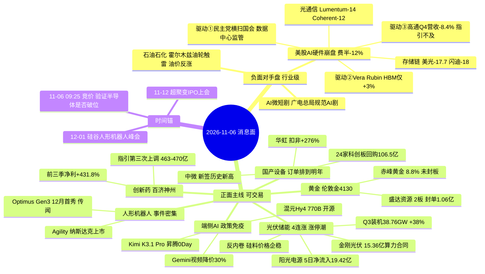

# 2026-11-06 · **消息面事件驱动**

> **数据源新鲜度**: partial · **降级状态**: false · **置信度**: 0.68
> **覆盖窗口**: 2026-11-05 06:00 → 2026-11-06 06:00（manifest lookback_hours=24）· **主源**: 财联社快讯 + 取阅 RSS 17 源（90 篇）+ 盘前公告窗口（1793 条）+ 东财三季报预告（500 条）
> **情绪坐标**: 11-05 涨停 84 / 跌停 0 / 炸板 48 / 炸板率 **36.36%** / 最高板 4 板 / 上涨 4869 家 → **情绪=震荡**（炸板率 ≥35%，按纪律候选数砍半）

## 一句话结论

海外算力链隔夜崩盘（费半 -12%）压制存储与光模块，资金主线切向光伏储能（4 连涨 + 电力设备 5 日净流入 130.72 亿）+ 黄金 + 百济硬业绩，端侧 AI 是唯一逆美股的政策免疫方向。

---

## 0. 今天必须先想清楚的三件事

**① 市场在为什么付钱？**
11-05 的钱付给了三个东西：光伏储能（电力设备 5 日主力净流入 **130.72 亿**，全市场第一）、电子（单日 **142 亿**）、医药生物（单日 **68 亿**）。付钱的共同点是"不受美国数据中心政策约束"的资产。而 11-05 夜盘美股把"受约束"的资产一次性重定价：费城半导体指数 **-12.00%（2020 年 3 月以来最大单日跌幅）**，英伟达 -8.76% 市值蒸发 4470 亿美元，美光 -17.70%，闪迪跌超 18%，台积电 -10.99%，纳指 100 -6.24%，VIX 24.44 单日 +47.14%。

**② 现在处在哪一段？**
反弹第 3 天（11-03 见底 → 11-04 反弹首日 → 11-05 放量大涨 2.14 万亿）。但**炸板率 36.36%**、最高板仅 4 板（浙文影业/闽发铝业）、涨停 84 家炸板 48 家。这是"情绪修复但封板质量差"的**震荡段**，不是主升段。第 4 天开始，板块内部会从"齐涨"切到"只给龙头与低位溢价"。

**③ 谁有地位？**
光伏：永臻股份 3 板 / 贝特利 2 板 / 中利集团 2 板（涨停梯队完整）；黄金：盛达资源 2 板（封单 1.06 亿）而龙头赤峰黄金 8.80% **未封板、盘中开板 21 次**；半导体：瑞芯微 2 板但**开板 11 次**、征和工业 2 板**开板 8 次**。封板质量说明：真正的地位在光伏，黄金与机器人是事件情绪，半导体是被海外砸出来的"逆势英雄"。

**④ 今天做什么、不做什么？**
做：光伏储能低位补涨（金刚光伏）+ 储能龙头（阳光电源）+ 百济硬业绩 + 国产设备右侧（中微/华虹，需竞价确认）。
不做：存储、光模块、CPO 的任何反弹（E001 行业级利空）；不做 2 板反复开板的机器人/端侧追高（降级观察）；不做黄金追高（盈亏比 1.60 < 2，降级）。

---

## 🗺️ 消息面全景图

---

## 🎯 顶级事件详解

### E20261106_001 · 美股 AI 硬件史诗级抛售 · strength=high · polarity=负面 · weighted=-0.900

**事件摘要**: 费城半导体指数单日 **-12.00%**，创 2020 年 3 月以来最大跌幅。存储链全线崩塌：美光 -17.70%、闪迪跌超 18%、西部数据 -13.48%、希捷 -13.43%、铠侠 ADR -15.20%、SK 海力士 -10.80%；芯片：AMD -17.16%、英特尔 -9.76%、高通 -9.75%、台积电 -10.99%、阿斯麦 -9.06%；光通信：Lumentum 跌超 14%、Coherent 跌超 12%、迈威尔 -11%。纳指 100 -6.24%，VIX 24.44（+47.14%），英伟达单日市值蒸发 4470 亿美元。四条独立源：上证（11-05 23:51）、证券时报（11-05 18:34）、news_cls 10jqka（11-06 05:01）、news_cls sina（11-06 00:10）。

**推理深度三问**:

- **大资金意图**: 不是"看空 AI"，是**从受美国政策约束的算力链换仓到不受约束的资产**。铁证是同一晚必需消费品、公用事业、医疗保健三个防御板块全部上涨 ≥1%，标普能源指数 +1.2% —— 这是仓位轮动，不是风险偏好崩塌。摩根大通衍生品团队也认为"更像仓位调整而非基本面轮动"。所以今天 A 股跟的不是"AI 死了"，而是"钱要换个地方待着"。
- **为什么走强**: （本条为下跌事件，问的是"为什么跌得这么猛"）三重预期在同一晚被打破，缺一不可。①**监管**：民主党横扫两院，德州新州长 Gina Hinojosa 竞选期间多次呼吁"立即暂停数据中心开发"，被市场视为数据中心开发商最坏情形；舒默把"确保数据中心不会推高能源账单"写进优先事项。②**用量**：英伟达 Vera Rubin 平台单 GPU HBM 容量**仅增约 3%**，靠 NVFP4、KV Cache 分层、多 GPU 分布式拿到 30 倍推理吞吐 —— 这直接把"存储容量军备竞赛"的核心假设打掉，是美光 -17.70% 的直接原因。③**业绩**：高通 Q4 营收 103.22 亿美元同比 -8.4%，下季调整后 EPS 指引中值 2.25 美元低于预期，Arm 指引同样不及。
- **逻辑够不够硬**: **硬，但"映射到 A 股必然下跌"这条推论不硬**。硬的部分：三个独立事实 + 一个公式级证据（HBM +3%）。不硬的部分：11-05 A 股电子单日主力净流入 **142 亿**、半导体 24 只涨停（有研新材 2 板、先导基电 2 板），说明 A 股半导体走的是**国产替代 + 订单能见度**，与海外需求景气度已经部分脱钩。所以正确处理不是"清仓半导体"，而是**分环节**：海外映射环节（存储/光模块/CPO）直接回避，国产替代环节（设备/代工）只在竞价不破位时做右侧。

**首推/禁买标的思维链**:

#### 中际旭创 300308 · role=禁买·光模块高位
- **买入理由**: 无。光模块全球龙一的基本面没有变坏（800G/1.6T 出货占比行业第一），但今日买它等于逆着 -12% 的费半做多，属于"模式外的钱"（纪律第 4 条）。
- **风险点**: 收盘 493.33 已跌破 MA5 627.76 与 MA20 722.27，5 日主力净流出 **31.10 亿**（全市场个股级最大流出之一），20 日跌 36.4%。光模块/CPO 概念 5 日主力净流出 **175.61 亿**，是全市场概念流出第一。任何反弹都是出货窗口。
- **止损条件**: 若持仓，参考价 493.33 跌破 **455**（20 日新低区）即止损离场，不留仓过夜。
- **可验证假设**: 11-06 竞价若低开幅度 < -3% 且 9:35 前不能收复 500，则全天不参与；若高开翻红，也只做减仓不做加仓。

#### 江波龙 301308 · role=禁买·存储周期见顶（v1.5 业绩极性协议适用）
- **买入理由**: 无。这是江波龙案的**第二次验证**：东财预告前三季净利同比 **+1864.55%~1990.84%**，但协议要求拆单季环比 —— Q3 单季利润环比 Q2 是 **-36%~-49%**，净利率从 47.4% 回落；同期原厂（三星/SK）毛利率 80%+，模组环节被成本挤压，属典型"增收不增利 + 周期见顶"。**同比数字越炸裂，越接近股价顶部区域**。
- **风险点**: 收盘 225.77 与 MA5 225.75 几乎重合（无趋势），MA20 238.44 在上方压制，5 日主力净流出 0.51 亿。今晚美光 -17.70% 会把它按在跌停附近开盘。
- **止损条件**: 若持仓，参考价 225.77 跌破 **200**（20 日低点区）即止损，不接反弹、不做 T。
- **可验证假设**: 若 11-06 开盘 30 分钟内跌幅 > -5% 且未回到 218 上方，确认"周期见顶 + 海外崩盘"双击成立；若逆势翻红，则说明国产存储有独立逻辑（需次日再确认，当日仍不追）。

---

### E20261106_002 · 民主党横扫两院 · strength=high · polarity=正面 · weighted=+0.800

**事件摘要**: 民主党掌控参众两院。参议院少数党领袖舒默明示明年立法议程：**结束伊朗战争、叫停关税、确保数据中心不会推高能源账单**。市场同步定价：美债各期限收益率最多下跌 12bp 至 9 月初以来最低，伦敦金突破 4130 美元/盎司、COMEX 黄金破 4140，伦敦银站上 53 美元。反面：油价并未单边走弱，布伦特收涨至 98 美元上方、WTI 90.52 美元（+2.72%），因霍尔木兹两艘油轮触雷、伊朗击落第六架美军 MQ-170 无人机。

**推理深度三问**:

- **大资金意图**: 把"中期选举"拆成三条独立定价链：**新能源（需求端政策转松）→ 黄金（财政纪律修复 + 美元走弱）→ 算力（用电成本约束 = 监管折价）**。前两条是买入理由，第三条是卖出理由 —— 这也是为什么今晚"新能源涨、半导体崩"能同时发生。同一个事件在不同板块给出相反方向，这是本次叉乘最有价值的地方。
- **为什么走强**: 光伏 4 连涨的直接催化就是"美国新能源政策预期转向"。财联社《九点特供》引用招商证券：此前市场预期 2027 年美国储能增速同比持平略增、光伏基本持平，若政策预期转向，美国新能源市场发展有望迎来转机。国内侧同步给数据：Q3 新增光伏装机 38.76GW 同比 +38%。
- **逻辑够不够硬**: **中**。硬在方向（民主党议程确实是新能源友好 + 关税下调），软在两处：①这是**议程表态不是立法**，从表态到落地有 6-12 个月时滞；②"结束伊朗战争"的交易已经部分反转 —— 油轮触雷、击落无人机，油价收涨 2.72%。所以这个事件只能支撑"光伏储能修复"，不能支撑"油价下行链（航空/化工）"。

**首推标的思维链**:

#### 阳光电源 300274 · role=首推·光伏储能龙头
- **买入理由**: 储能系统全球出货第一 + 光伏逆变器全球第一，是"美国储能政策转向"这条叙事在 A 股最纯正的载体。三个独立验证：①研报侧中邮证券 11-05《三季度业绩承压，有望随储能后续交付修复》给买入，东吴 11-02、国金 11-01 同为买入，一致预期 2026 年 EPS 4.78-5.05；②资金侧 5 日主力净流入 **19.42 亿**，储能概念 5 日净流入 58.72 亿；③业绩侧组件龙头 Q3 净利环比减亏 83%、储能业务经营性扭亏（财联社 VIP 日报）。
- **风险点**: 收盘 85.14 虽站在 MA5 76.55 与 MA20 83.44 之上，但距 60 日高 122.21 仍 **-30.3%**，是深坑反弹不是新高突破。5 日已涨 26.7%，11-05 盘中最高 91.3 回落收 85.14，上影线明显 —— 追高买在 85 以上属于接盘中位。
- **止损条件**: 参考价 85.14 跌破 **78.5**（-7.8%，失守 MA20 83.44 后的确认位）即止损。
- **可验证假设**: 目标区间 97-103（对应 60 日高的 -20% 回补位）。若 11-06 早盘 30 分钟成交额超过 11-05 同期且价格站上 87，则"储能主线延续"假设成立；若低开跌破 83.44 且不能收回，降级为观察。

---

### E20261106_003 · 光伏电力设备四连涨 · strength=high · polarity=正面 · weighted=+0.671

**事件摘要**: 电力设备板块盘中涨幅一度超 5%，逾 20 股涨停或涨超 10%。涨停梯队：永臻股份 3 板、贝特利 2 板、中利集团 2 板，协鑫集成、钧达股份、双良节能、弘元绿能、赛伍技术、时创能源、欧晶科技、金刚光伏、酉立智能（北交所 30%）批量涨停。驱动：①国家能源局 Q3 新增光伏装机 38.76GW 同比 +38%；②反内卷深化，硅料价格坚挺支撑硅片电池片报价阶段性企稳，组件龙头 Q3 净利环比减亏 83%；③四川印发新型储能三年行动方案（2026-2028），北京印发十五五新型能源体系规划；④电网侧截至 9 月底固定资产投资超 6000 亿元，完成全年预计投资的三分之二。

**推理深度三问**:

- **大资金意图**: 电力设备 5 日主力净流入 **130.72 亿**、电池 75.13 亿，是全市场唯二过百亿的方向。但注意结构：涨停 84 家里光伏占 12 家以上，而炸板 48 家也主要集中在中位补涨票 —— 资金在给龙头和低位票溢价，明确不给中位票。这就是"4 连涨第 4 天"的真实状态：**指数级主升但个股级分化**。
- **为什么走强**: 三条基本面同时改善才撑得起 4 连涨：价格（硅料坚挺、硅片电池片企稳）、盈利（Q3 环比减亏 83%、储能经营性扭亏）、需求（装机 +38%、电网投资 6000 亿）。加上美国政策转向的海外增量预期，是"周期底部 + 政策 + 海外"三击。这不是纯情绪炒作，是低位周期股的第一波估值修复。
- **逻辑够不够硬**: **硬（数据），但位置不便宜（第 4 日）**。硬的地方是每一项都有可核验数字；不硬的地方是第 4 日追中位票的盈亏比已经劣化 —— 炸板率 36.36% 就是证据。所以今天的正确动作是"只买低位未涨透的，不追 2 板以上中位"。

**首推标的思维链**:

#### 阳光电源 300274 · role=首推（E003 视角·板块资金龙头）
- **买入理由**: 从板块资金角度复核一次：电力设备 5 日 +130.72 亿、储能概念 +58.72 亿，而阳光电源个股 5 日 +19.42 亿，占板块净流入约 15%，是资金最集中的单一标的。板块要延续，龙头必须先站稳。
- **风险点**: 同上 —— 距 60 日高 -30.3%，5 日涨 26.7%，11-05 上影线 6.16 元（最高 91.3 / 收 85.14），说明 91 附近有明确抛压。板块第 4 日若出现"涨停家数减半 + 炸板率升破 40%"，龙头会被动跟随回落。
- **止损条件**: 参考价 85.14 跌破 **78.5** 即止损（与 E002 同一止损位，两事件共用一套风控）。
- **可验证假设**: 11-06 若光伏设备涨停家数 ≥8 家且永臻股份（3 板）能维持红盘，板块延续假设成立；若涨停家数 <5 家且永臻炸板，则当日只减不加。

#### 金刚光伏 300093 · role=首推·低位弹性
- **买入理由**: 三重身份叠加：①HJT 光伏 + 绿色算力双主业，上半年算力收入占比已提升至 31%；②11-05 晚公告控股子公司酒泉金刚与"客户 A"签《算力云服务合同》，含税总价不超过 **15.36 亿元**，服务期 60 个月，公司 2025 年营收仅 3.01 亿元（合同最高总价约为当年营收 5 倍）；③位置低 —— 收盘 18.66 距 60 日高 27.28 仍 **-31.6%**，20 日跌 4.4%，是板块内少数"没涨透"的票。在炸板率 36.36% 的震荡段，买低位是唯一盈亏比说得通的动作。
- **风险点**: 5 日主力净额 0.00 亿（无资金抢筹，纯消息驱动）；成交额仅 4.6 亿、流通市值 52 亿，是典型小票弹性，回撤同样快；11-05 是 1 板且盘中开板 3 次、换手 9.3%，封板质量一般；合同"不构成业绩承诺"，且客户 A 匿名，存在履约不确定性。
- **止损条件**: 参考价 18.66 跌破 **17.0**（-8.9%，破 5 日线 18.62 且失守 11-04 低点）即止损。
- **可验证假设**: 目标区间 21.5-22.5（对应 10-12 日高点 22.08 附近）。若 11-06 竞价高开 3%-7% 且 9:35 前量能超过 11-05 全天 50%，则"算力合同被资金认可"成立；若竞价高开 >8% 后回落破 18.66，说明是借利好出货，当日不碰。

---

### E20261106_004 · 贵金属突破 · strength=high · polarity=正面 · weighted=+0.534

**事件摘要**: 伦敦金现最高突破 4130 美元/盎司，COMEX 黄金破 4140，伦敦银站上 53 美元、白银期货最高 53.4 美元。A 股贵金属：赤峰黄金、盛达资源 2 连板，深中华 A 一字涨停 2 连板，四川黄金、湖南黄金、山金国际、西部黄金跟涨，板块内 14 只涨停。宝城期货归因：中期选举 → 美债收益率回落 + 美元走弱 → 金价支撑；中信期货提示反弹仍需地缘缓和与利率端配合。**当晚 05:39 高盛将 2026 年底金价预测下调至 4150 美元、2027 年底下调至 4800 美元。**

**推理深度三问**:

- **大资金意图**: 买的是"美元走弱 + 美债收益率回落"的**阶段性修复**，不是新趋势。证据链很干净：金价现价 4130 已经贴近高盛下调后的 2026 年底目标 4150 —— **卖方已经不给上方空间了**。所以这波钱的意图是"抢反弹 + 抢事件"，目标位一到就走。
- **为什么走强**: 结构很有意思：龙头赤峰黄金涨 8.80% **未封板、盘中开板 21 次**，而盛达资源 2 板封单 1.06 亿元、深中华 A 一字板。这说明资金选择"用小票锁情绪、用龙头做流动性出口"——典型的反弹中继结构，不是主升结构。
- **逻辑够不够硬**: **中偏弱**。硬的部分是事件真实（中期选举 + 美元弱）；弱的部分是①高盛下调目标价封住上方空间；②油价反而上涨（油轮触雷），削弱"通胀预期下行 → 降息 → 金价"的传导；③龙头未封板。结论：参与可以，但只能低吸不能追，且盈亏比不达标就降级。

**标的思维链**:

#### 赤峰黄金 600988 · role=降级观察·黄金板块龙头
- **买入理由**: 黄金板块龙头（东财行业 lead_stock），60 日高回撤 **-27.7%** 属低位修复；华安证券 11-04《金价高位对冲产销波动，紫金入主有望赋能》给买入、2026 年 EPS 1.56，太平洋 10-28 同样买入；5 日主力净流入 1.93 亿。
- **风险点**: **盈亏比不达标**：现价 37.58，止损 34.2（-9.0%），目标 42-44（+11.8%~+17.1%），RR 约 **1.60 < 2**，按纪律必须降级 watch。另外 11-05 盘中开板 21 次、收 8.80% 未封板，说明上方抛压极重；高盛下调金价目标构成基本面压制。
- **止损条件**: 参考价 37.58 跌破 **34.2**（-9.0%，失守 11-04 收盘 34.54）即止损；降级期间不建仓，仅做跟踪。
- **可验证假设**: 若 11-06 盛达资源（2 板）能 3 连板且赤峰站上 38.5，则"黄金情绪升级"成立，届时把止损上移至 36.5 再评估；若盛达炸板、赤峰跌破 36.48（MA5），确认反弹结束。

---

### E20261106_005 · 百济神州硬业绩 · strength=high · polarity=正面 · weighted=+0.568

**事件摘要**: 百济神州（688235）前三季营业总收入 349.93 亿元同比 +26.8%，归母净利 **60.55 亿元同比 +431.8%**；Q3 单季营收 127.74 亿同比 +26.8%、归母净利 27.84 亿同比 +304.3%；百悦泽 Q3 全球销售 94.24 亿元同比 +27.0%。同时**今年第三次上调**全年营收指引，由 449-462 亿上调至 **463-470 亿**，高于 Wind 一致预期 462.2 亿。同日创新药板块金陵药业、康弘药业涨停，医药生物单日主力净流入 68 亿。

**推理深度三问**:

- **大资金意图**: 在海外算力叙事被打断的当天，机构需要一只"业绩可验证、逻辑不依赖美国政策"的成长股做**避风港 + 进攻位**。百济是 A 股创新药里唯一"全球销售收入 + 已盈利 + 连续上调指引"的标的，正好补上这个位置。医药生物单日 68 亿净流入说明资金已经开始填这个坑。
- **为什么走强**: 三层递进。①单季利润同比 +304.3%，不是靠一次性收益（增长来自百悦泽/百泽安/安进授权产品销售）；②指引第三次上调且超出卖方一致预期，说明**公司自己的能见度高于市场**；③催化剂排期明确（Q4 日本递交百悦泽 MCL 一线上市申请、2027 上半年 NMPA 两款新适应症决定）。
- **逻辑够不够硬**: **硬（公告级）**。这是今天八条事件里唯一"数字全部可回溯到公司公告"的一条。唯一软点是资金：5 日主力净流入仅 **0.34 亿**，说明机构还没开始抢 —— 这既是机会（未被抢筹）也是风险（可能没人接）。

**首推标的思维链**:

#### 百济神州 688235 · role=首推·创新药硬业绩
- **买入理由**: 业绩与指引双超预期，是"事件驱动 + 业绩驱动"的罕见叠加。收盘 274.05 站上 MA5 272.43，MA20 276.15 就在头顶（一步之遥），20 日涨 9.9%，距 60 日高 314.85 仅 **-13.0%** —— 是少数"业绩新高 + 位置不高"的组合。
- **风险点**: 5 日主力净流入仅 0.34 亿，缺乏资金确认；成交额 13.9 亿、流通市值 315 亿，机构票属性强、弹性弱；创新药板块整体 5 日仅净流入 2.38 亿，板块效应尚未形成，单票独走容易被指数拖累；vibe-trading 研报库对该票**无覆盖**，缺第三方一致预期交叉。
- **止损条件**: 参考价 274.05 跌破 **258**（-5.9%，失守 MA20 276.15 且破 10-30 收盘 249.24 上方平台）即止损。
- **可验证假设**: 目标区间 305-318（前高 314.85 突破位）。若 11-06 站上 MA20 276.15 且成交额放大至 20 亿以上，则"机构开始建仓"成立；若跌破 272.43（MA5）且创新药板块翻绿，降级观察。

---

### E20261106_006 · 国产半导体设备订单能见度 · strength=medium · polarity=正面 · weighted=+0.473

**事件摘要**: 中微公司 2026 年新签订单量体量和增速均达历史新高、全年在手订单充裕；盛美上海截至 9-29 在手订单 170.73 亿元同比 +88.2%、前三季新签订单同比 +147%；东威科技在手合同约 45 亿元、设备订单已排到明年；北方华创订单规模持续扩大。10 月以来 24 家科创板半导体公司披露回购，金额上限合计 **106.5 亿元**（长鑫科技董事长提议回购上限提高至不超过 50 亿）。同日华虹宏力三季报：前三季归母净利 16.03 亿同比 +138.23%，Q3 扣非净利同比 **+276.11%**，Q4 收入指引 10.8-10.9 亿美元、毛利率 25%-26%。

**推理深度三问**:

- **大资金意图**: 抢的是"**订单能见度**"而不是"景气度"。中微 5 日主力净流入 **30.82 亿**（设备股第一）、北方华创 18.15 亿，说明钱在往"明年订单已排满"的环节集中。同时 106.5 亿回购是产业资本自己给的底 —— 这是今天所有正面主线里唯一有"公司自己买自己"背书的。
- **为什么走强**: 与 E001 形成正面对撞。多头逻辑：SEMI 预计 2026 年全球 300mm 前道设备支出 1490 亿美元同比 +31%，国产替代率仍在爬坡，订单排到明年。空头逻辑：费半 -12%、阿斯麦 -9.06%、泛林/应用材料跌超 10%，说明"全球设备需求预期"被数据中心监管打断。两条逻辑今天必须打一架。
- **逻辑够不够硬**: **基本面硬，交易层面不硬**。订单与回购是硬的（可核验），但今天开盘要承接 -12% 的情绪冲击，属于"事件与情绪对撞日"。处理原则：只在**竞价不破位**时做右侧，绝不低吸接刀。

**首推标的思维链**:

#### 中微公司 688012 · role=首推·国产半导体设备
- **买入理由**: 刻蚀设备国产化率最高，2026 新签订单量体量和增速均创历史新高，是"订单能见度"叙事最正的载体。资金侧 5 日主力净流入 30.82 亿居设备股第一；研报侧东吴证券 11-03《前三季度业绩同比高增，平台化布局持续推进》给买入，2026 年 EPS 5.23。位置：收盘 254.00 距 60 日高 399.58 **-36.4%**，20 日跌 18.3%，是深度回调后的第一根反包。
- **风险点**: 11-05 单日 +5.83% 且最高 265、收 254（上影 11 元），说明 265 有抛压；MA5 213.45 远在下方，短期已透支 5 日 11.9% 涨幅；今晚费半 -12%，最坏情形是低开 -6% 直接破 240。成交额 121 亿属高位换手。
- **止损条件**: 参考价 254.00 跌破 **232**（-8.7%）即止损；若竞价低开超过 -5%，当日不建仓、等企稳。
- **可验证假设**: 目标区间 295-305。若 11-06 竞价跌幅 < -3% 且 9:45 前收复 250（即"抗住费半"），则国产替代脱钩假设成立；若直接跌停或跌破 232，则确认"海外映射主导"，全链降级。

#### 华虹宏力 688347 · role=首推·晶圆代工涨价
- **买入理由**: 业绩与指引双上修 —— 前三季归母净利 16.03 亿同比 +138.23%、Q3 扣非 +276.11%、Q4 收入指引 10.8-10.9 亿美元（高于 Q3 的 9.871 亿美元）、毛利率指引 25%-26%（Q3 为 24.6%）。管理层明确"晶圆代工量价齐升的态势将持续"。位置极低：收盘 162.00 距 60 日高 295.00 **-45.1%**，20 日跌 16.2%，是深跌后的业绩拐点票。5 日主力净流入 3.62 亿。
- **风险点**: 代工是周期属性最强的环节，费半崩盘会直接压制估值；vibe-trading 无研报覆盖，缺卖方一致预期；收盘 162 虽站上 MA5 156.33 与 MA20 159.92，但 11-05 最高 168.5 回落 6.5 元，上影明显；流通市值 661 亿，弹性中等。
- **止损条件**: 参考价 162.00 跌破 **148**（-8.6%，失守 11-03 低点 140.98 上沿）即止损。
- **可验证假设**: 目标区间 186-195。若 11-06 守住 159.92（MA20）且半导体板块跌幅 < 3%，则"业绩拐点对抗海外情绪"成立；若跌破 MA20 且量能放大，说明定价权在海外，止损离场。

---

### E20261106_007 · 大模型开源潮 + 端侧 AI 窗口 · strength=medium · polarity=正面 · weighted=+0.580

**事件摘要**: 腾讯混元 Hy4 正式版发布，参数 **770B**（Hy3 系列不到 300B），首次引入视觉理解与 ComputerUse，WorkBuddy 首发接入后推理集群**紧急扩容十倍**；月之暗面 Kimi K3.1 Pro 完整权重公开，昇腾 0Day 支持推理部署（vLLM Ascend/SGLang）；谷歌 Gemini Omni 1.2 Flash 全面开放，720P 视频生成价格**下调 30%** 至每秒 0.07 美元，原生视频时长延至 15 秒；AppLovin Q3 营收 21.8 亿美元超预期、回购规模增至 36 亿美元。**同源负面腿**：广电总局 11-05 明确"扶持真人微短剧、规范 AI 微短剧"；引力传媒公告"AI 短剧业务规模小"提示风险。

**推理深度三问**:

- **大资金意图**: 从"算力投入"切到"应用产出"。华泰证券王伟光 11-05 的原话最准：AI 产业叙事尚未结束，但行情由全面普涨进入"中场休整"，**投资重心从算力投入转向应用**。这是对 E001 的正面回答 —— 钱不是离开 AI，是离开"卖铲子"去"淘金"。
- **为什么走强**: 三条都是"成本下降 → 应用爆发"的同一逻辑：Hy4 开源（模型成本降）、Kimi 开放权重 + 昇腾 0Day（国产算力可得性升）、Gemini 视频降价 30%（多模态成本降）。端侧还叠加一个反直觉利好：存储价格若进入下降通道，端侧 AI 的 BOM 成本下降 —— 股痴流沙河 11-06 00:00 明确说"端侧 AI 由于存储芯片涨价成本提升基本缺席了上半年 AI 行情，后面存储价格将进入下降通道，端侧 AI 将迎来戴维斯双击"。
- **逻辑够不够硬**: **中**。叙事硬（成本曲线明确向下），A 股标的硬不硬要分开看：端侧芯片（瑞芯微 Q3 预增 68.04%-73.17%）有业绩；大模型概念（世纪恒通/奥雅股份这类"运用了混元技术"的公告式蹭票）没有业绩。同一事件里必须切两刀：**有业绩的端侧做，纯概念的短剧/大模型蹭票不做**（广电总局已明确规范 AI 微短剧）。

**首推标的思维链**:

#### 瑞芯微 603893 · role=降级观察·端侧AI芯片
- **买入理由**: 端侧 AI SoC 国产龙一，Q3 业绩预增 **68.04%~73.17%**（东财三季报预告，2026-10-28）；东吴证券 10-28《Q3 业绩保持高增，端侧 AI 新品放量在即》与华金证券 10-28 双给买入；5 日主力净流入 11.47 亿。
- **风险点**: **封板质量差到不能追**：11-05 2 连板但盘中开板 **11 次**、成交额 45.7 亿、换手 5.1%，说明抛压极大；现价 217.81 距 60 日高 228.74 仅 **-4.8%**（几乎新高，无安全垫）；盈亏比 (250-217.81)/(217.81-200)=**1.81 < 2**，按纪律降级 watch。
- **止损条件**: 参考价 217.81 跌破 **200**（-8.2%）即止损；降级期间不追板，只在回踩 205 附近且缩量时评估。
- **可验证假设**: 若 11-06 端侧方向出现"瑞芯微+乐鑫+恒玄"三票联动且瑞芯微不开板，则端侧主线成立，届时按低吸 205 重算 RR 再决定；若瑞芯微炸板或高开低走，全组观察。

---

### E20261106_008 · 人形机器人催化密集 · strength=medium · polarity=正面 · weighted=+0.600

**事件摘要**: ①媒体曝 12 月 1-2 日 2026 硅谷人形机器人峰会，Optimus Gen3 或首秀（**单一媒体源，标注为传闻**）；②Agility Robotics 11-05 登陆纳斯达克（代码 AGLT），为美国首只人形机器人股，获富士康与英伟达投资；③丰田宣布设立机器人部门，定位"未来业务的关键支柱"；④工信部就《机器人产品标识码管理暂行办法（征求意见稿）》征求意见；⑤新华社与优必选联合发布全球首个仿生人形机器人新闻主播；⑥光轮智能与宇树科技达成战略合作；⑦王兴兴：明年是行业临界点，具身智能很快迎来"ChatGPT 时刻"。

**推理深度三问**:

- **大资金意图**: 事件驱动资金的"抢跑"行为，不是增量资金建仓。铁证：机器人板块 5 日主力净流出 **0.12 亿**（东财），11-05 板块仅涨 1.99%，涨停 13 只但征和工业 2 板开板 8 次、封单仅 330 万元。钱在"消息出来前买、消息出来卖"。
- **为什么走强**: 催化密度是全市场最高的 —— 一晚 7 条独立消息，且横跨美股（Agility 上市）、日股（丰田）、A 股（工信部/优必选/宇树）。但密度高不等于质量高：最关键的 Optimus Gen3 首秀只有一家媒体转述，属传闻级。
- **逻辑够不够硬**: **中偏弱**。产业方向确定（这个不用怀疑），但今天的交易价值有限：资金 5 日净流出 + 涨停票封板质量差 + 核心催化是传闻。正确姿势是"只跟踪不追板"，等 12 月峰会落地或出现带量反包再介入。

**标的思维链**:

#### 征和工业 003033 · role=降级观察·灵巧手弹性
- **买入理由**: 全球首创链式灵巧手 CHOHO Hand（17 个自由度、指尖精度 ±0.1mm、单手承重 40kg、寿命超 100 万次、传动效率 95%-98%），微型链系统已小批量交付并配套智元机器人等行业客户。11-05 2 连板，5 日主力净流入 0.88 亿。
- **风险点**: 封板质量最差 —— 2 板但盘中开板 **8 次**、封单仅 **330 万元**、成交额 4.8 亿、流通市值 69 亿；盈亏比 (94.5-85.09)/(85.09-77.5)=**1.24 < 2**，纪律上直接否决；板块 5 日资金净流出，无板块效应支撑；距 60 日高 97.88 仅 -13.1%，上方 97.88 是密集套牢区。
- **止损条件**: 参考价 85.09 跌破 **77.5**（-8.9%）即止损；降级期间不建仓。
- **可验证假设**: 若 11-06 机器人板块出现 ≥5 家涨停且征和能 3 连板不开板，说明资金真回来了，届时重评；若封单继续萎缩到 1000 万以下或炸板，确认是最后一棒。

---

## 📊 板块 × 事件热力矩阵

叉乘口径：`contrib = abs(weighted_score) × sign(板块极性) × {high:1.0, medium:0.7, low:0.4}`，同板块多事件累加。判定：>+0.12 正面 / <−0.12 负面 / 其余分歧。

| 板块 | 命中事件 | 净分 | 判定 | 事件数 | 位置与资金口径 |
|------|----------|-----:|:--:|:--:|---|
| 光伏设备 | E002 +0.800 / E003 +0.671 | **+1.471** | 🟢 正面 | 2 | 4 连涨第 4 日，电力设备 5 日净流入 130.72 亿，只做龙头与低位 |
| 黄金 | E002 +0.800 / E004 +0.534 | **+1.334** | 🟢 正面 | 2 | 距 60 日高 -27.7%，龙头未封板开板 21 次，情绪不纯 |
| 储能 | E002 +0.560 / E003 +0.671 | **+1.231** | 🟢 正面 | 2 | 5 日净流入 58.72 亿，位置低于光伏主材 |
| 创新药 | E005 +0.568 | +0.568 | 🟢 正面 | 1 | 刚启动，5 日仅净流入 2.38 亿，靠百济单票硬业绩 |
| 电网设备 | E003 +0.470 | +0.470 | 🟢 正面 | 1 | 6000 亿电网投资，顺钠股份一字板为情绪指标 |
| 人形机器人 | E008 +0.420 | +0.420 | 🟢 正面 | 1 | 催化最密集但 5 日主力净流出 0.12 亿，事件非资金 |
| 端侧AI | E007 +0.406 | +0.406 | 🟢 正面 | 1 | 沙河点名的 A 类趋势方向，但瑞芯微 2 板 11 次开板 |
| AI应用 | E007 +0.406 | +0.406 | 🟢 正面 | 1 | 美股 AI 广告 + 视频降价共振，需防纯概念补涨 |
| 白银 | E004 +0.374 | +0.374 | 🟢 正面 | 1 | 跟涨性质，封板质量弱于黄金 |
| 国产半导体设备 | E006 +0.331 | +0.331 | 🟢 正面 | 1 | 基本面最硬，但与费半 -12% 正面对撞，只做右侧 |
| 晶圆代工 | E006 +0.331 | +0.331 | 🟢 正面 | 1 | 华虹业绩+指引双上修，60 日高回撤 -45.1% |
| 国产算力 | E007 +0.232 | +0.232 | 🟢 正面 | 1 | 美国数据中心受限反利好 token 出海，二阶受益 |
| CXO | E005 +0.227 | +0.227 | 🟢 正面 | 1 | 跟随创新药，二线不单独开仓 |
| 石油石化 | E002 0.000 | 0.000 | 🟡 分歧 | 1 | 油价因油轮触雷反涨 2.72%，战争收尾逻辑未单向兑现 |
| AI微短剧(纯概念) | E007 -0.406 | **-0.406** | 🔴 负面 | 1 | 广电总局扶持真人剧规范 AI 剧，纯概念直接压制 |
| 半导体(海外映射) | E001 -0.630 | **-0.630** | 🔴 负面 | 1 | 海外映射压制，国产替代逻辑可部分脱钩，需分环节 |
| AI算力硬件(海外链) | E001 -0.900 | **-0.900** | 🔴 负面 | 1 | 数据中心监管风险直接打击海外订单能见度 |
| 光模块/CPO | E001 -0.900 | **-0.900** | 🔴 负面 | 1 | 5 日主力净流出 175.61 亿，全市场概念流出第一 |
| 存储芯片 | E001 -0.900 | **-0.900** | 🔴 负面 | 1 | 费半存储链崩塌 + Vera Rubin HBM 仅 +3%，逻辑被证伪 |

**sector_cross_summary（多事件叉乘 · 只有 3 个板块够格）**

| 板块 | 净分 | 事件数 | 叉乘结论 |
|------|-----:|:--:|---|
| 光伏设备 | +1.471 | 2（E002+E003） | **两条正面腿叠加的最强带**：一条来自美国政策转向的海外增量（E002），一条来自国内装机 +38% 与价格企稳（E003）。这是唯一"事件层与基本面层同时确认"的方向，也是今天必须配置的方向。但 4 连涨 + 炸板率 36.36% 决定只能买低位（金刚光伏）与龙头（阳光电源），不碰 2 板以上中位。 |
| 黄金 | +1.334 | 2（E002+E004） | 两条腿都是"美元弱 + 美债收益率落"，属同一驱动因子的重复计数 —— 这是叉乘的正分虚高案例。真实约束是高盛把 2026 年底目标下调到 4150，现价 4130 已贴顶。所以净分高但交易价值低，降级观察。 |
| 储能 | +1.231 | 2（E002+E003） | 储能同时吃"美国储能需求转松"（E002 中强度腿）和"国内装机与反内卷"（E003 高强度腿），且 5 日资金净流入 58.72 亿低于光伏概念 42.94 亿的反差说明资金还没挤进来 —— 是三个正面带里**拥挤度最低**的一个，阳光电源作为储能全球出货第一受益最直接。 |

**被挤出的负面对手盘（单事件，不进 cross_summary 但必须列）**：存储芯片 / 光模块/CPO / AI算力硬件(海外链) 三个 -0.900，全部来自 E001 同一事件。按命名规则它们不能合并成一个"AI硬件"行（否则把三条独立杀伤面糊成一条），但实际含义是：**今天只要沾这三个环节，一律不碰**。

---

## 🔥 三季报业绩预告命中（硬 alpha 交叉验证）

数据源：`data/raw/20261106/eastmoney_earnings_predict.json`（500 条，report_date 2026-09-30，captured 2026-11-06）+ 已披露三季报原文。

| 代码 | 名称 | 预告类型 | 增速下限~上限 | 事件命中 | 逻辑强度 |
|------|------|----------|---------------|----------|:--:|
| 001309 | 德明利 | 扭亏 | 32046.52%~33154.49% | E001 存储（**反向**） | 🔴 周期顶部信号，同比越炸越危险 |
| 300821 | 东岳硅材 | 预增 | 19047.97%~19748.08% | E003 光伏上游有机硅 | 🟢🟢 与反内卷涨价直接共振 |
| 002466 | 天齐锂业 | 预增 | 6957.09%~8219.79% | E002/E003 储能锂电链 | 🟢 周期反转，但非本文首选 |
| 688388 | 嘉元科技 | 预增 | 3065.71%~3329.52% | E003 锂电铜箔 | 🟡 二线，无量能验证 |
| 301308 | 江波龙 | 预增 | 1864.55%~1990.84% | E001 存储（**反向**） | 🔴 Q3 单季环比 -36%~-49%，周期见顶 |
| 688825 | 长鑫科技 | 扭亏 | 2581.06%~2609.47% | E006 存储原厂 | 🟡 原厂吃涨价，但今日被海外情绪压制 |
| 002812 | 恩捷股份 | 扭亏 | 1960.96%~2553.62% | E003 隔膜 | 🟡 二线 |
| 000703 | 恒逸石化 | 预增 | 9836.98%~10090.8% | 无（化纤） | ⚪ 未入主线 |
| **603893** | **瑞芯微** | **预增** | **68.04%~73.17%** | **E007 端侧AI（首推）** | 🟢🟢🟢 有业绩的端侧唯一龙头 |
| 688347 | 华虹宏力 | 三季报已披露 | Q3 扣非 **+276.11%** | E006 晶圆代工（首推） | 🟢🟢🟢 量价齐升 + Q4 指引上修 |
| 688235 | 百济神州 | 三季报已披露 | 前三季 **+431.8%** | E005 创新药（首推） | 🟢🟢🟢 真业绩 + 指引三度上调 |
| 300274 | 阳光电源 | 无预告 | — | E002/E003 光伏储能（首推） | 🟢🟢 券商一致预期 2026 EPS 4.78-5.05 |
| 300093 | 金刚光伏 | 无预告 | — | E003 光伏弹性（首推） | 🟡 靠 15.36 亿合同预期，无当期业绩 |

**关键判读**：存储三票（德明利/江波龙/长鑫）的预告数字是全场最炸裂的，却是今天最不能买的 —— 这正是 v1.5 协议存在的意义。反过来，瑞芯微 68%~73% 的增速在榜单里排不进前 20，但它是唯一"增速温和 + 位置不高 + 有机构覆盖"的组合。

---

## 🌱 首板候选池（first_board_candidates · 16 条）

只对正面事件的正面环节产出；排序键 `quality → source_count → hit_count`，**不因可交易性重排**；停牌/风险只做 `risk_flags` 标记。

| 代码 | 名称 | 行业 | 质量 | 源数 | 命中 | 收盘 | 5日主力(亿) | risk_flags |
|------|------|------|:--:|:--:|:--:|-----:|-----:|---|
| 300093 | 金刚光伏 | 光伏设备 | high | 6 | 11 | 18.66 | 0.00 | 无（已在 E003 首推） |
| 600641 | 先导基电 | 半导体 | high | 4 | 7 | — | — | 2 板高位 + E001 海外压制 |
| 600206 | 有研新材 | 半导体 | high | 4 | 6 | — | — | 2 板高位 + E001 海外压制 |
| 601599 | 浙文影业 | 纺织制造 | high | 4 | 6 | — | — | **4 板高位 + AI剧监管** |
| 002150 | 正泰电源 | 光伏设备 | high | 4 | 4 | — | — | 无 |
| 002773 | 康弘药业 | 生物制品 | high | 4 | 4 | 22.28 | 1.48 | 首板 + E005 共振 |
| 600396 | 华电辽能 | 电力 | high | 4 | 4 | — | — | 无 |
| 688429 | 时创能源 | 光伏设备 | high | 3 | 5 | 10.69 | 0.08 | 成交额 0.3 亿，流动性差 |
| 000603 | 盛达资源 | 贵金属 | high | 3 | 5 | 26.05 | 1.15 | 2 板高位 |
| 603212 | 赛伍技术 | 光伏设备 | high | 3 | 3 | — | — | 无 |
| 002131 | 利欧股份 | 通用设备 | high | 3 | 3 | — | — | 5 日涨幅偏大 |
| 688109 | 品茗科技 | 软件开发 | medium | 2 | 4 | — | — | 无 |
| 002343 | 慈文传媒 | 影视院线 | medium | 2 | 3 | — | — | AI剧监管 |
| 300071 | 福石控股 | 广告营销 | medium | 2 | 3 | — | — | 无 |
| 688648 | 中邮科技 | 专用设备 | medium | 2 | 3 | — | — | 无 |
| 300274 | 阳光电源 | 光伏概念 lead_stock | medium | 1 | 1 | 85.14 | 19.42 | lead_stock_proxy 单一来源 |

> 说明：FBC 只回答"消息侧有刺激"，**不含位置/竞价判断**（留给 D1）。带「板高位」标记的票一律不建议直接介入。

---

## 🚫 今日禁止清单（命中即不碰）

1. **存储芯片全环节**（江波龙/德明利/佰维/兆易）：E001 行业级 + Vera Rubin HBM 仅 +3% 证伪容量逻辑 + 三季报同比高点 = 股价顶部区。
2. **光模块 / CPO 全环节**（中际旭创/新易盛/天孚）：5 日主力净流出 175.61 亿，全市场概念流出第一；旭创单日 -7.51% 已破 MA5/MA20。
3. **AI 微短剧纯概念**（浙文影业 4 板/引力传媒 3 板）：广电总局明确"扶持真人剧、规范 AI 剧"，且引力传媒自己公告"AI 短剧业务规模小"。
4. **2 板以上且反复开板的机器人/端侧票**（征和工业 8 次开板、瑞芯微 11 次开板）：封板质量不支持隔日溢价。
5. **蹭"混元/AI"却无业绩的公告式标的**（世纪恒通/奥雅股份类）：E007 只能做有业绩的端侧。

---

## 关键证据

- 证据 1：费城半导体指数 2026-11-05 单日 **-12.00%**、报 9036.31 点，创 2020 年 3 月以来最大跌幅；英伟达 -8.76%、美光 -17.70%、台积电 -10.99%、阿斯麦 -9.06% · 来源 news_cls:10jqka（2026-11-06 05:01）
- 证据 2：英伟达 Vera Rubin NVL72 单 GPU HBM 容量**仅增加约 3%**，单位成本推理吞吐量最高提升 30 倍 · 来源 news_cls:sina（2026-11-06 00:06）
- 证据 3：纳指 100 -6.24%、安硕半导体 ETF 跌逾 12%，德州新州长 Gina Hinojosa 竞选期间多次呼吁立即暂停数据中心开发 · 来源 news_cls:sina（2026-11-06 00:10）
- 证据 4：11-05 涨停 84 家 / 炸板 48 家 / 炸板率 **36.36%** / 最高板 4 板 / 上涨 4869 家 · 来源 data/research/20261106/_work/_core.json `breadth_today`
- 证据 5：电力设备 5 日主力净流入 **130.72 亿**、电池 75.13 亿、储能概念 58.72 亿、光伏概念 42.94 亿、光模块/CPO 5 日 **-175.61 亿** · 来源 同上 `sector_flows` / `concept_flows`
- 证据 6：百济神州前三季归母净利 60.55 亿元同比 +431.8%，全年营收指引上调至 463-470 亿（Wind 一致预期 462.2 亿）· 来源 证券时报（2026-11-05 21:16）
- 证据 7：华虹宏力 Q3 扣非净利同比 +276.11%，Q4 收入指引 10.8-10.9 亿美元、毛利率 25%-26% · 来源 证券时报（2026-11-05 18:53）
- 证据 8：国家能源局 Q3 中国新增光伏装机约 38.76GW 同比 +38% · 来源 证券时报（2026-11-05 10:25 转载）
- 证据 9：金刚光伏子公司酒泉金刚签算力云服务合同含税总价不超 **15.36 亿元**，公司 2025 年营收 3.01 亿元 · 来源 上证（2026-11-05 22:32）+ anns_window
- 证据 10：东财三季报预告 500 条中，江波龙 +1864.55%~1990.84%、德明利扭亏 +32046.52%~33154.49%、瑞芯微 +68.04%~73.17% · 来源 data/raw/20261106/eastmoney_earnings_predict.json

---

## 数据源审计

| 源 | 日期 | 状态 | 记录数 | 备注 |
|---|---|:--:|---|---|
| news_cls（财联社+新浪快讯） | 2026-11-06 | 🟢 | 2975 | 覆盖 11-03 09:54 ~ 11-06 05:58，主新闻源 |
| news_major（Tushare 长篇要闻） | 2026-11-06 | 🟢 | 400 | 以行业/地方新闻为主，未贡献 top 事件 |
| eastmoney/earnings_predict | 2026-11-06 | 🟢 | 500 | 三季报预告全量，RS 用于业绩极性协议 |
| wechat_official_rss（取阅 17 源） | 2026-11-06 | 🟢 | 90 | 15 源有产出，李迅雷/证金事为空 |
| wechat_cli_5groups（焦点群 匿名） | 2026-11-06 | 🟡 | 0 | 7 群窗口内均无新消息，KOL 读数缺失 |
| anns_window（盘前公告窗口） | 2026-11-06 | 🟢 | 1793 | 11-05 1029 条 / 11-06 764 条 |
| tushareMcp daily / limit_list_d | 2026-11-06 | 🟢 | 133 | 涨停名单 + 60 日高价，口径=不复权 |
| vibe-trading get_research_reports | 2026-11-06 | 🟡 | 8 | 300274/688012/600988/603893 有覆盖，6 票无覆盖 |
| R7_capital_flow（只读复用） | 2026-11-06 | 🟢 | — | 仅取板块资金与个股 5 日净额，不做 R7 判断 |
| xtick hot_news | 2026-11-06 | ⚪ | — | 未探测，本报告不依赖 |

---

## 不确定性 / 反证

1. **最大的反证：A 股半导体可能不跟跌。** 11-05 A 股电子主力净流入 142 亿、半导体 24 只涨停，走的是国产替代与订单能见度，和费半 -12% 不是一个定价因子。若 11-06 半导体低开高走，本报告把 E001 定为"行业级负面"就是过度外推。**验证点：中微/北方华创竞价跌幅是否 < -3%。**
2. **光伏 4 连涨的第 4 天是最脆弱的一天。** 炸板率 36.36%、最高板 4 板，历史上这个组合下板块第 4-5 日常见单日 5% 以上的回撤。本报告选的都是低位（金刚 -31.6%）与龙头（阳光 -30.3%），但仍可能被板块整体拖累。
3. **黄金的净分虚高。** E002 与 E004 共用同一驱动因子（美元弱 + 美债收益率回落），叉乘把同一逻辑算了两次，+1.334 不代表两倍强度。真实约束是高盛下调目标至 4150、现价 4130 已贴顶。
4. **百济"业绩硬但没人买"的风险。** 5 日主力净流入仅 0.34 亿，创新药板块 5 日仅 2.38 亿。若机构不接力，硬业绩也可能只兑现一天。
5. **Optimus Gen3 首秀是单一媒体传闻。** E008 的核心催化若被证伪（如官方否认 12 月首秀），机器人板块当日就会回落，这也是它 strength 只给 medium 的原因。
6. **数据缺口**：焦点群 0 条导致 KOL 情绪读数缺失（用公众号 KOL 替代）；6 只候选无第三方研报覆盖（llm_pure_no_verification）；xtick 热榜未探测。

---

## 与其他 R/D/E 的关系

- **依赖**：`data/raw/20261106/*`（news_cls / news_major / earnings_predict / wechat_official_20 / anns_window / mcp_health）+ `data/research/20261106/_work/_core.json`（R7 价格与资金缓存，只读取数不复用判断）
- **被消费**：
  - R2 主线板块：本报告给出 3 条 2-事件叠加带（光伏设备 +1.471 / 黄金 +1.334 / 储能 +1.231）作为主线候选，负面对手盘（存储/光模块/AI算力硬件 各 -0.900）作为排除项
  - R5 个股画像：10 只标的（5 首推 / 3 观察 / 2 禁买）
  - R6 反证：重点质询 E001 的"映射必然性"（反证第 1 条）
  - D1 预案：`first_board_candidates` 16 条 + `stocks_catalyzed` 情绪映射；execution 只允许取 `llm_with_vibe_trading_verification` 的 4 票（阳光电源/中微/赤峰黄金/瑞芯微）+ 公告级硬业绩 2 票（百济/华虹）

---

## Sub-Agent 元数据

- skill: analyze_news_impact_v1@1.7
- artifact: `data/research/20261106/R4_news.json`
- method: llm_v1（五源硬约束 · news_cls + news_major + earnings_predict + 公众号 RSS + 公告窗口）
- prompt_version: r4_news_v1.7_20261106
- top_events: 8 · sector_polarity_matrix: 19 行 · sector_cross_summary: 3 行 · first_board_candidates: 16 条
- 事件去重: 27 个候选簇 → 16 条（8 top + 8 secondary），dedup_rate 0.41
- 生成时刻: 2026-11-06T06:52:00+08:00
