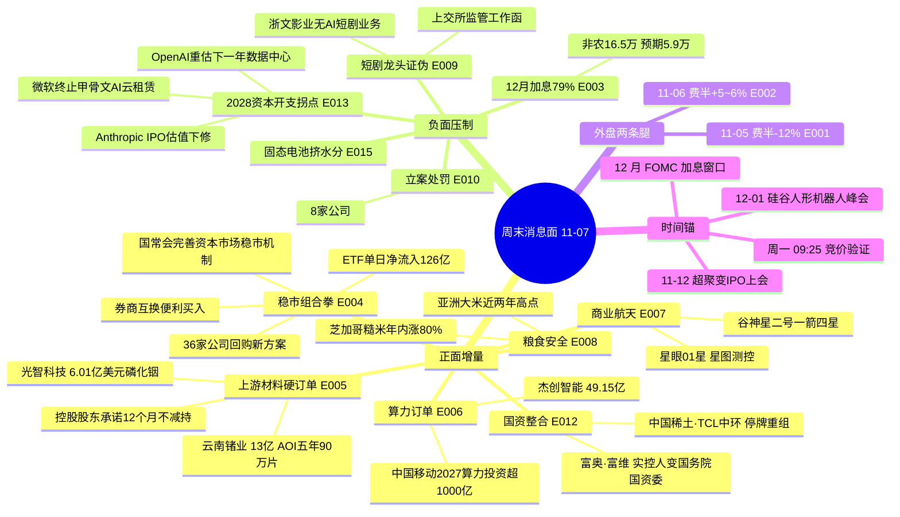

# 2026年11月07日 · **周末消息面事件驱动（轻量档）**

> **数据源新鲜度**: partial · **降级状态**: degraded · **置信度**: 0.62
> **覆盖窗口**: 2026-11-06 06:03 → 2026-11-07 18:00（36h）· **主源**: 财联社快讯 + 21号公众号（含盘前纪要）+ 公告窗口 2259 条 + 周末热榜
> **口径**: 非交易日档 —— **不写买卖建议、不给买卖点**。所有候选一律标「待周一竞价验证」，是否成立由 D1 右侧确认。

## 一句话结论

周末真正的增量是**「护盘组合拳 + 上游材料硬订单」对上「2028资本开支拐点叙事 + 12月加息79%」**，净方向仍是算力硬件链偏负（-0.7516）；短剧龙头被公司+交易所双重证伪，周一该板块是兑现不是接力。

## 🗺️ 消息面全景图

## 🎯 顶级事件详解（三问）

### E20261107_004 · 稳市组合拳同日落地 · strength=high · polarity=正面 · weighted=+0.7800

**事件摘要**：11-06 国务院常务会议明确"完善资本市场稳市机制，增强股市内在稳定性"；同日晚间 36 家公司披露回购新方案/报告书/首次回购（洛阳钼业10-20亿、松发5-10亿、沪电5-10亿、江西铜业3-5亿、赣锋2-4亿）；中金公司、银河证券、申万宏源同日完成互换便利项下买入操作；锐方基金 5 亿自购；当日 ETF 整体净流入 126.24 亿（股票型 108.23 亿、宽基 60.57 亿）。

**大资金意图**：这是一次**顶层定调 + 微观执行**的同步动作。国常会给的是政策叙事，回购给的是公司层面的真金白银，券商互换便利给的是通道，ETF 流入给的是承接量。四件事同一天落地，意图不是"拉指数"，而是**在外部冲击窗口里把下跌的斜率压平**——猫笔刀的观察很关键："一整天没看到官军进场的痕迹，六大宽基 ETF 都显著缩量"，但资金数据又显示 ETF 净流入 126 亿。这两个说法打架，我采信资金数据：**护盘方式变了，从"盘中拉权重"改成"盘后发公告+ETF被动承接"**。

**为什么走强**：因为周五的下跌是"外部输入型"（日经 -6%、韩国 -6.5%、台湾 -4.5%），不是内部基本面恶化。A 股当日上证只跌 1.1%、成交 1.67 万亿，跌幅在东亚最小。这种"外部砸、内部扛"的结构下，政策层最有动力出手，也最容易见效。

**逻辑够不够硬**：**硬，但有效期短**。硬在四点同源（政策+公司+通道+资金）且可验证（回购公告是真金白银的法律承诺）；短在"护盘"本身不创造需求，只能改变斜率。历史上这套组合通常对应 1-3 日的情绪修复窗口，不是趋势反转。**且它天然是"跌了才有"的事件——如果周一不跌，这条逻辑就自动失效。**

---

### E20261107_013 · 2028资本开支拐点叙事 · strength=high · polarity=负面 · weighted=-0.7200

**事件摘要**：11-06 盘中/盘后三件事叠加——微软正逐步终止向甲骨文租用 AI 云算力的协议（数十亿美元级合作全面重估）；OpenAI 高层讨论是否重新调整下一年度数据中心容量预期；Anthropic IPO 估值预期从 1.5 万亿美元下修至 1.2-1.3 万亿美元。摩根大通同日表态"美国数据中心建设或放缓，风险料从 2028 年起显现"。

**大资金意图**：空头在有 2026/2027 订单仍强劲的情况下，**必须把争论推到更远的时点**——2028 年以后还需要建多少数据中心、能拿到多少 GW 电力、审批会不会延期。这是一种"无法被当期数据反驳"的做空方式：当期业绩越好，越无法解释股价为什么跌，反而加剧矛盾。GS 交易台的原话是市场"严重超卖但多数机构仍以减仓、控制风险为主，尚未积极寻找抄底标的"。

**为什么走强**（这条负面为何压得住反弹）：因为它同时否掉了三条腿——微软否掉"云厂商租赁需求"、OpenAI 否掉"下一年容量"、Anthropic 估值否掉"AI 一级市场定价"。而费半 11-06 的 +5~6% 反弹靠的是"特朗普称100%支持人工智能"+ 强非农带来的经济韧性，**是情绪修复，不是叙事修复**。两条腿一条是情绪、一条是叙事，叙事腿更重。

**逻辑够不够硬**：**硬在方向，软在幅度**。方向硬：SOX 两年远期 PE 已从约 30 倍压到约 9.9 倍（GS），估值确实计入了不少悲观；软在幅度：多头的反证同样硬——Aterio 数据显示美国在建数据中心 86.7GW，其中 50GW 已进入垂直施工或更后阶段、22.5GW 完成度超 75%，已进入设备安装的项目很难因短期政策取消。**所以这条不是"AI 完了"，是"增速假设要下修"，对应的股价形态是震荡压缩而不是单边崩塌。**

**bearish_scope**: 行业级 · **bearish_impact_sectors**: [AI算力硬件链, 算力服务/IDC, 光模块, CPO, 存储, 半导体, 数据中心电力]

---

### E20261107_001 · 美股AI硬件踩踏 · strength=high · polarity=负面 · weighted=-0.7316

**事件摘要**：11-05（美东）纳指 -5.52%、费城半导体 -12%（2020年3月以来最大单日跌幅、有数据以来第二差），英伟达一夜蒸发近3万亿元。触发链条：民主党中期选举大胜后安萨里法案"全面暂停所有先进AI研发，违规企业可能被强制解散、个人最高20年监禁" + 杠杆 ETF 约 470 亿美元卖出再平衡（其中半导体 205 亿、科技 173 亿）+ CTA 趋势资金转空 + 做市商持有约每波动1%对应 70 亿美元的负 Gamma 敞口。散户开盘首小时卖出约 30 亿美元（负 5.7 个标准差）；ETF 成交占全市场成交 32%（6月以来最高）；期权成交量创历史新高。

**大资金意图**：这是**仓位危机，不是基本面定价**。傅里叶的猫的拆解是全程没有有效承接、每次反弹都遇卖盘、指数收在日内低点——这是"下跌带来更多卖出"的机械螺旋，做市商负 Gamma 对冲把跌幅放大。换句话说，当天卖的人不是"看空 AI"，是"必须减仓"。

**为什么走强**（这条负面为何成立）：因为它同时击穿了三条腿——① 政策腿（安萨里法案）；② 资金腿（杠杆 ETF 再平衡 + CTA + 负 Gamma）；③ 情绪腿（散户首小时 30 亿美元卖出）。三条腿同时断，任何单一利好都无法当天对冲。

**逻辑够不够硬**：**当天硬、延续性弱**。当天硬在数据全部可验证（跌幅、资金流、期权成交创纪录）；延续性弱在它是流动性事件，流动性事件的特征是"跌得快、反抽也快"，所以它必然要被 E002 部分抵消。

**bearish_scope**: 行业级 · **bearish_impact_sectors**: [AI算力硬件链, 光模块, CPO, 存储, 半导体]

---

### E20261107_002 · 美股AI硬件单日暴力反抽 · strength=high · polarity=正面 · weighted=+0.7000

**事件摘要**：11-06（美东）费城半导体指数涨超 5%（盘中一度 +6.01% 报 9552.37 点），AMD/Coherent 涨超 12%、泛林超 10%、美光 +8~9%、迈威尔/闪迪 +7%、台积电/英特尔/英伟达/Lumentum +6%、SK海力士 +5%；纳指 +1.52%、标普 +0.79%。催化：特朗普称"100%支持人工智能"；白宫经济顾问哈塞特称"数据中心仍有很大发展空间"；10 月非农 16.5 万证明经济韧性。同时台积电据报拟进军先进存储芯片制造（应英伟达要求布局 3D DRAM）；谷歌斥资 5.48 亿美元买入高通近 300 万股；SK海力士设立美国 AI 投资子公司 Hyaico（最高 100 亿美元）；OpenAI 完成 110 亿美元新一轮融资、估值 1.25 万亿美元。

**大资金意图**：这是**超跌反抽 + 政治喊话 + 产业资本继续下注**三件事的叠加。最值得注意的不是涨幅，而是**一级市场没停**：OpenAI 融资照常完成、SK海力士设 100 亿美元美国 AI 投资平台、台积电扩到存储、谷歌买高通。**二级市场在杀估值，一级市场在加仓。**

**为什么走强**：因为 11-05 的下跌是流动性螺旋，螺旋一旦停，价格就会回补到"叙事应有的位置"。加上哈塞特/特朗普同日两次喊话，给了多头一个台阶。

**逻辑够不够硬**：**中等**。硬在产业资本动作是真的、非农数据是真的；软在"政治喊话"没有约束力，且两天净跌幅仍有 6-7%。按 v1.4 纪律，**这条必须与 E001 并列存在，不得合并成一个利好条**——只留 E002 就会把"反抽"误读成"修复完成"。

---

### 合成结论 · E001 + E002 两面对冲后的净值（非独立事件）

如果只留"费半反弹"（+0.7000），会得出"周一科技修复"的乐观结论；如果只留"费半-12%"（-0.7316），会得出"周一继续杀"的悲观结论。**真实状态是两个方向在同一个板块上互相抵消（+0.7000 - 0.7316 = -0.0316），再叠加 E013（-0.7200）后板块净值 -0.7516。** 这才是可用读数。

---

### E20261107_005 · 磷化铟双订单 · strength=high · polarity=正面 · weighted=+0.6369

**事件摘要**：11-06 晚，光智科技（300489）控股子公司先锐科技与 Coherent Corp.（COHR，全球光模块销售额第三）签《LETTER OF INTENT》，2027-2029 年为 COHR 瑞士/瑞典工厂提供 6 英寸磷化铟衬底，预计金额不低于 **6.01 亿美元**（约 40.4 亿元），被业内称为"迄今全球已披露最大 6 英寸磷化铟衬底供货协议"。同日云南锗业（002428）此前公告的 AOI 五年 90 万片 4 英寸磷化铟协议对应 2027 年度 1.94 亿美元/约 13.05 亿元（占 2025 年经审计营收 122.46%），叠加控股股东及一致行动人承诺 12 个月不减持（合计持股 20.01%）、章建平三季度加仓 1961.57 万股成为第三大股东（期末市值 22.83 亿）。

**大资金意图**：这条线的资金意图最"实"——**买的是"海外大厂用长约锁定中国衬底产能"这个产业事实**，不是概念。COHR 是光模块鼻祖级企业、2025 年全球第三，英伟达今年 3 月还与它签了含 20 亿美元投资和数十亿美元采购承诺的多年合作。**上游材料厂拿到下游巨头的长协，等于把"AI 需求"从叙事变成了合同。**

**为什么走强**：三点共振——① 订单金额量级硬（6.01 亿美元 vs 云南锗业 2025 年营收的 122%）；② 供给稀缺（6 英寸磷化铟全球能做的不多，且需出口许可证）；③ 股东行为背书（章建平 Q3 加仓 + 控股股东承诺不减持）。**产业资本和大户在同一方向上加仓，比研报推荐可信。**

**逻辑够不够硬**：**硬，但有三个必须写明的折扣**。① 光智科技那份是 LOI（意向协议）不是最终合同，公告自己写明"最终协议签署时间尚存在不确定性"；② 需取得 6 英寸磷化铟衬底**出口许可证**，未按期取得可能导致协议无法履行甚至取消；③ 云南锗业前三季归母 +869.79% 属**资源周期股在锗价上行期的利润释放**，按 v1.5 协议不能直接读成"成长加速"——单季拆分未披露，标 `earnings_qoq_unverified`，polarity 只能算"中性偏正"。

---

### E20261107_006 · 算力订单密集 · strength=high · polarity=正面 · weighted=+0.5853

**事件摘要**：杰创智能（301248）与 H1 公司签《算力技术服务合同》，暂定总金额 **49.15 亿元**、期限 60 个月、分批交付分批结算；其三季报前三季营收 6.20 亿、归母 4271.73 万（同比 +87.59%）——**合同额约为前三季营收的 7.9 倍**。同日金刚光伏子公司拟签不超 15.36 亿算力云服务合同、协创数据与两家租赁公司签 57.2 亿联合融资租赁合同。11-06 中国移动董事长陈忠岳称 2027 年采购总额 5000 亿以上、**算力投资 1000 亿以上**，未来两年智算能力连续翻番、已开工 3 个吉瓦级智算园区、明年再建 2 个达 7 个。

**大资金意图**：算力订单这条线的资金意图是**"找确定性"**。在外盘把 AI 远期叙事打坏的当口，资金需要一个"当期就在签合同、当期就在计费"的载体。杰创智能的模式是"分批交付、分批核验、分期服务、月度结算"——**收入确认节奏清晰，不是一次性画饼**。

**为什么走强**：① 量级够（49.15 亿对 6.20 亿营收）；② 模式可验证（月度结算，能跟踪到收入）；③ 有产业锚（中国移动 1000 亿算力投资是运营商口径的官方资本开支，比云厂商的"可能放缓"更硬）。

**逻辑够不够硬**：**中等偏硬，但板块层面被压过**。个股层面这条很硬（合同是真签的、金额是真披露的）；板块层面它扛不住 E013——按叉乘公式，算力服务/IDC 净值 **-0.1347（负面）**：E006 的 +0.5853 被 E013 的 -0.7200 抵掉。**这是本期最重要的一个结论：订单利好是真的，但资本开支叙事把这个板块的净方向压成了负。**

---

### E20261107_009 · 短剧龙头被公司+交易所双重证伪 · strength=high · polarity=负面 · weighted=-0.6886

**事件摘要**：浙文影业（601599）11-06 开盘再度涨停、5 连板、累计涨幅 61.27%、换手率 21.97%；当晚公司公告"关注到市场将其列为 AI 短剧概念股，但截至目前生产经营未发生重大变化，主营业务仍为影视业务与毛纺织业务，**无 AI 短剧相关业务**"，同时收到上交所《关于有关股价波动事项的监管工作函》。财务侧：2023-2025 年影视业务收入 1.18 亿/3283 万/466.5 万元，2026 上半年影视收入 154.96 万元、占比不足 0.1%，**99% 营收来自纺织**（前三季营收 29.78 亿、归母 1.43 亿）。

**大资金意图**：龙虎榜给出答案——买一国泰海通上海长宁江苏路 7089 万、买二华鑫深圳分公司 6703 万；卖一南京证券张家港东环路 7777 万、卖二广发武汉京汉大道 3466 万。**买卖前二在同一价位对打，这不是吸筹，是换手。** 9 亿主力净流入配 21.97% 换手率，是典型的高位击鼓传花。

**为什么走强**（负面强排：这条必须占位）：因为它不是"某只票的风险"，而是**一个板块的定价基础被抽掉**。AI 漫剧的产业叙事是真的（"duanju"成英文词、海外付费前十中国厂商占九席、AI 漫剧海外用户超1.5亿、2026 国内市场规模有望超400亿），但**A 股给它配的龙头是个没有这块业务的公司**。叙事真 + 载体假，是这个板块最大的结构性风险。

**逻辑够不够硬**：**证伪是硬的**。公司公告 + 交易所监管函 + 财务占比不足 0.1%，三重证据闭环。**但要注意：证伪的是"龙头"，不是"题材"**——芒果超媒（AI 端联合即梦 AI 内测 Seedance2.5、携手火山引擎）3 日最高 +29.28%、上海电影 +18.41% 是业务侧真受益的。**周一预期是"龙头兑现 + 真受益票分化"，不是全板块死亡。**

**bearish_scope**: 板块级 · **bearish_impact_sectors**: [短剧游戏/AI漫剧, 传媒]

---

### E20261107_003 · 12月加息概率升至79% · strength=high · polarity=负面 · weighted=-0.6500

**事件摘要**：美国 10 月非农新增 16.5 万（市场预期 5.9 万，近三倍）、失业率回落至 4.1%、8-9 月合计上修 8.4 万。CME 数据：12 月维持利率不变概率 27.2%、加息 25bp 概率 **72.8%**（另一口径 79%，此前 67%）。美联储戴利当晚连续表态："预计我们将不得不进一步收紧政策""如有需要，准备加息""通胀必须成为头号优先事项"。美国 2 年期国债收益率一度涨 7bp 至 4.537%，美元指数走高，现货黄金短线跳水超 30 美元。

**大资金意图**：这是**周末最容易被忽略的一条**。市场注意力全在"AI 叙事"和"回购护盘"，但真正改变全球资金成本的是利率路径。12 月加息概率一周内从 67% 抬到 79%，意味着**外资对 A 股的"估值容忍度"要下修一档**。

**为什么走强**（改问：为何这条负面压在 A 股头上）：QFII 三季度持有 1309 只 A 股、平均涨幅 5.66%（跑赢上证 11.82 个百分点），说明外资在 A 股是实打实在场的；美债收益率上行 + 美元走强，直接压制新兴市场估值。同时国内政策正在"稳市"，形成**外部收紧 vs 内部托底**的对冲格局。

**逻辑够不够硬**：**方向硬，幅度待定**。硬：非农、失业率、上修、戴利表态四个证据同向。软：① 白宫经济顾问费兰当晚明确"不要指望强劲非农会促使美联储加息"，白宫与美联储口径不一致；② 美联储传声筒 Timiraos 认为这份报告"反映的是数月前状况，不足以促使美联储重新评估"；③ 报告细节"可能略显过时"（过去几周金融条件急剧收紧）。**所以这是"概率上升"而非"确定加息"，不能当既定事实用。**

**bearish_scope**: 行业级（全球流动性） · **bearish_impact_sectors**: [高估值成长, 外资重仓]

---

### E20261107_007 · 商业航天一箭四星 · strength=medium · polarity=正面 · weighted=+0.6000

**事件摘要**：11-07 07:37 谷神星二号遥三在酒泉发射，一箭四星（观澜试验星、云遥一号28星、中北大学一号、钧天一号06A）全部入轨。钧天一号06A 即"星眼01星"，由**星图测控（920116.BJ）抓总设计**、钧天航宇联合研制，是"星眼"太空感知星座首发星，面向空间目标监测、AI 智能计算、星地链路在轨验证。星河动力累计 24 次入轨发射、服务 30 家卫星客户、94 颗卫星入轨；其 IPO 辅导券商由华泰联合变更为中信证券。

**大资金意图**：这条的资金意图偏"事件驱动 + 提前埋伏"。11-06 商业航天概念榜位从 #6 → #3 → #2 连续上升，**说明资金在发射前一天已经进场**，不是消息后才反应。

**为什么走强**：周末唯一发生在**周六白天**的硬事件，且带明确上市公司主体（星图测控）。同时叠了资本动作（星河动力 IPO 辅导换中信证券）。

**逻辑够不够硬**：**事件硬、业绩软**。"首发验证星"是技术验证性质，不产生收入；商业航天在 A 股的历史模式是"事件涨一天、随后回吐"。逻辑够撑 1-3 日情绪，撑不起主线。

---

### E20261107_008 · 粮食安全双逻辑 · strength=medium · polarity=正面 · weighted=+0.4734

**事件摘要**：亚洲大米基准价升至近两年最高（泰国5%碎米 499 美元/吨，2024年12月以来最高）、芝加哥糙米期货年内涨超 80%、FAO 预计 2026/27 全球大米产量十多年来首降、美国农业部预计本季全球产量首降；印度干旱、菲律宾 10 月米价同比 +7.8%。国内：农业农村部称秋粮收获过九成、夏粮 3014.9 亿斤创历史新高、全年产量有望连续第 3 年超 1.4 万亿斤。盘面：11-06 农林牧渔逆市获超 10 亿主力净流入，**转基因 +2.01%、粮食概念 +0.72% 是全市场概念榜前 20 唯二收红**；东方海洋 13天8板（近7日6板）、万向德农 3日2板、新赛股份/秋乐种业/红太阳涨停或涨超10%。

**大资金意图**：普跌日里资金在找**有独立供需逻辑的方向**。这不是进攻，是避险——农业的 β 与全球科技 β 相关性极低，正好对冲 AI 叙事的波动。

**为什么走强**：外部涨价（进口替代/种业逻辑）+ 内部丰收（粮食安全底线）两件事不矛盾，且都有官方数据支撑，属于"可被验证的基本面"。

**逻辑够不够硬**：**中等**。硬在价格数据与官方口径；软在传导——米价对 A 股种业/种植股的利润传导是慢变量，标的多为小市值、业绩薄。且这条混了大量玄学（东方海洋是"东方"系 + "羊"谐音），**必须把基本面部分和玄学部分分开看**。

---

### E20261107_012 · 国资划转与停牌重组 · strength=medium · polarity=正面 · weighted=+0.5200

**事件摘要**：富奥股份（000030）控股股东拟将 29.84% 股份无偿划转至中国一汽，划转后中国一汽合计控制 **55.54%**，实控人由吉林省国资委变更为**国务院国资委**；富维股份（600742）亚东投资 15.45% 划转至中国一汽，连同一致行动人合计 **38.39%**，同样变更为国务院国资委。同期 TCL中环（002129）筹划发行股份购买资产继续停牌、中国稀土（000831）筹划重大资产重组停牌进展、联泰环保（603797）16.11 亿出售两家公司 100% 股权、湖南黄金（002155）发行股份购买资产问询回复、兴业银锡（000426）取得威领股份控制权、艾艾精工（603580）要约收购第二次提示。

**大资金意图**：国资整合这条线的意图是"**提高资产证券化率 + 减少同业竞争**"，属于中期制度红利而非短期题材。一汽系两家公司划转后，同业竞争问题被摆上台面，市场会预期后续资产注入。

**为什么走强**：事件本身是"实控人层级抬升"（省国资委 → 国务院国资委），对估值有制度性溢价；且同日 TCL中环、中国稀土两个大票停牌重组，把"重组"这条线的关注度整体抬高。

**逻辑够不够硬**：**硬在制度，软在时点**。硬：无偿划转是已完成公告，55.54%/38.39% 是确定数字；软：资产注入没有时间表，市场只能交易"预期"。**另需注意基本面难看**：富奥前三季营收 105.70 亿（-12.96%）、归母 1.25 亿（-71.59%）、Q3 单季亏损 6295 万；富维前三季营收 102.49 亿（-28.19%）、归母 2.73 亿（-30.37%）。**这是"重组逻辑压过业绩逻辑"的典型样本，只能当事件，不能当基本面。**

### E20261107_010 · 立案与处罚一批（8 家）· strength=low · polarity=负面 · weighted=-0.4200

**事件摘要**：ST龙大（002726）实控人涉嫌操纵证券市场被证监会立案；凤凰航运（000520）收到证监会立案告知书；ST京机（000821）收湖北证监局行政处罚决定书；广信股份（603599）控股股东收行政处罚决定书；天晟新材（300169）收行政处罚事先告知书；正海磁材（300224）、泰坦股份（003036）、海南发展（002163）分别收各地证监局警示函。

**大资金意图**：这类事件的资金意图是"绕开"，不是"做空"。8 家里 3 家带 ST 前缀，属于壳资源/问题股范畴，本身不在主流资金池里。

**为什么走强**：不适用于负面事件的"走强"提问，改为"为什么值得列"——因为它揭示了**监管节奏**：本周监管处罚集中在"实控人行为"（操纵市场、控股股东违规）而非"信息披露质量"，这个指向与 11-06 上交所并购重组座谈会、11-07 上交所对浙文影业发监管工作函是同一基调：**交易所对异动与实控人行为的容忍度在收紧。**

**逻辑够不够硬**：**硬在事实、弱在板块**。个案处罚不构成板块级利空，唯一需要提醒的是 ST 板块的"壳价值"逻辑（11-06 ST板块热榜 #17）在这类事件下会被压制。

**bearish_scope**: 个股级 · **bearish_impact_sectors**: [ST/壳资源, 问题个股]

---

### E20261107_011 · 创业板指权重上限15%渐进校准 · strength=medium · polarity=正面 · weighted=+0.3873

**事件摘要**：11-06 深交所与深圳证券信息有限公司发布修订，按第一大样本股实际权重稳步下调个股权重上限，每次调整保持新上限至少高于第一大样本实际权重 0.5 个百分点，直至达到 **15%** 目标；"只降不升、不向上反弹"。截至 11-06 第一大权重股权重 15.46%，12 月生效的新上限存在变数（可能 16%，也可能直接 15%）。以 2025-12 以来数据模拟回溯至 2026-09：指数累计收益小幅提升接近 1 个百分点、波动率基本持平，通信设备与服务/电子/电力设备及新能源前三大行业合计权重 71.1% 与原有基本一致。

**大资金意图**：这条的资金意图是**"被动资金再分配"**。权重上限压降 → 跟踪创业板指的 ETF 必须减头部、加中小权重。这是**可测算的、机械的买入力量**，不需要判断谁对谁错。

**为什么走强**：因为它同时满足两个条件——① 头部个股波动对指数的扰动下降（提升指数稳定性）；② 中小权重获得增量被动买盘。且官方明确"不是一次性压减权重，不主动下调个股权重，避免调样阶段指数产品被动卖出"，把冲击控制在最小。

**逻辑够不够硬**：**硬在机制，软在幅度**。机制是硬的（规则已发布、12 月生效）；幅度是软的（模拟回溯只提升接近 1 个百分点收益，波动率持平，行业结构不变）——**这是"长期制度红利"，不是"短期交易机会"**。它的真实意义是给中际旭创这类 15.46% 权重的票一个天花板，以及给创业板中小盘一个缓慢的增量。

---

### E20261107_014 · 美伊冲突升级 · strength=medium · polarity=负面 · weighted=-0.3800

**事件摘要**：11-07 凌晨至白天多条并行——伊朗南部格什姆岛传出爆炸声、初步报告显示两枚导弹击中该岛；特朗普称美方对伊朗实施"小型打击"；一艘希腊油轮在波斯湾遭袭致一名船员死亡、一艘油轮在霍尔木兹海峡附近爆炸；美国财政部对加拿大境内 8 家涉伊朗实体实施新制裁、就伊朗核计划悬赏 2000 万美元。**同时**：伊朗谈判代表正审议限制核计划的提案、美伊谈判"接近取得突破"、普京确认俄美乌三方会谈将于 11-10 在阿布扎比举行。

**大资金意图**：资金在这条上是**双向的**——避险买黄金/军工/石油，同时压制航空/交运/消费（油价成本）。但周末金价的数据很矛盾：伦敦金现一度重返 4100 美元，而 11-06 强非农公布后现货黄金短线跳水超 30 美元、沪金沪银主力跌幅均超 1%。**所以"避险"这条腿被"加息"那条腿顶住了。**

**为什么走强**（负面事件改问：为何值得进 top_events）：因为它会在周一开盘前决定油价缺口，直接影响航空/化工/交运的成本预期，且是周末唯一还在持续演化的地缘变量。

**逻辑够不够硬**：**弱**。同一批消息里既在打又在谈（"小型打击" vs "谈判接近突破" vs "三方会谈 11-10"），方向不明。只能作为**波动来源**标注，不能作为方向依据。

**bearish_scope**: 行业级（风险偏好） · **bearish_impact_sectors**: [航空机场, 交运, 消费]

---

### E20261107_015 · 固态电池"挤水分" · strength=medium · polarity=负面 · weighted=-0.3500

**事件摘要**：11-07 经济日报刊文《固态电池营销该挤挤水分》，引中国科学院院士、清华大学教授欧阳明高直言，多家车企宣布"固态电池量产下线"存在营销夸大。该文由同花顺/新浪转载进入快讯流。

**大资金意图**：这是**官媒定调型**的降温信号。固态电池在热榜 #15（11-04）、#12（11-05）连续在榜，属于有热度但已开始下行的题材；官媒此时发声，通常是给炒作降温。

**为什么走强**（负面事件改问：为何值得进 top_events）：官媒（经济日报）属官方源，按红线 1 单源官方即可入；且它否掉的是"量产"这个核心卖点，直接打击题材的定价基础。

**逻辑够不够硬**：**中等**。硬在权威性（院士+官媒）；软在它是"观点"不是"事实"——没有具体点名哪家企业虚假宣传。它压制的是**情绪**，不是**技术路线**。

**bearish_scope**: 板块级 · **bearish_impact_sectors**: [固态电池]

---

### E20261107_016 · 量子计算首批国标实施 · strength=low · polarity=正面 · weighted=+0.3012

**事件摘要**：《量子计算系统性能测试方法》（GB/T 47468-2026）与《量子计算服务平台第2部分：性能评估》（GB/T 47177.2-2026）正式实施，是我国量子计算领域首批性能测试评估类国家标准。30 余家起草单位覆盖中科大、合肥国家实验室、济南量子技术研究院，以及国盾量子、中电信量子、华翊量子、量旋科技、中科酷原、图灵量子、本源量子等。国盾量子（688027）是"祖冲之号"系列超导量子计算机研制核心企业，最新一单若落地将是其对外交付的第 7 台超导量子整机；本源量子已登记 IPO 辅导备案（中信建投，四期进展报告）。

**大资金意图**：这条几乎没有短线资金意图——国标实施是"行业规范化"事件，通常对应的是**一级市场估值与订单验收**，不是二级市场炒作。

**为什么走强**：勉强算"走强"的是"统一测评基准 → 算力采购与合同验收有据可依"，对整机厂商销售有实质帮助，但节奏极慢。

**逻辑够不够硬**：**弱**。标准落地 ≠ 订单落地。叉乘净值 +0.1205 只是刚刚越过 +0.12 的正面阈值（low 强度 × 0.4 权重），**属于"临界正面"，实际应读作"分歧偏正"**，不应据此做任何交易判断。

## 📊 板块 × 事件热力矩阵

> 叉乘公式：`contrib = abs(weighted_score) × sign(板块极性) × {high:1.0, medium:0.7, low:0.4}`；同板块同名累加；>+0.12 正面 / <-0.12 负面 / 其余分歧。

| 板块 | 事件锚 | 净分 | 事件数 | 判定 | 首推观察标的 | 独立源数 |
|---|---|--:|:--:|:--:|---|:--:|
| 证券 / 大金融 / 宽基被动 | E004 稳市组合拳 | **+0.7800** | 1 | 🟢🟢🟢 正面 | —（板块级） | 4 |
| 磷化铟/化合物半导体 · 光通信材料 | E005 磷化铟双订单 | **+0.6369** | 1 | 🟢🟢 正面 | 光智科技 / 云南锗业 | 4 |
| 商业航天 | E007 一箭四星 | **+0.4200** | 1 | 🟢 正面 | 星图测控 | 2 |
| 国资整合 / 汽车零部件 | E012 一汽划转 | **+0.3640** | 1 | 🟢 正面 | 富奥股份 / 富维股份 | 3 |
| 种业/粮食 · 转基因 | E008 大米涨价 | **+0.3314** | 1 | 🟢 正面 | 金健米业 / 万向德农 | 3 |
| 创业板中小盘 | E011 权重上限15% | **+0.2711** | 1 | 🟢 正面 | —（扩散逻辑） | 3 |
| 量子计算 | E016 首批国标 | **+0.1205** | 1 | 🟡 临界正面 | 国盾量子 | 2 |
| **算力服务/IDC** | E006 订单 +0.5853 / E013 拐点 -0.7200 | **-0.1347** | 2 | 🔴 负面 | 杰创智能（个股硬） | 5 |
| ST/壳资源 · 问题个股 | E010 立案处罚 | **-0.1680** | 1 | 🔴 负面 | —（回避） | 3 |
| 固态电池 | E015 挤水分 | **-0.2450** | 1 | 🔴 负面 | —（降温） | 2 |
| 航空机场 / 交运 / 消费 | E014 美伊冲突 | **-0.2660** | 1 | 🔴 负面 | —（油价成本） | 3 |
| 高估值成长 / 外资重仓 | E003 加息79% | **-0.6500** | 1 | 🔴 负面 | —（估值压制） | 4 |
| 短剧游戏/AI漫剧 · 传媒 | E009 龙头证伪 | **-0.6886** | 1 | 🔴🔴 负面 | —（兑现风险） | 4 |
| **AI算力硬件链**（含光模块/CPO/存储/半导体） | E001 -0.7316 / E002 +0.7000 / E013 -0.7200 | **-0.7516** | 3 | 🔴🔴 负面 | 中际旭创（仅作观察） | 6 |

**sector_cross_summary（只列多事件板块）**：

1. **AI算力硬件链：净 -0.7516 = 负面。** 三个事件是"崩 → 反抽 → 叙事受损"，`-0.7316 + 0.7000 - 0.7200`。**注意这个净值的方向含义：外围反抽（+0.70）已经被完整计入，仍然净负。** 换句话说，"周一科技修复"这个直觉在这套叉乘里不成立——反抽是已经发生的价格，叙事受损是还没完全定价的风险。
2. **算力服务/IDC：净 -0.1347 = 负面。** 这是本期最反直觉的一格：49.15 亿的硬订单（+0.5853）竟被 2028 资本开支叙事（-0.7200）压成净负。**含义是"订单能救个股，救不了板块"。** 杰创智能在个股层面是硬的（合同额 7.9 倍营收、月度结算可验证），但它带不动板块的 β。

**极性与价格的第二层校验**（热榜位 vs 当日涨跌）：

| 板块 | 11-06 热榜位 | 11-06 板块涨跌 | 背离判定 |
|---|:--:|:--:|---|
| 光伏概念 | #1 | **-1.79%** | 🔴 榜位第一但价格下跌 = 高位分歧 |
| 商业航天 | #2 | -2.41% | 🟡 榜位上升但价格跌 = 埋伏未兑现 |
| 转基因 | #3 | **+2.01%** | 🟢 榜位与价格同向 = 真实强势 |
| 短剧游戏 | #4 | -1.40% | 🟡 榜位高但价格转弱 = 兑现前兆 |
| CPO | #5 | -4.35% | 🔴 跌幅最大 = 拥挤度出清 |
| 高股息 | #15 | +0.01% | 🟢 位次低但抗跌 = 防御属性 |

## 🎯 下周一可能的首板候选（待周一竞价验证）

> 口径：v1.6 `first_board_candidates`。只对**正面新闻**产出；不判断位置与竞价（留给 D1）；**全部为观察候选，非买入建议**。排序 `quality → source_count → hit_count` 降序。

| 排序 | 代码 | 名称 | 催化类型 | 来源 | 源数 | quality | 可交易 | 风险标记 |
|:--:|---|---|---|---|:--:|:--:|:--:|---|
| 1 | 300489.SZ | 光智科技 | 6.01亿美元磷化铟长约（史上最大6英寸） | 公告+上证报+证券时报 | 3 | high | ✅ | LOI 非终局协议；需出口许可 |
| 2 | 301248.SZ | 杰创智能 | 49.15亿算力服务合同（60个月） | 公告+证券时报+上证报 | 3 | high | ✅ | 合同为暂定价；分批结算 |
| 3 | 000030.SZ | 富奥股份 | 实控人变更为国务院国资委（一汽控制55.54%） | 公告+上证报 | 2 | high | ✅ | 前三季归母 -71.59%，Q3 单季亏损 |
| 4 | 002428.SZ | 云南锗业 | 13亿AOI五年90万片 + 12个月不减持 + 章建平Q3加仓 | 公告+上证报+证券时报 | 3 | high | ✅ | **高位**（11-05 +10%、热榜#2）、周期股业绩 |
| 5 | 600742.SH | 富维股份 | 实控人变更为国务院国资委（一汽合计38.39%） | 公告+上证报 | 2 | high | ✅ | 前三季归母 -30.37% |
| 6 | 920116.BJ | 星图测控 | 星眼01星抓总设计（一箭四星） | 上证报+发射事件 | 2 | medium | ✅ | 北交所流动性；验证星不产生收入 |
| 7 | 600371.SH | 万向德农 | 亚洲大米近两年高点 + QFII三季度6家集体加仓 | 证券时报+盘前纪要 | 2 | medium | ✅ | 市值小；粮食题材持续性短 |
| 8 | 600127.SH | 金健米业 | 粮食概念热榜#5 + 亚洲米价 | 盘前纪要+热榜 | 2 | medium | ✅ | 利润传导慢 |
| 9 | 920087.BJ | 秋乐种业 | 种业涨停潮 + 北交所粮食 | 盘前纪要+证券时报 | 2 | medium | ✅ | 北交所；小市值 |
| 10 | 688027.SH | 国盾量子 | 量子计算首批国标实施（起草单位） | 上证报+国标委 | 2 | medium | ✅ | 标准落地≠订单；科创板波动 |
| — | 002129.SZ | TCL中环 | 筹划发行股份购买资产 | 公告 | 1 | high | ❌ **停牌** | 复牌时间未知 |
| — | 000831.SZ | 中国稀土 | 筹划重大资产重组 | 公告 | 1 | high | ❌ **停牌** | 停牌进展，未定复牌日 |

**高位接力风险名单（不是首板候选，单列防误用）**：

| 代码 | 名称 | 位置 | 风险 |
|---|---|---|---|
| 002086.SZ | 东方海洋 | 13天8板（近7日6板）、双榜第一 | 公司自述两大板块均亏损、非理性波动；**霸榜第一 = 出货警报区**；驱动为"东方"系+"羊"谐音玄学 |
| 002088.SZ | 鲁阳节能 | 6天5板、连续两日地天板 | Q3 单季亏损 2352.99 万、营收 -11.35%；异动公告称无未披露重大信息 |
| 600261.SH | 阳光照明 | 7天6涨停、封单近40万手 | 连续涨停后无新催化 |
| 601599.SH | 浙文影业 | 5连板、累计 +61.27% | **已被公司+交易所双重证伪**，周一兑现风险最高 |
| 002578.SZ | 闽发铝业 | 4连板 | 光伏情绪票，无独立催化 |

## 📋 公告硬事件清单（11-06 → 11-07，2259 条 / 1070 家）

### 一、回购（149 条 / 115 家；新方案·报告书·首次回购 37 条 / 36 家）

| 代码 | 名称 | 类型 | 金额 | 备注 |
|---|---|---|---|---|
| 603993.SH | 洛阳钼业 | 新方案 | 10-20 亿 | 价格上限 22.78 元，3个月内，维护价值 |
| 603268.SH | 松发股份 | 新方案 | 5-10 亿 | 上限 260 元/股，12个月，员工持股/激励 |
| 002463.SZ | 沪电股份 | 董事长提议 | 5-10 亿 | 6个月内未买卖公司股份 |
| 600362.SH | 江西铜业 | 董事长提议 | 3-5 亿 | 维护公司价值 |
| 002460.SZ | 赣锋锂业 | 实控人提议 | 2-4 亿 | 维护公司价值 |
| 002120.SZ | 韵达股份 | 新方案+报告书 | 5000万-1亿 | 同日另有控股股东增持计划 |
| 688015.SH | 交控科技 | 新方案 | 5000万-1亿 | 上限 23.04 元 |
| 300671.SZ | 富满微 | 新方案 | 5000万-1亿 | 上限 70.78 元 |
| 300346.SZ | 南大光电 | 董事长提议 | 2000-3500万 | 全部注销减资 |
| 300464.SZ | 星徽股份 | 新方案 | 1500-3000万 | 注销减资，上限 13 元 |
| 002370.SZ | 亚太药业 | 实控人提议 | 1000-2000万 | 员工持股/激励 |
| 688249.SH | 晶合集成 | 新方案+报告书 | 未披露 | 半导体，与中微公司同日 |
| 688012.SH | 中微公司 | 回购报告书 | 未披露 | 半导体设备 |
| 300408.SZ | 三环集团 | **首次回购** | 未披露 | 与"易中天"同批午间公告 |
| 688403.SH | 汇成股份 | 首次回购 | 未披露 | 半导体 |
| 688063.SH | 派能科技 | 首次回购 | 未披露 | 储能 |
| 603556.SH | 海兴电力 | 首次回购 | 未披露 | — |
| 600547.SH | 山东黄金 | 回购报告书 | 未披露 | 黄金 |
| 688281.SH | 华秦科技 | 回购报告书 | 未披露 | 军工材料 |
| 603256.SH | 宏和科技 | 新方案 | 未披露 | 电子布（与 301526 加码电子布共振） |

> 另有 603890 春秋电子、603186 华正新材、688556 高测股份、688523 航天环宇、688379 华光新材、688025 杰普特、002492 恒基达鑫、002273 水晶光电、300846 首都在线、300083 创世纪、603319 美湖股份、603162 海通发展、301600 慧翰股份、605319 无锡振华、605389 长龄液压、688627 精智达、920056 能之光 等 16 家披露新方案/报告书/首次回购。
> **午间"易中天"批**：天孚通信、新易盛、中际旭创、三环集团、大普微、立讯精密、领益智造集体出手（证券时报 11-06 12:47），其中领益智造同时有实控人/董事长增持 H 股完成公告。

### 二、增持 / 不减持（27 条）

| 代码 | 名称 | 事项 |
|---|---|---|
| 002428.SZ | 云南锗业 | 控股股东及一致行动人承诺 **12 个月内不减持**（合计持股 20.01%） |
| 688432.SH | 有研硅 | 控股股东、实控人自愿承诺不减持 |
| 600487.SH | 亨通光电 | 控股股东获增持专项贷款承诺函 |
| 002353.SZ | 杰瑞股份 | 董事长、副总裁增持计划且同日实施完毕 |
| 000858.SZ | 五粮液 | 集团增持计划实施结果 |
| 600959.SH | 江苏有线 | 控股股东增持实施完毕 |
| 001322.SZ | 箭牌家居 | 控股股东增持实施完成 |
| 002600.SZ | 领益智造 | 实控人、董事长兼总经理增持 H 股计划实施完成 |
| 000796.SZ | 凯撒旅业 | 控股股东以专项贷款+自有资金增持计划 |
| 688110.SH | 东芯股份 | 控股股东首次增持 |
| 600292.SH | 电投水电 | 实控人全资子公司首次增持 |
| 000886.SZ | 海南高速 | 控股股东及一致行动人增持触及 1% 整数倍 |
| 000035.SZ | 中国天楹 | 控股股东增持计划实施完成 |
| 001227.SZ | 兰州银行 | 董监高等自愿增持进展 |
| 002705.SZ | 新宝股份 | 控股股东增持期限过半 |

### 三、重组 / 控制权 / 要约（33 条 / 14 家）

| 代码 | 名称 | 事项 | 状态 |
|---|---|---|---|
| 000030.SZ | 富奥股份 | 29.84% 无偿划转至中国一汽，合计控制 **55.54%**，实控人→国务院国资委 | 已公告 |
| 600742.SH | 富维股份 | 15.45% 划转中国一汽，连一致行动人合计 **38.39%**，实控人→国务院国资委 | 已公告 |
| 002129.SZ | TCL中环 | 筹划发行股份购买资产 | **停牌中** |
| 000831.SZ | 中国稀土 | 筹划重大资产重组 | **停牌中** |
| 600683.SH | 京投发展 | 筹划重大资产重组进展 | 进行中 |
| 603797.SH | 联泰环保 | 重大资产出售报告书（草案），16.11 亿出售两家公司 100% 股权 | 草案 |
| 002155.SZ | 湖南黄金 | 发行股份购买资产，深交所问询函回复 + 报告书修订 | 审核中 |
| 000426.SZ | 兴业银锡 | 收购威领股份，取得控制权 | 已取得 |
| 603580.SH | 艾艾精工 | 上海誉升同风要约收购，第二次提示性公告 | 进行中 |
| 301266.SZ | 宇邦新材 | 要约收购提示性公告期满 60 日说明 | 进行中 |
| 601100.SH | 恒立液压 | 吸收合并全资子公司 | 已公告 |
| 688475.SH | 萤石网络 | 5% 以上股东协议转让（浙资运营/阡陌青荷） | 已公告 |
| 603595.SH | ST东尼 | 控股股东协议转让部分股份 | 已公告 |
| 920961.BJ / 300807.SZ / 001267.SZ / 000559.SZ / 002501.SZ | 创远信科 / 天迈科技 / 汇绿生态 / 万向钱潮 / *ST利源 | 重大资产重组进展 | 进行中 |

### 四、停复牌 / ST / 退市

| 代码 | 名称 | 事项 |
|---|---|---|
| 300237.SZ | 美晨科技（原 ST美晨） | **复牌摘帽**（盘前纪要 11-06 列示；热榜飙升榜新进 #45） |
| 002731.SZ | 萃华退 | 退市整理期第四次风险提示 |
| 300068.SZ | ST南都 | 其他风险警示进展 |
| 600238.SH | ST椰岛 | 董事会决议、担保、累计诉讼进展 |
| 000821.SZ | ST京机 | 收到湖北证监局行政处罚决定书 |
| 002726.SZ | ST龙大 | 实控人收到证监会立案告知书 |

### 五、立案 / 处罚 / 警示（8 家，均为官方公告）

| 代码 | 名称 | 事项 |
|---|---|---|
| 002726.SZ | ST龙大 | 实控人涉嫌**操纵证券市场**，证监会立案 |
| 000520.SZ | 凤凰航运 | 收到证监会立案告知书 |
| 000821.SZ | ST京机 | 湖北证监局行政处罚决定书 |
| 603599.SH | 广信股份 | 控股股东行政处罚决定书 |
| 300169.SZ | 天晟新材 | 行政处罚事先告知书 |
| 300224.SZ | 正海磁材 | 警示函 |
| 003036.SZ | 泰坦股份 | 浙江证监局警示函 |
| 002163.SZ | 海南发展 | 深圳证监局警示函 |

## 🔥 业绩预告命中（Q3 口径 · 硬 alpha 交叉验证）

> **必须先说清口径**：东财接口 `report_date=2026-09-30`、500 条记录，**本窗口（11-06→11-07）新增业绩预告仅 3 条且均为同一只票（钶锐锶 688827，11-04，预增 37.65%-57.89%）**。Q3 季报季已于 10-31 收官，**周末没有新的业绩预告可做首板催化**。下面交叉的是"本窗口新闻里出现的业绩数字"，按 v1.5 协议逐条验单季环比。

| 代码 | 名称 | 累计同比（原文） | 单季环比 | 扣非/周期 | 事件命中 | 判定 |
|---|---|:--:|:--:|:--:|---|:--:|
| 688347.SH | 华虹宏力 | Q3 净利 **+136%** | **环比 +222%**（原文给） | 主业，非周期 | 半导体设备/国产替代 | 🟢🟢🟢 **真加速** |
| 688235.SH | 百济神州 | 上调全年营收至 463-470 亿 | 未披露 | 主业 | 创新药（R4 11-06 E005 延续） | 🟢🟢 正面 |
| 688521.SH | 芯原股份 | 在手订单 185.69 亿 | 未披露 | 主业 | 半导体 IP | 🟢🟢 正面（订单型） |
| 301248.SZ | 杰创智能 | 前三季归母 **+87.59%** | 未披露 | 主业（智算云计费） | E006 算力订单 | 🟢🟢 正面，`earnings_qoq_unverified` |
| 002428.SZ | 云南锗业 | 前三季归母 **+869.79%**，营收 +70.71% | **未披露** | **周期股（锗价上行）** | E005 磷化铟 | 🟡 **中性偏正**：`cyclical=true`、`product_price_trend=上行`、`earnings_qoq_unverified`，累计同比只作背景 |
| 600742.SH | 富维股份 | 前三季归母 **-30.37%** | Q3 归母 8305 万（同比 -34.73%） | 主业 | E012 国资划转 | 🔴 业绩拖累，重组逻辑压过 |
| 000030.SZ | 富奥股份 | 前三季归母 **-71.59%** | **Q3 单季亏损 6295 万** | 主业 | E012 国资划转 | 🔴 环比转负，`verdict=业绩恶化` |
| 002088.SZ | 鲁阳节能 | Q3 营收 -11.35% | **Q3 归母 -2352.99 万** | 主业 | 高位接力样本 | 🔴 亏损 |
| 601599.SH | 浙文影业 | 前三季归母 +4.21% | Q3 归母 5284.85 万，同比 +148.67% | 主业为纺织 | E009 证伪 | 🟡 纺织业务增长，与 AI 短剧无关 |
| 688827.SH | 钶锐锶 | 预增 37.65%-57.89% | `PREDICT_HBMEAN=-0.584` | **未查** | 无（窗口外边缘） | 🟡 中性，环比为负，不作正面 |

**三条纪律提醒**：
1. **华虹宏力是本期唯一"同比+环比双加速"的业绩**（+136% / +222%），且是主业，属真加速。
2. **云南锗业必须按周期股协议处理**——+869.79% 是基底效应放大的后视镜，单季拆分未披露，polarity 只能中性偏正，**不能因为它涨得多就标正面**（江波龙案同型）。
3. **富奥/富维的业绩与重组逻辑背离**：一个 Q3 单季亏损、一个归母 -30%，市场买的是国资划转不是业绩。**这类"事件强、业绩弱"的票，只能进 watch 不能进 execution**（与 v1.2 消费契约一致）。

## 关键证据

- 证据 1：11-06 上证 -1.1% / 深成 -2.57% / 创业板 -3.96% / 科创综 -3.24%，4700+ 只下跌，成交 1.67 万亿；日经 -6%、韩国 -6.5%、台湾 -4.5% · 证券时报 2026-11-06 15:57
- 证据 2：11-05 纳指 -5.52%、费半 -12%（2020年3月以来最大单日、有数据以来第二差）；11-06 费半 +5~6%、AMD/Coherent +12% · 证券时报 2026-11-06 07:06 / 23:27
- 证据 3：安萨里法案"全面暂停所有先进AI研发"，违规企业可被强制解散、个人最高 20 年监禁 · 贩财局 2026-11-07 11:02
- 证据 4：美国 10 月非农 16.5 万 vs 预期 5.9 万，失业率 4.1%，12 月加息概率 67%→79% · 财联社快讯 2026-11-06 21:36-21:43
- 证据 5：微软逐步终止向甲骨文租用 AI 云算力；OpenAI 讨论重估下一年数据中心容量；Anthropic IPO 估值下修至 1.2-1.3 万亿美元 · 财联社/新浪 2026-11-06 21:18 / 01:41
- 证据 6：国常会"完善资本市场稳市机制，增强股市内在稳定性" · 证券时报 2026-11-06 19:43
- 证据 7：36 家公司回购新方案（洛阳钼业 10-20 亿等）+ 中金/银河/申万宏源互换便利买入 + ETF 净流入 126.24 亿 · 证券时报 19:18 / 上证报 22:15 / 新浪 08:48
- 证据 8：光智科技与 COHR 签 6.01 亿美元 6 英寸磷化铟 LOI（2027-2029）；云南锗业 AOI 13.05 亿元/122.46% 营收；控股股东承诺 12 个月不减持 · 上海证券报 23:17 / 证券时报 12:29
- 证据 9：杰创智能 49.15 亿算力合同、60 个月、月度结算；三季报营收 6.20 亿/归母 4271.73 万（+87.59%） · 证券时报 2026-11-06 20:53
- 证据 10：浙文影业"无 AI 短剧相关业务"+ 上交所监管工作函，5 连板 +61.27%，换手 21.97%，上半年影视收入 154.96 万 · 上海证券报 2026-11-07 00:19
- 证据 11：谷神星二号遥三一箭四星，星眼01星由星图测控抓总设计；星河动力 IPO 辅导换中信证券 · 上海证券报 2026-11-07 08:31
- 证据 12：富奥 29.84%→中国一汽合计 55.54%；富维 15.45%→一汽连一致行动人 38.39%；两家实控人→国务院国资委 · 上海证券报 2026-11-07 13:37
- 证据 13：11-06 概念榜前20仅转基因 +2.01%、粮食 +0.72%、高股息 +0.01% 未跌；CPO -4.35% · tushare ths_hot_concept rank_time 2026-11-06 22:30

## 数据源审计

| 源 | 日期 | 状态 | 抓取时间 | 记录数 | 备注 |
|---|---|:--:|---|--:|---|
| **news_cls**（财联社+新浪，Tushare news） | 2026-11-05→11-07 | 🟡 | 18:02 | 2150 | 尾部截断至 11-07 **08:55**，周六 09:00 后无快讯 |
| **news_major**（Tushare major_news） | 2026-11-06→11-07 | 🟡 | 18:02 | 800 | 尾部截断至 11-07 **09:00**；源以新浪财经(356)/同花顺(345)为主，财联社仅 54 |
| **eastmoney_earnings_predict** | report_date 2026-09-30 | 🟡 | 18:02 | 500 | 窗口内新增仅 3 条同票（钶锐锶 11-04）；季报季收官 |
| anns_window（Tushare anns_d） | 2026-11-06→11-07 | 🟢 | 18:02 | 2259 / 1070 家 | 11-06 1162 条 + 11-07 1097 条；回购149/重组并购69/定增114/增减持89 |
| wechat_official_rss（取阅 17 源） | 2026-11-06→11-07 | 🟢 | 18:02 | 100 篇 | 17/17 feed ok、9 个有文、core 5/9；覆盖到 11-07 17:23，**本次唯一完整到今日的源** |
| wechat_official_20（R4 兼容副本） | 同上 | 🟢 | 18:02 | 100 篇 | 与 rss 同一内容，文件名兼容 |
| wechat_cli_5groups（7 群） | 2026-11-06→11-07 | 🔴 | 18:02 | **0** | 7 群全 ok 但 count=0；0 字节 |
| attention_weekend 11-04/05/06 | 2026-11-04→11-06 | 🟢 | 18:02 | 960 | 三日榜 ok |
| attention_weekend 11-07 | 2026-11-07 | 🟡 | 18:02 | 0 | **not_available（周六无新榜，不置 degraded）** |
| ths_hot_concept（板块涨跌） | 2026-11-06 | 🟢 | 22:30(源) | 20 | 用于"榜位 vs 价格"背离校验 |
| xtick / MCP 实时行情 | — | ⚫ | — | — | 非交易日不调用盘中源 |
| hithink 受益股池（`@hithink-market-query`） | — | ⚫ | — | — | **本档未调用**：非交易日无实时涨幅可查，受益股池由公告+新闻文本直取，`llm_pick_method=llm_pure_no_verification` 的票已在候选表 source 列标明源数 |

> 说明：`degraded=true` 的根因是**群聊层 0 条 + 财联社/要闻尾部截断**，不是主源缺失。三源（news_cls / news_major / eastmoney）均已列出，无一缺失。

## 不确定性 / 反证

1. **最大的反证是"我可能把两条负面叠太重"**。E001（费半-12%）与 E013（2028 拐点）在时间上高度相关，可能讲的是同一件事——前者是价格反应，后者是叙事解释。如果按"事件独立性"要求，两者本应合并成一条负面。我按 v1.4「正反两面必须拆」拆开了崩/反抽，但**崩与拐点叙事是否算同一事件，我判断为"不算"**：崩是流动性与仓位（散户首小时卖30亿美元、杠杆ETF再平衡470亿、负 Gamma），拐点是基本面预期（微软/OpenAI/Anthropic 的动作）。**如果这个判断错了，AI算力硬件链的净值应该从 -0.7516 修正到约 -0.03（接近分歧），结论会从"负面"变成"看不清"。** 这个不确定性必须交给 R6 做独立反证。
2. **AI 算力硬件链的净值是三种口径里最脆的一个**。因为它同时吃"隔夜价格"（可观测）和"远期叙事"（不可观测），而我对两者的打分都是主观的。删掉任意一条，方向就翻转。**给下游的建议是：不要把 -0.7516 当"卖出信号"，只能当"别把它当修复信号"。**
3. **Q3 业绩这条腿基本是空的**。新增预告 0 条，说明这个周末的选股逻辑**完全靠事件，没有业绩过滤**。这是 v1.6 首板候选质量偏低的根本原因——光智科技是 LOI 不是合同、杰创是暂定价不是终价、富奥/富维业绩是负的。
4. **财联社快讯缺了周六白天**（08:55 后无数据）。周六 09:00-17:23 之间只靠公众号覆盖，而公众号（尤其官媒）发文偏正式、偏宏观，**可能漏掉周六白天的地方性/行业性小新闻**。这条缺口我无法用现有数据补，只能标出来。
5. **群聊 0 条**。所有"多源确认"实际上都是"媒体源+公告源"，没有 KOL 侧独立验证。按 v1.2 硬约束，`strength=high` 需要 ≥2 独立源——媒体与公告算两类独立源，形式上满足；但**缺了"市场参与者真实反应"这个维度**，对判断"这条能不能被资金接住"是没有帮助的。
6. **一致性预期本身可能是风险**。回购+稳市是"人人皆知的好事"，市场通常在消息落地当周就把这部分预期打完。**周一如果高开，回购这条不但不是催化，反而是兑现压力的来源。**

## 与其他 R/D/E 的关系

- **依赖**：`data/raw/20261107/{manifest.json, wechat_official_rss.jsonl, news_cls.jsonl, news_major.jsonl, anns_window.jsonl, eastmoney_earnings_predict.json, wechat_cli_5groups.jsonl(空)}`；`data/research/20261107/attention_weekend.json`；`data/research/20261106/{attention_signals.json, R1_style.json, R3_sentiment.json, R4_news.json}`（连续性对照）
- **被消费**：R2 主线（板块极性叉乘可直接作冷热底稿）、R5 个股画像（候选表入 watch）、R6 反证（AI算力净值最脆，建议优先证伪）、D1 盘前（周一竞价验证清单）、E1 复盘（周一验证命中率）
- **交接给 D1 的三条硬约束**：① 停牌两票（TCL中环/中国稀土）`tradable_today=false`，不得入 execution；② 富奥/富维业绩为负、只能进 watch；③ 光智/杰创的合同性质（LOI/暂定价）需在 entry 前确认

## Sub-Agent 元数据

- skill: analyze_news_impact_v1@1.7（weekend_light 变体）
- artifact: 本 md（周末档不落 `R4_news.json`，避免下游把周末档当交易日 artifact 消费）
- method: llm_v1（四源硬约束：公众号 RSS + 财联社快讯 + 要闻 + 公告窗口 2259 条；群聊层为空）
- event 数: raw 41 → merged 16（dedup 0.61）
- 生成时刻: 2026-11-07T18:55:00+08:00
- 已执行约束: 非交易日不写买卖建议/买卖点；候选一律标「待周一竞价验证」；不伪造涨停家数、竞价、情绪周期阶段
