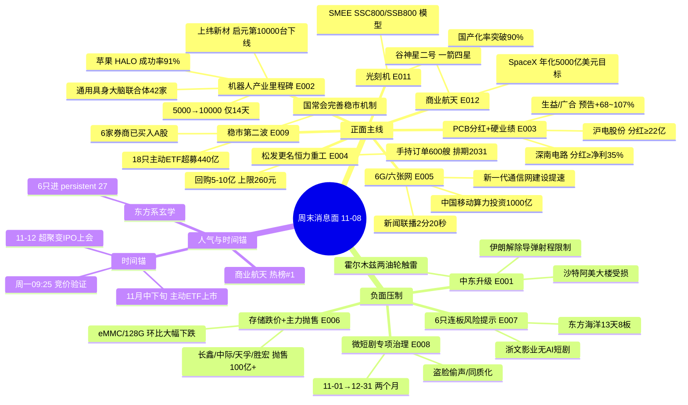

# 2026年11月08日 · **周末消息面事件驱动（轻量档）**

> **数据源新鲜度**: partial · **降级状态**: degraded（群聊空 / 预告无新增）· **置信度**: 0.66
> **覆盖窗口**: 2026-11-07 09:05 → 2026-11-08 18:00（33h，周六盘后 + 周日全天）；事件回看 7 日，λ=0.15
> **口径**: 非交易日档 —— **不写买卖建议、不给买卖点**。所有候选一律标「待周一竞价验证」，是否成立由 D1 右侧确认。
> **与 11-07 报告的口径差异**: 本档覆盖 11-07 09:05 → 11-08 18:00 的增量；11-07 已详解的**磷化铟（光智科技/云南锗业）、杰创智能 49.15 亿算力订单、富奥/富维国资划转**仍在 7 日窗口内，但按"周末增量"不重复展开，其衰减分见 11-07 报告；本档只对"周末二次发酵/新增"的事件重新打分。

## 一句话结论

周末的增量是**「机器人产业里程碑 + PCB 硬业绩分红 + 光刻机/6G 官方展示」对上「中东冲突升级 + 存储跌价 + 6 只连板集中风险提示」**；周一先看竞价，谁被资金接住谁才是主线——**产业故事已经很热，资金证据还没到。**

## T-1 收盘基座（11-06，真实数据，仅作背景）

| 指数 | 收盘 | 涨跌 | 备注 |
|---|--:|--:|---|
| 上证 | 3649.18 | **-1.10%** | 跌幅在东亚最小 |
| 深成 | 11175.78 | **-2.57%** | — |
| 创业板 | 2465.23 | **-3.96%** | AI 硬件权重拖累 |
| 科创50 | 1253.20 | -2.60% | — |
| 北证50 | 888.48 | -2.37% | — |
| 上证50 | 2787.41 | -0.84% | 防御相对抗跌 |

全市场 **涨 758 / 跌 4741 / 平 74**，成交 **1.67 万亿**（较周四缩量 4635 亿）；涨停 84 家、连板高度 4 板、炸板率 36.36%（R1 口径）。**注意：跌停家数数据源间不一致——R1 记 0，`limit_20261106.json` 记 15 只收盘跌停（杰瑞/东山/剑桥等）。本报告不取单一值，标冲突。**

**结构**：AI 硬件重挫（中际旭创 -9.19%、沪电 -9.62%、深南 -7.44%、胜宏 -7.92%、天孚 -5.79%），光伏/电力设备逆势（电力设备 +3.79%、光伏设备 +8.45%），玄学"东方"系与农业/粮食走强。**这是"指数跌幅不大、个股很惨"的典型分化日。**

## 🗺️ 消息面全景图

## 🎯 顶级事件详解（三问 + 观察标的）

> **排序契约**：`(strength: high>medium>low, -|weighted_score|)`。下表是严格排序；下文按主题簇展开（同一板块的正负事件放在一起便于对照），编号不变。

| 排名 | ID | 事件 | strength | weighted |
|:--:|---|---|:--:|--:|
| 1 | E20261108_001 | 中东冲突周末升级 | high | **-0.7500** |
| 2 | E20261108_002 | 机器人产业里程碑密集 | high | **+0.6500** |
| 3 | E20261108_003 | PCB 分红潮 + 硬业绩 | high | **+0.6000** |
| 4 | E20261108_005 | 6G / "六张网"政策共振 | high | **+0.5500** |
| 5 | E20261108_007 | 6 只连板股集中风险提示 | high | **-0.5500** |
| 6 | E20261108_009 | 稳市组合拳第二波 | high | **+0.5186** |
| 7 | E20261108_004 | 松发更名"恒力重工" + 回购 | high | **+0.5164** |
| 8 | E20261108_006 | 存储跌价 + AI 硬件主力抛售 | high | **-0.5164** |
| 9 | E20261108_008 | 微短剧专项治理 | high | **-0.4075** |
| 10 | E20261108_011 | SMEE 光刻机模型亮相 | medium | **+0.4500** |
| 11 | E20261108_010 | 五粮液增持收官 + 白酒价盘反弹 | medium | **+0.3873** |
| 12 | E20261108_012 | 商业航天一箭四星 + SpaceX 目标 | medium | **+0.3873** |
| 13 | E20261108_014 | AI 互动短剧 + 国家数据集团 | medium | **+0.3443** |
| 14 | E20261108_015 | 超聚变 IPO 11-12 上会 | medium | **+0.2869**（decayed） |

**时间衰减明细（λ=0.15）**：

| ID | event_type | raw_score | days_since | weighted_score | decayed |
|---|:--:|--:|:--:|--:|:--:|
| E001 | macro | -0.75 | 0 | -0.7500 | false |
| E002 | sentiment | +0.65 | 0 | +0.6500 | false |
| E003 | earnings | +0.60 | 0 | +0.6000 | false |
| E004 | policy | +0.60 | 1 | +0.5164 | false |
| E005 | policy | +0.55 | 0 | +0.5500 | false |
| E006 | sentiment | -0.60 | 1 | -0.5164 | false |
| E007 | sentiment | -0.55 | 0 | -0.5500 | false |
| E008 | policy | -0.55 | 2 | -0.4075 | false |
| E009 | policy | +0.70 | 2 | +0.5186 | false |
| E010 | insider | +0.45 | 1 | +0.3873 | false |
| E011 | sentiment | +0.45 | 0 | +0.4500 | false |
| E012 | sentiment | +0.45 | 1 | +0.3873 | false |
| E014 | sentiment | +0.40 | 1 | +0.3443 | false |
| E015 | policy | +0.45 | 3 | +0.2869 | true |

### E20261108_001 · 中东冲突周末升级 · strength=high · polarity=负面 · weighted=-0.7500

**事件摘要**：11-08 凌晨至下午，中东连串升级——伊朗革命卫队称两艘"违规油轮"在霍尔木兹海峡东部/中部触雷起火；美军中央司令部在阿曼湾击沉一艘试图突破封锁的商船；胡塞武装称对沙特和也门石油/军事目标发动六次袭击；沙特利雅得金融区遭袭，沙特阿美大楼受损，联军称拦截 2 枚弹道导弹 + 2 枚巡航导弹；伊朗宣布"解除导弹射程限制"。同日，卡塔尔首相称美伊斡旋仍在继续。**周五油价刚因"冲突降温 + OPEC+ 12 月维持产量 + 中东四国 10 月出口 +10%"跌出六年最大周跌幅（布油 -16.42%、美油 -12.76%），周末冲突又把风险溢价打回来。**

**大资金意图**：这是一条**典型的"周五空头回补、周一重新定价"事件**。周五卖油的人赌的是"降温"，周末的导弹和油轮触雷让这个假设失效；周一开盘前，原油暗盘/外盘期货的反应会决定 A 股石油石化、油运、航空、化工的开盘方向。资金意图不是"看多原油"，是**"把周五的错误定价修正回来"**。

**为什么走强 / 为什么走弱（这条是负面，反着读）**：负面不在"油价涨"本身，而在**风险偏好**——中东升级会压制全球风险资产、抬高航空/化工成本、推高黄金/军工避险需求。A 股周一大概率是"石油/黄金/军工高开，航空/化工/消费低开"的结构，而不是指数单边。

**逻辑够不够硬**：**事件硬、持续度软**。硬在沙特阿美大楼受损、油轮触雷、美军击沉商船都是可验证的既成事实；软在"升级"与"斡旋"同时存在（卡塔尔首相称美方仍愿外交解决），双方都在给对方留台阶。**这种事件通常对应 1-3 日的风险溢价，不是长期趋势。**

- **bearish_scope**: 行业级
- **bearish_impact_sectors**: 航空机场、化工、大消费、出口链
- **正面子板块**: 石油石化、油运、黄金、军工
- **观察标的（板块龙头锚，非新闻点名，proxy）**: 中国海油 600938（油气）、招商轮船 601872（油运）、山东黄金 600547（黄金）
- **风险**: 油价若高开 5%+，追高即接盘；若开盘后回落，说明市场认为"冲突可控"。

---

### E20261108_002 · 机器人产业里程碑密集 · strength=high · polarity=正面 · weighted=+0.6500

**事件摘要**：① 11-08 14:56 证券时报：上纬新材（688585）启元机器人第 10000 台个人机器人下线，从 5000 台到 10000 台仅用 14 天；月活超 98%、日均在线峰值超 40%、日均在线 3 小时、平均每位用户每天交互 100 多次。② 11-07 17:22：苹果研究团队公开人形机器人自主控制系统 HALO（arXiv 11-04），6 个未预扫描真实环境 360 次单项任务平均成功率 91%，组合任务平均 70%；用 250 张 H100 合成训练数据、64 张 B200 训练动作跟踪器；新浪称其调用千问模型在宇树 G1 上验证。③ 11-07 15:30：通用具身大脑产业创新联合体启动，42 家企业/机构（含宇树科技、优必选）。④ 11-07 13:43：马斯克称 Optimus 可能"只租不卖"，初期单台成本约 3 万美元。⑤ 云深处发布绝影 X50 四足机器人（50kg 负载、持续疾驰 2 公里）；汽车零部件巨头在进博会争抢机器人客户。

**大资金意图**：产业资本在**把"演示"变成"量产/租赁/数据闭环"**——上纬的台数爬坡、苹果的 91% 成功率、联合体的 42 家、Optimus 的租赁模式，四条都指向"机器人开始有商业模式"。但交易资金上周在撤：人形机器人 11-06 -2.93%、热榜热度从 144354 掉到 76060（-47%）、征和工业跌停且开板 8 次。**产业资本与交易资金方向相反。**

**为什么走强 / 为什么走弱（这条是正面，但要问"为什么没走强"）**：因为缺"上市公司订单/收入"确认。上纬的 10000 台是整机厂口径，苹果的 91% 是实验室口径，联合体是生态口径——**都不直接落到 A 股公司报表**。机器人要从"事件"变"主线"，必须出现板块内新面孔首板 + 成交额放大，否则只是脉冲。

**逻辑够不够硬**：**产业趋势硬、交易逻辑软**。硬在量产爬坡的数字和苹果的论文；软在"谁受益、受益多少"没有答案。**周一观察点不是"有没有新闻"，是"机器人板块有没有第二只涨停"。**

- **观察标的**: 上纬新材 688585（产业锚，11-06 收盘 180.02、-1.65%、流通约 726 亿）、宇树科技 688836（联合体/苹果验证，11-06 收盘 656.62、-3.99%、流通约 198 亿）、春光科技 603657（3 板情绪票，11-06 收盘 33.88、+10%、流通约 46 亿、封单仅 0.17 亿）
- **风险**: 上纬/宇树都是高位大市值；春光 3 板且封单弱；机器人热榜已退潮。
- **失效条件**: 若周一机器人板块只有上纬一家红、无第二只涨停，事件脉冲定性成立。

---

### E20261108_003 · PCB 分红潮 + 硬业绩 · strength=high · polarity=正面 · weighted=+0.6000

**事件摘要**：11-08 17:26 证券时报：深南电路（002916）收到控股股东深天科技控股提议函，建议 2026 年度现金分红总额不低于当年归母净利的 35%；前三季归母 41.29 亿（+77.54%）、扣非 40.98 亿（+87.8%），AI 加速卡/服务器/高速交换机/光模块/存储类封装基板订单增长。同日报道：沪电股份（002463）此前获控股股东提议 2026 年度分红不低于 22 亿；中集环科（301559）提议 2026-2028 每年分红不低于可分配利润 60%。业绩预告交叉：深南归母 +74.13~78.43%、沪电 +100.54~109.74%、生益电子 +68~75%、广合科技 +100.33~107.23%。

**大资金意图**：这是**"把 AI 景气的证据从利润表搬到现金流量表"**。AI PCB 公司的资本开支大，市场一直怀疑"赚的是纸面利润"；控股股东主动提分红，等于用"真金白银分配"给业绩背书。四家（深南/沪电/生益/广合）业绩全部 68%~110% 增长，说明 AI 服务器/交换机/光模块的拉货是真的。

**为什么走强 / 为什么走弱（这条是正面，但要问"为什么周五跌"）**：因为周五杀的是 **β**（蓝潮→美国数据中心监管→2028 资本开支叙事），不是 **α**（PCB 业绩）。中际 -9.19%、沪电 -9.62%、深南 -7.44%、生益 -8.39%、广合 -5.66%——这是"板块被砍"，不是"公司变差"。周末的分红公告，恰好给了"α 还在"的证据。

**逻辑够不够硬**：**业绩硬、估值软**。硬在四家预告和两家分红都是可验证的；软在 AI 硬件的全球 β 仍被"2028 资本开支"叙事压着。**周一读法：低开被业绩腿接住 = α 胜；高开低走 = β 继续。**

- **观察标的**: 深南电路 002916（11-06 收盘 199.92、-7.44%、流通约 1329 亿）、沪电股份 002463（73.21、-9.62%、约 1411 亿）、生益电子 688183（61.61、-8.39%、约 516 亿）、广合科技 001389（84.81、-5.66%、约 129 亿）
- **风险**: 深南分红是"提议"非"决议"；公告原文未进 18:00 快照；AI 硬件 β 仍在；大市值弹性有限。
- **失效条件**: 若周一四家 PCB 全部高开低走且跌破 11-06 低点，说明"业绩+分红"没被资金接受。

---

### E20261108_004 · 松发股份更名"恒力重工" + 5-10 亿回购 · strength=high · polarity=正面 · weighted=+0.5164

**事件摘要**：11-07 21:13 证券时报：松发股份（603268）公告拟以自有/自筹资金（含回购专项贷款）集中竞价回购，金额不低于 5 亿、不超过 10 亿，价格上限 260 元/股，期限 12 个月，用于员工持股/股权激励；同时拟将中文名变更为"恒力船舶重工股份有限公司"、证券简称变更为"恒力重工"。前三季营收 377.74 亿（+221.25%）、归母 66.73 亿（+424.87%）、扣非 62.46 亿（+807.82%）；Q3 营收 142.70 亿、归母 30.64 亿；手持订单超 600 艘，交船排期至 2031 年。11-06 收盘 149.45 元、总市值约 1522 亿（流通约 349 亿）。

**大资金意图**：这是**"资产重组完成后的身份确认 + 股东回报"**双动作。更名让"陶瓷壳"彻底变成"造船实体"，回购上限 260 元（较 149.45 元有 74% 空间）是管理层对自身价值的强信号；600 艘订单/2031 排期把"周期股"变成了"在手订单可见度"。

**为什么走强 / 为什么走弱（这条是正面，但要问"高位还值不值"）**：因为它是 4 年 16 倍的票（2023 年低点 13.18 元 → 最高 228 元），当前 149.45 元仍在高位；周五 -3.29%，说明高位有分歧。**正面在"业绩+回购+更名"三重确认，风险在"高位+大市值+造船周期"**。

**逻辑够不够硬**：**硬在订单，软在周期位置**。硬在 600 艘订单和 2031 排期是公开数据；软在造船景气已走了 4 年，市场会问"是不是周期顶部"。回购上限 260 元是管理层给出的估值锚，但不是股价保证。

- **观察标的**: 松发股份 603268（主标的）、亚星锚链 601890（船舶链代理，11-06 收盘 8.45、-0.94%、流通约 81 亿）
- **风险**: 高位 16 倍；回购上限≠成交价；流通市值 349 亿但总市值 1522 亿，解禁结构需查；造船周期见顶风险。
- **失效条件**: 若周一高开后回落至平盘以下，说明"更名+回购"已被一次性定价。

---

### E20261108_005 · 6G / "六张网"政策共振 · strength=high · polarity=正面 · weighted=+0.5500

**事件摘要**：① 国常会 11-06：加快重大项目和"六张网"建设实施进度，支持企业扩大设备更新、无形资产等投资（央视）。② 新闻联播 11-07 用 2 分 20 秒报道新一代通信网加快建设：5G/5G-A/6G + 万兆光网 + 卫星互联网，6G 基站可"像雷达一样感知物体运动"；已建成工业 5G 专网超 2.6 万个、5G 工厂 1260 个。③ 上海证券报 11-08 11:19 再提"新一代通信网建设提速"。④ 北京经开区 11-07 发文，加快布局 AI/量子/6G 技术转化、中试熟化，单个平台每年最高 3000 万元支持。⑤ 财闻私享：中国移动算力投资从 370 亿加码到 1000 亿。⑥ 11-06 运营商逆势收红：中国移动 +3.24%、中国电信 +4.22%、中国联通 +1.13%。

**大资金意图**：这是**"政策定调 + 官媒背书 + 运营商资本开支"三层同向**。国常会管项目、新闻联播管叙事、中国移动管钱；而且运营商在周五普跌日逆势收红，说明资金已经在做"防御 + 6G"的切换。**这是周末最"干净"的政策线之一。**

**为什么走强 / 为什么走弱（这条是正面，但要问"为什么没进热榜"）**：因为 6G 概念 11-07 没进同花顺概念热榜前 20——资金只买了运营商（大市值、高股息、防御），没有买 6G 设备/卫星的弹性票。**政策线已经启动，题材线还没启动。**

**逻辑够不够硬**：**政策硬、订单软**。硬在国常会/新闻联播/北京政策都是官方级；软在 6G 还在试验/标准阶段，资本开支没落地。**周一的读法：运营商继续稳 = 政策线成立；6G 概念进热榜 = 题材线启动。**

- **观察标的**: 中国移动 600941（11-06 收盘 103.49、+3.24%、流通约 934 亿）、中国电信 601728（6.91、+4.22%、约 5364 亿）、中国联通 600050（4.47、+1.13%、约 1385 亿）、梦网科技 002123（11-06 收盘 7.52、-1.70%、流通约 54 亿；移动网络大会"阅信 2.0"）
- **风险**: 运营商弹性小；6G 资本开支未落地；"六张网"是政策表述不是订单。
- **失效条件**: 若周一运营商集体低开且不能回补，说明周五只是避险，不是 6G 主线。

---

### E20261108_006 · 存储跌价 + AI 硬件主力抛售 · strength=high · polarity=负面 · weighted=-0.5164

**事件摘要**：① 11-07 17:00 同花顺行业追踪：电子存储市场（11-01~11-07）eMMC/128G 价格环比大幅下跌。② 11-07 11:28 财联社/新浪：长鑫科技、中际旭创、天孚通信、胜宏科技遭主力抛售共超 100 亿元。③ 11-06 收盘：长鑫 -4.98%、中际 -9.19%、天孚 -5.79%、胜宏 -7.92%；但长鑫仍是 11-07 同花顺热股 #1（人气与资金背离）。④ 业绩预告层面：江波龙归母 +1864.55~1990.84%、德明利扭亏 +32046.52~33154.49%、长鑫扭亏 +2581.06~2609.47%——**全是累计同比的"周期顶部数字"**。

**大资金意图**：资金在**卖"存储涨价叙事"的裂缝**。eMMC/128G 环比大幅下跌，说明消费电子存储的涨价开始松动；长鑫/中际/天孚/胜宏被抛售 100 亿+，是机构在"AI 硬件 β"上减仓。**注意：这不是"业绩不好"，是"业绩太好但股价先走"——江波龙/德明利的同比数字越炸裂，越像周期顶部。**

**为什么走强 / 为什么走弱（这条是负面，反着读）**：因为存储模组是周期股，市场定价的是**单季环比 + 产品价格方向**，不是累计同比。江波龙 2026Q3 单季 34.2-43.2 亿 vs Q2 53-67 亿，环比 -36%~-49%（v1.5 江波龙案已验），公告次日高开冲 271 砸到 259.5 收最低、三周 -25%。**eMMC 价格转跌，是同一个信号在 2026-11 重演。**

**逻辑够不够硬**：**方向硬、幅度软**。硬在价格和资金流都是可验证的；软在"跌多少算够"没有答案（SOX 远期 PE 已压到约 9.9 倍）。**周一读法：存储模组高开 = 出货；低开不破前低 = 可能只是 β 杀。**

- **bearish_scope**: 行业级
- **bearish_impact_sectors**: 存储芯片、存储模组、光模块/CPO、AI 算力硬件
- **观察标的（负面样本）**: 长鑫科技 688825（11-06 收盘 40.41、-4.98%、流通约 1820 亿）、江波龙 301308（214.77、-4.87%、约 605 亿）、德明利 001309（185.95、-7.39%、约 432 亿）
- **风险**: 长鑫仍是人气 #1，可能出现"人气反抽"；存储原厂 vs 模组环节错配（原厂受益、模组被挤压）。
- **失效条件**: 若 eMMC 价格下周止跌、长鑫/江波龙低开高走，说明"价格转向"被证伪。

---

### E20261108_007 · 6 只连板股集中风险提示 · strength=high · polarity=负面 · weighted=-0.5500

**事件摘要**：11-08 12:49 证券时报汇总 11-06 晚公告：东方海洋（002086，13 天 8 板）称交易异常波动、净利润持续亏损、基本面未变；阳光照明（600261，7 天 6 板）称股价偏离基本面、警惕非理性炒作；鲁阳节能（002088，6 天 5 板）称短期涨幅严重偏离、非理性波动突出；浙文影业（601599，5 连板）称"无 AI 短剧相关业务"；闽发铝业（002578，5 连板）称股价脱离基本面、光伏产品利润贡献低；润建股份（002929，5 天 3 板）称 AI/算力/词元业务占总营收比重仍较低。

**大资金意图**：这是**"高位股的官方降温"**。6 只票覆盖玄学（东方海洋）、光伏（阳光照明/闽发）、短剧（浙文）、算力（润建）、建材（鲁阳），基本把周五最热的情绪票一网打尽。交易所/公司的风险提示不会让它们周一必跌，但会让**接力资金的风险偏好下降**——高位票的分歧会放大。

**为什么走强 / 为什么走弱（这条是负面，反着读）**：因为风险提示本身是"事件"，不是"基本面变化"。它改变的是**博弈结构**：原来敢在 5-8 板接的人，看到公告后要重新算赔率；原来锁仓的人，看到"非理性波动"四个字会考虑兑现。

**逻辑够不够硬**：**硬在名单，软在时点**。名单是硬证据（6 家公司公告）；时点是软的——风险提示经常"提示完继续涨"，尤其在玄学行情里。**但它至少说明：监管/公司层已经认为"涨得太快"，这轮情绪的顶部区域到了。**

- **bearish_scope**: 板块级（高位连板/玄学/短剧/光伏情绪票）
- **bearish_impact_sectors**: 高位连板、玄学题材、短剧/传媒、光伏情绪票、算力概念
- **观察标的（负面样本）**: 东方海洋 002086、阳光照明 600261、鲁阳节能 002088、浙文影业 601599、闽发铝业 002578、润建股份 002929
- **风险**: 风险提示≠必跌；东方海洋仍是双榜第一（出货警报区）。
- **失效条件**: 若周一 6 只中仍有 3 只以上涨停，说明风险提示被市场无视，情绪仍在高位。

---

### E20261108_008 · 微短剧专项治理 · strength=high · polarity=负面 · weighted=-0.4075

**事件摘要**：11-06 23:12 财联社：广电总局部署新一轮微短剧低俗化同质化专项治理，为期两个月（11-01 至 12-31），针对 AI 微短剧质量良莠不齐、AI 技术助长低俗不良内容反弹等问题，重点治理"盗脸""偷声"、同质化推荐。11-07 20:32 人民网三评"字节时间"之争，批评超级平台的时间权力边界；红果短剧主动下线金币激励、上线休息提醒。

**大资金意图**：监管从"内容审核"延伸到"算法机制/注意力分配"，这对短剧平台的**增长逻辑**是压制：金币激励、无限滚动、自动连播都是短剧/免费阅读的留存工具，一旦被治理，DAU/时长/付费转化都会受影响。**周五短剧板块已经先跌（-1.40%），周末治理是"补刀"。**

**为什么走强 / 为什么走弱（这条是负面，反着读）**：因为短剧是"政策敏感型"题材，治理消息会直接打击估值；叠加浙文影业被证伪、6 只连板风险提示，**板块从"一致看多"转成"一致看空"**。财联社早知道同日给的"互动剧留存 2.59 倍"是细分亮点，但难对冲板块 β。

**逻辑够不够硬**：**政策硬、影响幅度软**。硬在广电总局是主管部门、治理期两个月；软在"治理"不等于"禁止"，AI 短剧的长期需求还在。**周一的读法：短剧高开 = 兑现；低开后有细分（互动剧/数据要素）逆势 = 结构性机会。**

- **bearish_scope**: 板块级
- **bearish_impact_sectors**: 短剧/传媒、AI 视频、影视院线
- **观察标的（负面样本）**: 浙文影业 601599（5 板、公司否认 AI 短剧）、中文在线 300364（网文 IP，11-06 -3.53%、流通约 173 亿）、万兴科技 300624（ReelMate 公测，-3.13%、约 82 亿）
- **风险**: 互动短剧（永吉/德才/凡拓）可能逆势；治理是"规范"不是"一刀切"。
- **失效条件**: 若周一短剧板块低开高走、浙文继续封板，说明政策治理被市场消化。

---

### E20261108_009 · 稳市组合拳第二波 · strength=high · polarity=正面 · weighted=+0.5186

**事件摘要**：① 国常会 11-06：完善资本市场稳市机制，增强股市内在稳定性（央视；财闻私享称"今年首次提及股市"）。② 财闻私享：中信证券、中金公司、国泰海通、银河证券、招商证券、东方证券已买入 A 股资产。③ 11-08 09:22 证券时报：首批 18 只主动 ETF 全部提前结募，17 只已成立，3 只一日售罄，17 只比例配售总认购近 440 亿元（募集规模 340 亿），有效认购户数超 30 万，预计 11 月中下旬上市。④ 11-06 晚 36 家公司披露回购新方案/报告书/首次回购（洛阳钼业 10-20 亿、松发 5-10 亿、沪电 5-10 亿提议、江西铜业 3-5 亿、赣锋 2-4 亿等）。

**大资金意图**：这是**"政策定调 + 券商自营 + ETF 增量 + 公司回购"四层同向**，而且发生在周五 4741 只下跌之后。意图不是"拉指数"，是**在外部冲击窗口把下跌斜率压平**。ETF 的 440 亿是真实的增量资金，11 月中下旬上市后会变成买盘。

**为什么走强 / 为什么走弱（这条是正面，但要问"为什么市场还跌"）**：因为"稳市"是跌了才有的事件，且它的效果是"托底"不是"反转"。周五 4741 只下跌、成交缩量 4635 亿，说明政策还没改变市场的风险偏好。**政策底与市场底不是同一个东西。**

**逻辑够不够硬**：**硬在钱，软在时点**。硬在 440 亿认购/36 家回购/6 家券商买入都是可验证的；软在"什么时候见效"——历史上这套组合通常对应 1-3 日情绪修复，不是趋势反转。**若周一不跌，这条逻辑自动弱化。**

- **观察标的**: 中信证券 600030（11-06 收盘 25.72、-1.00%、流通约 3132 亿）、中金公司 601995（28.00、-1.65%、约 1137 亿）、国泰海通 601211（16.46、-1.26%、约 2214 亿）
- **风险**: "跌了才有"的护盘逻辑；券商买入金额未披露；ETF 上市要等到 11 月中下旬。
- **失效条件**: 若周一指数高开低走、券商冲高回落，说明稳市被定价完。

---

### E20261108_010 · 五粮液增持收官 + 白酒价盘反弹 · strength=medium · polarity=正面 · weighted=+0.3873

**事件摘要**：11-07 11:09 财联社：五粮液 30 亿元增持收官、最高 100 亿元回购持续推进（公告：宜宾五粮液集团增持计划实施结果）。11-08 08:57 新浪"酒价内参"：12 大白酒单品终端零售均价七涨五跌，五粮液普五八代 +6 元至 780 元、青花郎 +7 元至 672 元、古井贡古20 +6 元至 515 元、习酒君品 +5 元至 620 元；飞天茅台 -3 元至 1776 元（连续第三天下滑、阶段新低）、精品茅台 -4 元至 2431 元、国窖1573 -2 元至 869 元、洋河 M6+ -6 元至 582 元。

**大资金意图**：这是**"股东回报 + 价盘企稳"的组合**。五粮液的 30 亿增持/100 亿回购是白酒板块最强的股东回报信号；价盘"七涨五跌"是跌深后的温和反弹。但飞天仍在创新低，说明**高端酒的需求没有反转**。

**为什么走强 / 为什么走弱（这条是正面，但要问"反弹还是反转"）**：因为白酒是"低位+高股息+防御"的载体，在 AI 硬件杀估值、中东风险上升的周末，资金有理由做防御。但价盘反弹是"跌深反弹"，不是"景气反转"——飞天 -3 至 1776 是证据。

**逻辑够不够硬**：**股东回报硬、基本面软**。硬在 30 亿增持/100 亿回购是真金白银；软在白酒动销/库存/价格仍在磨底。**周一的读法：防御资金进白酒 = 成立；白酒领涨 = 风险偏好仍在低位。**

- **观察标的**: 五粮液 000858（11-06 收盘 75.34、-0.63%、流通约 2924 亿）
- **风险**: 大市值弹性小；飞天价盘仍创新低；消费复苏不确定。
- **失效条件**: 若周一白酒高开低走、五粮液跌破 11-06 低点，说明防御逻辑没被接受。

---

### E20261108_011 · SMEE 新一代光刻机模型亮相 · strength=medium · polarity=正面 · weighted=+0.4500

**事件摘要**：11-08 14:42 上海证券报：上海微电子装备集团（SMEE）在第九届进博会中国馆展出新一代前道干式扫描投影光刻机 SSC800、SSB800（模型），采用透明剖视设计；平台适配 I-line、KrF 两类主流技术路线；高精度物镜/照明系统、高速双工件台/掩模台、自动物料传输、高精度对准调平传感均实现全链条自主可控；关键零部件国产化率突破 90%，已实现定型与规模化量产；多台设备在国内头部逻辑/存储量产线稳定运行，累计流片超千万片，设备有效运行率超 92%。

**大资金意图**：这是**"国产半导体设备自主化的官方展示"**，但注意——**展出的是"模型"，不是"新订单"**。SMEE 未上市，A 股映射是"光学元件/精密零部件/半导体设备"的供应链，而不是 SMEE 本身。

**为什么走强 / 为什么走弱（这条是正面，但要问"为什么不是 high"）**：因为"模型亮相"的信息量低于"量产交付/新签订单"。国产化率 90%、已量产、流片超千万片是硬信息，但它们是"已有能力"的复述，不是"新增变化"。**强度顶格 medium，不给 high。**

**逻辑够不够硬**：**产业硬、交易软**。硬在 SMEE 是国内唯一具备前道干式光刻机稳定量产交付能力的厂商；软在"A 股谁受益"没有官方点名。**周一若半导体设备板块高开，必须看是否放量；不放量就是事件脉冲。**

- **观察标的（概念代理，非新闻点名，proxy_hithink_concept）**: 先锋精科 688605（半导体设备零部件，11-06 收盘 64.92、+0.34%、流通约 70 亿）、永新光学 603297（光学元件，104.43、-1.34%、约 116 亿）、富创精密 688409（半导体设备精密件，125.50、-1.18%、约 384 亿）
- **风险**: 代理映射不等于真受益；SMEE 未上市；光刻机概念 11-06 涨幅第一的是"东方嘉盛"（物流，蹭概念），真设备股并未大涨。
- **失效条件**: 若周一半导体设备板块高开低走、代理票不涨，说明"模型亮相"已被一次性定价。

---

### E20261108_012 · 商业航天一箭四星 + SpaceX 目标 · strength=medium · polarity=正面 · weighted=+0.3873

**事件摘要**：11-07 12:53 新华社：谷神星二号遥三运载火箭在酒泉发射，将观澜试验星、云遥一号28星、中北大学一号、钧天一号06A 共 4 颗卫星送入 535 公里太阳同步轨道；其中"星眼01星"由星图测控抓总设计。11-07 财闻私享：马斯克再抛目标——明年 SpaceX 年化收入 5000 亿美元、Terafab 芯片产能一太瓦、星链计算机同步上天；SpaceX 美股周五涨超 8%。11-07 09:07 马斯克：每颗卫星 100 束激光、每束 >10 Tbps、10 万颗星座应能胜过海底光缆。

**大资金意图**：商业航天是**"事件驱动 + 海外映射"**的典型：国内一箭四星提供事件，SpaceX 目标提供估值想象。星图测控在 dc 飙升榜 #2，说明人气资金已经在关注。

**为什么走强 / 为什么走弱（这条是正面，但要问"为什么热榜第一还跌"）**：因为 11-06 商业航天板块 -2.41%、0 涨停，热榜 #1 只是"关注度高"，不是"资金买入"。**人气与价格背离，是商业航天的老问题。**

**逻辑够不够硬**：**事件硬、业绩软**。硬在发射成功/星眼01星是既成事实；软在验证星不产生收入、SpaceX 目标不可验证。**1-3 日情绪窗口。**

- **观察标的**: 星图测控 920116（北交所，11-06 收盘 35.11、-2.28%、流通约 79 亿）、中国卫星 600118（代理，55.00、-3.32%、约 650 亿）
- **风险**: 北交所流动性；验证星无收入；商业航天历来"事件涨一天、随后回吐"。
- **失效条件**: 若周一商业航天高开低走、星图测控跌破 11-06 收盘，说明事件已一次性定价。

### 次级事件（观察级，不进详解）

| ID | 事件 | strength | polarity | weighted | 板块 | 备注 |
|---|---|:--:|:--:|--:|---|---|
| E20261108_014 | AI 互动短剧 + 国家数据集团 | medium | 正面 | **+0.3443** | 短剧/传媒、数据要素 | 财联社早知道 11-07：互动剧 7 日留存 2.59 倍；国家数据集团 10-20 雄安成立；永吉股份 ROI>2、德才股份《零号档案》、中文在线/捷成股份/凡拓数创。与 E008 形成分歧，政策压制占优 |
| E20261108_015 | 超聚变创业板 IPO 11-12 上会 | medium | 正面 | **+0.2869**（decayed=true） | 算力/服务器 | 深交所 11-05 披露；融资约 80 亿，40.8 亿投新一代算力基础设施。**时间锚，不是新增事件** |

**其他观察（不入矩阵）**：
- **寒潮/供暖**（11-08 07:24）：15 省部分地区降温超 10℃、秦皇岛暴雪红色预警、北京试供暖——天然气/供热/煤炭的季节性题材，强度 low、无个股点名。
- **中美经贸视频通话**（11-08 人民日报头版摘要）：何立峰与美国财长贝森特、贸易代表格里尔视频通话——风险偏好正面，但无板块映射。
- **纳斯达克 23/5 交易制度**（12-06 实施）：制度变化，对 A 股次日定价无直接映射。

---

## 📊 板块 × 事件热力矩阵

> 叉乘公式：`contrib = abs(weighted_score) × sign(板块 polarity) × {high:1.0, medium:0.7, low:0.4}`；同板块多事件累加。**必须先 abs()，否则负面事件会被双重取反翻正。**

| 板块 | 事件锚 | 净分 | 事件数 | 判定 | 观察标的 | 独立源数 |
|---|---|--:|:--:|:--:|---|:--:|
| 人形机器人/具身智能 | E002 +0.6500 | **+0.6500** | 1 | 🟢🟢 正面（事件强/资金弱） | 上纬新材/宇树科技/春光科技 | 4 |
| PCB/AI 服务器载板 | E003 +0.6000 | **+0.6000** | 1 | 🟢🟢 正面（业绩+分红） | 深南/沪电/生益/广合 | 3 |
| 6G/通信设备/运营商 | E005 +0.5500 | **+0.5500** | 1 | 🟢🟢 正面（政策线） | 中国移动/中国电信/梦网 | 4 |
| 券商/宽基/大金融 | E009 +0.5186 | **+0.5186** | 1 | 🟢 正面（托底） | 中信/中金/国泰海通 | 4 |
| 船舶制造 | E004 +0.5164 | **+0.5164** | 1 | 🟢 正面（订单+回购） | 松发/亚星锚链 | 2 |
| 半导体设备/光刻机 | E011 +0.4500 | **+0.4500** | 1 | 🟢 正面（展示级） | 先锋精科/永新光学 | 1+proxy |
| 白酒 | E010 +0.3873 | **+0.3873** | 1 | 🟢 正面（防御） | 五粮液 | 2 |
| 商业航天 | E012 +0.3873 | **+0.3873** | 1 | 🟢 正面（事件级） | 星图测控/中国卫星 | 3 |
| 存储芯片/模组 | E006 -0.5164 | **-0.5164** | 1 | 🔴 负面（价格转跌） | 长鑫/江波龙/德明利 | 3 |
| 高位连板/玄学/情绪票 | E007 -0.5500 | **-0.5500** | 1 | 🔴 负面（官方降温） | 东方海洋/阳光/鲁阳/浙文/闽发/润建 | 2 |
| 短剧/传媒 | E008 -0.4075 / E014 +0.3443 | **-0.0632** | 2 | 🟡 分歧（政策压制占优） | 浙文/中文在线/万兴 | 4 |
| 石油石化/油运/黄金/军工 | E001 +0.7500（子板块极性正） | **+0.7500** | 1 | 🟢 正面（事件子板块） | 中国海油/招商轮船/山东黄金 | 5 |
| 航空机场/化工/大消费 | E001 -0.7500（子板块极性负） | **-0.7500** | 1 | 🔴 负面（成本/风险偏好） | —（板块级） | 5 |
| 光伏/电力设备 | 无新增事件 | **0.0000** | 0 | 🟡 高位兑现风险 | 观察不追 | — |
| 算力服务/IDC | E015 +0.2869（时间锚，decayed） | **+0.2869** | 1 | 🟡 时间锚（11-12 上会） | — | 2 |

### sector_cross_summary（只收多事件板块）

- **短剧/传媒 = E008(-0.4075) + E014(+0.3443) = -0.0632 → 分歧**。政策压制（广电总局治理）与产品逻辑（互动剧留存 2.59 倍）方向相反；政策权重更大，**板块整体按"兑现"处理，细分互动剧只做观察**。
- **AI 算力硬件链不做单一叉乘**：PCB +0.6000 / 存储 -0.5164 / 半导体设备 +0.4500 / 光模块 -（含在 E006 负面）。**子板块分化，不能按"AI 算力"整体做多**；周一是"个股 α"不是"板块 β"。
- **机器人 +0.6500 是单事件最高净分，但热榜 #6、价格 -2.93%**：事件强、资金弱，需首板确认，不能只看净分。
- **石油链 +0.7500 vs 航空 -0.7500 是同一事件的两面**，不合并、不对冲；按"做多石油/黄金、回避航空/化工"读。

## 🔥 三季报业绩预告命中（硬 alpha 交叉验证）

> 数据：`eastmoney_earnings_predict`（report_date=2026-09-30，500 条）。**季报季已收官，窗口内无新增；本段是"用已披露预告做逻辑交叉"，不是"新预告"。**

### 一、按归母增速排序的 top15：大部分是"周期顶部数字"，不是新 alpha

| 代码 | 名称 | 预告类型 | 归母增速 | 事件命中 | 判定 |
|---|---|---|---|:--:|---|
| 001309.SZ | 德明利 | 扭亏 | **+32046%~33154%** | 存储（E006） | 🔴 周期陷阱：存储模组，累计同比失真 |
| 300821.SZ | 东岳硅材 | 预增 | +19048%~19748% | 无 | ⚪ 非事件板块 |
| 000703.SZ | 恒逸石化 | 预增 | +3319%~3405% | 石油链（E001） | 🟡 周期股，价格方向为主 |
| 002466.SZ | 天齐锂业 | 预增 | +2735%~3235% | 锂 | 🟡 周期股，价格方向为主 |
| 688825.SH | 长鑫科技 | 扭亏 | **+2581%~2609%** | 存储（E006） | 🔴 业绩兑现≠股价涨；主力抛售 100 亿+ |
| 002812.SZ | 恩捷股份 | 扭亏 | +1884%~2475% | 锂电 | 🟡 周期股 |
| 688808.SH | 联讯仪器 | 预增 | +1866%~2073% | 无 | ⚪ 非事件板块 |
| 301308.SZ | 江波龙 | 预增 | **+1865%~1991%** | 存储（E006） | 🔴 v1.5 案例：Q3 环比 -36%~-49%，不因同比高给正面 |
| 605189.SH | 富春染织 | 预增 | +1348%~1519% | 无 | ⚪ 非事件板块 |
| 688388.SH | 嘉元科技 | 预增 | +1197%~1319% | 锂电 | 🟡 周期股 |
| 603991.SH | 领先股份 | 扭亏 | +1239% | 无 | ⚪ 非事件板块 |
| 603026.SH | 石大胜华 | 扭亏 | +968%~1032% | 无 | ⚪ 非事件板块 |
| 000626.SZ | 远大控股 | 预增 | +890%~1018% | 无 | ⚪ 非事件板块 |
| 002493.SZ | 荣盛石化 | 预增 | +778%~823% | 石油链（E001） | 🟡 周期股 |
| 300497.SZ | 富祥股份 | 扭亏 | +658%~785% | 无 | ⚪ 非事件板块 |

**读法**：这张表里"增速最炸"的德明利/长鑫/江波龙，全是存储周期股；天齐/恩捷/嘉元/恒逸/荣盛是锂/石化周期股。**按 v1.5 协议，周期股 polarity 以单季环比 + 产品价格方向为准，累计同比只作背景。** 周五这些票几乎全跌（德明利 -7.39%、江波龙 -4.87%、长鑫 -4.98%、天齐 -2.26%、恩捷 -2.76%、嘉元 -4.80%、恒逸 -2.98%、荣盛 -3.31%），**业绩数字没有救股价**。

### 二、真正与本周事件相交的：PCB 四家（+68%~110%）

| 代码 | 名称 | 归母预告 | 扣非预告 | 分红/回购 | 11-06 收盘 | 涨跌 | 流通市值 |
|---|---|---|--:|---|---|--:|--:|
| 002916.SZ | 深南电路 | +74.13%~78.43% | +84.15%~88.73% | 分红≥归母净利 35%（控股股东提议） | 199.92 | **-7.44%** | 1329 亿 |
| 002463.SZ | 沪电股份 | +100.54%~109.74% | +100.27%~107.36% | 分红≥22 亿 + 回购提议 5-10 亿 | 73.21 | **-9.62%** | 1411 亿 |
| 688183.SH | 生益电子 | +68%~75% | +68%~75% | — | 61.61 | **-8.39%** | 516 亿 |
| 001389.SZ | 广合科技 | +100.33%~107.23% | +101.84%~108.94% | 回购实施完成（11-07 公告） | 84.81 | **-5.66%** | 129 亿 |

**读法**：这四家是"业绩+分红/回购+AI PCB"三重交叉，且周五被 β 杀（-5.66%~-9.62%）。**它们是周一"α vs β"对决的核心样本**：若低开被接住，说明业绩腿有效；若继续杀，说明 2028 资本开支叙事压过当期业绩。

> ⚠️ 未命中但需剔除：中集环科 301559 提议 2026-2028 分红≥60%，但流通市值仅 **11.6 亿 < 20 亿硬线**，按用户"防庄股"规则**不进候选池**。

## 🎯 下周一可能的首板候选（待周一竞价验证）

> 口径：**消息侧有明确刺激 + 周五收盘可交易 + 流通市值 ≥20 亿**。不含买卖建议；是否成立由周一竞价/开盘 30 分钟资金确认。`T1` 是未涨停的首板候选，`T2` 是已首板/连板的接力票（风险更高），`T3` 是龙头锚（不是首板，只作板块温度计）。

### T1 · 首板候选（周五未涨停，消息侧有新增刺激）

| # | 代码 | 名称 | 催化 | 来源/源数 | quality | 11-06 收盘 | 涨跌 | 流通市值 | 风险标记 |
|:--:|---|---|---|---|:--:|--:|--:|--:|---|
| 1 | 002123.SZ | 梦网科技 | 移动网络大会"阅信 2.0" + 6G 政策 | 要闻+公告 / 2 | medium | 7.52 | -1.70% | 54 亿 | 6G 概念未进热榜前20；换手仅 1.7% |
| 2 | 300624.SZ | 万兴科技 | ReelMate AI 海外版公测（AI 短剧） | 快讯+公告 / 2 | medium | 48.00 | -3.13% | 82 亿 | 广电总局专项治理；板块转空 |
| 3 | 605287.SH | 德才股份 | 奇想无限《零号档案：降临》AI 互动影游 | 公众号+要闻 / 2 | medium | 53.50 | -3.73% | 75 亿 | PE 110；短剧治理；换手 23% |
| 4 | 301313.SZ | 凡拓数创 | FunSim 具身智能仿真平台（机器人数据） | 公众号 / 1 | medium | 67.88 | **+1.68%** | 53 亿 | 单源；数据要素商业化未落地；换手 34.7% |
| 5 | 603058.SH | 永吉股份 | AI 互动剧 ROI>2 + 番茄年度框架 | 公众号 / 1 | medium | 7.99 | -4.31% | 33 亿 | 单源；小市值；题材退潮 |
| 6 | 001389.SZ | 广合科技 | PCB 回购完成 + 三季报预增 100~107% | 公告+预告 / 2 | high | 84.81 | -5.66% | 129 亿 | AI 硬件 β；周五已跌 5.66% |
| 7 | 688605.SH | 先锋精科 | 光刻机概念代理（SMEE 模型亮相） | hithink 概念 / proxy | medium | 64.92 | +0.34% | 70 亿 | 非新闻点名；SMEE 未上市 |
| 8 | 603297.SH | 永新光学 | 光刻机光学元件代理 | hithink 概念 / proxy | medium | 104.43 | -1.34% | 116 亿 | 代理映射；光刻机真设备股未涨 |
| 9 | 920116.BJ | 星图测控 | 星眼01星抓总设计 + 商业航天热榜#1 | 要闻+热榜 / 2 | medium | 35.11 | -2.28% | 79 亿 | 北交所流动性；验证星无收入 |
| 10 | 601890.SH | 亚星锚链 | 船舶链代理（松发更名+回购） | proxy / 0 | low | 8.45 | -0.94% | 81 亿 | 非新闻点名；船舶链无独立催化 |
| 11 | 600127.SH | 金健米业 | 粮食/农业线人气（周五 +6.88%） | 热榜 / 1 | medium | 11.19 | +6.88% | 72 亿 | 换手 51.6%；粮食题材持续性短 |

### T2 · 接力票（周五已首板/连板，风险高于 T1）

| # | 代码 | 名称 | 催化 | 来源/源数 | quality | 11-06 收盘 | 涨跌 | 流通市值 | 风险标记 |
|:--:|---|---|---|---|:--:|--:|--:|--:|---|
| 1 | 603366.SH | 日出东方 | "东方"系玄学 + 首板封单 1.93 亿 | 公众号+热榜 / 2 | medium | 8.99 | +10.04% | 73 亿 | 纯玄学；扩散末期；媒体已总结 |
| 2 | 600327.SH | 大东方 | "东方"系 + 首板 | 公众号+热榜 / 2 | medium | 4.91 | +10.09% | 43 亿 | 纯玄学；换手 37.5% |
| 3 | 002310.SZ | 东方新能 | "东方"系 + 首板封单 1.21 亿 | 热榜 / 1 | medium | 2.32 | +9.95% | 102 亿 | 纯玄学；低价股 |
| 4 | 600278.SH | 东方创业 | "东方"系 + 首板 | 热榜 / 1 | medium | 7.12 | +10.05% | 61 亿 | 纯玄学；封单仅 0.27 亿 |
| 5 | 002889.SZ | 东方嘉盛 | "东方"系 + 首板；光刻机概念涨幅第一（hithink） | 热榜+hithink / 1 | medium | 14.91 | +10.04% | 37.5 亿 | 纯玄学；物流蹭光刻机 |
| 6 | 600371.SH | 万向德农 | 粮食/转基因 + 2/3 板 | 快讯+公告 / 2 | medium | 12.39 | +10.04% | 36 亿 | 已 2 板；封单 0.86 亿；换手 46% |
| 7 | 603657.SH | 春光科技 | 机器人情绪票 + 3 板 | 盘前纪要+热榜 / 1 | medium | 33.88 | +10.00% | 46 亿 | 3 板；封单仅 0.17 亿；开板 1 次 |

### T3 · 龙头锚（不是首板，只作板块温度计）

| 代码 | 名称 | 角色 | 11-06 收盘 | 涨跌 | 流通市值 | 备注 |
|---|---|---|--:|--:|--:|---|
| 002916.SZ | 深南电路 | PCB 业绩+分红锚 | 199.92 | -7.44% | 1329 亿 | 预告 +74~78%；分红≥35% |
| 002463.SZ | 沪电股份 | PCB 业绩+分红锚 | 73.21 | -9.62% | 1411 亿 | 预告 +100~110%；分红≥22 亿 |
| 688183.SH | 生益电子 | PCB 业绩锚 | 61.61 | -8.39% | 516 亿 | 预告 +68~75% |
| 603268.SH | 松发股份 | 造船/更名锚 | 149.45 | -3.29% | 349 亿 | 回购 5-10 亿；订单 600 艘 |
| 688585.SH | 上纬新材 | 机器人产业锚 | 180.02 | -1.65% | 726 亿 | 10000 台下线；高位 |
| 688836.SH | 宇树科技 | 机器人生态锚 | 656.62 | -3.99% | 198 亿 | 联合体/苹果验证；高价 |
| 000858.SZ | 五粮液 | 白酒防御锚 | 75.34 | -0.63% | 2924 亿 | 30 亿增持/100 亿回购 |
| 600941.SH | 中国移动 | 6G/算力运营商锚 | 103.49 | +3.24% | 934 亿 | 算力投资 1000 亿 |
| 601728.SH | 中国电信 | 6G 运营商锚 | 6.91 | +4.22% | 5364 亿 | 周五逆势收红 |

**排除清单（纪律用）**：
- **中集环科 301559**：分红≥60% 很硬，但流通市值 11.6 亿 < 20 亿 → 按用户"防庄股"硬线剔除。
- **TCL中环 002129 / 中国稀土 000831**：筹划重大资产重组/发行股份购买资产，**仍停牌**，复牌时间未知 → 不交易、不候选。
- **建科智能 300823**：流通 11.1 亿 < 20 亿 → 剔除（三季报更正，本身也是负面）。
- **杰瑞股份 002353**：董事长/副总裁增持计划，但周五 **-10.00% 跌停**、油价周跌 16% → 增持是"护盘"不是"低吸理由"，不进首板候选。

### 首推票思维链（观察版，不写价位、不给买卖点）

#### 深南电路 002916 · PCB 业绩+分红核心
- **观察理由**：2026 年度分红≥归母净利 35%（控股股东提议）；前三季归母 41.29 亿（+77.54%）、扣非 40.98 亿（+87.8%）；业绩预告 +74.13~78.43%；AI 加速卡/服务器/高速交换机/光模块/存储类封装基板订单增长。11-06 收盘 199.92、-7.44%，是"业绩硬、股价被 β 杀"的典型。
- **风险点**：分红是"提议"不是"决议"，公告原文未进 18:00 快照；AI 硬件 β 仍被 2028 资本开支叙事压着；流通市值 1329 亿，弹性有限。
- **失效条件**：若周一 PCB 板块高开低走、深南跌破 11-06 低点，说明"业绩+分红"这条腿没被资金接受。
- **可验证假设**：沪电/生益/广合能否同步止跌；四家一起止跌 = 板块 α；只有深南一家 = 个股事件。

#### 上纬新材 688585 · 机器人产业锚
- **观察理由**：启元机器人第 10000 台下线，5000→10000 仅 14 天；月活 98%、日均在线峰值 40%、人均日交互 100+。11-06 收盘 180.02、-1.65%，流通约 726 亿。
- **风险点**：市值大、股价高位；"台数"不等于"收入/利润"；机器人板块热度已从高点腰斩，征和工业跌停。
- **失效条件**：若周一机器人板块只有它一只红、无第二只涨停，说明是单票事件而非板块行情。
- **可验证假设**：机器人板块成交额能否回到 11-06 的 1.5 倍以上；回不去 = 事件脉冲。

#### 梦网科技 002123 · 6G 首板候选
- **观察理由**：2026 移动网络大会发布"阅信 2.0"，探索"消息即服务"；国常会"六张网" + 新闻联播 2 分 20 秒 6G 报道 + 上海证券报"新一代通信网建设提速"。11-06 收盘 7.52、-1.70%，流通约 54 亿，是 6G 概念里少数中小市值标的。
- **风险点**：6G 概念 11-07 未进热榜前 20，资金只买运营商；公司换手仅 1.7%，说明当前没有资金关注；"阅信 2.0"是产品发布，不是订单。
- **失效条件**：若周一 6G 概念高开低走、梦网不能放量，说明只是产品事件，不是板块启动。
- **可验证假设**：6G 概念能否在周一进入热榜前 20；进不去 = 题材线未启动。

## 📋 公告硬事件清单（11-07 → 11-08，1101 条 / 499 家）

> `anns_window` 分类：回购 50、增减持/权益变动 45、并购重组/控制权 45、业绩预告/财报 57、股权激励/员工持股 55、定增/再融资 25、风险提示/异动 19、监管/处罚/问询 12、ST/退市 1、其他 790。以下只列硬事件，不复述股东大会资料。

### 一、分红 / 回购（真金白银）

| 代码 | 名称 | 事件 | 细节 | 源 |
|---|---|---|---|---|
| 002916.SZ | 深南电路 | 分红提议 | 2026 年度分红≥归母净利 35%；前三季归母 41.29 亿（+77.54%） | 证券时报 11-08（公告原文待核） |
| 002463.SZ | 沪电股份 | 分红提议 + 回购提议 | 2026 分红≥22 亿；董事长提议回购 5-10 亿 | 证券时报/公告 11-07 |
| 301559.SZ | 中集环科 | 分红提议 | 2026-2028 每年≥可分配利润 60% | 证券时报 11-08 |
| 603268.SH | 松发股份 | 回购预案 + 更名 | 5-10 亿、上限 260 元、12 个月；更名"恒力重工" | 公告 11-07 |
| 603993.SH | 洛阳钼业 | 回购方案 | 10-20 亿、上限 22.78 元、3 个月 | 公告 11-07 |
| 600362.SH | 江西铜业 | 董事长提议回购 | 3-5 亿 | 公告 11-07 |
| 002460.SZ | 赣锋锂业 | 实控人提议回购 | 2-4 亿 | 公告 11-07 |
| 002120.SZ | 韵达股份 | 回购方案+控股股东增持 | 5000 万-1 亿回购 + 增持计划 | 公告 11-07 |
| 688015.SH | 交控科技 | 回购方案 | 5000 万-1 亿、上限 23.04 元 | 公告 11-07 |
| 300671.SZ | 富满微 | 回购方案 | 5000 万-1 亿、上限 70.78 元 | 公告 11-07 |
| 300346.SZ | 南大光电 | 董事长提议回购 | 2000-3500 万、全部注销 | 公告 11-07 |
| 688012.SH | 中微公司 | 回购报告书 | 未披露金额 | 公告 11-07 |
| 688249.SH | 晶合集成 | 回购方案+报告书 | 未披露金额 | 公告 11-07 |
| 001389.SZ | 广合科技 | 回购实施完成 | — | 公告 11-07 |

### 二、增持（股东/管理层）

| 代码 | 名称 | 事件 | 细节 | 源 |
|---|---|---|---|---|
| 000858.SZ | 五粮液 | 增持收官 + 回购推进 | 30 亿增持实施完毕；最高 100 亿回购持续推进 | 财联社 11-07 / 公告 |
| 002353.SZ | 杰瑞股份 | 董事长/副总裁增持计划 | 周五 -10.00% 跌停后披露 | 公告 11-07 |
| 688110.SH | 东芯股份 | 控股股东首次增持 | 存储芯片；增持进展 | 公告 11-07 |
| 600959.SH | 江苏有线 | 控股股东增持完成 | — | 公告 11-07 |
| 001227.SZ | 兰州银行 | 董监高增持进展 | — | 公告 11-07 |
| 001322.SZ | 箭牌家居 | 控股股东增持完成 | — | 公告 11-07 |
| 002105.SZ | 信隆健康 | 董事增持计划 | — | 公告 11-07 |
| 688117.SH | 圣诺生物 | 高管增持进展 | — | 公告 11-07 |

### 三、重组 / 并购 / 要约 / 停复牌

| 代码 | 名称 | 事件 | 状态 |
|---|---|---|---|
| 688072.SH | 拓荆科技 | 发行股份及支付现金购买资产报告书（申报稿）修订 | 半导体设备 M&A，推进中 |
| 605255.SH | 天普股份 | 中昊芯英收购，持续督导意见 | AI 芯片借壳线，推进中 |
| 603797.SH | 联泰环保 | 重大资产重组一般风险提示 | 风险提示，注意波动 |
| 603580.SH | 艾艾精工 | 上海誉升同风要约收购第二次提示 | 要约收购，关注要约价与市价差 |
| 601969.SH | 海南矿业 | 并购重组审核委会议安排 | 上会临近 |
| 601018.SH | 宁波港 | 收购 Xinda Resources 少数股权 | 关联交易 |
| 002129.SZ | TCL中环 | 筹划发行股份购买资产，停牌进展 | **仍停牌** |
| 000831.SZ | 中国稀土 | 筹划重大资产重组，停牌进展 | **仍停牌** |
| 000559.SZ | 万向钱潮 | 重大资产重组进展 | 推进中 |
| 002123.SZ | 梦网科技 | 子公司拟现金购买资产提示 | 推进中 |

### 四、业绩更正 / 监管 / ST / 风险

| 代码 | 名称 | 事件 | 性质 |
|---|---|---|---|
| 603728.SH | 鸣志电器 | 2026 三季报更正 | 🔴 财务更正 |
| 603956.SH | 威派格 | 2026 三季报更正 | 🔴 财务更正 |
| 688485.SH | 九州一轨 | 2026 三季报修订版 | 🔴 财务更正（周五 -7.66%） |
| 300823.SZ | 建科智能 | 2026 三季报更正 | 🔴 财务更正；流通 11.1 亿 <20 亿 |
| 002726.SZ | ST龙大 | 实控人收到证监会立案告知书 | 🔴 立案 |
| 000520.SZ | 凤凰航运 | 收到证监会立案告知书 | 🔴 立案 |
| 000821.SZ | ST京机 | 收到湖北证监局行政处罚决定书 | 🔴 处罚 |
| 603599.SH | 广信股份 | 控股股东收到行政处罚决定书 | 🔴 处罚 |
| 002163.SZ | 海南发展 | 收到深圳证监局警示函 | 🟡 警示 |
| 600238.SH | ST椰岛 | 累计诉讼及进展 | 🟡 ST 风险 |
| 603378.SH | *ST亚士 | 庭外重组进展 | 🟡 重组不确定 |
| 002501.SZ | *ST利源 | 重大资产重组进展 | 🟡 重组不确定 |

## 关键证据

- 证据 1：11-08 05:25/15:50 中东升级——两艘油轮霍尔木兹触雷起火；美军在阿曼湾击沉一艘商船；胡塞称对沙特石油/军事目标发动六次袭击；利雅得金融区遭袭、沙特阿美大楼受损，联军拦截 2 枚弹道+2 枚巡航导弹；伊朗解除导弹射程限制 · 财联社/证券时报/央视（`data/raw/20261108/news_cls.jsonl`）
- 证据 2：11-08 14:56 上纬新材启元机器人第 10000 台下线，5000→10000 仅 14 天；月活 98%、日均在线峰值 40%、人均日交互 100+ · 证券时报
- 证据 3：11-08 17:26 深南电路分红≥归母净利 35%，前三季归母 41.29 亿（+77.54%）、扣非 40.98 亿（+87.8%）；沪电分红≥22 亿；中集环科≥60% · 证券时报
- 证据 4：11-08 11:19 新一代通信网建设提速（5G-A/6G/万兆光网/卫星互联网）；11-07 新闻联播 2 分 20 秒；11-06 国常会"六张网" · 上海证券报/央视
- 证据 5：11-08 12:49 证券时报汇总 6 只连板股风险提示（东方海洋/阳光照明/鲁阳节能/浙文影业/闽发铝业/润建股份），均为 11-06 晚公告 · 证券时报
- 证据 6：11-07 11:28 长鑫科技/中际旭创/天孚通信/胜宏科技遭主力抛售共超 100 亿元；11-07 17:00 eMMC/128G 价格环比大幅下跌 · 财联社/同花顺
- 证据 7：11-08 09:22 首批 18 只主动 ETF 全部提前结募，17 只成立、440 亿认购、340 亿规模、30 万认购户、11 月中下旬上市 · 证券时报
- 证据 8：11-07 21:13 松发股份 5-10 亿回购、上限 260 元、更名恒力重工；前三季营收 377.74 亿（+221.25%）、归母 66.73 亿（+424.87%）、扣非 62.46 亿（+807.82%）、手持订单 600 艘 · 证券时报
- 证据 9：11-08 14:42 SMEE SSC800/SSB800 前道干式光刻机模型亮相，国产化率 90%+、已量产、累计流片超千万片、设备有效运行率 92% · 上海证券报
- 证据 10：11-07 12:53 谷神星二号遥三一箭四星（535km SSO），星眼01星由星图测控抓总设计；SpaceX 目标明年年化 5000 亿美元 · 新华社/财闻私享
- 证据 11：11-07 11:09 五粮液 30 亿增持收官、最高 100 亿回购；11-08 08:57 白酒 12 大单品七涨五跌，普五 +6 至 780、青花郎 +7 至 672、飞天 -3 至 1776 · 财联社/新浪
- 证据 12：11-06 23:12 广电总局部署新一轮微短剧专项治理（11-01~12-31，AI 微短剧低俗/同质化/盗脸偷声） · 财联社

## 数据源审计

| 源 | 日期 | 状态 | 抓取时间 | 记录数 | 备注 |
|---|---|:--:|---|--:|---|
| tushare/news_cls | 2026-11-07→11-08 | 🟢 | 18:02 | 576 | 覆盖 11-07 09:05→11-08 08:57 |
| tushare/news_major | 2026-11-07→11-08 | 🟢 | 18:02 | 757 | 覆盖到 11-08 09:00 |
| eastmoney/earnings_predict | 2026-09-30 | 🟡 | 18:02 | 500 | report_date=2026-09-30；窗口内新增仅钶锐锶 11-04，季报季收官 |
| wechat_official_20 | 2026-11-07→11-08 | 🟢 | 18:02 | 29 | 17 feed 仅 8 个有文；9 个零篇 |
| wechat_cli_5groups | 2026-11-07→11-08 | 🔴 | 18:02 | 0 | **7 群 ok / count=0；0 字节；连续断更多日 · 11-06 R3 已记 9 天** |
| anns_window | 2026-11-07→11-08 | 🟢 | 18:02 | 1101 | 499 家；20261107 1098 / 20261108 3 |
| attention_weekend | 2026-11-05→11-07 | 🟡 | 18:02 | 960 | 11-08 四张榜 0 行（not_available） |
| xtick/hot_news | — | ⚫ | — | — | 本档未调用（news_cls/news_major 已覆盖） |
| hithink-market-query | 2026-11-06 | 🟢 | 18:12 | 4 次 | PCB/人形机器人/光刻机/6G 概念成员核验 |

> 主源缺失即 degraded：`degraded=true`，根因是 **群聊层空 + 预告无新增**；`news_cls`/`news_major`/`anns_window` 三源完整，事件面覆盖足够。

## 不确定性 / 反证

1. **最大反证：群聊 0 条**。本报告的"受益股池"完全来自新闻/公告/热榜，没有 KOL 二次口播验证。**如果周一出现"新闻很热、群聊没人提"的情况，说明题材只停留在媒体层。**
2. **"周末发酵"可能是伪命题**。上纬 10000 台、深南分红、SMEE 光刻机、松发更名，很多是周五盘后公告的二次解读；把它们当"新增催化"会高估周一的开盘溢价。**真正新增的只有：中东升级、6 只连板风险提示、18 只 ETF 结募、五粮液酒价。**
3. **深南分红公告未进 18:00 快照**。证券时报 17:26 报道"11 月 8 日晚公告"，但 `anns_window` 18:00 抓取时未含该条；**以证券时报为准，周一必须核公告原文**。若公告金额/比例与报道有出入，本事件强度要下调。
4. **中东的双面性**。周五油价刚跌 16%（降温交易），周末又升级；**周一油价可能高开，但"高开多少"取决于外盘期货，不是 A 股自己能定价的**。把中东读成"石油链必涨"是过度线性。
5. **AI 硬件的"业绩 vs 估值"没有答案**。深南/沪电/生益/广合的业绩+分红是硬的，但 2028 资本开支叙事是软的、无法证伪。**这种组合历史上是震荡，不是单边；周一只做"谁被接住"的右侧确认，不预判方向。**
6. **玄学/连板的风险提示不等于必跌**。6 只风险提示是"官方降温"，但玄学行情经常"提示完继续涨"。**本报告把它们列为负面样本，不是做空建议。**
7. **代理映射的误差**。先锋精科/永新光学/富创精密是 hithink 概念成员代理，不是 SMEE 官方点名的受益股；亚星锚链是船舶链代理，金健米业是热榜代理。**proxy 票只能进观察池，不能当"新闻点名"票用。**

## 与其他 R/D/E 的关系

- **依赖**：`data/raw/20261108/{wechat_official_20.jsonl, news_cls.jsonl, news_major.jsonl, anns_window.jsonl, eastmoney_earnings_predict.json, manifest.json}`；`data/research/20261108/attention_weekend.json`；`data/raw/20261106/{daily_20261106.json, daily_basic_20261106.json, limit_20261106.json}`（周五价格/市值/涨跌停基座）；`skills/_shared/hithink-market-query`（概念成员核验）
- **被消费**：R2 主线（PCB/机器人/6G 三条候选）、R5 个股画像（深南/沪电/松发/上纬/宇树）、R6 反证（中东两面、业绩 vs 估值、代理映射误差）、D1 盘前（FBC 候选池 + 公告硬事件）、E1 复盘（周末事件 vs 周一实际表现）

## Sub-Agent 元数据

- skill: analyze_news_impact_v1@1.7（weekend_light 变体）
- artifact: 本 md（周末档不落 R4_news.json，避免下游把周末档误读为交易日档）
- method: llm_v1 · 五源硬约束（公众号 + 财联社/新浪 + 要闻 + 公告窗口 + 东财预告）+ 热榜 + hithink 概念核验
- 生成时刻: 2026-11-08T18:22:00+08:00
- 已执行约束: 不写买卖建议、不给买卖点、不伪造涨停家数/竞价/情绪周期；所有候选标"待周一竞价验证"
