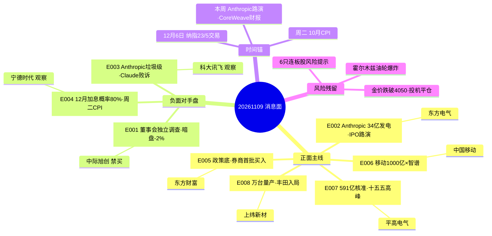

# 2026年11月9日 · **消息面事件驱动**

> **数据源新鲜度**: ok · **降级状态**: false · **置信度**: 0.66
> **覆盖窗口**: 72h+（11-06 09:10 → 11-09 05:59） · **主源**: 财联社快讯+新浪 + 21号公众号RSS(40篇) + 东财三季报预告 + R7资金面

## 一句话结论
英伟达CEO丑闻+美联储12月加息双压 AI硬件链, 国常会稳市+移动算力+特高压+机器人万台对冲; 修复窗口观察日, 只做低位政策/算力, 不接海外映射高位

## 🗺️ 消息面全景图

## 🎯 顶级事件详解

### E20261109_001 · 英伟达CEO黄仁勋婚外情致歉 董事会启动独立调查 暗盘跌超2% · strength=high · polarity=负面

**事件摘要**: 英伟达CEO黄仁勋婚外情致歉 董事会启动独立调查 暗盘-2% 英伟达链情绪受压 · 独立源 5 条 · weighted_score=-0.85 · days_since=0 · 未衰减

**推理深度三问**:

**大资金意图**: 叠加上周民主党AI监管/数据中心放缓叙事 周一A股AI硬件链低开概率大; 但周五美股费半+4.21%修复窗口与丑闻对冲 需竞价验证; 单源族但三重官方确认+暗盘价格独立验证

**为什么走强**: 该事件是 high 强度 负面 催化; 叠加上周民主党AI监管/数据中心放缓叙事 周一A股AI硬件链低开概率大; 但周五美股费半+4.21%修复窗口与丑闻对冲 需竞价验证; 单源族但三重官方确认+暗盘价格独立验证

**逻辑够不够硬**: 叠加上周民主党AI监管/数据中心放缓叙事 周一A股AI硬件链低开概率大; 但周五美股费半+4.21%修复窗口与丑闻对冲 需竞价验证; 单源族但三重官方确认+暗盘价格独立验证

**首推票思维链**:

#### 中际旭创 300308.SZ · role=禁买·光模块高位

- **买入理由**: 光模块全球龙一 800G/1.6T出货占比行业第一 海外算力资本开支直接对标 英伟达链核心映射 · 板块联动 中际旭创 5 日主力净流出 -35.34 亿 光模块板块周五 -9% 级全线杀跌 · 资金 -35.34 亿 · 业绩催化 无预告

- **风险点**: 负面事件标的 不接反弹 高位持仓回避

- **止损条件**: 425.6（参考价 448.00 跌破 425.60（-5%）即止损离场 持仓不留 不接反弹）

- **可验证假设**: 若开盘30分钟内主力净额≤0或板块无涨停承接 → 假设不成立 当日回避

### E20261109_002 · Anthropic 34亿美元采购燃气发电机 本周启动IPO路演 AI算力基建新证据 · strength=high · polarity=正面

**事件摘要**: Anthropic斥34亿美元买燃气发电机供数据中心 本周启动IPO路演 AI算力基建新证据 · 独立源 5 条 · weighted_score=0.8 · days_since=0 · 未衰减

**推理深度三问**:

**大资金意图**: 复合事件: 腿1=11-08 34亿采购 腿2=11-08 OnePower GPU采购承诺 腿3=11-09 04:32 IPO路演; 与E003(估值遭砍)正负交织 同一主体的两面（错题本004精神）; 对A股映射为发电设备+算力基建 非直接订单

**为什么走强**: 该事件是 high 强度 正面 催化; 复合事件: 腿1=11-08 34亿采购 腿2=11-08 OnePower GPU采购承诺 腿3=11-09 04:32 IPO路演; 与E003(估值遭砍)正负交织 同一主体的两面（错题本004精神）; 对A股映射为发电设备+算力基建 非直接订单

**逻辑够不够硬**: 复合事件: 腿1=11-08 34亿采购 腿2=11-08 OnePower GPU采购承诺 腿3=11-09 04:32 IPO路演; 与E003(估值遭砍)正负交织 同一主体的两面（错题本004精神）; 对A股映射为发电设备+算力基建 非直接订单

**首推票思维链**:

#### 东方电气 600875.SH · role=研究观察·燃气轮机A股映射

- **买入理由**: 国内燃气轮机/发电设备龙头 Anthropic采购标的为美国供应商 东方电气为A股燃气发电映射 · 板块联动 电力设备板块 5 日主力净流入 +104.2 亿(R7 seesaw) 11-06 单日 -50.06 亿 回补方也在退 · 资金 +0.50 亿 · 业绩催化 无预告

- **风险点**: 事件驱动标的 板块资金或未确认 只做龙头与低位

- **止损条件**: 21.0（参考价 22.69 跌破 21.00（-7.4%）离场 事件驱动映射度中等 不追高）

- **可验证假设**: 若开盘30分钟内主力净额≤0或板块无涨停承接 → 假设不成立 当日回避

### E20261109_004 · 非农16.5万远超预期 美联储12月加息概率升至80% 本周二CPI定生死 · strength=high · polarity=负面

**事件摘要**: 非农16.5万远超预期 美联储12月加息概率升至80% 本周二CPI定生死 · 独立源 4 条 · weighted_score=-0.689 · days_since=1 · 未衰减

**推理深度三问**:

**大资金意图**: 宏观压制: 利率期货12月加息概率80% 市场预计本轮还可能累计加息约两次; 对A股: 高估值成长承压 但A股已提前调整4个月 独立行情逻辑仍在; 本周40股解禁441.85亿亦为资金面扰动

**为什么走强**: 该事件是 high 强度 负面 催化; 宏观压制: 利率期货12月加息概率80% 市场预计本轮还可能累计加息约两次; 对A股: 高估值成长承压 但A股已提前调整4个月 独立行情逻辑仍在; 本周40股解禁441.85亿亦为资金面扰动

**逻辑够不够硬**: 宏观压制: 利率期货12月加息概率80% 市场预计本轮还可能累计加息约两次; 对A股: 高估值成长承压 但A股已提前调整4个月 独立行情逻辑仍在; 本周40股解禁441.85亿亦为资金面扰动

**首推票思维链**:

#### 宁德时代 300750.SZ · role=观察·外资买入 vs 加息压制

- **买入理由**: 新能源全球龙头 外资机构过去一周持续买入(人民财讯) 高估值成长对利率敏感 · 板块联动 锂电池 5 日主力净流入 +28.02 亿(R7 seesaw) 宁德时代 5 日 +30.45 亿 外资买入证据 · 资金 +30.45 亿 · 业绩催化 无预告

- **风险点**: 负面事件标的 不接反弹 高位持仓回避

- **止损条件**: 242.0（参考价 254.22 跌破 242.00（-4.8%）离场 或外资5日净流入转负即走）

- **可验证假设**: 若开盘30分钟内主力净额≤0或板块无涨停承接 → 假设不成立 当日回避

### E20261109_005 · 国常会今年首提稳市机制 26家券商申请700亿互换便利 6家已首批买入 · strength=high · polarity=正面

**事件摘要**: 国常会今年首提稳市机制 26家券商申请700亿互换便利 6家已首批买入 · 独立源 5 条 · weighted_score=0.689 · days_since=1 · 未衰减

**推理深度三问**:

**大资金意图**: 原发生日: 国常会11-06盘后; 共识形成日11-08(周末公众号/研报传播); 政策底信号 但中信建投提示: 本周属超跌技术性修复 趋势性反转基础尚不牢固; 若周一券商高开回落 政策底逻辑转弱

**为什么走强**: 该事件是 high 强度 正面 催化; 原发生日: 国常会11-06盘后; 共识形成日11-08(周末公众号/研报传播); 政策底信号 但中信建投提示: 本周属超跌技术性修复 趋势性反转基础尚不牢固; 若周一券商高开回落 政策底逻辑转弱

**逻辑够不够硬**: 原发生日: 国常会11-06盘后; 共识形成日11-08(周末公众号/研报传播); 政策底信号 但中信建投提示: 本周属超跌技术性修复 趋势性反转基础尚不牢固; 若周一券商高开回落 政策底逻辑转弱

**首推票思维链**:

#### 东方财富 300059.SZ · role=研究首选·券商情绪龙头

- **买入理由**: 互联网券商龙头 两市成交额1.67万亿 券商业绩与市场活跃度直接挂钩 · 板块联动 东方财富 5 日主力净流入 +7.86 亿 稳市政策直接受益 券商为政策底首选载体 · 资金 +7.86 亿 · 业绩催化 无预告

- **风险点**: 事件驱动标的 板块资金或未确认 只做龙头与低位

- **止损条件**: 17.7（参考价 18.78 跌破 17.70（-5.7%）离场 政策催化低于预期即走）

- **可验证假设**: 若开盘30分钟内主力净额≤0或板块无涨停承接 → 假设不成立 当日回避

### E20261109_006 · 中国移动2027算力投资超1000亿 与智谱签约GLM接入移动云 国产算力加速 · strength=high · polarity=正面

**事件摘要**: 中国移动2027算力投资超1000亿 与智谱签约GLM接入移动云 国产算力加速 · 独立源 4 条 · weighted_score=0.689 · days_since=1 · 未衰减

**推理深度三问**:

**大资金意图**: 腿1=移动网络大会(11-06) 腿2=与智谱签约(11-08) 腿3=泛全联盟策略(11-08); KOL称token出海为周末发酵最多叙事 移动算力为其国内腿; 与E003(海外AI估值遭砍)正负对冲

**为什么走强**: 该事件是 high 强度 正面 催化; 腿1=移动网络大会(11-06) 腿2=与智谱签约(11-08) 腿3=泛全联盟策略(11-08); KOL称token出海为周末发酵最多叙事 移动算力为其国内腿; 与E003(海外AI估值遭砍)正负对冲

**逻辑够不够硬**: 腿1=移动网络大会(11-06) 腿2=与智谱签约(11-08) 腿3=泛全联盟策略(11-08); KOL称token出海为周末发酵最多叙事 移动算力为其国内腿; 与E003(海外AI估值遭砍)正负对冲

**首推票思维链**:

#### 中国移动 600941.SH · role=研究首选·算力投资直接主体

- **买入理由**: 事件直接主体 2027算力投资超1000亿 与智谱GLM深度绑定 移动云MaaS平台 · 板块联动 电信运营商 11-06 行业主力净流入 +4.05 亿(R7) 中国移动 5 日 +1.68 亿 · 资金 +1.68 亿 · 业绩催化 无预告

- **风险点**: 事件驱动标的 板块资金或未确认 只做龙头与低位

- **止损条件**: 100.0（参考价 103.49 跌破 100.00（-3.4%）离场）

- **可验证假设**: 若开盘30分钟内主力净额≤0或板块无涨停承接 → 假设不成立 当日回避

### E20261109_007 · 国网一交两直591亿核准 特高压进入十五五核准开工高峰 5万亿电网投资开启 · strength=high · polarity=正面

**事件摘要**: 国网一交两直591亿核准 特高压进入十五五核准开工高峰 5万亿电网投资开启 · 独立源 4 条 · weighted_score=0.646 · days_since=1 · 未衰减

**推理深度三问**:

**大资金意图**: 阿坝1000kV世界海拔最高特高压变电站年底投运 刷新多项纪录; R7显示电力设备5日+104.2亿回补 资金确认度高; 但周五电力设备单日-50.06亿 回补方也在退 需竞价验证; 主设备: 换流阀/变压器/直流支撑电容器/功率半导体

**为什么走强**: 该事件是 high 强度 正面 催化; 阿坝1000kV世界海拔最高特高压变电站年底投运 刷新多项纪录; R7显示电力设备5日+104.2亿回补 资金确认度高; 但周五电力设备单日-50.06亿 回补方也在退 需竞价验证; 主设备: 换流阀/变压器/直流支撑电容器/功率半导体

**逻辑够不够硬**: 阿坝1000kV世界海拔最高特高压变电站年底投运 刷新多项纪录; R7显示电力设备5日+104.2亿回补 资金确认度高; 但周五电力设备单日-50.06亿 回补方也在退 需竞价验证; 主设备: 换流阀/变压器/直流支撑电容器/功率半导体

**首推票思维链**:

#### 平高电气 600312.SH · role=研究观察·特高压主设备龙头

- **买入理由**: 特高压开关设备龙头 财联社明日主题前瞻正文直接点名 高海拔GIL先发 拉萨换流站首个应用 · 板块联动 电网设备板块周五走高(太阳电缆涨停) 电力设备 5 日主力净流入 +104.2 亿(R7) · 资金 -0.07 亿 · 业绩催化 无预告

- **风险点**: 事件驱动标的 板块资金或未确认 只做龙头与低位

- **止损条件**: 20.8（参考价 21.76 跌破 20.80（-4.4%）离场 或板块无涨停承接即走）

- **可验证假设**: 若开盘30分钟内主力净额≤0或板块无涨停承接 → 假设不成立 当日回避

### E20261109_008 · 上纬新材启元机器人1万台下线 拓斯达Star发布 丰田设机器人部门 产业化提速 · strength=high · polarity=正面

**事件摘要**: 上纬新材启元机器人1万台下线14天翻倍 拓斯达Star发布 丰田设机器人部门 产业化提速 · 独立源 5 条 · weighted_score=0.646 · days_since=1 · 未衰减

**推理深度三问**:

**大资金意图**: 催化最密集: 万台量产/拓斯达Star/丰田机器人部门/智元进博会/英伟达VLA提速3.4倍; R7口径机器人板块资金5日净流出 属事件驱动非资金驱动 只做龙头与低位 不接中位杂毛

**为什么走强**: 该事件是 high 强度 正面 催化; 催化最密集: 万台量产/拓斯达Star/丰田机器人部门/智元进博会/英伟达VLA提速3.4倍; R7口径机器人板块资金5日净流出 属事件驱动非资金驱动 只做龙头与低位 不接中位杂毛

**逻辑够不够硬**: 催化最密集: 万台量产/拓斯达Star/丰田机器人部门/智元进博会/英伟达VLA提速3.4倍; R7口径机器人板块资金5日净流出 属事件驱动非资金驱动 只做龙头与低位 不接中位杂毛

**首推票思维链**:

#### 上纬新材 688585.SH · role=研究首选·消费级具身智能直接标的

- **买入理由**: 启元机器人第10000台个人机器人下线 月活超98% 日均在线3小时 平均每人每天交互100多次 · 板块联动 人形机器人产业链周末催化最密集 龙虎榜月回顾: 机器人人气股襄阳轴承3连板 · 资金 +1.37 亿 · 业绩催化 无预告

- **风险点**: 事件驱动标的 板块资金或未确认 只做龙头与低位

- **止损条件**: 170.0（参考价 180.02 跌破 170.00（-5.6%）离场）

- **可验证假设**: 若开盘30分钟内主力净额≤0或板块无涨停承接 → 假设不成立 当日回避

### E20261109_003 · Anthropic IPO估值遭砍 或获垃圾级评级 Claude Max虚标败诉 AI应用估值承压 · strength=medium · polarity=负面

**事件摘要**: Anthropic IPO估值遭砍或获垃圾级评级 叠加Claude Max虚标败诉 AI应用估值承压 · 独立源 3 条 · weighted_score=-0.516 · days_since=1 · 未衰减

**推理深度三问**:

**大资金意图**: 同一主体(Anthropic)负面腿 与E002正面腿正负交织; 美股AI一级市场定价下修 映射A股AI应用风险偏好 国产替代逻辑可部分脱钩

**为什么走强**: 该事件是 medium 强度 负面 催化; 同一主体(Anthropic)负面腿 与E002正面腿正负交织; 美股AI一级市场定价下修 映射A股AI应用风险偏好 国产替代逻辑可部分脱钩

**逻辑够不够硬**: 同一主体(Anthropic)负面腿 与E002正面腿正负交织; 美股AI一级市场定价下修 映射A股AI应用风险偏好 国产替代逻辑可部分脱钩

**首推票思维链**:

#### 科大讯飞 002230.SZ · role=观察·国产AI应用映射承压

- **买入理由**: 国产大模型/AI应用龙头 海外AI一级市场估值下修映射国内AI应用风险偏好 · 板块联动 AI应用板块周五普跌 科大讯飞 11-06 -2.30% 5日主力净流出 -0.46 亿 · 资金 -0.46 亿 · 业绩催化 无预告

- **风险点**: 负面事件标的 不接反弹 高位持仓回避

- **止损条件**: 36.2（参考价 38.25 跌破 36.20（-5.4%）离场 观察仓 不追）

- **可验证假设**: 若开盘30分钟内主力净额≤0或板块无涨停承接 → 假设不成立 当日回避

## 📊 板块 × 事件热力矩阵（净分）

| 板块 | 净分 | 判定 | 事件数 | 叉乘明细 | 位置/资金口径 |
|------|-----:|------|-------:|----------|----------------|
| AI算力基建(数据中心电力) | +0.800 | 🟢 正面 | 1 | 002 正面x1.00=+0.800 | Anthropic 34亿发电采购+IPO路演 算力资本开支新证据 数据中心电力链正面; 与E001英伟达治理丑闻对A股 |
| 燃气发电设备 | +0.800 | 🟢 正面 | 1 | 002 正面x1.00=+0.800 | AI公司迄今最大发电设备采购 燃气轮机/发电设备A股映射(东方电气); 但订单在美 映射度中等 |
| 券商 | +0.689 | 🟢 正面 | 1 | 005 正面x1.00=+0.689 | 国常会今年首提稳市+6家券商首批互换便利买入 政策底首选载体; 东方财富5日+7.86亿 资金确认; 若周一高开回落 政 |
| 国产算力(移动云) | +0.689 | 🟢 正面 | 1 | 006 正面x1.00=+0.689 | 中国移动2027算力投资超1000亿+智谱GLM接入移动云 国产算力硬投资; 与E003海外AI估值遭砍对冲 国产替代占 |
| 特高压 | +0.646 | 🟢 正面 | 1 | 007 正面x1.00=+0.646 | 国网一交两直591亿核准 十五五核准开工高峰; R7电力设备5日+104.2亿 资金确认高; 但11-06单日-50.0 |
| 人形机器人零部件 | +0.646 | 🟢 正面 | 1 | 008 正面x1.00=+0.646 | 万台量产/拓斯达Star/丰田机器人部门催化最密集; 板块资金5日净流出 事件驱动非资金驱动 只做龙头与低位 |
| 大盘权重/沪深300 | +0.482 | 🟢 正面 | 1 | 005 正面x0.70=+0.482 | 稳市机制受益 指数权重托底预期; 券商/银行11-06逆势净流入 防御脉冲 |
| 通信运营商 | +0.482 | 🟢 正面 | 1 | 006 正面x0.70=+0.482 | 中国移动算力投资直接受益 运营商11-06主力净流入+4.05亿 |
| 电网设备 | +0.452 | 🟢 正面 | 1 | 007 正面x0.70=+0.452 | 特高压核准传导 太阳电缆周五涨停 板块资金面尚可 |
| 消费级具身智能 | +0.452 | 🟢 正面 | 1 | 008 正面x0.70=+0.452 | 上纬新材启元万台 消费级具身智能商业化提速 月活98% 但估值已大涨40%+ 追高需谨慎 |
| AI应用 | +0.121 | 🟢 正面 | 2 | 006 正面x0.70=+0.482; 003 负面x0.70=-0.361 | 分歧偏正(0.121 刚过阈值): 国产大模型落地(移动×智谱+0.482) vs 海外AI估值遭砍(-0.361) 国 |
| 半导体(海外映射) | -0.035 | 🟡 分歧 | 2 | 001 负面x0.70=-0.595; 002 正面x0.70=+0.560 | 分歧(-0.035): 英伟达治理丑闻(-0.595) vs Anthropic GPU采购需求(+0.560) 对冲; |
| 港股科技 | -0.482 | 🔴 负面 | 1 | 004 负面x0.70=-0.482 | 12月加息预期压制港股科技 恒生科技周五跌1.83% 纳指ETF溢价停牌显示资金仍追逐美股科技 |
| 成长股(高估值) | -0.689 | 🔴 负面 | 1 | 004 负面x1.00=-0.689 | 12月加息概率80% 高估值成长承压; 本周二10月CPI关键 若超预期成长股再杀一波 |
| AI算力硬件(海外链) | -0.850 | 🔴 负面 | 1 | 001 负面x1.00=-0.850 | 英伟达CEO丑闻+上周民主党AI监管/数据中心放缓 海外算力链情绪双杀; 周五费半+4.21%修复窗口被周末利空覆盖 |
| 光模块/CPO | -0.850 | 🔴 负面 | 1 | 001 负面x1.00=-0.850 | 中际旭创5日主力-35.34亿 港股AI新股破发 基石浮亏124亿 光模块高位持仓回避 |
| 存储芯片 | -0.850 | 🔴 负面 | 1 | 001 负面x1.00=-0.850 | 暗盘SK海力士-1%/闪迪-2.3%(美光周五+8%后回落) 存储链情绪未稳; 江波龙周期见顶教训(单季环比-36~-4 |

**sector_cross_summary（多事件行）**:

- **AI应用** · 净分 +0.121 · 正面 · 2 事件 → 分歧偏正(0.121 刚过阈值): 国产大模型落地(移动×智谱+0.482) vs 海外AI估值遭砍(-0.361) 国产替代逻辑占优 但海外映射波动大
- **半导体(海外映射)** · 净分 -0.035 · 分歧 · 2 事件 → 分歧(-0.035): 英伟达治理丑闻(-0.595) vs Anthropic GPU采购需求(+0.560) 对冲; 海外映射钝化 A股半导体设备/制造已缩圈独立走强(R7: 半导体设备5日+118.34亿 vs 元件-127.71亿)

## 🔥 业绩预告命中（硬 alpha 交叉验证）

| 代码 | 名称 | 预告类型 | 增速下限-上限 | 事件命中 | 逻辑强度 |
|------|------|----------|--------------|----------|:--:|
| 002916.SZ | 深南电路 | 预增 | 74.13%~88.73% | FBC(分红提议≥净利35%) | 🟢🟢🟢 |
| 601969.SH | 海南矿业 | 预增 | 77.30%~124.36% | FBC(布谷尼锂矿发运12万吨) | 🟢🟢 |
| 300223.SZ | 君正股份 | 预增 | 2595%(Q3单季净利同比) | FBC(1.5亿回购改注销) | 🟢🟢 |
| 688827.SH | 钶锐锶 | 预增 | 37.65%~57.89% | 11-10 科创板上市(IPO公告) | 🟡 |

> 说明: 三季报预告按**单季环比**(QoQ)口径复核——深南电路/海南矿业预告为累计同比背景, 事件驱动不靠同比绝对值; 周期股/高位业绩票不因预告数字追高(江波龙案教训)

## 🚀 首板候选池（FBC · 消息侧有明确刺激）

| 代码 | 名称 | 板块 | 质量 | 独立源 | 命中 | 风险标记 | 5日主力(亿) |
|------|------|------|------|-------:|-----:|----------|-----------:|
| 600941.SH | 中国移动 | 电信运营 | high | 4 | 21 | — | 1.68 |
| 688585.SH | 上纬新材 | 化工原料(启元机器人) | high | 4 | 7 | — | 1.37 |
| 600801.SH | 华新建材 | 水泥 | high | 3 | 7 | 5日涨幅28.3% | -0.13 |
| 688048.SH | 长光华芯 | 半导体(光芯片) | high | 3 | 6 | 5日主力净流出 | -0.52 |
| 300750.SZ | 宁德时代 | 电气设备 | high | 2 | 5 | — | 30.45 |
| 300607.SZ | 拓斯达 | 专用机械 | high | 2 | 4 | 5日主力净流出 | -0.75 |
| 002916.SZ | 深南电路 | 元器件(PCB) | high | 2 | 3 | 5日主力净流出;5日跌幅14.2% | -8.98 |
| 603920.SH | 世运电路 | 元器件 | medium | 1 | 6 | 5日主力净流出 | -0.47 |
| 002792.SZ | 通宇通讯 | 通信设备 | medium | 1 | 2 | — | 0.23 |
| 300223.SZ | 君正股份 | 半导体 | medium | 1 | 2 | 换手10.9%高位 | 4.82 |
| 601969.SH | 海南矿业 | 普钢(锂矿) | medium | 1 | 2 | — | -0.11 |
| 600312.SH | 平高电气 | 电气设备 | medium | 1 | 1 | 单源官方前瞻 | -0.07 |
| 002074.SZ | 国轩高科 | 电气设备(电池) | medium | 1 | 1 | — | -0.05 |
| 000030.SZ | 富奥股份 | 汽车配件 | medium | 1 | 1 | — | -0.06 |

> 排序键=quality→source_count→hit_count, 不因可交易性重排; 停牌票加 tradable_today=false 由 D1 过滤; 全部 direct_name_match, lead_stock_proxy 本会话无概念榜数据故空缺（见审计 🔴）

## 🔻 次级负面事件（必须输出 · 红线3）

| 事件 | 杀伤面 | 强度 | 说明 |
|------|--------|------|------|
| 暗盘金价跌破4050美元 高盛: 主因投机资金大规模平仓 | 板块级 黄金,白银 | medium | 与SEC01(央行增持)背离: 央行长线底仓 vs 投机盘平仓; 白银暗盘跌破47美元 日内-0.4% |
| 港股AI产业链新股密集破发 中际旭创等52家基石浮亏124亿 | 板块级 AI硬件,光模块 | medium | 港股前三季IPO破发率87%; AI硬件一级/二级定价双杀 映射A股AI硬件风险偏好 |
| 欧洲多国爆发反对数据中心抗议 抵制AI数据中心浪潮席卷欧洲 | 板块级 数据中心,AI算力 | medium | 与E001英伟达丑闻同向 海外算力监管/社会阻力叙事强化; 但Anthropic 34亿采购(E002)反向证明资本开支仍强 |
| 市场传超级AI禁令利空引发下挫 下周行情以求稳为主 | 板块级 AI应用,算力 | medium | 传闻未证实 中信建投观点: 市场可能过度交易民主党AI监管风险 调整后担忧或缓和 |
| 比特币跌破74000美元 以太坊-7.57% 加密货币风险资产承压 | 板块级 风险资产,科技成长 | medium | 比特币跌破74000 日内-2.99%; 全球风险偏好降温 与E004加息预期同向 |
| 英伟达约7600万元AI芯片与硬件货物被盗 警方未抓获嫌疑人 | 个股级 AI芯片 | low | 与E001同主体 治理/运营负面叠加 均为英伟达链情绪压制 |
| 6只连板股集体风险提示 东方海洋13天8板 阳光照明7天6板 鲁阳节能6天5板 | 板块级 连板股,玄学股 | medium | 东方海洋净利-6793万仍亏损 阳光照明股价偏离基本面 鲁阳节能非理性波动; 高位连板退潮风险 情绪面压制题材股 |
| 新一轮微短剧专项治理工作启动 AI短剧概念承压 | 板块级 微短剧,AI应用 | medium | 周末要闻: 新一轮微短剧专项治理启动; 浙文影业5连板后公告无AI短剧业务(见NEG07) 短剧概念周一承压 |

## 关键证据

- 证据 1: 英伟达董事会 04:02 启动对 CEO 独立调查 + 黄仁勋 04:04 致歉 + 04:28 内部信 + 暗盘 -2% · 来源 news_cls:sina · 2026-11-09
- 证据 2: Anthropic 34亿美元燃气发电机采购(AI 公司迄今最大发电设备订单) + 本周启动 IPO 路演 · 来源 华尔街见闻/同花顺/新浪 · 2026-11-08/09
- 证据 3: 国常会部署完善资本市场稳市机制(今年首次提及股市) + 6家券商互换便利首批买入 · 来源 公众号/新浪/天风 · 2026-11-06/08
- 证据 4: 央行 10 月末黄金储备 7830 万盎司, 环比 +83 万盎司, 连续 24 个月增持, 增持量创近两年最大 · 来源 news_cls:sina · 2026-11-08
- 证据 5: 中国移动 2027 算力投资超 1000 亿(采购总规模超 5000 亿) + 与智谱签署合作协议 · 来源 news_cls:sina · 2026-11-08
- 证据 6: 上纬新材启元机器人第 10000 台下线, 14 天从 5000 到 10000, 月活超 98% · 来源 证券时报/新浪 · 2026-11-08
- 证据 7: R7 资金: 半导体设备 5 日 +118.34 亿 vs 元件 -127.71 亿(缩圈); 电力设备 5 日 +104.2 亿; 11-06 主力单日 -528.52 亿 · 来源 R7_capital_flow · 2026-11-09

## 数据源审计

| 源 | 日期 | 状态 | 备注 |
|---|---|:--:|---|
| tushare/news_cls | 2026-11-09 | 🟢 | 2200 条 · 72h+ 回看(11-06~11-09) |
| tushare/news_major | 2026-11-09 | 🟢 | 800 条 · 仅标题可用 |
| eastmoney/earnings_predict | 2026-11-09 | 🟢 | 500 条 · 2026Q3 预告 |
| wechat_official_rss | 2026-11-09 | 🟢 | 40 篇 · 17 源(盘前纪要等 6 源空 feed) |
| wechat_cli_5groups | 2026-11-09 | 🟡 | 0 条 · 周末群消息缺档 |
| anns_window | 2026-11-09 | 🟢 | 76 条 · 44 家 |
| tushare moneyflow_dc | 2026-11-09 | 🟢 | 22 只 · 5 日主力净额(东财DC口径=超大单+大单) |
| R7_capital_flow | 2026-11-09 | 🟢 | 只读复用 · 11-06 收盘口径 |
| xtick/hot_news | 2026-11-09 | 🔴 | MCP 本会话未接入 |
| hithink business/market | 2026-11-09 | 🔴 | 未接入 → top_pick 降级 llm_pure_no_verification |
| events_20261108/anns_classified | — | 🔴 | 前晚 event-tracker 产物缺失 |

## 不确定性 / 反证

- **英伟达丑闻单源族**: E001 全部来自 news_cls:sina 多时点, 虽为董事会官方行动+暗盘价格验证, 但无第二独立源族; 若周一开盘 A股 AI 硬件低开幅度 <1% 说明该利空已被上周定价, 反证 E001 权重
- **Anthropic 正负交织**: E002(34亿采购+路演) vs E003(估值遭砍+垃圾级) 同一主体的两面; 若路演定价低于预期, E002 正面逻辑被 E003 覆盖, AI 基建叙事转弱
- **政策底 vs 技术性修复**: 国常会稳市+券商买入是强信号, 但中信建投明确"本周属超跌技术性修复, 趋势性反转基础尚不牢固"; 若券商高开回落, 政策底逻辑转弱
- **12月加息预期**: 利率期货 80% 概率, 周二 10 月 CPI 若超预期 → 成长股再杀; 若 CPI 低于预期 → E004 负面权重下降, 科技修复窗口打开
- **机器人资金未确认**: E008 催化最密集但 R7 口径机器人板块资金 5 日净流出, 事件驱动非资金驱动; 若周一机器人高开无承接 → 只做低位首板, 不追高位
- **金价背离**: 央行增持(长线底仓) vs 暗盘跌破 4050(投机平仓), 黄金短线方向由投机盘决定, 不因央行数据追高
- **数据缺口**: 群聊 0 条、hithink 未接入、event-tracker 缺失 → 事件验证层单薄, 置信度压至 0.66

## 与其他 R/D/E 的关系

- 依赖: data/raw/20261109/* · R7_capital_flow_20261109.json · R1_style.json · emotion_cycle.json
- 被消费: R2 主线(R4 叙事共振) / R5 个股画像(六维验证 top_pick) / R6 反证(E001/E004 负面腿) / D1 预案(FBC 竞价强弱确认后右侧)

## Sub-Agent 元数据

- skill: analyze_news_impact_v1@1.7
- artifact: data/research/20261109/R4_news.json
- method: llm_v1(八事件聚合 · 板块极性叉乘 · FBC 候选池)
- 生成时刻: 2026-11-09T06:59:54+08:00
