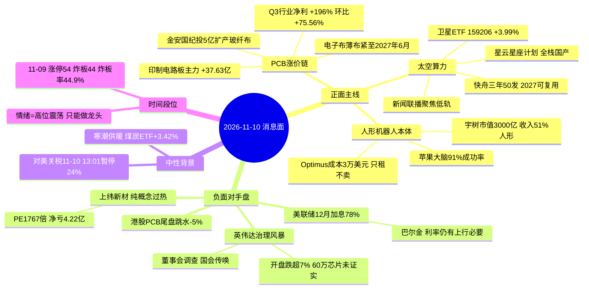
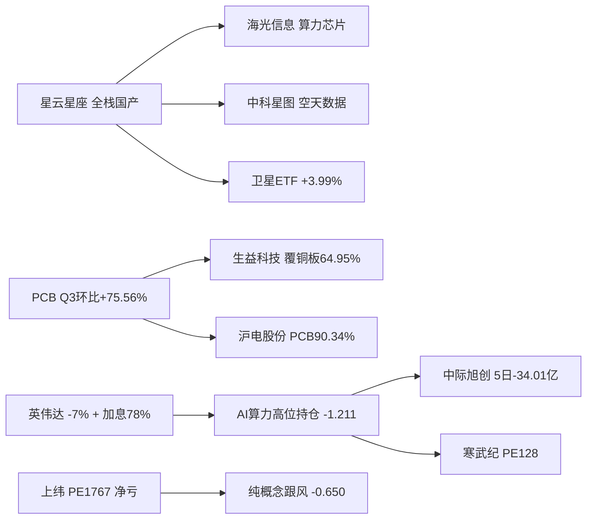

# 2026-11-10 · **消息面事件驱动**

> **数据源新鲜度**: partial · **降级状态**: true · **置信度**: 0.62
> **覆盖窗口**: 11-07 09:05 → 11-10 05:58（news_cls 2219 条 / news_major 800 条 / 公众号 83 篇 / 盘前公告 1447 条）
> **主源**: 财联社快讯 + 21 号公众号池（含「盘前纪要」每日 07:00 结构化盘前）+ 上海证券报/证券时报 + 东财三季报预告 + R7 资金
> **时间口径**: `date` = 该事件对 A 股可交易的第一日（盘后/隔夜腿归次日），`days_since` = trade_date − date；λ=0.15

## 一句话结论

**唯一正面新主线是「太空算力 + PCB 涨价」两条硬件腿，唯一硬负面对手盘是「英伟达治理风暴 + 12 月加息 78%」砸 AI 算力高位持仓；上纬新材 20cm 涨停后自曝 PE 1767 倍属跟风盘出货前兆，禁买。**

---

## 🗺️ 消息面全景图

**叙事传导链（flowchart）**

---

## 🎯 顶级事件详解

### E20261110_001 · 英伟达治理风暴升级 · strength=high · polarity=负面 · weighted=-0.850

**事件摘要**：11-09 17:23 美股盘前英伟达跌超 2%，23:27 开盘暴跌超 7%（上证报 23:22 记「大幅低开后拉起」），11-10 02:07 美国国会传唤黄仁勋、02:58 董事会已就相关争议展开调查，02:33 黄仁勋被移出 Anthropic 主办 CEO 论坛议程，Kalshi 定价其 2027 年底前离职概率 17%。同期路透报道「60 万块英伟达高级芯片在香港待运」，外交部 15:29 仅回应「立场是一贯的，具体情况建议向主管部门询问」——**未证实批准**。五源：news_cls:sina 多时点 + 上海证券报 + 证券时报。

**推理深度三问**:
- **大资金意图**: 这不是基本面事件，是**治理折价事件**。机构在 11-09 已经把「电子 +93.39 亿 / 光通信 +53.30 亿」的钱押进 AI 硬件，一夜之间核心资产 CEO 被国会传唤、被移出公开议程，机构的第一反应不是卖基本面而是**降 Beta**——把仓位从「总龙 + 高 PE」切到「低 PE + 有业绩」。这解释了为什么同日寒武纪 PE128 只涨 6.02% 而 PCB（PE 22 倍）板块放量 +3.07%。
- **为什么走强**: 严格说这条是**走弱**。A 股 11-09 只定价了「暗盘跌 2%」，隔夜 -7% + 国会传唤是全新的、盘前无法证伪的信息，因此明日开盘 AI 算力硬件必然承压；但上证报同时记录「低开后拉起」，说明美股资金把它当**治理事件**而非**产业证伪**，所以杀伤有天花板，属情绪面而非逻辑面。
- **逻辑够不够硬**: **半硬**。硬的部分：董事会调查 + 国会传唤 + 移出论坛三件都是可核验的公司/政治行动，不是传闻；软的部分：60 万块芯片是否批准**没有官方确认**，中际旭创/新易盛的订单并未被证伪。结论：按行业级利空处理（压制高位持仓），但不构成产业链证伪，**不卖基本面、只砍杠杆**。

**首推票思维链**:

#### 中际旭创 300308.SZ · role=禁买·光模块总龙
- **买入理由**: 没有买入理由——这是**禁买票**。列出的唯一目的是记录它是本次利空的**最大单一映射**：光通信收发模块占营收 98.99%（毛利率 46.59%，hithink 主营），11-09 成交额 167.40 亿元居 A 股第一（上证报 12:37），板块资金光通信 +53.30 亿；但个股 5 日主力 **-34.01 亿**、20 日 -37.61%、距 60 日高 **-55.5%**，板块强、个股弱的顶背离。
- **风险点**: 事件级利空 + 资金级背离 + 位置级低位（20 日分位 1.4）三重叠加，属「跌了很多但还在跌」的形态，不是低吸是接刀；一旦开盘再放量下杀，-5.46% 的止损位在跌停板前毫无保护作用。
- **止损条件**: 参考价 452.03 × 结构止损 **10 日低 427.34（-5.46%）**，同时 MA5 481.39 已成反压，跌破 427.34 即确认趋势二次破位，无条件离场。
- **可验证假设**: 若 11-10 开盘 30 分钟主力净额 ≤ 0 且成交额较前日萎缩 20% 以上，则「板块资金回补光模块」假设不成立，全日回避；若净额转正且站上 MA5 481.39，才可讨论修复。

#### 新易盛 300502.SZ · role=观察·光模块龙二
- **买入理由**: 光互联产品占营收 99.87%、海外收入 97.92%（hithink 主营），是光模块里**唯一 5 日主力净流入 +3.67 亿**的票（中际旭创 -34.01 亿、工业富联 -3.54 亿），说明资金在板块内部做了「弃总龙、留龙二」的切换；距 20 日高 -49.9%、位置分位 2.2，属深跌反抽位置。
- **风险点**: 事件是行业级负面，龙二的相对强势只在「板块不倒」前提下成立；RR 1.62 < 2，按纪律不能进执行池，只能观察；海外收入 97.92% 意味着它同时吃美股 AI 情绪与关税变量的双重 beta。
- **止损条件**: 参考价 176.00 × 10 日低 **161.16（-8.43%）**，与 R7 stop10 同源口径，跌破即反抽失败。
- **可验证假设**: 若 11-10 光通信模块板块主力净额仍为正（R7 口径 > 0）且新易盛跌幅小于中际旭创，则「龙二接力」假设成立，可上调为研究观察首选；若两者同步下杀则假设证伪。

---

### E20261110_003 · 星云星座计划落地 · strength=high · polarity=正面 · weighted=+0.732

**事件摘要**：11-09 2026 太空云产业生态大会（合肥）发布「星云星座计划」——中科院空天院与国内科创企业联合研发的**全栈国产化太空算力网**，产业化主体中科星云注册资本 15 亿元，由中科星图、中科曙光、海光信息、星图测控、曙光数创、中科卫星 6 家产业主体 + 10 家国资平台共 16 家发起。同日 19:54 快舟航天公布三年规划（快舟一号甲/十一号 50 次以上发射，2027 年快舟十二号固液混合、快舟六号可重复首飞入轨回收，发射成本 ≤2 万元/公斤）；新闻联播 19:53 要闻专题聚焦低轨互联网组网。卫星 ETF（159206）11-09 领涨 **+3.99%**。五源。

**推理深度三问**:
- **大资金意图**: 这是**唯一「政策 + 订单 + 官媒」三腿同日共振的新题材**。11-09 资金已经给了答案：卫星 ETF +3.99% 居 ETF 涨幅第一（news_cls 15:01），信维通信 20cm 涨停盘中封单 26 万手（上证报 10:06）——资金要的不是「航天概念」，而是**算力从地面卷到天上的新增量**，因为地面 AI 数据中心正被「电从哪里来、何时能投运」卡住（高盛 11-09 报告：2026 年 20GW / 2027 年 35GW 部署）。
- **为什么走强**: 三个硬约束同时被满足——① 技术体制有主体（空天院「太空云」概念体系 + 16 家发起主体的股权闭环，不是 PPT）；② 发射能力有排期（快舟 50 次/3 年 + 2027 可复用）；③ 有官方背书（新闻联播当晚专题）。A 股最怕「只有故事没有主体」，这次主体、排期、背书三样都有。
- **逻辑够不够硬**: **硬，但兑现远**。硬在产业链闭环真实存在（中科星云 6 家产业主体里 5 家是 A 股/北交所标的，可直接映射）；软在收入兑现要等星座组网（2027 年后），属于「主题投资」而非「业绩投资」。因此只能买**有当期业绩 + 已站上均线**的映射票（海光信息），不能买纯航天概念（中国卫星 20 日分位 100、昨日炸板）。

**首推票思维链**:

#### 海光信息 688041.SH · role=研究首选·星云算力芯片股东
- **买入理由**: 三重叠加——① 主营硬：集成电路产品占营收 99.90%、高端处理器 99.98%、毛利率 57.78%（hithink 主营），是**星云 6 家产业发起主体中唯一提供「国产高端算力芯片」的一家**（上证报 22:16 原文列明）；② 业绩硬：东财预告归母 +38.16%~51.93%（公告日 2026-10-30）；③ 资金硬：5 日主力 **+14.06 亿**、**5/5 个交易日全为正**，是本次 12 只候选里资金确认度最高的一只。技术上收盘 191.88 站上 MA5 186.34 与 MA20 190.45 **双线**，距 60 日高 -35.4%、位置分位 21.0，属右侧低吸而非追高。
- **风险点**: 加息 78% 对 PE 130 倍的国产算力估值是持续压制；星云星座的收入贡献在 2027 年之后，当下买的是「主题溢价 + 算力景气」而非星座订单；5 日 +8.41% 已有浮盈盘，开盘若冲高需防一致性兑现。
- **止损条件**: 参考价 191.88 × (1-0.06) = **180.37**，该位同时在 MA20 190.45 之下，跌破 MA20 即承认「双线右侧」假设失效，止损距 -6.0%。
- **可验证假设**: 若 11-10 半导体板块主力净额维持为正（R7 口径半导体 11-09 +23.12 亿）且海光不破 MA20 190.45，则右侧结构成立，RR 1.81 可上调至 T+1 试仓；若板块净额转负且跌破 MA20，假设当日证伪，全额离场。

#### 中科星图 688568.SH · role=研究观察·星云星座直接股东
- **买入理由**: 主营结构直接对上「空天数据」：商业航天占营收 19.69%（毛利率 53.72%）、地理信息特种 31.21%、低空经济 14.07%（hithink 主营）；作为中科星云 6 家产业主体之一「贯通空天数据与信息服务」。技术上是 12 只候选里**唯一同时站上 MA20（30.09）且 20 日 +12.22%** 的太空算力票，11-09 +2.53% 温和量增，距 60 日高 -16.2%。
- **风险点**: 资金几乎走平（5 日 +0.15 亿），说明映射尚未被主动资金认可；T+1 空间极小（5 日高 33.65 仅 +5.3%），RR 0.88 < 2，按纪律只能观察；单一源命中（公众号 3 次），独立源不足。
- **止损条件**: 参考价 31.96 × (1-0.06) = **30.04**，与 MA20 30.09 几乎重合（双支撑），跌破即趋势转弱，止损距 -6.01%。
- **可验证假设**: 若 11-10 商业航天方向出现 ≥2 只涨停且中科星图放量（成交额 > 前日 1.5 倍）站上 33.65，则「直接股东溢价」假设成立；若仅卫星 ETF 涨而个股不跟，则资金只买 beta 不买个股，维持观察不动手。

---

### E20261110_002 · PCB 供需两紧 · strength=high · polarity=正面 · weighted=+0.689

**事件摘要**：上海证券报 13:45 产业链调研——头部 PCB 厂商订单饱满、产能利用率均在 90% 以上，部分厂商售价与出货量同步上升；上游电子布供应偏紧、稀缺型号不足。国金证券口径：PCB 行业 2026 前三季营收 3324.60 亿（+45.09%）、归母 458.32 亿（+108.42%）；**Q3 营收 1463.39 亿（同比 +85.40%、环比 +41.27%），归母 240.94 亿（同比 +196.00%、环比 +75.56%）**。另一家 PCB 董秘称产品累计涨价约 30%（高端 40-50%、中低端 20%）。华创熊翊宇：Q4 仍有望提价但涨幅收窄，电子布整体供需紧张或 2027Q2 缓解，薄布紧到 2027 年 6 月。同日金安国纪公告投约 5 亿元新建年产 1.3 亿米电子级玻纤布（news_cls 16:35）。R7：印制电路板板块主力 **+37.63 亿**、涨幅 +3.07%，元件 +38.42 亿。

**推理深度三问**:
- **大资金意图**: 这是**唯一「业绩环比加速 + 板块资金第一」双确认的方向**。R7 显示 11-09 电子 +93.39 亿、PCB +37.63 亿，而全市场是「超大单 +130.88 亿托权重、中单小单 -133.24 亿离场」——钱不是在扩散，是在**收拢到少数有环比业绩的硬件环节**。PCB 正是这种「涨价可验证 + Q3 环比 +75.56%」的环节。
- **为什么走强**: 供需两端同时收紧：需求侧 AI 服务器 PCB 层数从 10 层升到 16-24 层、单台电子布用量是传统服务器 3-8 倍（方正证券）；供给侧薄布织机有限、产能跟不上，薄布紧到 2027 年 6 月。**上游紧缺 = 中游提价权**，这是本轮利润弹性的来源，而不是需求总量爆发。
- **逻辑够不够硬**: **硬，但有内部结构差**。硬：18 家 A 股 PCB 企业 Q3 营收全部同比增长、14 家净利同比增长或扭亏（上证报梳理），环比 +75.56% 是算术事实；结构差：传统中低端板提价是一次性的成本传导（熊翊宇明确说「中期较高毛利率较难持续」），真正的持续性只在**高端 AI 板与上游材料（电子布/覆铜板）**。同日港股 PCB 指数尾盘跳水 -5%、建滔积层板/芯碁微装双双 -10%，是同一产业链的反面腿——A 股收盘后港股杀跌，明日高开要防兑现。

**首推票思维链**:

#### 生益科技 600183.SH · role=研究首选·覆铜板龙头
- **买入理由**: 位置 + 业绩 + 环节三样都占优——① 环节：覆铜板和粘结片占营收 **64.95%**（毛利率 29.16%）、PCB 占 29.01%（hithink 主营），是「电子布紧缺 → 覆铜板提价」的直接受益方，不是被成本挤压的加工厂；② 业绩：东财预告归母 **+164%~181%**（公告日 2026-10-30），Q3 单季环比 **+58.7%**（PREDICT_HBMEAN 0.5868），符合 v1.5 协议「环比加速 + 产品涨价 → 正面」；③ 位置：收盘 70.68，距 60 日高 **-55.1%**、位置分位 **3.5**，MA20 99.18 远在上方，属深度调整后的极低位，向下空间被 10 日低 67.57 约束。
- **风险点**: 5 日主力 **-12.73 亿**、5 日 -13.89%，资金尚未回流（板块强而个股弱，与沪电同病）；港股 PCB 尾盘跳水说明外资在减这条链；提价是一次性成本传导，Q4 涨幅收窄已在卖方口径中明确。
- **止损条件**: 参考价 70.68 × (1-0.07) = **65.73**，位于 10 日低 67.57 之下，跌破 10 日低即「低位不再低」的结构破坏，止损距 -7.0%，RR(T+1 目标 81.20) = **2.13**。
- **可验证假设**: 若 11-10 覆铜板/电子布方向出现涨停或板块主力继续净流入（R7 口径元件/印制电路板 > 0）且生益站上 MA5 74.74，则「上游提价 + 低位修复」成立；若板块净流入但生益继续净流出，则是个股问题而非板块问题，降级剔除。

#### 沪电股份 002463.SZ · role=研究观察·PCB龙头
- **买入理由**: 纯正度最高——印刷电路板业务占营收 **90.34%**（毛利率 40.52%）、国外收入 81.58%（hithink 主营），是 AI 高层数板的主力供应商；东财预告归母 **+100.54%~109.74%**、Q3 单季环比 **+57.7%**，业绩弹性与生益同级；距 60 日高 -41.3%、位置分位 8.5，属低位。
- **风险点**: 5 日主力 **-12.42 亿**、5 日 -10.4%，且收盘 77.10 已在 MA5 79.08 下方——板块资金第一而龙头自己净流出，是典型的「板块强个股弱」；RR 1.77 < 2，纪律上不能进执行池；国外收入 81.58% 使其同时暴露在关税与美股情绪下。
- **止损条件**: 参考价 77.10 × 10 日低 **72.10（-6.49%）**，与 R7 stop10 一致，跌破即低位修复失败。
- **可验证假设**: 若 11-10 沪电主力净额转正且站回 MA5 79.08，则「龙头补涨」成立；若净额继续为负，即便板块涨也只能判定为「被动跟随」，维持观察。

#### 超声电子 000823.SZ · role=降级观察·首板低位前排
- **买入理由**: 唯一同时命中两个涨价环节的低位小票——印制线路板占营收 46.27%、覆铜板 23.42%（hithink 主营）；东财预告归母 **+90.78%~102%**、Q3 单季环比 **+193.9%**（弹性为候选池最高）；11-09 首板涨停（limit=U、limit_times=1），5 日主力 **+4.54 亿**，流通市值仅 106.3 亿，属低位前排。
- **风险点**: **T+1 上方空间只有 +1.5%（18.13）**，RR 0.19 —— 首板次日接力的赔率结构最差；炸板率 44.9% 的环境下首板胜率被系统性压低；毛利率仅 13.78%（PCB 环节最低），业绩弹性靠低基数不是靠定价权。
- **止损条件**: 参考价 17.86 × (1-0.08) = **16.43**，首板次日回踩不破此位才算强势，止损距 -8.01%。
- **可验证假设**: 若 11-10 竞价高开 ≥3% 且 9:35 前封板，则「低位前排接力」成立；若竞价平开或低开并破 17.24（MA5），则按一夜情处理，当日不参与。

---

### E20261110_005 · 上纬新材自曝风险 · strength=high · polarity=负面 · weighted=-0.650

**事件摘要**：11-09 晚间公司公告——短期股价涨幅过大，10-16 以来累计涨幅 **106.72%**，最新市盈率 **1767.36 倍**，显著高于化学原料行业水平；11-09 以 20cm 涨停收盘报 216.02 元（limit_times=1）。三季报：前三季营收 120893.29 万元（-5.51%）、归母净利 **-42197.92 万元**、扣非 -42541.46 万元。公司明确称「营业收入主要来自新材料业务，消费级具身智能机器人收入占比很低」，且产能爬坡/良率/订单转化/供应链均存在不确定。hithink 主营：化工行业占营收 **100%**，无人形机器人收入科目。三源（上证报 + 公司公告 + hithink）。

**推理深度三问**:
- **大资金意图**: 这是**跟风盘的出货窗口**。11-09 机器人板块由宇树（+9.04%、市值重回 3000 亿）定价，上纬作为「消费级机器人」映射被资金推到 20cm 涨停；当晚公司自己发文提示 PE 1767 倍与净亏 4.22 亿，等于把「我不值这个钱」写在公告里——大资金此刻要做的是**借明日高开把筹码交给追高者**，而不是继续拉升。
- **为什么走强**: 严格说是「为什么要卖」。它能 20cm 涨停的唯一理由是**板块情绪**（宇树 3000 亿 + 苹果大脑 91% + Optimus 只租不卖），而不是自身业绩：营收 -5.51%、净亏 4.22 亿、机器人收入占比极低。情绪驱动的高位票，在公司自曝风险后失去继续上涨的理由。
- **逻辑够不够硬**: **硬（负面方向）**。这是模式六「霸榜出货」的标准前兆：连板 + 估值离行业 10 倍以上 + 公司主动提示风险 + 主营业务不支撑。与 E004（宇树本体真催化）同板块同日出现，构成「真龙头 vs 纯概念」的分化，必须拆成两条独立事件，不能合并成一条「机器人利好」。

**首推票思维链**:

#### 上纬新材 688585.SH · role=禁买·纯概念过热
- **买入理由**: 无买入理由，**禁买**。化工收入占比 100%（hithink 主营）、机器人收入占比极低、前三季归母 -4.22 亿、PE 1767.36 倍，四项全部指向「纯情绪定价」。记录它是为了让 D1 把它从任何候选池中剔除，而不是等竞价强弱再判断。
- **风险点**: 20cm 票单日即可吃满 -10% 硬区间上限；若明日高开，追高者接的是公司自己提示风险的筹码；若明日低开，按 1 板 + 106.72% 累计涨幅，跌停连锁概率高。
- **止损条件**: 参考价 216.02 × (1-0.10) = **194.42**，这是机械记录位（禁买票不设交易止损），跌破即确认出货开始。
- **可验证假设**: 若 11-10 竞价高开 ≥5% 且 9:30-10:00 出现单笔 >5000 手砸盘，则「借高开出货」假设成立；若直接低开破 194.42，则假设亦成立但已无交易价值——两种情形都不参与。

---

### E20261110_004 · 人形机器人三重催化 · strength=high · polarity=正面 · weighted=+0.646

**事件摘要**：① 11-09 宇树科技盘中涨超 15%，总市值重回 3000 亿元（上证报 10:21），收盘 +9.04%；② 盘前纪要 07:00 收录苹果研究团队机器人大脑进展——6 个未预先建图的真实环境、360 次单项任务测试、平均成功率 **91%**，但明确「新增物理任务仍需人工写提示词与关键帧、机器人主要依赖视觉感知难感知接触，加触觉是后续方向」；③ 财联社早知道 21:34 转述马斯克：Optimus 初期制造成本约 **3 万美元**、或将「只租不卖」，英伟达称物理 AI 黄金时代并与三星/SK 海力士深化合作。三源 + 广发证券 SuperMimic 研报口径。

**推理深度三问**:
- **大资金意图**: 资金在做**「本体 vs 概念」的分层**。11-09 机器人涨停名单里祥明智能 20cm、光洋股份/华培动力/爱仕达/日盈电子 10cm，而上纬 20cm 后被公司自己提示风险——同一天同一板块出现「真本体（宇树收入 51% 来自人形）+ 纯映射（上纬化工 100%）」两极，资金必然向有收入验证的一端集中。
- **为什么走强**: 三个催化都指向**产业化门槛被跨过**：宇树工厂固定工序成功率接近 100%（王兴兴 11-05）、苹果大脑 91% 成功率、特斯拉成本曲线 3 万美元且转向租赁（降低客户门槛）。这不是「概念扩散」，而是「量产经济性」的三段证据。
- **逻辑够不够硬**: **硬在方向，软在节奏**。方向：人形机器人收入占比 51.07%（宇树，毛利率 63.18%）证明本体已能卖钱；软：苹果自己承认数据仍需人工、触觉感知缺失，说明泛化能力未解决。结论只买本体龙头，不买零部件扩散。

**首推票思维链**:

#### 宇树科技 688836.SH · role=观察·本体龙头高位
- **买入理由**: 本体纯度最高——人形机器人占营收 **51.07%**（毛利率 63.18%）、四足 41.05%（hithink 主营），是唯一「人形已占收入过半」的 A 股本体；11-09 盘中 +15%、收盘 +9.04%，市值重回 3000 亿，5 日主力 +1.26 亿且 3/5 日为正。
- **风险点**: 20 日 **+69.95%**、PE **516 倍**、位置分位 44.8，属高位高价股；流通市值仅 215.4 亿，波动放大；RR 0.88 < 2，且 10-09 起已连续放量，一致性买入风险高；与上纬同日涨停意味着板块情绪已到「跟风票 20cm」的晚期特征。
- **止损条件**: 参考价 716.00 × (1-0.07) = **665.92**，位于 MA5 666.65 之下，跌破 MA5 即短线转弱，止损距 -6.99%。
- **可验证假设**: 若 11-10 机器人板块出现 ≥5 只涨停且宇树维持 MA5 之上，则「本体龙头锁仓」成立；若板块涨停数不足 3 只或宇树跌破 MA5，则按高位退潮处理，只观察不参与。

---

### E20261110_008 · 美联储 12 月加息 78% · strength=medium · polarity=负面 · weighted=-0.516

**事件摘要**：11-09 07:04 利率期货显示 12 月累计加息 25bp 概率 **78%**、维持不变 22%；11-10 01:07 美联储巴尔金称「需求强劲、通胀居高难下，利率仍有上行必要，但加息步伐必须谨慎」；11-10 02:22 纽约联储调查显示消费者通胀预期稳定、但失业担忧升至 2020 年以来最高。三源。

**推理深度三问**:
- **大资金意图**: 这是**给 AI 算力高位持仓的第二根钉子**。R7 11-09 数据已经显示「超大单 +130.88 亿托权重、中单小单 -133.24 亿离场」——大资金在托指数、散户在撤，这种结构下加息预期会进一步压制 PE 100 倍以上的成长股，而不是压制低 PE 硬件。
- **为什么走强**: 严格说是「为什么压制」。78% 的加息概率是**可定价的既成预期**，但它与英伟达治理风暴同日叠加，把「AI 硬件高位」从单一事件风险升级为「事件 + 利率」双杀，这是本次唯一的行业级双重负面对手盘（合成 -1.211）。
- **逻辑够不够硬**: **中等硬**。硬：78% 是市场定价，不是观点；软：巴尔金同时强调「步伐必须谨慎」，且通胀预期稳定，说明这是「higher for longer」而非「加速加息」，对 A 股是估值压制而非流动性断裂。结论：减杠杆、不杀基本面。

**首推票思维链**:

#### 寒武纪 688256.SH · role=观察·高PE杀估值
- **买入理由**: 云端智能芯片及加速卡占营收 **99.98%**（毛利率 55.25%，hithink 主营），是国产算力纯正度最高的标的；11-09 +6.02%、5 日主力 **+13.25 亿**、4/5 日为净流入，资金面是全候选池第二强（仅次于海光 +14.06 亿）。
- **风险点**: PE **128.4 倍**，是加息预期最直接的靶子；距 60 日高 -29.8%、位置分位 21.9，但 MA20 895.37 仍在收盘 851.21 上方，说明尚未重回右侧；T+1 目标 881.88 仅 +3.6%，RR 0.51，赔率极差。
- **止损条件**: 参考价 851.21 × (1-0.07) = **791.60**，该位在 MA5 822.94 之下，跌破 MA5 即「反抽结束」，止损距 -7.0%。
- **可验证假设**: 若 11-10 半导体板块主力净额转负（R7 半导体 11-09 为 +23.12 亿）且寒武纪跌破 MA5 822.94，则「高 PE 杀估值」兑现；若板块净额维持为正且站上 MA20 895.37，则仅按强势震荡处理，不参与。

---

### E20261110_007 · 寒潮供暖煤炭 · strength=medium · polarity=正面 · weighted=+0.473

**事件摘要**：寒潮接连来袭、北方进入供暖季，取暖负荷提高带动刚性耗煤（上证报 12:37）；11-09 郑州煤电、安泰集团双双涨停，昊华能源、兖矿能源涨超 4%，煤炭 ETF（515220）**+3.42%**；广发证券：冬储需求稳步释放、各环节库存中位、动力煤价格维持高位震荡；开源证券：周期弹性（煤价上行、驱动由旺季需求转向供给收缩）+ 稳健红利双击。四源。

**推理深度三问**:
- **大资金意图**: 这是**科技主线的对冲腿**。11-09 沪指 +0.32%、创业板 -0.27%，煤炭 ETF +3.42% 与卫星 ETF +3.99% 同时居前——说明资金在做两件事：追新题材（太空算力）与买防御（煤炭），而不是全面加仓。煤炭的钱来自「红利 + 冷冬」的确定性，不是产业景气。
- **为什么走强**: 驱动是天气与库存，不是需求扩张：寒潮 → 取暖负荷 → 刚性耗煤 → 冬储补库，链条短、可验证、可证伪（气温回升即破）。这正是它只能做一夜情、不能做主线的根本原因。
- **逻辑够不够硬**: **软**。理由有三：① 涨停的是郑州煤电（流通 57.6 亿、毛利率 11.24%）与安泰集团（流通 33.4 亿）这类小盘弹性票，不是中国神华/陕西煤业这类真龙头；② 寒潮是**外生变量**，天气一转即证伪；③ 开源自己也把逻辑拆成「周期 + 红利」两半，说明单一驱动不足。结论：只作风格观察，不进候选。

**首推票思维链**:

#### 郑州煤电 600121.SH · role=降级观察·首板小盘
- **买入理由**: 煤炭占营收 **89.45%**（毛利率 11.24%，hithink 主营）的纯动力煤弹性标的，11-09 首板涨停（limit=U、limit_times=1），5 日主力 +1.39 亿，位置分位 37.7、距 60 日高 -24.3%，属低位。
- **风险点**: 流通市值仅 **57.6 亿**、毛利率 11.24% = 纯情绪弹性，无定价权；T+1 目标位即当日涨停价 4.73，RR **0.05** 等于零赔率；防御轮动的资金与科技主线互斥，明日科技若强则煤炭必然失血。
- **止损条件**: 参考价 4.73 × (1-0.08) = **4.35**，首板次日不破 MA5 4.36 才算有效，止损距 -8.03%。
- **可验证假设**: 若 11-10 气温预报继续下修且煤炭 ETF 主力净流入为正，则「冷冬交易」延续；若煤炭 ETF 转为净流出，则寒潮行情一日游，当日不参与。

---

### E20261110_006 · 对美关税续停 24% · strength=medium · polarity=中性 · weighted=+0.258

**事件摘要**：国务院关税税则委员会公告，自 **2026-11-10 13:01** 起，在 2 个月内继续暂停实施 24% 的对美加征关税税率、保留 10%，落实中美元首华盛顿会晤成果；中方注意到美方拟以 301 关税替代已被判决失效的 IEEPA 项下关税，将视情调整反制。三源（财政部原文 + 证券时报 + 上证报）。

**推理深度三问**:
- **大资金意图**: **没有大资金意图**——这是延续现状，不是新增利好。11-09 对美出口链（巨星科技 -2.54%、5 日主力 -0.36 亿）没有资金异动，说明市场早已把「24% 暂停」当成基准情形，公告只是把基准情形再确认两个月。
- **为什么走强**: 严格说「不涨」。它提供的是**尾部风险下降**（避免 11-10 之后立即加征），属于降低波动而非提高盈利，因此对板块净分贡献为 0（中性）。
- **逻辑够不够硬**: **时间锚硬、方向软**。硬：13:01 生效是今日盘中唯一可精确定时的政策事件；软：内容无增量，且美方 301 替代路径仍在，2 个月后仍是变量。结论：只作背景变量，不给方向，不据此下单。

**首推票思维链**:

#### 巨星科技 002444.SZ · role=观察·对美出口链
- **买入理由**: 工具五金占营收 **99.4%**（毛利率 33.48%，hithink 主营），对美出口占比高，是关税续停的直接名义受益方；PE 14.5 倍、距 60 日高 -7.1%、位置分位 68.3，属估值不高且位置中性的稳健标的。
- **风险点**: 中性事件无增量预期差，5 日主力 -0.36 亿说明资金不认；11-09 -2.54% 已跌破 MA5 28.82；RR 0.90，赔率不足；出口链同时受美国需求与汇率影响，关税只是其中一个变量。
- **止损条件**: 参考价 29.12 × (1-0.06) = **27.37**，同时低于 MA5 28.82，跌破即震荡转弱，止损距 -6.01%。
- **可验证假设**: 若 11-10 出口链（工具/家电/汽车零部件）出现 ≥3 只放量上涨且巨星站回 MA5，则「关税续停交易」成立；若无板块共振，则维持观察，不因单条政策新闻入场。

---

## 📊 板块 × 事件热力矩阵

| 板块 | 事件锚 | 净分 | 判定 | 事件数 | 叉乘明细 |
|------|--------|-----:|:----:|:--:|------|
| AI算力高位持仓 | E001 英伟达 + E008 加息 | **-1.211** | 🔴负面 | 2 | 001 负面×1.00=-0.850 / 008 负面×0.70=-0.361 |
| 光模块/CPO | E001 英伟达 | -0.850 | 🔴负面 | 1 | 001 负面×1.00=-0.850 |
| 太空算力/卫星互联网 | E003 星云星座 | **+0.732** | 🟢正面 | 1 | 003 正面×1.00=+0.732 |
| PCB/覆铜板 | E002 供需两紧 | **+0.689** | 🟢正面 | 1 | 002 正面×1.00=+0.689 |
| 纯概念跟风杂毛 | E005 上纬自曝 | -0.650 | 🔴负面 | 1 | 005 负面×1.00=-0.650 |
| 人形机器人 | E004 三重催化 | +0.646 | 🟢正面 | 1 | 004 正面×1.00=+0.646 |
| 英伟达供应链 | E001 英伟达 | -0.595 | 🔴负面 | 1 | 001 负面×0.70=-0.595 |
| 商业航天 | E003 快舟规划 | +0.512 | 🟢正面 | 1 | 003 正面×0.70=+0.512 |
| 电子布/玻纤 | E002 上游紧缺 | +0.482 | 🟢正面 | 1 | 002 正面×0.70=+0.482 |
| 港股PCB映射 | E002 港股跳水 | -0.482 | 🔴负面 | 1 | 002 负面×0.70=-0.482 |
| 物理AI感知(触觉/视觉) | E004 苹果大脑 | +0.452 | 🟢正面 | 1 | 004 正面×0.70=+0.452 |
| 成长股估值(高PE) | E008 加息 | -0.361 | 🔴负面 | 1 | 008 负面×0.70=-0.361 |
| 煤炭/动力煤 | E007 寒潮 | +0.331 | 🟢正面 | 1 | 007 正面×0.70=+0.331 |
| 燃气/供暖 | E007 寒潮 | +0.189 | 🟢正面 | 1 | 007 正面×0.40=+0.189 |
| 对美出口链 | E006 关税续停 | +0.000 | 🟡分歧 | 1 | 006 中性×0.70=+0.000 |

**sector_cross_summary（唯一多事件行）**：`AI算力高位持仓 = -1.211（负面，2 腿）`——英伟达治理风暴（-0.850，high）+ 美联储 12 月加息 78%（-0.361，medium）在同一板块叠加，是本次**唯一被两条独立事件共同砸中的方向**；与 R7「中单小单 -133.24 亿离场」同向，故高位算力只能减不能加。叉乘的价值正在此：单独看 E001 或 E008 都只是 -0.85 / -0.52 量级，叠加后才解释「为什么 11-09 电子板块资金 +93.39 亿，但光模块总龙 5 日仍是 -34.01 亿」。

---

## 🚀 首板候选池（消息侧直接点名 · 22 只）

按 `quality → source_count → hit_count` 排序，**不因可交易性重排**；风险只标记不排序。

| 名称 | 代码 | 消息侧主营 | 源数 | 命中 | 收盘 | 5日 | 5日主力(亿) | 昨日板 | 风险标记 |
|------|------|------|:--:|:--:|-----:|-----:|-----:|:--:|------|
| 宇树科技 | 688836.SH | 人形51.07%+四足41.05% | 4 | 15 | 716.00 | +8.1% | +1.26 | — | 高位高价 PE516 |
| 沪电股份 | 002463.SZ | PCB 90.34% | 4 | 9 | 77.10 | -10.4% | **-12.42** | — | 5日主力净流出 |
| 金安国纪 | 002636.SZ | 覆铜板 | 4 | 7 | 66.03 | +3.7% | **-4.08** | — | 5日主力净流出 |
| 超声电子 | 000823.SZ | PCB 46.27%+覆铜板23.42% | 3 | 11 | 17.86 | +3.4% | +4.54 | U 首板 | 次日接力需竞价验证 |
| 华培动力 | 603121.SH | 涡轮增压器→机器人 | 3 | 8 | 11.98 | +5.1% | +0.31 | U 首板 | 流通40.6亿小盘 |
| 郑州煤电 | 600121.SH | 煤炭 89.45% | 3 | 6 | 4.73 | +13.7% | +1.39 | U 首板 | 流通57.6亿小盘 |
| 安泰集团 | 600408.SH | 焦炭 | 3 | 6 | 3.32 | +1.8% | +0.53 | U 首板 | 流通33.4亿小盘 |
| 航天发展 | 000547.SZ | 通信设备(航天科工) | 3 | 4 | 12.78 | +2.0% | **-0.60** | — | 5日主力净流出 |
| 中科曙光 | 603019.SH | 服务器整机(星云股东) | 3 | 3 | 78.75 | +7.6% | +0.14 | — | — |
| 世运电路 | 603920.SH | PCB | 2 | 10 | 33.58 | +2.2% | +1.42 | U 首板 | 次日接力需竞价验证 |
| 信维通信 | 300136.SZ | 天线/射频 | 2 | 6 | 47.70 | +11.1% | +3.33 | Z 炸板 | 触板回落 情绪不接 |
| 顺灏股份 | 002565.SZ | 商业航天参股 | 2 | 5 | 10.54 | **+28.4%** | +6.92 | U 首板 | 5日涨幅偏热 |
| 胜宏科技 | 300476.SZ | AI板 | 2 | 5 | 131.42 | -2.7% | **-10.89** | — | 5日主力净流出 |
| 海光信息 | 688041.SH | 集成电路 99.9% | 2 | 3 | 191.88 | +8.4% | **+14.06** | — | — |
| 星图测控 | 920116.BJ | 卫星测运控(星云股东) | 2 | 3 | 36.66 | +5.1% | +0.18 | — | 北交所 |
| 中国卫星 | 600118.SH | 卫星 | 2 | 3 | 57.50 | +3.2% | +3.75 | Z 炸板 | 20日分位100+炸板 |
| 西部材料 | 002149.SZ | 稀有金属(航天) | 2 | 3 | 41.51 | +19.8% | +6.47 | U 首板 | 5日涨幅偏热 |
| 景旺电子 | 603228.SH | PCB | 2 | 6 | 57.59 | -10.0% | **-4.93** | Z 炸板 | 炸板+净流出 |
| 奥士康 | 002913.SZ | PCB | 1 | 6 | 58.42 | +4.6% | +1.71 | U 首板 | 单一源 |
| 光洋股份 | 002708.SZ | 轴承/丝杠 | 1 | 5 | 21.97 | +7.0% | +2.41 | U 首板 | 单一源 |
| 日盈电子 | 603286.SH | 汽车电子/机器人 | 1 | 5 | 55.36 | +4.6% | +0.30 | U 首板 | 单一源 |
| 中科星图 | 688568.SH | 商业航天19.69% | 1 | 3 | 31.96 | +10.2% | +0.15 | — | 单一源 |

**读法**：① 22 只里 10 只昨日涨停（U）——在炸板率 44.9% 的环境下首板次日胜率被系统性压低，D1 必须以竞价强弱二次确认；② 3 只昨日炸板（信维通信/中国卫星/景旺电子）直接标「情绪不接」；③ 资金与消息同向的只有 4 只（海光 +14.06 亿、顺灏 +6.92、西部材料 +6.47、超声 +4.54），其余多为「消息热、资金撤」。

---

## 🔥 业绩预告命中（三季报 · 东财 RPT_PUBLIC_OP_NEWPREDICT · 单季环比口径）

按 v1.5 协议，**同比只作背景，polarity 由单季环比 + 产品价格方向决定**。

| 代码 | 名称 | 预告类型 | 归母同比 | 单季环比(QoQ) | 事件命中 | 判定 |
|------|------|----------|----------|------|----------|:--:|
| 002463.SZ | 沪电股份 | 预增 | +100.54%~109.74% | **+57.7%** | E002 PCB | 🟢🟢🟢 环比加速 |
| 600183.SH | 生益科技 | 预增 | +164%~181% | **+58.7%** | E002 覆铜板 | 🟢🟢🟢 环比加速 |
| 000823.SZ | 超声电子 | 预增 | +90.78%~102% | **+193.9%** | E002 PCB | 🟢🟢🟢 环比最陡 |
| 688183.SH | 生益电子 | 预增 | +68%~75% | +20.0% | E002 PCB | 🟢 温和加速 |
| 688041.SH | 海光信息 | 预增 | +38.16%~51.93% | **-5.8%** | E003 星云股东 | 🟡 环比微降（营收 +50.47%~64.17% 仍强） |
| 001309.SZ | 德明利 | 扭亏 | +32046%~33154% | **+4.2%** | 存储(次选) | 🟡 同比炸裂但环比走平 → 不给正面 |
| 601138.SH | 工业富联 | — | 无预告 | — | — | ⚪ 不在本次事件映射 |

**三条硬结论**：
1. **PCB 链是唯一「同比 + 环比」双加速的板块**（沪电 +57.7% / 生益 +58.7% / 超声 +193.9%），与 E002 的提价逻辑自洽，不是估值故事。
2. **海光信息同比 +38~52% 但环比 -5.8%**，属「营收强、利润环比走平」；本次仍给研究首选，是因为它的驱动力是「星云国产芯片身份 + 5 日主力 5/5 全正」，而非单季利润加速——这一层必须写清，避免 D1 误读成业绩爆发。
3. **存储被剔除的原因**：德明利同比 +32046% 是低基数幻觉，单季环比仅 +4.2% 属走平（v1.5 陷阱表第 1/3 类），不足以支撑「存储高景气」的正面定性 → 只登记为次级事件。

---

## 关键证据

- 证据 1：PCB 行业 Q3 营收 1463.39 亿（+85.40%，环比 +41.27%）、归母 240.94 亿（+196.00%，环比 +75.56%）· 国金证券口径 · 上海证券报 2026-11-09 12:37
- 证据 2：头部 PCB 厂商产能利用率均在 90% 以上、电子布薄布紧至 2027 年 6 月 · 上海证券报 2026-11-09 13:45 产业链调研
- 证据 3：中科星云 6 家产业主体含海光信息（国产高端算力芯片）、中科曙光（服务器整机）、星图测控、曙光数创、中科卫星 · 上海证券报 2026-11-09 22:16
- 证据 4：快舟三年 50 次以上发射、2027 年快舟十二号/快舟六号可重复首飞、发射成本 ≤2 万元/公斤 · news_cls:10jqka 2026-11-09 19:54
- 证据 5：上纬新材 PE 1767.36 倍、10-16 以来 +106.72%、前三季归母 -42197.92 万元、扣非 -42541.46 万元 · 公司公告 + 上海证券报 2026-11-09 21:40
- 证据 6：英伟达开盘暴跌超 7%（23:27）+ 国会传唤黄仁勋（11-10 02:07）+ 董事会调查 · news_cls:sina 多时点
- 证据 7：美联储 12 月加息 25bp 概率 78% · news_cls:10jqka 2026-11-09 07:04
- 证据 8：印制电路板板块主力 +37.63 亿 / 涨幅 +3.07%，电子 +93.39 亿，光通信 +53.30 亿；全市场超大单 +130.88 亿、中单小单 -133.24 亿 · R7_capital_flow_20261110.json
- 证据 9：卫星 ETF（159206）+3.99% 居 ETF 涨幅第一，煤炭 ETF（515220）+3.42% · news_cls:sina 2026-11-09 15:01
- 证据 10：苹果机器人大脑 6 环境 360 次测试平均成功率 91%，触觉感知为后续方向 · 盘前纪要 2026-11-09 07:00

---

## 数据源审计

| 源 | 日期 | 状态 | 备注 |
|---|---|:--:|---|
| tushare/news_cls | 2026-11-10 | 🟢 | 2219 条 · 覆盖 11-07 09:05 → 11-10 05:58（72h 回看） |
| tushare/news_major | 2026-11-10 | 🟢 | 800 条 · 覆盖 11-09 16:37 → 11-10 04:44 |
| eastmoney/earnings_predict | 2026-11-10 | 🟢 | 500 条 · report_date 2026-09-30（三季报） |
| wechat_official_rss（21 号池） | 2026-11-10 | 🟢 | 83 篇 · 17 feed 全 ok · 含「盘前纪要」07:00 |
| anns_window（盘前公告窗口） | 2026-11-10 | 🟢 | 1447 条 · 覆盖上一交易时段至今 |
| R7_capital_flow | 2026-11-10 | 🟢 | 5 日主力净额 + 板块净流入 + 研究候选 |
| hithink business-query | 2026-11-10 | 🟢 | 11 次主营构成核验（官方 OpenAPI） |
| tushare daily（60 日历史） | 2026-11-10 | 🟢 | 13 只候选 · MA5/MA20/10 日低/60 日高 |
| wechat_cli_5groups | 2026-11-10 | 🔴 | 0 字节 · 7 群窗口内无消息 · KOL 腿缺失 |
| weflow-analytics | 2026-11-10 | 🔴 | Server not found in config |
| xtick/hot_news · datapro | 2026-11-10 | 🔴 | 本会话未接入（主控禁止 MCP 直调） |

---

## 不确定性 / 反证

1. **英伟达方向可能回摆**：上证报 23:22 记「大幅低开后拉起」，证券时报 23:27 记「开盘暴跌超 7%」——同夜两个方向。若美盘最终收红，明日 A 股算力未必低开，E001 的 -0.850 会被过度定价。这是本文最大的一处不确定性。
2. **60 万块芯片未获官方证实**：外交部仅称「立场是一贯的」，既不能证明批准也不能证明否决。任何据此推出「国产算力替代加速」的结论都是无源推论。
3. **PCB 的同产业链反面腿已出现**：港股 PCB 指数 11-09 尾盘跳水 -5%、建滔积层板/芯碁微装双双 -10%。A 股收盘后才发生，明日高开时外资已在减仓，这是板块内生的兑付压力。
4. **板块强、个股弱的普遍背离**：PCB 板块主力 +37.63 亿，但沪电 -12.42 亿、生益 -12.73 亿、胜宏 -10.89 亿、景旺 -4.93 亿。本文的两只 PCB 首选都是在「板块资金流入、个股资金流出」背景下选出，逻辑依赖「资金次日回补个股」，这本身是未验证假设。
5. **KOL 腿完全缺失**：wechat_cli 0 条、weflow down，无法与 R3 做交叉验证；所有 `kol_confirm` 均为「⚠️ 无交叉源」。单靠媒体 + 资金的结构，容易漏掉「盘口语言」类的强弱变化。
6. **上纬判定为负面但同板块仍有真龙头**：E004 与 E005 同日同板块方向相反，若资金不分层（连真龙头一起杀），则宇树的观察位也会失效——这正是本板块的二元风险。

---

## 与其他 R/D/E 的关系

- **依赖**：`data/raw/20261110/`（news_cls / news_major / wechat_official_20 / anns_window / earnings_predict）+ `data/research/20261110/R7_capital_flow_20261110.json`（资金口径）+ `data/research/20261109/emotion_cycle.json`（炸板率 44.9%）
- **被消费**：R2（主线候选：太空算力 / PCB 两条正腿 + AI算力高位负腿）、R5（对 12 只候选做六维画像）、R6（对 2 只研究首选做反证，重点质疑「板块强个股弱」的背离）、D1（研究池 → 竞价确认 → 执行池）
- **给 D1 的三条硬约束**：① 2 只研究首选（生益科技 RR 2.13 / 海光信息 RR 1.81，仓位各 ≤0.10）；② 其余 10 只全部为观察/降级/禁买，其中上纬新材、中际旭创为**禁买**；③ 首板池 22 只中 10 只昨日涨停、3 只昨日炸板，D1 必须以竞价强弱二次确认后才可进入执行层。

---

## Sub-Agent 元数据

- skill: analyze_news_impact_v1@1.7
- artifact: data/research/20261110/R4_news.json（8 事件 / 15 板块行 / 1 多事件叉乘 / 22 首板候选 / 12 只候选票）
- method: llm_v1.7（硬扩容五源 + 板块极性叉乘 + top_pick_logic + v1.5 业绩环比协议）
- 生成时刻: 2026-11-10T06:45:00+08:00
- confidence: 0.62（KOL 腿缺失 + 隔夜方向可能回摆）
