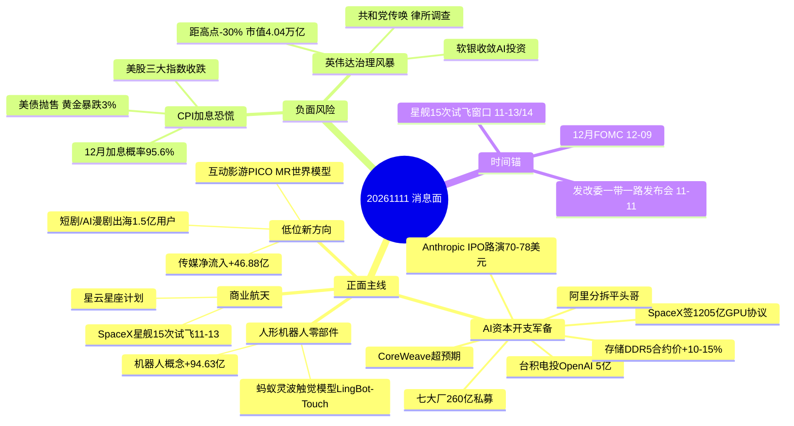

```yaml
date: 2026-11-11
agent: R4-news-impact
skill_version: analyze_news_impact_v1@1.7
generated_at: 2026-11-11T07:10:00+08:00
confidence: 0.60
degraded: true
data_sources:
  - name: tushare/news_cls
    path: data/raw/20261111/news_cls.jsonl
    status: ok
    captured_at: 2026-11-11T06:03:02+08:00
    record_count: 2660
    error: null
  - name: tushare/news_major
    path: data/raw/20261111/news_major.jsonl
    status: ok
    captured_at: 2026-11-11T06:03:02+08:00
    record_count: 800
    error: null
  - name: eastmoney/earnings_predict
    path: data/raw/20261111/eastmoney_earnings_predict.json
    status: ok
    captured_at: 2026-11-11T06:03:02+08:00
    record_count: 500
    error: null
  - name: wechat_official_rss(18号池)
    path: data/raw/20261111/wechat_official_20.jsonl
    status: ok
    captured_at: 2026-11-11T06:01:42+08:00
    record_count: 84
    error: null
  - name: wechat_cli_5groups
    path: data/raw/20261111/wechat_cli_5groups.jsonl
    status: error
    captured_at: 2026-11-11T06:01:54+08:00
    record_count: 0
    error: 7 群窗口内 0 条消息
  - name: anns_window(盘前公告窗口)
    path: data/raw/20261111/anns_window.jsonl
    status: ok
    captured_at: 2026-11-11T06:03:00+08:00
    record_count: 2211
    error: null
  - name: expectation_gap(个股级预期差对账)
    path: data/research/20261111/expectation_gap.json
    status: error
    captured_at: 2026-11-11T04:46:00+08:00
    record_count: 0
    error: no_input: 文章3篇/股票名录0只 未做个股级对账
  - name: R7_capital_flow
    path: data/research/20261111/R7_capital_flow_20261111.json
    status: ok
    captured_at: 2026-11-11T04:43:00+08:00
    record_count: 26
    error: null
  - name: R3_sentiment
    path: data/research/20261111/R3_sentiment.json
    status: error
    captured_at: null
    record_count: 0
    error: R3 未产出 无法 KOL 交叉
  - name: hithink/business-query
    path: skills/_shared/hithink-business-query
    status: ok
    captured_at: 2026-11-11T07:00:00+08:00
    record_count: 16
    error: null
  - name: tushare/moneyflow_dc
    path: MCP moneyflow_dc 20261104-20261110
    status: ok
    captured_at: 2026-11-11T07:00:00+08:00
    record_count: 8
    error: null
input_freshness: partial
input_freshness_note: KOL腿完全缺失(wechat_cli 0条+R3未产出) expectation_gap层no_input; 财联社/公众号/公告/东财预告四腿齐全 结论不依赖缺失腿
```


# 2026-11-11 · **消息面事件驱动**

> **数据源新鲜度**: partial · **降级状态**: degraded · **置信度**: 0.60
> **覆盖窗口**: 前 72h(11-08 09:13 → 11-11 06:00) · **主源**: 财联社快讯 + 18 号公众号池(**盘前纪要**) + 公告窗口 + 东财三季报预告 + R7 资金(东财 DC 主力净额口径)

## 一句话结论
隔夜美国 CPI 超预期引爆加息恐慌是 11-11 最大变量;消息面双主线 = AI 资本开支军备(Anthropic 260 亿私募 + 平头哥分拆)与低位传媒/短剧;修复段第 3 天只做低开承接与首板。

## 🗺️ 消息面全景图



## 🎯 顶级事件详解(每事件三问 + 首推票思维链)

### E20261111_001 · 美国CPI超预期→美联储加息恐慌 · strength=high · polarity=负面

**事件摘要**: 11-10 21:30 美国 10 月核心 CPI 环比 +0.3%(预估 +0.2%)超预期 → 市场 100% 定价 12 月加息 25bp(50bp 概率飙至 13.6%),洛根/沃勒/鲍曼集体放鹰,10Y 美债 5.02%,现货黄金暴跌 3%(沪金夜盘 -2.29%),美股三大指数收跌(纳指 -0.74%)。8 源确认(财联社多时点 + 证券时报/上证报公众号)。

**推理深度三问**:
- **大资金意图**: 通胀反复 = 全球流动性收紧预期再起。A 股修复段(11-09 起)正好走到第 3 天接力日,隔夜利空是对"修复段能否延续"的压力测试——资金会用竞价红盘率投票:昨日涨停竞价红盘率 ≥50% 则修复延续,否则降级一日反抽。
- **为什么走强**: 这条不是"板块事件"而是"市场级事件"。11-10 全市场主力才刚净流入 +173.37 亿(连续第 2 日),5 日窗口刚翻正到 +371.48 亿,CPI 冲击直接打在资金刚确认的修复趋势上;贵金属(黄金 -3%)、成长股估值(高利率压制)、港股映射三条线同时受击。
- **逻辑够不够硬**: **硬**。官方数据(美国劳工部)+ 8 独立源 + 全球资产同步反应(美债/黄金/美股/汇市)全部指向同一方向,不是传闻。缺陷是:12 月 FOMC 前仍是预期博弈,若后续 CPI 回落则利空出尽,方向存在回摆风险。

**首推票思维链**:

#### 中际旭创 300308 · 禁买·光模块总龙
- **买入理由**: 消息面逻辑本应最强(光模块总龙 + AI 资本开支军备),但纪律优先于逻辑——高位成长股在加息日不接,今日禁买。
- **风险点**: 距 60 日高仍深跌;美联储加息 + 美股科技回调(英伟达 -6%)双重压制;若高开回落则反抽结束。
- **止损条件**: 参考价 471.00 × 0.93 = 438.03(-7%)结构止损,破位即离场。
- **可验证假设**: 若开盘 30 分钟光模块板块净额 ≤0 且 5 日主力继续转卖 → 假设(修复延续)不成立,当日回避。

#### 山东黄金 600547 · 观察·贵金属龙头
- **买入理由**: 黄金逻辑(避险+央行增持)长期仍在,但隔夜现货金 -3% 直接砸盘,今日不是买点。
- **风险点**: 现货黄金日内跌 3%、沪金夜盘 -2.29%、沪银 -3.41%,贵金属板块集体承压;若 CPI 持续超预期则加息周期拉长,金价继续承压。
- **止损条件**: 参考价 27.00 × 0.93 = 25.11(-7%)结构止损,破位即离场。
- **可验证假设**: 若开盘黄金板块高开红盘率 <50% → 板块情绪转差,不接;若现货金企稳收复 4050 美元 → 可恢复观察。

### E20261111_002 · 英伟达暴跌+治理风暴升级 · strength=high · polarity=负面

**事件摘要**: 英伟达盘中跌逾 6%,较 52 周高点跌 30.1%,市值 4.04 万亿;众议院共和党考虑传唤黄仁勋,董事会聘请顶级律所 Wachtell 调查;Nscale 推迟 350 亿美元 IPO;软银季度亏损 70 亿美元后收敛 AI 投资。6 源确认(财联社多时点)。

**推理深度三问**:
- **大资金意图**: AI 硬件叙事从"信仰"切换为"怀疑"——治理丑闻 + 高利率 + AI 回报争议三杀。A 股映射方向明确:高位算力持仓(中际旭创/工业富联)减仓、买点后置;但资金会否切向国产算力(平头哥/寒武纪)要看当日接力。
- **为什么走强**: 英伟达是 A 股 AI 硬件链的估值锚,跌 30% 意味着整个 AI 硬件估值中枢下移;软银/Nscale 收敛 = 全球 AI 资本开支出现第一根裂缝,与 E003(Anthropic 军备)正面直接对冲。
- **逻辑够不够硬**: **硬**。股价暴跌是已发生事实,传唤/调查是官方程序推进,不是传闻。缺陷是:英伟达基本面(数据中心需求)未证伪,暴跌含情绪超调成分,超跌反抽随时可能发生。

**首推票思维链**:

#### 工业富联 601138 · 观察·AI服务器中军
- **买入理由**: NVDA 链最大 A 股敞口,若英伟达企稳则弹性最大;但治理风暴未落地,今日只观察不动手。
- **风险点**: 英伟达若继续下跌,AI 服务器订单预期直接受损;5 日 +4.14 亿净流入是唯一支撑,事件负面下支撑脆弱。
- **止损条件**: 参考价 43.18 × 0.93 = 40.16(-7%)结构止损,破位即离场。
- **可验证假设**: 若英伟达盘前/开盘转涨且工业富联主力净额转正 → 事件冲击消化,可恢复观察;若净额 ≤0 → 当日回避。

#### 剑桥科技 603083 · 降级观察·高速光模块
- **买入理由**: 砍单传闻已澄清、800G/1.6T 订单旺盛,基本面无碍;但 5 日主力 -5.94 亿资金背离,降级观察。
- **风险点**: 11-10 单日 +1.22 亿是反抽非反转;英伟达暴跌拖累光模块链情绪;前高套牢盘沉重。
- **止损条件**: 参考价 106.32 × 0.93 = 98.88(-7%)结构止损,资金背离下破位即离场。
- **可验证假设**: 若连续 2 日主力净流入且收复 5 日线 → 资金背离修复,可升级观察;否则维持降级。

### E20261111_003 · AI资本开支军备(Anthropic IPO+七大厂私募) · strength=high · polarity=正面

**事件摘要**: Anthropic IPO 路演定价 70-78 美元,AMD/博通/谷歌/美光/微软/英伟达/台积电 260 亿美元私募 N 类股;Anthropic 与 SpaceX 签最高 1205 亿美元英伟达 GPU 算力协议;台积电获批投资 OpenAI 5 亿;CoreWeave 单季业绩超预期并上调年度预测;OpenAI Q3 营收 100 亿美元。8 源确认。

**推理深度三问**:
- **大资金意图**: 全球最大 AI 公司的 IPO 定价 = AI 算力估值锚重估。260 亿私募(含台积电/英伟达)证明"AI 资本开支军备竞赛"是共识不是单点押注;SpaceX 1205 亿 GPU 协议是历史上最大算力采购之一,需求侧直接实证。
- **为什么走强**: 与 E001/E002 同夜并存——需求侧军备(正面)vs 宏观利率+龙头治理(负面)同日对冲。这正是 09-14 惨案模板要求"正反两面拆两条事件"的原因:若只报利好,11-11 开盘 AI 硬件高开就是诱多;若只报利空,就会错过低开承接机会。
- **逻辑够不够硬**: **硬**。IPO 定价/私募/合同/业绩全部是公司公告级事实,高盛同时给出 Anthropic 2030 年 6000 亿美元营收预测。缺陷是:正面被隔夜宏观负面压制,开盘竞价才是裁决,事件强度不减但方向未定。

**首推票思维链**:

#### 新易盛 300502 · 首推·光模块龙二
- **买入理由**: AI 资本开支最直接受益环节(光模块);R7 5 日主力 +26.92 亿、11-10 单日 +13.54 亿升级延续,是光模块唯一持续净流入;低开承接非追高(修复段第 3 天纪律)。
- **风险点**: 距 20 日高仍深跌,反抽中抛压大;若英伟达继续暴跌拖累光模块链,低开会变低走。
- **止损条件**: 参考价 183.80 × 0.93 = 170.93(-7%)结构止损,跌破 5 日线确认离场。
- **可验证假设**: 若开盘 30 分钟主力净额 >0 且光模块板块红盘 → 承接成立;若净额 ≤0 → 假设不成立,当日回避。

#### 沪电股份 002463 · 观察·PCB龙头
- **买入理由**: PCB 三季报整体净利 +102%(40 家合计 353 亿),公司 11-10 公告 5-10 亿回购 + 实控人增持计划,基本面+股东行为双支撑。
- **风险点**: 5 日主力 -2.04 亿资金未确认;11-10 +5.45% 后获利盘需消化;若 AI 硬件整体杀跌则 PCB 跟跌。
- **止损条件**: 参考价 81.30 × 0.93 = 75.61(-7%)结构止损,破位即离场。
- **可验证假设**: 若主力净额连续转正且回购公告后股价站稳 MA5 → 资金确认,可升级观察;否则维持观察。

### E20261111_004 · 阿里巴巴拟分拆平头哥独立上市 · strength=high · polarity=正面

**事件摘要**: 11-10 20:57-21:23,上证报/证券时报先后确认阿里已申请分拆平头哥(T-Head)独立上市,官方回应需港交所+证监会批准。平头哥 = 玄铁 RISC-V + 含光 NPU + 倚天 CPU。3 源确认。

**推理深度三问**:
- **大资金意图**: 阿里芯片资产证券化 = 国产算力估值锚重塑。分拆上市将给 RISC-V 生态与国产 CPU/NPU 一个独立二级定价,直接利好玄铁生态伙伴(芯原等)与国产算力对标(寒武纪/海光)。
- **为什么走强**: 与 E003 国产算力正面共振(同夜),且是国内事件(不受美股 CPI 直接冲击),11-11 有望成为国产半导体独立于英伟达暴跌的避险方向。
- **逻辑够不够硬**: **硬**。阿里官方确认 + 两大官媒同步 + 交易所审批流程是既定程序,不是传闻。缺陷是审批周期长(1-2 周),短期是主题情绪而非业绩兑现。

**首推票思维链**:

#### 芯原股份 688521 · 首推·RISC-V IP龙头
- **买入理由**: 平头哥玄铁生态核心受益(一站式芯片定制 81.17% 营收),5 日主力 +6.66 亿资金确认(11-05 +3.74 亿放量);国产 IP 稀缺标的。
- **风险点**: 主题兑现靠审批节奏,若阿里上市节奏放缓则情绪退潮;毛利率 17% 偏低,业绩弹性有限。
- **止损条件**: 参考价 110.74 × 0.93 = 102.99(-7%)结构止损,破位即离场。
- **可验证假设**: 若开盘半导体国产化板块高开红盘率 >60% 且芯原主力净额 >0 → 主题成立;若平头哥概念竞价绿盘 → 情绪不认,当日回避。

#### 寒武纪 688256 · 观察·国产AI芯片对标
- **买入理由**: 国产 AI 芯片估值锚,平头哥分拆给对标估值提供参照;5 日主力 +23.79 亿仍是全市场最强势的国产算力。
- **风险点**: 11-10 -1.55% 已先回落;838 元高位 + 市值庞大,弹性有限;英伟达暴跌若压制 AI 硬件整体,寒武纪难独立。
- **止损条件**: 参考价 838.00 × 0.93 = 779.34(-7%)结构止损,高位票破位即离场。
- **可验证假设**: 若国产芯片概念净额转正且寒武纪收复 MA5 → 可恢复观察;否则高位只观察不参与。

### E20261111_005 · 蚂蚁灵波开源触觉基础模型LingBot-Touch · strength=medium · polarity=正面

**事件摘要**: 11-10 13:12 蚂蚁灵波开源触觉基础模型 LingBot-Touch(近 5000 小时真实触觉数据,覆盖磁触觉/视触觉/压触觉),财联社早知道 19:00 将其列为明日主题前瞻。2 源 + 盘前纪要机器人 13 家涨停背景。

**推理深度三问**:
- **大资金意图**: 触觉 = 灵巧手数据底座,开源模型 = 行业基础设施化,蚂蚁下场把"触觉数据"做成公共品,利好触觉传感器/灵巧手环节的国产替代;资金已在 11-10 用机器人 +94.63 亿、人形机器人 +57.70 亿投票。
- **为什么走强**: 人形机器人是修复段唯一有产业级催化的方向(马斯克 Optimus 明年交付 + 蚂蚁开源触觉模型 + 苹果机器人大脑研究);R7 显示钱从高度板(闽发铝业机构出货)切向低位首板,机器人零部件正是承接方向。
- **逻辑够不够硬**: **硬**。开源模型是已发布事实,近 5000 小时数据是量化实证;与 R7 资金共振。缺陷是:上纬新材/华培动力等跟风盘全部发风险提示(收入未形成),纯概念标的会先于龙头退潮。

**首推票思维链**:

#### 宇树科技 688836 · 首推·人形机器人总龙
- **买入理由**: 人形机器人总龙(四足 41.05% 营收,毛利率 56.72%),R7 概念端机器人 +94.63 亿,11-10 +6.29%;高位只做低开承接,不追高。
- **风险点**: pos20 88.1、5 日 +21.84%,位置已高;若机器人板块高开低走则龙头补跌;单票 761 元高价股流动性波动大。
- **止损条件**: 参考价 761.01 × 0.93 = 707.74(-7%)结构止损,破位即离场。
- **可验证假设**: 若机器人板块开盘 30 分钟净额 >0 且宇树不破分时均线 → 承接成立;若板块竞价绿盘 → 当日回避高位龙头。

#### 汉威科技 300007 · 观察·触觉传感
- **买入理由**: 触觉传感标的(传感器占比 22.12%),11-10 +7.45%、5 日主力 +4.10 亿,低位首板候选。
- **风险点**: 触觉收入占比未披露,主题弹性依赖情绪;传感器业务毛利率 27% 一般。
- **止损条件**: 参考价 42.55 × 0.93 = 39.57(-7%)结构止损,破位即离场。
- **可验证假设**: 若灵波概念高开且主力净额 >0 → 触觉传感成为机器人细分接力方向;若机器人板块整体回落 → 放弃。

### E20261111_006 · DDR5 RDIMM合约价+10-15%+华为存储试商用 · strength=medium · polarity=正面

**事件摘要**: 11-10 19:29 财联社:26Q4 DDR5 RDIMM 合约价强势上涨 10%-15%,CFM 上调本月 DDR5 价格;19:40:原厂长协与长协外价差拉开、锁价上限;20:17:华为新型存储系统即将启动试商用。3 源确认。

**推理深度三问**:
- **大资金意图**: 存储涨价链是 AI 硬件里少数"价格已确认"的方向,资金会在 AI 硬件杀跌中寻找涨价确定性;但 v1.5 协议(江波龙案)明确:涨价利好原厂/接口,模组环节增收不增利。
- **为什么走强**: DDR5 RDIMM 是服务器主内存,AI 服务器需求 + 原厂减产(三星/海力士)双驱动;华为存储试商用打开国产存储第二曲线。
- **逻辑够不够硬**: **硬**。合约价 +10-15% 是行业报价事实(CFM 上调为佐证),不是预测。缺陷是:模组厂毛利率被挤压(江波龙 19.40% vs 兆易 67.57%),涨价无法均匀传导,选股必须避开模组环节。

**首推票思维链**:

#### 澜起科技 688008 · 观察·内存接口芯片
- **买入理由**: DDR5 RDIMM 接口芯片直接受益(毛利率 62.28%),涨价周期中接口环节最确定;但 5 日主力 -6.03 亿,资金未确认,观察不动手。
- **风险点**: 11-05 单日 -6.23 亿机构出逃,筹码未稳;若 AI 硬件整体杀跌则接口芯片跟随。
- **止损条件**: 参考价 154.80 × 0.93 = 143.96(-7%)结构止损,破位即离场。
- **可验证假设**: 若存储板块净额转正且澜起主力净额 >0 → 资金确认,可升级观察;若仍净流出 → 维持观察。

#### 江波龙 301308 · 观察·模组环节(环节错配)
- **买入理由**: 存储模组龙头(存储行业 99.997%),涨价周期名义受益;但按 v1.5 环节错配协议,模组增收不增利,只观察不首推。
- **风险点**: 毛利率 19.40% 被原厂挤压;11-10 三周前高点 271 已回落;涨价对模组是"成本压力"而非"利润弹性"。
- **止损条件**: 参考价 220.93 × 0.93 = 205.46(-7%)结构止损,破位即离场。
- **可验证假设**: 若 Q4 单季净利环比转正(拆单季验证) → 环节错配证伪,可升级;否则维持观察。兆易创新 5 日主力 -14.12 亿资金背离,已直接剔除。

### E20261111_007 · 星云星座计划+SpaceX星舰15次试飞 · strength=medium · polarity=正面

**事件摘要**: 星云星座计划(11-09 太空云大会,中科院空天院+科创企业全栈国产化太空算力网)+ SpaceX 星舰 15 次试飞(11-13/14 窗口,首次挑战双回收)+ SpaceX 与 Singulus 签异质结太阳能产线合同 + 快舟未来三年 50+ 次发射。5 源确认,复合事件。

**推理深度三问**:
- **大资金意图**: 商业航天从"发射概念"走向"产业化兑现"(太空算力网/卫星互联网/星舰双回收)。A 股资金 11-09/10 连续两日买入(中国卫星 5 日 +5.63 亿、西部材料 11-09 涨停 +3.05 亿)。
- **为什么走强**: 星舰 15 次试飞首次挑战"完整轨道发射系统双回收"是历史性节点,11-13/14 窗口临近形成时间锚;星云星座 = 国内政策+产业双背书。
- **逻辑够不够硬**: **硬**。星云星座是央视报道的产业化发布,SpaceX 试飞计划/合同是公司公告级事实。缺陷是:事件已 2 日(星云 11-09 发布),属旧催化延续,强度打折;星舰试飞本身有失败风险。

**首推票思维链**:

#### 中国卫星 600118 · 首推·商业航天龙头
- **买入理由**: 商业航天龙头(宇航制造及卫星应用 98.18%),5 日主力 +5.63 亿、11-10 +4.64%;星舰窗口 11-13/14 临近,时间锚明确。
- **风险点**: pos20 94.9 高位;星舰若试飞失败则情绪退潮;11-10 已连续上涨,获利盘需消化。
- **止损条件**: 参考价 60.17 × 0.93 = 55.96(-7%)结构止损,破位即离场。
- **可验证假设**: 若星舰相关新闻在 11-11 盘中发酵且主力净额 >0 → 主题延续;若板块竞价绿盘 → 当日回避。

#### 西部材料 002149 · 观察·商业航天材料
- **买入理由**: 钛材占营收 100%,商业航天材料核心供应商;5 日主力 +5.99 亿(11-09 涨停 +3.05 亿)。
- **风险点**: 11-10 单日主力反手 -0.31 亿,涨停后兑现压力;事件 2 日衰减。
- **止损条件**: 参考价 43.00 × 0.93 = 39.99(-7%)结构止损,破位即离场。
- **可验证假设**: 若 11-11 主力净额恢复为正且商业航天板块红盘 → 兑现结束可观察;否则维持观察。

### E20261111_008 · AI短剧出海爆火+互动影游新叙事 · strength=medium · polarity=正面

**事件摘要**: 海外 AI 漫剧活跃用户超 1.5 亿,中国厂商占出海短剧付费应用前十中九席;海看股份与红果/抖音签 AI 漫剧合作;预期差寻找号发文"传媒的新叙事-互动影游之 PICO/MR/世界模型";11-10 影视院线 +14.65 亿、板块 +7.05% 领涨。5 源确认(含 R7 资金)。

**推理深度三问**:
- **大资金意图**: 传媒是 R7 确认的"低位新方向"(净流入 +46.88 亿),承接从高度板(闽发铝业机构出货 -3.42 亿)撤离的资金;AI 短剧/互动影游 = 传媒里唯一有产业增量的叙事(中国厂商出海垄断 + AI 漫剧降本)。
- **为什么走强**: 11-10 传媒板块 +7.05% 领涨,慈文传媒/掌阅科技首板涨停,文投控股 2 连板龙虎榜机构承接 +1.07 亿;资金+涨停+消息三共振,是修复段第 3 天最干净的"低位首板/补涨"方向。
- **逻辑够不够硬**: **硬**。1.5 亿活跃用户/前十占九席是产业数据,海看签约是公告级事实;上证报标题自带"业内人士泼冷水",提示情绪高位有分歧,追高需谨慎。

**首推票思维链**:

#### 慈文传媒 002343 · 首推·短剧影视
- **买入理由**: 影视剧占营收 97.28%,短剧影视首板(11-10 涨停),5 日主力 +4.57 亿,传媒净流入 +46.88 亿直接受益;9.33 元低价首板符合修复段低位纪律。
- **风险点**: 11-10 已涨停,今日追高溢价有限;短剧行业竞争激烈,业绩兑现弱;上证报"泼冷水"提示分歧。
- **止损条件**: 参考价 9.33 × 0.93 = 8.68(-7%)结构止损,破位即离场。
- **可验证假设**: 若传媒板块开盘红盘率 >60% 且慈文不破分时均线 → 接力成立;若板块竞价绿盘或慈文低开超 -3% → 当日回避。

#### 海看股份 301262 · 观察·AI漫剧
- **买入理由**: 与红果/抖音签 AI 漫剧合作框架(11-10 20:54 公告),AI 漫剧直接受益;毛利率 53.93%,5 日主力 +1.15 亿,未涨停留空间。
- **风险点**: 合作框架协议不等于收入;11-10 仅 +4.21%,人气弱于慈文/掌阅;若传媒情绪退潮则跟跌。
- **止损条件**: 参考价 25.25 × 0.93 = 23.48(-7%)结构止损,破位即离场。
- **可验证假设**: 若 AI 漫剧题材发酵(盘中新闻/互动)且主力净额 >0 → 补涨候选;若传媒板块整体回落 → 放弃。

## 📊 板块 × 事件热力矩阵

| 板块 | 事件锚 | 净分(叉乘) | 事件数 | 方向判定 | 首推标的 |
|------|--------|:--:|:--:|:--:|----------|
| 存储 | E003 军备 + E006 涨价 | +0.910 | 2 | 🟢 多事件叠加 | 澜起(观察)/江波龙(观察) |
| AI算力硬件 | E003 军备 | +0.750 | 1 | 🟢 正面 | 新易盛(首推) |
| 光模块/CPO | E003 军备 | +0.750 | 1 | 🟢 正面 | 新易盛(首推) |
| 半导体国产化 | E004 平头哥 | +0.650 | 1 | 🟢 正面 | 芯原(首推) |
| RISC-V/CPU | E004 平头哥 | +0.455 | 1 | 🟢 正面 | 芯原(首推) |
| 人形机器人零部件 | E005 触觉 | +0.361 | 1 | 🟢 正面 | 宇树(首推)/汉威(观察) |
| 传媒/AI应用 | E008 短剧 | +0.361 | 1 | 🟢 正面 | 慈文(首推) |
| 短剧/影视 | E008 短剧 | +0.361 | 1 | 🟢 正面 | 慈文(首推) |
| 商业航天/卫星互联网 | E007 星云/星舰 | +0.285 | 1 | 🟢 正面 | 中国卫星(首推) |
| 太空算力 | E007 星云/星舰 | +0.285 | 1 | 🟢 正面 | 中国卫星(首推) |
| 英伟达供应链 | E002 英伟达 | -0.560 | 1 | 🔴 负面 | 工业富联(观察) |
| 港股映射/北向重仓 | E001 CPI | -0.630 | 1 | 🔴 负面 | — |
| AI算力硬件高位持仓 | E002 英伟达 | -0.800 | 1 | 🔴 负面 | 剑桥(降级观察) |
| 成长股估值 | E001 CPI | -0.900 | 1 | 🔴 负面 | 中际旭创(禁买) |
| 贵金属/黄金 | E001 CPI | -0.900 | 1 | 🔴 负面 | 山东黄金(观察) |

**sector_cross_summary(多事件叉乘)**: 唯一多事件行 = **存储 +0.910(E003 AI 军备 × 存储 + E006 涨价 × 存储)**。含义:存储是 AI 硬件里唯一被"需求(军备)+价格(合约价 +10-15%)"双事件叠加的板块,但在 E002 英伟达暴跌与 E001 高利率的双重负面对手盘下,净分为正却不极端——可交易带是"低开承接存储原厂/接口,不碰模组"。

**行情数字口径**: 收盘价/5 日主力净额来自 R7_capital_flow_20261111.json(东财 DC 主力净额=超大单+大单)与 moneyflow_dc 20261104-20261110 落盘缓存;净额 vs 净流入口径 = R7 同源。

## 🔥 三季报业绩预告命中(硬 alpha 交叉验证)

从 `eastmoney_earnings_predict.json`(500 条)提取与今日事件板块交集:

| 代码 | 名称 | 预告类型 | 增速(扣非) | 事件命中 | 逻辑强度 |
|------|------|----------|:--:|----------|:--:|
| 688802.SH | 沐曦股份 | 扭亏 | +403%~+549% | E003 AI算力军备/国产GPU | 🟢🟢🟢 |
| 688801.SH | 燧原科技 | 预增 | 营收 +326%~+455% | E003 AI算力军备/国产AI芯片 | 🟢🟢🟢 |
| 002815.SZ | 崇达技术 | 预增 | +300%~+389%(EPS口径) | E003 PCB 算力硬件 | 🟢🟢🟢 |
| 002436.SZ | 兴森科技 | 预增 | +215%~+248% | E003 PCB 算力硬件 | 🟢🟢🟢 |
| 301086.SZ | 鸿富瀚 | 预增 | +183%~+283% | E005 机器人零部件 | 🟢🟢 |

**解读**: 沐曦/燧原是国产 GPU/AI 芯片新上市标的,三季报扣非扭亏/营收暴增是"国产算力需求实证",与 E003(Anthropic 军备)+E004(平头哥分拆)构成硬 alpha 共振——**业绩预告级别的事件必须与消息面事件双源共振,这是 2026-07-06 锐捷案固化红线**。崇达/兴森确认 PCB 三季报高增(与 E003 沪电/金安国纪一致)。鸿富瀚在机器人首板涨停名单内且三季报预增,属"业绩+题材"双确认。

## 关键证据

- 证据 1: 美国 10 月核心 CPI 环比 +0.3%(预估 +0.2%),12 月加息 25bp 概率 95.6%/50bp 13.6% · 来源 财联社 11-10 21:30/21:55/17:23
- 证据 2: Anthropic IPO 路演 70-78 美元 + AMD/博通/谷歌/美光/微软/英伟达/台积电 260 亿私募 + SpaceX 1205 亿 GPU 协议 · 来源 财联社 11-10 19:33/19:39/20:05
- 证据 3: 阿里分拆平头哥 T-Head 独立上市需港交所+证监会批准 · 来源 上证报 20:57/证券时报 21:23/阿里官方 20:38
- 证据 4: 11-10 全市场主力 +173.37 亿(连续第 2 日净买),传媒 +46.88 亿/电子 +92.02 亿,概念端机器人 +94.63 亿 · 来源 R7_capital_flow_20261111.json
- 证据 5: 高度板 7 板闽发铝业涨停但主力净卖 -2.47 亿、龙虎榜机构净卖 -3.42 亿——高度板出货、钱在低位新方向 · 来源 R7 龙虎榜/主力数据

## 数据源审计

| 源 | 日期 | 状态 | 备注 |
|---|---|:--:|---|
| tushare/news_cls | 2026-11-11 | 🟢 | 2660 条 · 72h 回看 |
| tushare/news_major | 2026-11-11 | 🟢 | 800 条 |
| eastmoney/earnings_predict | 2026-11-11 | 🟢 | 500 条 · 三季报预告 |
| wechat_official_rss(18号池) | 2026-11-11 | 🟢 | 84 篇(含盘前纪要) |
| wechat_cli_5groups | 2026-11-11 | 🔴 | 0 条(7 群窗口内无消息) |
| anns_window(盘前公告窗口) | 2026-11-11 | 🟢 | 2211 条 · 跨周末窗口 |
| expectation_gap(预期差对账) | 2026-11-11 | 🔴 | no_input: 文章 3 篇/股票名录 0 只 |
| R7_capital_flow | 2026-11-11 | 🟢 | 26 只候选评估 |
| R3_sentiment | 2026-11-11 | 🔴 | 未产出 · KOL 交叉缺失 |
| hithink/business-query | 2026-11-11 | 🟢 | 16 只主营核验 |
| tushare/moneyflow_dc | 2026-11-11 | 🟢 | 8 只 5 日主力净额补算 |

## 不确定性 / 反证

1. **CPI 冲击与 Anthropic 利好同日对冲**: E001 与 E003 方向相反且强度相近,开盘竞价(昨日涨停红盘率)是唯一裁决——若竞价红盘率 <50%,消息面正面主线全部失效,只做日内 T。
2. **英伟达暴跌的超调风险**: 跌 30% 含治理丑闻情绪成分,若隔夜(11-11 盘中)英伟达企稳反抽,A 股 AI 硬件可能低开高走,E002 利空被证伪,此时 E003 正面主线优先级上升。
3. **KOL 腿完全缺失**: wechat_cli 0 条 + R3 未产出,无法做情绪共振交叉验证;所有 kol_confirm=⚠️。D1 需自行用竞价数据校准。
4. **expectation_gap 层失效**: 个股级"公众号点名 vs 市场定价"对账未跑通(no_input),今日缺少预期差维度,首板候选全部依赖消息文本直接命中,噪音可能偏高。
5. **商业航天为旧催化**: E007 星云星座发布已 2 日(11-09),衰减到 raw 的 74%;星舰试飞(11-13/14)若失败,板块情绪直接反转。
6. **正负交织股**: 光模块(新易盛/中际旭创)同时受 E003 正面与 E001/E002 负面夹击;存储(澜起/江波龙)受 E006 正面与 E002 负面夹击——这类票的结论是"低开承接可,追高不可"。

## 与其他 R/D/E 的关系

- 依赖: R7_capital_flow_20261111.json(资金口径) · R1_style.json(风格/仓位上限) · emotion_cycle.json(主升) · data/raw/20261111/ 四腿(财联社/公众号/公告/东财预告)
- 被消费: R2 主线(板块映射) · R5 个股画像(芯原/新易盛等候选) · R6 反证(负面事件 + 环节错配) · D1 预案(低开承接池 + 首板池)

## Sub-Agent 元数据

- skill: analyze_news_impact_v1@1.7
- artifact: data/research/20261111/R4_news.json
- method: llm_v1(硬扩容·五源硬约束·板块极性叉乘 v1.7)
- 生成时刻: 2026-11-11T07:10:00+08:00
