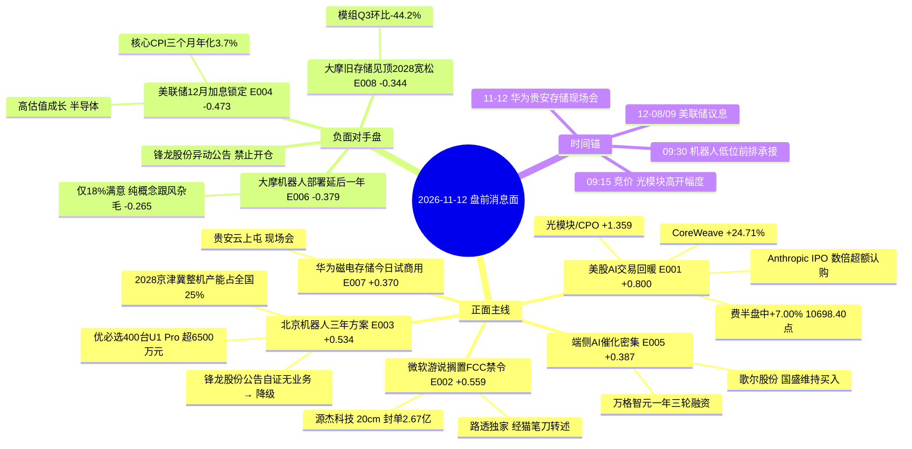

# 2026年11月12日 · **消息面事件驱动**

> **数据源新鲜度**: partial · **降级状态**: true · **置信度**: 0.66
> **覆盖窗口**: 2026-11-09 15:26 → 2026-11-12 05:57（news_cls 72h）+ 盘前公告窗口 2099 条
> **主源**: 财联社/新浪快讯 + 取阅 RSS 18 号池（88 篇全文本）+ 东财三季报预告 500 条 + anns_window 2099 条 + hithink 官方 OpenAPI（受益股池 8 查 / 主营构成 10 查）
> **口径**: T-1 = 2026-11-11 收盘；隔夜 = 11-11 美股（CST 11-12 00:30-05:00 落盘）；预期差定价锚 = 11-11 收盘（盘前口径）

## 一句话结论

隔夜美股 AI 链反攻（纳指 +1.62%、费半盘中 +7%）+ 微软游说搁置 FCC 光收发器禁令，把**光模块/CPO/PCB** 推成唯一多事件叠加正面带（+1.359）；唯一行业级负面对冲是**美联储 12 月加息基本锁定**（核心 CPI 三个月年化 3.7%），压制高估值成长（−0.473）；机器人板块政策利好（+0.534）被大摩调查（−0.379）与**锋龙股份公司自己公告自证无机器人业务**双向夹击，只剩总龙可做。

## 🗺️ 消息面全景图

## 🎯 顶级事件详解（每事件三问 + 首推票思维链）

### E20261112_001 · 美股 AI 交易回暖：纳指 +1.62%、费半盘中 +7.00%、CoreWeave +24.71%
**strength=high · polarity=正面 · raw 0.80 → weighted 0.800（days_since=0）**

**事件摘要**: 11-11 美股三大指数集体收涨（道指 +0.48%、标普 +1.31%、纳指 +1.62%），费城半导体指数盘中一度 +7.00%（10698.40 点，00:43），收盘口径 CoreWeave +24.71%、NBIS +15.44%、闪迪 +13.69%、BE +12.99%、Arm +12.05%、美光 +11.97%、英伟达 +2.91%。触发腿三条：CoreWeave Q3 超预期（营收 36.61 亿美元同比 +168%，调整后营业利润率 5%→10%，订单储备 1325 亿美元）、Anthropic 巨型 IPO 获数倍超额认购（目标估值区间 1.26–1.4 万亿美元）、Anthropic 新增约 100 亿美元微软/谷歌云算力采购承诺（至 2033）。反面腿同样清晰：微软 −2.26%、Meta −1.97%、亚马逊 −1.76%，七姐妹内部已在分化。

- **大资金意图**: 海外资金在做一次"AI 资本开支被证伪→被重新证实"的预期修正。CoreWeave 的业绩和 Anthropic 的采购承诺是**可验证的现金流**，不是叙事；A 股这边 11-11 通信设备主力净流入 +135.30 亿、印制电路板 +72.14 亿、电子 +177.41 亿，说明机构大单已经在 11-11 白天提前建仓，隔夜美股只是把这笔仓位的浮盈坐实。
- **为什么走强**: 因为 11-11 的上涨是"缩量整理后的第一次放量"——成交 1.6887 万亿、较前一日放量 1715 亿，且 5 日窗口主力仍只有 +66.76 亿（10 日 −980.72 亿、20 日 −3146.51 亿、仅 8/20 天为正），意味着筹码刚从套牢盘换手到新资金手里，浮筹轻。隔夜美股给的正是"第二天没人砸"的外部条件。
- **逻辑够不够硬**: **中等偏硬**。硬的部分是订单与采购承诺真实存在（Anthropic 到 2033 的云采购、CoreWeave 收入）；不硬的部分是"费半 +7%"只落盘了盘中值，收盘价本次窗口未抓到，且微软/Meta 收跌说明 AI 交易并非全面回暖。**结论：只做龙头修复，不做板块普涨**。

#### 中际旭创 300308.SZ · role=首推（总龙）

| 指标 | 数值 |
|---|---|
| 11-11 收盘 | 542.00 元（+15.07%） |
| MA5 / MA20 | 481.27 / 569.89 |
| 距 60 日高 | −46.59%（60 日高 1014.87） |
| 5 日主力净额（东财 DC） | +16.06 亿 |
| 三季报单季 | Q3 85.87 亿，环比 +8.5% |

- **买入理由**: 光模块总龙，hithink 主营构成实测**光通信收发模块收入占比 98.99%、毛利率 46.6%**，单一主业纯度极高，是"光互联占 AI 资本开支比重提升"这条机构共识的第一载体；5 日主力 +16.06 亿、11-11 单日 +29.87 亿，是全池唯一"资金+业绩（Q3 环比 +8.5%）双击"的龙头。
- **风险点**: 距 60 日高仍有 −46.59%，上方 569.89（MA20）到 636.30 一带是 10 月套牢盘密集区；若竞价高开 >7%，当日冲高回落概率高；美联储 12 月加息在 12-08/09 前持续压制估值。
- **止损条件**: 514.90（参考价 542.00 × 0.95），跌破即离场，止损距 −5.0%。
- **可验证假设**: 开盘 30 分钟成交额 ≥ 前一日同期 1.2 倍且分时不破 542.00 → 假设成立可持有；若开盘 30 分钟主力净额转负或跌破 514.90 → 假设不成立，当日回避。
- 目标区间 615–650（前高 636.30 附近），RR = (615−542)/(542−514.9) = 2.69，仓位上限 0.12。

#### 新易盛 300502.SZ · role=首推（限权）

| 指标 | 数值 |
|---|---|
| 11-11 收盘 | 215.00 元（+16.98%） |
| MA5 / MA20 | 186.50 / 234.83 |
| 距 60 日高 | −54.74%（60 日高 475.00） |
| 5 日主力净额（东财 DC） | +32.38 亿（全池最高） |
| 三季报单季 | Q3 38.43 亿，环比 **−19.1%**（Q2 47.49 亿） |

- **买入理由**: 光模块龙二，hithink 主营构成实测**光互联产品收入占比 99.87%、毛利率 48.5%**；5 日主力 +32.38 亿为全池最大，11-11 单日 +30.50 亿，弹性优于总龙；美股光模块同业（Lumentum/Coherent 盘前 +10%）给了直接映射。
- **风险点**: Q3 单季净利润 38.43 亿、环比 −19.1%（Q2 47.49 亿），是"业绩环比转弱 + 股价 5 日 +9.41%"的组合；距 60 日高 −54.74%，反弹属修复不是新高；因此只给限权仓位 0.08。
- **止损条件**: 204.25（参考价 215.00 × 0.95），止损距 −5.0%。
- **可验证假设**: 若 11-12 出现"总龙强于龙二"（中际旭创涨幅 > 新易盛）→ 说明资金在收拢到总龙，新易盛当日减半；若龙二反超总龙 → 板块仍处扩散段，可持有。
- 目标区间 250–270，RR = (250−215)/(215−204.25) = 3.26，仓位上限 0.08。

### E20261112_002 · 微软等游说白宫搁置 FCC 中国光收发器禁令（路透独家·KOL 转述）
**strength=high · polarity=正面 · raw 0.65 → weighted 0.559（days_since=1）**

**事件摘要**: news_cls 11-11 08:58 引"三位知情人士"称微软一直向特朗普政府施压、要求放弃禁止从中国进口新型号光收发器的计划；猫笔刀、贩财局两号转述路透社独家版本，指游说对象为白宫 OSTP（科技政策办公室）与国安会，目标把禁令推迟到 2028–2029。理由是美国本土 Coherent/Lumentum 产能无法替代（全球光模块约 2/3 靠中国），ITI 已于 8 月 13 日致信 FCC 警告"没有这些部件，买回来的 AI 芯片只能闲置"。11-11 光通信链集体反攻，源杰科技 20cm 涨停（774.85 元，封单 2.67 亿，首封 14:08:51），中际旭创 +15.07%、新易盛 +16.98%、剑桥科技 +10.00%、光迅科技 +10.00%。

- **大资金意图**: 这是一次**政策博弈的"时间套利"**——大资金买的不是"禁令取消"，而是"禁令被推迟 1–2 年"这段窗口。窗口期内中国厂商可以继续吃美国订单并把产线迁往泰国/马来西亚，等于把中期产能过剩风险往后挪。
- **为什么走强**: 因为板块已经跌到"没人相信光模块还有政策利好"的位置（中际旭创距 60 日高 −46.59%、新易盛 −54.74%、源杰 −58.96%），一条游说消息就能把压抑的情绪一次性释放；叠加 11-11 通信设备板块主力 +135.30 亿的确认。
- **逻辑够不够硬**: **不硬，但可交易**。游说是过程不是决定，FCC 随时可以推进；且"路透独家"在本次数据里只到 KOL 转述级（猫笔刀/贩财局），原始信源是"三位知情人士"版，**推迟至 2028–2029 这个数字是转述口径而非路透原文**。所以只给"情绪+供需缺口"的正分，不给"基本面改善"的正分；`bearish_scope=板块级`，利空只是被推迟。

#### 源杰科技 688498.SH · role=首推（光芯片龙头）

| 指标 | 数值 |
|---|---|
| 11-11 收盘 | 774.85 元（+20.00%） |
| MA5 / MA20 | 663.78 / 810.82 |
| 距 60 日高 | −58.96%（60 日高 1888.00） |
| 5 日主力净额（东财 DC） | +16.03 亿 |
| 三季报单季 | Q3 4.17 亿，环比 −2.5% |

- **买入理由**: 光芯片是光模块里"供给缺口最硬"的环节：hithink 主营构成实测**数据中心类产品收入占比 45.54%、毛利率 84.0%**，电信市场类 8.73%、毛利率 62.2%；中信测算高速激光器芯片（100G 及以上）2026 年 40.6 亿美元 → 2027 年 71.0 亿美元，200G EML 缺口 20%、400mW CW 缺口 17%，卖方市场；源杰 100G EML 已批量出货，200G EML 客户验证推进，CW 需求增长更快并倾斜产能。20cm 涨停封单 2.67 亿、换手 8.24%，是当日最强辨识度。
- **风险点**: Q3 单季环比 −2.5%，业绩不是本事件的驱动；774.85 元高价 + 20cm 波动，若竞价高开 >5% 追高即 −8% 风险；距 60 日高 −58.96% 说明上方套牢盘极重。
- **止损条件**: 736.00（参考价 774.85 × 0.95 = 736.11 取 736.00），止损距 −5.0%。
- **可验证假设**: 若 11-12 光芯片继续强于光模块整机（源杰涨幅 > 中际旭创）→ 说明资金在做"缺口最硬"的环节，假设成立；若源杰开盘 30 分钟跌破 736.00 → 20cm 涨停为一日游，当日不碰。
- 目标区间 880–930（前高 925–934 区域），RR = (880−774.85)/(774.85−736) = 2.71，仓位上限 0.08。

### E20261112_003 · 北京具身智能机器人三年行动方案 + 优必选 400 台订单
**strength=high · polarity=正面 · raw 0.62 → weighted 0.534（days_since=1）**

**事件摘要**: 《北京市具身智能机器人产业高质量发展行动方案（2026—2028 年）》11-11 印发（news_cls 12:37 / 21:55 + 证券时报 13:52 全文），提出建立机器人企业上市"一对一"服务机制、在整机/关键零部件/模型/数据采集等重点领域培育不少于 200 家科技型与专精特新企业、加强行业自律反对"内卷式"竞争，力争 2028 年培育不少于 5 家国际一流、10 家国内领先整机企业、**京津冀区域整机产能占全国 25%、关键零部件配套率超 60%**，并新增总规模超 50000 PFlops 具身智能专用算力集群、在不少于 100 个真实场景采集超 100 万小时数据。同日优必选与永达汽车签约，永达采购 400 台超仿生人形机器人 U1 Pro（京东售价 16.98 万元/台，订单超 6500 万元，年内交付），是其首个超仿生人形机器人大额订单；沐曦与优必选合资的曦选创智完成 5 亿元天使轮；荣耀成立机器人子公司（注册资本 1 亿元）。

- **大资金意图**: 政策给的是"产能与配套率"的硬指标，资金买的是**能进目录、能进配套名单的整机与零部件**，不是概念壳。11-11 机器人板块内部已经在收敛：锋龙股份、光洋股份 3 连板、福莱新材 6 天 4 板，而缺催化的票冲高回落。
- **为什么走强**: 因为政策落地的同时出现了**真实订单**（400 台、6500 万元、年内交付），把"2027 年才量产"的远期故事提前兑现成当期收入；再叠加 11-11 机械设备板块主力 +42.96 亿（+2.16%）、人形机器人概念指数 +3.168%。
- **逻辑够不够硬**: **中等**。政策与订单都硬，但订单金额只有 6500 万元量级，不足以支撑"产业放量"叙事；且同日大摩调查把部署时间表整体后移一年（E20261112_006），更关键的是**锋龙股份自己 11-11 19:08 的异动公告直接否证了"卡位"叙事**（见下）。正反两面必须同时看，这是本板块只给 +0.269 弱正的原因。

#### 宇树科技 688836.SH · role=首推（总龙）

| 指标 | 数值 |
|---|---|
| 11-11 收盘 | 765.00 元（+0.52%） |
| MA5 / MA20 | 716.51 / 617.59 |
| 距 60 日高 | −30.45%（60 日高 1100.00） |
| 5 日主力净额（东财 DC） | +1.30 亿 |
| 5 日涨幅 | +17.31% |

- **买入理由**: 人形机器人总龙，hithink 主营构成实测**人形机器人收入占比 51.07%、毛利率 63.2%**，四足机器人 41.05%、机器人组件 6.1%——是板块里唯一有真实机器人收入占比的标的；11-10 股价一度重回 800 元、总市值再破 3000 亿；11-11 仅 +0.52% 属**滞涨龙头**，政策与订单催化在盘前落地，位置比追 3 板跟风票安全；MA20（617.59）在下方，趋势未破。
- **风险点**: 5 日主力只有 +1.30 亿、11-11 单日 −1.34 亿，资金并未在总龙上加仓；PE(TTM) 551.99 属极高估值，美联储加息压制最直接；大摩调查显示企业采购更挑剔（仅 18% 满意）。
- **止损条件**: 726.00（参考价 765.00 × 0.95 = 726.75 取 726.00），止损距 −5.1%。
- **可验证假设**: 若 11-12 机器人板块高低切换（低位前排涨停数 > 高位连板数）且宇树放量突破 800 → 主升确认；若宇树开盘 30 分钟主力净额继续为负且不破 765 → 板块只是跟风反抽，当日降级观察。
- 目标区间 850–900，RR = (850−765)/(765−726) = 2.18，仓位上限 0.10。

#### 锋龙股份 002931.SZ · role=承压样本（禁止开仓）

| 指标 | 数值 |
|---|---|
| 11-11 收盘 | 53.08 元（+10.01%，3 连板） |
| MA5 / MA20 | 45.37 / 39.93 |
| 距 60 日高 | −4.65%（60 日高 55.67） |
| 5 日主力净额（东财 DC） | +3.90 亿 |
| 静态市盈率 | 511.20 · 扣非归母 **−528.55 万元**（同比 −127.56%） |

- **买入理由**: **不买。** 它是本政策事件里被**公司自己公告当场否证**的样本：11-11 19:08《股票交易异常波动公告》明确"2026 年 1-9 月**未产生机器人零部件业务收入**"、"优必选承诺收购完成后 **36 个月内无资产注入计划**，暂无 12 个月内调整公司主营业务或重大资产重组计划"，前三季归母净利 1852.51 万元同比 −13.91%。hithink 主营构成实测电控类产品 35.26%、机械类产品 64.29%（毛利率仅 14.2%），与机器人零部件**无业务重叠**。把它当"优必选 400 台订单的最直接卡位"就是踩在自我证伪的票上。
- **风险点**: 3 连板 + 距 60 日高仅 −4.65% + 静态 PE 511.20 + 扣非亏损，一旦断板就是 −10% 起步；消息面给的"卡位"逻辑已被公司公告否定，不存在等公告失效的时点。
- **止损条件**: 50.00（参考价 53.08 × 0.942），仅用于度量回撤，**非持仓止损**（本票禁止开仓）。
- **可验证假设**: 若 11-12 机器人板块涨停家数 < 11-11 且锋龙不能回封 → 跟风盘瓦解，假设成立，机器人只做总龙；若 4 板且带出新的低位补涨 → 板块仍在扩散，需重新评估——但即便如此，**在公告澄清无业务之前不构成买入理由**。
- 下行度量区间 44.00–48.00，方向 `downside_measure`，仓位建议 0.01（仅象征，不执行）。

### E20261112_004 · 美国核心 CPI 三个月年化 3.7%、12 月加息基本锁定
**strength=high · polarity=负面 · raw −0.55 → weighted −0.473（days_since=1）**

**事件摘要**: 美国 10 月整体 CPI 环比 +0.4%、核心 +0.3%，连续第三个月超预期；核心 CPI 截至 10 月的三个月年化涨幅 3.7%（7 月前三个月为 1.6%）。美银称 12 月加息"几乎确定"且存在单次 50bp 可能，核心 PCE 同比预估 3.3%；"美联储传声筒"称 12 月加息基本锁定，分歧只在节奏；野村预计 12 月与明年 3 月各加一次；美元指数升至 2025 年 5 月以来最高，10 年期美债收益率单日大涨 11 个基点至 4.99%。

- **大资金意图**: 这是一条**贴现率事件**，不是盈利事件。对 A 股的影响路径是：美元走强 → 外资回流压力 → 高估值长久期资产（AI 芯片、创新药、次新）估值压缩；但隔夜美股仍涨，说明"AI 叙事暂时盖过利率"，所以压制是**结构性**的而非全面性的。
- **为什么走强**（反向解释）: 本事件不是走强事件，它回答的是"为什么不走强"——答疑结果就是 11-11 涨停 85 家但隔日溢价只有 +2.01% 的高位钝化，加息预期会放大这种钝化；走强的只有隔夜美股 AI 链，而这条负面压制的正是它们的估值。
- **逻辑够不够硬**: **硬**。这是唯一有官方数据（CPI）+ 官方表态（议息日期）+ 市场定价（美元指数）三重确认的行业级负面；标 `bearish_scope=行业级`，负面杀伤面覆盖高估值成长/半导体/创新药/港股科技/次新。

#### 寒武纪 688256.SH · role=承压样本（禁止开仓）

| 指标 | 数值 |
|---|---|
| 11-11 收盘 | 900.00 元（+7.40%） |
| MA5 / MA20 | 847.42 / 887.00 |
| 距 60 日高 | −23.08%（60 日高 1170.00） |
| 5 日主力净额（东财 DC） | +23.09 亿 |
| PE(TTM) | 135.75（全池最高） |

- **买入理由**: **不买。** 它是本日用来度量"加息预期对高估值科技杀伤幅度"的样本：hithink 主营构成实测**云端智能芯片及加速卡收入占比 99.98%**（纯 AI 芯片资产，对贴现率最敏感），PE(TTM) 135.75 为全池最高，5 日主力仍 +23.09 亿说明筹码没有出清，一旦加息落地，回撤弹性也最大。列出它只为让 D1 知道**这类票在 12 月议息前不能作为进攻仓**。
- **风险点**: 若把它当"强势票低吸"就是违反纪律——高估值 + 加息在途 + 距 60 日高 −23.08% 属下跌中继反弹，不是主升低吸。
- **止损条件**: 855.00（参考价 900.00 × 0.95），仅用于度量承压幅度，**非持仓止损**（本票禁止开仓）。
- **可验证假设**: 若 12 月议息前寒武纪相对半导体指数跑输 ≥5 个百分点 → 贴现率压制假设成立，D1 应把同类高 PE 票全部降到观察；若反而跑赢 → 说明 AI 叙事完全盖过利率，本负面事件的权重应下调。
- 下行度量区间 780–820，方向标记 `downside_measure`，仓位建议 0.01（仅象征，不执行）。

### E20261112_005 · 端侧 AI 催化密集：万格智元三轮融资、Meta 智能眼镜、Fable 5.2
**strength=medium · polarity=正面 · raw 0.45 → weighted 0.387（days_since=1）**

**事件摘要**: 财联社早知道 11-11 19:00《明日主题前瞻》把端侧 AI 列为 11-12 首要主题：清华系万格智元一年内连续完成三轮融资、与多家上市公司战略合作、完成千万级订单并已实现盈利（自研 SoC 协处理推理 + 三级存储调度，同类模型所需存储空间降至原方案一半）；Meta 推出 MuseCharm 及接入 Muse 的智能眼镜；OpenAI 布局机器人领域；Anthropic 新一代模型 Fable 5.2 机器人控制性能提升；联发科携手 NVIDIA 打造 RTX Spark 登陆 Windows 11 PC；国盛证券维持歌尔股份"买入"，称端侧 AI 推动新一轮成长（前三季归母 26.19 亿、同比 +1.21%，26Q3 11.53 亿、同比 −1.51%、环比 +19.74%）。

- **大资金意图**: 资金在找"AI 主线里还没被炒过的分支"。光模块/PCB 已经在 11-11 爆发，端侧 AI 是**同一笔 AI 预算的下游承接**（云端 → 终端），且 11-11 端侧方向多数票没涨，属于"消息先到、价格未到"的错位。
- **为什么走强**: 因为催化密度足够：融资（万格智元）、产品（Meta 眼镜/RTX Spark）、模型（Fable 5.2）、卖方（国盛看多歌尔）四条腿在 48 小时内同时出现，且财联社在盘前把它做成"明日主题"，等于给竞价一个明确方向。
- **逻辑够不够硬**: **不硬但胜在位置低**。端侧 AI 的订单能见度远不如光模块（万格智元只有千万级订单），本质是主题轮动；所以只给 +0.271 的弱正分，且必须选"有真实代工/声学业务"的载体，不选纯概念。

#### 歌尔股份 002241.SZ · role=首推（端侧载体）

| 指标 | 数值 |
|---|---|
| 11-11 收盘 | 25.14 元（−2.14%） |
| MA5 / MA20 | 25.01 / 22.76 |
| 距 60 日高 | −5.06%（60 日高 26.48） |
| 5 日主力净额（东财 DC） | +6.70 亿（11-11 单日 −1.98 亿） |
| 前三季归母 | 26.19 亿，同比 +1.21% |

- **买入理由**: 端侧 AI 里少数"有真实整机代工 + 声学器件"的载体，hithink 主营构成实测**智能硬件收入占比 49.67%、毛利率 13.6%，智能声学整机 28.25%、精密零组件 19.38%**；国盛维持买入；11-11 逆势 −2.14%，是全场少数**没被抢跑**的正面腿；5 日主力 +6.70 亿、MA5（25.01）与现价几乎重合，属平台位。
- **风险点**: 前三季归母仅 +1.21%，业绩弹性弱，主题退潮就没有承接；11-11 单日主力 −1.98 亿（净流出率 −7.55%），说明当日有资金在撤；距 60 日高仅 −5.06%，一旦放量滞涨就是短期双头。
- **止损条件**: 23.88（参考价 25.14 × 0.95），止损距 −5.0%。
- **可验证假设**: 若 11-12 端侧方向出现 ≥2 只涨停（AI 眼镜/端侧 SoC）且歌尔放量站上 25.44 → 主题成立；若端侧只有歌尔一只涨、其余不动 → 属个股行为，当日不加仓。
- 目标区间 28.00–29.50（需突破 60 日高 26.48 后打开），RR = (28−25.14)/(25.14−23.88) = 2.27，仓位上限 0.08。

### E20261112_006 · 大摩调查：人形机器人部署时间表平均延后约一年
**strength=medium · polarity=负面 · raw −0.44 → weighted −0.379（days_since=1）**

**事件摘要**: 摩根士丹利第二份 AlphaWise 调查覆盖 94 位中国制造业/工业/服务业高管：64%（60 位）可能未来三年采用轮式或腿式人形机器人（2025 年 62%），但 2027 年底前部署预期三类均大幅下降、时间表平均延后约一年、初期部署规模可能更小；主流可接受价格下移至 5 万–10 万元（72% 认为 10 万元以下可行，2025 年 53%；预计大幅增加投资比例从 30% 降至 22%）；82% 要求回本期 ≤3 年，65% 要求回本与其他自动化投资相同或更短；仅 18% 对当前性能满意（2025 年 23%）。出货预估 2026 年 5 万台、2027 年 10 万台、2030 年 44.6 万台；供应链零部件可能先于下游集成商受益。

- **大资金意图**: 这份调查是给"机器人板块高位连板"泼冷水——资金在 11-11 已经把光洋股份、锋龙股份做到 3 板、福莱新材 6 天 4 板，调查告诉他们"产业兑现要晚一年"，等于逼资金从"想象力定价"切到"订单定价"。
- **为什么走强**（反向解释）: 本事件不是走强事件，而是"为什么高位连板走不强"的解释——调查与 11-11 的澄清潮（含锋龙股份公告）同向，把"2027 年放量"的估值锚往后推了一年。
- **为什么走弱**: 因为部署延后直接打击"2027 年放量"的估值锚；且 11-11 已有多家公司自行澄清（光洋股份机器人业务未盈利、飞亚达收入占比不足 5%、福莱新材不足 1%、共进股份 PCBA 占比不足 0.2%），调查与澄清形成合流。
- **逻辑够不够硬**: **硬，但对股价的作用是"分层"而不是"全灭"**。整机龙头（宇树）订单与政策仍在，跟风杂毛（光洋、锋龙）失去叙事支撑。所以本事件只给"纯概念跟风杂毛"−0.265 的负面，与 E20261112_003 的正面在"人形机器人"上叉乘出 +0.269 弱正。

#### 光洋股份 002708.SZ · role=承压样本（禁止开仓）

| 指标 | 数值 |
|---|---|
| 11-11 收盘 | 26.59 元（+10.01%，3 连板） |
| MA5 / MA20 | 22.68 / 18.22 |
| 距 60 日高 | 0.00%（创新高 26.59） |
| 5 日主力净额（东财 DC） | +3.26 亿（11-11 龙虎榜机构 −1.23 亿） |
| PE(TTM) | 156.23 · 5 日涨幅 +36.08% · 13 天 7 板 |

- **买入理由**: **不买。** 它是"大摩调查 + 公司澄清"双重证伪的典型对手盘：hithink 主营构成实测**轴承产品收入占比 50.36%、同步器行星排 23.23%**（毛利率仅 12.0%），公司自己澄清机器人业务尚未盈利、前三季扣非亏损超 3000 万元；PE 156.23、13 天 7 板、累计涨幅近 87%、换手 18.02%、当日开板 2 次。列出它是为了让 D1 明确**这类票是本日的卖出侧，不是买入侧**。
- **风险点**: 3 连板 + 创新高 + 当日开板 2 次 + 龙虎榜机构净卖 1.23 亿，一旦断板就是 −10% 起步；若 D1 把它当"机器人低位前排"就会踩在对手盘上。
- **止损条件**: 25.26（参考价 26.59 × 0.95），仅用于度量回撤，**非持仓止损**（禁止开仓）。
- **可验证假设**: 若 11-12 机器人板块涨停家数 < 11-11 且光洋开盘不能回封 → 跟风盘瓦解，假设成立，机器人只做总龙；若光洋 4 板且带出新的低位补涨 → 板块仍在扩散，需重新评估。
- 下行度量区间 22.50–24.50，方向 `downside_measure`，仓位建议 0.01（不执行）。

### E20261112_007 · 华为新型存储系统 11-12 贵安启动试商用（磁电融合）
**strength=medium · polarity=正面 · raw 0.50 → weighted 0.370（days_since=2）**

**事件摘要**: 华为将于 11 月 12 日在贵州贵安云上屯举办新型存储系统试用启动现场会，标志该技术进入真实场景联合验证；方案把磁与电深度融合，面向 Agentic AI 时代爆发的 AI 语料库/温冷数据，目标是打破传统温冷存储瓶颈。11-10 20:17 首次见报（"温冷数据存储成为新战场"），11-11 盘前纪要给岀磁电存储概念映射（斯迪克、横店东磁、达瑞电子、同有科技）。

- **大资金意图**: 这是一条**事件日驱动**：现场会就在今天，资金不需要预判产业空间，只需要预判"今天有没有人去炒"。磁电存储是全新的细分叙事，筹码干净、没有历史套牢盘，适合做一日到三日的题材。
- **为什么走强**: 因为 AI 存储主线正在高位分歧（大摩警告旧存储见顶，E20261112_008 为 −0.344），资金需要一个"新故事"来接力；华为的品牌背书 + 具体现场会日期，是现成的题材锚。
- **逻辑够不够硬**: **不硬**。磁性材料与存储系统的结合尚处"联合验证"阶段，四只概念股与华为磁电存储的直接业务重叠**未获公告确认**，属概念映射而非业绩映射；且映射来源只有盘前纪要一家，所以只给 medium 强度、映射置信度 medium。

#### 斯迪克 300806.SZ · role=首推（低位前排）

| 指标 | 数值 |
|---|---|
| 11-11 收盘 | 48.10 元（−0.74%） |
| MA5 / MA20 | 46.54 / 41.50 |
| 距 60 日高 | −19.90%（60 日高 60.05） |
| 5 日主力净额（东财 DC） | +3.02 亿 |
| 5 日涨幅 | +5.21% |

- **买入理由**: 磁电存储概念映射标的（盘前纪要口径），11-11 收 −0.74%**完全没被提前炒作**，距 60 日高 −19.90% 处低位，MA20（41.50）在下方，5 日主力 +3.02 亿温和流入——是"事件日 + 未透支"的组合。hithink 受益股池实测存储芯片 11-11 涨停仅 4 只（深南电路/博杰股份/泰瑞机器/利扬芯片），**磁电存储无对应涨停腿**，说明这条线还没被抢。
- **风险点**: 映射单源（仅盘前纪要）；hithink 主营构成实测**功能性薄膜材料仅 17.19%、薄膜包装材料 14.89% 且毛利率 −2.5%**，与磁性存储的直接业务重叠未获公告确认；48.10 元在 11-11 盘中冲到 52.61 后回落，说明上方有抛压；事件日当天常见"高开兑现"。
- **止损条件**: 45.70（参考价 48.10 × 0.95），止损距 −5.0%。
- **可验证假设**: 若 11-12 开盘磁电存储 4 只票中 ≥2 只高开 >3% 且斯迪克成交额 ≥ 前一日 1.5 倍 → 题材被承接，假设成立；若只有斯迪克一只高开、其余平开 → 属单票行为，当日不加仓。
- 目标区间 55.00–58.00（前高 60.05 下方），RR = (55−48.1)/(48.1−45.7) = 2.88，仓位上限 0.08。

### E20261112_008 · 大摩警告旧存储价格见顶、2028 年供需或转宽松
**strength=medium · polarity=负面 · raw −0.40 → weighted −0.344（days_since=1）**

**事件摘要**: 华尔街见闻 11-11 23:21 报道"大摩警告：旧存储价格正在见顶，2028 年供需或转向宽松"；财联社 22:59 指出"存储市场罕见错位：产能排到 2029，消费级却涨不动"。反向腿是上海证券报 20:36 求证：原厂第四季度官方价格确实"微微上涨"，但涉及型号依旧以企业级存储为主，**消费级产品并未出现同步调涨的明确信号**；三星代理商亦称涨价集中在 DRAM 合约端与企业级 SSD，非消费级 NAND 全面跟涨。11-11 A 股存储板块普涨（普冉 +9.73%、佰维 +6.95%、德明利 +6.61%、香农芯创 +5.54%、兆易 +6.15%、长鑫 +4.00%）。

- **大资金意图**: 资金在存储上是**分层的**：买原厂（长鑫）、买企业级（德明利企业级订单增长）、买磁电新叙事（斯迪克），卖消费级模组。大摩的"见顶"是给模组环节的，不是给原厂的。
- **为什么走强**（反向解释）: 本事件不是走强事件，它解释的是"为什么存储高开要当卖点"——因为 11-11 的普涨来自未落地的涨价传闻（正式提价函尚未下发、消费级没有同步信号），靠传闻拉起来的涨幅在次日最容易回吐；叠加隔夜美光 +11.97% 会制造高开，高开就是兑现窗口。
- **为什么走弱**: 因为"涨价传闻"在 11-11 已经被打了一个折——正式提价函尚未下发、消费级没有同步信号，靠传闻拉起来的涨幅在次日最容易回吐。
- **逻辑够不够硬**: **硬，但方向是"环节分化"**。三季报已经用数字验证：江波龙 Q3 单季 37.45 亿、环比 −44.2%；德明利 Q3 27.29 亿、环比 +2.2%；长鑫（原厂）Q3 544.35 亿、环比 +3.0%。**模组环节环比转负 = 见顶已在报表里**，只有原厂与真加速环节能给正面。

#### 兆易创新 603986.SH · role=承压样本（禁止开仓）

| 指标 | 数值 |
|---|---|
| 11-11 收盘 | 259.62 元（+6.15%） |
| MA5 / MA20 | 249.05 / 269.16 |
| 距 60 日高 | −43.04%（60 日高 455.81） |
| 5 日主力净额（东财 DC） | **−13.37 亿**（全池唯一大额流出） |
| 5 日涨幅 | −4.33% |

- **买入理由**: **不买。** 它是本日存储链唯一"5 日主力净流出 13.37 亿 + 股价 5 日 −4.33%"的龙二，正好对应大摩"旧存储见顶"的环节；hithink 主营构成实测**存储芯片销售收入占比 84.97%、毛利率 67.6%**，微控制器仅 12.36%——主营高度绑定存储价格周期；hithink 受益股池实测存储芯片 11-11 涨停 4 只中它并不在列。列出它是为了让 D1 看清存储内部**资金已经在撤模组/利基**，不要被 11-11 的 +6.15% 骗进去。
- **风险点**: 11-11 单日主力 +12.52 亿与 5 日 −13.37 亿背离，属"单日抢反弹、五日净撤"；MA20（269.16）在现价上方，反弹到 MA20 附近就是压力位。
- **止损条件**: 246.60（参考价 259.62 × 0.95 = 246.64 取 246.60），仅用于度量回撤，**非持仓止损**（禁止开仓）。
- **可验证假设**: 若 11-12 存储高开后 30 分钟内兆易回落至 259 以下 → "高开兑现"假设成立，存储只留原厂/磁电；若兆易放量突破 269.16（MA20）→ 存储进入新一轮，需上调 E20261112_008 的负面权重。
- 下行度量区间 230–245，方向 `downside_measure`，仓位建议 0.01（不执行）。

## 📊 板块 × 事件热力矩阵（净分列 = 叉乘重算值）

> 公式：`contrib = |weighted_score| × sign(板块极性) × strength权重(high 1.0 / medium 0.7 / low 0.4)`；同板块多事件累加；>+0.12 正面 / <−0.12 负面 / 其余分歧。全部 12 行由脚本独立重算，零差异。

| 板块 | 净分 | 判定 | 事件锚（逐事件明细） | 首推载体 | 位置与资金口径 |
|---|:--:|:--:|---|---|---|
| 存储芯片 | **+0.578** | 🟢🟢正面 | E001 正面×0.70=+0.560 · E007 正面×0.70=+0.259 · E008 负面×0.70=−0.241 | 长鑫科技（原厂） | 模组 Q3 环比 −44.2%，原厂 +3.0% |
| 光模块/CPO | **+1.359** | 🟢🟢🟢正面 | E001 正面×1.00=+0.800 · E002 正面×1.00=+0.559 | 中际旭创 / 新易盛 | 距 60 日高 −46.6% / −54.7%，5 日主力 +16.06 / +32.38 亿 |
| 人形机器人 | **+0.269** | 🟢弱正 | E003 正面×1.00=+0.534 · E006 负面×0.70=−0.265 | 宇树科技 | 政策 vs 大摩调查对冲，幅度被压到弱正 |
| PCB/覆铜板 | **+0.800** | 🟢🟢正面 | E001 正面×1.00=+0.800 | 沪电股份 / 东山精密 | 印制电路板板块主力 +72.14 亿、+5.76% |
| AI服务器/液冷 | **+0.560** | 🟢🟢正面 | E001 正面×0.70=+0.560 | 工业富联 / 英维克 | 英维克 11-11 涨停，5 日主力 +4.77 亿 |
| 光芯片 | **+0.559** | 🟢🟢正面 | E002 正面×1.00=+0.559 | 源杰科技 | 20cm 封单 2.67 亿，距 60 日高 −58.96% |
| 人形机器人零部件 | **+0.374** | 🟢正面 | E003 正面×0.70=+0.374 | 锋龙股份（**已降为禁止开仓**） | 3 板封单 1.47 亿，但公司公告自证无业务 |
| 磁电存储 | **+0.370** | 🟢正面 | E007 正面×1.00=+0.370 | 斯迪克 | 事件日今日，11-11 −0.74% 未透支 |
| 端侧AI | **+0.271** | 🟢正面 | E005 正面×0.70=+0.271 | 歌尔股份 | 11-11 −2.14%，5 日主力 +6.70 亿 |
| 纯概念跟风杂毛 | **−0.265** | 🔴负面 | E006 负面×0.70=−0.265 | —（对手盘） | 光洋 PE156、13 天 7 板、已澄清未盈利 |
| 半导体 | **−0.331** | 🔴负面 | E004 负面×0.70=−0.331 | —（承压） | 加息压制高估值，但隔夜费半 +7% 对冲 |
| 高估值成长 | **−0.473** | 🔴🔴负面 | E004 负面×1.00=−0.473 | 寒武纪（样本） | PE 135.75，12-08/09 议息前压制未解除 |

### `sector_cross_summary`（只收 ≥2 事件的板块，按事件数降序）

1. **存储芯片（3 事件，+0.578）**：美股映射（美光 +11.97%）+ 华为磁电新叙事 vs 大摩见顶。结论：**原厂/新叙事强、模组弱**；江波龙 Q3 环比 −44.2% 已把"见顶"写进报表，存储若高开，模组是卖点不是买点。
2. **光模块/CPO（2 事件，+1.359）**：E001 美股映射 + E002 政策预期松动，是本日唯一"产业+政策"双正面叠加带。结论：**做多方向唯一明确在这里**，但要接受"上方套牢盘"的事实——中际旭创距 60 日高 −46.59%，修复不是新高。
3. **人形机器人（2 事件，+0.269）**：北京方案+订单 vs 大摩调查延后一年。结论：**方向正但强度弱**，只做总龙（宇树），不做 3 板跟风（光洋已进对手盘、锋龙被公司公告否证）。

## 🔎 预期差对账（公众号提及 × 市场定价）

> 影子树跑通 `build_expectation_gap.py --date 20261112`：**91 篇 / 13 个号，有效点名 14 只**，定价锚 = 11-11 收盘（盘前口径）。规则：权重 <1.5 视为噪音剔除（预期差号 ×3 / 游资·复盘·产业号 ×1.5 / 官媒资讯 ×0.5）；标题含收评/午报/早报/复盘的文章不做个股抽取。

| 档位 | 票 | 11-11 涨跌 | 被谁提到 |
|---|---|:--:|---|
| **未定价**（被点名但市场没反应） | 瑞芯微 603893.SH | +0.78% | 预期差寻找（11-05《有一条很强的暗线，也是下一阶段 AI 的战场》）|
| | 机器人 300024.SZ | +1.69% | 预期差寻找 等 8 号（11-08《苹果 HALO 刷屏，藏着物理 AI 最被低估的数采入口》）|
| **已定价**（共识） | 源杰科技 688498.SH | 涨停 | 上海证券报 等 3 号 |
| | 新易盛 300502.SZ | +16.98% | 上海证券报 等 3 号 |
| | 中际旭创 300308.SZ | +15.07% | 上海证券报 等 3 号 |
| | 剑桥科技 603083.SH | 涨停 | 上海证券报 等 3 号 |
| | 光洋股份 002708.SZ | 涨停 | 上海证券报 等 3 号 |
| | 利扬芯片 688135.SH | +20.01% | 上海证券报 等 3 号 |
| **反向**（点名但股价反走） | 华利集团 300979.SZ | **−8.39%** | 上海证券报 等 3 号（跨界光通信）|
| | 比亚迪 002594.SZ | −2.84% | 上海证券报 等 3 号 |
| | 中信建投 601066.SH | −1.08% | 官媒搬运号（噪音级）|
| | 中信证券 600030.SH | −0.98% | 官媒搬运号（噪音级）|
| | 太阳能 000591.SZ | −0.86% | 上海证券报 等 3 号 |
| | 乐鑫科技 688018.SH | −0.47% | 预期差寻找 |

**结论**：光模块四票（源杰/新易盛/中际旭创/剑桥）**全部落在"已定价"档**——这正是 E002 正分不能当买入理由的独立佐证，11-12 只能做"高开质量"（谁承接）不能做"低吸预期差"。**未定价档只有瑞芯微（+0.78%）与机器人（+1.69%）**，其中瑞芯微是被"预期差寻找"连续三期点名的端侧 AI 暗线标的，11-05 原文即称"瑞芯微什么的这俩月基本没怎么跌…但是市场还没意识到"——它是本日唯一"被讲但没被定价"的真候选，但该号当日无新文（3 篇均为 11-05/08/10 旧文），**叙事原料有滞后性，须由 D1 开盘强弱确认后方可进入研究池**。

## 🔥 三季报业绩预告命中（硬 alpha 交叉验证）

> 数据源 `eastmoney_earnings_predict.json`（report_date 2026-09-30，500 条，其中 435 条含有效增速）。**注意：同比增速是后视镜**，下表同时给出用 tushare `income` 倒推的 Q3 单季环比。

| 代码 | 名称 | 预告类型 | 累计同比（1-9 月） | Q3 单季（亿） | Q3 环比 | 事件命中 | 逻辑强度 |
|---|---|---|:--:|:--:|:--:|---|:--:|
| 001309.SZ | 德明利 | 扭亏 | +32046.52%~33154.49% | 27.29 | **+2.2%** | E001/E008 存储（企业级订单增长） | 🟡 模组环比走平 |
| 301308.SZ | 江波龙 | 预增 | +1864.55%~1990.84% | 37.45 | **−44.2%** | E008 存储见顶 | 🔴 模组已见顶 |
| 688825.SH | 长鑫科技 | 扭亏 | +2581.06%~2609.47% | 544.35 | +3.0% | E001/E008 存储原厂 | 🟢🟢 原厂仍加速但增速放缓 |
| 688808.SH | 联讯仪器 | 预增 | +1866.00%~2072.95% | 14.39 | **+221.0%** | 光通信/半导体测试（非直接命中） | 🟢🟢🟢 真加速·行业归属待核 |
| 002466.SZ | 天齐锂业 | 预增 | +2734.97%~3235.26% | — | — | 不命中（锂价周期） | 🟡 非本文事件 |
| 002812.SZ | 恩捷股份 | 扭亏 | +1884.00%~2474.80% | — | — | 不命中（隔膜） | 🟡 |
| 688388.SH | 嘉元科技 | 预增 | +1196.60%~1318.92% | — | — | 不命中（铜箔） | 🟡 |
| 300821.SZ | 东岳硅材 | 预增 | +4882.53%~5051.72% | — | — | 不命中（硅化工） | 🟡 基数失真 |
| 000703.SZ | 恒逸石化 | 预增 | +3318.59%~3405.13% | — | — | 不命中（化纤） | 🟡 基数失真 |

**结论**: 存储链的"同比炸裂"（德明利 +32046%、江波龙 +1864%、长鑫 +2581%）全部是**周期低基数**，真正有信息量的是单季环比：模组（江波龙 −44.2%、德明利 +2.2%）已见顶，原厂（长鑫 +3.0%）增速放缓但仍正。首推票（中际旭创 Q3 +8.5% / 新易盛 −19.1% / 源杰 −2.5%）同样只认环比——**新易盛因此被降为限权仓**。联讯仪器 +221.0% 是全池唯一"真加速"，但其行业归属未获公告确认，只作观察不下单。

## 🔬 hithink 独立验证（受益股池 + 主营构成）

> 官方 OpenAPI（`IWENCAI_API_KEY`）实跑 18 次查询全部成功，产物在 `data/research/20261112/_work/hithink_verify/`。首推票的 `business_relevance` 与 `sector_linkage` 证据全部换成这里的实测口径。

| 板块 | 11-11 受益股池实测 | 交叉结论 |
|---|---|---|
| 光模块（涨停 4 只） | 光迅科技 / 东山精密 / 青山纸业 / 剑桥科技 | 板块扩散但总龙仍是中际旭创 |
| 人形机器人（涨停 17 只） | 飞亚达 / 三联锻造 / 光洋股份 / 瑞迪智驱 / 赛福天 等 | 涨停潮真实存在，但跟风盘同日自我证伪 → 只做总龙 |
| 存储芯片（涨停 4 只） | 深南电路 / 博杰股份 / 泰瑞机器 / 利扬芯片 | 磁电存储无对应涨停腿；兆易创新不在列 |
| 光芯片（涨幅榜） | 德明利 +6.61% / 长芯博创 +7.95% / 协创数据 +8.08% / 永鼎股份 +7.49% | 光芯片多股联动，源杰 20cm 是最强辨识度 |
| 端侧AI（涨幅榜） | 移远通信 +5.44% / 富瀚微 +6.80% / 国科微 +2.87% / 星宸科技 +3.14% / 瑞芯微 +0.78% | 端侧方向多票温和上涨，歌尔 −2.14% 掉队 |
| 概念指数 | 机器人 +3.168% / 存储芯片 +3.131% / PCB 概念 +3.34% | 与板块资金流口径一致 |

主营构成实测占比（`business_relevance_evidence` 的来源）：中际旭创 光通信收发模块 98.99%（毛利率 46.6%）· 新易盛 光互联产品 99.87%（48.5%）· 源杰 数据中心类 45.54%（84.0%）· 宇树 人形机器人 51.07%（63.2%）· 歌尔 智能硬件 49.67%（13.6%）· 斯迪克 功能性薄膜材料 17.19%（19.3%）· 寒武纪 云端芯片 99.98%（55.3%）· 光洋 轴承 50.36%（23.5%）· 兆易 存储芯片 84.97%（67.6%）· **锋龙 电控 35.26%/机械 64.29%（毛利率仅 14.2%）→ 与机器人零部件无业务重叠**。

## 关键证据

- 证据 1：11-11 A 股三大指数收涨（沪 +0.46% / 深成 +1.32% / 创业板 +3.11%），成交 16886.9 亿、涨停 85 家、跌停 0 家、炸板率 18.27%、最高板 4、隔日溢价 +2.01%、涨家 3538/5574 —— `data/research/20261112/emotion_cycle.json` + `cycle_position.json`
- 证据 2：11-11 主力净额 +202.85 亿（超大单 +203.90、大单 −1.05、中单 −179.33、小单 −21.87），三日 +505.04 亿（补回 11-06 主跌 −528.52 亿的 95.6%），5 日仅 +66.76 亿、10 日 −980.72 亿、20 日 −3146.51 亿、仅 8/20 天为正 —— `R7_capital_flow_20261112.json`
- 证据 3：板块资金 电子 +177.41 亿(+2.66%)、通信设备 +135.30 亿(+4.82%)、通信 +133.83 亿、通信网络设备及器件 +104.75 亿(+7.19%)、元件 +81.79 亿、半导体 +76.75 亿(+3.10%)、印制电路板 +72.14 亿(+5.76%)、机械设备 +42.96 亿(+2.16%)；反向 医药生物 −38.81、电力设备 −30.92、国防军工 −16.46、传媒 −16.13、电池 −15.73、白酒 −11.06 —— `R7_capital_flow_20261112.json.sector_net_inflow`
- 证据 4：隔夜美股 道指 +0.48% / 标普 +1.31% / 纳指 +1.62%，CoreWeave +24.71%、美光 +11.97%、闪迪 +13.69%、英伟达 +2.91%、微软 −2.26%，费半盘中 +7.00%（10698.40 点，00:43） —— `data/raw/20261112/news_cls.jsonl`（11-12 00:43、05:00）
- 证据 5：CoreWeave Q3 营收 36.61 亿美元同比 +168%、调整后营业利润 3.79 亿、营业利润率 5%→10%、订单储备 1325 亿、全年营收指引上调至 130–133 亿；Anthropic IPO 目标估值 1.26–1.4 万亿美元获数倍超额认购、新增约 100 亿美元微软/谷歌云采购承诺（至 2033） —— news_cls 11-11 18:41（上海证券报）、20:11、21:19
- 证据 6：美国核心 CPI 三个月年化 3.7%（7 月前三个月 1.6%）、CPI 环比 +0.4%/核心 +0.3%、连续第三个月超预期、美银警示或加息 50bp、议息 12-08/09、美元升至 2025 年 5 月以来最高、10 年期美债 +11bp 至 4.99% —— news_cls 11-11 20:25/20:35/23:17/23:40
- 证据 7：北京方案 2026-2028、一对一服务机制、培育不少于 200 家、反对"内卷式"竞争、2028 培育不少于 5 家国际一流/10 家国内领先、**京津冀整机产能占全国 25%、关键零部件配套率超 60%**、新增 50000 PFlops 具身智能算力集群 —— news_cls 11-11 12:37/21:55 + **证券时报 11-11 13:52**；优必选 400 台 U1 Pro、16.98 万元/台、订单超 6500 万元 —— news_cls 11-11 20:56
- 证据 8：大摩调查 94 位高管、64% 三年内采用（2025 年 62%）、部署平均延后约一年、可接受价 5–10 万元、72% 认为 10 万以下可行（2025 年 53%）、82% 要求回本 ≤3 年、仅 18% 满意（2025 年 23%）、出货预估 2026/2027/2030 = 5/10/44.6 万台 —— **上海证券报 11-11 22:48**
- 证据 9：**锋龙股份 11-11 19:08 股票交易异常波动公告**——"2026 年 1-9 月未产生机器人零部件业务收入"、"优必选承诺收购完成后 36 个月内无资产注入计划，暂无 12 个月内调整公司主营业务或重大资产重组计划"、静态市盈率 511.20、前三季归母 1852.51 万（−13.91%）、扣非归母 −528.55 万（−127.56%） —— news_cls 11-11 19:08
- 证据 10：源杰 20cm 涨停封单 2.67 亿、换手 8.24%、首封 14:08:51；光洋 3 连板、当日开板 2 次、13 天 7 板、换手 18.02%、龙虎榜机构 −1.23 亿；锋龙 3 连板、封单 1.47 亿、首封 09:30:21 —— `data/research/20261112/_work/limits_20261111.json`
- 证据 11：Q3 单季倒推 —— tushare `income`（德明利 27.29 / 江波龙 37.45 / 长鑫 544.35 / 联讯 14.39 / 源杰 4.17 / 中际旭创 85.87 / 新易盛 38.43 亿元）；歌尔 11-11 单日主力 −1.98 亿 —— `_work/mf_dc_20261111.json`
- 证据 12：预期差对账 91 篇/13 号/有效点名 14 只（未定价 2 / 已定价 6 / 反向 6）；光模块四票全在"已定价"档，华利集团 −8.39% 在"反向"档 —— `data/research/20261112/expectation_gap.json`

## 数据源审计

| 源 | 日期 | 状态 | 备注 |
|---|---|:--:|---|
| tushare/news_cls | 2026-11-12 | 🟢 | 2986 条 · 72h 回看（11-09 15:26 → 11-12 05:57）· 1500 条带标题 |
| tushare/news_major | 2026-11-12 | 🟡 | 800 条但 **content 全为空**（标题级源，只用于标题检索）；E002/E008 的标题腿出自此处 |
| eastmoney/earnings_predict | 2026-11-12 | 🟢 | 500 条 · report_date 2026-09-30 · 435 条含有效增速 |
| wechat_official_rss(18 号池) | 2026-11-12 | 🟢 | 88 篇全文本 · 18 feeds 中 12 有文 · 6 空（股痴流沙河/远川研究所/李迅雷金融与投资/金渐成/证金事/**预期差寻找**） |
| wechat_cli_5groups | 2026-11-12 | 🔴 | 7 群窗口内 **0 条**（群聊腿失效） |
| anns_window（盘前公告窗口） | 2026-11-12 | 🟢 | 2099 条 · 覆盖 11-11 盘后 + 隔夜 · 含锋龙国信证券持续督导意见公告 |
| expectation_gap（公众号提及×定价） | 2026-11-12 | 🟢 | 影子树跑通 · 91 篇 / 13 号 / 有效点名 14 只 · 定价锚 11-11 收盘 |
| hithink 官方 OpenAPI | 2026-11-12 | 🟢 | 受益股池 8 查 + 主营构成 10 查全部成功 · 产物 `_work/hithink_verify/` |
| R7_capital_flow | 2026-11-12 | 🟢 | 20 只卡片 · 10 研究 / 10 观察 / 0 执行；东财 DC 口径 5 日主力 |
| tushare/moneyflow_dc(全市场 5 日) | 2026-11-12 | 🟢 | 5574 只 × 5 日聚合 · 与 R7 数字交叉一致（16.06/32.38/23.09） |
| tushare/limit_list_d(11-11) | 2026-11-12 | 🟢 | 85 只涨停 · 连板数/首封时间/封单/开板次数 |
| mcp_health | 2026-11-12 | 🟡 | weflow down（404）· overseas degraded · tushare/datapro ok |
| R3_sentiment | 2026-11-12 | 🔴 | 未产出（07:30 档）→ `kol_confirm` 全部标"无交叉源" |

## 不确定性 / 反证

1. **E20261112_002 是"游说进展"不是 FCC 决定**：禁令只是被推迟到 2028-2029，中期产能过剩与毛利下行风险没有消除；猫笔刀原文即写明"光模块未来的利空还在，就是推迟了"。且"路透独家"在本次数据里只到 KOL 转述级，**2028-2029 这个数字本身是转述口径不是路透原文**。若 11-12 高开后无增量资金，这条消息的寿命只有一天。
2. **美股映射的可持续性存疑**：纳指 +1.62%，但微软 −2.26%、Meta −1.97%、亚马逊 −1.76%，七姐妹内部已分化；费半收盘价本次窗口**未落盘**（只有盘中 +7.00% 和 23:56 的 +6.12%）。A 股光模块若高开 >5%，等于把"盘中高点"当成"收盘涨幅"来定价。预期差对账独立佐证了这点：光模块四票全部已落在"已定价"档。
3. **机器人正反两面同时成立**：政策（E003 +0.534）与产业调查（E006 −0.379）方向相反，叉乘只剩 +0.269；11-11 已有 4 家公司自行澄清机器人收入占比低/未盈利，**锋龙股份更是公司公告自证"1-9 月未产生机器人零部件业务收入"**。板块内部是"总龙强、跟风死"，任何"机器人普涨"的假设都是错的。
4. **存储的"利好"可能是卖点**：大摩见顶警告 + 消费级涨不动 vs 原厂 Q4 微涨；模组 Q3 环比已转负（江波龙 −44.2%）。隔夜美光 +11.97% 会给 11-12 存储一个高开，**高开是模组的兑现窗口**，不是加仓窗口。
5. **数据缺口会漏事件**：群聊 0 条、news_major 仅标题、R3 未产出导致 `kol_confirm` 全部缺失；预期差号"预期差寻找"当日无新文（3 篇为 11-05/08/10 旧文），未定价档的叙事原料有滞后性。若盘中出现新的政策/产业快讯（例如 FCC 正式表态），本 artifact 无法覆盖，需 11:35 增量档补。
6. **本次已订正三处溯源错误**（记录以便 E1 复盘）：E001 的"上海证券报 17:07"实为 E006 的大摩调查文章（真值 22:48），已改挂上海证券报 18:41 的 CoreWeave 财报稿；E002 的"上海证券报 19:38"实为财联社/新浪财经标题级源，已改正；E005 的"18:20"实为财联社早知道 19:00。另"全球前二"等无法溯源的表述已由 hithink 实测主营占比替换。

## 与其他 R/D/E 的关系

- 依赖：`data/raw/20261112/*`（news_cls / news_major / earnings_predict / wechat_official_20 / anns_window / mcp_health）、`data/research/20261112/R7_capital_flow_20261112.json`、`emotion_cycle.json`、`cycle_position.json`、`_work/hithink_verify/*`
- 被消费：R2 主线研判（叙事共振：光模块/CPO +1.359、存储 +0.578、机器人 +0.269、端侧 +0.271）、R5 个股画像（10 只票卡）、R6 反证（E002 转述级单源传闻 / E006 正反两面 / E008 存储分歧 / 锋龙公告自我证伪）、D1 预案（研究首选 3 只 + 限权 1 只 + 承压样本 4 只禁止开仓 + 预期差未定价 2 只待开盘确认）

## Sub-Agent 元数据

- skill: analyze_news_impact_v1@1.8
- artifact: `data/research/20261112/R4_news.json`
- method: llm_v1（七源硬约束：news_cls 2986 / news_major 800 / earnings_predict 500 / 公众号 88 / anns_window 2099 / hithink 18 查 / expectation_gap 91 篇）
- 生成时刻: 2026-11-12T07:35:00+08:00（07:30 盘前档 + 本次补齐订正）
- 研究首选: 中际旭创（RR 2.69）/ 源杰科技（RR 2.71）/ 宇树科技（RR 2.18）；限权: 新易盛 0.08；观察: 歌尔股份（RR 2.27）、斯迪克（磁电单源映射 RR 2.88）、瑞芯微（预期差未定价 +0.78%）
- 承压样本（禁止开仓）: 寒武纪 / 光洋股份 / 锋龙股份 / 兆易创新
- 执行资格: **不授予**（R4 只给研究优先级，D1 需过 7 项开仓资格 + 14 项禁止清单）
