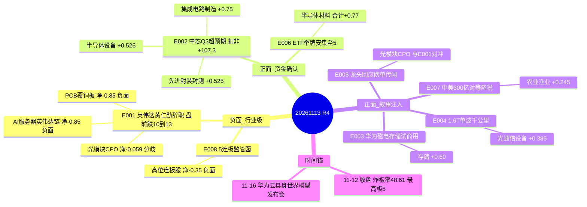

# 2026-11-13 · **消息面事件驱动**

> **数据源新鲜度**: partial · **降级状态**: true · **置信度**: 0.68
> **覆盖窗口**: 11-12 06:00 → 11-13 06:00 · **主源**: 财联社快讯 2973 + 公众号18号池 95(含财联社早知道/盘前纪要) + 主板公告窗口 2358 + 东财三季预告 500

## 一句话结论

半导体制造/材料/封测是今日唯一消息面与资金面同向的方向; 英伟达黄仁勋辞职把光模块/PCB/AI服务器打成行业级利空(叉乘-0.059判分歧), 存储只有叙事没有资金, 农业降税只有事件没有基本面。

## 🗺️ 消息面全景图

## 🎯 顶级事件详解

### E20261113_001 · 英伟达黄仁勋辞去总裁/CEO/董事 · strength=high · polarity=负面 · weighted=-0.850

**事件摘要**: 北京时间11-12 22:04 英伟达公告黄仁勋辞去总裁、CEO及董事全部职务即刻生效, CFO科莱特·克雷斯任临时CEO, Harvey Jones任首任董事长, 启动正式CEO遴选; 盘前跌10%~13%。

- **大资金意图**: 这是AI硬件链的估值锚被拔掉, 不是业绩事件。美银测算若其离任英伟达份额72%→50%、毛利率73%→65%、企业价值或缩水1.4万亿美元 → 全球AI资本开支的确定性从"黄仁勋个人"转移到"公司流程", 机构必须降贝塔。11-12 A股已先跌: 中际旭创冲567.89收508.90(-6.11%)单日主力-26.50亿、工业富联-4.85%主力-13.84亿 → 大资金是提前撤, 今日是二次确认。
- **为什么走强**: 反面在走强: 英伟达竞争对手股价拉升(证券时报11-12 23:01), 半导体11-12主力+23.53亿(5日+117.72亿)、先进封装+17.52亿、寒武纪+8.11%主力+14.06亿 → 钱不是离开AI, 是从"英伟达链"换到"国产算力/自研链"。
- **逻辑够不够硬**: 中硬偏硬。硬的部分: 公告原文+盘前跌幅+美银量化测算+同日A股资金分流四重证据。不硬的部分: 临时CEO由CFO兼任说明治理过渡可能短期化, 若两周内选出强势继任者, 利空会快速衰减; 且NVDA盘前跌幅与最终收盘可能有差异。所以本条只作"行业级风险闸门", 不作做空依据。

#### 中际旭创 300308 · role=承压样本（禁止开仓）
- **买入理由**: 不买。作为NVDA链最纯的光模块总龙(主营占比98.99%), 本条只用来度量承压幅度, 禁止开仓。
- **风险点**: 距60日高-49.86%、MA20 562.49在头上、11-12单日主力-26.50亿, 反弹即卖压。
- **止损条件**: 参考价508.90×0.95=483.46, 度量位破位即确认下跌延续(非持仓止损)。
- **可验证假设**: 若今日竞价光模块板块红盘且中际旭创30分钟主力净额转正>5亿, 说明市场把治理事件当"一次性", 则承压判断失效。

#### 工业富联 601138 · role=承压样本（禁止开仓）
- **买入理由**: 不买。AI服务器整机中军, 是英伟达机柜订单的直接载体, 事件冲击第一顺位。
- **风险点**: 11-12主力-13.84亿(5日-2.14亿)为昨日top10唯一双负; 距20日高-14.12%。
- **止损条件**: 参考价43.35×0.95=41.18, 仅作承压度量。
- **可验证假设**: 若今日AI服务器方向出现单日主力净流入>5亿且工业富联收复MA5, 则"卖硬件"判断需修正。

### E20261113_002 · 中芯国际Q3营收+28.1% 扣非+107.3% Q4指引环比+4%~6% · strength=high · polarity=正面 · weighted=+0.750

**事件摘要**: Q3营收219.83亿元同比+28.1%、净利28.47亿同比+87.6%、扣非26.39亿同比+107.3%、毛利率29.9%(环比+4.6pct); 单季销售31.9亿美元环比+6.1%; Q4指引收入环比+4%~6%、毛利率26%~28%; 8吋当量月产能Q2 1,096,500→Q3 1,116,750片。

- **大资金意图**: 11-12主力-525.12亿的全市场撤退里, 半导体是唯一净流入板块(+23.53亿, 5日+117.72亿, 20日+85.66亿且为20日唯一累计为正的成长板块)。机构在缩圈: 卖光通信(通信-68.14、PCB-27.51)买半导体制造。中芯这份Q3是给这条缩圈提供基本面许可证。
- **为什么走强**: 单季环比是硬的: 营收+4.6%(美元口径+6.1%)、毛利率环比+4.6pct、扣非同比+107.3%、Q4指引继续环比增 → 量价利三线同向, 且产能利用率上升带动的耗材/设备/封测是链式受益(所以E002同时给半导体材料/设备/封测加分)。
- **逻辑够不够硬**: 硬。v1.5业绩协议核验: 累计同比只是背景, 关键是单季: Q3净利28.47亿 vs Q2单季31.06亿(由H1 44.67−Q1 13.61倒推)环比-8.3%, 但前三季扣非56.33亿 vs 净利73.14亿, 差额16.81亿主要落在H1 → 净利环比下滑来自Q2非经常基数, 不是经营恶化; 扣非口径Q3 26.39亿同比+107.3%才是真实经营斜率。唯一瑕疵: Q4毛利率指引26%~28%低于Q3的29.9%, 说明产品组合/折旧仍有压力。

#### 中芯国际 688981 · role=研究首选
- **买入理由**: 主营92.8%为集成电路晶圆代工(毛利率22.8%), 事件与资金双确认; 收盘111.72、MA5 109.74、MA20 104.21, 站上双均线; 距60日高-18.74%(不是新高, 属修复中段); 5日主力净额+5.06亿(东财DC口径 超大单+大单)、11-12单日+2.66亿。
- **风险点**: Q4毛利率指引环比降; 高位震荡环境炸板率48.61%, 半导体若单日转负则缩圈逻辑破; 港股定价与A股溢价差。
- **止损条件**: 参考价111.72×0.95=106.13, 先破MA5 109.74再破止损, 两段确认。
- **可验证假设**: 今日30分钟主力净额<0 或 半导体板块单日净流出>20亿 → 缩圈逻辑失效, 当日回避。

#### 通富微电 002156 · role=研究首选
- **买入理由**: 集成电路封装测试为第一大主业(业务利润23.73亿, 国外15.42亿/国内9.37亿), 先进封装概念11-12主力+17.52亿(5日+83.63亿), 代工满产直接外溢到封测; 收盘48.36、MA5 45.18、MA20 44.84, 双均线之上; 距60日高-33.35%; 5日主力净额+8.66亿、单日+8.62亿。
- **风险点**: 11-12触板后炸板(Z)开板3次, 封板质量一般; 封测毛利率低于代工, 业绩弹性靠产能利用率; 距60日高仍有33%空间意味着上方套牢盘。
- **止损条件**: 参考价48.36×0.95=45.94, 破MA5 45.18先减半。
- **可验证假设**: 若今日先进封装概念主力净额转负且通富无法站上48.36, 则"外溢"假设不成立。

#### 华虹宏力 688347 · role=观察（龙二 弹性低于龙头）
- **买入理由**: 观察不买。同为晶圆代工, 11-12主力+3.38亿(5日+1.03亿)弱于中芯, 集成电路制造板块+8.85亿; 收盘172.59、距20日高-8.59%。
- **风险点**: 成熟制程占比高, 毛利率低于中芯; 资金确认弱; RR 2.25 低于2.5的舒适区。
- **止损条件**: 参考价172.59×0.95=163.96。
- **可验证假设**: 若中芯与华虹5日主力净额比值回到>5:1之外(即华虹补涨), 则龙二弹性假设成立, 可升观察为首选。

### E20261113_003 · 华为磁电存储系统贵安启动联合试商用 · strength=high · polarity=正面 · weighted=+0.600

**事件摘要**: 11-12华为磁电存储系统客户联合试商用启动, 已部署华为云乌兰察布, 明年规划容量被客户全量预定; TCO较HDD方案降30%、远期目标降50%; 赛迪顾问测算2031年北美以外温冷存储市场超2000亿元。

- **大资金意图**: 这是"第三条存储介质"的产业叙事, 但11-12存储链资金是反向的(兆易创新5日-3.91亿、斯迪克5日-0.25亿), 只有HBM概念5日+38.99亿且集中在原厂 → 大资金买的是"涨价+原厂", 不是"新介质概念"。
- **为什么走强**: 叙事够新(中国厂商首次定义并试商用的存储介质), 但A股缺直接载体(华为未上市), 所以板块没走出来; 真正走出来的是业绩: 长鑫科技前三季扭亏+2581%~2609%、江波龙+1864%~1990%、德明利扭亏 → 存储的钱在业绩里不在概念里。
- **逻辑够不够硬**: 事件硬(官方现场会+容量被预定+2000亿市场测算), 映射不硬(磁电介质无上市直接受益标的)。按纪律"无资金无催化的概念不推", 本条只给叙事分, 不给个股开仓资格。

#### 斯迪克 300806 · role=降级观察（概念映射未证实）
- **买入理由**: 不买。功能性薄膜材料收入占比17.19%毛利率19.3%, 与磁电存储的重叠未获公告确认; 11-12 -5.01%、单日主力-2.29亿、5日-0.25亿转负, 收45.69在MA5 46.48下方。
- **风险点**: 概念映射随时被公司澄清; 距60日高-23.91%; 5日资金已转负。
- **止损条件**: 参考价45.69×0.95=43.41。
- **可验证假设**: 若公司公告/互动易确认磁电存储供货关系 且 5日主力净额转正, 才升级为观察; 否则维持降级。

### E20261113_004 · 中国移动230GBaud 960km单波1.6T传输 · strength=high · polarity=正面 · weighted=+0.550

**事件摘要**: 中国移动联合伙伴完成230GBaud单波1.6Tb/s在G.652.D光纤960km实时传输, 创国内最长纪录; 天风证券看好AIDC链; 前瞻点名盈新发展(子公司企业级DRAM量产)与剑桥科技(800G/1.6T产线+3.2T/6.4T/7.2T与NPO试制线)。

- **大资金意图**: 1.6T是2027-2028的产能叙事, 大资金在11-11已用涨停兑现(光模块CPO指数+8.25%、成交1500亿), 11-12则反手卖出(通信设备-68.14亿) → 同一条叙事在两天里被做了两遍方向相反的交易, 说明它是"分歧叙事"不是"趋势叙事"。
- **为什么走强**: 技术边界(960km)是硬的工程指标, 对DCI/长途相干是实打实降本; 但盘面上11-12光模块整体回落, 只有剑桥科技+5.04%且炸板3次 → 走强的是个股不是板块。
- **逻辑够不够硬**: 事件硬、板块不硬。叉乘裁决: 光模块/CPO = E004(+0.55) + E005(+0.241) + E001(-0.85) = -0.059 → 分歧。纪律要求分歧板块只做个股弱转强, 不做板块内追高。

#### 剑桥科技 603083 · role=观察（冲板炸板 弹性核心）
- **买入理由**: 观察。高速光组件与光模块收入16.75亿/48.22亿=34.7%、毛利率34.5%、国外收入93.9%, 1.6T/3.2T产线是直接主业; 11-12 +5.04%但炸板3次; 5日主力净额+7.51亿、单日+2.78亿; 距60日高-48.35%属深跌修复; 收122.85在MA20 135.12下方-9.1%。
- **风险点**: 板块叉乘为负(E001行业级利空); 炸板3次说明封板资金不坚决; MA20在头上形成反压; 高位震荡环境对光模块最不友好。
- **止损条件**: 参考价122.85×0.95=116.71。
- **可验证假设**: 今日竞价光模块方向红盘 + 剑桥30分钟主力净额>0 且站上MA5 110.85 → 分歧转一致, 可升观察为首选; 若低开且主力净流出>3亿则剔除。

### E20261113_005 · 光通信龙头回应砍单传闻 · strength=medium · polarity=正面 · weighted=+0.344

**事件摘要**: 证券时报11-12 07:57报道 A股多家光通信巨头回应砍单传闻, 剑桥科技称传闻与经营不符、订单旺盛、产能利用率高位; 另有上海证券报指出部分三季度重仓光模块的基金11-11净值涨幅明显落后, 显示已撤离。

- **大资金意图**: 辟谣是给持仓者的安慰剂, 不是给增量资金的理由。11-11光模块指数+8.25%时部分重仓基金净值只涨1.67%/1.07% → 有人借反弹出货, 这才是资金真实动作。
- **为什么走强**: 没走强。11-12通信设备主力-68.14亿、源杰科技-1.55%, 只有源杰单日主力+9.70亿(5日+27.88亿)与股价背离 → 资金在个别票上做承接, 板块整体在退。
- **逻辑够不够硬**: 不硬(weighted已衰减到0.344, days_since=1)。本条只用于证伪"砍单"这一利空, 不构成加仓依据; 与E001对冲后光模块净分仍为负。

#### 源杰科技 688498 · role=观察（资金与股价背离）
- **买入理由**: 观察。数据中心类光芯片收入占比45.54%毛利率84.0%(电信市场8.73%毛利率62.2%), 高毛利光芯片是CPO核心; 11-12 -1.55%但主力+9.70亿、5日+27.88亿; 距60日高-59.6%属深跌修复; 收762.81在MA20 795.63下方。
- **风险点**: 股价与资金背离(资金买股价不涨)通常是承接而非启动; 光模块叉乘为负; MA20反压。
- **止损条件**: 参考价762.81×0.95=724.67。
- **可验证假设**: 若今日股价站上MA20 795.63且主力净额继续为正, 则背离转一致; 若主力转负而股价横盘, 视为出货确认。

### E20261113_006 · 科创半导体ETF举牌安集科技至5% · strength=medium · polarity=正面 · weighted=+0.350

**事件摘要**: 科创半导体ETF华夏11-11集中竞价增持79.92万股, 持股由4.65%升至5.00%触及举牌线(简式权益变动报告书11-12披露)。

- **大资金意图**: ETF举牌是被动规模增长的结果, 但它泄露了一个事实: 半导体ETF正在持续吸金 → 这是半导体板块在11-12全市场-525亿时还能净流入+23.53亿的资金结构解释。
- **为什么走强**: 举牌直接利好个股筹码结构(ETF被动锁仓), 与E002的满产逻辑形成"基本面+资金面"双击; 安集11-12 -0.92%但5日主力+1.28亿, 属缩量整理不是走弱。
- **逻辑够不够硬**: 中硬。资金面硬(举牌是硬披露), 基本面需要E002传导(抛光液/湿电子化学品是晶圆制造耗材, 产能利用率上升直接拉动); 扣分项: ETF举牌不是主动看好, 且5%后继续增持空间受基金规模约束。

#### 安集科技 688019 · role=研究首选
- **买入理由**: 集成电路收入24.99亿占99.8%毛利率56.8%, 化学机械抛光液12.04亿毛利率55.6%、功能性湿电子化学品3.13亿毛利率56.0% → 半导体材料纯度最高; 收214.80、MA5 211.13、MA20 190.45 双均线之上; 距60日高-21.56%; 5日主力净额+1.28亿。
- **风险点**: 11-12单日主力-0.18亿(小幅流出); 材料板块无独立指数, 情绪依附半导体; 高位震荡下耗材股弹性小于设备股。
- **止损条件**: 参考价214.80×0.95=204.06, 破MA5 211.13先减半。
- **可验证假设**: 若中芯Q3业绩兑现后半导体材料方向5日主力净额保持为正, 则耗材逻辑成立; 若半导体单日净流出>20亿则降级。

### E20261113_007 · 中美300亿对300亿对等降税框架 · strength=medium · polarity=正面 · weighted=+0.350

**事件摘要**: 商务部11-12例行发布会称"300亿对300亿"对等降税框架有利于稳定拓展中美双边贸易, 双方保持密切沟通, 农产品贸易为关注方向; 11-12农林牧渔主力+19亿、渔业指数+5%创8个月新高。另日本报告本季首起禽流感。

- **大资金意图**: 农业是弱势里的防御+主题, 11-12资金+19亿但领涨的是东方海洋(14天9板)这类高标 → 大资金在做情绪轮动, 不是在买贸易基本面。
- **为什么走强**: 渔业指数创新高+日本禽流感+开心果涨价33%, 三个独立催化叠加在一个低位板块; 但"对等降税"至今没有落地时点, 属预期不是事实。
- **逻辑够不够硬**: 不硬。事件是宏观框架无时点, 个股映射靠板块归属; 且高位震荡+炸板率48.61%环境下, 首板次日接力是最容易被杀的一类交易。

#### 好当家 600467 · role=观察（低位首板 需竞价确认）
- **买入理由**: 观察。海水养殖+捕捞+食品加工, 产品口径海参业务利润9594万为第一大单品, 海产品价格弹性直接对应; 11-12首板(limit_times=1)封单4429万、主力+0.71亿(5日+0.88亿); 收2.48、MA5 2.28、MA20 2.24; 距60日高-8.49%。
- **风险点**: 渔业领涨由东方海洋9/17高标带动, 高标一断则板块无接力; 首板在高位震荡环境失败率高; 2.48距60日高只差8.5%, 不是深度低位。
- **止损条件**: 参考价2.48×0.95=2.36(止损距-4.8%)。
- **可验证假设**: 今日竞价渔业方向高开且好当家不低开>3%, 盘口封单持续 → 接力成立; 若东方海洋断板或好当家低开破MA5 2.28则剔除。

### E20261113_008 · 上交所对大东方/日出东方下发监管工作函 · strength=medium · polarity=负面 · weighted=-0.500

**事件摘要**: 11-12上交所对大东方(600327)、日出东方(603366)下发股价波动监管工作函; 两股均5连板, 累计涨幅81.77%/61.20%, 大东方前三季营收-26.61%、净利-84.89%, 日出东方换手19.86%。

- **大资金意图**: 5板是当前最高板, 监管函直指情绪顶端 → 大资金要做的不是买, 是防断板传染。11-12炸板率48.61%、35只炸板, 已是接力失效的典型信号。
- **为什么走强**: 反面: 高位妖股在监管+基本面自证(营收净利双降)下只有下跌路径; 这类标的一旦断板, 会把"消费/零售低位补涨"一整条跟风链带走。
- **逻辑够不够硬**: 硬(监管函+公告原文+财务数据三重)。按纪律"躲中位和杂毛", 本条只作风险度量与情绪闸门。

#### 大东方 600327 · role=承压样本（禁止开仓）
- **买入理由**: 不买。百货零售+医疗健康, 与5连板题材无产业对应; 前三季营收19.41亿同比-26.61%、净利840.92万同比-84.89%。
- **风险点**: 5板+监管函+基本面自证, 随时快速下跌(公司公告原文); 换手38.62%筹码极不稳定。
- **止损条件**: 参考价7.18×0.95=6.82, 仅作承压度量。
- **可验证假设**: 若今日开盘即断板且封单归零, 则高位情绪压制成立, 全场接力溢价下修。

#### 日出东方 603366 · role=承压样本（禁止开仓）
- **买入理由**: 不买。厨卫电器主营未变, 公司自认股价与经营业绩行业情况严重偏离。
- **风险点**: 5连板+开板7次+监管函, 换手19.86%高于行业平均。
- **止损条件**: 参考价13.17×0.95=12.51, 仅作承压度量。
- **可验证假设**: 若日出东方断板而大东方仍封板, 说明监管只压制单票不压制情绪; 两者同断则确认退潮。

## 📊 板块 × 事件热力矩阵

| 板块 | 事件锚 | 龙头/样本 | 独立源数 | 净分 | 极性 | 结论 |
|---|---|---|:--:|:--:|:--:|---|
| 半导体材料 | E002+E006 | 安集科技 | 4 | +0.770 | 正面 | 本日最干净的多事件板块(满产耗材+ETF举牌) |
| 集成电路制造/晶圆代工 | E002 | 中芯国际 | 4 | +0.750 | 正面 | 唯一20日累计为正的成长板块 |
| 存储 | E003 | 斯迪克(概念) | 2 | +0.600 | 正面 | 叙事强映射弱; 钱在原厂不在概念 |
| 先进封装/封测 | E002 | 通富微电 | 3 | +0.525 | 正面 | 代工满产直接外溢 |
| 半导体设备 | E002 | 北方华创 | 3 | +0.525 | 正面 | 5日+41.79亿 pos_days 5/5 |
| 光通信设备 | E004 | 剑桥科技 | 3 | +0.385 | 正面 | 1.6T叙事 但板块整体在退 |
| 农业/渔业 | E007 | 好当家 | 2 | +0.245 | 正面 | 情绪轮动 无基本面兑现 |
| 光模块/CPO | E001+E004+E005 | 中际旭创 | 6 | -0.059 | 分歧 | 技术利好被治理风险对冲 只做个股弱转强 |
| 高位连板股 | E008 | 大东方/日出东方 | 2 | -0.350 | 负面 | 5板+监管函 情绪闸门 |
| PCB/覆铜板 | E001 | 超颖电子 | 3 | -0.850 | 负面 | 行业级利空 今日不做 |
| AI服务器/英伟达链 | E001 | 工业富联 | 3 | -0.850 | 负面 | 订单载体第一顺位承压 |

**sector_cross_summary(多事件叉乘)**:
- **光模块/CPO -0.059(分歧)**: E004(+0.550)+E005(+0.241)+E001(-0.850)。技术利好被龙头治理风险对冲; 11-12中际旭创冲567.89收508.90(-6.11%)单日主力-26.50亿, 分歧已在盘中兑现 → 不做板块内追高, 只做个股弱转强。
- **半导体材料 +0.770(正面)**: E002(+0.525)+E006(+0.245)。满产耗材拉动+ETF举牌同向, 安集5日主力+1.28亿、距60日高-21.56% → 今日唯一"事件+资金+位置"三项都站得住的方向。

## 🔥 业绩预告命中(三季报硬 alpha 交叉验证)

`eastmoney_earnings_predict` top15 预告中 5 只落在本文事件板块(全部为存储/半导体), 与E002/E003同向; 按v1.5协议区分原厂与模组:

| 代码 | 名称 | 类型 | 增速区间 | 事件命中 | 单季环比/质量 | 判定 |
|---|---|---|---|:--:|---|:--:|
| 688825.SH | 长鑫科技 | 扭亏 | +2581%~+2609% | E003 存储原厂 | 原厂吃涨价 | 🟢 正面 |
| 301308.SZ | 江波龙 | 预增 | +1864%~+1991% | E003 存储模组 | Q3单季环比-36%~-49% | 🟡 中性(模组被成本挤压) |
| 001309.SZ | 德明利 | 扭亏 | +32046%~+33154% | E003 存储模组 | 低基数扭亏 净利86.5亿 | 🟡 中性(基数失真) |
| 603991.SH | 领先股份 | 扭亏 | +1238.6% | E002 半导体 | 扭亏 | 🟡 观察 |
| 301536.SZ | 星宸科技 | 预增 | +663%~+698% | E002 端侧/半导体 | 净利15.43亿 | 🟢 正面 |
| 300604.SZ | 长川科技 | 预增 | +98.2%~+109.7% | E002 半导体设备 | 净利17.15亿 | 🟢 正面 |
| 600487.SH | 亨通光电 | 预增 | +151.3%~+168.1% | E004 光通信 | 净利59.7亿扣非59.4亿 | 🟢 正面(但光模块板块叉乘为负) |

> 中芯国际走三季报正式披露(非预告): 净利73.14亿+91.6%、扣非56.33亿+77.3%, 已在E002展开单季拆解。

## 关键证据

- 证据1: 英伟达公告黄仁勋辞去总裁/CEO/董事即刻生效、CFO克雷斯临时接任、盘前跌10%~13% · 上海证券报 11-12 22:04 / 证券时报 22:06 / 财联社 22:29
- 证据2: 中芯Q3营收219.83亿+28.1%、净利28.47亿+87.6%、扣非26.39亿+107.3%、毛利率29.9%环比+4.6pct、Q4指引环比+4%~6% · 财联社 11-12 17:39 + tushare income(20260930/20260630/20260331)
- 证据3: 半导体11-12主力+23.53亿、5日+117.72亿、20日+85.66亿; 通信设备-68.14亿、印制电路板-27.51亿 · R7_capital_flow 20261113
- 证据4: 华为磁电存储试商用 明年容量被全量预定 TCO降30% · 上海证券报 11-12 23:11
- 证据5: 中国移动230GBaud 960km单波1.6T · 财联社早知道 11-12 19:00 明日主题前瞻
- 证据6: 科创半导体ETF华夏举牌安集科技至5.00% · 上海证券报 11-12 16:59
- 证据7: 大东方/日出东方5连板监管函 + 大东方前三季净利-84.89% · 证券时报 11-12 20:08 + tushare limit_list_d(limit_times=5)

## 数据源审计

| 源 | 日期 | 状态 | 备注 |
|---|---|:--:|---|
| tushare/news_cls | 2026-11-13 | 🟢 | 2973条 72h回看 财联社+新浪 |
| tushare/news_major | 2026-11-13 | 🟢 | 800条 长篇要闻(仅标题摘要) |
| eastmoney/earnings_predict | 2026-11-13 | 🟢 | 500条 2026Q3预告 |
| wechat_official_rss(18号池) | 2026-11-13 | 🟢 | 95篇 含财联社早知道/盘前纪要 4feed空 |
| wechat_cli_5groups | 2026-11-13 | 🔴 | 7群0条 weflow down → 群聊维度缺失 |
| anns_window(盘前公告) | 2026-11-13 | 🟢 | 2358条 |
| tushare/limit_list_d | 2026-11-12 | 🟢 | 涨停37/炸板35/跌停5 |
| tushare/income | 2026-11-13 | 🟢 | 中芯三季/Q2/Q1 三表 |
| tushare/moneyflow_dc | 2026-11-12 | 🟢 | 个股5日主力净额(DC 超大单+大单) |
| hithink_business_query | 2026-11-13 | 🟢 | 6只主营构成核验 |
| hithink_market_query | 2026-11-13 | 🟡 | 返回缺涨跌幅字段 脑机查询返回非相关标的 → 未作映射依据 |
| overseas_snapshot(美股) | 2026-11-13 | 🟡 | 指数为11-11收盘stale 英伟达事件用新闻源 |
| expectation_gap | 2026-11-13 | 🔴 | no_input 股票名录0只 → 个股级预期差对账不可用 |

## 不确定性 / 反证

1. **英伟达事件的衰减速度是最大变量**: 临时CEO由CFO兼任, 说明董事会要的是"稳定"而不是"再造"; 若一周内选出强势继任者并重申路线图, E001会从行业级利空降为一次性事件, 光模块的-0.059会翻正。反之若继任者来自外部且战略转向自研/保守, 冲击会延长。
2. **中芯的正面并非无瑕疵**: Q4毛利率指引26%~28%低于Q3的29.9%, 说明产品组合与折旧压力仍在; 单季净利环比-8.3%需要靠"Q2非经常基数"解释, 若市场按净利环比读, 可能出现"业绩超预期但不涨"的分歧。
3. **光模块三事件是自相矛盾的**: 1.6T千公里+砍单证伪 vs 龙头治理冲击, 任何一边被证伪都会让叉乘翻转。本文判分歧而不判方向, 是承认证据对等。
4. **存储只有叙事**: 华为磁电无上市载体, 斯迪克映射未证实且5日资金转负; 真正的钱在原厂(长鑫扭亏+2581%)与涨价链, 但原厂不在A股可交易池的核心位置 → 本条对D1的实际价值是"别买磁电概念"。
5. **农业是情绪不是基本面**: 对等降税无时点, 渔业新高由9/17高标带动, 首板在炸板率48.61%的环境里成功率低; 若东方海洋断板, 好当家的溢价会同时消失。
6. **数据缺口**: 群聊0条意味着本文缺少KOL二次口播验证; 美股指数stale意味着隔夜风险偏好只能靠新闻推断; 受益股池工具字段缺失导致板块内个股扩散度无法量化。
7. **正负交织股**: 亨通光电预告+151%~168%(正面)但所属光通信在E001压制下; 寒武纪5日主力+34.21亿最强但距60日高仅-16.8%且PE146, 属"资金最强+位置最高"的矛盾体 → 只作降级观察。

## 与其他 R/D/E 的关系

- 依赖: data/raw/20261113 五源(news_cls/news_major/earnings_predict/wechat_official_rss/anns_window) + R7_capital_flow_20261113(资金口径) + emotion_cycle.json(T-1情绪)
- 被消费: R2主线(半导体制造/材料/封测为主线候选; 光模块判分歧) / R5画像(中芯/安集/通富/剑桥/好当家) / R6反证(E001行业级负面 + E008情绪闸门 + 存储叙事空心) / D1预案(研究首选3只 全部research_only)
- 与R7一致性: R7"卖光通信买半导体"与本文叉乘同向; R7 execution_candidates=0 与本文 execution_eligible=false 一致
- 与R6的预期分歧: 本文给正面的存储(E003)在R6视角属"叙事空心+概念映射未证实", 预计R6会压制该条 → 本文已预先降级斯迪克

## Sub-Agent 元数据

- skill: analyze_news_impact_v1@1.8
- artifact: data/research/20261113/R4_news.json
- method: llm_v1(五源硬约束 + v1.5业绩单季协议 + v1.7极性叉乘)
- generated_at: 2026-11-13T07:45:00+08:00
