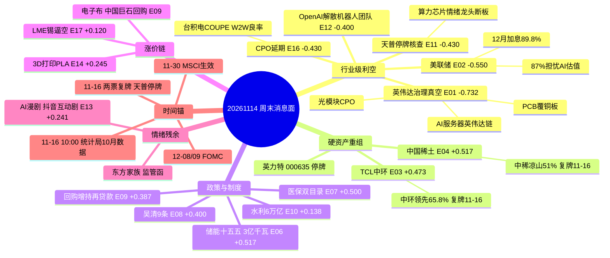

# 2026年11月14日 · **消息面事件驱动**（周末轻量档）

> **数据源新鲜度**: partial · **降级状态**: false · **置信度**: 0.66
> **覆盖窗口**: 11-13 06:02 → 11-14 18:02（36h，跨周五收盘 + 周六全天）· **主源**: 财联社快讯 2325 + 重大要闻 800 + 公众号 18 号池 105 + 盘前公告窗口 2759（覆盖 1167 家公司）+ 东财三季报预告 500
> **⚠️ 周末档纪律**: 非交易日，本档**不写买卖建议、不给买卖点、不给仓位**。所有候选一律标注「待周一竞价验证」，候选池只做「消息侧有没有刺激」的筛选，不做位置/强度判断（那属于 D1 与竞价环节）。

## 一句话结论

周末发酵是「海外 AI 硬件杀估值 + 国内政策/重组托底」双轨：光模块/CPO 板块净分 **−1.03**（两事件叠加），半导体硅片 **+0.47**、稀土 **+0.52**、储能 **+0.52**、创新药 **+0.50** 三条正面线都有硬公告或硬业绩；全部**待周一竞价验证**。

## 🗺️ 消息面全景图

## 🎯 周末发酵事件详解

### E20261114_001 · 英伟达黄仁勋辞职的第二周定价 · strength=high · polarity=负面 · raw −0.85 · weighted **−0.732** · days_since 1 · decayed=false

**事件摘要**：11-12 美股盘后英伟达公告黄仁勋辞去总裁/CEO/董事即刻生效，CFO 克雷斯任临时 CEO；本周英伟达累计跌约 13%~14%（连续第六周下跌，2012 年以来最长），市值蒸发逾 6200 亿美元（上证报同期口径：本周逾 3.8 万亿元）；11-13 美股费半收盘跌超 3%、盘中最大 −6.4%（AMD −8.75%）；Truist 下调至持有、目标价 346→174；董事会已启动猎头、接触 Arm CEO Rene Haas，但声明「尚未正式接触任何候选人」；美国国会要求商务部长卢特尼克 12-10 作证。

- **大资金意图**：这是把 AI 硬件链的**估值锚**从「创始人」换成「公司流程」，机构必须降 β。钱没有离开 AI，只是换载体——11-13 A 股英伟达链杀（天孚/胜宏 −10%、生益跌停、中际旭创 −8%），同一天中芯、华虹逆势走强。
- **为什么走强**：这是空头在走强，不是多头。三条证据同向：美股连续第六周阴线、A 股供应商股价与「合作未受影响」的口供背离、以及 CPO 延期叙事被叠加进来（见 E16）。
- **逻辑够不够硬**：**事件硬、定价已走过中段**。硬的部分（公告原文＋董事会正式声明＋国会介入＋评级下调）无法反驳；不硬的部分是「持续性」——CFO 临时接任意味着过渡可能很短，A 股算力卡价格并未显著波动（证券时报 11-14 08:08 采访多家算力厂商）。按衰减公式，7 日后本条归零，**周一是它最后的有效定价窗口**。
- **待周一部分**：看光模块/CPO 板块竞价是否**低开高走**。低开高走＝利空已被消化（空头挤压）；低开继续走弱＝定价延续。两者都成立，取决于前 30 分钟资金，不取决于新闻。

### E20261114_016 · CPO 大规模交付推迟到 2027 底~2028（台积电 COUPE 良率）· strength=medium · polarity=负面 · raw −0.50 · weighted **−0.430** · single_source=true

**事件摘要**：11-13 23:26「傅里叶的猫」转述 FUNDA 深度报告：台积电 COUPE 线的 W2W 混合键合良率上不去（D2W 约 80%，W2W 卡住），各环节测试设备供应商尚未确定，CPO 真正大规模交付要到 2027 年底甚至 2028，晚于市场预期。

- **大资金意图**：给「光模块杀估值」补上产业侧理由。原来杀的是「英伟达治理」，现在多一条「CPO 放量时间表后移」——两条叠加才是光模块净分 −1.03 的来源。
- **为什么走强**：它精准打击了 2027 年放量的卖方假设，而 A 股光模块估值里已经含了这部分。
- **逻辑够不够硬**：**不硬到可以单独下判断**。单一公众号转述第三方报告，无原文、无台积电/设备商回应，按交叉核实层规则 `strength` 顶格 medium、`single_source=true`。它与 E01 叠加后才有板块级的杀伤力，单独看只能当「叙事补充」。

### E20261114_002 · 美联储半年度金融稳定报告 + 12 月加息锁定 · strength=high · polarity=负面 · raw −0.55 · weighted **−0.550** · days 0

**事件摘要**：11-13（美东）美联储发布半年度《金融稳定报告》，87% 受访者把 AI 列为金融体系显著风险，明确警示「AI 与高企资产估值可能构成潜在脆弱性」；同日多位官员（杰斐逊、戴利、柯林斯、洛根）表态偏鹰，CME 显示 12 月加息 25bp 概率 89.8%（11-14 05:41），美银把路径改为 12 月/1 月/3 月连续三次加至 4.5%~4.75%。

- **大资金意图**：这是对全球高 β 成长资产的第二个压制器。海外 AI 叙事与利率同时转向，等于把「分母」和「分子」一起打。
- **为什么走强**：因为它在官方文本里——「87%」这个数字给了机构减仓的合规理由。
- **逻辑够不够硬**：硬（官方报告 + CME 定价 + 多家投行改预测）。但对 A 股的传导是间接的：国内货币政策独立，实际影响在**外资风险偏好与港股科技**，不在 A 股题材的当日涨跌。所以本条只作背景压制，不作为 A 股个股事件。
- **待周一部分**：11-16 10:00 国家统计局 10 月经济数据发布会；若数据弱于预期，反而强化国内政策加码预期——这是本条的反向读法。

### E20261114_003 · TCL 中环重组方案出炉 · 11-16 复牌 · strength=high · polarity=正面 · raw +0.55 · weighted **+0.473**

**事件摘要**：11-13 晚 TCL 中环（002129）披露预案：发行股份收购中环领先 65.80% 股权（向无锡产发、TCL 科技、国投集新等 50 名交易对方），发行价 7.59 元/股，持股 32.72%→98.52%，并配套募资（TCL 科技认购 20%~30%），11-16 开市复牌。中环领先 2025 年营收 57.07 亿；2026 前三季 49.0 亿 +15%，Q3 单季 18.6 亿 +23%、净利 0.80 亿（国内同业首个单季经营性盈利）；前三季出货 1101 MSI +21%，12 吋 +24%。

- **大资金意图**：把半导体硅片资产从「参股」变成「并表」，等于把利润表做实。国资（无锡产发）+ 大基金三期（国投集新）一起进来，是给估值换锚。
- **为什么走强**：复牌当日的定价权。停牌前价格里没有这部分并表利润，复牌后需要重新定价——这是事件驱动最标准的「缺口」。
- **逻辑够不够硬**：**中硬**。硬：标的资产行业地位（国内规模/出货双第一）、国资背书、Q3 已转盈。不硬：审计评估未完成、最终作价未定；且交易约定「交割后两年内协商收购晶盛机电所持中环领先剩余 1.48%」，而**晶盛机电 11-14 收到浙江证监局警示函**（销售收入内控不规范、内控自评未如实反映）——这不是重组障碍，但会成为复牌当天的舆情变量。
- **待周一部分**：看复牌高开幅度与是否放量。这条不做首板判断（复牌票不属于首板）。

### E20261114_004 · 中国稀土注入中稀凉山 51% · 11-16 复牌 · strength=high · polarity=正面 · raw +0.60 · weighted **+0.517**

**事件摘要**：11-13 晚中国稀土（000831）披露预案：发行股份购买控股股东中国稀土集团所持中稀（凉山）稀土 51% 股权，发行价 39.41 元/股，11-16 复牌。中稀凉山前身四川江铜稀土，拥有四川冕宁牦牛坪超大型稀土矿，稀土氧化物工业可开采储量居全国轻稀土矿山第二；为全球最大氟碳铈稀土产品生产企业之一。

- **大资金意图**：轻稀土资源端证券化。控股股东兑现注入承诺，等于把「资源—冶炼—磁材」链条的利润往上市公司集中，这是资源股最实的增厚方式。
- **为什么走强**：稀土是本周唯一「价格＋业绩」同向的资源链。包头稀交所 11-13：氧化镨钕 71.92 万/吨（+0.02）、氧化镝 151.42 万（+0.50）、氧化铽 640 万（+2.0）。业绩侧：中国稀土前三季预告归母 3.63–4.63 亿（+88.96%~140.99%）、扣非 +98.63%~152.94%；北方稀土归母 36.2–36.8 亿（+134.95%~138.84%）；金力永磁 +42.59%~55.2%（东财预告，报告期 2026-09-30）。
- **逻辑够不够硬**：**硬**。理由：注入标的是实体矿山（可开采储量全国第二）、价格与业绩双确认、同业业绩集体高增。风险在「复牌即高点」——稀土板块今年已有多次事件驱动冲高回落，位置判断留给竞价。
- **待周一部分**：复牌票不判首板；观察它对**北方稀土/金力永磁/广晟有色**的板块带动是否在开盘 30 分钟内成立。

### E20261114_006 · 《"十五五"新型储能实施方案》印发 · strength=high · polarity=正面 · raw +0.60 · weighted **+0.517**

**事件摘要**：11-13 国家发改委、国家能源局联合印发：到 2030 年全国新型储能装机 3 亿千瓦、平均储能时长约 3 小时；「十五五」新增省内自用储能需求约 1.1 亿千瓦，2030 年省内自用超 2.4 亿千瓦；新能源基地配储 5000万~6000 万千瓦。技术路线：巩固锂离子、推广钠离子、推动压缩空气与液流电池工程化产业化；场景加入绿电直连、零碳园区、虚拟电厂。

- **大资金意图**：把储能从「补贴驱动」换到「市场化+容量电价」的框架里，给长时储能一条可算账的路径。3 亿千瓦是「保底值」（电力规划设计总院徐东杰原话），意思是既要给信心、又要防投资冲动——**这句话本身就是对「暴涨式炒作」的提前降温**。
- **为什么走强**：政策级别高（两部委联合印发）、量化指标明确（3 亿千瓦/3 小时）、技术路线点名（钠电、压缩空气、液流）。
- **逻辑够不够硬**：政策硬，映射软。储能是「大票+低弹性」板块，政策落地对当日涨停贡献有限；真正能出首板的是**钠离子/液流/压缩空气的弹性中小票**，而这类票的纯度需要 R2/R5 再筛。别把「政策利好」直接当「明天有板」。
- **待周一部分**：竞价看储能方向是否有量。若只有大票红、没有小票封板，说明资金不认这个题材的短线弹性。

### E20261114_007 · 2026 版医保＋商保「双目录」发布 · strength=high · polarity=正面 · raw +0.50 · weighted **+0.500**

**事件摘要**：11-14 国家医保局、人社部发布 2026 版医保目录，新增 107 种药品（其中 51 个一类新药，创历史新高），调后总数 3331 个；商保创新药目录新增 12 种（含全球首个实体瘤 CAR-T、中国首个血友病基因治疗药物），共 28 种；新版 2027-01-01 执行。百万级 CAR-T 首次纳入基本医保，患者自付降至 10 万元以内。

- **大资金意图**：医保支付端给创新药开一条「以量换价」的通道，商保目录是第二条腿。对创新药是中期逻辑，不是当日涨停逻辑。
- **为什么走强**：51 个一类新药是历年最高，且第一次把 CAR-T 这种百万级疗法放进支付体系——象征意义大于当期利润。
- **逻辑够不够硬**：政策硬，个股映射不硬。CAR-T 在 A 股的纯正标的很少（多数在港股/未上市），A 股更多是「创新药大票 + CXO」的间接受益。我**不**把这条直接映射成首板候选，避免「政策好→乱点名」。

### E20261114_011 · 天普股份 11-16 起停牌核查 · strength=high · polarity=负面 · raw −0.50 · weighted **−0.430**

**事件摘要**：天普股份（605255）11-10~11-13 四连板（自 11-09 累涨 54.73%），11-13 收 73.82 元，PE −1295.95、PB 12.44（汽车零部件行业 26.32 / 2.49）；11-16 开市起停牌核查。公司同时澄清：主营未变、股东中昊芯英无资产注入计划、36 个月内不借壳，中昊芯英自身 IPO 在推进。

- **大资金意图**：这是监管对「算力芯片壳资源」叙事的定点拆解。天普是 11 月最强算力情绪载体（人气榜 surge 45→7），它停牌等于把这条线的旗帜拿走。
- **为什么走强**：空头叙事：4 连板 + PE 负值 + PB 高于行业 5 倍 + 公司自己否认三件事，四条凑齐后核查是必然结果。
- **逻辑够不够硬**：硬（公告原文）。但要注意它的**外溢**：天普停牌会让「算力芯片/中昊芯英概念」在周一失去龙头，同题材跟风票缺旗帜，容易集体退潮。

### E20261114_012 · OpenAI 解散独立机器人团队 · strength=medium · polarity=负面 · raw −0.40 · weighted **−0.400**

**事件摘要**：11-14 01:14 报道，OpenAI 已解散独立机器人团队，研究员调至其他部门；公司称「并非放弃机器人，而是依托通用模型加速机器人研发」。

- **大资金意图**：这是「具身智能技术路线」的一次组织表态——从「专用机器人团队」转向「通用模型赋能」。对 A 股人形机器人板块，它打的是「海外标杆在推进」的叙事前提。
- **为什么走强**：11-13 人形机器人概念已经 −3.15%、板块资金 −19.87 亿、宇树 −8.38%；本条是叠加，不是起点。
- **逻辑够不够硬**：不硬（组织调整被官方包装成「加速」，可作两种解释）。但方向性上与「机器人板块 late 阶段派发」一致，所以进负面清单、不进强负面。

### E20261114_008 · 吴清 9 条：稳市机制/量化与减持规则/长期资本 · strength=medium · polarity=正面 · raw +0.40 · weighted **+0.400**

**事件摘要**：11-14 首届中国资本市场学术年会，吴清提出 9 条研究重点：稳市长效机制、跨境跨市场风险、大型与新型科技企业发行制度适配、支持新型消费与传统产业升级、AI 在资本市场的传导映射（算法黑箱/AI 网络攻击）、长期资本耐心资本、预期引导减少羊群效应、**量化交易与股份减持制度规则优化**、跨境投融资便利化。

- **大资金意图**：这是制度层面的「稳」——重点在压波动、引长钱，而不是给某条题材发令。
- **为什么走强**：它和 11-06 国常会「完善资本市场稳市机制」、11-04 起回购增持再贷款（近 10 天 50+ 家获专项贷款承诺函）构成一套组合。受体是红利与蓝筹。
- **逻辑够不够硬**：制度硬、短期交易意义弱。**特别注意第 8 条点名「量化交易」**——这条对当日高换手题材股是潜在约束，不是利好。

### E20261114_009 · 回购/增持潮（再贷款政策加码）· strength=medium · polarity=正面 · raw +0.45 · weighted **+0.387**

**事件摘要**：11-13~14 密集公告：中国巨石（600176）拟 1.5–2.5 亿回购**全部注销**，上限价 49.15 元 vs 11-13 收盘 27.37 元；华虹宏力（688347）3–5 亿回购注销；联讯仪器（688808）1–1.5 亿（上限 1538 元，A 股第三高价股，收 718.05）；南亚新材（688519）1–2 亿；肯特催化（603120）1.115–2.23 亿；海光信息（688041）取得回购专项贷款承诺函；复旦微电（688385）、联芸科技（688449）、南微医学（688029）、科博达（603786）、东材科技（601208）、辽宁成大（600739）董事长提议回购。增持侧：星湖科技（600866）控股股东增持计划、韵达股份（002120）增持+专项贷款、东阿阿胶（000423）董事长增持、天华新能（300390）董事增持、君禾股份（603617）控股股东计划。

- **大资金意图**：政策（再贷款）给了低成本资金，公司用它做注销式回购——这是提高 EPS 的硬动作，不是象征性增持。
- **为什么走强**：50+ 家拿专项贷款、多家注销式回购，规模上已经不是个案。
- **逻辑够不够硬**：硬在「注销」二字。**但要防一个常见误读**：49.15 元是「回购价格上限」，不是「要约价」，不代表公司承诺在 49 元买——中国巨石现价 27.37 元，上限溢价 80% 的真实含义是「管理层认为现价显著低估」，不是「有 80% 保底」。同理联讯仪器 1538 元上限 vs 718.05 元收盘。

### E20261114_013 · AI 漫剧/短剧：抖音开放互动剧与互动影游合作 · strength=medium · polarity=正面 · raw +0.40 · weighted **+0.241**

**事件摘要**：抖音集团短剧版权中心面向具备互动内容、短剧、漫剧或游戏制作能力的合作方开放合作，提供三种合作模式与两项限时激励：单剧最高 20 万元保底 + 30%~50% 额外分成，可叠加。11-13 盘面：文投控股 5 天 4 板、金逸影视 4 天 2 板、幸福蓝海 20CM 涨停、横店影视/湖北广电/中国电影/儒意涨停。

- **大资金意图**：在硬件被杀的一周里，找一个与海外 AI 叙事无关、纯国内平台补贴驱动的避风港；容量小、位置低、有真金白银补贴做催化。
- **为什么走强**：连续走强 5 天且在大盘 −3.32% 的当天走出独立行情，说明有资金在里面做「逆势辨识度」。
- **逻辑够不够硬**：题材级硬、产业级不硬。20 万保底对上市公司利润表贡献极小，本质是**情绪题材**。已走 5 天属中后段，周一要防「分歧转一致后再转分歧」。

### E20261114_014 · 3D 打印拉动 PLA 多轮涨价 · strength=medium · polarity=正面 · raw +0.35 · weighted **+0.245**

**事件摘要**：上证报 11-14 调研：PLA 工业级树脂主流价 18500–19500 元/吨（进口 22000–23000）；金丹科技 10-10 对乳酸系列统一上调 8%，道达尔能源科碧恩 10-16 全系提价 10%；前三季 3D 打印设备产量 +62.5%，2026 年预估 3D 打印耗材用 PLA 约 14 万吨；金丹科技乳酸产能 23.3 万吨、产线满负荷。

- **大资金意图**：这是「涨价链」的小分支——真实提价 + 真实开工率，属可验证的行业景气，不是概念。
- **为什么走强**：多个企业连续调价（8%、10%），且下游需求（3D 打印）有统计局数据背书。
- **逻辑够不够硬**：中硬。硬：出厂价与开工率可查。不硬：标的少、市值小、题材容量不足以形成板块效应。

### E20261114_017 · LME 锡逼空 / 铜连跌五周 · strength=low · polarity=正面（锡）· raw +0.30 · weighted **+0.120**

**事件摘要**：11-14 04:44 LME 锡现货对三个月合约升水达 670 美元/吨，库存暴跌引发新一轮逼空；同期铜价跌破 13500 美元/吨、创近两年最长连跌（五周），受 AI 震荡与加息预期拖累。

- **大资金意图**：资源品内部剧烈分化——锡（供给受限）被逼空、铜（宏观 β）被抛售。
- **为什么走强**：库存暴跌是硬约束，现货对三个月合约升水 670 美元/吨，是逼空的典型形态；同一时间铜因 AI 震荡与加息预期连跌五周，两条金属走出相反曲线。
- **逻辑够不够硬**：中（LME 价差是硬数据），但 A 股映射标的集中（锡业股份），且低权重不进首推。

## 📊 板块 × 事件热力矩阵

叉乘口径：`contrib = |weighted_score| × sign(板块极性) × strength 权重(high 1.0 / medium 0.7 / low 0.4)`，同板块同名累加；> +0.12 正面 / < −0.12 负面 / 其余分歧。

| 板块 | 事件锚 | 净分 | 定性 | 首推/辨识度标的 | 独立源数 | 三季报预告 |
|---|---|:--:|:--:|---|:--:|:--:|
| 光模块/CPO | E01(−0.732)+E16(−0.301) | **−1.03** | 🔴🔴 负面 | 中际旭创/新易盛/天孚通信（承压样本） | 3（含单源 E16） | 亨通光电 +151%~168%、光迅科技 +65%~82% |
| PCB/覆铜板 | E01 | **−0.73** | 🔴🔴 负面 | 生益科技/沪电股份/景旺电子 | 2 | 生益科技 +164%~181%、沪电 +100%~110% |
| AI服务器/英伟达链 | E01 | **−0.73** | 🔴🔴 负面 | 工业富联/浪潮信息 | 2 | 浪潮信息 +156%~177% |
| 稀土/永磁 | E04 | **+0.52** | 🟢🟢 正面 | 中国稀土（复牌）/北方稀土/金力永磁 | 3（预案+价格+预告） | 北方稀土 +135%~139%、中国稀土 +89%~141% |
| 储能 | E06 | **+0.52** | 🟢🟢 正面 | 政策级；弹性标的待 R2 收敛 | 3（两部委+答记者问+专家） | 亿纬锂能 +80%~90%、德业股份 +80%~84% |
| 创新药/CAR-T | E07 | **+0.50** | 🟢🟢 正面 | 政策级；CAR-T 纯正标的稀缺 | 3（医保局+人社部+大会） | 海思科 +297%~321%、华海药业 +170%~190% |
| 半导体硅片/材料 | E03 | **+0.47** | 🟢 正面 | TCL中环（复牌）/沪硅产业/立昂微 | 2 | 立昂微 扭亏(+261%)、复旦微电 +188%~248% |
| 人形机器人 | E12 | **−0.40** | 🔴 负面 | 宇树科技/襄阳轴承（周五已 −8.38%/−跌停） | 2 | —（宇树未上市口径不适用） |
| 高位连板股 | E11 | **−0.30** | 🔴 负面 | 天普股份（停牌）/大东方/日出东方（监管函） | 2 | — |
| 电子布/玻纤 | E09（回购+紧缺复合） | **+0.27** | 🟢 正面 | 中国巨石/宏和科技 | 2 | 中国巨石 +100%~110% |
| 光芯片 | E05 | **+0.27** | 🟡 分歧 | 源杰科技/长光华芯/仕佳光子 | 2 | —（未见预告） |
| 3D打印/乳酸 | E14 | **+0.25** | 🟢 正面 | 金丹科技 | 2 | — |
| 影视/短剧（AI漫剧） | E13 | **+0.24** | 🟢 正面但中后段 | 文投控股/横店影视/中国电影 | 2 | — |
| 券商 | E08 | **+0.16** | 🟡 弱正 | 政策级 | 1（官方讲话） | — |
| 水利基建 | E10 | **+0.14** | 🟡 弱正 | 中国电建/粤水电 | 1（上证报测算） | — |
| 小金属/锡 | E17 | **+0.12** | 🟡 边缘 | 锡业股份 | 1 | — |

### `sector_cross_summary`（只收多事件板块）

- **光模块/CPO（2 事件，−1.03）**：E01（英伟达治理，high，−0.732）与 E16（CPO 交付推迟，medium，−0.301）**同名累加**才达到 −1.03。若把 E16 单列成「CPO 延期」这一新名字，这条链就只剩 −0.73，等于人为稀释利空——本周必须同名。
- **光芯片 vs 光模块的背离**：源杰科技 17.44 亿大单（E05，+0.27 分歧偏正）与光模块 −1.03 同链反向。周五盘面已经给出答案：源杰开盘跌超 10%（收窄至 −6% 内），说明**订单利好抵不过板块 β**。周一若源杰能独立走强，才是这条背离的第一次胜出。
- **稀土（1 事件 + 3 条业绩）**：E04 单事件 +0.52，但叠加同业预告（北方稀土 +135%、金力永磁 +42%）后，这条线的「事件+业绩」双重确认度是本周末最高的之一。

## 🔥 三季报业绩预告命中（硬 alpha 交叉验证）

数据源：`data/raw/20261114/eastmoney_earnings_predict.json`（report_date 2026-09-30，500 条，captured 18:02）。**本期三季报已收官，周末无新增预告**——下面是把本文事件板块与预告池做交集后的命中项。

| 代码 | 名称 | 预告类型 | 增速下限-上限 | 归母上限 | 事件命中 | 逻辑强度 |
|---|---|---|:--:|:--:|---|:--:|
| 000831.SZ | 中国稀土 | 预增 | +89%~+141% | 4.63 亿 | E04 中稀凉山注入 | 🟢🟢🟢 |
| 600111.SH | 北方稀土 | 预增 | +135%~+139% | 36.8 亿 | E04 板块共振 | 🟢🟢🟢 |
| 300748.SZ | 金力永磁 | 预增 | +43%~+55% | 8.0 亿 | E04 磁材端 | 🟢🟢 |
| 600176.SH | 中国巨石 | 预增 | +100%~+110% | 53.93 亿 | E09 回购注销+电子布紧缺 | 🟢🟢🟢 |
| 605358.SH | 立昂微 | 扭亏 | +261%（归母 1.74 亿） | 1.74 亿 | E03 硅片链 | 🟢🟢 |
| 688385.SH | 复旦微电 | 预增 | +188%~+248% | 11.5 亿 | E09 董事长提议回购 | 🟢🟢 |
| 688041.SH | 海光信息 | 预增 | +38%~+52% | 29.8 亿 | E09 回购专项贷款 | 🟢🟢 |
| 600183.SH | 生益科技 | 预增 | +164%~+181% | 68.7 亿 | E01 板块被砸（业绩与股价背离） | 🟡 矛盾 |
| 002463.SZ | 沪电股份 | 预增 | +100%~+110% | 57.0 亿 | E01 板块被砸 | 🟡 矛盾 |
| 000977.SZ | 浪潮信息 | 预增 | +156%~+177% | 41.0 亿 | E01 AI服务器被砸 | 🟡 矛盾 |
| 688808.SH | 联讯仪器 | 预增 | +1866%~+2073% | 21.0 亿 | E09 回购（自身） | 🟢🟢 |
| 301308.SZ | 江波龙 | 预增 | +1864%~+1991% | 149.0 亿 | 存储（本周无新催化） | 🟡 周期见顶待查 |

**读法**：稀土与玻纤是「业绩＋事件」同向；PCB/覆铜板/服务器是「业绩极好但被海外叙事砸」——这组矛盾是周一定价的核心分歧，**业绩不等于股价**，巨量套牢盘决定了好逻辑也要磨时间（用户口径）。

## 📌 公告硬事件（盘前公告窗口 2759 条 / 1167 家公司，11-13~11-14）

### ① 重组 / 控制权 / 要约

| 代码 | 名称 | 事项 | 状态 |
|---|---|---|---|
| 002129.SZ | TCL中环 | 发行股份收购中环领先 65.80%，发行价 7.59 元 | 11-16 复牌 |
| 000831.SZ | 中国稀土 | 发行股份收购中稀凉山 51%，发行价 39.41 元 | 11-16 复牌 |
| 000635.SZ | 英力特 | 控股股东拟协议转让 + 筹划发行股份购买资产 | 停牌 |
| 300862.SZ | 蓝盾光电 | 13.5 亿收购岚创科技 100%（真空镀膜设备） | 报告书披露 |
| 600085.SH | 同仁堂 | 24.44 亿现金收购天津同仁堂 60% | 关联交易 |
| 603580.SH | 艾艾精工 | 上海誉升同风要约收购 | 第三次提示 |
| 603389.SH | 亚振家居 | 吴涛要约收购 | 持续督导总结 |
| 001331.SZ | 胜通能源 | 七腾机器人要约收购 | 持续督导 |
| 002277.SZ | 友阿股份 | 发股+现金购买资产 | 深交所审核通过 |
| 300688.SZ | 创业黑马 | 发股购买版信通 100% | 证监会注册批复 |
| 601969.SH | 海南矿业 | 发股+现金购买资产 | **上交所暂缓审议**（负面） |
| 301419.SZ | 阿莱德 | 现金收购源宝精密 ≥51% | 尽调阶段 |
| 002729.SZ | 好利科技 / 002084.SZ 海鸥住工 / 002160.SZ 常铝股份 / 920580.BJ 科创新材 | 控制权拟变更 | 进展公告 |

### ② 回购（含注销式）

| 代码 | 名称 | 方案 | 备注 |
|---|---|---|---|
| 600176.SH | 中国巨石 | 1.5–2.5 亿，全部注销，上限 49.15 元 | 收 27.37 元（11-13） |
| 688347.SH | 华虹宏力 | 3–5 亿，用于注销 | 11-13 公告，当日盘中一度涨近 5% |
| 688808.SH | 联讯仪器 | 1–1.5 亿，上限 1538 元 | A 股第三高价股，收 718.05 元 |
| 688519.SH | 南亚新材 | 1–2 亿，上限 332.50 元 | — |
| 603120.SH | 肯特催化 | 1.115–2.23 亿，上限 50 元（含专项贷款 2 亿） | — |
| 688041.SH | 海光信息 | 取得回购专项贷款承诺函 | — |
| 688385.SH | 复旦微电 / 688449.SH 联芸科技 / 688029.SH 南微医学 / 603786.SH 科博达 / 601208.SH 东材科技 / 600739.SH 辽宁成大 | 董事长/实控人提议回购 | 提议≠方案 |
| 603833.SH | 欧派家居 / 600987.SH 航民股份 / 603293.SH 埃泰克 / 603268.SH 松发股份 | 首次回购/回购报告书 | — |

### ③ 增持

| 代码 | 名称 | 事项 |
|---|---|---|
| 600866.SH | 星湖科技 | 控股股东增持计划 |
| 002120.SZ | 韵达股份 | 控股股东增持 + 取得专项贷款承诺函 |
| 000423.SZ | 东阿阿胶 | 董事长增持 |
| 300390.SZ | 天华新能 | 董事首次增持 + 后续计划 |
| 603617.SH | 君禾股份 | 控股股东增持计划 |
| 002039.SZ | 黔源电力 / 001205.SZ 盛航股份 / 000915.SZ 华特达因 | 增持触及 1% 整数倍 |
| 600189.SH | 泉阳泉 / 300850.SZ 新强联 / 002109.SZ ST兴化 | 增持实施完毕 |

### ④ ST / 退市 / 停复牌

| 代码 | 名称 | 事项 | 极性 |
|---|---|---|:--:|
| 605255.SH | 天普股份 | 11-16 起停牌核查（4 连板） | 🔴 |
| 300366.SZ | ST创意 | 申请撤销其他风险警示（已完成追溯重述） | 🟢 |
| 600180.SH | *ST瑞茂 | 股价低于 1 元、可能终止上市首次风险提示 | 🔴 |
| 002973.SZ | 侨银股份 | 侨银转债可能不能按期足额兑付本息的重大风险提示 | 🔴 |
| — | 萃华退 | 2026-11-13 摘牌（退市板块 45 交易日内可挂牌转让） | 🔴 |
| 600302.SH | ST标准 | 收购西安昊友航天复合材料 51% 完成工商变更 | 🟡 |
| 600238.SH | ST椰岛 / 002122.SZ ST汇洲 | 股东会/投资者关系 | ⚪ |

### ⑤ 监管与风险提示

| 代码 | 名称 | 事项 |
|---|---|---|
| 300316.SZ | 晶盛机电 | 浙江证监局警示函（2024/2025 销售收入内控不规范、内控自评未如实反映）——与 TCL 中环重组交易对手身份交叉 |
| 000877.SZ | 天山股份 | 收到行政监管措施决定书及证监会立案告知书 |
| 603366.SH / 600327.SH | 日出东方 / 大东方 | 股票交易风险提示（均 5 连板，同受上交所监管工作函） |
| 603536.SH / 600825.SH / 605169.SH | 惠发食品 / 新华传媒 / 洪通燃气 | 股票交易风险提示 / 异动问询回函 |
| 002205.SZ | 国统股份 | 两日涨幅偏离超 20%，异动公告称经营正常 |
| 600821.SH | 金开新能 | 与关联方共同收购赫章电力并投建威赫 2×660MW 煤电 |
| 002600.SZ | 领益智造 | 回应 AMD AI 服务器液冷/快拆接头认证问题（未确认） |
| 300081.SZ | ST恒信 | 作废公章被离职员工冒用，拟报案 |

## 🎯 周一候选（全部**待竞价验证**，本档不给买点/仓位）

### A. 复牌/停牌事件票（不是首板，单列）

| 代码 | 名称 | 事件 | 周一关键变量 |
|---|---|---|---|
| 002129.SZ | TCL中环 | 重组复牌 11-16 | 高开幅度、是否放量、晶盛机电警示函舆情 |
| 000831.SZ | 中国稀土 | 重组复牌 11-16 | 高开幅度、对北方稀土/金力永磁带动 |
| 000635.SZ | 英力特 | 停牌（重组+控制权转让） | 无交易，观察复牌时点 |
| 605255.SH | 天普股份 | 停牌核查 11-16 起 | 同题材跟风票失去旗帜 → 算力芯片概念退潮风险 |

### B. 首板候选（消息侧有明确刺激；source=direct_name_match / lead_stock_proxy）

| 代码 | 名称 | 消息触发 | 源 | 质量 | 待验证点 | 风险旗 |
|---|---|---|:--:|:--:|---|---|
| 600176.SH | 中国巨石 | 1.5–2.5 亿注销式回购 + 电子布紧缺（2027 供给难匹配需求）+ 三季报 +100%~110% | 公告 + 上证/证券时报 | A | 是否高开走强、玻纤板块是否跟随 | 回购上限价 49.15 ≠ 要约价，勿误读为 80% 保底 |
| 688347.SH | 华虹宏力 | 3–5 亿回购注销 + 成熟制程涨价 + 中芯 Q3 强势 | 公告 + 盘中异动 | A | 与中芯同步性；若中芯走弱则单腿 | 港股半导体弹性更大，A/H 溢价 |
| 688498.SH | 源杰科技 | 17.44 亿大功率激光器芯片订单（B 客户） | 公告（单源，公司披露） | B | 能否脱离光模块 β 独立走强 | 周五已因板块杀跌，订单与位置冲突 |
| 603256.SH | 宏和科技 | 电子布紧缺（中国巨石口径：低库存、2027 供给增量难匹配） | 行业 + 公告链 | B | 电子布纯度最高，但体量小、易被忽视 | 未在公告窗口见自身催化 |
| 600715.SH | 文投控股 | 抖音互动剧/影游合作（单剧 20 万保底+30~50% 分成） | 财联社 + 盘面 | B | 5 天 4 板后是「分歧转一致」还是「一致转分歧」 | 高位、换手极大；人气榜 rank2 已拥挤 |
| 603103.SH | 横店影视 | 同上（周五首板） | 盘面 + 政策 | C | 影视板块能否从「个股」扩散到「板块」 | 题材容量小，纯情绪驱动 |
| 300528.SZ | 幸福蓝海 | 同上（周五 20CM） | 盘面 + 政策 | C | 20CM 次日承接 | 弹性大、回撤也大 |
| 600977.SH | 中国电影 | 同上（周五首板 + 首进人气榜 rank10） | 盘面 + 榜单 | C | 大票能否持续封板 | 体量大、封板成本高 |
| 600111.SH | 北方稀土 | 中国稀土复牌带动 + 三季报 +135%~139% | 公告 + 行业价格 | A | 复牌带动是否在 30 分钟内成立 | 稀土多次事件冲高回落 |
| 300748.SZ | 金力永磁 | 同上（磁材端）+ 三季报 +43%~55% | 公告 + 预告 | B | 磁材端弹性是否优于资源端 | 同上 |
| 605358.SH | 立昂微 | 硅片链 + 扭亏（归母 1.74 亿） | 预告 + 事件链 | B | 是否与 TCL 中环复牌形成板块共振 | 硅片价格本周仍在下行（硅业分会 11-13：N型G10L 0.95 元/片，周环比 −2.06%） |
| 600866.SH | 星湖科技 | 控股股东增持计划 | 公告 | C | 增持计划 vs 实际执行 | 增持计划≠买入 |
| 000423.SZ | 东阿阿胶 | 董事长增持 | 公告 | C | 消费/中药防御属性 | — |
| 002120.SZ | 韵达股份 | 控股股东增持 + 专项贷款 | 公告 | C | 快递价格战背景 | — |
| 300274.SZ | 阳光电源 | 储能十五五方案（3 亿千瓦） | 政策（lead_stock_proxy） | C | 政策级利好能否转化为板块量能 | 大票低弹性；非消息点名 |
| 002335.SZ | 科华数据 | 同上 | 政策（lead_stock_proxy） | C | 见上 | 同上 |
| 600348.SH | 华阳股份 | 钠离子储能路线点名 | 政策（lead_stock_proxy） | C | 钠电路线是否被资金选中 | 板块纯度需 R2/R5 复核 |
| 000629.SZ | 钒钛股份 | 液流电池路线点名 | 政策（lead_stock_proxy） | C | 液流路线是否被资金选中 | 同上 |
| 000960.SZ | 锡业股份 | LME 锡现货升水 670 美元/吨、库存暴跌逼空 | 财联社 | C | 伦锡逼空能否传导到 A 股 | 单一商品价格驱动，持续性差 |

> **`risk_flags`（不参与排序，单列）**：天普股份停牌核查（同题材失去龙头）；大东方/日出东方监管工作函；海南矿业重组暂缓审议；*ST瑞茂面值退市风险；侨银转债兑付风险；晶盛机电警示函与 TCL 中环重组交叉；CPO 延期为单一来源（medium 以下）。

## ⏰ 时间锚

| 时点 | 事件 | 对谁有意义 |
|---|---|---|
| 11-16 09:30 | TCL中环（002129）、中国稀土（000831）复牌 | 半导体硅片 / 稀土 |
| 11-16 09:30 | 天普股份停牌核查开始 | 算力芯片概念情绪龙头缺位 |
| 11-16 10:00 | 国家统计局 10 月国民经济运行情况发布会（付凌晖） | 宏观/顺周期 |
| 11-16 15:00 | 国新办：第十四届中部投资贸易博览会（商务部凌激） | 中部/外贸 |
| 11-16 | 上证国新央企信用债指数正式推出 | 债券基准 |
| 11-30 收盘后 | MSCI 11 月调整生效（新增华电新能、云南锗业、中际旭创 H） | 被动资金 |
| 12-08/09 | 2026 年最后一次 FOMC（12 月加息 25bp 概率 89.8%） | 全球风险偏好 |
| 12-10 | 美国商务部长卢特尼克就英伟达问题作证 | AI 硬件链 |

## 数据源审计

| 源 | 日期 | 状态 | 记录数 | 备注 |
|---|---|:--:|---|---|
| tushare/news_cls | 2026-11-12→14 | 🟢 | 2325 | 窗口 11-12 21:03 → 11-14 08:57（周六午后新闻由公众号补齐） |
| tushare/news_major | 2026-11-13→14 | 🟢 | 800 | 11-13 17:00 → 11-14 09:00 |
| eastmoney/earnings_predict | 报告期 2026-09-30 | 🟢 | 500 | captured 11-14 18:02；**周末无新增预告**，三季报已收官 |
| wechat_official_rss（18 号池） | 2026-11-14 | 🟢 | 105 | 11 号有文章；7 号空（ymj0418、安静拆主线、盘口逻辑拆解、调研先知、李迅雷、财闻私享、预期差寻找） |
| wechat_cli_5groups | 2026-11-13→14 | 🟡 | 0 | 7 群 status ok 但 0 条（空文件），连续第二日 |
| anns_window（盘前公告窗口） | 2026-11-13→14 | 🟢 | 2759 / 1167 家公司 | 11-13 1487 + 11-14 1272 |
| attention_weekend | 2026-11-14 | 🟡 | 25 | 11-14 四榜全 0 → `not_available`（非交易日，不置 degraded） |
| hithink-market-query | — | ⚪ | — | 本档**未调用**（周末不判强度，受益股池判断留给 R2/D1），不记为失败 |

## 不确定性 / 反证

1. **「利空已被定价」是最大的反证**。英伟达链从 11-12 就开始杀（中际旭创单日 −6.11%、工业富联 −4.85%），到 11-13 天孚/胜宏 −10%、生益跌停，已经杀了两个交易日。周一若低开高走，说明市场把治理事件当一次性冲击——那时 −1.03 的板块净分就是**过期结论**。
2. **业绩与股价的背离没有被解决**。生益科技三季报 +164%~181%、沪电 +100%~110%、浪潮信息 +156%~177%，但周五全部被砸。这正是「产业逻辑好 ≠ 股价能涨」的现场版——巨量套牢盘决定了好逻辑也要磨时间。反过来看，这也是周一的赔率来源之一。
3. **CPO 延期是单源**（傅里叶的猫转述 FUNDA），我给它 medium/single_source，但它与 E01 叠加成了 −1.03。若周一出现「CPO 龙头翻红」，要承认这条加权给多了。
4. **储能/创新药是政策级利好、板块级映射**。3 亿千瓦被专家明确表述为「保底值」，「给予行业信心，又防止投资冲动」，这句话本身就是对炒作的提前降温；医保双目录对 A 股纯正标的的利润贡献当期接近零。两条都不要当首板理由。
5. **回购潮里有误读陷阱**：中国巨石上限价 49.15 vs 收盘 27.37、联讯仪器 1538 vs 718.05，都是「上限」不是「要约」。把它们读成「保底 80%」会直接导致错误的赔率判断。
6. **群聊 0 条**：本档缺 KOL 交叉验证，任何「市场情绪」判断都只有公众号与盘面两源。这也是置信度 0.66 的上限来源。
7. **未做的部分**：本档没有做 `hithink-market-query` 受益股池（周末不判强度）、没有跑 `build_expectation_gap.py`（该脚本依赖当日行情，非交易日无意义）。这两条缺口在周一盘前应由正常 R4 流程补上。

## 与其他 R/D/E 的关系

- **依赖**: `data/raw/20261114/`（news_cls / news_major / wechat_official_20 / anns_window / eastmoney_earnings_predict）· `data/research/20261114/attention_weekend.json` · `data/research/20261113/R4_news.json`（周五事件基线，用于叠加与衰减）
- **被消费**: R2 主线板块（周末发酵题材候选）· R5 个股画像（候选池）· R6 反证（一致性与拥挤度）· D1 盘前决策（事件池 + 竞价验证清单）· E1 复盘（事件命中率）

## Sub-Agent 元数据

- skill: analyze_news_impact_v1（weekend_light 变体，v1.8 口径）
- artifact: 本文件（周末档不落 `data/research/YYYYMMDD/R4_news.json`，遵守「只写 data/raw 与 chzl_kg」的边界；JSON 与 `check_r4_artifact.py` 校验留给周一正常档）
- method: llm_v1（五源：财联社 + 重大要闻 + 公众号 18 号池 + 公告窗口 + 东财三季报预告）；衰减 λ=0.15，以 11-14 为基准日
- 生成时刻: 2026-11-14T18:14:00+08:00
