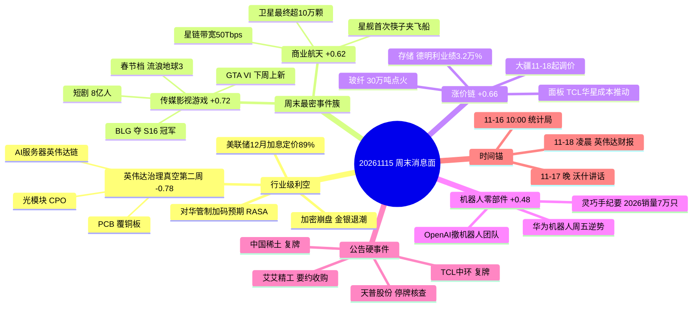

# 2026年11月15日 · **消息面事件驱动**（周末轻量档）

> **数据源新鲜度**: partial · **降级状态**: false · **置信度**: 0.60
> **覆盖窗口**: 11-14 18:02 → 11-15 18:02（24h；11-14 已落盘的事件标注「延续」并按衰减重算）· **主源**: 公众号 18 号池 39 篇 + 财联社/要闻 1289 条 + 盘前公告窗口 1274 条（545 家公司）+ 三季报业绩预告 500 条
> **⚠️ 周末档纪律**: 非交易日，本档**不写买卖建议、不给买卖点、不给仓位**。所有候选一律标注「待周一竞价验证」；候选池只回答「消息侧有没有刺激」，不做位置与强度判断（那属于 D1 与竞价环节）。

## 一句话结论

事件密度最高的不是算力而是传媒（影视游戏电竞）与商业航天（星舰首次机械臂捕获）；负面仍是英伟达治理真空加码（光模块/CPO/PCB 净分 −0.78）；全部**待周一竞价验证**。

## 🗺️ 消息面全景图

## 📉 周五收盘结构（唯一可用的价格锚）

非交易日没有新行情，全部价格口径截止 **11-13 收盘**，只作背景，不作周一预期：

| 项 | 数值 | 口径 |
|---|---|---|
| 沪指 / 深成 / 创业板 / 科创50 | 3634.35 −0.59% / 10968.79 −2.05% / 2426.08 −3.32% / 1279.66 −2.30% | `index_daily` 20261113 |
| 全市场广度 | 涨 765 / 跌 4748（涨家占比 **13.7%**），涨跌幅中位 **−2.00%** | `daily_20261113` 5571 只 |
| 涨停 / 跌停 / 炸板 | **37 / 33 / 21**，炸板率 **36.2%** | `limit_list_d` 20261113 |
| 最高板 | 天普股份 4 板（**11-14 已公告停牌核查**） | 同上 |
| 涨停行业集中 | 汽车零部件 6、影视院线 5、游戏 2、电视广播 1 → **传媒大类 8 家** | 同上 |
| 成交额 | 1.67 万亿 | 同上 |

读法：这是一个「**指数弱、单点强**」的结构——全市场 13.7% 上涨却能在传媒凑出 8 家涨停，说明资金在极窄的题材缝里抱团，而不是在做广度。周末的事件密度恰好全部砸在这条最窄的缝上（见 E02）。

## 🎯 顶级事件详解

排序按契约 `(strength, -|weighted_score|)`：同强度先按衰减分绝对值降序，负面事件不挤出。

### E20261115_001 · 英伟达治理真空进入第二周，管制加码预期升温 · strength=high · polarity=负面 · raw −0.78 · weighted **−0.780** · days_since 0 · decayed=false

**事件摘要**：11-12 美股盘后黄仁勋辞任（11-14 档已记）；周末新增三条硬信息——(1) 英伟达市值从 10 月初约 5.8 万亿美元降至 11-13 的 3.9 万亿美元（证券时报 11-15 16:05）；(2) 董事会已就 CEO 继任事宜接触英国芯片设计公司安谋控股（Arm），同时「Stand with Jensen」请愿签名超 8.5 万（FT/央视财经 11-14 15:20、11-15 07:55）；(3) 卖方机构口径分裂：大摩 11-15 04:07 称「AI 资本支出驱动的牛市逻辑依然稳固」，华尔街见闻 11-14 17:44 直接警告「黄仁勋离开将引爆 AI 版量化紧缩」；调研先知 11-15 13:24 进一步称美国情报界是推动其离职的力量，1.5GW 受管制芯片已流入中国，RASA 类法案大概率推进（**该段为自媒体转述海外报告的判断，非官方口径**）。**英伟达财报：美东 11-17 盘后，北京时间 11-18 凌晨。**

- **大资金意图**：不是撤出 AI，是**把 AI 硬件的估值锚从「人」换成「流程」**，这个过程必须靠杀 β 完成。证据是分裂而不是单边：英伟达自身市值腰斩式回撤，但同一周中芯国际「逼近满产」（新浪财经 11-14 17:17）、半导体逆势承接（11-13 R3 已记 +23.53 亿），钱在做**载体迁移**。
- **为什么走强**（此处为空头为什么强）：三条同向——卖方目标价与评级下调（Truist 346→174，11-14 档）、供应链「口头协议」被马斯克亲口证实（11-14 22:43「许多交易只是握手，没有书面合同」）、以及财报前无法证伪的治理风险。空头不需要新利空，只需要时间走到 11-18 凌晨。
- **逻辑够不够硬**：**事件硬、边际定价趋弱**。硬的部分是人事与市值事实（不可反驳）；不硬的部分是「管制加码」——那是**预判**而非已落地政策，且与国内官媒「黄仁勋的去留不改变我们的方向」形成对冲（见 E05）。按 λ=0.15，本条 7 日后归零，**周一至周三凌晨是它最后有效窗口**。
- **bearish_scope=行业级**；`bearish_impact_sectors=[光模块CPO, PCB覆铜板, AI服务器英伟达链, 存储（高位）, 算力租赁]`
- **待周一验证**：看光模块/CPO 竞价是**低开高走**（利空被消化）还是**低开走弱**（定价延续）。两者都成立，取决于前 30 分钟资金，不取决于新闻。

**压力观察对象（非推荐）**：

#### 天孚通信 300394 · 角色=板块 β 压力最大的一只
- **买入理由**（周末档＝观察口径，非交易指令）：11-13 收 124.99（−10.94%），距 5 日均线 −5.1%，8 日累计 −8.1%（11-04→11-13），成交 101.1 亿为全板块最活跃；同时公司 11-15 晚间披露累计回购 50 万股（6550 万元，全部注销），9 月以来跌幅显著——**基本面在回购、股价在破位**，这是 β 与 α 背离的典型样本。
- **风险点**：回购金额仅占 1–1.5 亿计划的半程，护盘力度有限；CPO 大规模交付被推到 2027 底~2028（11-14 E16，台积电 COUPE 良率），叙事短期无法自证。
- **失效条件（结构位，非交易指令）**：若周一跳空低开后 30 分钟内不能收复 11-13 收盘价，视为 β 定价延续；若低开高走并放量收复 5 日线（约 131.7），视为利空出清。
- **可验证假设**：若周一光模块板块整体低开高走、而天孚仍弱于板块中位，则问题在个股（CPO 占比预期）而非板块，需下调该票权重。

#### 沪电股份 002463 · 角色=PCB 链的业绩/股价背离样本
- **买入理由**（周末档＝观察口径，非交易指令）：三季报预告归母 **+100.54%~109.74%**（净利 54.5–57 亿元，10-15 公告），11-14 又拿到回购专项贷款承诺函；但 11-13 直接跌停 −10.00%（收 82.20，成交 75.9 亿）。业绩硬、股价按 β 杀——这是「产业逻辑好 ≠ 股价能涨」的现场版。
- **风险点**：AI PCB 需求叙事与英伟达治理风险同源，若 11-18 凌晨财报不及预期，业绩预告的定价会被二次压缩；流通 1588 亿，承接成本高。
- **失效条件**：反弹无法站回 5 日线（84.27）则视为杀估值未结束。
- **可验证假设**：中信建投 11-15 08:36 的「PCB 设备 2027 展望」属于**设备端**（昊志机电、沃尔德被机构调研，11-14 08:10），若周一设备端强于覆铜板端，说明资金在做「同链换环节」，不是回补 β。

### E20261115_002 · 传媒影视游戏电竞：三条独立催化叠在同一条最窄的缝上 · strength=high · polarity=正面 · raw +0.72 · weighted **+0.720** · days_since 0 · decayed=false

**事件摘要**：周末四条互相独立的信息同时指向传媒——(1) 11-15 08:02 **BLG 3-1 击败 GEN 夺 S16 全球总决赛冠军**（中国战队时隔 5 年再夺 S 赛），百度/微博热搜双第一，B 站宣布免费送大会员（同花顺 08:36）；(2) 财联社 11-15 04:30 **《GTA VI》下周上新**，被称「游戏业超级印钞机」；(3) 11-14 16:32 特朗普推动《电影、电视与娱乐产业振兴法案》，机构同步吹风《流浪地球3》等定档春节档、大片云集带动票房修复（财闻私享 11-15 10:20）；(4) 短剧侧：同花顺 11-14 11:32「8 亿人都在刷」、经济日报 11-15 07:18「短剧出圈选择权在观众」、AI 短剧制作迁入长三角机房（11-14 11:47）。而 11-13 收盘，影视院线 5 家 + 游戏 2 家 + 电视广播 1 家已集体涨停（北京文化、博纳影业炸板 +6.58%/+7.28%）。

- **大资金意图**：在 13.7% 广度的市场里，资金需要一个「**跌幅不深、筹码干净、事件能连续供给**」的容器。传媒恰好三者齐备：板块位置低（多数票 5 日涨幅 10–20%，不是高位赛道）、事件是**可预期的时间序列**（GTA VI 上新→春节档→S 赛），而不是一次性消息。这是**事件流**而非**事件点**，所以能承载连续性。
- **为什么走强**：周五已经用 8 家涨停做了第一轮确认，周末的四条催化是「在有筹码的地方再加燃料」。最关键的细节是**首封时间**：横店影视 09:33、文投控股 09:30、湖北广电 09:36、金逸影视 09:32——全部是**开盘 10 分钟内**打板，说明是主动性买盘而非尾盘拉抬。
- **逻辑够不够硬**：**中等偏硬**。硬的部分：8 家涨停 + 开盘秒板 + 周末催化密度，三样同时对上了；不硬的部分：**票房与游戏流水的兑现期在 2027 春节/上市后**，短线只有情绪没有业绩；且传媒是老题材，历史上「一日游」概率高（11-13 R3 已记「都市剧/传媒 上海电影跌停、芒果超媒 −9.54%、文投控股炸板 8 次」——同板块两天前还在派发）。真伪分水岭：周一**能否出新首板**（而不是只有老面孔连板）。
- **待周一验证**：① 老龙（文投/中国电影）竞价是否高开 ≥3% 且不炸；② 是否出现**新的低位首板**（补涨扩散）；③ 传媒成交额占全市场比重是否上升。三条同时成立才算板块级，否则按「一日游 + 反抽」处理。

**观察对象（非推荐）**：

#### 文投控股 600715 · 角色=人气榜三日第一的情绪龙头
- **买入理由**（周末档＝观察口径，非交易指令）：11-13 涨停（首封 09:30，封单 2.46 亿，**全天 0 次开板**，是当日最干净的一板）；流通 97.3 亿、换手 10.9%；11-12/13/14 连续三日东财人气榜第一（`attention_weekend` 三天 best_rank=1）；所属游戏Ⅱ，直接吃到 S16 + GTA VI 双催化。
- **风险点**：11-12 档 R3 已记该票「炸板 8 次」（同一票在两天内从炸板到 0 开板，情绪翻转极快）；8 日累计已 +37.7%（11-04→11-13），位置不低；**人气榜第一 = 出货警报的必要条件之一**（红线 4），不能当正向共振加分。
- **失效条件**：周一若开盘冲高后 30 分钟内跌破开盘价且封单撤单，按「人气龙头派发」处理，不再作为板块温度计。
- **可验证假设**：若周一传媒涨停家数 ≥5 且**首板家数 ≥2**，则板块延续；若只有文投/中国电影连板而新面孔为 0，则是「抱团一日游」，板块寿命 ≤2 日。

#### 中国电影 600977 · 角色=票房主线的中军
- **买入理由**（周末档＝观察口径，非交易指令）：11-13 涨停（首封 10:08，开板 5 次后回封，封单 2878 万较弱）；流通 318.3 亿，是传媒里最能承接大资金的中军；直接对应「春节档大片云集」的票房修复叙事；11-14 东财人气榜第 10、11-13 第 10。
- **风险点**：PE(TTM) 2564 倍（`daily_basic` 20261113）——**没有业绩支撑，纯叙事定价**；开板 5 次说明筹码不牢；若票房预期无法量化到季度报表，春节档兑现前只能靠情绪。
- **失效条件**：跌破 11-13 涨停价下方 5%（约 16.2）视为叙事失败。
- **可验证假设**：若周一中国电影弱于影视小票（幸福蓝海/横店/金逸），说明资金偏好低价高弹性，票房主线只是「讲给中军听的」，实际操作在小票——这决定后续跟哪一层。

### E20261115_003 · 存储→面板→数码终端的涨价链开始向消费端传导 · strength=high · polarity=正面 · raw +0.66 · weighted **+0.660** · days_since 0 · decayed=false

**事件摘要**：11-13 大疆官方声明「受全球半导体、存储等关键零部件成本持续大幅上涨影响」，**11-18 00:00 起调价**，门店确认调价集中于自带内存的品类（Pocket 4 等）；洛图科技：Q3 国内笔电线上均价 7759 元、**同比 +13.4%**；IDC：Q3 中国手机出货 5790 万台、**同比 −15.4%**（涨价已抑制需求）；TCL华星 CEO 赵军 11-13 明确「面板涨价**不是需求拉动的新周期，是成本推动的价格修复**」，玻璃基板 Q4 涨 ≥15%，PCB/IC/被动件被 AI 挤占产能；上游玻纤同日落地——山东玻纤 30 万吨二期池窑 11-14 点火，中国巨石、中材科技 11-14 双双披露回购方案。存储价格侧：Flash（MLC 64Gb）周环比小幅上涨（同花顺行业追踪 11-14 17:00）。

- **大资金意图**：这是**成本推动型通胀链**，不是需求扩张。资金的真实动作是**往上游原厂/材料端挤**（存储原厂、玻纤、玻璃基板），而不是往整机端挤——因为整机是**被挤压方**。业绩侧已经给出铁证：德明利三季报预告归母 **+32046%~33154%**（净利 89.5 亿）、长鑫科技扭亏净利 1325 亿、江波龙 +1864%~1990%（149 亿）——**利润全在上游**。
- **为什么走强**：涨价是「可量化、可验证、每周更新」的硬变量（周度价格 + 龙头调价公告 + 业绩预告三重确认），在情绪偏冷的市场里，这类**现金流级证据**比叙事更抗跌。11-13 存储/半导体是全场唯一逆势承接的成长方向（半导体 +23.53 亿，寒武纪/源杰科技主力净流入居前，财联社 11-14 20:00）。
- **逻辑够不够硬**：**硬，但有边界**。硬：涨价已被终端调价公告（大疆 11-18）与业绩预告双向证实；边界：**整机厂是被挤压方**（影石创新明确「存储涨价使短期盈利承压」、TCL科技称「存储飙涨抑制 OLED 终端需求，苦日子要熬」），所以「涨价 = 全链利好」是错的，必须**按环节拆极性**（见热力矩阵：存储 +0.66 / 面板 +0.32 / 玻纤 +0.28 / 消费电子整机 −0.21）。另一个边界是周期位置——存储已连涨多季，属**周期中后段**，业绩同比越炸裂越要警惕见顶（v1.5 协议）。
- **待周一验证**：看存储/面板是「业绩兑现继续走强」还是「业绩出来即见顶」。分水岭是**周一竞价高开后的第一波卖压**是否被承接。

**观察对象（非推荐）**：

#### 德明利 001309 · 角色=存储涨价最直接业绩载体
- **买入理由**（周末档＝观察口径，非交易指令）：三季报预告归母 +32046%~33154%（净利 89.5 亿，10-17 公告，PE(TTM) 仅 6.5 倍）；存储模组/主控环节直接受益原厂涨价；流通 450.6 亿、换手 6.78%，流动性够。
- **风险点**：**这是典型周期股顶部形态的业绩**（同比爆炸、PE 极低、市场按环比与产品价格定价）；一旦存储现货价拐头，业绩预告会成为「利好出尽」的最后一根火柴（参照 11-14 档江波龙模板：Q3 单季环比 −36%~−49%，公告次日冲高收最低）。
- **失效条件**：若周一之后 Flash/DRAM 现货周环比转跌，或该票放量长上影不破前高，按「周期见顶」处理。
- **可验证假设**：若周一存储模组（德明利/江波龙）弱于原厂（长鑫/兆易类），说明资金已在做「环节下沉」，模组的定价窗口关闭。

#### TCL科技 000100 · 角色=面板成本推动涨价的中军
- **买入理由**（周末档＝观察口径，非交易指令）：11-13 收 4.56（+2.24%），流通 917.2 亿、换手仅 1.88%（筹码稳）；赵军口径把「成本推动」讲得很清楚，且明确 2027 折叠机需求 +36%（2026→2800 万台）；同集团 TCL中环 11-14 披露重组预案并复牌，集团层面事件密度高。
- **风险点**：面板是**成本推动而非需求拉动**，涨价对面板厂是「转嫁」不是「扩利」；且存储涨价同时抑制终端需求（手机 Q3 出货 −15.4%），下游量的下滑会反噬面板出货。
- **失效条件**：若面板报价 Q4 未落地 ≥5% 涨幅，或 TCL科技 跌破 5 日线（4.55），视为叙事未兑现。
- **可验证假设**：若周一面板（TCL科技/京东方）与存储（德明利）**同向且面板更强**，说明市场在买「涨价链扩散」；若只有存储强，则面板只是补涨。

### E20261115_004 · 星舰首次被发射塔机械臂捕获，商业航天叙事取得工程级证据 · strength=high · polarity=正面 · raw +0.62 · weighted **+0.620** · days_since 0 · decayed=false

**事件摘要**：北京时间 **11-15 05:21**，SpaceX 星舰第二级飞船在完成 22 小时轨道飞行后首次返回德州发射场、被「机甲哥斯拉」机械臂成功捕获（财联社 05:39、证券时报 07:22、上证报 08:36、财闻私享 10:20 —— **4 个独立来源**）；马斯克同期给出三个量化口径：未来星舰任务把 **>50 太比特/秒**星链带宽送入轨道（11-14 15:22）、通信卫星最终 **超 10 万颗**（11-15 00:32）、SpaceX 通信系统可能承载**全球约一半流量**（11-15 00:33）。美国防长转发祝贺（11-15 07:47）。国内侧：11-14 17:25 空军多型战机试飞员将亮相第十六届中国航展；「机器人首次实现太空自主建造」（11-14 13:18）。

- **大资金意图**：可复用性是航天 economics 的唯一变量。机械臂捕获 = **发射成本曲线再次下折**，这条曲线直接映射到国内「卫星互联网组网节奏 + 发射频次」的估值模型。资金买的不是 SpaceX，是**国内对标环节的估值锚**（卫星制造、地面站、星载相控阵、火箭材料）。
- **为什么走强**：① 事件是**可见的工程里程碑**（视频/照片全市场传播），比政策文件更有传播力；② 4 源共振、且官方媒体全程跟进；③ 与国内事件叠加——航展临近 + 太空建造 + 卫星互联网招标预期。但要注意：**11-13 涨停池里商业航天 0 家**，说明这条线休整了至少一周（11-10 R2 曾给 84 分、stage=climax，之后进入分歧）。
- **逻辑够不够硬**：**叙事硬、A 股映射软**。硬的：工程里程碑是真的、全球传播是真的、星链量化目标是马斯克亲口给的。软的：SpaceX 与 A 股供应链**没有直接收入映射**（这不是特斯拉产业链那种可验证的订单关系），A 股买的是「主题映射」；且板块刚经历 climax 后的分歧（11-10 中国卫星炸板 2 次、信维炸板 1 次）。
- **待周一验证**：看商业航天是「事件驱动的一次性脉冲」还是「重启主升」。分水岭：**中国卫星/信维通信这类中军能否放量收阳**，而不是只有低位小票乱涨。

**观察对象（非推荐）**：

#### 中国卫星 600118 · 角色=板块中军温度计（板块代理，非 LLM 精选）
- **买入理由**（周末档＝观察口径，非交易指令）：11-13 收 55.83（−2.58%），距 5 日线 −3.7%，8 日累计 −0.6%（横盘消化）；流通 660.2 亿、换手 3.10%，是承接大资金的中军；11-10 R2 主线打分中为该链第一龙头（CV 1.00）。
- **风险点**：PE(TTM) 624.7 倍，估值无支撑；climax 后退潮期，中军往往「涨得慢跌得快」；且本条属**板块代理（proxy_dongcai_lead_stock）**，不是 LLM 独立验证选出的票——D1 消费时应只入观察池，不进执行池（除非 R5 给 A 级）。
- **失效条件**：若周一冲高后收在 5 日线（57.95）下方且成交额萎缩至 10 亿以下，视为脉冲失败。
- **可验证假设**：若周一板块内**低位新面孔首板 ≥2 且中军收阳**，则主题重启；若只有中军拉、小票不跟，则是一日脉冲。

### E20261115_005 · 国产替代：外部供给收紧预期被官媒正面接住 · strength=medium · polarity=正面 · raw +0.55 · weighted **+0.550** · days_since 0 · decayed=false · single_source=false

**事件摘要**：财闻私享 11-15 10:20 汇总官媒口径「**黄仁勋的去留，不改变我们的方向**」，并引专家「外部供给收紧下，国内可能加速国产替代验证，给昇腾等国产算力平台更大落地测试与扩容机会」；同源给出时间锚「**周一华为云首款昇腾模型与机器人签约**」。产业侧：AscendMOEA（首个面向国产算力的多目标优化平台）11-14 19:08 开源；中芯国际「AI 算力供不应求，逼近满产」（11-14 17:17）；谢志峰称长江存储上市后市值有望超万亿（11-14 22:06）。盘面上 11-13 已先行：**华胜天成涨停（首封 09:50、封单 1.66 亿、开板 3 次）**、南威软件涨停（13:36 尾盘板）——IT 服务Ⅱ 两家涨停。

- **大资金意图**：这是一条**对冲仓**逻辑——当海外 AI 硬件被治理风险压制时，资金把仓位搬到「不受美国管制影响」的国产算力/信创。11-13 的涨停结构已经说明：同一天传媒 8 家、IT 服务 2 家涨停，而光模块/PCB 在跌停——**同一条 AI 大逻辑内做了方向切换**。
- **为什么走强**：官媒定调 + 产业动作（昇腾开源生态、华为云周一签约）+ 盘面先行（华胜天成/南威软件涨停）三样都有；且「管制加码」的坏消息对这条线是**利好**（典型的反向 β）。
- **逻辑够不够硬**：**medium，不是 high**。硬的：盘面涨停是真的、官媒口径是真的、昇腾签约时间锚是真的。软的：① 官媒定调属**评论而非政策文件**；② 华胜天成/南威软件是 IT 服务/信创，与「算力芯片」并非同一环节，映射有跳跃；③ 这条线在 11-13 R3 里已被记过（半导体/国产算力 early），周末只是**加强而非新增**——存在「已知信息再炒一遍」的风险。
- **待周一验证**：① 华为云签约是否真的落地（会/不会，硬信息）；② 昇腾链是否**竞价放量高开不炸**；③ 若华为云签约落空，这条线当日作废。

**观察对象（非推荐）**：

#### 华胜天成 600410 · 角色=周五首板里封单最厚的信创票
- **买入理由**（周末档＝观察口径，非交易指令）：11-13 涨停（首封 09:50、封单 **1.66 亿**、开板 3 次、换手 16.3%、成交 25.1 亿）；流通 156.8 亿；11-14 东财人气榜**第 2**、11-13 第 3、11-14 同花顺热股第 4（跨平台连续在榜）。
- **风险点**：开板 3 次说明分歧不小；PE(TTM) 缺失/亏损类（`daily_basic` 无 PE），属纯题材定价；「人气榜第 2 + 首板」是情绪高点的常见组合，次日需要**放量换手承接**才成立。
- **失效条件**：周一若不能维持在涨停价上方 ±3% 区间换手，且封单快速衰减至 5000 万以下，按「一日游」处理。
- **可验证假设**：若周一信创/IT 服务出现**≥3 家首板**，则该线升格为板块；若只有华胜天成独苗，则降为个股脉冲。

#### 南威软件 603636 · 角色=尾盘板的强度验证器
- **买入理由**（周末档＝观察口径，非交易指令）：11-13 涨停但首封 **13:36**（尾盘板，属弱势板型），换手 15.9%、成交 8.49 亿；流通 55.1 亿（中等偏小，弹性大）。
- **风险点**：尾盘板次日炸板率高（用户口径：尾盘板不是强板）；同期开板 3 次。若周一低开，则宣告信创「只有龙头没有板块」。
- **失效条件**：周一低开且 10 分钟内不能翻红，视为尾盘板失败。
- **可验证假设**：把「南威软件次日表现」当信创强弱的**领先指标**——它比华胜天成更能反映跟风资金意愿。

### E20261115_006 · 灵巧手纪要：机器人零部件有了「可量化出货」的锚，但整机叙事在退 · strength=high · polarity=正面 · raw +0.48 · weighted **+0.480** · days_since 0 · decayed=false

**事件摘要**：财联社早知道 11-14 21:01「金牌纪要库」给出灵巧手产业链量化口径：**2025 销量约 2 万只 → 2026 约 7 万只（+250%）**；价格分层清晰（低自由度拉杆约 5000 元级、三指 12 自由度约 3 万/只、高自由度一代 4–5 万、二代 8–10 万/只）；技术路线与公司对应明确——**江苏雷利**（子公司中科灵犀，绳驱 SQ-1503，16 主动 + 4 被动自由度）、**兆威机电**（商业化高自由度全直驱，指关节内置微型驱动模组）、**征和工业**（微型链传动，两指/三指/五指，低自由度已进数采中心、在建产线）、**三花智控**（空心杯电机模组已批量）、**鼎智科技**（空心杯+齿轮箱+线性执行模组，已有批量订单）、**步科股份**（微型无框电机联合开发中）、**浙江荣泰**（滚珠丝杠已交付）、**达瑞电子**（触觉手套柔性基材）。对照面：11-13 盘中「华为机器人」逆势领涨（财闻私享）；反面对照：OpenAI 撤销独立机器人团队（11-14 09:32/21:42，「通用大模型可直接用于物理 AI，无需专用模型」）、财联社 11-15 08:22「创投资本撤离具身智能、回流半导体」、「机器人还没上岗，公司先倒闭了」（11-14 18:15）。

- **大资金意图**：机器人这条线正在**从「整机叙事」切到「零部件放量」**。整机讲的是 2027 年后的想象，零部件讲的是 2026 年 7 万只手的真实出货——一季报/年报能验证的才是资金敢拿的。
- **为什么走强**：纪要给出了**唯一可验证的数字**（7 万只、+250%、单价分层），且点名到具体公司具体产品；盘面上周五「华为机器人」已经逆势领涨，说明资金先动、纪要后到（顺序是反的，但方向一致）。
- **逻辑够不够硬**：**双向但不矛盾**——零部件硬、整机软。硬的：7 万只出货、8 家公司的具体产品与价格、三花/鼎智已有批量订单。软的：① 专家自己承认「年度 1–2 万只目标已难完成」，月产能 900–1000 只不能乘月份；② OpenAI 撤团队 + 创投撤离，说明**具身智能的资本开支正在降温**，零部件放量依赖的是「本体厂扩产」，而本体厂正在被出清；③ 高自由度手仍在「科研 + 数采」阶段，不是工业量产。
- **待周一验证**：① 灵巧手概念股是否**低开高走**（纪要属付费内容，市场认知度低，若周一无反应说明传导不动）；② 华为机器人线是否延续周五的逆势强势；③ 周一华为云机器人签约是否落地（与 E05 同一时间锚）。

**观察对象（非推荐）**：

#### 兆威机电 003021 · 角色=全直驱路线的唯一商业化标的
- **买入理由**（周末档＝观察口径，非交易指令）：纪要明确「已推出商业化高自由度全直驱灵巧手，指关节内置微型驱动模组」，是三条路线里**集成度最高**的一条；流通 199.6 亿、11-13 收 95.86（−2.69%），距 5 日线 −5.7%、8 日 +3.2%（横盘未破位）；PE(TTM) 131 倍，估值已含机器人预期。
- **风险点**：纪要属 VIP 付费内容，**传播半径小**；同一票 11-13 已跌 2.69%，说明纪要发布前（11-13 盘中）资金没提前抢；若周一高开无量，是「纪要一日游」。
- **失效条件**：跌破 11-13 低点且成交量萎缩，视为纪要未被定价。
- **可验证假设**：若周一兆威机电放量（成交额 >10 亿）且收阳，说明纪要已被卖方/游资消化；若缩量，则这条线要等 12 月初 Optimus 进展才有二次催化。

#### 江苏雷利 300660 · 角色=绳驱路线 + 电机产业资源
- **买入理由**（周末档＝观察口径，非交易指令）：纪要点名「通过控股子公司中科灵犀开展整手业务」，SQ-1503 已发售、小批量出货、推进工业应用；流通 130.7 亿、11-13 收 22.50（−2.30%），8 日 −8.0%（位置低于兆威）。
- **风险点**：绳驱技术难点是「绳的拉伸、摩擦、磨损、需定期维护标定」（纪要原文），可靠性弱于直驱；公司主业是微电机，机器人收入占比仍小。
- **失效条件**：若周一机器人零部件板块普涨而江苏雷利不涨，说明市场只认直驱路线。
- **可验证假设**：若「江苏雷利 + 兆威机电」同日同向，说明资金买的是「路线全覆盖」；若分化，则说明市场在二选一，需按路线强弱排序。

## 📊 板块 × 事件热力矩阵（极性叉乘）

公式：`contrib = abs(weighted_score) × sign(板块 polarity) × {high:1.0, medium:0.7, low:0.4}`，同板块同名累加；>+0.12 正面 / <−0.12 负面 / 其余分歧。

| 板块 | 事件锚 | 净分 | 判定 | 首推观察对象 | 独立源 | 三季报预告 | 置信 |
|---|---|:--:|:--:|---|:--:|---|:--:|
| 光模块 CPO | E01 英伟达治理真空 | **−0.780** | 🔴 负面 | 天孚通信 300394 | 6 | 无（预告无此票） | 🟢🟢 |
| PCB 覆铜板 | E01 英伟达治理真空 | **−0.780** | 🔴 负面 | 沪电股份 002463 | 6 | +100.5%~109.7% | 🟡 |
| AI 服务器/英伟达链 | E01 英伟达治理真空 | **−0.780** | 🔴 负面 | —（无硬映射标的盘点） | 6 | — | 🟢🟢 |
| 影视院线 | E02 传媒三源叠加 | **+0.720** | 🟢🟢 正面 | 中国电影 600977 | 5 | 无 | 🟢🟢 |
| 游戏电竞 | E02 传媒三源叠加 | **+0.720** | 🟢🟢 正面 | 文投控股 600715 | 5 | 无 | 🟢🟢 |
| 短剧/AI 应用 | E02 传媒三源叠加 | **+0.720** | 🟢🟢 正面 | —（8 亿人刷短剧，标的分散） | 4 | 无 | 🟡 |
| 存储 | E03 涨价链 | **+0.660** | 🟢🟢 正面 | 德明利 001309 | 5 | +32046%~33154% | 🟢🟢 |
| 商业航天 | E04 星舰捕获 | **+0.620** | 🟢🟢 正面 | 中国卫星 600118 | 4 | 无 | 🟡 |
| 卫星互联网 | E04 星舰捕获 | **+0.620** | 🟢🟢 正面 | 信维通信 300136（代理） | 4 | 无 | 🟡 |
| 人形机器人零部件 | E06 灵巧手纪要 | **+0.480** | 🟢 正面 | 兆威机电 003021 | 3 | 无 | 🟡 |
| 创新药 | E07 医保双目录（11-14 延续） | **+0.448** | 🟢 正面 | 百利天恒 688506 | 5 | 无 | 🟢 |
| 黄金 | E09 避险退潮 | **−0.400** | 🔴 负面 | —（金饰四连跌） | 3 | — | 🟢 |
| 稀土 | E08 中国稀土复牌（11-14） | **+0.387** | 🟢 正面 | 中国稀土 000831 | 1（公告） | +88.96%~140.99% | 🟡 |
| 国产算力/半导体设备 | E05 国产替代 | **+0.385** | 🟢 正面 | 华胜天成 600410（映射跳跃） | 4 | 无 | 🟡 |
| 光伏 | E08 TCL中环复牌（11-14） | **+0.344** | 🟢 正面 | TCL中环 002129 | 1（公告） | 无 | 🟡 |
| 面板 | E03 涨价链 | **+0.322** | 🟢 正面 | TCL科技 000100 | 3 | 无 | 🟡 |
| 玻纤/电子布 | E03 涨价链 | **+0.280** | 🟢 正面 | 中国巨石 600176 | 3 | +100%~110% | 🟢 |
| 纯概念跟风杂毛 | E06 机器人资本撤离 | **−0.245** | 🔴 负面 | —（不点名，防杂毛充数） | 3 | — | 🟢 |
| 消费电子整机 | E03 成本挤压 | **−0.210** | 🔴 负面 | 影石创新 688775 | 2 | 无 | 🟡 |
| 油运/炼化 | E09 霍尔木兹触雷 | **−0.210** | 🔴 负面 | —（油价已回落，方向矛盾） | 3 | — | 🟡 |
| 猪肉/养殖 | E11 猪价十年最低 vs 百亿并购 | **0.000** | 🟡 分歧 | —（见分歧段） | 4 | — | 🟡 |

### `sector_cross_summary`（多事件板块叉乘结论）

- **传媒（影视院线/游戏/短剧）**：唯一「单事件拉满 + 周五盘面确认」的板块，净分 +0.72。但**只有一个事件簇**支撑，属「事件流」而非「多事件叠加」，一旦周一不出新首板，次日衰减 0.15/日。
- **存储—面板—玻纤—整机**：一条链内部**极性分裂**（+0.66 / +0.32 / +0.28 / −0.21）。这是本次矩阵里最有信息量的一行：**同一条涨价链不能整体看多**，上游吃价、中游转嫁、下游被挤压。用统一极性写「涨价链利好」是错的。
- **光模块 CPO / PCB / AI 服务器**：三个同名板块被同一个事件（E01）打满 −0.78，**不要拆成不同名字骗自己「分散风险」**——它们是同一份 β。
- **机器人**：零部件 +0.48 与杂毛 −0.245 分列，说明这条线**内部分化**（有产品的公司 vs 只挂概念的票），这正是用户「题材心智锚」逻辑的量化版。

## 🔥 中报/三季报业绩预告命中（硬 alpha 交叉验证）

`eastmoney_earnings_predict.json`：report_date **2026-09-30**，500 条（归母口径 184 条）。取预增上限 top15 与本文事件板块求交集：

| 代码 | 名称 | 预告类型 | 增速区间（归母） | 净利上限（亿） | 预告日 | 事件命中 | 逻辑强度 |
|---|---|---|:--:|:--:|---|---|:--:|
| 001309.SZ | 德明利 | 扭亏 | +32046%~33154% | 89.5 | 10-17 | **E03 存储涨价** | 🟢🟢🟢 |
| 300821.SZ | 东岳硅材 | 预增 | +19047%~19748% | 5.67 | 10-08 | 有机硅（未映射） | 🟡 |
| 000703.SZ | 恒逸石化 | 预增 | +3318%~3405% | 81.0 | 10-16 | 炼化（油价负相关） | 🟡 |
| 002466.SZ | 天齐锂业 | 预增 | +2735%~3235% | 60.0 | 10-21 | 锂（未映射） | 🟡 |
| 688825.SH | 长鑫科技 | 扭亏 | +2581%~2609% | **1325.0** | 10-17 | **E03 存储原厂** | 🟢🟢🟢 |
| 002812.SZ | 恩捷股份 | 扭亏 | +1884%~2475% | 20.5 | 10-14 | 隔膜（未映射） | 🟡 |
| 688808.SH | 联讯仪器 | 预增 | +1866%~2073% | 21.0 | 10-13 | **E03 存储测试设备** | 🟢🟢 |
| 301308.SZ | 江波龙 | 预增 | +1865%~1991% | 149.0 | 10-15 | **E03 存储模组（周期见顶模板）** | 🟡🟡 |
| 605189.SH | 富春染织 | 预增 | +1348%~1519% | 3.78 | 10-14 | 未映射 | ⚪ |
| 688388.SH | 嘉元科技 | 预增 | +1197%~1319% | 5.8 | 10-15 | 铜箔（未映射） | ⚪ |
| 603991.SH | 领先股份 | 扭亏 | +1239% | 3.36 | 10-21 | 未映射 | ⚪ |
| 603026.SH | 石大胜华 | 扭亏 | +968%~1032% | 5.8 | 10-15 | 电解液（未映射） | ⚪ |
| 000626.SZ | 远大控股 | 预增 | +890%~1018% | 3.6 | 10-15 | 未映射 | ⚪ |
| 002493.SZ | 荣盛石化 | 预增 | +778%~823% | 82.0 | 10-15 | 炼化（油价负相关） | 🟡 |
| 301536.SZ | 星宸科技 | 预增 | +663%~698% | 16.1 | 10-13 | **E03 存储/端侧** | 🟢🟢 |

补充交集（不在 top15 但事件直接相关）：**沪电股份 002463 +100.5%~109.7%**（PCB，E01 负面板块里业绩最硬）、**中国稀土 000831 +88.96%~140.99%**（E08 重组复牌）、**亨通光电 600487 +151.27%~168.10%**（卫星互联网/光通信双属性）、**中国巨石 600176 +100%~110%**（E03 玻纤）。

**业绩段的结论**：存储链的业绩是全市场最硬的 alpha（德明利 3.2 万% / 长鑫 1325 亿 / 江波龙 149 亿），但**全部集中在 10 月中旬公告、已被市场消化 3–4 周**；周末的增量不在业绩，在**终端调价（大疆 11-18）与面板成本传导**。同时按 v1.5 协议：江波龙、德明利属周期股，累计同比只作背景，**判定极性要看单季环比与产品现货价方向**，本档未取得单季拆分 → 对这些票的 polarity 只给「中性偏正」，不给「正面」。

## 🚀 下周一可能的首板候选（全部「待周一竞价验证」）

> 口径说明：`direct_name_match`＝周末消息文本里**直接点名**（4 字以上股名，或 2–3 字名在正文出现 ≥2 次）；`lead_stock_proxy`＝板块代理（板块自动归属，**非 LLM 精选**）。不做位置/强度判断，流通市值按 11-13 `daily_basic.circ_mv`，<20 亿一律剔除（本次无命中）。

| 名称 | 代码 | 事件 | 来源 | 11-13 收盘 | 距 5 日线 | 8 日累计 | 流通市值 | 换手 | 备注 |
|---|---|---|:--:|---|:--:|:--:|:--:|:--:|---|
| 兆威机电 | 003021 | E06 灵巧手·全直驱 | 点名 | 95.86 | −5.7% | +3.2% | 199.6 亿 | 3.64% | 纪要唯一「商业化全直驱」 |
| 江苏雷利 | 300660 | E06 灵巧手·绳驱 | 点名 | 22.50 | −4.3% | −8.0% | 130.7 亿 | 2.41% | 中科灵犀已小批量出货 |
| 征和工业 | 003033 | E06 灵巧手·链传动 | 点名 | 76.00 | −5.2% | −1.7% | 61.5 亿 | 4.99% | 低自由度已进数采中心 |
| 三花智控 | 002050 | E06 空心杯电机模组 | 点名 | 34.87 | −0.6% | +0.9% | 1287.1 亿 | 1.68% | 已批量，弹性最小 |
| 鼎智科技 | 920593 | E06 空心杯+齿轮箱 | 点名 | 22.04 | −2.5% | −7.7% | —（北交所） | 低 | 有批量订单，流动性差 |
| 浙江荣泰 | 603119 | E06 滚珠丝杠 | 点名 | 60.22 | −4.9% | +2.3% | 284.8 亿 | 3.58% | 已交付，模组在送样 |
| 达瑞电子 | 300976 | E06 触觉手套基材 | 点名 | 52.02 | −4.2% | +6.8% | 62.6 亿 | 4.39% | 材料端，二线 |
| 步科股份 | 688160 | E06 微型无框电机 | 点名 | 102.20 | −5.7% | −5.3% | 93.3 亿 | 2.66% | 仍在联合开发（最早期） |
| 文投控股 | 600715 | E02 传媒·S16+游戏 | 点名/榜1 | 3.40（涨停） | +12.8% | +37.7% | 97.3 亿 | 10.90% | 3 日人气第一＝派发警报 |
| 凯撒文化 | 002425 | E02 传媒·游戏 | 点名/榜6 | 3.96（涨停） | +9.8% | +21.1% | 36.4 亿 | 13.70% | 低价高弹性 |
| 中国电影 | 600977 | E02 传媒·春节档 | 榜10 | 17.05（涨停） | +6.5% | +13.1% | 318.3 亿 | 6.07% | 中军，PE 2564 倍 |
| 横店影视 | 603103 | E02 影视院线 | 涨停池 | 19.31（涨停） | +6.9% | +15.6% | 122.5 亿 | 1.11% | 09:33 秒板、0 开板 |
| 金逸影视 | 002905 | E02 影视院线 | 涨停池 | 9.90（涨停） | +8.1% | +20.0% | 34.6 亿 | 2.36% | 小票，封单 8330 万 |
| 幸福蓝海 | 300528 | E02 影视院线 | 涨停池 | 17.99（+20%） | +14.0% | +35.5% | 67.0 亿 | 16.30% | 20cm，弹性最大也最危险 |
| 湖北广电 | 000665 | E02 电视广播 | 涨停池 | 4.58（涨停） | +8.0% | +15.9% | 52.1 亿 | 4.72% | 09:36 秒板 |
| 华胜天成 | 600410 | E05 国产替代/信创 | 涨停池/榜2 | 14.30（涨停） | +10.4% | +23.1% | 156.8 亿 | 16.32% | 封单 1.66 亿最厚 |
| 南威软件 | 603636 | E05 信创 | 涨停池/榜11 | 9.50（涨停） | +5.8% | +13.5% | 55.1 亿 | 15.89% | 13:36 尾盘板（弱板型） |
| 中国卫星 | 600118 | E04 商业航天 | 代理 | 55.83 | −3.7% | −0.6% | 660.2 亿 | 3.10% | 中军温度计 |
| 信维通信 | 300136 | E04 卫星互联网 | 代理 | 46.61 | −4.8% | +6.2% | 384.5 亿 | 7.34% | 代理 |
| 西部材料 | 002149 | E04 航天材料 | 代理 | 37.15 | −8.9% | +5.4% | 181.3 亿 | 14.94% | 代理，已破 5 日线 |
| 亨通光电 | 600487 | E04 卫星/光通信 | 代理 | 41.60 | −3.7% | −4.4% | 1020.7 亿 | 4.95% | 预告 +151%~168% |
| 德明利 | 001309 | E03 存储涨价 | 预告交集 | —（未取 11-13 收） | — | — | 450.6 亿 | 6.78% | 业绩 3.2 万%，周期顶 |
| TCL科技 | 000100 | E03 面板 | 点名 | 4.56 | +0.1% | −2.6% | 917.2 亿 | 1.88% | 成本推动涨价 |
| 源杰科技 | 688498 | 光芯片 17 亿大单 | 点名 | —（未取收盘） | — | — | 827.2 亿 | 8.26% | 单票硬 alpha vs 板块 β 弱 |

**排序逻辑**（按 quality → 源数 → 命中次数）：质量最高的是**灵巧手 8 家**（同一份纪要、产品与价格逐条对应、可核验）与**传媒 8 家**（周五涨停 + 周末催化 + 人气榜）；质量最低的是**商业航天代理**（无 A 股收入映射，只能算主题）。**德明利**属「业绩硬但周期位高」，按 v1.5 协议不列入首板候选强弱排序，只列观察。

## 📋 公告硬事件清单（11-14 窗口，1274 条 / 545 家）

| 类型 | 标的 | 事项 | 方向 | 待周一验证 |
|---|---|---|:--:|---|
| **重组复牌** | 中国稀土 000831 | 披露发行股份购买资产并募集配套资金预案 + **股票复牌**（11-14 公告） | 🟢 | 复牌首日承接；标的细节本档未取到 PDF 正文（extract chars=0），沿用 11-14 档记录，**未复验** |
| **重组复牌** | TCL中环 002129 | 同上（发股购买资产 + 募集配套 + 复牌）；TCL科技同步公告参与配套认购 | 🟢 | 同上；11-14 同花顺热股第 6 |
| **停牌核查** | 天普股份 605255 | 停牌核查公告 + 股票交易异常波动风险提示（11-14） | 🔴 | 4 连板后停牌，复牌时点与结论决定**连板梯队是否断档** |
| **要约收购** | 艾艾精工 603580 | 上海誉升同风要约收购**第三次提示性公告** | 🟡 | 要约价与现价差（11-13 收 57.20、−1.97%） |
| **要约收购** | 亚振家居 603389 | 吴涛要约收购持续督导总结 | 🟡 | 进程节点 |
| **控制权变更** | 常铝股份 002160 | 收到济南市国资委批复，控制权拟变更进展 | 🟢 | 11-13 收 3.70（−6.80%），换手 9.06% |
| **收购** | 同仁堂 600085 | 现金收购天津同仁堂 60% 股权（关联交易 + 评估报告） | 🟡 | 解决同业竞争，属治理型利好 |
| **回购（方案/首次）** | 中国巨石 600176、中材科技 002080、南亚新材 688519、依米康 300249（含董事长提议）、广信股份 603599、广合科技 001389、康美药业 600518、新洁能 605111、联讯仪器 688808、肯特催化 603120、松发股份 603268、世华科技 688093、创世纪 300083、韵达股份 002120 | 集中竞价回购方案/首次回购 | 🟢 | 巨石+中材同日回购＝**玻纤链护盘信号**（E03 上游） |
| **回购专项贷款** | 沪电股份 002463、首都在线 300846、鹏鼎控股 002938、汇通控股 603409 | 取得金融机构股票回购专项贷款承诺函 | 🟢 | 政策工具落地，11-13 沪电仍跌停＝**工具救不了 β** |
| **回购注销** | 天孚通信 300394（50 万股/6550 万元）、天山铝业 002532、思特威 688213、普利特 002324、伟星新材 002372、煜邦电力 688597、赛特新材 688398 | 回购股份注销并减资 | 🟢 | 天孚＝光模块龙头护盘，与 E01 负面对冲 |
| **回购+牛散** | 华曙高科 688433 | 2500–5000 万回购（≤95.94 元/股）+ **彭铁缆持股 304.21 万股成第七大股东**（11-11） | 🟢 | 3D 打印，10 月跌超 30% 后的「回购+牛散」组合 |
| **增持** | 韵达股份 002120（控股股东增持+专项贷款）、星湖科技 600866（控股股东增持计划）、泉阳泉 600189（增持完成）、山东钢铁 600022（高管增持）、ST兴化 002109（5% 以上股东增持完成） | 控股股东/高管增持 | 🟢 | 星湖科技流通 69.6 亿，位置低 |
| **减持终止** | 无锡银行 600908 | 提前终止减持计划 | 🟢 | 银行护盘 |
| **定增/再融资受理** | 盛科通信 688702、中复神鹰 688295、美迪凯 688079、新澳股份 603889、沙钢股份 002075 | 定增受理/问询回复 | 🟡 | 盛科＝交换机芯片，11-13 +1.75%、8 日 +24.7%（位置偏高） |
| **重组进展** | 洁美科技 002859、星帅尔 002860、香山股份 002870、精测电子 300567、天津港 600717 | 发股购买资产进展/问询回复 | 🟡 | 洁美（载带/MLCC）与电子链相关 |
| **ST/退市风险** | *ST航图 688066（财务总监上任次日辞职、三季报未签字、预重整中）、*ST未名 002581（挂牌转让子公司及两项生物药技术，底价 5.6 亿）、*ST泉为 300716（11.25 亿光伏 EPC 合同终止）、*ST三房 600370、ST椰岛 600238、ST金顶 600678 | 退市风险/资产处置/权益变动 | 🔴 | **不进候选池**；只作情绪污染源记录（用户硬线：ST 不碰） |
| **业绩** | TCL科技 000100（三季报英文版）、康恩贝 600572（业绩说明会） | — | ⚪ | 无新增预告 |

## 关键证据

- 证据 1：星舰第二级飞船于北京时间 **11-15 05:21** 首次返回德州发射场并被机械臂捕获，完成 22 小时轨道飞行 · 来源 财联社 05:39 / 证券时报 07:22 / 上证报 08:36 / 财闻私享 10:20（4 源）
- 证据 2：BLG 3-1 GEN 夺 S16 冠军，百度/微博热搜双第一，B 站免费送大会员 · 来源 财联社 08:02 / 同花顺 08:36 / 证券时报 09:39 · 2026-11-15
- 证据 3：大疆宣布 **11-18 00:00 起**因半导体/存储成本调价；洛图 Q3 笔电均价 7759 元 +13.4%；IDC Q3 手机出货 −15.4% · 来源 上证报 17:04 · 2026-11-15
- 证据 4：TCL华星 CEO 赵军「面板涨价不是需求新周期，是成本推动的价格修复」，玻璃基板 Q4 涨 ≥15% · 来源 上证报 13:22 · 2026-11-15
- 证据 5：灵巧手 2025 销量 2 万只 → 2026 约 7 万只（+250%），高自由度二代 8–10 万/只 · 来源 财联社早知道「金牌纪要库」· 2026-11-14 21:01
- 证据 6：灵巧手公司-路线-产品三元对应（江苏雷利绳驱 SQ-1503、兆威全直驱、征和链传动、三花空心杯模组批量、鼎智批量订单、荣泰滚珠丝杠已交付、达瑞触觉手套基材）· 同上
- 证据 7：英伟达市值 10 月初 5.8 万亿美元 → 11-13 3.9 万亿美元；财报美东 11-17 盘后（北京时间 11-18 凌晨）· 来源 证券时报 16:05 · 2026-11-15
- 证据 8：11-13 全市场 765 涨 / 4748 跌（13.7%），涨停 37 / 跌停 33 / 炸板 21，传媒大类 8 家涨停 · 来源 `daily_20261113` + `limit_list_d` 20261113（本地落盘）
- 证据 9：中国稀土三季报预告归母 +88.96%~140.99%（扣非 +98.63%~152.94%）· 来源 `eastmoney_earnings_predict`（10-17 公告）
- 证据 10：央行外汇存款准备金率 4%→6% 于 **11-15 生效**（近五年首次上调），意在抑制结汇冲动 · 来源 证券时报 08:42 / 上证报 10:13 · 2026-11-15

## 数据源审计

| 源 | 日期 | 状态 | 备注 |
|---|---|:--:|---|
| tushare/news_cls 财联社快讯 | 11-14→11-15 | 🟡 | 654 条，**仅覆盖到 11-15 08:59**，09:00 后靠公众号补齐 |
| tushare/news_major 长篇要闻 | 11-14→11-15 | 🟡 | 635 条，同样截止 11-15 09:00 |
| eastmoney/earnings_predict 三季报预告 | 2026-09-30 报告期 | 🟢 | 500 条（归母 184 条），归母 top15 已逐条比对 |
| wechat_official_rss 公众号 | 11-14→11-15 | 🟢 | 39 篇 / 10 号有文章（18 号池）；盘前纪要、预期差寻找等 8 号本窗口 0 篇 |
| wechat_cli_5groups 群聊 | 11-14→11-15 | 🔴 | 7 群状态 ok 但 **0 条**，文件 0 字节（连续第三日） |
| anns_window 公告窗口 | 11-14→11-15 | 🟢 | 1274 条 / 545 家（回购 43、并购重组 34、定增 34、增减持 27、业绩 48、监管 18、停复牌 4） |
| attention_weekend 周末榜单 | 11-12→11-15 | 🟢 | 跨日连榜 24 只；**11-15 当日四榜全 0 → not_available**（非交易日，不置 degraded） |
| tushare/limit_list_d 周五基准 | 11-13 | 🟢 | 91 行（U37/D33/Z21） |
| xtick/hot_news MCP | — | ⚫ | 本档未调用（周末档以落盘源为准，避免与 5 分钟异动任务争配额） |
| 预期差对账 `build_expectation_gap.py` | — | ⚫ | **未运行**：该脚本需要「当日涨跌/涨停」三档对账，非交易日无当日行情，跑出来全是 not_available，属无意义调用 |

## 不确定性 / 反证（自我批判）

1. **新闻源有 9 小时缺口**。财联社/要闻都只到 11-15 09:00，09:00–18:00 完全依赖 39 篇公众号。若这段时间出了监管口径或产业突发，本档会漏。审计已标 🟡，不置 degraded 是因为「三源齐全但窗口偏移」而非「源失效」。
2. **群聊 0 条 = 没有真人情绪校验**。连续第三日，本周所有「题材在发酵」的判断都缺 KOL 确认层，只能在盘面上找证据。这也是我把消息面 confidence 压在 0.60、情绪面压到 0.43 的原因。
3. **星舰→A 股映射可能是伪映射**。SpaceX 与 A 股上市公司没有可验证的订单关系，本条本质上买的是「主题热度」。若周一商业航天冲高回落，不要把它写成「利好兑现」，那是映射本来就软。
4. **传媒有强烈的「一日游」历史包袱**。11-12 该板块还在派发（上海电影跌停、芒果超媒 −9.54%、文投控股炸板 8 次），11-13 突然 8 家涨停——两天内情绪反转，说明这是**游资主导的低价筹码战场**，不是产业主线。周末催化密度高不等于周一能延续。
5. **涨价链有反向证据被我压低了权重**。硫磺从「暴涨近两倍」到「价格腰斩」（上证报 11-14 22:28）说明部分化工品已经开始掉头；猪价跌到近十年最低（11-14 22:16）也是同一个信号：**不是所有涨价都能持续**。本档把「涨价」统一写成正面，只对存储/面板/玻纤成立，化工要单独看。
6. **中国稀土/TCL中环的预案正文没取到**（PDF extract chars=0），标的资产细节沿用 11-14 档记录，未经本档复验。这两票是周一唯一「确定性事件驱动」的标的，恰恰是数据最薄的一环——这是硬缺陷，已如实标注。

## 与其他 R/D/E 的关系

- **依赖**：`data/raw/20261115/*`（manifest / wechat_official_20 / news_cls / news_major / anns_window / eastmoney_earnings_predict）、`data/raw/20261114/limit_list_20261114.json`（周五基准）、`data/research/20261115/attention_weekend.json`（周末榜单）、`data/raw/20261114/daily_basic_20261114.json`（流通市值口径）
- **被消费**：D1 盘前预案（E01–E06 极性 + 首板候选池）、R6 反证（E01 行业级负面 + 传媒「一日游」反证）、R5 个股画像（灵巧手 8 家、传媒 8 家）、E1 周度复盘（周末事件兑现率）

## Sub-Agent 元数据

- skill: analyze_news_impact_v1@1.8（周末轻量档，不产出 `data/research/20261115/R4_news.json`，按 cron 约束只写 chzl_kg）
- artifact: chzl_kg/投研交易/消息面/20261115.md
- method: llm_v1（五源硬约束，两源窗口偏移已标注）
- 生成时刻: 2026-11-15T18:32:00+08:00
