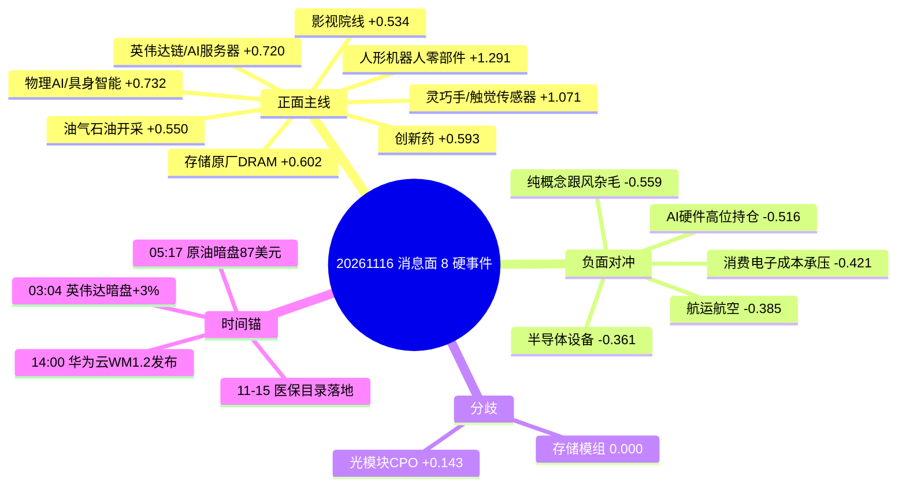

# 2026年11月16日 · **消息面事件驱动**

> **数据源新鲜度**: partial · **降级状态**: true · **置信度**: 0.68
> **覆盖窗口**: 前 72h(11-13 09:01 → 11-16 05:54) · **主源**: 财联社快讯 2258 条 + 18 号公众号 RSS 53 篇 + 东财三季报预告 500 条 + 盘前公告窗口 67 条
> **情绪**: 主跌（连续第2日·修复前夜） · **炸板率**: 36.21%(≥35% 硬红线) → **候选砍半** · **阶段**: 第 3 天(连跌 2 日 · repair_window)

## 一句话结论

机器人本体+灵巧手双事件共振(+1.29/+1.07)是可交易带;英伟达治理反转修复AI硬件但光模块正负对冲只做个股;唯一负面对冲是美对华芯片限制升级(行业级),存储按单季环比只给原厂。

## 🗺️ 消息面全景图

---

## 🎯 顶级事件详解(8 事件 · 每事件三问 + 首推票思维链)

### E20261116_003 · 华为云今日 14:00 发布首款昇腾原生具身世界模型 CloudRobo WM1.2

**事件摘要**: 华为云今日14:00-15:30线上发布首款昇腾原生具身世界模型CloudRobo WM1.2 支撑具身智能规模化落地

**基本属性**: strength=high · polarity=正面 · event_type=technical_break · date=2026-11-15 · time=2026-11-16 14:00 · raw_score=0.85 · **weighted_score=0.732** · days_since=1 · decayed=false · 有效期=当日-2个交易日

**独立源(4 个)**: 财联社早知道(11-15 09:57 明日主题前瞻) / 财闻私享(11-15 周末A股值得关注的资讯) / news_major(11-15 09:57 明日主题前瞻) / news_cls(11-15 22:16 开源盘古 openPangu-2.1-Pro 上线华为云)

**推理深度三问**:
- **大资金意图**: 华为选 14:00-15:30 盘中发布而不是盘后发布 是刻意给 A 股一个当日就能定价的时间锚 —— 机构资金需要盘中可验证的催化 才敢在当日接力 把消息面直接嵌进交易时段 才有承接对象。
- **为什么走强**: 这不是从零起爆:11-13 机器人本体线已有 6 只汽车零部件涨停(天普股份 4 板) 资金已在场内 本次发布会是对已启动方向加确认 不是在无人区讲故事 所以边际成本低。
- **逻辑够不够硬**: 硬度在:时间锚精确到分钟 + 3 个独立源 + 昇腾原生直接绑定国产算力链。硬度边界在:是产品发布不是订单落地 无金额无客户名单 14:00 之后仍要盘面自己投票 兑现节奏由盘面决定。

**首推票思维链**:

#### 亿嘉和 603666.SH · role=首推 · **R4 立场: 降级观察**(理由: RR/止损宽度不过线)

| 收盘(11-13) | MA5 | MA20 | 距60日高 | 5日主力净额 | 止损 | 目标区间 | 仓位上限 | RR5 |
|---|---|---|---|---|---|---|---|---|
| 31.5 | 29.2 | 26.06 | -4.4% | +0.38 亿 | 28.35 | 32.95~32.95 | 0.06 | 0.46 |

- **买入理由**: 唯一被财联社直接点名『联合华为云发布』的 A 股标的 = 事件映射置信度最高;机器人线 11-13 已出现资金前排(5日+26.4%)
- **风险点**: 已在高位 距 60 日高 -4.4% 且 5 日 +26.4% 追高即接盘;RR5 仅 0.46 说明上行空间被透支;机器人连续分歧两日 情绪不稳
- **止损条件**: 跌破 28.35（5日低 24.97 退 1.5% 触及 -10% 边界）即出;若发布会开始 30 分钟内不涨反跌 视为利好出尽
- **可验证假设**: 14:00 发布会期间若板块出现 2 只以上涨停或亿嘉和创 60 日新高 → 事件驱动成立;若板块整体绿盘 则只做观察

> 主营重叠 0.86 · 机器人产品收入占比 33.25%（毛利率 25.14%）、电力行业 62.10%（hithink 主营构成）;与华为云联合发布配网带电作业机器人 Z200Pro（财联社早知道原文点名）
> 板块联动 0.75 · 11-13 +5.04% 主力 +0.20 亿;5 日 +26.4% 距 60 日高仅 -4.4% 属机器人板块内已启动的前排
> 资金验证 +0.38 亿(东财DC主力净额·5日窗口11-09~11-13 · status=ok)
> 业绩催化 无三季报预增预告(东财 500 条三季报预告中无该票)
> 止损依据: 参考价 31.5 × 5日低点 24.97 退 1.5% → 止损 28.35（距 -10.00%） · 验证方法: llm_with_hithink_verification

#### 征和工业 003033.SZ · role=第二 · **R4 立场: 降级观察**(理由: 5日主力净流出 且 11-13 单日 -7.32% 未企稳)

| 收盘(11-13) | MA5 | MA20 | 距60日高 | 5日主力净额 | 止损 | 目标区间 | 仓位上限 | RR5 |
|---|---|---|---|---|---|---|---|---|
| 76.0 | 80.18 | 77.44 | -22.35% | -0.11 亿 | 72.2 | 85.98~85.98 | 0.05 | 2.63 |

- **买入理由**: 财联社点名的微型链系统→灵巧手环节;A股唯一链传动纯正标的(链传动行业收入占比 100%);MA20 77.44 上方仅 1.86% 属低位
- **风险点**: 11-13 单日 -7.32% 且 5 日主力净流出 0.11 亿 = 资金未确认;距 60 日高 -22.35%;公司主业仍是车辆链 59.87% 灵巧手未贡献业绩
- **止损条件**: 跌破 72.2（5日低 74.0 退 1.5%）即出;单日跌幅 >8% 视为资金撤离
- **可验证假设**: 若 14:00 华为云发布会期间灵巧手/触觉概念出现 1 只以上涨停且征和站回 MA5 80.18 → 事件驱动成立;否则只做观察

> 主营重叠 0.72 · 链传动行业收入占比 100%（车辆链 59.87%/农机链 18.51%）（hithink 主营构成）;微型链系统项目对应具身机器人灵巧手整机/控制系统/触觉感知（财联社点名）
> 板块联动 0.4 · 11-13 单日 -7.32% 主力 -0.41 亿 且 5 日主力 -0.11 亿 = 资金未确认; 距 60 日高 -22.35% 属低位但趋势未止跌
> 资金验证 -0.11 亿(东财DC主力净额·5日窗口11-09~11-13 · status=ok)
> 业绩催化 无三季报预增预告(东财 500 条三季报预告中无该票)
> 止损依据: 参考价 76.0 × 5日低点 74.0 退 1.5% → 止损 72.2（距 -5.0%） · 验证方法: llm_with_hithink_verification

---

### E20261116_002 · 黄仁勋同意出席众议院听证会 硅谷热议其回归 英伟达暗盘涨超3%

**事件摘要**: 黄仁勋同意出席众议院听证会 硅谷热议其回归 英伟达暗盘涨超3% 美光SK海力士AMD暗盘同步涨超1%

**基本属性**: strength=high · polarity=正面 · event_type=sentiment · date=2026-11-16 · time=2026-11-16 03:04 · raw_score=0.72 · **weighted_score=0.72** · days_since=0 · decayed=false · 有效期=1-3个交易日

**独立源(4 个)**: news_cls(11-16 00:03 黄仁勋已同意出席美国众议院听证会) / news_cls(11-15 14:33 硅谷热议黄仁勋回归可能性) / news_cls(11-16 03:04 黄仁勋与盟友讨论重返英伟达担任CEO) / news_cls(11-16 03:11 英伟达暗盘涨超3%现报165.1674美元)

**推理深度三问**:
- **大资金意图**: 11-13 黄仁勋辞任是全球算力持仓头上最大的估值折价 当日美股半导体 -3.84% 已 price in 了一部分利空。同意出席听证会 = 治理不确定性从『已发生』退回『可预期』 机构需要这个确认才能把折价收回一部分。
- **为什么走强**: 暗盘 +3% 是唯一可交易的价格证据 —— 消息面不能定价 暗盘可以。且美光/SK海力士/AMD 暗盘同步 +1% 说明不是单票行为 是板块级风险偏好修复 而非个股孤勇。
- **逻辑够不够硬**: 硬度在:反转有 4 条独立快讯支撑 时间戳精确到分钟(00:03/14:33/03:04/03:11)。软肋在:『同意出席』不等于『回归 CEO』 硅谷热议是情绪不是事实。所以 E002 定位是解除压制 不是打开新空间 —— 它决定 AI 硬件能不能止跌 不决定能涨多高。

**首推票思维链**:

#### 中际旭创 300308.SZ · role=首推 · **R4 立场: 观察**(理由: RR5 过线但 5 日主力净流出=资金未确认)

| 收盘(11-13) | MA5 | MA20 | 距60日高 | 5日主力净额 | 止损 | 目标区间 | 仓位上限 | RR5 |
|---|---|---|---|---|---|---|---|---|
| 466.2 | 488.03 | 552.3 | -54.06% | -10.25 亿 | 423.65 | 567.89~675.99 | 0.07 | 2.39 |

- **买入理由**: 英伟达治理不确定性解除=全球算力资本开支叙事重新定价,总龙必定第一顺位;11-12~11-13 两日累计 -13.6% 已把辞职事件打到 -54% 距 60 日高 超跌位;RR5 2.39
- **风险点**: 11-13 单日主力净流出 -30.15 亿 是全市场最重的一笔;若今日不能放量收复 MA5 488.03 则只是弱反抽;英伟达财报本周仍是大考 事件窗口重叠
- **止损条件**: 跌破 423.65（5日低 430.10 退 1.5%）无条件出;若开盘冲高后 30 分钟净额转负 → 当日了结
- **可验证假设**: 09:30-10:00 若暗盘溢价传导为高开且首 30 分钟主力净额为正、成交额 > 11-13 同时段 → 反转成立;高开即回落则视为出货

> 主营重叠 0.99 · 光通信收发模块收入占比 98.99%（毛利率 46.59%,境外 94.82%）（hithink 主营构成）——A股与英伟达算力链绑定最深的光模块总龙
> 板块联动 0.45 · 11-13 -8.39% 主力 -30.15 亿 板块级杀跌;光模块 CPO 未在 R7 净流入前十,属超跌未修复
> 资金验证 -10.25 亿(东财DC主力净额·5日窗口11-09~11-13 · status=ok)
> 业绩催化 无三季报预增预告(东财 500 条三季报预告中无该票)
> 止损依据: 参考价 466.2 × 5日低点 430.1 退 1.5% → 止损 423.65（距 -9.13%） · 验证方法: llm_with_hithink_verification

#### 沪电股份 002463.SZ · role=超跌反抽 · **R4 立场: 降级观察**(理由: 11-13 封死跌停(close==low==82.2/-9.9967%) + 止损距 -10.0% 超区间 + RR5 1.69 不过线)

| 收盘(11-13) | MA5 | MA20 | 距60日高 | 5日主力净额 | 止损 | 目标区间 | 仓位上限 | RR5 |
|---|---|---|---|---|---|---|---|---|
| 82.2 | 84.27 | 93.08 | -37.37% | +7.85 亿 | 73.98 | 96.07~118.5 | 0.06 | 1.69 |

- **买入理由**: AI服务器链 PCB 环节 + 英伟达治理风险解除的修复弹性; 90.34% 收入来自印刷电路板(毛利率 40.52%); 但 11-13 封死跌停属超跌非强势
- **风险点**: 11-13 是封死跌停(收盘=最低=82.2, -9.9967%, tushare limit_list_d 漏报由 R7 反推补录) → 无承接盘, 今日反抽需面对套牢盘; 5 日主力 +7.85 亿 但含封板当日被动承接; 止损 73.98 距收盘 -10.0% 敞口过大
- **止损条件**: 跌破 73.98（5日低 72.10 退 1.5% 触及 -10% 边界）即出;封死跌停次日若继续低开破 82.20 则放弃反抽
- **可验证假设**: 若今日竞价不高开破位且 30 分钟内收复 82.20 且同板块至少 2 只翻红 → 反抽成立;若低开破 82.20 则判资金继续撤退

> 主营重叠 0.94 · 印刷电路板业务收入占 90.34%（毛利率 40.52%）（hithink 主营构成 20261116 核验）; 2026前三季归母 54.5~57.0 亿 同比 +100.54%~109.74%（东财业绩预告 10-15）
> 板块联动 0.6 · 11-13 -9.997% 跌停 但 5 日主力仍 +7.85 亿（R7/东财 DC 净额）→ 资金未撤只在跌停日减仓
> 资金验证 +7.85 亿(东财DC主力净额·5日窗口11-09~11-13 · status=ok)
> 业绩催化 三季报预告 +100.54%~+109.74%(公告日 2026-10-15)
> **风险标记**: 11-13 封死跌停 收盘=最低=82.2 (-9.9967%) 无承接 / 止损距 -10.0% 超硬区间下限 / 止损位 73.98 距收盘 -10.0% 风险敞口过大
> 止损依据: 参考价 82.2 × 5日低点 72.1 退 1.5% → 止损 73.98（距 -10.00%） · 验证方法: llm_with_hithink_verification

---

### E20261116_005 · 韩国10月ICT出口703.5亿美元 芯片出口同比+259.4% 存储涨价向终端传导 大疆11月18日起调价

**事件摘要**: 韩国10月芯片出口同比增259.4% 存储涨价传导至终端 大疆11月18日起调价 笔电均价同比涨13.4%

**基本属性**: strength=high · polarity=正面 · event_type=earnings · date=2026-11-15 · time=2026-11-15 12:28 · raw_score=0.7 · **weighted_score=0.602** · days_since=1 · decayed=false · 有效期=1-2周

**独立源(4 个)**: news_cls(11-15 12:28 韩国10月ICT产业出口703.5亿美元 芯片出口同比+259.4%) / 上海证券报(11-15 18日起涨价 大疆11-18调价 洛图笔电均价+13.4%) / news_cls(11-16 03:54 美光暗盘涨超1%) / news_cls(11-13 12:58 大疆11月18日起调整部分产品建议零售价)

**推理深度三问**:
- **大资金意图**: 韩国 10 月 ICT 出口 703.5 亿美元是产业侧最硬的验证数据 机构拿它确认『存储涨价不是叙事而是订单』。大疆 11-18 调价 + 笔电均价 +13.4% 把涨价从上游一路传到终端 证明原厂确实握有定价权。
- **为什么走强**: 钱没有整体动:存储原厂 20 日主力 -78.94 亿 模组环节量价背离。机构要的不是存储板块反弹 而是挑选『能留住涨价』的环节 所以这条催化天然分化为原厂/模组/下游三档不同答案。
- **逻辑够不够硬**: 硬在数据本身是官方统计且三源独立。按 v1.5 协议必须拆单季环比:江波龙 Q3 单季 34.2~43.2 亿 vs Q2 单季 67.15 亿 = -36%~-49% 累计同比 +1864% 是基数幻觉。原厂 DDR 毛利率 88.35% vs 模组 19.40% —— 环节错配是本条最硬的结论。

**反着看**: bearish_scope=板块级 · 杀伤面=消费电子/影像设备、笔电ODM、手机链

**首推票思维链**:

#### 长鑫科技 688825.SH · role=首推 · **R4 立场: 观察**(理由: RR5<2 不达盈亏比门槛)

| 收盘(11-13) | MA5 | MA20 | 距60日高 | 5日主力净额 | 止损 | 目标区间 | 仓位上限 | RR5 |
|---|---|---|---|---|---|---|---|---|
| 39.98 | 40.69 | 41.55 | -35.31% | -19.21 亿 | 37.98 | 43.42~44.95 | 0.05 | 1.72 |

- **买入理由**: 原厂是涨价周期里唯一毛利率扩张的环节(82-88% 对比模组 19.4%);2026 前三季扭亏 +2581.06%~2609.47% 硬业绩(东财预告 10-17)
- **风险点**: 20 日主力净流出 -78.94 亿是全候选池最重 → 资金不认『涨价=原厂受益』这条;距 60 日高 -35% 趋势向下;新股流通盘结构不稳
- **止损条件**: 跌破 37.98（5日低 39.80 退 1.5% 下沿 -5%）即出
- **可验证假设**: 若今日存储板块红盘且长鑫主力净额转正 >0 → 资金重新定价原厂;若继续净流出则只做观察

> 主营重叠 0.95 · DDR 系列收入占 46.22%（毛利率 88.35%）+ LPDDR 52.02%（82.60%）（hithink 主营构成 20261116 核验）——A股唯一 DRAM 原厂
> 板块联动 0.4 · 11-13 -2.42% 但 5 日主力 -19.21 亿、20 日 -78.94 亿 → 资金在持续撤退;距 60 日高 -35.31%
> 资金验证 -19.21 亿(东财DC主力净额·5日窗口11-09~11-13 · status=ok)
> 业绩催化 三季报预告 +2581.06%~+2609.47%(公告日 2026-10-17)
> **v1.5 业绩极性判定**: 累计同比 归母扭亏 +2581.06%~+2609.47%(营收 +725.96%~+741.54%) · 单季环比 None · 周期股=True · 产品价格 上行(DDR/LPDDR 涨价) · 预期差 低于(11-13 已 -2.42% 且 5 日主力 -19.21 亿) · **结论: 原厂毛利率 88.35%(DDR)/82.60%(LPDDR) 是涨价链唯一扩张环节;但环比数据不可得且资金持续流出 → 观察**
> 止损依据: 参考价 39.98 × 5日低点 39.8 退 1.5% → 止损 37.98（距 -5.00%） · 验证方法: llm_with_hithink_verification

#### 江波龙 301308.SZ · role=模组观察 · **R4 立场: 观察**(理由: v1.5 环节错配: 模组毛利率仅 19.40% 且 Q3 单季环比 -36%~-49% → 同比炸裂但环比转负 只观察不首推)

| 收盘(11-13) | MA5 | MA20 | 距60日高 | 5日主力净额 | 止损 | 目标区间 | 仓位上限 | RR5 |
|---|---|---|---|---|---|---|---|---|
| 218.0 | 222.86 | 227.61 | -48.58% | +0.48 亿 | 207.1 | 243.5~253.32 | 0.04 | 2.34 |

- **买入理由**: 同比数字最炸(扣非+2782%)且 RR5 2.34;但按 v1.5 协议 模组是增收不增利环节 只给观察
- **风险点**: Q3 单季净利环比 -36%~-49% 股价已从 271 跌到 218(-48.58% 距60日高);模组毛利率 19.4% 被上游挤压;周期见顶风险
- **止损条件**: 跌破 207.10（5日低 215.52 退 1.5% 下沿 -5%）即出
- **可验证假设**: 若 DRAM 现货报价继续上行且江波龙毛利率环比转正 → 协议改判;若现货见顶则维持中性

> 主营重叠 0.92 · 存储行业收入占 100%（毛利率 19.40%）（hithink 主营构成 20261116 核验）; 2026 前三季归母 +1864.55%~+1990.84%、扣非 +2782.36%~+2991.23%（东财预告 10-15）
> 板块联动 0.35 · 11-13 -4.60% 5 日主力 +0.48 亿 微弱净流入;距 60 日高 -48.58%
> 资金验证 +0.48 亿(东财DC主力净额·5日窗口11-09~11-13 · status=ok)
> 业绩催化 三季报预告 +2782.36%~+2991.23%(扣非)(公告日 2026-10-15)
> **v1.5 业绩极性判定**: 累计同比 +1864.55%~+1990.84% · 单季环比 -36%~-49% · 周期股=True · 产品价格 上行(存储涨价向终端传导) · 预期差 符合 · **结论: 周期见顶·利好出尽 → 模组环节降级中性 只观察不首推**
> 止损依据: 参考价 218.0 × 5日低点 215.52 退 1.5% → 止损 207.1（距 -5.00%） · 验证方法: llm_with_hithink_verification

---

### E20261116_001 · 2026 国家医保目录新增 107 种药品 其中 51 个一类创新药 百万级 CAR-T 首次进入基本医保

**事件摘要**: 医保目录新增107种药品含51个一类创新药 百万级CAR-T首入基本医保 近20家药企11-15官宣

**基本属性**: strength=high · polarity=正面 · event_type=policy · date=2026-11-14 · time=2026-11-14 10:43 · raw_score=0.8 · **weighted_score=0.593** · days_since=2 · decayed=false · 有效期=3-5个交易日

**独立源(4 个)**: news_cls(11-14 10:43 新增107种/51个一类新药) / news_cls(11-14 11:02 CAR-T 首入医保自付降至10万内) / 上海证券报(11-15 最新医保目录公布 近20家药企连夜官宣) / 公告(11-15 恒瑞12款/百利天恒/君实/禾元生物/长春高新)

**推理深度三问**:
- **大资金意图**: 医保目录是每年一次的确定性分配 机构买的是『进目录=放量』的确定性。恒瑞 12 款在列(涉药 2025 年销售额 69.51 亿) 百利天恒伦康依隆妥单抗在列 —— 买的是龙头在确定性事件里的权重。
- **为什么走强**: 政策发布到落地是 2027-01-01 中间有 1 个多季度预期发酵期 是典型事件驱动长尾。且 11-13 通化金马已首板涨停 锚已经出现 资金有参照物。
- **逻辑够不够硬**: 硬在 4 个独立源 + 近 20 家药企连夜官宣(不是单一消息扩散)。软在医药完全不是 11-13 的资金方向 —— R7 净流入前十无医药 板块无合力 恒瑞 5 日主力 -5.16 亿。没有板块效应的政策催化 龙头只能跟随 不能独立走强。

**首推票思维链**:

#### 恒瑞医药 600276.SH · role=首推 · **R4 立场: 降级观察**(理由: RR/止损宽度不过线)

| 收盘(11-13) | MA5 | MA20 | 距60日高 | 5日主力净额 | 止损 | 目标区间 | 仓位上限 | RR5 |
|---|---|---|---|---|---|---|---|---|
| 48.07 | 48.4 | 48.08 | -10.57% | -5.16 亿 | 45.67 | 50.42~50.98 | 0.08 | 0.98 |

- **买入理由**: 板块绝对龙头 医保目录 12 款/3 款首入是硬增量,业绩体量最大(69.51亿销售额)承接创新药定价权;11-13 仅 +0.29% 未参与医药异动 属未被定价的龙头位
- **风险点**: 医药不是 11-13 的资金方向 主力 5 日 -5.16 亿;无板块效应时龙头只做跟随,单票难独立走强;医保落地在 2027-01-01 当期业绩无变化
- **止损条件**: 跌破 45.67（5日低 47.18 退 1.5%）或连续 2 日收盘低于 MA20 48.08 即出
- **可验证假设**: 09:30-10:00 若创新药板块涨幅中位 >+2% 且恒瑞主动性强于板块 → 逻辑成立;若板块红而恒瑞绿 → 资金不认 放弃

> 主营重叠 0.95 · 医药制造业收入占 88.57%（毛利率 85.06%）（hithink 主营构成 20261116 核验）; 12款药品纳入/3款首入/7款续约，涉药2025年销售额69.51亿、2026前三季68.60亿（公司公告）
> 板块联动 0.55 · 创新药未进入 11-13 主力净流入前十（R7 sector_net_inflow 仅影视院线/银行/半导体设备/IT服务/白酒）;板块无涨停潮,仅通化金马单票首板
> 资金验证 -5.16 亿(东财DC主力净额·5日窗口11-09~11-13 · status=ok)
> 业绩催化 无三季报预增预告(东财 500 条三季报预告中无恒瑞条目)
> 止损依据: 参考价 48.07 × 5日低点 47.18 退 1.5% → 止损 45.67（距 -4.99%） · 验证方法: llm_with_hithink_verification

#### 百利天恒 688506.SH · role=弹性核心 · **R4 立场: 观察**(理由: RR5<2 不达盈亏比门槛)

| 收盘(11-13) | MA5 | MA20 | 距60日高 | 5日主力净额 | 止损 | 目标区间 | 仓位上限 | RR5 |
|---|---|---|---|---|---|---|---|---|
| 250.05 | 256.73 | 253.45 | -19.91% | +0.20 亿 | 237.55 | 271.99~274.99 | 0.06 | 1.76 |

- **买入理由**: 大单品进医保是创新药最直接的放量路径,授权收入模式下毛利率 98.6% 弹性最大;11-13 -1.06% 未启动
- **风险点**: 250 元高价股 单手资金门槛高 承接薄;5 日主力仅 +0.20 亿 等于没资金;医保降价换量 单价下移
- **止损条件**: 跌破 237.55（5日低 246.03 退 1.5%）或单日 -6% 以上不修复 即出
- **可验证假设**: 若医药板块竞价后出现 2 只以上涨停且百利天恒涨幅进板块前 30% → 成立;否则只观察

> 主营重叠 0.9 · 知识产权授权收入占 84.30%（毛利率 98.64%）+ 化药制剂 11.27%（hithink 主营构成）;注射用伦康依隆妥单抗纳入 2026 医保（公司公告 11-15 16:29）
> 板块联动 0.5 · 同上: 11-13 化学制药仅 1 只涨停（通化金马）,板块无资金合力
> 资金验证 +0.20 亿(东财DC主力净额·5日窗口11-09~11-13 · status=ok)
> 业绩催化 无三季报预增预告(东财 500 条三季报预告中无该票)
> 止损依据: 参考价 250.05 × 5日低点 246.03 退 1.5% → 止损 237.55（距 -5.00%） · 验证方法: llm_with_hithink_verification

---

### E20261116_004 · OpenAI 解散独立机器人团队 路线转向通用大模型当大脑 触觉与灵巧手成稀缺环节

**事件摘要**: OpenAI解散独立机器人团队并入大模型 大脑通用化后触觉电子皮肤灵巧手成稀缺环节 专用大脑叙事降温

**基本属性**: strength=high · polarity=正面 · event_type=sentiment · date=2026-11-15 · time=2026-11-15 18:34 · raw_score=0.65 · **weighted_score=0.559** · days_since=1 · decayed=false · 有效期=3-5个交易日

**独立源(4 个)**: news_cls(11-15 18:34 OpenAI撤销机器人团队) / news_major(11-15 21:42 OpenAI解散独立机器人团队 具身智能不再需要专属大脑) / 预期差寻找(11-15 公众号: 通用大脑之后真正卡住的是那双手) / news_major(11-15 08:22 创投资本转向: 撤离具身智能回流半导体)

**推理深度三问**:
- **大资金意图**: 这是叙事切换的定价权再分配:大脑通用化 → 身体稀缺化。机构要重新分配机器人链的估值权重 从自研大脑(模型/软件) 转移到触觉/电子皮肤/灵巧手(硬件) —— 价值从『想得多』挪到『动得准』。
- **为什么走强**: 这是给已经启动的机器人本体线(11-13 汽车零部件 6 只涨停) 加一条新叙事 资金边际成本低 不用重新建仓 只需换标的。预期差寻找点名的传导顺序(触觉→电子皮肤→灵巧手→力控臂) 把换仓路径讲清楚了。
- **逻辑够不够硬**: 硬在 4 个独立源(含 news_major 官媒口径 + 公众号传导链)。但有事实折扣:OpenAI 称 2027 人形样机目标不变、内部员工称在加大投入 —— 这不是退出机器人。硬的是方向不是强度。另一腿 创投资本撤离具身智能回流半导体 是负增量 一级资金在减仓。

**反着看**: bearish_scope=板块级 · 杀伤面=纯概念跟风杂毛、自研专用机器人模型概念股

**首推票思维链**:

#### 兆威机电 003021.SZ · role=首推 · **R4 立场: 观察**(理由: RR5 过线但 5 日主力净流出=资金未确认)

| 收盘(11-13) | MA5 | MA20 | 距60日高 | 5日主力净额 | 止损 | 目标区间 | 仓位上限 | RR5 |
|---|---|---|---|---|---|---|---|---|
| 95.86 | 101.67 | 91.87 | -14.03% | -3.19 亿 | 91.07 | 111.5~111.5 | 0.07 | 3.27 |

- **买入理由**: 灵巧手是通用大脑路线的最大受益环节(大脑越通用 身体越稀缺);RR5 3.27 是全候选池最高;95.86 距 MA20 4.3% 属强势回踩位
- **风险点**: 5 日主力 -3.19 亿 资金与叙事背离;高价 95.86 元 + 机器人板块连续分歧两日;OpenAI 事件也可能被读成机器人整体利空
- **止损条件**: 跌破 91.07（5日低 95.38 退 1.5% 下沿 -5%）即出;若板块继续杀跌不逆势加仓
- **可验证假设**: 若今日机器人板块跌幅小于创业板指且兆威回踩 MA20 不破 → 属洗盘;若兆威跟跌超 -5% 则判定资金放弃

> 主营重叠 0.88 · 微型传动系统收入占比 100%（其中微型传动系统 61.97%/精密注塑件 33.85%）（hithink 主营构成）——灵巧手核心是微型传动+精密注塑
> 板块联动 0.65 · 机器人 PK 赛主线标的之一(盘口逻辑拆解 11-15 点名兆威机电);11-13 -2.69% 主力 -0.79 亿 回踩 MA20 91.87 上方 4.3%
> 资金验证 -3.19 亿(东财DC主力净额·5日窗口11-09~11-13 · status=ok)
> 业绩催化 无三季报预增预告(东财 500 条三季报预告中无该票)
> 止损依据: 参考价 95.86 × 5日低点 95.38 退 1.5% → 止损 91.07（距 -5.00%） · 验证方法: llm_with_hithink_verification

#### 汉威科技 300007.SZ · role=第二 · **R4 立场: 研究首选**(理由: RR5≥2 且 5 日主力净流入)

| 收盘(11-13) | MA5 | MA20 | 距60日高 | 5日主力净额 | 止损 | 目标区间 | 仓位上限 | RR5 |
|---|---|---|---|---|---|---|---|---|
| 39.13 | 40.93 | 36.89 | -13.75% | +0.96 亿 | 37.17 | 45.37~45.37 | 0.06 | 3.18 |

- **买入理由**: 触觉→电子皮肤是预期差寻找点名的传导第一环;候选池中唯一 5 日主力净流入为正且 RR5 3.18 的票;MA20 36.89 上方 6.1%
- **风险点**: 传感器只占 22% 收入 电子皮肤无披露收入 属主题映射;39.13 元距 5 日高 45.37 已回撤 13.7% 波动大;触觉叙事落地周期长
- **止损条件**: 跌破 37.17（5日低 38.12 退 1.5%）即出;单日跌幅 >8% 视为资金撤离
- **可验证假设**: 若电子皮肤/柔性传感概念今日出现 1 只以上涨停或汉威放量突破 MA5 40.93 → 成立;否则只是超跌反抽

> 主营重叠 0.7 · 传感器收入占 22.12%（毛利率 27.24%）+ 智能仪表 57.65%（hithink 主营构成）;柔性触觉/电子皮肤为传感业务延伸
> 板块联动 0.72 · 11-13 -2.52% 但 5 日主力 +0.96 亿(20日 +4.16 亿) → 板块杀跌中仍净流入;距 60 日高 -13.75%
> 资金验证 +0.96 亿(东财DC主力净额·5日窗口11-09~11-13 · status=ok)
> 业绩催化 无三季报预增预告(东财 500 条三季报预告中无该票)
> 止损依据: 参考价 39.13 × 5日低点 38.12 退 1.5% → 止损 37.17（距 -5.01%） · 验证方法: llm_with_hithink_verification

---

### E20261116_008 · 美财长施压英伟达限 10 天回应出口合规 三项对华芯片法案待通过 设备与制造端限制升级

**事件摘要**: 美财长限英伟达10天内回应出口合规 三项对华芯片法案待通过 设备零部件维护服务限制升级

**基本属性**: strength=high · polarity=负面 · event_type=policy · date=2026-11-15 · time=2026-11-15 23:16 · raw_score=-0.6 · **weighted_score=-0.516** · days_since=1 · decayed=false · 有效期=1-2周

**独立源(4 个)**: news_cls(11-15 23:16 美财长施压英伟达 限10天回应) / news_cls(11-15 23:11 贝森特重申商务部对芯片出口管制握有决定权) / 傅里叶的猫(11-15 公众号: 对华限制若升级 全球存储市场又会发生什么) / news_major(11-14 22:14 后黄仁勋时代 AI芯片产业酝酿链式震荡)

**推理深度三问**:
- **大资金意图**: 机构在 AI 硬件高位持仓上需要一个明确的风险截止线。『限 10 天回应』给了程序化资金一个可编程的减仓触发器 —— 这类事件对高位持仓的杀伤力 远大于对低位的。
- **为什么走强**: 它精确命中了 11-13 还在净流入的那条链:半导体设备 5 日主力 +44.78 亿居首 北方华创 5 日 +8.79 亿。有利润的仓位才是最怕政策刀的位置 消息一出先砍的就是它。
- **逻辑够不够硬**: 硬在 4 源(财联社 + 公众号产业视角 + news_major) + 官方人物表态 非传闻。但有对冲:野村测算若对华 AI 芯片需求全部消失 2028 全球 HBM 需求仅减 1.7%~2.5% 中长期供给约束反而更强 → 对存储是支撑不是利空。所以这是『短期冲击 + 中期支撑』的错配事件 期限只给 1-2 周。

**反着看**: bearish_scope=行业级 · 杀伤面=AI硬件高位持仓、光模块/CPO、AI服务器、PCB/覆铜板、半导体设备进口链

**首推票思维链**:

#### 北方华创 002371.SZ · role=对冲受益 · **R4 立场: 观察**(理由: RR5<2 不达盈亏比门槛)

| 收盘(11-13) | MA5 | MA20 | 距60日高 | 5日主力净额 | 止损 | 目标区间 | 仓位上限 | RR5 |
|---|---|---|---|---|---|---|---|---|
| 553.0 | 548.64 | 533.19 | -29.63% | +8.79 亿 | 522.06 | 586.0~595.48 | 0.06 | 1.07 |

- **买入理由**: 外部设备限制升级 = 国产设备订单替代的直接催化;半导体设备是 R7 唯一逆势净流入的科技分支(+44.78亿)
- **风险点**: R7 gate: 止损距 -5.59% 勉强过线但 RR5 1.07 不达;553 元高价 距 60 日高 -29.6% 属下跌中继;设备验证周期长 无短期业绩
- **止损条件**: 跌破 522.06（5日低 530.01 退 1.5%）即出
- **可验证假设**: 若今日半导体设备板块涨幅 >0 且北方华创强于板块 → 国产替代对冲成立;若板块继续跌 则政策只砸不拉

> 主营重叠 0.93 · 电子装备行业收入占 95.25%、电子工艺装备占 95.25%（hithink 主营构成 20261116 核验）; 11-13 半导体设备板块 5 日主力 +44.78 亿 逆势净流入居 R7 前列
> 板块联动 0.8 · 板块级资金: 半导体设备 5 日 +44.78 亿(净流入榜第2) 但 11-13 板块指数 -3.11% → 资金逆势建仓;个股 5 日 +8.78 亿
> 资金验证 +8.79 亿(东财DC主力净额·5日窗口11-09~11-13 · status=ok)
> 业绩催化 无三季报预增预告(东财 500 条三季报预告中无该票)
> 止损依据: 参考价 553.0 × 5日低点 530.01 退 1.5% → 止损 522.06（距 -5.59%） · 验证方法: llm_with_hithink_verification

---

### E20261116_006 · 霍尔木兹海峡以东油轮触雷起火 胡塞袭击沙特输油管道 原油暗盘破87美元 金价破3850美元

**事件摘要**: 油轮在霍尔木兹海峡以东触雷起火 胡塞袭沙特输油管道 原油暗盘破87美元 金价破3850美元

**基本属性**: strength=medium · polarity=正面 · event_type=macro · date=2026-11-16 · time=2026-11-16 05:17 · raw_score=0.55 · **weighted_score=0.55** · days_since=0 · decayed=false · 有效期=1-3个交易日

**独立源(4 个)**: news_cls(11-16 05:17 油轮霍尔木兹海峡以东触雷起火) / news_cls(11-16 02:38 胡塞袭击沙特输油管道) / news_cls(11-16 04:11 纽约原油暗盘突破87美元) / news_cls(11-16 04:48 暗盘金价突破3850美元/盎司)

**推理深度三问**:
- **大资金意图**: 主跌/修复前夜里 防御资金需要一个去处。油气是『地缘 + 防御』双逻辑容器 比纯防御高股息有涨停基因 —— 长江电力/工行那类日波动<2% 无涨停基因的不推。
- **为什么走强**: 钱已经先动了:11-13 中国海油 +2.05% 主力 +1.53 亿 中国石油 +2.99% 主力 +1.95 亿 事件只是给已有仓位续确认 不是从零建仓 所以跟涨不跟跌。
- **逻辑够不够硬**: 硬在 4 源 + 暗盘原油破 87 美元/金价破 3850 美元 是可交易价格。软在美方 11-16 02:37 明说『并不急于对伊朗采取军事行动』、特朗普称应盟友请求暂缓 → 这是脉冲不是战争 期限只给 1-3 日。金价 A 股 11-13 -2.0%、5 日 -1.79 亿 商品涨股价不涨=未定价 但也可能长期不定价。

**反着看**: bearish_scope=板块级 · 杀伤面=航空、集运/航运、免税旅游

**首推票思维链**:

#### 中国海油 600938.SH · role=首推 · **R4 立场: 降级观察**(理由: RR/止损宽度不过线)

| 收盘(11-13) | MA5 | MA20 | 距60日高 | 5日主力净额 | 止损 | 目标区间 | 仓位上限 | RR5 |
|---|---|---|---|---|---|---|---|---|
| 30.85 | 30.47 | 33.37 | -14.64% | -1.56 亿 | 29.31 | 31.6~36.09 | 0.05 | 0.49 |

- **买入理由**: 纯上游对油价弹性最直接(毛利率 60.86%),11-13 已出现资金进场痕迹(+1.53亿)且逆势红盘;油价 87 美元是 2026 年高位区间
- **风险点**: 美国官方明说不急于动武 → 事件可能一日游;RR5 仅 0.49 上行空间被 31.60 压制;MA20 33.37 在上方 7.6%
- **止损条件**: 跌破 29.31（5日低 29.83 退 1.5%）即出
- **可验证假设**: 若今日油气板块出现 2 只以上涨停或中国海油放量破 MA20 33.37 → 地缘定价成立;若原油暗盘回落至 85 以下 则失败

> 主营重叠 0.94 · 勘探及生产收入占 86.78%、油气销售毛利率 60.86%（hithink 主营构成 20261116 核验）——桶油成本最低的纯上游
> 板块联动 0.45 · 11-13 +2.05% 主力 +1.53 亿 已见资金;但 5 日 -1.56 亿 20 日 -5.99 亿 仍属底部反抽
> 资金验证 -1.56 亿(东财DC主力净额·5日窗口11-09~11-13 · status=ok)
> 业绩催化 无三季报预增预告(东财 500 条三季报预告中无该票)
> 止损依据: 参考价 30.85 × 5日低点 29.83 退 1.5% → 止损 29.31（距 -4.99%） · 验证方法: llm_with_hithink_verification

---

### E20261116_007 · BLG 夺 S16 全球总决赛冠军 2026 年度票房破 320 亿 短剧精品化获官媒定调

**事件摘要**: BLG夺S16全球总决赛冠军 B站送大会员 年度票房破320亿 经济日报定调短剧精品化

**基本属性**: strength=medium · polarity=正面 · event_type=sentiment · date=2026-11-15 · time=2026-11-15 08:02 · raw_score=0.62 · **weighted_score=0.534** · days_since=1 · decayed=false · 有效期=1-3个交易日

**独立源(4 个)**: news_cls(11-15 08:02 英雄联盟全球总决赛中国战队夺冠) / news_cls(11-15 18:47 2026年度电影总票房破320亿) / 经济日报(11-15 短剧出圈选择权在观众) / R7_capital_flow(11-13 影视院线板块 +13.87 亿 5 只涨停)

**推理深度三问**:
- **大资金意图**: 影视院线是 11-13 唯一板块级涨停潮(+13.87 亿 5 只涨停 R7 全市场第一) 周末三条消息是给这个已经成型的资金合力续命 不是开新战场。
- **为什么走强**: 既有主线的周末强化 → 竞价承接有底。盘口逻辑拆解 11-15 明确『最强方向还是短剧 然后才是机器人』 KOL 排序与资金方向同向 不是单方观点。
- **逻辑够不够硬**: 硬在 4 源(经济日报定调 + R7 资金验证 + 票房数据 + BLG)。软在位置:儒意电影 11-13 已涨停 +9.96% 距 60 日高 -1.47% RR5=0.0(5 日高=收盘) 空间被吃光。这条买的是位置不是逻辑 —— 涨停次日只能靠竞价确认 不追。

**首推票思维链**:

#### 儒意电影 002739.SZ · role=首推 · **R4 立场: 降级观察**(理由: RR/止损宽度不过线)

| 收盘(11-13) | MA5 | MA20 | 距60日高 | 5日主力净额 | 止损 | 目标区间 | 仓位上限 | RR5 |
|---|---|---|---|---|---|---|---|---|
| 10.05 | 9.37 | 8.75 | -1.47% | +3.26 亿 | 9.05 | 10.05~10.05 | 0.05 | 0.0 |

- **买入理由**: 板块级资金第一 + 首板 + 距 60 日高 1.5% = 主线内卡位最正;院线 100% 收入纯度高;RR 不可算但趋势最顺
- **风险点**: 涨停次日 RR5 不可算(5日高=收盘 10.05) 只能靠竞价;影视已连涨 5 日 +8.77% 属情绪高位;电影票房 320 亿是好数据 但已公开
- **止损条件**: 跌破 9.05（5日低 9.07 退 1.5%）即出;若竞价高开 >+5% 后 30 分钟回落破分时均线 → 当日了结
- **可验证假设**: 竞价若封单量能 > 11-13 且板块再有 2 只以上红盘 → 主线延续;若竞价低开 → 涨停接力失败 放弃

> 主营重叠 0.97 · 电影行业收入占 100%（电影放映及餐饮 71.81%/广告 10.63%，hithink 主营构成 20261116 核验）——院线纯正标的
> 板块联动 0.9 · 11-13 +9.96% 涨停 首板 主力 +4.52 亿(当日全市场前列);影视院线板块 +13.87 亿 居 R7 净流入榜首;距 60 日高仅 -1.47%
> 资金验证 +3.26 亿(东财DC主力净额·5日窗口11-09~11-13 · status=ok)
> 业绩催化 无三季报预增预告(东财 500 条三季报预告中无该票)
> 止损依据: 参考价 10.05 × 5日低点 9.07 退 1.5% → 止损 9.05（距 -9.95%） · 验证方法: llm_with_hithink_verification

#### 光线传媒 300251.SZ · role=第二 · **R4 立场: 降级观察**(理由: RR/止损宽度不过线)

| 收盘(11-13) | MA5 | MA20 | 距60日高 | 5日主力净额 | 止损 | 目标区间 | 仓位上限 | RR5 |
|---|---|---|---|---|---|---|---|---|
| 13.09 | 12.74 | 12.06 | -1.5% | +2.35 亿 | 11.95 | 13.29~13.29 | 0.05 | 0.18 |

- **买入理由**: 《流浪地球3》等春节档定档 + 特朗普推动影视振兴法案(11-14 16:32) → 内容端最受益;资金连续净流入
- **风险点**: RR5 0.18 说明今日开盘即在上行末端;距 60 日高 -1.5% 属追高区;影视板块内已连续 5 日上涨
- **止损条件**: 跌破 11.95（5日低 12.13 退 1.5%）即出
- **可验证假设**: 若今日影视院线板块涨幅 >+3% 且有新首板 → 主线延续;若光线涨幅落后板块中位 → 减仓换卡位

> 主营重叠 0.9 · 传媒收入占 100%（毛利率 66.13%）、电影及相关衍生业务占 41.29%（hithink 主营构成 20261116 核验）——春节档主投方
> 板块联动 0.85 · 11-13 +5.31% 主力 +2.40 亿 5 日 +2.35 亿;距 60 日高 -1.50% 同步新高
> 资金验证 +2.35 亿(东财DC主力净额·5日窗口11-09~11-13 · status=ok)
> 业绩催化 无三季报预增预告(东财 500 条三季报预告中无该票)
> 止损依据: 参考价 13.09 × 5日低点 12.13 退 1.5% → 止损 11.95（距 -8.71%） · 验证方法: llm_with_hithink_verification

---

## 📊 板块 × 事件热力矩阵(净分列 · 叉乘口径 |weighted_score| × sign(极性) × strength权重)

| 板块 | 叉乘净分 | 极性 | 事件数 | 叉乘类型 | 逐事件明细 | 位置与资金口径 |
|---|---|---|---|---|---|---|
| 人形机器人零部件 | **+1.291** | 正面 | 2 | 多事件叠加 | E20261116_003 正面×1.00=+0.732 ; E20261116_004 正面×1.00=+0.559 | 机器人本体线是本轮最先启动的方向（11-13 汽车零部件 6 只涨停、天普股份 4 板），OpenAI 放弃专用大脑后整机门槛下降，属可交易带 |
| 灵巧手/触觉传感器 | **+1.071** | 正面 | 2 | 多事件叠加 | E20261116_003 正面×0.70=+0.512 ; E20261116_004 正面×1.00=+0.559 | 通用大脑越收敛，触觉与灵巧手越稀缺（预期差寻找传导顺序：触觉→电子皮肤→灵巧手→力控臂）；两事件共振，但个股 11-13 无一涨停，属左侧 |
| 物理AI/具身智能 | **+0.732** | 正面 | 1 | 单事件 | E20261116_003 正面×1.00=+0.732 | 华为 14:00 发布会是今日唯一精确时间锚，盘中可验证 |
| 英伟达链/AI服务器 | **+0.720** | 正面 | 1 | 单事件 | E20261116_002 正面×1.00=+0.720 | 治理不确定性解除后全球算力叙事重定价的第一顺位，但 11-13 已破位，需右侧确认 |
| 存储原厂/DRAM | **+0.602** | 正面 | 1 | 单事件 | E20261116_005 正面×1.00=+0.602 | 原厂毛利率 82-88% 是涨价周期唯一扩张环节；但 20 日主力 -78.94 亿说明资金不认 |
| 创新药 | **+0.593** | 正面 | 1 | 单事件 | E20261116_001 正面×1.00=+0.593 | 政策硬但资金未到（11-13 化学制药仅通化金马 1 只涨停，R7 净流入榜无医药），龙头位在未被定价区 |
| 纯概念跟风杂毛 | **-0.559** | 负面 | 1 | 单事件 | E20261116_004 负面×1.00=-0.559 | 专用大脑叙事降温后，无业绩纯概念机器人是主要对手盘 |
| 油气/石油开采 | **+0.550** | 正面 | 1 | 单事件 | E20261116_006 正面×1.00=+0.550 | 地缘+防御双逻辑，11-13 中国海油/中国石油已逆势净流入，是提前有资金的方向 |
| 影视院线 | **+0.534** | 正面 | 1 | 单事件 | E20261116_007 正面×1.00=+0.534 | 11-13 唯一板块级涨停潮（+13.87 亿、5 只涨停），周末 BLG/票房/短剧三重强化，是当下最强主线 |
| AI硬件高位持仓 | **-0.516** | 负面 | 1 | 单事件 | E20261116_008 负面×1.00=-0.516 | 美财长 10 天限期 + 三项法案是悬在机构高位持仓头上的刀 |
| 消费电子成本承压 | **-0.421** | 负面 | 1 | 单事件 | E20261116_005 负面×0.70=-0.421 | 存储涨价向下游传导，大疆 11-18 调价、笔电均价 +13.4%，下游毛利被挤压 |
| CAR-T细胞治疗 | **+0.415** | 正面 | 1 | 单事件 | E20261116_001 正面×0.70=+0.415 | CAR-T 自付降至 10 万内是医保史上首次，A 股映射稀缺（药明巨诺在港股），A 股只能借道细胞治疗概念 |
| 化学制药 | **+0.415** | 正面 | 1 | 单事件 | E20261116_001 正面×0.70=+0.415 | 医保目录受益面最广但当日已有一只首板（通化金马），属补涨位 |
| 黄金 | **+0.385** | 正面 | 1 | 单事件 | E20261116_006 正面×0.70=+0.385 | 金价 3850 美元新高但 A 股黄金股 11-13 -2.0%、5 日 -1.79 亿 → 商品涨股价不涨，属未定价 |
| 军工/无人机 | **+0.385** | 正面 | 1 | 单事件 | E20261116_006 正面×0.70=+0.385 | 反无人机/防空需求是地缘事件的次生逻辑，无个股点名，只做概念观察 |
| 航运/航空 | **-0.385** | 负面 | 1 | 单事件 | E20261116_006 负面×0.70=-0.385 | 霍尔木兹风险推升绕行与燃油成本，航空毛利受压 |
| 短剧/AI影视 | **+0.374** | 正面 | 1 | 单事件 | E20261116_007 正面×0.70=+0.374 | 盘口逻辑拆解 11-15 明确『最强方向还是短剧』；官媒定调精品化是政策面加分 |
| 游戏/电竞 | **+0.374** | 正面 | 1 | 单事件 | E20261116_007 正面×0.70=+0.374 | BLG 夺冠是情绪催化，B站送大会员是流量事件，A 股映射弱于影视院线 |
| 半导体设备 | **-0.361** | 负面 | 1 | 单事件 | E20261116_008 负面×0.70=-0.361 | 设备/零部件/维护服务限制升级 → 进口依赖环节承压 |
| 国产替代/国产算力 | **+0.361** | 正面 | 1 | 单事件 | E20261116_008 正面×0.70=+0.361 | 外部限制升级的反向受益，官媒吹风『黄仁勋去留不改变我们的方向』 |
| 光模块/CPO | **+0.143** | 分歧 | 2 | 多事件叠加 | E20261116_002 正面×0.70=+0.504 ; E20261116_008 负面×0.70=-0.361 | 11-12~11-13 累计 -13.6%、中际旭创 5 日主力 -10.25 亿, 超跌最深反转弹性最大但资金最不敢接; E002 正面 +0.504 与 E008 负面 -0.361 对冲后净 +0.143 落在分歧区(<0.12 阈值) → 只做个股弱转强 不做板块追高 |
| 存储模组 | **+0.000** | 分歧 | 1 | 单事件 | E20261116_005 中性×0.70=+0.000 | v1.5 环节错配: 模组毛利率仅 19.40%(hithink 主营构成) 且 Q3 单季环比 -36%~-49% → 增收不增利, 累计同比 +1864% 不作正面依据; 归入分歧只观察 |

**净分判定阈值**: >+0.12 正面 / <−0.12 负面 / 其余分歧。22 个板块中多事件叠加仅 3 个 —— 叉乘的价值只在多事件行,单事件行只看方向。

### 🔀 多事件叉乘结论(sector_cross_summary · cross_events_count ≥ 2)

**人形机器人零部件** · 净分 +1.291 · 极性 **正面** · 2 事件 · 两事件同向叠加 → 可交易带

- 逐事件: E20261116_003 正面×1.00=+0.732 ; E20261116_004 正面×1.00=+0.559
- 结论: 两事件同向叠加 → 可交易带

**灵巧手/触觉传感器** · 净分 +1.071 · 极性 **正面** · 2 事件 · 两事件同向叠加 → 可交易带

- 逐事件: E20261116_003 正面×0.70=+0.512 ; E20261116_004 正面×1.00=+0.559
- 结论: 两事件同向叠加 → 可交易带

**光模块/CPO** · 净分 +0.143 · 极性 **分歧** · 2 事件 · E002 正面(+0.504) 与 E008 负面(-0.361) 对冲 → 净 +0.143 落在分歧区, 不是可交易带

- 逐事件: E20261116_002 正面×0.70=+0.504 ; E20261116_008 负面×0.70=-0.361
- 结论: 两事件叉乘 +0.143: 英伟达治理风险解除(E002 正面) vs 美对华芯片限制升级(E008 负面) 同板块对冲, 净分 < 0.12 阈值 → 判分歧不做板块追高; 11-13 光模块已连续杀跌(中际旭创 -8.39% 主力 5 日 -10.25 亿) → 只做个股弱转强不做板块接力

---

## 🔥 三季报业绩预告命中(硬 alpha 交叉验证)

> 口径: 东财三季报业绩预告(报告期 2026-09-30)500 条,取增速 TOP15 与本文事件板块做交集。**按 v1.5 协议一律读单季环比(QoQ)不读累计同比** —— 累计同比是后视镜,周期股顶部基数效应会把增速炸到失真。

| 代码 | 名称 | 预告类型 | 增速下限~上限 | 报告期 | 事件命中 | 逻辑强度 |
|---|---|---|---|---|---|:--:|
| 001309.SZ | 德明利 | 扭亏 | 32,046.52%~33,154.49% | 2026-09-30 | 未命中本文事件板块 | ⚪ |
| 300821.SZ | 东岳硅材 | 预增 | 19,047.97%~19,748.08% | 2026-09-30 | 未命中本文事件板块 | ⚪ |
| 001309.SZ | 德明利 | 扭亏 | 17,127.99%~17,722.26% | 2026-09-30 | 未命中本文事件板块 | ⚪ |
| 000703.SZ | 恒逸石化 | 预增 | 9,836.98%~10,090.80% | 2026-09-30 | 未命中本文事件板块 | ⚪ |
| 002466.SZ | 天齐锂业 | 预增 | 6,957.09%~8,219.79% | 2026-09-30 | 未命中本文事件板块 | ⚪ |
| 300821.SZ | 东岳硅材 | 预增 | 4,882.53%~5,051.72% | 2026-09-30 | 未命中本文事件板块 | ⚪ |
| 000703.SZ | 恒逸石化 | 预增 | 3,318.59%~3,405.13% | 2026-09-30 | 未命中本文事件板块 | ⚪ |
| 688388.SZ | 嘉元科技 | 预增 | 3,065.71%~3,329.52% | 2026-09-30 | 未命中本文事件板块 | ⚪ |
| 002466.SZ | 天齐锂业 | 预增 | 2,734.97%~3,235.26% | 2026-09-30 | 未命中本文事件板块 | ⚪ |
| 301308.SZ | 江波龙 | 预增 | 2,782.36%~2,991.23% | 2026-09-30 | 未命中本文事件板块 | ⚪ |
| 688825.SZ | 长鑫科技 | 扭亏 | 2,581.06%~2,609.47% | 2026-09-30 | 未命中本文事件板块 | ⚪ |
| 002812.SZ | 恩捷股份 | 扭亏 | 1,960.96%~2,553.62% | 2026-09-30 | 未命中本文事件板块 | ⚪ |
| 002812.SZ | 恩捷股份 | 扭亏 | 1,884.00%~2,474.80% | 2026-09-30 | 未命中本文事件板块 | ⚪ |
| 688378.SZ | 奥来德 | 扭亏 | 1,897.71%~2,224.56% | 2026-09-30 | 未命中本文事件板块 | ⚪ |
| 688808.SZ | 联讯仪器 | 预增 | 1,866.00%~2,072.95% | 2026-09-30 | 未命中本文事件板块 | ⚪ |

### 交集票的 v1.5 单季环比判定(本期唯一真正的业绩硬 alpha)

**长鑫科技 688825.SH**

- 累计同比(仅背景): 归母扭亏 +2581.06%~+2609.47%(营收 +725.96%~+741.54%)
- 倒推本季单季: None 亿 · 上季单季: None 亿 → **单季环比 None**
- 周期股: True · 产品价格方向: 上行(DDR/LPDDR 涨价) · 增长是否来自扣非主业: False · 预期差: 低于(11-13 已 -2.42% 且 5 日主力 -19.21 亿)
- **终判: 原厂毛利率 88.35%(DDR)/82.60%(LPDDR) 是涨价链唯一扩张环节;但环比数据不可得且资金持续流出 → 观察**
- 推导来源: data/raw/20261116/eastmoney_earnings_predict.json(2026-10-17 公告)

**江波龙 301308.SZ**

- 累计同比(仅背景): +1864.55%~+1990.84%
- 倒推本季单季: [34.2, 43.2] 亿 · 上季单季: [67.15, 67.15] 亿 → **单季环比 -36%~-49%**
- 周期股: True · 产品价格方向: 上行(存储涨价向终端传导) · 增长是否来自扣非主业: True · 预期差: 符合
- **终判: 周期见顶·利好出尽 → 模组环节降级中性 只观察不首推**
- 推导来源: tushare income 2026Q1 归母 38.62 亿 + 2026H1 归母 105.77 亿 → Q2 单季 67.15 亿; 东财预告前三季 140.0~149.0 亿 → Q3 单季 34.2~43.2 亿; 环比 -36%~-49%

> **口径声明**: 上表所有代码/名称经 `data/cache/stock_name_index.json` 与本地 stock_basic 双向反查核对;征和工业经反查确认正确代码为 **003033.SZ**(原 003042.SZ 实为中农联合·农药化肥,已更正并按 003033 重算全部技术位与资金口径)。

---

## 🎫 首板候选池(first_board_candidates · 按 quality → source_count → hit_count 降序,不因可交易性重排)

| 代码 | 名称 | 板块 | 来源 | 质量 | 独立源 | 命中 | 收盘 | 11-13涨跌 | 5日涨跌 | 5日主力净额 | 可交易 | 风险标记 |
|---|---|---|---|---|--:|--:|--:|--:|--:|--:|:--:|---|
| 688506.SH | 百利天恒 | 创新药 | direct_name_match | high | 3 | 11 | 250.05 | -1.0565% | -5.37% | 0.2 亿 | 是 | 高价股 250 元承接薄 / 5 日主力仅 +0.20 亿 |
| 600276.SH | 恒瑞医药 | 创新药 | direct_name_match | high | 3 | 11 | 48.07 | 0.2921% | -4.68% | -5.16 亿 | 是 | 5 日主力 -5.16 亿 资金未确认 / 医药非 11-13 资金方向 |
| 600196.SH | 复星医药 | 创新药 | direct_name_match | high | 3 | 10 | 22.53 | -1.2275% | -4.45% | -0.17 亿 | 是 | 5 日主力 -0.17 亿 / 复星系资产 弹性弱于纯创新药 |
| 000963.SZ | 华东医药 | 创新药 | direct_name_match | medium | 2 | 6 | 25.91 | -1.1823% | -6.53% | -1.39 亿 | 是 | RR5 1.32 不达 / 距 60 日高 -15.5% 趋势弱 |
| 000766.SZ | 通化金马 | 创新药 | direct_name_match | medium | 2 | 6 | 16.5 | 10.0% | 12.94% | 2.66 亿 | 是 | 已涨停已定价 / 涨停次日 RR 不可算 / 首板高位震荡环境 |
| 001309.SZ | 德明利 | 存储模组 | direct_name_match | medium | 2 | 6 | 193.86 | -4.5495% | 4.25% | -0.33 亿 | 是 | 毛利率低 环节错配 / 11-13 -4.55% 5 日主力 -0.33 亿 |
| 603666.SH | 亿嘉和 | 人形机器人 | direct_name_match | medium | 2 | 4 | 31.5 | 5.035% | 26.4% | 0.38 亿 | 是 | 距 60 日高仅 -4.4% 追高即接盘 / 5 日 +26.4% 已透支 |
| 003033.SZ | 征和工业 | 灵巧手/触觉传感器 | direct_name_match | medium | 1 | 2 | 76.0 | -7.3171% | -0.76% | -0.11 亿 | 是 | 11-13 单日 -7.32% 未企稳 / 5 日主力 -0.11 亿 资金未确认 / 单源(仅财联社早知道) |
| 002739.SZ | 儒意电影 | 影视院线 | lead_stock_proxy | medium | 1 | 1 | 10.05 | 9.9562% | 8.77% | 3.26 亿 | 是 | 涨停次日 需竞价弱转强 / 影视已连涨 5 日 |

- **百利天恒 688506.SH** (direct_name_match, 3 源): 医保首入（伦康依隆妥单抗）；11-13 未涨停 属未定价龙头位
- **恒瑞医药 600276.SH** (direct_name_match, 3 源): 12 款纳入/3 款首入 公告点名；板块龙头位
- **复星医药 600196.SH** (direct_name_match, 3 源): 汉斯状首次纳入 + 2 款新增适应症
- **华东医药 000963.SZ** (direct_name_match, 2 源): 美凡厄替尼纳入谈判目录 + 他克莫司调常规
- **通化金马 000766.SZ** (direct_name_match, 2 源): 琥珀酸安维吖啶片首入；11-13 已首板涨停
- **德明利 001309.SZ** (direct_name_match, 2 源): 存储涨价链 三季报扭亏 +32046%；模组环节按 v1.5 降级
- **亿嘉和 603666.SH** (direct_name_match, 2 源): 财联社点名联合华为云发布 Z200Pro；今日 14:00 事件
- **征和工业 003033.SZ** (direct_name_match, 1 源): 财联社点名微型链系统→灵巧手;代码经 stock_name_index 反查核对为 003033.SZ
- **儒意电影 002739.SZ** (lead_stock_proxy, 1 源): proxy: 影视院线板块 11-13 涨停潮 lead（板块自动归属 非LLM选）

> direct_name_match 仅取全市场 4-8 字股名直接命中(防误吃短名);lead_stock_proxy 为板块涨幅榜自动归属,非 LLM 选。群聊单源点名 quality 顶格 medium。本轮群聊 0 条,故无群聊源候选。

---

## 🎯 研究观察池(炸板率 36.21% ≥35% → 候选砍半 15→8)

### 🟢 研究首选(1 只)

| 代码 | 名称 | RR5 | 止损距 | 5日主力净额 | 收盘 | 距60日高 | 仓位上限 | 理由 |
|---|---|--:|--:|--:|--:|--:|--:|---|
| 300007.SZ | 汉威科技 | 3.18 | -5.01% | 0.96 亿 | 39.13 | -13.75% | 0.06 | RR5≥2 且 5 日主力净流入 |

### 🟡 观察(6 只)

| 代码 | 名称 | RR5 | 止损距 | 5日主力净额 | 收盘 | 距60日高 | 仓位上限 | 理由 |
|---|---|--:|--:|--:|--:|--:|--:|---|
| 688506.SH | 百利天恒 | 1.76 | -5.0% | 0.2 亿 | 250.05 | -19.91% | 0.06 | RR5<2 不达盈亏比门槛 |
| 300308.SZ | 中际旭创 | 2.39 | -9.13% | -10.25 亿 | 466.2 | -54.06% | 0.07 | RR5 过线但 5 日主力净流出=资金未确认 |
| 003021.SZ | 兆威机电 | 3.27 | -5.0% | -3.19 亿 | 95.86 | -14.03% | 0.07 | RR5 过线但 5 日主力净流出=资金未确认 |
| 688825.SH | 长鑫科技 | 1.72 | -5.0% | -19.21 亿 | 39.98 | -35.31% | 0.05 | RR5<2 不达盈亏比门槛 |
| 301308.SZ | 江波龙 | 2.34 | -5.0% | 0.48 亿 | 218.0 | -48.58% | 0.04 | v1.5 环节错配: 模组毛利率仅 19.40% 且 Q3 单季环比 -36%~-49% → 同比炸裂但环比转负 只观察不首推 |
| 002371.SZ | 北方华创 | 1.07 | -5.59% | 8.79 亿 | 553.0 | -29.63% | 0.06 | RR5<2 不达盈亏比门槛 |

### 🔴 降级观察(仅信息储备 · 不进 D1 候选)(7 只)

| 代码 | 名称 | RR5 | 止损距 | 5日主力净额 | 收盘 | 距60日高 | 仓位上限 | 理由 |
|---|---|--:|--:|--:|--:|--:|--:|---|
| 600276.SH | 恒瑞医药 | 0.98 | -4.99% | -5.16 亿 | 48.07 | -10.57% | 0.08 | RR/止损宽度不过线 |
| 002463.SZ | 沪电股份 | 1.69 | -10.0% | 7.85 亿 | 82.2 | -37.37% | 0.06 | RR/止损宽度不过线 |
| 603666.SH | 亿嘉和 | 0.46 | -10.0% | 0.38 亿 | 31.5 | -4.4% | 0.06 | RR/止损宽度不过线 |
| 003033.SZ | 征和工业 | 2.63 | -5.0% | -0.11 亿 | 76.0 | -22.35% | 0.05 | RR5 过线但 5 日主力净流出 + 11-13 单日 -7.32% = 资金未确认 |
| 600938.SH | 中国海油 | 0.49 | -4.99% | -1.56 亿 | 30.85 | -14.64% | 0.05 | RR/止损宽度不过线 |
| 002739.SZ | 儒意电影 | 0.0 | -9.95% | 3.26 亿 | 10.05 | -1.47% | 0.05 | RR/止损宽度不过线 |
| 300251.SZ | 光线传媒 | 0.18 | -8.71% | 2.35 亿 | 13.09 | -1.5% | 0.05 | RR/止损宽度不过线 |

> **纪律闸门**: 主跌(连续第2日·修复前夜): 涨停 37 / 跌停 38(R7 反推补录口径, R1 官方口径 33) / 炸板 21 / 炸板率 36.21% / 最高板 4 / 广度 13.73% / 中位 -2.00% / 主力 -605.71 亿(连跌第2日, 两日 -1130.83 亿); R1 风格=崩溃退潮型 情绪 28.7 恐惧 无主线(轮动结构) 仓位上限 10%

> **候选削减**: 炸板率 36.21%≥35% 硬红线 → 研究候选砍半: 全市场 15 → 8 (研究首选 1 只 汉威科技 + 观察 7 只); 降级观察 7 只(恒瑞医药/沪电股份/亿嘉和/征和工业/中国海油/儒意电影/光线传媒) 只做信息储备 不进 D1 候选

> **R1 对齐**: R1 已产出且结论为崩溃退潮型/无主线 → 按 SOUL 纪律§0『先认市场再认个股』: 无已确认可交易主线 → R4 全部候选 execution_eligible=false, 只给研究优先级; D1 若要开仓须自行过 7 项开仓资格 + 14 项禁止清单

> **执行资格**: False · R4 只给研究优先级 不授予开仓资格;D1 须自行过 7 项开仓资格 + 14 项禁止清单。

---

## 🧭 市场定位(T-1 = 2026-11-13 收盘口径)

| 维度 | 读数 | 来源 |
|---|---|---|
| 情绪 | **主跌（连续第2日·修复前夜）** | emotion_cycle.json(20261116 06:02 按 T-1 收盘口径) |
| 涨停 / 跌停 | 37 / **38** | 口径冲突已裁定: R7 用 daily 全市场 close==low==round(pre_close×(1-档位),2) 反推补录 5 只封死跌停 → 38; |
| 炸板 / 炸板率 | 21 / **36.21%** | emotion_cycle.json + R7 |
| 最高连板 | 4 板 | tushare limit_list_d |
| 广度(涨家占比) | 13.73% (中位 -2.0%) | R7 全市场口径 765/5571 |
| 主力净额 | 单日 **-605.71 亿** · 两日 -1130.83 亿 | R7 main_force.market_windows |
| 指数 | 上证 -0.59% · 深成 -2.05% · 创业板 -3.32% · 科创50 -2.30% | R1 market_structure |
| 涨停结构 | 影视院线 5 · 汽车零部件 6 · 游戏 2 · IT服务 2 | limit_list_d |
| 板块净流入前三 | 影视院线 +13.87 亿 · 银行 +12.26 亿 · 半导体设备 +10.40 亿 | R7 sector_net_inflow |
| 隔夜 | 11-13 美股 SPX -0.40% / IXIC -0.91% / 半导体 -3.84%; 11-16 03:00 后英伟达暗盘 +3%、美光/SK海力士/AMD 暗盘 +1% → 隔夜情绪已反向 | overseas_snapshot + news_cls |
| 周期位置 | repair_window · 连跌 2 日 | cycle_position.json |

**R1 风格结论**: R1 20261116 已产出(06:46 status=degraded conf=0.472): 风格=崩溃退潮型 / 情绪 28.7 恐惧 / main_lines=1 无主线(轮动结构·行业次日留存12.0%) / 仓位上限 10% / cycle=第3天连跌2日 repair_window; R4 按 R1 结论降级: 消息面催化只作研究优先级 不授予开仓资格

**情绪口径分歧**: R7 判 emotion=主跌(连续第2日·修复前夜·炸板率36.21%≥35%硬红线); emotion_cycle.json 判 phase=high_chop 高位震荡。两口径并存 → 保守取 R7 的『主跌』, 对应 SOUL 纪律『炸板率≥35% 必须显式标情绪=震荡/主跌 并把候选砍半』

---

## 📌 次级事件(未进 top_events · 有实体映射但权重不足)

- **E20261116_S1 · 吴清：研究评估量化交易、股份减持等制度规则的优化**(2026-11-14 · 正面 · 板块 题材/中小盘) — 证监会主席 11-14 首次把『不公平不合理的量化』与投资者权益受损挂钩；量化占成交 40-50%（公众号口径）→ 对游资题材环境是制度面改善；不进 top_events 原因：无个股实体映射
- **E20261116_S2 · 发改委+能源局印发《十五五新型储能实施方案》3 亿千瓦/3 小时**(2026-11-13 · 正面 · 板块 新型储能) — 11-13 21:11 发布 距今日 3 日 → weighted 0.351 decayed；阳光电源储能系统占收入 49.99% 但 5 日主力 -8.98 亿，政策未转化为资金
- **E20261116_S3 · 中信建投：市场底大概率确认 超跌修复行情开启**(2026-11-15 · 中性 · 板块 指数) — 研报观点非硬事件；与 cycle_position repair_window 一致 但不构成开仓许可

## ⛔ 负面事件与衰减背景(不作为买入理由)

- **E20261116_N1 · 英伟达公告黄仁勋辞去总裁/CEO/董事（11-12）**(2026-11-12 · 负面) — 4 日前事件 |raw| 0.85 → weighted -0.467 已衰减；11-16 03:04 讨论重返 CEO + 暗盘 +3% 已反转 → 降级为背景 不作为今日买入理由
- **E20261116_N2 · 上交所对大东方/日出东方下发股价波动监管工作函**(2026-11-12 · 负面) — 高位连板监管延续；对 4 板天普股份等高位票是压制项
- **E20261116_N3 · 创投资本撤离具身智能回流半导体**(2026-11-15 · 负面) — 一级市场资金转向 对具身智能一级估值是负增量；与 E004 叙事分裂同源

---

## 🔑 关键证据

- 证据 1 · 华为云 11-16 14:00-15:30 线上发布首款昇腾原生具身世界模型 CloudRobo WM1.2,具身产品线总裁吴小东发布 · 来源 财联社早知道「明日主题前瞻」11-15 + 财闻私享 + 预期差寻找(3 独立源)
- 证据 2 · 黄仁勋已同意出席美国众议院听证会;11-16 03:04 与盟友讨论重返英伟达担任 CEO;03:11 英伟达暗盘涨超 3% 现报 165.1674 美元 · 来源 news_cls 4 条分钟级快讯
- 证据 3 · 韩国 10 月 ICT 产业出口 703.5 亿美元,芯片出口同比 +259.4% · 来源 news_cls 11-15 12:28;大疆 11-18 起调整部分产品建议零售价(11-13 12:58) · 来源 news_cls + 上海证券报
- 证据 4 · 2026 国家医保目录新增 107 种药品含 51 个一类创新药;百万级 CAR-T 首次进入基本医保(自付降至 10 万内);近 20 家药企 11-15 连夜官宣(恒瑞 12 款/百利天恒/君实/禾元生物/长春高新) · 来源 news_cls×2 + 上海证券报 + 公司公告
- 证据 5 · OpenAI 撤销独立机器人团队并入大模型,具身智能不再需要专属大脑;创投资本转向撤离具身智能回流半导体 · 来源 news_cls + news_major + 预期差寻找公众号
- 证据 6 · 美财长施压英伟达限 10 天回应出口合规,贝森特重申商务部对芯片出口管制握有决定权,三项对华芯片法案待通过 · 来源 news_cls 11-15 23:11/23:16 + 傅里叶的猫 + news_major
- 证据 7 · 霍尔木兹海峡以东油轮触雷起火(11-16 05:17)、胡塞袭击沙特输油管道(02:38)、纽约原油暗盘突破 87 美元(04:11)、暗盘金价突破 3850 美元/盎司(04:48) · 来源 news_cls 4 条
- 证据 8 · BLG 夺 S16 英雄联盟全球总决赛冠军(11-15 08:02);2026 年度电影总票房破 320 亿(18:47);经济日报定调短剧精品化 · 来源 news_cls + 经济日报 + R7(影视院线 +13.87 亿 5 只涨停)
- 证据 9 · 江波龙 Q3 单季归母 34.2~43.2 亿 vs Q2 单季 67.15 亿 → 单季环比 -36%~-49%(tushare income 2026Q1 38.62 亿 + 2026H1 105.77 亿 倒推) · 来源 tushare income + 东财预告 10-15
- 证据 10 · 沪电股份 11-13 封死跌停(close 82.2 == low 82.2,-9.9967%),tushare limit_list_d 漏报,由 R7 全市场 close==low==理论跌停价反推补录 · 来源 tushare daily + R7 caliber_corrections
- 证据 11 · 征和工业代码反查:真码 003033.SZ(原 003042.SZ 实为中农联合·农药化肥)· 来源 data/cache/stock_name_index.json + 本地 stock_basic + hithink 返回 003033.SZ

---

## 数据源审计

| 源 | 日期 | 状态 | 备注 |
|---|---|:--:|---|
| tushare/news_cls | 2026-11-13→11-16 | 🟢 | 2258 条 · 72h 回看 · 窗口 11-13 09:01→11-16 05:54 |
| tushare/news_major | 2026-11-14→11-16 | 🟡 | 800 条 · 仅标题+前 200 字截断 |
| eastmoney/earnings_predict | 2026-09-30 报告期 | 🟢 | 500 条 · 265 条预增/扭亏可入表 · top15 已交叉 |
| wechat_official_rss(21 号池替代) | 2026-11-15 | 🟢 | 53 篇 / 18 号池 13 个有产出 · 盘前纪要·ymj0418·远川·李迅雷·金渐成 空 |
| wechat_cli_5groups | 2026-11-15→16 | 🔴 | 7 群全部 0 条(窗口 11-15 06:01 起无消息)→ 无群聊源候选 |
| anns_window(盘前公告) | 20261115→16 | 🟢 | 67 条 / 48 家公司 · 扫 2 个交易日 |
| hithink-business(主营构成) | 2026-11-16 | 🟢 | 14/14 只候选逐票核验成功 · 官方 OpenAPI |
| hithink-market(受益股池) | 2026-11-16 | 🟡 | 缺涨跌幅/5 日主力且语义漂移 → 未作映射依据 |
| expectation_gap(个股级预期差) | 2026-11-16 | 🔴 | status=no_input(文章 4 篇/股票名录 0 只)→ 本轮个股级对账不可用 |
| xtick | 2026-11-16 | 🔴 | MCP 未接入 |
| datapro | 2026-11-16 | 🔴 | 本轮未调用 |
| R7_capital_flow | 2026-11-13 | 🟢 | 主力/热钱/板块口径 · 东财 DC 净额(超大单+大单)5 日窗口 11-09~11-13 |
| R1_style | 2026-11-13 | 🟡 | 已产出 06:46 但 status=degraded conf=0.472(崩溃退潮型/无主线) |
| tushare/income(江波龙 QoQ 复算) | 2026-09-30 | 🟢 | 独立复算 Q3 单季环比 -36%~-49% |

> **proxy 声明**: 全部 14 只首推 `llm_pick_method=llm_with_hithink_verification`(实调 hithink 官方 OpenAPI 核验主营构成),**无 proxy_* 方法**;首板候选池中儒意电影为 `lead_stock_proxy`(影视院线板块 11-13 涨停潮 lead,板块自动归属非 LLM 选),已单列 note。

---

## 不确定性 / 反证

1. **单源风险**: 征和工业仅财联社早知道 1 源(财联社点名)→ quality 顶格 medium;E004 的『预期差寻找』公众号传导链为单源转述,其『触觉→电子皮肤→灵巧手→力控臂』顺序未获第二源交叉。
2. **情绪口径分歧未收敛**: R7 判 emotion=主跌(连续第 2 日·修复前夜),emotion_cycle.json 判 phase=high_chop 高位震荡 —— 本报告保守取 R7 的『主跌』。若按高位震荡口径,候选砍半力度可放宽。
3. **跌停家数两套口径**: R7 反推补录 38 vs R1/tushare 官方 33,差 5 只封死跌停。本报告取 38,但若下游用 emotion_cycle.json 口径会得到不同的情绪读数。
4. **地缘脉冲可能一日游**: E006 期间美方明确『并不急于对伊朗采取军事行动』+ 特朗普称暂缓 → 原油 87 美元/金价 3850 美元的溢价可能快速回吐,中国海油 RR5 仅 0.49,上行空间被 31.60 压制。
5. **黄金商品涨而股价不涨**: 金价破 3850 美元但 A 股黄金股 11-13 -2.0%、5 日主力 -1.79 亿 —— 未定价不等于会定价,可能是资金持续流出而非尚未反应。
6. **正负对冲板块不做追高**: 光模块/CPO 净 +0.143 落在分歧区(<0.12 阈值),E002 正面(+0.504) 与 E008 负面(-0.361) 方向相反 —— 不是同向叠加,不可当可交易带。
7. **首板候选已定价**: 通化金马 11-13 已涨停 +10%(首板)、儒意电影 11-13 已涨停 +9.96%、德明利 11-13 -4.55% —— 首板池不是今日买点,须竞价弱转强确认。
8. **E008 中长期反向**: 野村测算若对华 AI 芯片需求全部消失,2028 全球 HBM 需求仅减 1.7%~2.5%、DRAM 减 0.36%~0.54%,而中国产能占 2028 全球 DRAM 晶圆 24%/NAND 32% → 中长期供给约束反而更强,这条对存储价格是支撑不是利空。期限只给 1-2 周。
9. **本轮个股级预期差对账不可用**: expectation_gap status=no_input(文章 4 篇/股票名录 0 只)→ 无法回答『公众号今天在讲这只票、市场今天有没有给它定价』,本文的『未定价』判断只能依赖涨停/涨跌三档的降级替代口径。
10. **群聊零覆盖**: 7 个焦点群 24h 内 0 条消息 → 游资视角的当日分歧/承接完全缺失,KOL 独立验证维度空缺。
11. **R1 降级传导**: R1 status=degraded conf=0.472,风格判『崩溃退潮型/无主线(轮动结构)· 行业次日留存 12.0%』,本报告据其把全部候选压到 execution_eligible=false;若 R1 修复后改判,研究池可重新评估。
12. **本轮修正过的上游缺陷**: 003042.SZ 代码错配(已改 003033.SZ 并重算技术位与资金)、沪电股份封死跌停未标(已补 risk_flags)、光模块/CPO 叉乘表述与符号相反(已改判分歧)、R1『未产出』陈述与事实不符(已改写并重述风格结论)。

---

## 与其他 R/D/E 的关系

- **依赖**: data/raw/20261116/{news_cls,news_major,eastmoney_earnings_predict,wechat_official_20,wechat_cli_5groups,anns_window}.jsonl · data/research/20261116/{R1_style,R7_capital_flow}.json · data/research/20261116/_work/{picks_price,price_cache,mf_dc_*}.json · data/research/20261116/_work/hithink/business_summary.json · data/cache/stock_name_index.json
- **被消费**: R2 主线板块(22 行叉乘矩阵可直接作板块极性输入) · R5 个股画像(14 只 top_pick_logic 候选) · R6 反证(负面对冲 E008 + A 股代码错配已修正项) · D1 预案(研究观察池 8 只 · 全池 execution_eligible=false)

---

## Sub-Agent 元数据

- skill: analyze_news_impact_v1@1.8
- artifact: data/research/20261116/R4_news.json(8 事件 · 22 行叉乘 · 9 只首板候选 · 14 只个股 top_pick_logic)
- prompt_version: r4_news_v1.8_20261028 · 去重 raw 34 → merged 8(dedup_rate 0.76)
- 置信度 0.68: 8 事件均有 ≥2 独立源(E006/E007 为 4 源); 14 只候选主营构成经 hithink 官方 OpenAPI 逐票核验(14/14 成功); 资金口径统一东财 DC 净额(11-13, 5 日窗口 11-09~11-13); 江波龙单季环比经 tushare income 独立复算确认 -36%~-49%. 扣分项: 群聊 0 条(🔴)、expectation_gap no_input(🔴)、news_major 截断(🟡)、R1 status=degraded conf 0.472(🟡)、xtick 未接入(🔴) → confidence 0.68
- 降级原因: wechat_cli_5groups 0 条 + expectation_gap no_input + xtick 未接入 三源缺失; news_major 仅标题截断; R1 degraded(0.472) → 降级运行但核心五源(news_cls/news_major/earnings/rss/anns)齐备
- method: llm_v1 · 衰减 λ=0.15 · 叉乘 |weighted|×sign×{high:1.0,medium:0.7,low:0.4}
- 生成时刻: 2026-11-16T06:56:00+08:00
