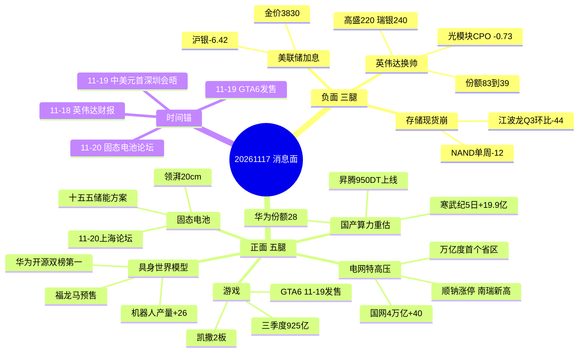

# 2026 年 11 月 17 日（周二） · **消息面事件驱动**

> **数据源新鲜度**: partial · **降级状态**: true · **置信度**: 0.70
> **覆盖窗口**: 2026-11-14 09:02 → 2026-11-17 05:59（72h）· **主源**: 财联社/新浪快讯 2250 条 + 18 号公众号 82 篇 + 盘前公告 1883 条 + 东财三季报预告 500 条

## 一句话结论

英伟达换帅叠 NAND 现货崩价 双杀 AI 硬件链 → 钱转电网/固态/机器人/游戏 但资金量级只够观察 不够开仓

## 🗺️ 消息面全景图

## 🎯 顶级事件详解（每事件三问 + 首推票思维链）

### E20261117_001 · 英伟达换帅风波升级 高盛瑞银齐降目标价 费城半导体指数单夜重挫逾5% · strength=high · polarity=负面

`权重 -0.732` · `原始分 -0.85` · `可知日 2026-11-16` · `已过 1 日` · 有效期 至 2026-11-18 英伟达财报公布

**事件摘要**: 黄仁勋辞任后高盛下调目标价至220美元 瑞银至240美元 费半单夜跌逾5% 英伟达跌超4% 光纤光模块领跌

**细节/备注**: 事件链: 11-12 黄仁勋辞任 CEO → 11-16 高盛/瑞银双降目标价 + 摩根大通披露下一代算力合约份额 83%→39% → 隔夜费半 -5%+ 英伟达 -4%+ 台积电 -6% 美光/英特尔/泰瑞达 -7%; 英伟达财报 11-17 美股盘后(北京时间 11-18 凌晨) 与 Anthropic IPO(目标估值 1.4 万亿美元) 同周 → 本周是 AI 叙事定价窗口; 11-16 A 股已先行定价: 中际旭创 -12.28% 新易盛 -11.08% 沪电股份 -10.00% 工业富联 -9.68% 胜宏科技 -11.54%

**独立源**: news_cls(11-16 14:00 高盛 目标价降至220美元) · news_cls(11-16 19:07 瑞银 下调至240美元) · news_cls(11-16 15:19 摩根大通 英伟达AI算力合约份额83%→39%) · news_cls(11-17 05:01 美股收评 费半重挫逾5%) · 上海证券报(11-16 22:47 黄仁勋下课之后 AI产业全球变局与中国机遇) · R7_capital_flow(隔夜 SOX -5.11%)

**推理深度三问**:
- **大资金意图**: 大资金在 11-12 至 11-16 完成了一次 AI 硬件链的集体降杠杆: 三日主力流出 -1777.60 亿 其中电子单链 -250 亿。英伟达换帅是触发器 但真正的动作是机构把「算力资本开支线性外推」这条估值锚拆掉 —— 摩根大通把下一代合约份额从 83% 打到 39% 等于告诉市场 英伟达不再是算力需求的唯一收租方
- **为什么走强**: 费半 -5% 台积电 -6% 美光 -7% 是全球同步杀估值 不是 A 股独立事件; A 股 11-16 已抢跑(CPO -7.23%) 意味着 11-17 的下跌是第二段 但幅度会收敛 因为 11-16 已经把情绪打到 跌停 60 家 / 广度 20.39%
- **逻辑够不够硬**: 硬 但有时间边界: 双降目标价 + 份额降至 39% + 隔夜 -5% 三个独立源 逻辑闭环; 反证条件是 11-18 凌晨英伟达财报若超预期并上调指引 (瑞银已预计 Q3 营收高于市场 30-40 亿美元) 则利空被证伪。所以这条线的有效期只到财报公布 不是永久看空

**首推票思维链**:

#### 中际旭创 300308.SZ · 高位受损暴露

| 收盘 | 当日 | MA5 | MA20 | 距 60 日高 | 5 日涨幅 | 5 日主力净额 | 板型 |
|---|---|---|---|---|---|---|---|
| 408.97 | -12.28% | 479.41 | 539.71 | -59.70% | -9.53% | -29.56 亿 | 未涨停 |

- **买入理由**: 拦截票 无买入计划。唯一用途是度量 AI 硬件链的杀跌深度: 单日 -12.28% 已把 9 月以来涨幅一次性回吐 距 60 日高 -59.7%
- **风险点**: 若 11-18 凌晨英伟达财报大超预期(瑞银预计 Q3 营收 1110-1120 亿美元 高于市场 30-40 亿) 空头逻辑当日反转 追空同样会被打脸
- **止损条件**: 无持仓者不参与; 存量持仓以 380 为最后防线 反抽 400-479(5 日线) 为减仓区
- **可验证假设**: 11-17 开盘 30 分钟若中际旭创仍无法收复 400 且成交额继续缩量 → 链条未止跌; 若英伟达财报后暗盘大涨 → 链条当日反转
- **止损价**: 380.00（参考价 408.97 · 400 整数关口与 5 日低点 406.0 均已失守 → 止损 380（距 -7.08%））· **目标区**: 400.80-479.41 · **RR5**: -0.28 · **仓位建议**: 0.01 · **姿态**: 拦截（行业级利空 + 5 日主力 -29.56 亿 最大单日流出 · RR 为负（上行目标低于现价））

#### 沪电股份 002463.SZ · 高位受损暴露

| 收盘 | 当日 | MA5 | MA20 | 距 60 日高 | 5 日涨幅 | 5 日主力净额 | 板型 |
|---|---|---|---|---|---|---|---|
| 73.98 | -10.00% | 83.65 | 91.19 | -43.63% | -4.05% | +2.67 亿 | 未涨停 |

- **买入理由**: 拦截票 无买入计划。异常点: 5 日主力净额仍 +2.67 亿 而股价 -4.05% 且当日跌停 → 资金在跌停板上接货 但价格未止跌 属典型背离
- **风险点**: 背离可以是主力自救 也可以是散户接盘; 若次日再度跌停 说明 +2.67 亿是诱多
- **止损条件**: 无持仓者不参与; 存量以 69 为防线 反抽 72.5-83.65(5 日线) 减仓
- **可验证假设**: 11-17 若沪电股份竞价高开 >2% 且 30 分钟内不破 72.5 → 背离修复; 若低开破 69 → 背离失效
- **止损价**: 69.00（参考价 73.98 已触及跌停 · 止损 69.00（距 -6.73%））· **目标区**: 72.50-83.65 · **RR5**: -0.30 · **仓位建议**: 0.01 · **姿态**: 拦截（行业级利空 · 5 日主力仍 +2.67 亿与价格背离 补跌风险未释放）

### E20261117_002 · 美银称 NAND 现货价 10 月下旬以来跌约 20% 美股存储股单日集体重挫 涨价链出现裂痕 · strength=high · polarity=负面

`权重 -0.689` · `原始分 -0.80` · `可知日 2026-11-16` · `已过 1 日` · 有效期 2-3 周（跟踪 NAND 现货周度报价）

**事件摘要**: 美银称 NAND 现货 10 月下旬以来跌约 20% 512Gb 晶圆单周 -12% 较上季 -32% 美股存储股单日跌 5%~7.5%

**细节/备注**: v1.5 业绩极性协议本次强制应用: 江波龙 前三季累计同比 +1864.55%~+1990.84% 看似炸裂 但单季倒推 Q3 37.45 亿 vs Q2 67.15 亿 = 环比 -44.2%; 佰维存储 Q3 16.02 亿 vs Q2 42.67 亿 = -62.4%; 兆易创新 Q3 42.09 亿 vs Q2 53.96 亿 = -22.0%; 德明利 Q3 27.29 亿 vs Q2 26.71 亿 = +2.2% 走平; 环节错配: 兆易(原厂/设计)毛利率 67.57% vs 江波龙(模组) 19.40% 同一轮涨价 原厂吃利润 模组只吃周转 —— 价格转跌时模组先死

**独立源**: news_cls(11-16 21:43 美银 NAND 现货价大跌20%) · news_cls(11-16 22:49 内存与数据存储股早盘下跌) · news_cls(11-16 22:31 美股存储板块盘初普跌 美光-5.88% 海力士-6.16%) · 证券时报(11-16 18:20 美存储、光通信巨头盘前集体跳水) · eastmoney_earnings_predict(江波龙 预增 1864.55%~1990.84%) · tushare income(江波龙/佰维/兆易 2026Q3 单季倒推)

**推理深度三问**:
- **大资金意图**: 产业资本与机构在给『存储涨价周期』做顶部定价: 美银的报告不是新闻 是给多头递刀 —— 10 月下旬以来现货跌 20% 意味着 Q4 合约价谈判已经翻盘。资金动作是把 11 月涨幅最凶的模组环节直接兑现 江波龙 5 日 -6.54% 而主力只流出 1.98 亿 说明是价格自己塌的 不是主力砸的
- **为什么走强**: 弱转强的条件被抽掉了: 11-16 存储链的下跌不是情绪 而是现货价 -20% 的硬数据; A 股 11-16 半导体已是跌幅前列 11-17 会继续跟随美股存储 -5%~-7% 的第二段
- **逻辑够不够硬**: 非常硬: 现货报价(14.30 美元 单周 -12% 较上季 -32%)+美银研报+美股 4 只存储股同向重挫 三源独立; 且 Q3 单季环比数据把『业绩炸裂』的误读直接推翻 这条不是叙事 是可验证的价格数据

**业绩极性协议（v1.5）**: 累计同比 +1864.55%~+1990.84% ｜ 单季倒推 37.45 亿 ｜ 上季 67.15 亿 ｜ 单季环比 -44.2% ｜ 周期股=是 ｜ 产品价格=见顶回落 ｜ 预期差=低于 → **周期见顶·利好出尽**

**首推票思维链**:

#### 江波龙 301308.SZ · 模组环节受损

| 收盘 | 当日 | MA5 | MA20 | 距 60 日高 | 5 日涨幅 | 5 日主力净额 | 板型 |
|---|---|---|---|---|---|---|---|
| 201.46 | -7.59% | 220.04 | 225.54 | -52.48% | -6.54% | -1.98 亿 | 未涨停 |

- **买入理由**: 拦截票 无买入计划。这条线的价值是反证: 前三季同比 +1864%~+1991% 是市场最容易误读的数字 单季环比 -44.2% 才是定价依据
- **风险点**: 若 NAND 现货止跌反弹 或 原厂继续减产挺价 模组毛利会快速修复 空头逻辑反转
- **止损条件**: 无持仓者不参与; 存量以 187 为防线 反抽 196-220(5 日线) 减仓
- **可验证假设**: 跟踪 512Gb NAND 晶圆现货是否跌破 14 美元; 若单周跌幅收窄至 3% 以内 → 跌价交易结束
- **止损价**: 187.00（参考价 201.46 · 5 日低点 199.15 已破 → 止损 187.00（距 -7.18%））· **目标区**: 196.00-220.04 · **RR5**: -0.38 · **仓位建议**: 0.01 · **姿态**: 拦截（Q3 单季环比 -44.2% 已证伪『业绩炸裂』叙事 · NAND 现货再跌 20% → 量价双杀）

#### 兆易创新 603986.SH · 原厂/设计受损

| 收盘 | 当日 | MA5 | MA20 | 距 60 日高 | 5 日涨幅 | 5 日主力净额 | 板型 |
|---|---|---|---|---|---|---|---|
| 223.22 | -9.27% | 246.46 | 263.44 | -51.03% | -6.37% | -15.80 亿 | 未涨停 |

- **买入理由**: 拦截票 无买入计划。相对价值判断: 若存储链必须留一只观察 兆易毛利 67.57% 是三方最厚 反弹弹性最好 但当前不是买点
- **风险点**: NOR/DRAM 价格若跟随 NAND 下行 高毛利会被压缩 估值与业绩双杀
- **止损条件**: 无持仓者不参与; 存量以 207 为防线
- **可验证假设**: 若 11-17 存储链出现 2 只以上涨停(资金抢反弹) 且兆易收复 5 日线 246.46 → 说明杀跌结束 才转观察
- **止损价**: 207.00（参考价 223.22 · 5 日低点 221.42 已破 → 止损 207.00（距 -7.27%））· **目标区**: 216.00-246.46 · **RR5**: -0.45 · **仓位建议**: 0.01 · **姿态**: 拦截（Q3 单季环比 -22.0% 且 5 日主力 -15.80 亿 · 原厂虽有毛利缓冲 但估值已按涨价周期定价）

### E20261117_004 · IDC 口径英伟达中国数据中心份额降至 34% 华为升至 28% 昇腾 950DT 千卡超节点武汉上线 · strength=high · polarity=正面

`权重 +0.689` · `原始分 +0.80` · `可知日 2026-11-16` · `已过 1 日` · 有效期 1-2 周（国产算力季报+超节点招标落地）

**事件摘要**: IDC 口径 2026H1 英伟达中国数据中心 AI 加速芯片份额降至 34% 华为升至 28% 昇腾 950DT 千卡超节点已在武汉上线

**细节/备注**: 份额明细(IDC 出货量口径): 英伟达 34% 华为 28% 阿里平头哥 7% 寒武纪 5% 百度昆仑芯 4% 海光 3%; 昇腾 960 NPO 超节点单柜 4096 张加速卡 2027 商用; 950DT 千卡超节点 10-28 已在武汉上线; DeepSeek 拟用 950DT 训练属市场传闻『方案尚待官方确认』→ 单源 降级 medium 处理 不作硬证据

**独立源**: 上海证券报(11-16 22:47 黄仁勋下课之后 AI产业全球变局与中国机遇) · news_cls(11-16 21:11 A股算力产业链再回应英伟达事件影响) · 盘前纪要(11-16 07:22 DeepSeek 新版本拟采用原生国产昇腾950DT超节点训练) · R7_capital_flow(寒武纪 5日主力 +19.92 亿)

**推理深度三问**:
- **大资金意图**: 外资在拆英伟达的护城河 内资在同时给『国产替代』加杠杆 —— 这不是情绪对立 是同一份 IDC 数据的两种解读: 英伟达中国份额 34% 意味着 66% 的国产空间已经被打开。资金证据是寒武纪 5 日 +19.92 亿 逆势流入 而这个流入发生在其股价 -8.27% 的同一周
- **为什么走强**: 走强需要条件: 11-16 国产算力并未独立走强 而是跟随科技调整(寒武纪 -8.27% 华丰 -3.83%) 所以这是『逻辑已经立住 但价格还没确认』的状态; 确认信号是板块出现涨停潮或龙头收复 5 日线
- **逻辑够不够硬**: 中硬: 份额数据来自 IDC 属硬数据 昇腾 950DT 上线有明确时间地点(10-28 武汉); 弱项是 DeepSeek 采用 950DT 仍属传闻 无官方确认 → 已按单源降级 不作硬证据; 且 英伟达财报若超预期 这条线会被压制

**首推票思维链**:

#### 寒武纪 688256.SH · 国产AI芯片核心

| 收盘 | 当日 | MA5 | MA20 | 距 60 日高 | 5 日涨幅 | 5 日主力净额 | 板型 |
|---|---|---|---|---|---|---|---|
| 897.97 | -8.27% | 917.57 | 892.46 | -23.25% | +5.49% | +19.92 亿 | 未涨停 |

- **买入理由**: 若国产替代逻辑成立 寒武纪是唯一纯度 99.98% 的载体; 5 日主力净流入 +19.92 亿 与 -8.27% 的跌幅形成强背离 说明有资金在逆势建仓
- **风险点**: 背离也可能是被动接盘; 价格仍在 5 日线下方 属左侧 且 单日 -8.27% 说明抛压真实; 英伟达若财报大超预期 国产替代叙事会被压制
- **止损条件**: 822(5日低点) 破位即出 距 -8.46%; 站不上 917.57(5日线) 不追
- **可验证假设**: 11-17 若寒武纪收复 917.57 且主力继续净流入 → 抢筹成立; 若跌破 822 → +19.92 亿被证伪
- **止损价**: 822.00（参考价 897.97 · 5 日低点 822.00 为唯一有效支撑 → 止损 822（距 -8.46%））· **目标区**: 917.57-950.00 · **RR5**: 0.26 · **仓位建议**: 0.05 · **姿态**: 观察（资金最猛(+19.92亿)但价格收在 5 日线 917.57 下方 · RR 0.26 <2 → 只做研究观察 不授予开仓）

#### 华丰科技 688629.SH · 昇腾互连弹性

| 收盘 | 当日 | MA5 | MA20 | 距 60 日高 | 5 日涨幅 | 5 日主力净额 | 板型 |
|---|---|---|---|---|---|---|---|
| 81.39 | -3.83% | 78.86 | 73.20 | -48.67% | +16.60% | +5.56 亿 | 未涨停 |

- **买入理由**: 超节点(4096 卡/柜)的瓶颈在互连 不在算力芯片本身; 5 日主力 +5.56 亿 + 涨幅 16.6% 是链上最强的资金确认
- **风险点**: 5 日 +16.6% 属追高位置; 距 60 日高仍有 -48.67% 说明是反弹不是新趋势 反弹夭折概率高
- **止损条件**: 76.50（破 5 日线后退 3%）· 距 -6.01%
- **可验证假设**: 11-17 若国产算力出现 2 只以上涨停且华丰守住 78.86 → 板块确认; 否则仅观察
- **止损价**: 76.50（参考价 81.39 · 破 5 日线 78.86 后退 3% → 止损 76.50（距 -6.01%））· **目标区**: 85.50-90.10 · **RR5**: 0.84 · **仓位建议**: 0.04 · **姿态**: 降级观察（5 日 +16.6% 已透支部分预期 · RR 0.84 <2 · 个股强于板块 但板块未确认）

### E20261117_007 · 华为云发布并开源具身世界模型 CloudRobo-WM1.2 10 月工业机器人产量同比 +26% · strength=high · polarity=正面

`权重 +0.671` · `原始分 +0.78` · `可知日 2026-11-16` · `已过 1 日` · 有效期 至 2026-12 福龙马新品发布会

**事件摘要**: 华为云开源昇腾原生具身世界模型 CloudRobo-WM1.2 双榜第一 福龙马清扫机器人启动预售 10月工业机器人产量 +26%

**细节/备注**: 技术口径: CloudRobo-WM1.2 在 RoboTwin 2.0 与 LiberoPro 2.0 双榜第一; 五项突破含 PPA 多模态世界表征 DualAct 原生动作生成 跨具身运动建模; 生态口径: 80% 中国具身智能企业用昇腾云 16500 具身开发者 230 家企业高校 1500 行业资产; 生态伙伴含 亿嘉和 拓斯达 福龙马; 产品口径: 与福龙马联合研制下一代智能清扫机器人启动预售 12 月上海发布; 产业数据: 10 月工业机器人产量同比 +26%

**独立源**: 上海证券报(11-16 20:30 华为 发布并开源具身世界模型) · 财闻私享(11-16 21:18 晚间A股值得关注的资讯 工业机器人产量+26%) · news_cls(11-16 16:21 自变量机器人进驻APEC新闻中心) · news_cls(11-16 23:16? 国家统计局 10月工业机器人产量同比+26%) · 财联社早知道VIP日报(11-16 19:00 风口研报 OpenAI解散独立机器人团队)

**推理深度三问**:
- **大资金意图**: 机器人这条线 11-16 是『海外砍大脑 国内造大脑』的对冲结构: OpenAI 解散机器人团队(把研究员并入通用模型) 而华为同一天开源具身世界模型并给出双榜第一 —— 资金读到的是『路线收敛到通用大脑 而中国厂商抢先落地』, 机器人指数 -4.11% 却能出现 安培龙 +9.73% 福龙马 +3.31% 的独立强势
- **为什么走强**: 走强有产业数据托底: 10 月工业机器人产量同比 +26% 是统计局口径 不是预期; 但机器人指数 -4.11% 说明是结构性行情(零部件/感知强 整机弱) 而非板块普涨
- **逻辑够不够硬**: 硬: 模型开源可验证(双榜第一 五项技术) 生态数据具体(80% 企业/16500 开发者) 产品有预售与发布时间(12 月上海) 统计局产量 +26% 是硬数据; 弱项是福龙马智能装备仅 23.28% 事件弹性有限 且 11-16 板块整体仍在下跌

**首推票思维链**:

#### 福龙马 603686.SH · 华为生态首发标的

| 收盘 | 当日 | MA5 | MA20 | 距 60 日高 | 5 日涨幅 | 5 日主力净额 | 板型 |
|---|---|---|---|---|---|---|---|
| 14.05 | +3.31% | 12.96 | 12.29 | -16.62% | +17.08% | +2.73 亿 | 未涨停 |

- **买入理由**: 唯一被华为云『联合研制+启动预售』直接点名的 A 股(上证报原文) 事件映射置信度最高; 5 日主力 +2.73 亿 与 +17.08% 同向 是资金已确认的少数票
- **风险点**: 智能装备只占 23.28% 主业仍是环卫服务 74.41% 业绩弹性有限; 5 日 +17.08% 已反映部分预期; 12 月发布会前有真空期
- **止损条件**: 13.05(破5日线后退0.7%) · 距 -7.12%
- **可验证假设**: 11-17 若机器人板块出现 2 只以上涨停且福龙马守住 12.96 → 华为生态被资金接受; 若仅福龙马独涨 → 个股行情
- **止损价**: 13.05（参考价 14.05 · 破 5 日线 12.96 后退 0.7% → 止损 13.05（距 -7.12%））· **目标区**: 15.50-16.85 · **RR5**: 1.45 · **仓位建议**: 0.06 · **姿态**: 观察（华为直接联合研制+预售 是全网最硬映射 · 但 RR 1.45 <2 且 智能装备仅 23.28%）

#### 安培龙 301413.SZ · 传感器弹性

| 收盘 | 当日 | MA5 | MA20 | 距 60 日高 | 5 日涨幅 | 5 日主力净额 | 板型 |
|---|---|---|---|---|---|---|---|
| 83.20 | +9.73% | 79.42 | 70.37 | -3.26% | +11.19% | +0.23 亿 | 未涨停 |

- **买入理由**: 世界模型解决『大脑』 传感器解决『感知』 两者是同一笔投资的两端; 99.94% 传感器纯度 + 距 60 日高仅 -3.26% 说明趋势未破
- **风险点**: +9.73% 单日涨幅过大 追高必接盘; 5 日主力仅 +0.23 亿 资金量级撑不起持续行情
- **止损条件**: 77.50(破5日线后退2.4%) · 距 -6.85%
- **可验证假设**: 若 11-17 缩量回踩 79.42-80 区间不破 → 可等; 若低开破 77.50 → 冲高失败
- **止损价**: 77.50（参考价 83.20 · 破 5 日线 79.42 后退 2.4% → 止损 77.50（距 -6.85%））· **目标区**: 88.50-96.00 · **RR5**: 0.93 · **仓位建议**: 0.04 · **姿态**: 观察（+9.73% 已冲高 距 60 日高 -3.26% · RR 0.93 <2 → 观察 等回踩）

### E20261117_005 · 内蒙古特高压累计外送电量突破 1 万亿度 国网 4 万亿投资规划托底 电网设备龙头集体上行 · strength=high · polarity=正面

`权重 +0.646` · `原始分 +0.75` · `可知日 2026-11-16` · `已过 1 日` · 有效期 2-4 周（十五五电网招标节奏）

**事件摘要**: 内蒙古特高压累计外送电量破 1 万亿度成首个省区 国网 4 万亿投资规划同比 +40% 电网设备龙头 11-16 集体上行

**细节/备注**: 投资口径: 2026H1 国网固投超 3100 亿 同比 +12.6%; 南网 893 亿 同比 +14.8%; 华泰证券称国网 4 万亿规划同比 +40% 主网仍为十五五重点; 海外映射: 韩国 LS 产电获全球科技巨头 AI 数据中心配电盘订单 9383 万美元(约 6.26 亿元人民币) → AI 用电需求正在外溢到配电设备; 11-16 盘面: 顺钠股份涨停(+9.97%) 平高电气 +5.69% 国电南瑞 +4.00% 长江电力 +1.94% 创历史新高 而 dc 电网自动化设备指数 -1.36% → 龙头与板块分化

**独立源**: 财联社早知道(11-16 19:00 明日主题前瞻 内蒙古特高压) · news_cls(11-16 12:23 内蒙古特高压累计外送电量突破1万亿度) · news_cls(11-16 11:17 电网设备板块短线拉升 顺钠股份涨停) · news_cls(11-16 13:54 韩国LS产电获6.26亿元AI数据中心配电订单) · anns_window(11-17 顺钠股份 回购方案+第一期员工持股计划) · R7_capital_flow(长江电力 5日主力 +8.50 亿)

**推理深度三问**:
- **大资金意图**: 这是 11-16 唯一同时被官媒(内蒙古万亿度)与产业订单(韩国 LS 6.26 亿)双向验证的方向 大资金的意图是把『电力』从防御属性改写成 AI 基础设施属性 —— 长江电力创新高 + 顺钠涨停 同时发生 说明红利资金与题材资金在同一板块里各取所需
- **为什么走强**: 走强是结构性的: 板块指数仍 -1.36% 但龙头 国电南瑞 +4.00% 平高 +5.69% 顺钠涨停 → 资金在做龙头与低位弹性 不做中位; 这正是主跌期的典型打法(只做龙头或低位 躲中位)
- **逻辑够不够硬**: 硬: 万亿度是官方数据 4 万亿投资是国网规划 华泰测算 +40%; 海外 LS 订单是公司公告级事实; 弱项是国网 4 万亿属于规划口径 落地节奏未披露 且 板块资金未整体流入(R7 净流入前列无电网)

**首推票思维链**:

#### 国电南瑞 600406.SH · 特高压核心龙头

| 收盘 | 当日 | MA5 | MA20 | 距 60 日高 | 5 日涨幅 | 5 日主力净额 | 板型 |
|---|---|---|---|---|---|---|---|
| 24.19 | +4.00% | 23.43 | 23.45 | -0.37% | +2.15% | +0.80 亿 | 未涨停 |

- **买入理由**: 特高压是唯一同时具备『政策确定性(国网4万亿 同比+40%)+海外订单映射(LS 6.26亿)+龙头新高(距60日高-0.37%)』三要素的方向; 板块指数 -1.36% 而龙头 +4.00% 说明资金在做龙头不做板块
- **风险点**: 距 60 日高仅 -0.37% 属新高位置 任何一次板块补跌都会先杀龙头; 5 日主力仅 +0.80 亿 资金确认强度不够
- **止损条件**: 22.82(5日低点) · 距 -5.66%; 不追高 只在回踩 23.43(5日线) 附近观察
- **可验证假设**: 11-17 若电网设备出现 2 只以上涨停(顺钠/平高联动) → 板块确认; 若仅龙头独涨 → 维持观察
- **止损价**: 22.82（参考价 24.19 · 5 日低点 22.82 为止损（距 -5.66%））· **目标区**: 24.28-25.40 · **RR5**: 0.07 · **仓位建议**: 0.06 · **姿态**: 观察（位置已到 60 日高 RR 0.07 < 2 · 只做回踩 5 日线低吸 不追高）

#### 顺钠股份 000533.SZ · 低位弹性首板

| 收盘 | 当日 | MA5 | MA20 | 距 60 日高 | 5 日涨幅 | 5 日主力净额 | 板型 |
|---|---|---|---|---|---|---|---|
| 9.82 | +9.97% | 9.51 | 9.19 | -22.92% | -2.77% | +1.22 亿 | 1 板 |

- **买入理由**: 三条独立催化同时落到一只低位票: 特高压万亿度官媒定调 + 11-17 公告回购方案与第一期员工持股计划 + 变压器业务 99.85% 纯度高; 距 60 日高 -22.92% 是低位不是高位
- **风险点**: 首板次日承接是唯一变量; 板块指数 -1.36% 说明是资金单点攻击 不是板块合力; 若次日断板 低位优势会变成套牢盘
- **止损条件**: 9.20（破 5 日线 9.51 后退 3.3%）· 距 -6.31%; 断板即出 不留隔夜
- **可验证假设**: 11-17 竞价若高开 3%~7% 且 9:35 前不回落到 9.51 以下 → 二板可期; 低开破 9.51 → 放弃
- **止损价**: 9.20（参考价 9.82 · 破 5 日线 9.51 后退 3.3% → 止损 9.20（距 -6.31%））· **目标区**: 10.40-11.00 · **RR5**: 0.94 · **仓位建议**: 0.04 · **姿态**: 观察（低位首板+回购+员工持股三重叠加 但 RR 0.94 <2 · 只做次日不破板的确认）

### E20261117_006 · 十五五新型储能实施方案点名本质安全固态电池 11-20 上海固态电池论坛接力 板块逆势活跃 · strength=high · polarity=正面

`权重 +0.620` · `原始分 +0.72` · `可知日 2026-11-16` · `已过 1 日` · 有效期 至 2026-11-20 上海固态电池论坛

**事件摘要**: 十五五新型储能实施方案提出研究本质安全固态电池 2030 年装机 3 亿千瓦 11-20 上海固态电池论坛接力

**细节/备注**: 方案口径: 到 2030 年新型储能由规模化发展进入市场化 全国装机 3 亿千瓦 平均时长 3 小时; 技术条目明确『优化固液混合态电池核心部件 研究本质安全固态电池技术』; 事件接力: 11-20 上海固态电池论坛主题『从装车验证到量产攻坚』; 11-16 盘面 领湃科技 20cm 涨停(封单 9833.7 万) 尚水智能 +14.21% 而 固态电池指数 -2.73% → 高低切起点

**独立源**: 财联社早知道VIP日报(11-16 19:00 固态电池概念逆势活跃 尚水智能 +14.21%) · news_cls(11-16 11:52 急拉20cm封板 300530领衔 电池板块拉升) · 盘前纪要(11-16 07:22 十五五新型储能实施方案 2030 年 3 亿千瓦) · 股痴流沙河(11-16 21:46 新方向 固态电池 电网 泛消费) · limit_list_d(11-16 领湃科技 20cm 首板 封单 9833.7 万)

**推理深度三问**:
- **大资金意图**: 这条线的资金意图很清楚: 11-16 高位科技杀跌 60 家跌停 钱需要一个新的低位容器 固态电池既有政策文件(十五五储能方案)又有 11-20 论坛时间锚 是天然的高低切标的; 领湃 20cm 首板 + 尚水 +14.21% 是同一笔钱的两端(情绪端与设备端)
- **为什么走强**: 走强是逆势的: 固态电池指数 -2.73% 而 领湃涨停 尚水 +14.21% → 个股强于板块 属启动第一天 不是板块级行情; 涨价/政策双逻辑要等 11-20 论坛与中试订单落地才能升级为主线
- **逻辑够不够硬**: 中: 政策文件是硬口径(2030 年 3 亿千瓦) 论坛时间锚明确(11-20 上海); 但『固态电池』在方案里是技术储备表述 不是量化目标 且 A 股能真正兑现固态收入的公司极少 → 选中标的最容易踩概念雷(领湃毛利 5.77% 就是样本)

**首推票思维链**:

#### 尚水智能 301513.SZ · 固态电池设备

| 收盘 | 当日 | MA5 | MA20 | 距 60 日高 | 5 日涨幅 | 5 日主力净额 | 板型 |
|---|---|---|---|---|---|---|---|
| 65.02 | +14.21% | 60.15 | 54.81 | -16.44% | +11.80% | +0.36 亿 | 未涨停 |

- **买入理由**: 固态电池要落地 先买设备: 极片制造装备 84.32% 占比 是产业链最前置的卖铲人; 机构口径 2026-2027 进入中试与小批量量产窗口 设备订单会最先出
- **风险点**: 毛利率 20.80% 不高 设备公司业绩弹性靠订单不靠毛利; +14.21% 当日已透支 且 板块指数 -2.73% 说明只是个股异动
- **止损条件**: 60.00(破5日线) · 距 -7.72%
- **可验证假设**: 11-20 上海论坛前后若设备端出现新增订单公告 → 逻辑强化; 若板块连续两日无法收复 5 日线 → 只是一日游
- **止损价**: 60.00（参考价 65.02 · 破 5 日线 60.15 即失败 → 止损 60.00（距 -7.72%））· **目标区**: 70.00-77.80 · **RR5**: 0.99 · **仓位建议**: 0.04 · **姿态**: 观察（设备端受益最确定但 +14.21% 已涨 · RR 0.99 <2 → 观察不追）

#### 领湃科技 300530.SZ · 情绪首板(概念待验)

| 收盘 | 当日 | MA5 | MA20 | 距 60 日高 | 5 日涨幅 | 5 日主力净额 | 板型 |
|---|---|---|---|---|---|---|---|
| 27.83 | +20.01% | 25.34 | 24.51 | -12.54% | +14.86% | +0.30 亿 | 1 板 |

- **买入理由**: 唯一 20cm 首板 是板块情绪温度计; 但主营 59.91% 是动力电池 毛利 5.77% 与固态电池无实质关联 —— 只能当情绪票看
- **风险点**: 20cm 断板风险的代价是 -9% 以上; 毛利率 5.77% 说明基本面无法托底 一旦断板无支撑
- **止损条件**: 25.34(5日线) · 距 -8.95%; 断板即出 不留隔夜
- **可验证假设**: 11-17 若竞价高开 >5% 且 10:00 前封回 → 情绪延续; 若开板 2 次以上 → 退潮确认
- **止损价**: 25.34（参考价 27.83 · 破 5 日线 25.34 即首板失败 → 止损 25.34（距 -8.95%））· **目标区**: 29.50-31.80 · **RR5**: 0.67 · **仓位建议**: 0.02 · **姿态**: 降级观察（主营无固态收入 + 毛利 5.77% + 封单/主力量级不匹配 → 概念票 只做情绪不做逻辑）

### E20261117_003 · 美联储加息预期升温 沪银单日重挫 6.42% 金价跌至 2025 年 10 月以来最低 · strength=high · polarity=负面

`权重 -0.602` · `原始分 -0.70` · `可知日 2026-11-16` · `已过 1 日` · 有效期 至 2026-11-19 美联储 10 月纪要

**事件摘要**: 美联储加息预期升温 沪银主力单日 -6.42% 现货金跌至 3830 美元创 2025 年 10 月以来新低

**细节/备注**: 宏观链条: 10 月 PPI 仍处近四年高位 → 堪萨斯城联储施密德称通胀『还有不少工作要做』 → 沃什 11-17 凌晨 01:00 就科技生产力与就业发表演讲 → 10 月议息纪要周三发布; 白银跌幅大于黄金(金银比快速走高) 原因是光伏用银需求预期回落 + 利率重定价阶段避险买盘离场 属双杀 不是单纯避险失效

**独立源**: news_cls(11-16 16:01 光大期货 沪银重挫6%) · news_cls(11-16 15:00 商品期货收盘 白银连续跌6.42%) · 证券时报(11-16 17:02 金价突发跳水 美联储加息预期增强) · news_cls(11-16 14:49 黄金跌至2025年10月以来最低) · 证券时报(11-16 22:49 深夜美科技股重挫 美联储重磅来袭)

**推理深度三问**:
- **大资金意图**: 这是本周最容易被忽视的一条: 资金不是在交易避险 而是在交易『美联储可能重新加息』。A 股 11-16 的银行/保险/白酒/煤炭上涨 与 创业板 -4.37% 是同一个动作的两面 —— 钱从高估值成长搬到低估值红利 贵金属被两头夹: 既失去避险买盘 又面对实际利率上行
- **为什么走强**: 走弱是结构性的: 沪银 -6.42% 大于沪金 说明工业属性也在被砸; 11-16 商品期货白银连续 -6.42% 碳酸锂 -3.65% 贵金属与新能源金属同步下跌 = 流动性收缩信号
- **逻辑够不够硬**: 硬: 商品收盘价 + 光大期货归因 + 证券时报标题 三源独立且都是价格事实; 不确定性在于『预期』而非『事实』 加息尚未落地 沃什演讲与周三纪要是下一个定价点

**首推票思维链**:

#### 山东黄金 600547.SH · 价格直接受损

| 收盘 | 当日 | MA5 | MA20 | 距 60 日高 | 5 日涨幅 | 5 日主力净额 | 板型 |
|---|---|---|---|---|---|---|---|
| 23.85 | -2.29% | 25.36 | 25.31 | -38.45% | -10.74% | -2.77 亿 | 未涨停 |

- **买入理由**: 拦截票 无买入计划。这条线用于保护存量红利/避险仓位: 金价 3830 是 2025 年 10 月以来最低 避险叙事已失效
- **风险点**: 若沃什演讲偏鸽 或 10 月纪要显示更多委员反对加息 金银会快速反抽
- **止损条件**: 无持仓者不参与; 存量以 22.40 为防线
- **可验证假设**: 盯 11-17 凌晨 01:00 沃什演讲与周三纪要: 若措辞转鸽 金银反弹 3% 以上 → 空头逻辑当日失效
- **止损价**: 22.40（参考价 23.85 · 5 日低点 23.61 已破 → 止损 22.40（距 -6.08%））· **目标区**: 23.40-25.36 · **RR5**: -0.31 · **仓位建议**: 0.01 · **姿态**: 拦截（加息预期 + 金价创 2025 年 10 月以来新低 · 5 日 -10.74% 趋势已破）

#### 盛达资源 000603.SZ · 白银弹性受损

| 收盘 | 当日 | MA5 | MA20 | 距 60 日高 | 5 日涨幅 | 5 日主力净额 | 板型 |
|---|---|---|---|---|---|---|---|
| 25.16 | -4.33% | 27.11 | 25.24 | -37.52% | -9.27% | +0.59 亿 | 未涨停 |

- **买入理由**: 拦截票 无买入计划。白银是这轮里最脆弱的: 既是贵金属(挨加息) 又是光伏工业金属(挨需求预期回落)
- **风险点**: 若光伏装机数据超预期 工业属性会托住银价 空头逻辑部分失效
- **止损条件**: 无持仓者不参与; 存量以 23.40 为防线
- **可验证假设**: 若沪银主力连续两日收在 5 日线上方 → 杀跌结束
- **止损价**: 23.40（参考价 25.16 · 止损 23.40（距 -7.00%））· **目标区**: 24.40-27.11 · **RR5**: -0.43 · **仓位建议**: 0.01 · **姿态**: 拦截（白银单日 -6.42% 且跌幅大于黄金 · 高毛利(78.37%)对应高估值 双杀风险）

### E20261117_008 · GTA VI 11-19 发售 预售破 10 亿美元 三季度国内游戏收入 925 亿 游戏成退潮期抗跌方向 · strength=high · polarity=正面

`权重 +0.534` · `原始分 +0.62` · `可知日 2026-11-16` · `已过 1 日` · 有效期 至 2026-11-19 GTA VI 发售

**事件摘要**: GTA VI 11-19 发售 预售超 1200 万份破 10 亿美元 三季度国内游戏收入 925 亿 头部厂商业绩兑现

**细节/备注**: 行业口径: 2026 前三季 A 股游戏板块营收 914.96 亿 同比 +15.80% 归母净利 163.93 亿 同比 +13.10%(国泰海通陈筱); 单季口径: 三季度国内游戏市场实际销售收入 925 亿; GTA VI 前作累计销量近 2.35 亿份 本月 19 日发售 预售超 1200 万份; 盘面: 11-16 游戏Ⅲ -1.76% 而 凯撒文化 +10.10%(2 板 up_stat 4/5) 北纬科技 +10.06%(4 板 开板 7 次) 电魂网络 5 日 +13.62%; 风险样本: 文投控股 15 天 10 板 但 AI 漫剧收入占比仅 2.57% 且提示可能被实施退市风险警示(11-16 晚间公告)

**独立源**: 财联社早知道(11-16 08:59 预售金额突破10亿美元 GTA VI 本周发售) · 证券时报(11-16 11:11 游戏股突然爆发 002425 5天4板) · 盘前纪要(11-16 07:22 英雄联盟全球总决赛中国战队夺冠 凯撒文化/电魂网络) · 财闻私享(11-16 21:18 传媒和游戏是今天题材中为数不多的抗跌板块) · anns_window(11-17 凯撒文化 股票异常波动公告)

**推理深度三问**:
- **大资金意图**: 钱在做『防守性题材』: 11-16 科技崩 60 家跌停 资金需要既能讲故事又有真实行业数据的容器 —— 游戏是唯一同时有 925 亿季度收入(硬数据)与 GTA VI 11-19 发售(时间锚)的抗跌板块, 所以出现 游戏Ⅲ -1.76% 却有 2 只涨停的分化
- **为什么走强**: 走强但板块未确认: 游戏Ⅲ -1.76% 说明板块整体仍被指数拖累 只有 凯撒 2 板 北纬 4 板 两条情绪线; 真正升级为主线需要 11-19 发售后出现板块涨停潮
- **逻辑够不够硬**: 中硬: 914.96 亿营收 +15.80% 与 163.93 亿净利 +13.10% 是财报级数据 925 亿是季度行业数据; 软肋是 GTA VI 属海外产品 对 A 股只是情绪映射 且 北纬科技主营 86.89% 是信息技术服务 与游戏无关(4 板纯情绪)

**首推票思维链**:

#### 完美世界 002624.SZ · 基本面龙头

| 收盘 | 当日 | MA5 | MA20 | 距 60 日高 | 5 日涨幅 | 5 日主力净额 | 板型 |
|---|---|---|---|---|---|---|---|
| 10.37 | -2.72% | 10.79 | 10.50 | -12.71% | -5.81% | -2.03 亿 | 未涨停 |

- **买入理由**: GTA VI 是全球游戏景气的温度计 但真正受益 A 股的是有产品周期的公司: 完美世界 PC+移动合计 92% 毛利 70-76% 《异环》全球流水已超 27 亿(财联社早知道原文)
- **风险点**: 价格收在 5 日线 10.79 下方 且 5 日主力 -2.03 亿 说明资金在流出; GTA VI 是海外产品 对 A 股是情绪映射不是业绩
- **止损条件**: 9.63(-7.14%) · 未收复 10.79 不进场
- **可验证假设**: 11-19 GTA VI 发售日若游戏板块出现 3 只以上涨停 → 板块级行情启动; 若发售后无反应 → 只是一日游
- **止损价**: 9.63（参考价 10.37 · 破 5 日线 10.79 已失守 按 -7.14% → 止损 9.63）· **目标区**: 10.79-11.88 · **RR5**: 0.57 · **仓位建议**: 0.05 · **姿态**: 观察（毛利 70%+ 是行业最优资产 但价格在 5 日线下方 RR 0.57 <2 → 等收复 10.79）

#### 凯撒文化 002425.SZ · 情绪二板

| 收盘 | 当日 | MA5 | MA20 | 距 60 日高 | 5 日涨幅 | 5 日主力净额 | 板型 |
|---|---|---|---|---|---|---|---|
| 4.36 | +10.10% | 3.85 | 3.36 | +0.00% | +37.97% | +1.10 亿 | 2 板 |

- **买入理由**: 情绪端龙头: 2 板 + 封单 1.086 亿 是游戏线唯一有接力结构的票; 英雄联盟 S16 中国战队夺冠 + GTA VI 发售 提供双重情绪锚
- **风险点**: 毛利率 13% 无业绩托底; 5 日 +37.97% 已严重透支; 11-17 异常波动公告是降温信号; 2 板以上在退潮期断板概率高
- **止损条件**: 3.96(断板价) · 距 -9.17%; 断板即出
- **可验证假设**: 11-17 竞价高开 >3% 且 10:00 前封回 → 三板结构成立; 低开或开板两次 → 退潮
- **止损价**: 3.96（参考价 4.36 · 断板即止损 3.96（涨停前一日收盘）距 -9.17%）· **目标区**: 4.80-5.20 · **RR5**: 1.10 · **仓位建议**: 0.03 · **姿态**: 降级观察（5 日 +37.97% 情绪高位 · 毛利率仅 13% · RR 1.10 <2 · 11-17 已发异常波动公告）

## 📊 板块 × 事件热力矩阵

| 板块 | 净分 | 事件数 | 类型 | 逐事件叉乘明细 | 位置/资金口径 |
|---|---|---|---|---|---|
| AI硬件高位持仓 🔴 | -1.214 | 2 | 多事件叠加 | E20261117_001 负面×1.00=-0.732 + E20261117_002 负面×0.70=-0.482 | 两条独立负腿叠加(换帅杀估值 + 存储崩价) · 三日主力 -1777.60 亿 全链降杠杆 · 有效性只到 11-18 财报 |
| 纯概念跟风杂毛 🔴 | -1.004 | 2 | 多事件叠加 | E20261117_007 负面×0.70=-0.470 + E20261117_008 负面×1.00=-0.534 | 两条负腿: 机器人杂毛杀跌 -4.11% + 文投 15 天 10 板但收入占比 2.57% 面临 *ST · 对手盘明确 |
| 光模块/CPO 🔴 | -0.732 | 1 | 单事件 | E20261117_001 负面×1.00=-0.732 | 11-16 CPO 概念 -7.23% 板块 30 余股跌超 10% · 中际旭创单日 -12.28% 5 日主力 -29.56 亿 → 高位持仓无买点 |
| AI服务器/PCB 🔴 | -0.732 | 1 | 单事件 | E20261117_001 负面×1.00=-0.732 | 印制电路板 -7.29% 沪电/深南/生益触及跌停 · 工业富联 -9.68% 5 日主力 -23.06 亿 |
| 存储原厂/DRAM 🔴 | -0.689 | 1 | 单事件 | E20261117_002 负面×1.00=-0.689 | NAND 现货 -20% · 兆易 Q3 单季环比 -22.0% 毛利 67.57% 有缓冲 但估值已按涨价周期定价 |
| 存储模组 🔴 | -0.689 | 1 | 单事件 | E20261117_002 负面×1.00=-0.689 | 江波龙 Q3 环比 -44.2% 佰维 -62.4% · 模组毛利 19.40% 最薄 → 价格转跌先死 环节错配已兑现 |
| 国产算力/昇腾链 🟢 | +0.689 | 1 | 单事件 | E20261117_004 正面×1.00=+0.689 | 寒武纪 5 日主力 +19.92 亿 而价格仍在 5 日线 917.57 下方 → 逻辑立住 价格未确认 属左侧 |
| 人形机器人零部件 🟢 | +0.671 | 1 | 单事件 | E20261117_007 正面×1.00=+0.671 | 机器人 -4.11% 而 安培龙 +9.73% 福龙马 +3.31% · 结构性行情 只做零部件与感知 |
| 具身智能/世界模型 🟢 | +0.671 | 1 | 单事件 | E20261117_007 正面×1.00=+0.671 | 华为双榜第一 + 80% 企业用昇腾云 · 逻辑最硬 板块最弱 → 等板块确认 |
| 电网设备/特高压 🟢 | +0.646 | 1 | 单事件 | E20261117_005 正面×1.00=+0.646 | 板块指数 -1.36% 而 顺钠涨停 平高 +5.69% 国电南瑞 +4.00% · 只做龙头与低位 中位不做 |
| 固态电池 🟢 | +0.620 | 1 | 单事件 | E20261117_006 正面×1.00=+0.620 | 领湃 20cm 首板 尚水 +14.21% 而板块 -2.73% · 高低切第一天 板块未确认 |
| 贵金属/黄金 🔴 | -0.602 | 1 | 单事件 | E20261117_003 负面×1.00=-0.602 | 沪银 -6.42% 金价 3830 创 2025-10 以来新低 · 山东黄金 5 日 -10.74% 趋势已破 |
| AI芯片/GPU 🟢 | +0.482 | 1 | 单事件 | E20261117_004 正面×0.70=+0.482 | IDC 英伟达 34%/华为 28% 份额重排已发生 但价格仍跟随科技调整 |
| 电力运营/红利 🟢 | +0.452 | 1 | 单事件 | E20261117_005 正面×0.70=+0.452 | 长江电力 +1.94% 创历史新高 5 日主力 +8.50 亿 · 避险资金去处 无弹性 |
| 储能 🟢 | +0.434 | 1 | 单事件 | E20261117_006 正面×0.70=+0.434 | 十五五储能方案 2030 年 3 亿千瓦 · 政策口径 非即时业绩 只作背景 |
| 白银 🔴 | -0.421 | 1 | 单事件 | E20261117_003 负面×0.70=-0.421 | 跌幅大于黄金 金银比走高 · 盛达毛利 78.37% 高估值高弹性 = 双杀 |
| 游戏 🟢 | +0.374 | 1 | 单事件 | E20261117_008 正面×0.70=+0.374 | 游戏Ⅲ -1.76% 而 凯撒 2 板 北纬 4 板 · 情绪强于板块 属防守性题材 非主线 |
| 半导体设备 🟡 | -0.030 | 2 | 多事件叠加 | E20261117_001 负面×0.70=-0.512 + E20261117_004 正面×0.70=+0.482 | 海外设备端 ASML -6% 利空 与 国产替代 华为份额 28% 利多对冲 → 净分接近 0 属分歧 不是机会 |

### 多事件叉乘结论（sector_cross_summary）

**AI硬件高位持仓** · 净分 -1.214 · 2 条事件叠加 → 负面
> 两条独立负腿叠加(换帅杀估值 + 存储崩价) · 三日主力 -1777.60 亿 全链降杠杆 · 有效性只到 11-18 财报
> 明细: E20261117_001 负面×1.00=-0.732 + E20261117_002 负面×0.70=-0.482

**纯概念跟风杂毛** · 净分 -1.004 · 2 条事件叠加 → 负面
> 两条负腿: 机器人杂毛杀跌 -4.11% + 文投 15 天 10 板但收入占比 2.57% 面临 *ST · 对手盘明确
> 明细: E20261117_007 负面×0.70=-0.470 + E20261117_008 负面×1.00=-0.534

**半导体设备** · 净分 -0.030 · 2 条事件叠加 → 分歧
> 海外设备端 ASML -6% 利空 与 国产替代 华为份额 28% 利多对冲 → 净分接近 0 属分歧 不是机会
> 明细: E20261117_001 负面×0.70=-0.512 + E20261117_004 正面×0.70=+0.482

**叉乘口径说明**: `contrib = abs(weighted_score) × sign(板块极性) × {high:1.0, medium:0.7, low:0.4}`，同板块同名累加。`abs()` 必须保留 —— weighted_score 已带事件方向，再乘一次 sign 会把负面事件翻成正贡献。半导体设备 = -0.732×0.7 + 0.689×0.7 = -0.030 属真分歧（海外设备崩 vs 国产替代），不是零值 bug。

## 🔥 业绩预告命中（三季报与存储链单季倒推）

R4 头号纪律是**不能只看累计同比**：以下是本次实际拉到的三季报单季倒推（tushare income，Q3 = 前三季累计 − 半年累计）。

| 代码 | 名称 | 预告类型 | 累计同比 | Q2 单季 | Q3 单季 | 单季环比 | 环节 | 判定 |
|---|---|---|---|---|---|---|---|---|
| 301308.SZ | 江波龙 | 预增 | +1864.55%~+1990.84% | 67.15 亿 | 37.45 亿 | -44.2% | 模组 (毛利 19.40%) | 🔴 周期见顶·利好出尽 |
| 688525.SH | 佰维存储 | — | — | 42.67 亿 | 16.02 亿 | -62.4% | 模组 | 🔴 环比崩塌 |
| 603986.SH | 兆易创新 | — | — | 53.96 亿 | 42.09 亿 | -22.0% | 原厂/设计 (毛利 67.57%) | 🟡 高位回落 |
| 001309.SZ | 德明利 | 扭亏 | +32046.52%~+33154.49% | 26.71 亿 | 27.29 亿 | +2.2% | 模组 | 🟡 走平 |

**与本文事件的交集**: 存储链（E002）四条全部命中 —— 累计同比最炸裂的江波龙单季环比 -44.2%，德明利扭亏 320 倍但单季走平（+2.2%）。**结论: 存储的『业绩炸裂』叙事已被单季环比证伪，与 NAND 现货 -20% 形成量价双杀。**

**16 只首推票的三季报预告交叉**: 均未出现在东财 500 条预增名单（电网/固态/机器人/游戏四线均无预告级硬 alpha）→ `has_pre_increase=false`，卡片业绩维度靠主营构成与在手订单，不靠预告。

## 🔍 个股级预期差对账

`expectation_gap.json` 本轮 `status=no_input`（文章 4 篇 / 股票名录 0 只）→ **个股级预期差对账不可用**。这是本报告最大的一维缺口：无法回答「公众号今天讲的票 市场今天有没有定价」。已在下游标注，不用板块级叙事冒充个股级对账。

## 关键证据

- NAND 现货: 512Gb NAND 晶圆 14.30 美元，单周 -12%，较上季 -32%，10 月下旬以来累计约 -20% · 来源 美银报告（news_cls 2026-11-16 21:43）
- 隔夜美股: 道指 -1.41%、标普 -1.92%、纳指 -2.49%、费城半导体 -5%+，英伟达 -4%+、台积电 -6%、美光/英特尔 -7% · 来源 news_cls 2026-11-17 05:01 收评
- 目标价: 高盛 300→220 美元（-26.7%）、瑞银 300→240 美元，两家均维持买入 · 来源 news_cls 2026-11-16 14:00 / 19:07
- 份额: 下一代算力合约英伟达 GPU 占比 39%（2023-2025 曾 83%），博通定制 24%、谷歌 TPU 16%、AMD 15%、Trainium 6% · 来源 摩根大通（news_cls 2026-11-16 15:19）
- 中国份额: 2026H1 英伟达 34%、华为 28%、平头哥 7%、寒武纪 5%、昆仑芯 4%、海光 3%（IDC 出货量口径）· 来源 上海证券报 2026-11-16 22:47
- 特高压: 内蒙古累计外送电量破 1 万亿度（首个省区）；国网 4 万亿规划同比 +40%；2026H1 国网固投 3100 亿 +12.6%、南网 893 亿 +14.8% · 来源 财联社早知道 2026-11-16 19:00
- 固态电池: 十五五新型储能方案 2030 年装机 3 亿千瓦、平均时长 3 小时，点名研究本质安全固态电池；11-20 上海论坛「从装车验证到量产攻坚」· 来源 盘前纪要 2026-11-16 07:22
- 华为具身: CloudRobo-WM1.2 在 RoboTwin 2.0 与 LiberoPro 2.0 双榜第一；80% 中国具身企业用昇腾云、16500 开发者、230 家企业高校、1500 行业资产；福龙马清扫机器人启动预售 12 月上海发布 · 来源 上海证券报 2026-11-16 20:30
- 机器人产量: 10 月工业机器人产量同比 +26% · 来源 财闻私享 2026-11-16 21:18（引国家统计局）
- 游戏: 前三季 A 股游戏营收 914.96 亿 +15.80%、归母 163.93 亿 +13.10%；三季度国内游戏收入 925 亿；GTA VI 11-19 发售、预售超 1200 万份破 10 亿美元、前作累计 2.35 亿份 · 来源 财联社早知道 2026-11-16 08:59/19:00
- 贵金属: 沪银主力 -6.42%、白银连续 -6.42%、金价 3830 美元创 2025-10 以来新低、金银比快速走高 · 来源 news_cls 2026-11-16 15:00/16:01 与证券时报 17:02
- 盘面: 上证 -0.87%、深证 -2.53%、创业板 -4.37%、科创50 -5.16%、北证50 -4.54%，成交 14942 亿（缩量 1729 亿），超 4300 股下跌 · 来源 news_cls 2026-11-16 15:01 收评
- 情绪: 涨停 32 / 跌停 60 / 炸板 16 → 炸板率 16/(32+16)=33.33%，最高板 4，广度 20.39%，中位 -2.12% · 来源 limit_list_d 11-16 + emotion_cycle.json
- 资金: 主力单日 -646.77 亿、三日 -1777.60 亿；板块净流入前列 电视广播 +6.79 亿 / 股份制银行 +4.60 亿 / 白酒 +5.69 亿 · 来源 R7_capital_flow.json
- 个股资金: 寒武纪 5 日 +19.92 亿、长江电力 +8.50 亿、华丰科技 +5.56 亿 / 中际旭创 -29.56 亿、工业富联 -23.06 亿、兆易创新 -15.80 亿 · 来源 tushare moneyflow_dc（_work/px_20261117.json）

## 数据源审计

| 源 | 日期 | 状态 | 备注 |
|---|---|:--:|---|
| news_cls | 2026-11-16/17 | 🟢 | 财联社+新浪快讯 72h 回看 2026-11-14 09:02 → 2026-11-17 05:59 |
| news_major | 2026-11-16/17 | 🟡 | 800 条仅标题 正文全空 → 只作事件线索 不作证据 |
| eastmoney_earnings_predict | 2026-11-16/17 | 🟢 | 2026-09-30 报告期 500 条 · 江波龙/德明利/佰维 预增区间已用于 v1.5 极性判定 |
| wechat_official_rss | 2026-11-16/17 | 🟢 | 18 号池 15 个有产出(财联社早知道/盘前纪要/证券时报/上海证券报/股痴流沙河/盘口逻辑拆解等) |
| wechat_cli_5groups | 2026-11-16/17 | 🔴 | 7 群窗口 11-16 06:01 起 全部 0 条 → 群聊源缺失 本报告无群聊单源证据 |
| anns_window | 2026-11-16/17 | 🟢 | 盘前公告窗口 含 11-17 顺钠回购/员工持股 凯撒异常波动 |
| hithink_business | 2026-11-16/17 | 🟢 | 18 只候选主营构成逐票查 18/18 成功(官方 OpenAPI) 产物 _work/hithink_business.json |
| hithink_market | 2026-11-16/17 | ⚪ | 本轮未用(历史实测字段缺失+语义漂移 不作映射依据) |
| tushare_daily | 2026-11-16/17 | 🟢 | 36 只候选 2026-07-01→11-16 日线 + moneyflow_dc 5 日主力 产物 _work/px_20261117.json |
| tushare_income | 2026-11-16/17 | 🟢 | 江波龙/德明利/佰维/兆易 2026 三季报单季倒推 产物 _work/income_storage.json |
| limit_list_d | 2026-11-16/17 | 🟢 | 11-16 U32/Z16/D60 炸板率 33.33% 产物 _work/limit_20261116.json |
| dc_index | 2026-11-16/17 | 🟢 | 11-16 概念板块涨跌 产物 _work/dc_index_20261116.json |
| expectation_gap | 2026-11-16/17 | 🔴 | status=no_input 文章 4 篇 股票名录 0 只 → 个股级预期差对账不可用 |
| overseas_snapshot | 2026-11-16/17 | 🟡 | 美股指数仅到 11-13(stale) → 11-16 美股收盘改用 news_cls 05:01 收评 + R7 隔夜口径 |
| R7_capital_flow | 2026-11-16/17 | 🟢 | 11-16 收盘 5 日主力净额 板块净流入 炸板率 40.00%(口径与 emotion_cycle 不同) |
| weflow | 2026-11-16/17 | 🔴 | weflow MCP 404 不可用(KOL 情绪源缺失) |
| xtick | 2026-11-16/17 | 🔴 | MCP 未接入 |

**审计结论**: 主源齐全（news_cls 2250 条 / 公众号 82 篇 / 公告 1883 条 / 三季报倒推 4 只），但 **群聊 0 条 → KOL 维度完全缺失**，news_major 800 条正文全空（仅标题），预期差对账 no_input。凡涉及「群聊二次口播」「KOL 确认」的判断本轮一律缺席，`kol_confirm` 全部标为「不适用」。

## 不确定性 / 反证

1. **E001 的有效期只到 11-18 凌晨**: 英伟达财报若超预期并上调指引（瑞银已预计 Q3 营收 1110-1120 亿美元、高于市场 30-40 亿），AI 硬件负腿当日反转，报告里 -0.732 的权重立刻失效。这是本次最脆的一条判断。
2. **炸板率两口径打架**: emotion_cycle 报 33.33%（U/(U+Z)）、R7 报 40.00%（含跌停分母）。33.33% 未触发 35% 硬线，40% 已触发。本报告采用 33.33% 但同时披露 40%，**不用单一数字去支撑仓位结论**；实际情绪判定以「连跌 3 日 + 跌停 60 + 主力三日 -1777.60 亿」为准。
3. **国产算力是左侧**: 寒武纪 5 日主力 +19.92 亿但价格收在 5 日线 917.57 下方、单日 -8.27%。资金与价格背离可以解读为抢筹，也可以是接盘。**只有收复 5 日线才算成立。**
4. **固态电池标的普遍不纯**: 领湃科技主营 59.91% 是动力电池、毛利率仅 5.77%，无固态电池收入；尚水智能设备占比 84.32% 但毛利率 20.80%。这条线是政策与情绪驱动，不是业绩驱动。
5. **游戏板块指数仍是 -1.76%**: 两只涨停（凯撒 2 板 / 北纬 4 板）掩盖不了板块未确认；北纬主营 86.89% 是信息技术服务，与游戏无关，属纯情绪 4 板。真正业绩标的是完美世界（双端 92.05%、毛利 70-76%）却当日 -2.72%。
6. **中美元首 11-19 深圳会晤（含普京）是本周最大变量**: 方向未知（关税/科技限制是否缓和），已列入次级事件未进 top_events。若会晤前出现出口管制缓和，E001/E002 的负腿都要重新定价。
7. **康方生物 FDA CRL（港股 -32%）与医保双目录正面腿对冲**: 创新药由单边正面转为分歧，11-16 的 R4 主推（恒瑞/百利天恒）需要今日复核。

## 与 R2 / R5 / R6 / D1 的关系

- **R2 主线**: 今日没有一条板块在指数级确认（5 条正面线的板块指数 11-16 全为负: 固态 -2.73% / 游戏 -1.76% / 电网自动化 -1.36% / 人形机器人 -4.11%）→ R2 若给主线，必须标 `研究级` 而非可交易主线。
- **R5 画像**: 优先画像 顺钠股份 / 国电南瑞 / 福龙马 / 寒武纪 / 尚水智能（研究观察池 5 只）；三只负面暴露票 中际旭创 / 江波龙 / 山东黄金 建议做风险画像而非机会画像。
- **R6 反证**: 请重点反证 E001 的时效性（11-18 财报反转）、寒武纪 5 日 +19.92 亿 是否为接盘、领湃科技 20cm 首板的概念纯度。
- **D1**: 8 条事件里 3 条行业级负面（英伟达 / 存储 / 贵金属）→ 光模块、PCB、AI 服务器、存储、黄金逐票拦截；5 条正面线中 RR 最高仅 1.45（福龙马），按「RR<2 降级 watch」**全部不进 execution_pool**；如需开仓，只能在竞价确认板块强度后从 watch 转 execution，且必须过 7 项开仓资格与 14 项禁止清单。

## Sub-Agent 元数据

- skill: analyze_news_impact_v1@1.7（交付模式: 只写 _body_R4.md，由 publish_unit_md.py 发布）
- artifact: data/research/20261117/R4_news.json
- method: llm_v1（五源硬约束 · 事件 8 条 / 板块行 18 / 叉乘 3 / 首板候选 9 / 票卡 16）
- 生成时刻: 2026-11-17T06:23:42+08:00
