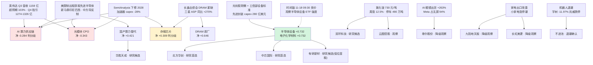

# 2026 年 11 月 18 日（周三） · **消息面事件驱动**

> **数据源新鲜度**: partial · **降级状态**: true · **置信度**: 0.72
> **覆盖窗口**: 11-15 09:15 → 11-18 05:54（72h）· **主源**: 财联社快讯 2660 条 + 公众号 86 篇（含财联社早知道 6 篇 / 盘前纪要）+ 东财中报预告 500 条 + 公告窗口 2791 条
> **市场锚**: 11-17 主跌第 4 日（连跌 4 日 / cycle_day 5）· 涨停 38 跌停 84 · 炸板率 36.67%（stk_limit）/ 35.09%（U-Z）· 主力 -263.04 亿

## 一句话结论

半导体设备与电子化学材料是唯一「消息+涨停+5日资金」三重同向的修复方向（设备 5 日 +39.53 亿）；英伟达 Q3 四指标全超但盘后仅涨 1%，只止血不续命，AI 算力链判分歧；最大负面对冲是美限制远程获取先进半导体与 SemiAnalysis 下修 2028 资本开支 28%。

## 🗺️ 消息面全景图

## 🎯 顶级事件详解（每事件三问 + 个股思维链）

> 排序口径：strength 优先（high > medium > low），同级按 |weighted_score| 降序；负面事件按 |score| 同场排序，未被挤到末尾。

### E20261118_003 · 英伟达Q3营收1158亿美元超预期 数据中心1076亿 Q4指引1274-1326亿高于预期 盘后仅涨1-2% · strength=high · polarity=正面

**事件摘要**: 英伟达Q3营收1158亿美元同比增103% 数据中心1076亿 调整后EPS2.68 毛利率74.9% Q4指引1274-1326亿 连续15季超预期上限 盘后仅涨1-2%

`raw_score=+0.80` → `weighted_score=+0.800`（λ=0.15 · days_since=0 · decayed=false）· **有效窗口**: 1-3日（财报是硬事件 但盘后反应已给出上限）

**来源（4 个独立源）**：
- 财联社快讯 11-18 05:21/05:23/05:25/05:30/05:31(营收/EPS/指引/Vera Rubin)
- 财联社 05:50 美股AI硬件盘后走高(SK海力士/闪迪/Lumentum涨2-3%)
- 财联社 05:24 CoreWeave/Nebius盘后上涨
- 财联社 11-17 21:15 英伟达高管CPO新供应链

**板块映射**：AI算力供应链（正面/high，贡献 +0.800） · 光模块CPO（正面/medium，贡献 +0.560）

**推理深度三问**：

- **大资金意图**: 英伟达这份财报的作用不是“给A股AI硬件链发令枪”，而是“止血”。连续15季超预期上限、Q4指引1274-1326亿高于市场1252.5亿、Vera Rubin环比多贡献近200亿，把“AI资本开支见顶”的叙事按住了；但盘后只涨1-2%，说明大资金对“换帅+出口管制”这两个非基本面变量仍然给了折价。
- **为什么走强**: A股这边的传导是盘后链：SK海力士/闪迪/Lumentum涨2-3%，对应存储与光模块；但A股光模块三巨头5日主力-54.4/-23.8/-15.8亿，股价距高-60%以上，这条链的筹码结构已经坏了，靠一份财报只能做反抽不能做趋势。真正受益的是CPO供应链重构（英伟达高管明说围绕CPO建新供应链、周期5周缩到2周）。
- **逻辑够不够硬**: 中等偏硬。基本面数字100%硬（营收/指引/EPS/毛利率四连超），但定价端已经“超预期不涨”，这本身就是最强的证据：市场不再为AI硬件付溢价。结论——把它当“空头逻辑的证伪”，不当“多头的发令枪”。

> 研判备注：同一主体的反面必须并列：众议院民主党领袖反对黄仁勋回归、董事会尚未考虑回归(11-18 00:51/00:56) → 已列入 secondary_negative_events；财报超预期但盘后仅+1-2%(涨幅收窄至1%)说明超预期已被11-12以来的杀跌部分定价

#### 中际旭创 300308.SZ · 光模块龙头（财报受益但不做趋势）

| 收盘 | 当日 | MA5 | MA20 | 距 60 日高 | 5 日主力净额 | 连板 | 位置 | 研究态度 | RR |
|---|---|---|---|---|---|---|---|---|---|
| 393.00 | -3.9% | 463.81 | 526.97 | -61.1% | -54.4 亿 | — | 距高 -61.1% | **降级观察** | 3.08 |

主力口径：东财 DC `net_amount`（净额=超大单+大单），窗口 11-11→11-17 五交易日，与 R7 同源。

- **买入理由**: 英伟达 Q3 营收 1158 亿超预期 + Q4 指引 1274-1326 亿 → 对光模块是需求端止血; 但盘后英伟达仅涨 1-2% 说明超预期已被定价 5 日主力 -54.4 亿是最强反证
- **风险点**: 393.00 位于 5 日线 463.81 与 20 日线 526.97 下方 距 60 日高 -61.1% 单边下跌 无任何均线支撑
- **止损条件**: 无持仓不参与; 存量以 370.00 为防线 反抽 463.81(5日线) 为减仓区 不在此位置加仓
- **可验证假设**: 11-18 若因财报高开 >5% 但 30 分钟内跌破开盘价且主力净额转负 → 确认“超预期不涨” 直接回避; 若放量收复 5 日线 463.81 → 才谈反抽
- 止损价 **370.00**（参考价 393.00 · 整数关 390 下方 1.3% 设防 → 止损 370.00（距 -5.85%））· 目标区间 463.81~526.97 · 建议仓位 0.02 · 英伟达超预期但盘后仅 +1% · 个股 5 日主力 -54.4 亿 距 60 日高 -61.1% · 主跌第 4 日不接高位崩塌链（段位否决 非 RR 否决）

### E20261118_002 · 光刻胶与半导体设备ETF单日领涨4.79% 电子化学三股涨停 工信部发布设备质量标准 先进封装2026年收入首超传统封装 · strength=high · polarity=正面

**事件摘要**: 半导体设备ETF涨4.79%领涨全市场 光刻胶板块西陇科学盛剑科技涨停 工信部发布设备与零部件质量标准 先进封装资本开支近280亿美元

`raw_score=+0.85` → `weighted_score=+0.732`（λ=0.15 · days_since=1 · decayed=false）· **有效窗口**: 3-5日（资金5日净流入已转正 属修复主线的第一段）

**来源（6 个独立源）**：
- 财联社早知道 11-17 19:00 主题前瞻(光刻胶/先进封装两节)
- news_cls 15:02 半导体设备ETF领涨4.79%
- news_cls 09:36 光刻胶板块直线拉升 西陇科学盛剑科技涨停
- 新华社 15:52 工信部《半导体设备与零部件质量管理体系》行业标准
- Yole 2026 先进封装收入首超传统(资本开支近280亿美元)
- R7 sector 半导体设备5日净流入39.53亿

**板块映射**：半导体设备（正面/high，贡献 +0.732） · 电子化学材料（正面/high，贡献 +0.732） · 先进封装（正面/medium，贡献 +0.512）

**推理深度三问**：

- **大资金意图**: 大资金在11-17做的事很清楚：从“设计/PCB/光模块”这条已经打满的AI硬件链里撤出来，把钱塞进“制造+设备+材料”这三个还没被炒透、且有国产替代政策托底的环节。半导体设备5日净流入+39.53亿是本周唯一持续为正的科技分支，中芯概念单日+41.82亿，这是主动调仓不是被动护盘。
- **为什么走强**: 走强的直接抓手是“可验证的订单/标准/资本开支”：工信部行业标准落地给设备与零部件国产化定了验收口径，Yole口径2026年先进封装收入首超传统封装、资本开支近280亿美元，光刻胶国产验证周期从1-2年缩到6-12个月。三条都不是情绪，是能把2027年业绩往前挪的实质变化。
- **逻辑够不够硬**: 硬。三重同向（官媒/政策 + 涨停潮 + 5日资金净流入）在本轮主跌第4日里极其稀缺；唯一缺陷是位置：设备ETF已单日涨4.79%，北方华创距60日高只差-27.6%，属于“修复第一段已走完一半”，所以只能做龙头回踩/半路，不能追一字板杂毛。

> 研判备注：这是11-17全市场唯一“消息+涨停+资金5日净流入”三重同向的方向：半导体设备5日+39.53亿 集成电路制造+10.26亿 材料+5.53亿 中芯概念+41.82亿；同时科创50+0.62%为本轮首次转正

#### 北方华创 002371.SZ · 半导体设备总龙头

| 收盘 | 当日 | MA5 | MA20 | 距 60 日高 | 5 日主力净额 | 连板 | 位置 | 研究态度 | RR |
|---|---|---|---|---|---|---|---|---|---|
| 568.75 | +4.1% | 554.97 | 531.97 | -27.6% | +19.5 亿 | — | 距高 -27.6% | **研究首选** | 2.32 |

主力口径：东财 DC `net_amount`（净额=超大单+大单），窗口 11-11→11-17 五交易日，与 R7 同源。

- **买入理由**: 国海证券维持买入 前三季归母 53.92 亿 +5.10% Q3 单季 20.22 亿 +5.18% 在手订单充足（无预告但业绩确定） + 设备5日资金转正 是“消息+资金”双确认
- **风险点**: 568.75 站上 5 日线 554.97 与 20 日线 531.97 上方 距 60 日高仅 -27.6% 属修复通道 回踩 5 日线是唯一低吸位
- **止损条件**: 跌破 538.00（5 日线下方 3%）止损; 若单日冲高回落且收盘低于 554.97 则降为观察
- **可验证假设**: 11-18 半导体设备 ETF 若继续放量且北方华创 30 分钟主力净额为正 → 修复第二段成立; 若设备 ETF 高开低走 → 只留半仓
- 止损价 **538.00**（参考价 568.75 · 5 日线 554.97 下方 3% 处设防 → 止损 538.00（距 -5.41%））· 目标区间 640.00~700.00 · 建议仓位 0.10 · 设备板块 5 日唯一持续净流入(+39.53 亿) 个股 5 日 +19.5 亿同向 · RR 2.32 · 距 60 日高 -27.6% 处修复第一段 不追一字板

#### 中芯国际 688981.SH · 国产晶圆代工龙头

| 收盘 | 当日 | MA5 | MA20 | 距 60 日高 | 5 日主力净额 | 连板 | 位置 | 研究态度 | RR |
|---|---|---|---|---|---|---|---|---|---|
| 113.45 | +6.6% | 110.28 | 105.51 | -17.5% | +8.0 亿 | — | 距高 -17.5% | **研究首选** | 2.67 |

主力口径：东财 DC `net_amount`（净额=超大单+大单），窗口 11-11→11-17 五交易日，与 R7 同源。

- **买入理由**: 美商务部 11-16 限制远程获取先进半导体（E004）+ 国产算力份额长期提升（沐曦业绩会）→ 代工需求被政策强制留在境内; 5 日主力 +8 亿与股价 +5.3% 同向
- **风险点**: 113.45 站上 5 日线 110.28 与 20 日线 105.51 距 60 日高 -17.5% 为半导体链中位置最优的大市值标的
- **止损条件**: 跌破 106.50（5 日线下方 3.4%）止损; 若跌破 110.28 且当日主力净额转负 先减半
- **可验证假设**: 11-18 若中芯概念 30 分钟净额继续为正且科创 50 站上 5 日线 → 代工腿确认; 若科创 50 冲高回落 → 视为反抽
- 止损价 **106.50**（参考价 113.45 · 破 5 日线 110.28 再下 3.4% 设防 → 止损 106.50（距 -6.13%））· 目标区间 132.00~140.00 · 建议仓位 0.10 · 美限制远程获取先进半导体 → 国产代工是唯一可交付路径 · 5 日主力 +8.0 亿 单日 +9.1 亿 · 距 60 日高 -17.5% 位置最好 · RR 2.67

#### 有研新材 600206.SH · 半导体材料低位首板

| 收盘 | 当日 | MA5 | MA20 | 距 60 日高 | 5 日主力净额 | 连板 | 位置 | 研究态度 | RR |
|---|---|---|---|---|---|---|---|---|---|
| 39.33 | +10.0% | 38.24 | 37.24 | -35.4% | +9.9 亿 | 1 板 | 距高 -35.4% | **研究候选** | 2.32 |

主力口径：东财 DC `net_amount`（净额=超大单+大单），窗口 11-11→11-17 五交易日，与 R7 同源。

- **买入理由**: 首板封单 25.6 亿是本轮最大单票封单 + 单日主力 +14.9 亿(成交 47.5 亿) + 材料板块 5 日资金转正 → 资金强度已确认 但毛利率 7.6% 说明业绩弹性有限
- **风险点**: 39.33 涨停 站上 5 日线 38.24 / 20 日线 37.24 距 60 日高 -35.4% 处低位第一根涨停 属“低位首板”
- **止损条件**: 跌破 37.10（首板实体下沿下方 3%）止损; 若次日开盘一字且封单 <5 亿 立即降为观察
- **可验证假设**: 11-18 竞价封单 ≥10 亿且 9:30-9:45 不开板 → 承接成立; 若高开 >6% 后 15 分钟内翻绿 → 首板失败 当日不接
- 止损价 **37.10**（参考价 39.33 · 首板实体下沿 38.24（5 日线）再下 3% → 止损 37.10（距 -5.67%））· 目标区间 44.50~48.00 · 建议仓位 0.06 · 首板封单 25.6 亿（成交 47.5 亿 封单/成交 0.54）+ 单日主力 +14.9 亿 + 距 60 日高 -35.4% 低位 → 属“低位前排” 但首板次日承接是唯一变量 · RR 2.32

### E20261118_001 · 长鑫科技业绩会确认DRAM全年供给紧缺 三星Q3存储均价同比+270% 满产 但长鑫5日主力净流出56.5亿 · strength=high · polarity=正面

**事件摘要**: 长鑫称DRAM紧缺延续 四季度毛利率稳定 LPDDR6首发量产 三星Q3存储均价同比涨270% 满产率100% 但长鑫5日主力净流出56.5亿

`raw_score=+0.75` → `weighted_score=+0.646`（λ=0.15 · days_since=1 · decayed=false）· **有效窗口**: 1-2周（供给紧缺为季度级变量）

**来源（7 个独立源）**：
- 长鑫科技业绩说明会快讯8条(财联社 11-17 17:42→20:58)
- 证券时报 20:11 长鑫科技最新发声
- 上海证券报 18:46 长鑫科技最新发声
- 财联社 21:06 三星Q3存储器价格同比
- 270%
- news_cls 17:42 新加坡10月电子出口
- 73.9%

**板块映射**：存储芯片（正面/high，贡献 +0.646） · DRAM原厂（正面/high，贡献 +0.646）

**推理深度三问**：

- **大资金意图**: 存储是本轮AI硬件链里唯一还有现货价格支撑的分支（三星ASP+270%、长鑫满产、四季度毛利率指引稳定），但大资金已经在11月12日之后就把它当“兑现品”处理：长鑫5日主力-56.5亿、兆易-21.2亿、中际旭创-54.4亿。资金意图不是“再买涨价”，而是借业绩会的确定性出货高位筹码。
- **为什么走强**: 事件本身不可能让板块重新走强，因为股价已经先跌了40-60%，跌的是估值不是景气。真正能让它反弹的只有一种情形：11-18凌晨英伟达Q4指引超预期把AI资本开支叙事重新点燃——这条腿今天确实出现了（E003），所以存储是“消息正面+资金反手”的对冲型事件，不是单边多头。
- **逻辑够不够硬**: 半硬。价格与产能是硬事实（隆众/三星DART/长鑫业绩会三源），但定价方向已反转：原厂高毛利不等于股价上涨，模组环节毛利率被上游挤压（江波龙Q3单季环比为负的先例）。结论：只认原厂环节，不认模组；且必须等资金由负转正才谈右侧。

> 研判备注：v1.5 业绩极性协议：长鑫前三季预增725.96%~741.54%属累计同比后视镜 原厂毛利率DDR88.4%/LPDDR82.6%为真加速环节 但股价距60日高-41%且主力5日-56.5亿 → 消息与资金背离 存储模组环节(江波龙类)属增收不增利 不得按同比乐观

#### 长鑫科技 688825.SH · DRAM原厂（消息正面但资金反手）

| 收盘 | 当日 | MA5 | MA20 | 距 60 日高 | 5 日主力净额 | 连板 | 位置 | 研究态度 | RR |
|---|---|---|---|---|---|---|---|---|---|
| 36.19 | -5.6% | 39.51 | 41.19 | -41.0% | -56.5 亿 | — | 距高 -41.0% | **降级观察** | 1.52 |

主力口径：东财 DC `net_amount`（净额=超大单+大单），窗口 11-11→11-17 五交易日，与 R7 同源。

- **买入理由**: 原厂毛利率 88.4% 是全场最高 但股价 5 日 -10.5% 且主力单日 -19.7 亿 → 业绩已被资金当利好在高位兑现 属 v1.5 周期见顶模板
- **风险点**: 36.19 已破 5 日线 39.51 与 20 日线 41.19 双均线 距 60 日高 -41% 处在下跌通道中继 无右侧信号
- **止损条件**: 无持仓者不参与; 存量持仓以 34.00 为最后防线 反抽 39.51(5日线) 为减仓区
- **可验证假设**: 11-18 若存储板块跟随英伟达财报高开但长鑫 15 分钟内翻绿且主力净额转负 → 证伪“紧缺延续”叙事; 若放量站上 39.51 → 原厂腿成立
- 止损价 **34.00**（参考价 36.19 · 破 5 日线 39.51 与 20 日线 41.19 后已无支撑 → 止损 34.00（距 -6.05%））· 目标区间 39.51~41.19 · 建议仓位 0.02 · RR 1.51 <2 + 5 日主力 -56.5 亿（全场最大单票流出）+ 距 60 日高 -41% → 消息正面但筹码已坏 只登记不进池

### E20261118_004 · 美商务部限制远程获取先进半导体 覆盖新马泰印尼巴西 中方称将采取反制 国产替代逻辑再强化 · strength=high · polarity=负面

**事件摘要**: 美商务部11月16日发布临时最终规则 限制向新马泰印尼巴西出口先进芯片并须申请许可 中方强烈反对称将采取反制措施

`raw_score=-0.70` → `weighted_score=-0.602`（λ=0.15 · days_since=1 · decayed=false）· **有效窗口**: 持续（规则已生效 影响季度级转口与算力采购）

**来源（3 个独立源）**：
- news_cls 11-17 20:28 商务部新闻发言人答记者问
- news_cls 15:21 外交部批美国经济胁迫(临时最终规则细节)
- 证券时报 15:47 外交部回应美调查涉英伟达芯片

**负面杀伤面**：`行业级` → AI算力供应链 / 光模块CPO / 海外算力转口 / 服务器代工

**板块映射**：AI算力供应链（负面/high，贡献 -0.602） · 光模块CPO（负面/medium，贡献 -0.421） · 海外算力转口（负面/medium，贡献 -0.421） · 国产算力替代（正面/medium，贡献 +0.421）

**推理深度三问**：

- **大资金意图**: 这是“堵后门”而不是“关门”：美国要掐的是新马泰印尼巴西这条转口路径（之前中国企业靠第三国采购先进芯片），所以短期利空的是海外算力租赁/转口链与依赖境外算力的模型企业；但它的直接后果是把需求往国内赶——11-17华胜天成1分钟拉涨停封单31亿、沐曦业绩会讲“国产算力份额提升是长期趋势”，都是这条腿的市场反应。
- **为什么走强**: 国产算力走强不是因为“情绪爱国”，而是因为采购路径被物理切断后，国产GPU从“备选”变成“唯一可交付”。11-17盘面已经给出证据：华胜天成封单31亿、5日主力+12.7亿，中芯概念单日+41.82亿，半导体制造+18.08亿——钱在往“能自己造”的环节集中。
- **逻辑够不够硬**: 硬在方向，软在节奏。方向硬：商务部/外交部两级官方表态 + 临时最终规则是既成事实；软在节奏：A股国产算力票（华胜天成距高-15%、主营IT集成毛利率8.5%）大多是题材承接而非纯正标的，追高容易被“业绩不匹配”反噬。

> 研判备注：正反两面拆条：对海外算力转口/东南亚代工是负面 对国产算力替代是正面（同一事件的两条腿 不得只留一面）；配合E005 SemiAnalysis下修形成行业级负腿

#### 华胜天成 600410.SH · 华为算力概念首板（国产替代承接腿）

| 收盘 | 当日 | MA5 | MA20 | 距 60 日高 | 5 日主力净额 | 连板 | 位置 | 研究态度 | RR |
|---|---|---|---|---|---|---|---|---|---|
| 15.29 | +10.0% | 13.80 | 12.43 | -15.0% | +12.7 亿 | 1 板 | 距高 -15.0% | **研究候选** | 2.15 |

主力口径：东财 DC `net_amount`（净额=超大单+大单），窗口 11-11→11-17 五交易日，与 R7 同源。

- **买入理由**: 美限制远程获取先进半导体(E004)+华为昇腾云占中国具身智能 80% → 国产算力需求被动扩张; 封单 31 亿 + 5 日主力 +12.7 亿是资金确认 但主营毛利率 8.5% 说明业绩不匹配
- **风险点**: 15.29 站上 5 日线 13.80 / 20 日线 12.43 距 60 日高 -15.0% 属中位首板 位置不占优
- **止损条件**: 跌破 14.40（首板实体下沿上方 4.3%）止损; 若次日开盘封单 <10 亿 或开板即走弱 立即降为观察
- **可验证假设**: 11-18 竞价封单 ≥15 亿且不开板 → 承接成立; 若高开低走跌破 14.40 → 一字板即出货 当日剔除
- 止损价 **14.40**（参考价 15.29 · 首板实体下沿 13.80 上方留 4.3% 缓冲 → 止损 14.40（距 -5.82%））· 目标区间 17.20~18.30 · 建议仓位 0.06 · 封单 31.05 亿（成交 14.0 亿 封单/成交 2.22）+ 单日主力 +7.1 亿 5 日 +12.7 亿 · RR 2.15 · 但主营 IT 集成毛利率 8.5% 属题材承接 一字板次日承接是唯一变量

### E20261118_005 · SemiAnalysis大幅下修AI算力预测 2028年加速器资本开支下调28% HBM与电力需求同步下修 · strength=high · polarity=负面

**事件摘要**: SemiAnalysis下调2028年全球AI加速器资本开支预测28% 同步下修HBM需求与数据中心电力需求 2028-2030调整幅度最大

`raw_score=-0.65` → `weighted_score=-0.482`（λ=0.15 · days_since=2 · decayed=false）· **有效窗口**: 2-4周（模型级判断 需等英伟达Q4实际订单证伪）

**来源（3 个独立源）**：
- news_cls 11-16 19:50 SemiAnalysis模型更新(2028-2030调整幅度最大)
- 11-17 光模块CPO板块低迷(中际旭创跌破400 新易盛天孚跌超4%)
- news_cls 11-16 09:39 CPO板块持续下挫

**负面杀伤面**：`行业级` → 光模块CPO / HBM / 存储芯片 / AI服务器 / PCB

**板块映射**：AI算力供应链（负面/high，贡献 -0.482） · 光模块CPO（负面/high，贡献 -0.482） · 存储芯片（负面/medium，贡献 -0.337）

**推理深度三问**：

- **大资金意图**: 卖方模型下修不是散户情绪，是机构在给2028年的估值锚打折：加速器capex -28%、HBM需求下修、电力需求下修，等于把“AI永续高增长”的斜率砍掉三分之一。大资金的回应很直接——光模块三巨头5日主力合计净流出近94亿，中际旭创跌破400元整数关。
- **为什么走强**: 它之所以在11-16/11-17这两天集中发酵，是因为赶上了英伟达财报前的真空期：多头不敢加，空头拿这个模型当令箭。但它对A股的杀伤是“估值”不是“订单”，所以表现为阴跌而不是崩塌，且一旦英伟达Q4实际指引证伪（已发生：1274-1326亿 > 1252.5亿），这条腿会快速衰减。
- **逻辑够不够硬**: 半硬。SemiAnalysis是有历史准确度的独立机构，28%的下修幅度属于重大修正；但它是“模型预测”不是“已发生订单”，且已被英伟达Q4指引部分证伪。结论：作为“压制反弹高度”的约束条件使用，不作为“做空A股光模块”的独立理由。

> 研判备注：与E003（英伟达超预期）构成正负对冲：同一板块拿到+0.800与-0.482 两条腿 → 矩阵判分歧 不得写成同向叠加；英伟达Q4指引1274-1326亿是对该下修的第一个反证

#### 天孚通信 300394.SZ · CPO 光器件（行业级利空正靶心）

| 收盘 | 当日 | MA5 | MA20 | 距 60 日高 | 5 日主力净额 | 连板 | 位置 | 研究态度 | RR |
|---|---|---|---|---|---|---|---|---|---|
| 104.61 | -5.1% | 124.84 | 151.79 | -64.5% | -15.8 亿 | — | 距高 -64.5% | **降级观察** | 3.16 |

主力口径：东财 DC `net_amount`（净额=超大单+大单），窗口 11-11→11-17 五交易日，与 R7 同源。

- **买入理由**: SemiAnalysis 把 2028 加速器 capex 砍 28% 并同步下修 HBM 需求 天孚 98.7% 收入是光通信元器件 属最直接受害环节
- **风险点**: 104.61 位于 5 日线 124.84 与 20 日线 151.79 下方 距 60 日高 -64.5% 单边下跌 反抽目标即 5 日线
- **止损条件**: 无持仓不参与; 存量以 98.20 为防线 反抽 124.84 为减仓区
- **可验证假设**: 11-18 若英伟达财报带动高开但天孚 30 分钟净额仍为负 → 下修叙事未被证伪 继续回避; 若连续两日主力转正且站上 124.84 → 才谈修复
- 止损价 **98.20**（参考价 104.61 · 100 整数关下方 1.8% 设防 → 止损 98.20（距 -6.13%））· 目标区间 124.84~151.79 · 建议仓位 0.02 · SemiAnalysis 下修直指 HBM/光模块需求 · 5 日主力 -15.8 亿 距 60 日高 -64.5% · 段位=主跌第 4 日 → 反弹空间不作开仓理由

### E20261118_006 · 氯化铵创年内新高 周涨12.5% 联碱停车产能490万吨 全年产量减200万吨 双环科技首板验证 · strength=medium · polarity=正面

**事件摘要**: 氯化铵工业级730元/吨创年内新高 周涨12.5% 联碱停车产能490万吨 全年产量同比减200万吨 双环科技首板

`raw_score=+0.60` → `weighted_score=+0.516`（λ=0.15 · days_since=1 · decayed=false）· **有效窗口**: 1-2周（价格周度数据可连续跟踪）

**来源（4 个独立源）**：
- 财联社早知道 11-17 19:00 主题前瞻(工业级730元/吨 山东河北干铵720元/吨)
- 财联社早知道 08:52 电报解读(周涨超12% 限产停车出口三重托举)
- 隆众资讯(停车产能490万吨/分析师战伟)
- news_cls 11-17 双环科技涨停(化学原料)

**板块映射**：氯化铵（正面/medium，贡献 +0.361） · 纯碱联碱（正面/medium，贡献 +0.361）

**推理深度三问**：

- **大资金意图**: 化工涨价链的钱是最“讲道理”的钱：停车490万吨、全年减产200万吨是可核减的供给缺口，工业级氯化铵730元/吨创年内新高是现货事实，联碱企业毛利率只有4.9%（双环）意味着价格每涨100元/吨对利润的弹性是倍数级。11-17双环科技首板，说明已经有资金按“业绩弹性”而不是“题材”进场。
- **为什么走强**: 走强的机制是“低毛利基数 + 供给硬缺口 + 无库存缓冲”：联碱装置长期亏损降负，短期复产不了，下游复合肥/出口需求还在，价格只能往上找均衡。这类行情不需要大盘配合，是典型的“逆势独立品种”。
- **逻辑够不够硬**: 硬。三重证据（现货价、停车产能、涨停验证）+ 低基数弹性，是本周除半导体外唯一“价格可跟踪”的正面事件。缺陷：容量小（双环流通盘67.5亿、云图128亿级），只能做弹性不做主线。

> 研判备注：价格事实链完整（隆众现货+财联社两栏目+涨停验证）；风险是纯碱期货同期偏弱(11-16 纯碱跌超1%) 若纯碱继续走弱会压制联碱综合毛利

#### 双环科技 000707.SZ · 联碱弹性首板（氯化铵纯度 98.4%）

| 收盘 | 当日 | MA5 | MA20 | 距 60 日高 | 5 日主力净额 | 连板 | 位置 | 研究态度 | RR |
|---|---|---|---|---|---|---|---|---|---|
| 4.59 | +10.1% | 4.26 | 4.24 | -5.2% | +0.3 亿 | 1 板 | 距高 -5.2% | **研究候选** | 2.28 |

主力口径：东财 DC `net_amount`（净额=超大单+大单），窗口 11-11→11-17 五交易日，与 R7 同源。

- **买入理由**: 氯化铵周涨 12.5% 停车产能 490 万吨 全年减产 200 万吨; 双环毛利率 4.9% 低基数是弹性来源 首板封单 0.43 亿说明资金认可但容量小
- **风险点**: 4.59 涨停 站上 5 日线 4.26 / 20 日线 4.24 距 60 日高 -5.2% 接近新高 属“低位基数+价格新高”组合
- **止损条件**: 跌破 4.30（首板实体下沿上方 0.9%）止损; 若氯化铵现货周涨幅回落至 <5% → 逻辑降级
- **可验证假设**: 11-18 若氯化铵现货继续报涨且双环封单 ≥0.5 亿 → 弹性成立; 若纯碱期货同步走弱 且双环开板 → 只做一日游不接力
- 止损价 **4.30**（参考价 4.59 · 首板实体下沿 4.26 上方 0.9% 设防 → 止损 4.30（距 -6.32%））· 目标区间 5.25~5.60 · 建议仓位 0.06 · 联碱收入占比 98.4% 毛利率仅 4.9% → 氯化铵每涨 100 元/吨的利润弹性最大 · 首板封单 0.43 亿 · RR 2.28 · 距 60 日高仅 -5.2% 属接近新高的强势低位基数

#### 云图控股 002539.SZ · 盐-碱-肥一体化（氯化铵 60 万吨）

| 收盘 | 当日 | MA5 | MA20 | 距 60 日高 | 5 日主力净额 | 连板 | 位置 | 研究态度 | RR |
|---|---|---|---|---|---|---|---|---|---|
| 11.53 | -0.1% | 11.55 | 11.26 | -17.3% | +0.2 亿 | — | 距高 -17.3% | **观察** | 2.17 |

主力口径：东财 DC `net_amount`（净额=超大单+大单），窗口 11-11→11-17 五交易日，与 R7 同源。

- **买入理由**: 财联社主题前瞻明示“云图控股已建成盐-碱-肥完整产业链 氯化铵年产能 60 万吨” 但 11-17 主力仅 +0.1 亿 属“消息点到但资金未跟”
- **风险点**: 11.53 贴 5 日线 11.55 下方 20 日线 11.26 上方 距 60 日高 -17.3% 横盘待选择方向
- **止损条件**: 跌破 10.90（20 日线下方 3.2%）止损; 若氯化铵逻辑发酵但云图 3 日不涨 → 移出观察池
- **可验证假设**: 11-18 若双环继续强势且云图放量站上 11.55 → 板块扩散成立; 若双环开板回落 → 云图同步降级
- 止损价 **10.90**（参考价 11.53 · 20 日线 11.26 下方 3.2% 设防 → 止损 10.90（距 -5.46%））· 目标区间 12.90~13.60 · 建议仓位 0.04 · RR 2.17 成立但 11-17 平盘（-0.09%）未获资金确认 主力仅 +0.1 亿 → 等板块二次确认 不抢跑

### E20261118_007 · 全球AI眼镜上半年出货同比+263% Meta占无屏94% 瀛通通讯两连板后自曝相关收入不足1% · strength=medium · polarity=正面

**事件摘要**: 上半年全球AI眼镜出货同比增263% Meta占无屏品类94% 概念股瀛通通讯两连板后公告智能眼镜收入占比不足1%

`raw_score=+0.55` → `weighted_score=+0.473`（λ=0.15 · days_since=1 · decayed=false）· **有效窗口**: 1-2周（CES前新品周期 但缺A股业绩承接）

**来源（7 个独立源）**：
- 财联社早知道 11-17 19:00 主题前瞻(Counterpoint: 上半年出货同比
- 263% 无屏
- 258%)
- 上海证券报 16:16 巨头持续加码AI眼镜概念爆发
- news_cls 11-18 02:04 Meta Muse将登陆AI眼镜
- 华泰证券研报 端侧AI催化密集
- news_cls 18:41 瀛通通讯异动公告(智能眼镜收入占比不足1%)

**板块映射**：AI眼镜（正面/medium，贡献 +0.331） · 消费电子（正面/low，贡献 +0.189）

**推理深度三问**：

- **大资金意图**: AI眼镜的资金意图是“提前埋伏CES新品周期”，但手法是拉杂毛不是买龙头：瀛通通讯两连板（收入占比<1%）、捷荣技术首板，而真正的整机代工歌尔-0.38%、立讯-1.75%。这说明进来的钱是短打情绪资金，不是配置资金。
- **为什么走强**: 数据确实硬（Counterpoint：上半年+263%，Meta无屏占94%，东方证券预测2025-2030年出货993万→8690万副）。但A股的产业位置尴尬：整机是Meta/依视路，模组与芯片在海外，A股可承接的是声学/光学零组件与代工——所以消息越硬，越暴露“标的纯度不足”。
- **逻辑够不够硬**: 不硬。硬的是海外出货数据，软的是A股映射：唯一被资金选中的票自己公告“相关收入不足1%”，这是最直接的证伪。结论：事件保留在top_events（叙事级别够），但个股一律不追，只认歌尔这类有真实代工份额的龙头且必须等资金确认。

> 研判备注：事件强度给medium而非high的原因：出货数据硬 但A股无纯正受益龙头 涨的是瀛通通讯(收入占比<1%)与捷荣技术 → 属“叙事强、业绩弱”；歌尔/立讯仅+/-1% 未获资金确认

#### 歌尔股份 002241.SZ · AI眼镜整机/声学代工龙头

| 收盘 | 当日 | MA5 | MA20 | 距 60 日高 | 5 日主力净额 | 连板 | 位置 | 研究态度 | RR |
|---|---|---|---|---|---|---|---|---|---|
| 23.59 | -0.4% | 24.25 | 23.48 | -10.9% | -5.5 亿 | — | 距高 -10.9% | **降级观察** | 0.95 |

主力口径：东财 DC `net_amount`（净额=超大单+大单），窗口 11-11→11-17 五交易日，与 R7 同源。

- **买入理由**: Counterpoint 上半年 AI 眼镜出货 +263% Meta 无屏占 94% → 歌尔是真实代工承接方 但 5 日主力 -5.5 亿 说明配置资金未进
- **风险点**: 23.59 在 5 日线 24.25 下方 20 日线 23.48 上方 距 60 日高 -10.9% 属横盘偏弱
- **止损条件**: 跌破 22.10（20 日线下方 6.3%）止损; 若跌破 23.48 且主力连续为负 移出观察池
- **可验证假设**: 11-18 若 AI 眼镜板块出现新龙头涨停且歌尔放量站上 24.25 → 龙头确认; 若仍是瀛通/捷荣类杂毛领涨 → 事件作废
- 止损价 **22.10**（参考价 23.59 · 20 日线 23.48 下方 6.3% 设防 → 止损 22.10（距 -6.32%））· 目标区间 25.00~26.50 · 建议仓位 0.02 · RR 0.98 <2 + 5 日主力 -5.5 亿 + 股价在 5 日线 24.25 下方 → 龙头未获资金确认 事件只能做叙事不能做交易

### E20261118_008 · 家电出口继续改善 小家电逆势涨停潮 九阳地天板 小熊与长虹美菱两连板 家电净流入6.5亿 · strength=medium · polarity=正面

**事件摘要**: 国金证券称家电出口继续改善 小家电逆势 九阳地天板涨停 小熊电器与长虹美菱两连板 家用电器净流入6.53亿

`raw_score=+0.55` → `weighted_score=+0.473`（λ=0.15 · days_since=1 · decayed=false）· **有效窗口**: 1-3日（情绪驱动 无业绩硬锚）

**来源（5 个独立源）**：
- 财联社早知道 11-17 19:00 VIP日报(国金证券引海关总署出口数据 看好家电出口继续改善)
- 证券时报 11:15 地天板002242强势拉升
- news_cls 15:00 收评 小家电逆势
- news_cls 09:53 九阳触及跌停→收盘涨停
- R7 家用电器净流入6.53亿

**板块映射**：家用电器（正面/medium，贡献 +0.331） · 小家电出口（正面/medium，贡献 +0.331）

**推理深度三问**：

- **大资金意图**: 家电的钱是“避险+补涨”双目的：主跌第4日里，资金要找不依赖AI叙事、又有出口数据背书的方向。国金证券用海关总署数据说出口继续改善，给了机构一个“基本面没坏”的理由；家用电器净流入6.53亿，是当天除半导体外唯一为正的大板块。
- **为什么走强**: 走强的载体是低位小票而不是龙头：九阳地天板（早盘跌停→收盘涨停，开板2次）、小熊2板、长虹美菱2板、北鼎异动。这是典型的“主线空窗期的低位补涨”，不是产业趋势。出口数据只是借口，真正的驱动是“跌够了+有故事”。
- **逻辑够不够硬**: 不硬。出口改善是研报口径（国金引海关数据），不是公司公告的订单；家电龙头美的/格力/海尔当天并没有涨，涨的是小家电情绪票。结论：作为“退潮期抗跌方向”记录，个股只能做低位首板，不能接力地天板。

> 研判备注：家电是11-17唯一“板块级逆势+资金净流入”的消费方向 但驱动是出口数据研报+低位补涨情绪 非业绩超预期；九阳为地天板(早盘触及跌停 收盘涨停 开板2次)属高位情绪票

#### 九阳股份 002242.SZ · 小家电地天板（情绪票 非低位）

| 收盘 | 当日 | MA5 | MA20 | 距 60 日高 | 5 日主力净额 | 连板 | 位置 | 研究态度 | RR |
|---|---|---|---|---|---|---|---|---|---|
| 31.52 | +10.0% | 28.03 | 24.41 | +0.0% | -6.6 亿 | 1 板 | 距高 +0.0% | **降级观察** | 1.81 |

主力口径：东财 DC `net_amount`（净额=超大单+大单），窗口 11-11→11-17 五交易日，与 R7 同源。

- **买入理由**: 国金证券引海关总署数据称家电出口继续改善 → 给了低位补涨的理由 但九阳 5 日主力 -6.6 亿说明拉抬靠情绪资金不是配置资金
- **风险点**: 31.52 创 60 日新高 距 60 日高 0.0% 5 日线 28.03 与 20 日线 24.41 多头排列 但地天板形态本身是分歧极值
- **止损条件**: 跌破 29.60（5 日线上方 5.6%）止损; 若次日高开 >5% 后跌破 31.52 立即离场
- **可验证假设**: 11-18 若高开缩量且 30 分钟不破 31.52 → 情绪延续; 若低开或冲高回落破 29.60 → 地天板次日必杀 直接剔除
- 止损价 **29.60**（参考价 31.52 · 5 日线 28.03 上方 5.6% 设防 → 止损 29.60（距 -6.09%））· 目标区间 35.00~37.50 · 建议仓位 0.02 · 地天板（早盘触及跌停 收盘涨停 开板 2 次）+ 5 日 +19.6% 创 60 日新高 + 5 日主力 -6.6 亿 → 情绪票 高位 次日爆量反手风险 · RR 1.81 <2

#### 长虹美菱 000521.SZ · 冰洗/空调 两连板

| 收盘 | 当日 | MA5 | MA20 | 距 60 日高 | 5 日主力净额 | 连板 | 位置 | 研究态度 | RR |
|---|---|---|---|---|---|---|---|---|---|
| 4.74 | +10.0% | 4.19 | 4.08 | -4.8% | +1.2 亿 | 2 板 | 距高 -4.8% | **降级观察** | 1.37 |

主力口径：东财 DC `net_amount`（净额=超大单+大单），窗口 11-11→11-17 五交易日，与 R7 同源。

- **买入理由**: 两连板且 5 日主力 +1.2 亿（与涨幅同向）说明有接力资金 但毛利率 7.9% 无业绩弹性 纯情绪
- **风险点**: 4.74 站上 5 日线 4.19 / 20 日线 4.08 距 60 日高 -4.8% 二板位置偏高
- **止损条件**: 跌破 4.44（5 日线上方 5.9%）止损; 二板次日若不能封板 直接走
- **可验证假设**: 11-18 若家电板块出现第三个涨停且长虹美菱封单 ≥0.5 亿 → 板块延续; 若昨日涨停股红盘率 <60% → 全板块降级
- 止损价 **4.44**（参考价 4.74 · 5 日线 4.19 上方 5.9% 设防 → 止损 4.44（距 -6.33%））· 目标区间 5.15~5.50 · 建议仓位 0.02 · 2 板中位接力 + 距 60 日高 -4.8% 不属低位 + RR 1.37 <2 → 退潮期不接二板

## 📊 板块 × 事件热力矩阵

公式：`contrib = abs(weighted_score) × sign(板块极性) × strength权重(high1.0/medium0.7/low0.4)`，同板块多事件累加；>+0.12 正面 / <−0.12 负面 / 其余分歧。

| 板块 | 净分 | 极性 | 事件腿数 | 交叉构成 | 结论 |
|---|---|---|---|---|---|
| 半导体设备 | **+0.732** | 正面 | 1 | E20261118_002 正面×1.00=+0.732 | 唯一单腿正面且无对冲 · 5 日资金 +39.53 亿是本周最硬证据 · 政策标准落地给国产化验收口径 |
| 电子化学材料 | **+0.732** | 正面 | 1 | E20261118_002 正面×1.00=+0.732 | 单腿正面 · 11-17 三股涨停(江化微/格林达/西陇科学)形成板块级涨停潮 · 光刻胶验证周期缩短至 6-12 个月 |
| DRAM原厂 | **+0.646** | 正面 | 1 | E20261118_001 正面×1.00=+0.646 | 单腿正面 · 长鑫毛利率 88.4% 满产 · 但个股主力 -56.5 亿 → 消息与筹码背离 只认原厂不认模组 |
| 先进封装 | **+0.512** | 正面 | 1 | E20261118_002 正面×0.70=+0.512 | 单腿正面但强度 medium(+0.512) · Yole 口径 2026 年收入首超传统封装 · 缺当日涨停验证 属中期逻辑 |
| 海外算力转口 | **-0.421** | 负面 | 1 | E20261118_004 负面×0.70=-0.421 | 单腿负面 · 新马泰印尼巴西转口路径被封 · 影响海外算力租赁与第三国采购 |
| 国产算力替代 | **+0.421** | 正面 | 1 | E20261118_004 正面×0.70=+0.421 | 单腿正面 · 同一政策事件的反面腿 · 采购路径被切断后国产 GPU 由备选变唯一可交付 |
| 氯化铵 | **+0.361** | 正面 | 1 | E20261118_006 正面×0.70=+0.361 | 单腿正面 · 工业级 730 元/吨创年内新高 周涨 12.5% · 停车 490 万吨 · 双环首板验证 |
| 纯碱联碱 | **+0.361** | 正面 | 1 | E20261118_006 正面×0.70=+0.361 | 单腿正面 · 联碱毛利率 4.9% 低基数弹性最大 · 风险是纯碱期货同期偏弱 |
| 光模块CPO | **-0.343** | 分歧 | 3 | E20261118_003 正面×0.70=+0.560 + E20261118_004 负面×0.70=-0.421 + E20261118_005 负面×1.00=-0.482 | 三腿对冲(+0.560 英伟达超预期 vs -0.482 下修 -0.421 美限制) · 净 -0.343 → 负面占优 且三巨头 5 日主力合计 -94.0 亿 |
| AI眼镜 | **+0.331** | 正面 | 1 | E20261118_007 正面×0.70=+0.331 | 单腿正面 · 出货 +263% 数据硬 · 但涨的是瀛通(收入不足1%)/捷荣 龙头歌尔未获资金确认 |
| 家用电器 | **+0.331** | 正面 | 1 | E20261118_008 正面×0.70=+0.331 | 单腿正面 · 11-17 净流入 6.53 亿为消费唯一样本 · 但驱动是出口研报 + 低位补涨情绪 非业绩 |
| 小家电出口 | **+0.331** | 正面 | 1 | E20261118_008 正面×0.70=+0.331 | 单腿正面 · 九阳地天板/小熊/长虹美菱两连板 · 情绪强度高但业绩弹性低(长虹毛利率 7.9%) |
| 存储芯片 | **+0.309** | 分歧 | 2 | E20261118_001 正面×1.00=+0.646 + E20261118_005 负面×0.70=-0.337 | 两腿对冲(+0.646 紧缺延续 vs -0.337 资本开支下修) · 净值为正但股价距高 -40~-60% → 判分歧 不作可交易带 |
| AI算力供应链 | **-0.284** | 分歧 | 3 | E20261118_003 正面×1.00=+0.800 + E20261118_004 负面×1.00=-0.602 + E20261118_005 负面×1.00=-0.482 | 三腿对冲(英伟达 +0.800 超预期 vs 美限制 -0.602 vs 下修 -0.482) · 净 -0.284 → 制度性利空压过基本面利好 判分歧偏空 |
| 消费电子 | **+0.189** | 正面 | 1 | E20261118_007 正面×0.40=+0.189 | 单腿正面 low · 仅作为 AI 眼镜叙事的溢出环节 |

### 多事件叉乘结论（sector_cross_summary）

- **光模块CPO**（3 腿，净 -0.343 → 分歧）：E20261118_003 正面×0.70=+0.560 + E20261118_004 负面×0.70=-0.421 + E20261118_005 负面×1.00=-0.482。三腿对冲(+0.560 英伟达超预期 vs -0.482 下修 -0.421 美限制) · 净 -0.343 → 负面占优 且三巨头 5 日主力合计 -94.0 亿
- **存储芯片**（2 腿，净 +0.309 → 分歧）：E20261118_001 正面×1.00=+0.646 + E20261118_005 负面×0.70=-0.337。两腿对冲(+0.646 紧缺延续 vs -0.337 资本开支下修) · 净值为正但股价距高 -40~-60% → 判分歧 不作可交易带
- **AI算力供应链**（3 腿，净 -0.284 → 分歧）：E20261118_003 正面×1.00=+0.800 + E20261118_004 负面×1.00=-0.602 + E20261118_005 负面×1.00=-0.482。三腿对冲(英伟达 +0.800 超预期 vs 美限制 -0.602 vs 下修 -0.482) · 净 -0.284 → 制度性利空压过基本面利好 判分歧偏空

> 叉乘纪律：正负对冲的板块（存储芯片 / AI 算力供应链 / 光模块 CPO）一律判「分歧」，不得因为净值为正或负就写成「同向叠加」；分歧带不构成可交易带，只能作为「仓位上限被压制」的理由。

## 🔥 业绩预告命中（三季报 · 单季环比倒推）

| 代码 | 名称 | 预告口径 | 增速 | 单季环比（倒推） | 事件命中 | 逻辑强度 |
|---|---|---|---|---|---|---|
| 688825.SH | 长鑫科技 | 归母扭亏 | +2581.06%~+2609.47%（131~132.5 亿） | Q3 单季 53.40~54.90 亿 vs Q2 52.84 亿 → **+1.0%~+3.9%** | E001 DRAM 紧缺 | 🟡 环比增速由 +213% 骤降至 +1~4%，二阶导转负 |
| 301308.SZ | 江波龙 | 扣非预增 | +2782.36%~+2991.23%（138~148 亿） | Q3 单季 34.23~43.23 亿 vs Q2 67.15 亿 → **-36.2%~-49.0%** | E001 模组环节 | 🔴 增收不增利，已剔除 |
| 001309.SZ | 德明利 | 扣非扭亏 | +17127.99%~+17722.26%（85.96~88.96 亿） | 未拆（缺 H1 基数） | E001 模组环节 | 🟡 与江波龙同类，环比未验证不采信 |
| 002371.SZ | 北方华创 | 无预告（研报口径） | 前三季 53.92 亿 +5.10%，Q3 单季 20.22 亿 +5.18% | Q3 20.22 亿 vs Q2 17.35 亿 → **+16.6%** | E002 设备 | 🟢🟢 环比加速，支撑研究首选 |
| 300821.SZ | 东岳硅材 | 归母预增 | +19047.97%~+19748.08%（5.47~5.67 亿） | 未拆 | 与今日 8 条事件无交集 | ⚪ 仅记录 |
| 000703.SZ | 恒逸石化 | 归母预增 | +3318.59%~+3405.13%（79~81 亿） | 未拆 | 无交集（化工景气但非氯化铵链） | ⚪ 仅记录 |
| 002466.SZ | 天齐锂业 | 归母预增 | +2734.97%~+3235.26%（51~60 亿） | 未拆 | 无交集 | ⚪ 仅记录 |

**v1.5 业绩极性协议落地**：长鑫归母同比 +2581% 是「周期顶部最炸裂的同比数字」，真正的定价变量是 Q3 单季环比只 +1.0~3.9%（Q2 环比是 +213%）；江波龙 Q3 环比 -36~-49% 属「上游原厂吃涨价、中游模组被成本挤压」的环节错配。两者都证明：存储的业绩是后视镜，股价（长鑫 5 日主力 -56.5 亿）才是当下的定价。

## 🎯 首板候选池（消息侧明确刺激 · 竞价强弱留给 D1）

| 代码 | 名称 | 板块 | 来源 | 独立源 | 封单(亿) | 距 60 日高 | 5 日主力 | 质量 | 可交易 | 风险标记 |
|---|---|---|---|---|---|---|---|---|---|---|
| 301209.SZ | 联合化学 | 电子化学材料/光刻胶链 | direct_name_match | 3 | 0.52 | -20.7% | +1.8 亿 | high | ✅ | 20cm 首板 + 5 日已涨 30.4% 位置偏高；封单仅 0.52 亿 承接强度中等 |
| 603078.SH | 江化微 | 电子化学材料/湿电子化学品 | direct_name_match | 2 | 0.87 | -37.5% | +0.9 亿 | high | ✅ | 首板次日承接是唯一变量；板块 5 日主力仅 +0.9 亿 单票资金量偏小 |
| 002584.SZ | 西陇科学 | 电子化学材料/光刻胶配套 | direct_name_match | 2 | 0.81 | -24.7% | +1.3 亿 | high | ✅ | 首板开盘 9:35 封板 换手 8.1% 需防低开；化学试剂主业弹性小于纯电子化学品 |
| 603931.SH | 格林达 | 电子化学材料/显影液 | direct_name_match | 1 | 0.33 | -30.3% | +0.4 亿 | medium | ✅ | 单源确认 只作名称池线索；封单 0.33 亿偏弱 开板风险 |
| 603324.SH | 盛剑科技 | 半导体设备/尾气处理 | direct_name_match | 1 | 0.58 | -31.9% | +0.1 亿 | medium | ❌ | 成交额仅 0.5 亿 容量太小 不适合大资金；5 日主力仅 +0.1 亿 资金确认不足 |
| 603297.SH | 永新光学 | 光刻机光学元件 | direct_name_match | 2 | 0.20 | -6.0% | +0.1 亿 | high | ❌ | 距 60 日高仅 -6.0% 位置高 不是低位；封单 0.20 亿极弱 易开板 |
| 002855.SZ | 捷荣技术 | 消费电子/AI眼镜链 | direct_name_match | 1 | 0.29 | -42.6% | +0.2 亿 | medium | ❌ | AI眼镜业务未披露收入占比 无法验证；距 60 日高 -42.6% 属超跌反弹 非趋势 |
| 002861.SZ | 瀛通通讯 | AI眼镜纯概念 | direct_name_match | 2 | — | -12.8% | +1.7 亿 | medium | ❌ | 公司公告明确：智能眼镜业务收入占营收比例不足1%；两连板 + 2 日涨幅偏离 20% 已达异动标准；主营业务为电声器件 与 AI 眼镜叙事不匹配 |
| 600958.SH | 东方证券 | 券商/并购重组 | lead_stock_proxy | 4 | — | -13.2% | -0.7 亿 | medium | ❌ | 板块 11-17 无一只涨停 券商并购过会未引发涨停潮；5 日主力 -0.7 亿 与“护盘”叙事背离 |

> 口径：`direct_name_match` = 消息正文直接点名（名称≥4 字，多源=high / 单源=medium）；`lead_stock_proxy` = 板块 lead_stock 代理，仅作名称线索。本层不做位置与竞价判断，`tradable_today=false` 的票只登记不推荐。

## 🔍 研究观察池（按优先级）

| 优先级 | 代码 | 名称 | 关联事件 | 为什么是它 |
|---|---|---|---|---|
| P1 | 002371.SZ | 北方华创 | E20261118_002 | 设备总龙头 · 板块 5 日唯一净流入(+39.53 亿) · 个股 5 日 +19.5 亿 · 距 60 日高 -27.6% 修复第一段 |
| P1 | 688981.SH | 中芯国际 | E20261118_002 / E20261118_004 | 国产代工唯一规模化平台 · 美限制转口后需求被强制留境内 · 5 日 +8 亿 · 距 60 日高 -17.5% 位置最优 |
| P2 | 600206.SH | 有研新材 | E20261118_002 | 首板封单 25.6 亿(全场最大) + 单日主力 +14.9 亿 · 距 60 日高 -35.4% 低位前排 |
| P2 | 600410.SH | 华胜天成 | E20261118_004 | 华为算力首板 封单 31 亿 + 5 日主力 +12.7 亿 · 但主营 IT 集成毛利率仅 8.5% 属题材承接 |
| P2 | 000707.SZ | 双环科技 | E20261118_006 | 联碱 98.4% 毛利率 4.9% 低基数弹性 · 氯化铵周涨 12.5% 现货可跟踪 · 首板封单 0.43 亿 |
| P3 | 002539.SZ | 云图控股 | E20261118_006 | 盐-碱-肥完整链 + 氯化铵 60 万吨 · 11-17 平盘未获资金确认 → 等二次确认 |
| P3 | 688347.SH | 华虹宏力 | E20261118_004 | 晶圆代工 95.7% · 11-17 +10.39% 单日主力 +6.3 亿 · RR 1.61 <2 → 只观察 |
| P4 | 002241.SZ | 歌尔股份 | E20261118_007 | AI眼镜整机代工龙头 · 出货 +263% 硬数据 · 但 5 日主力 -5.5 亿 RR 0.98 → 等资金确认 |
| P3 | 603078.SH | 江化微 | E20261118_002 | 湿电子化学品首板 封单 0.87 亿 · 距 60 日高 -37.5% 低位 · 已列入首板候选池 |

**剔除清单（命中禁止清单或段位不符）**

| 代码 | 名称 | 关联事件 | 剔除理由 |
|---|---|---|---|
| 002861.SZ | 瀛通通讯 | E20261118_007 | 公告自曝智能眼镜收入占比不足1% · 两连板纯情绪 · 杂毛命中禁止清单 |
| 603986.SH | 兆易创新 | E20261118_001 | 存储设计票 5 日主力 -21.2 亿 距 60 日高 -52.9% 破位下杀 · 与长鑫同属“业绩兑现品” 不接 |
| 301308.SZ | 江波龙 | E20261118_001 | 模组环节“增收不增利” 上游涨价挤压毛利 · 距 60 日高 -52.7% · v1.5 环节错配模板 |
| 003017.SZ | 大洋生物 | E20261118_006 | 氯化铵逻辑但 11-17 -6.51% 反包失败 · 流通盘 17.3 亿 容量过小 · 资金未确认 |
| 002855.SZ | 捷荣技术 | E20261118_007 | AI眼镜业务未披露收入占比 无法验证 · 距 60 日高 -42.6% 超跌反弹非趋势 |

**次级事件（不进 top_events 但 D1 需知道）**

- **工信部同意北京等8省市开展6G创新发展部省协同试点**（2026-11-17 · 正面/medium）：官方政策但11-17无一只6G涨停 中兴通讯 +0.51%（5日主力-4.4亿）烽火 -0.30% 信科移动 -2.49% → 无资金确认 只作政策线索 不进 top_events
- **东吴证券收购东海证券83.68%股权获上交所并购重组委通过 第三批SFISF多家券商完成首批买入**（2026-11-17 · 正面/medium）：券商板块11-17无涨停（国泰海通+0.99% 华泰+1.00% 东吴+0.14%）净流入未验证 → 属“护盘/情绪修复”线索 由R7/D1消费 不作消息面首推
- **上海万卡级智算中心试运行 服务对象直指大模型企业**（2026-11-17 · 正面/medium）：已并入E004的国产算力替代腿 不单列
- **大族数控/欧菲光/鼎龙股份密集披露先进封装与玻璃基板进展**（2026-11-17 · 正面/low）：个股级互动披露 属E002先进封装腿的补充证据 不单列

**次级负面事件（红线 3：负面必须列出）**

- **人形机器人板块大跌 宇树科技-11.97% 兆威机电跌停 绿的谐波-4.24%**（2026-11-17 · 负面/high）：物理AI 是 11-17 跌停潮核心 5 日主力宇树-15.7亿 兆威-5.5亿; 小鹏IRON 明年Q1进门店的正面消息完全无法对冲 → 退潮确认
- **影视院线/文化传媒跌停潮 影视ETF单日-8.17% 传媒净流出55.31亿**（2026-11-17 · 负面/high）：AI漫剧高位退潮 与文投控股类情绪票同步杀跌 → 退潮期“旧题材”出清
- **英伟达董事会截至11-17尚未考虑黄仁勋回归 众议院民主党领袖称不应允许**（2026-11-18 · 负面/medium）：与E003财报超预期构成同一主体的反面腿（v1.4 正反拆条）· 压制英伟达盘后涨幅至1% 是AI硬件链的估值折价来源
- **CPO板块延续低迷 中际旭创盘中跌破400元 新易盛天孚跌超4%**（2026-11-17 · 负面/medium）：已计入E005的bearish_impact_sectors 与E003正面腿对冲

## 关键证据

- 英伟达 Q3 营收 **1158 亿美元**（同比 +103.1%，预期 1093.3 亿）、数据中心 **1076 亿**（预期 1018.7 亿）、调整后 EPS 2.68、毛利率 74.9%、Q4 指引 **1274-1326 亿**（预期 1252.5 亿）· 来源 财联社快讯 2026-11-18 05:21-05:31
- 英伟达盘后涨幅收窄至 **1%**，美股 AI 硬件盘后仅走高 2-3%（SK 海力士 / 闪迪 / Lumentum）· 来源 财联社 2026-11-18 05:50/05:54
- 三星 2026Q3 存储器平均售价同比 **+270%**，DS 部门产能利用率 **100%** · 来源 财联社 2026-11-17 21:06（三星 DART 三季度报告书）
- 氯化铵工业级 **730 元/吨**创年内新高，山东河北干铵 720 元/吨周涨 **12.5%**；联碱停车产能 **490 万吨/年**，全年产量同比减约 200 万吨 · 来源 财联社早知道 2026-11-17 19:00（隆众资讯）+ 08:52 电报解读
- 半导体设备 ETF 领涨 **4.79%**（159327），科创半导体设备 ETF 午间 +7.03%；光刻胶板块 09:36 直线拉升 西陇科学/盛剑科技涨停 · 来源 news_cls 2026-11-17 15:02/11:31/09:36
- 半导体设备 5 日主力 **+39.53 亿**（唯一持续净流入科技分支）、集成电路制造 +10.26 亿、半导体材料 +5.53 亿、中芯概念单日 +41.82 亿 · 来源 R7_capital_flow（东财 DC 同源）
- 有研新材首板封单 **25.6 亿**（成交 47.5 亿）、单日主力 **+14.9 亿**；华胜天成封单 **31.05 亿**、5 日主力 +12.7 亿 · 来源 limit_list_d + dc_moneyflow 2026-11-17
- 美商务部 11-16 发布限制远程获取先进半导体临时最终规则（新马泰印尼巴西须申请许可），商务部 11-17 20:28 称「强烈不满、坚决反对，将采取反制措施」· 来源 news_cls 2026-11-17 20:28 + 外交部 15:21
- SemiAnalysis 下调 2028 年全球 AI 加速器资本开支预测 **28%**，同步下修 HBM 需求与数据中心电力需求 · 来源 news_cls 2026-11-16 19:50
- 工信部同意北京/河北/上海/江苏/浙江/安徽/湖北/广东 8 省市开展 **6G 创新发展部省协同试点**；同日批准《半导体设备与零部件质量管理体系》行业标准 · 来源 news_cls 2026-11-17 15:15 / 新华社 15:52
- 瀛通通讯公告：智能眼镜领域仅少量代工、**相关收入占营收比例不足 1%**、未形成量产 · 来源 news_cls 2026-11-17 18:41（这是 AI 眼镜事件“叙事强业绩假”的自我证伪）
- Counterpoint：2026 上半年全球 AI 眼镜出货同比 **+263%**，Meta 占无屏品类 **94%**（同比 +260%、环比 +22%）· 来源 财联社早知道 2026-11-17 19:00
- 国金证券引海关总署数据称家电出口继续改善；11-17 家用电器净流入 **6.53 亿**，九阳地天板、小熊/长虹美菱两连板 · 来源 财联社早知道 VIP日报 + 证券时报 11:15 + R7 sector
- 11-17 全市场：涨停 38 / 跌停 84 / 炸板 22 / 最高板 3 / 广度 23.79% / 中位 -1.31% / 主力 -263.04 亿 / 成交 14675.2 亿（缩量 266.4 亿）· 来源 R7_capital_flow 04:54 落盘

## 数据源审计

| 源 | 日期 | 状态 | 备注 |
|---|---|:--:|---|
| news_cls | 2026-11-18 | 🟢 | 财联社+新浪快讯 2660 条 2026-11-15 09:15 → 2026-11-18 05:54（含英伟达财报全序列） |
| news_major | 2026-11-18 | 🟡 | 800 条仅标题 正文全空 → 只作事件线索 不作证据 |
| eastmoney_earnings_predict | 2026-11-18 | 🟢 | 2026-09-30 报告期 500 条 · 长鑫+725.96~741.54% 江波龙+2782~2991% 德明利扭亏已用于 v1.5 极性判定 |
| wechat_official_rss | 2026-11-18 | 🟢 | 18 号池 13 个有产出 86 篇（含财联社早知道 6 篇 盘前纪要 1 篇 上海证券报 38 证券时报 29） |
| wechat_cli_5groups | 2026-11-18 | 🔴 | 7 群窗口 11-17 06:01 起 全部 0 条 → 群聊源缺失 本报告无群聊单源证据 |
| anns_window | 2026-11-18 | 🟢 | 覆盖 11-17 19:00 → 11-18 06:00 共 1140 家公司 2791 条（业绩 81 增减持 44 风险提示 46） |
| hithink_business | 2026-11-18 | 🟢 | 13/13 成功（北方华创/中芯/有研/双环/云图/长鑫/华虹/歌尔/中际旭创/天孚/九阳/长虹美菱/华胜天成） |
| hithink_market | 2026-11-18 | ⚪ | 未使用：历史字段缺涨跌幅且存在语义漂移 改用 tushare daily + dc moneyflow 取价与资金 |
| tushare_daily | 2026-11-18 | 🟢 | 37 只票 2026-06-01→11-17 日线 计算 MA5/MA20/距60日高/5日涨跌 |
| dc_moneyflow | 2026-11-18 | 🟢 | 11-11→11-17 五交易日全市场东财 DC 主力净额（净额=超大单+大单 与 R7 同源） |
| stk_limit_limit_list_d | 2026-11-18 | 🟢 | 涨停 37 炸板 20 跌停 67（U/Z/D 口径）· R7 用 stk_limit 复核补录 17 只封死跌停 → 跌停 84 |
| dc_index_sector | 2026-11-18 | 🟢 | 40 个东财行业板块当日/5日/20日主力净额与涨幅 |
| expectation_gap | 2026-11-18 | 🔴 | status=no_input（文章 4 篇 / 股票名录 0 只）→ 个股级预期差对账本日不可用 |
| overseas_snapshot | 2026-11-18 | 🟡 | indices/us_stocks/fx 三类 degraded commodities skipped → 美股盘后用 news_cls 快讯替代 |
| R7_capital_flow | 2026-11-18 | 🟢 | 04:54 落盘 · emotion=主跌第4日 · 炸板率 36.67% · 0 可执行 / 3 研究卡 |
| weflow | 2026-11-18 | 🔴 | ngrok 404 → 情绪共振与 KOL 交叉验证维度缺失 |
| xtick | 2026-11-18 | 🔴 | 本会话未接入 → 盘口/竞价维度由 R7 与 D1 承担 |

**缺口诚实标注**：群聊 7 群窗口内 0 条（wechat_cli 源 error）→ 无群聊单源证据；`expectation_gap.json` status=no_input（文章 4 篇、股票名录 0 只）→ 个股级预期差对账不可用；news_major 800 条仅标题；weflow/xtick 未接入 → KOL 与盘口维度由 R7/D1 承担。以上缺口不静默降级，已同步写入 JSON `sources_status` 与 `data_sources_audit`。

## 不确定性 / 反证

1. **英伟达“超预期不涨”可能是最强的负面信号**：四指标全超但盘后仅 +1%，说明市场已把它当“兑现”而非“加速”。若 11-18 A 股光模块高开 5% 后 30 分钟内跌破开盘价，本条正面腿当日作废——我在 E003 个股卡里把这条写成了可验证假设。
2. **美限制与国产替代是同一条新闻的两面**：对海外算力转口是负面，对国产算力是正面。如果我把 11-17 华胜天成封单 31 亿读成“国产替代确认”，那它同时意味着“题材承接而非业绩”（主营 IT 集成毛利率 8.5%），追高容易被打回。
3. **存储是本报告最容易被误读的一条**：长鑫归母 +2581%、三星 ASP +270% 全是硬事实，但 Q3 单季环比只有 +1~4%（Q2 是 +213%），江波龙环比 -36~-49%。把它当“涨价主线”来做，就是 11 月江波龙那次 -25% 的重演。
4. **家电与 AI 眼镜都是“叙事强、业绩弱”**：九阳是地天板（早盘跌停收盘涨停），瀛通通讯自己公告收入不足 1%。这两条我放在 top_events 是因为叙事硬度够，但个股全部降级，不构成交易资格。
5. **炸板率双口径分歧**：stk_limit 权威口径 36.67%（22/60）与 cycle_position 的 U/Z 口径 35.09%（20/57）。两者都越过 35% 硬红线，因此“候选砍半”的结论不依赖口径选择；但 D1 若只引用其一，必须写明口径。
6. **KOL 维度完全空缺**：群聊 0 条 + R3 未产出，我无法验证“游资是否认同半导体设备这条修复”。这是本报告最大的盲区——R7 的资金数据是“已发生”，KOL 是“意图”，缺一半。
7. **正面腿可能被隔夜外盘二次定价**：英伟达财报后 SK 海力士/闪迪/Lumentum 仅涨 2-3%，若 11-18 美股正式交易时段回吐，A 股半导体设备的“修复第一段”会直接断在半路。

## 与 R2 / R5 / R6 / D1 的关系

- **依赖**：`data/raw/20261118/*`（news_cls / wechat_official_rss / anns_window / eastmoney_earnings_predict）+ `R7_capital_flow.json`（04:54 落盘 · 情绪与板块资金）+ `cycle_position.json` / `emotion_cycle.json`（主跌第 4 日 / repair_window）
- **被消费**：R2（主线候选：半导体设备+材料是本报告唯一三重同向方向）· R5（个股画像优先覆盖 12 只卡 + 首板池）· R6（两条行业级负腿 + 一条正负对冲带是反证重点）· D1（研究优先级 ≠ 开仓资格，需过 7 项资格 + 14 项禁止清单）
- **不授予开仓**：本报告 `discipline_gate.execution_eligible=false`。研究首选 2 只（北方华创 RR 2.32 / 中芯国际 RR 2.67）也必须在竞价阶段用「半导体设备 ETF 强度 + 科创 50 站上 5 日线」二次确认。

## Sub-Agent 元数据

- skill: analyze_news_impact_v1@1.8
- artifact: `data/research/20261118/R4_news.json`
- method: llm_v1（八条硬事件 · 五源硬约束 · 极性叉乘 abs() 口径）
- prompt_version: r4_news_v1.8_20261118
- 事件密度: 0.0013（8 事件 / 6337 条原始项，normal）
- 生成时刻: 2026-11-18T06:45:00+08:00
- 研究态度分布: 研究首选 2 / 研究候选 3 / 观察 1 / 降级观察 6 / 剔除 5（剔除清单另计）

