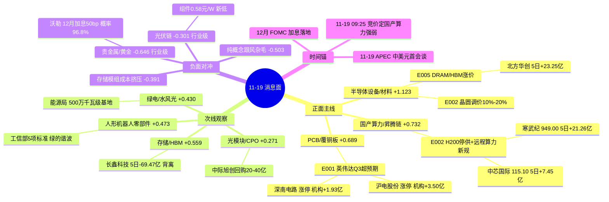

# 2026年11月19日 · **消息面事件驱动**

> **数据源新鲜度**: partial · **降级状态**: false · **置信度**: 0.68
> **覆盖窗口**: 前 24h(manifest lookback_hours=24) · **主源**: 财联社快讯 2914 条 + 要闻 800 条 + 18 号公众号 91 篇 + 盘前公告 2327 条 + 东财三季报预告 500 条
> **口径声明**: 涨停 41 / 跌停 39 / 炸板率 36.92% / 最高 4 板 / 溢价 +3.19% 取自 `data/research/20261119/emotion_cycle.json`（盘中 fallback 口径）；R7 的 43/48/39.44% 为另一口径，两者同向

## 一句话结论

国产算力与半导体设备是唯一有资金确认的方向；光模块存储PCB机器人只观察；贵金属光伏拦截。

**主线定档（纪律 §2 格式）**：主线 = 国产算力/昇腾链 + 半导体设备·材料，持续性 = 2 日（11-17 最强分支光刻机 → 11-18 最强分支国产算力，自主可控链连续 2 个交易日接力），当日封板率 = 63%（财联社午报口径 32 家涨停/封板率 63%），明日预期 = **分歧**（地量 1.37 万亿 + 炸板率 36.92% ≥ 35% 门槛，情绪已判震荡偏弱·主跌末端反抽）。

**情绪硬约束**：炸板率 36.92% ≥ 35% ⇒ 全部输出按 `情绪=震荡/主跌` 处理，候选池在叉乘结果上**砍半**（正面板块 9 条 → 只保留净分 ≥ +0.43 的 6 条进入可研究层，其余降为观察）。

## 🗺️ 消息面全景图

## 🎯 顶级事件详解

### E20261119_002 · 英伟达停止向中国出货 H200 + 美商务部远程算力许可新规 · strength=high · polarity=正面 · raw 0.85 · weighted 0.732

**事件摘要**：11-18 外交部例行会回应「英伟达临时 CEO 称将不再向中国出货 H200」；同步美商务部规则要求海外数据中心向外国公司提供超 1,200 万 TPP 算力须申请许可，并收紧先进芯片 FAB/OSAT 规定；业内已接获晶圆代工调价通知，涨幅 10% 至逾 20%（盘前纪要 11-18 / 新闻_cls 15:23 / 10jqka）。

**大资金意图**：这是一条**把海外链需求强行切给国产链**的行政指令，而不是普通利好。5 日主力数据是唯一可信证据——寒武纪 +21.26 亿、中芯 +7.45 亿、北方华创 +23.25 亿、华虹宏力 +18.15 亿，而同期中际旭创 -79.05 亿、新易盛 -57.97 亿、工业富联 -41.22 亿。资金不是在做「AI 硬件」，是在做「去英伟达化的中国算力」。

**为什么走强**：盘面已经给出答案。11-17 国产替代条线 19 家涨停（11-18 盘前纪要涨停归因）；11-18 接力的是华为算力（华东重机 4 连板、华胜天成 4 天 3 板、卡莱特 20CM 二连板、真视通/四川长虹/常山北明涨停）与算力租赁（美利云/润建股份/中嘉博创/利通电子/青云科技涨停）。而光模块/存储/PCB 海外链在 60 日高下方 50%-67%。同一则消息，两条腿方向相反。

**逻辑够不够硬**：**硬，但只硬在设备和制造两端**。硬的理由：①断供是行政命令，不可逆；②晶圆调价 10%-20% 是价格端实证，不是预期；③5/20 日双正的资金方向只有半导体设备（R7: 5 日 +55.61 亿、集成电路制造 +27.20 亿）。不硬的部分：寒武纪 949 元、60 日高回撤仅 -17.8%，位置不低，一旦 APEC 会谈出现缓和表述，这条腿回吐最快。

#### 寒武纪 688981→688256 · role=龙头(国产算力芯片) · 态度=**进**

- **买入理由**：集成电路收入占比 100%、毛利率 55.25%（hithink 主营验证）；5 日主力 +21.26 亿为全表第一；60 日高回撤 -17.8%、MA5 940.73 上方运行，是国产链唯一「高位不破」的旗手。
- **风险点**：949.00 元高价股，单日振幅动辄 8%；若 APEC 中美元首会谈释放缓和表述，断供逻辑当日证伪；5 日已 +5.4%，追高即接最后一棒。
- **止损条件**：871.50（参考价 949.00 × -8.2%），并以 MA20 893.27 为最后防线，收盘失守两者之一即离场。
- **可验证假设**：若 09:25 竞价涨幅 < +2% 且开盘 30 分钟主力净额仍为正 → 承接成立可进；若竞价高开 > +7% 而 10:00 前主力净额转负 → 假设不成立，当日不进。

#### 中芯国际 688981 · role=中军(晶圆代工) · 态度=**进**

- **买入理由**：集成电路收入占比 100%（毛利率 23.16%，hithink）；晶圆代工调价 10%-20% 直接落在它的收入端；南向资金 11-18 净买中芯 4.98 亿港元；5 日主力 +7.45 亿，MA20 106.25 上方。
- **风险点**：涨价传导有季度滞后；60 日高回撤 -12.5% 位置偏高；大盘地量环境下权重票弹性弱，容易「对了方向不赚钱」。
- **止损条件**：105.90（参考价 115.10 × -8.0%），同时以 MA20 106.25 为防线。
- **可验证假设**：若半导体板块 09:45 前成交额同比放大 ≥ 20% 且中芯站上 118 → 资金确认；若板块缩量而中芯独强 → 属护盘不是主升，降为观察。

### E20261119_001 · 英伟达 Q3 营收 1158 亿美元 · 追加 1500 亿回购 · strength=high · polarity=正面 · raw 0.80 · weighted 0.689

**事件摘要**：Q3 营收 1158 亿美元（同比 +103%、环比 +20%）、净利 653 亿美元（同比 +105%），均超预期 5%-6%；Q4 指引 1274-1326 亿美元高于预期；FY28 营收增速上调至 75%（原 70%）；云业务积压订单 2.5 万亿美元；追加 1500 亿美元回购授权、剩余额度 2273 亿美元（猫笔刀 11-18 22:20 / 10jqka 05:21-05:29）。

**大资金意图**：机构要的是「AI 资本开支还没见顶」的确认，用来给 PCB/覆铜板上游的估值兜底。11-18 PCB 板块主力净流入 +45.17 亿、元件 +46.38 亿，龙虎榜机构净买沪电 +3.50 亿/生益 +3.43 亿/深南 +1.93 亿——这是本日**唯一一条「机构真金白银 + 消息同日共振」**的证据链。

**为什么走强**：财报把「砍单」叙事按住了。11-16 SemiAnalysis 下修 2028 资本开支预测、11-17 费半重挫 5%，海外链被杀了一周；财报后美股 AI 硬件盘后走高，A 股 PCB 恐慌被解除，沪电/深南双双涨停、生益盘中触 20CM。

**逻辑够不够硬**：**半硬**。硬在订单（2.5 万亿积压）与回购（1500 亿），软在价格——瑞银 240→220、富国 300→250、杰富瑞 300→250 三家下调目标价，浑水同日披露做空报告，说明卖方对「超预期」的定价已到天花板。对 A 股而言，PCB 三个票都在 MA20 下方 15%-20%，这是「利好打在下跌趋势里」，只能做反抽不能做趋势。

#### 沪电股份 002463 · role=龙头(PCB) · 态度=**降级**

- **买入理由**：印刷电路板收入占比 90.34%、毛利率 40.52%（hithink）；11-18 涨停 +10.00%、封单 0.63 亿、成交 81.9 亿为板块第一；龙虎榜机构净买 +3.50 亿（R7）是 PCB 最强单票证据。
- **风险点**：涨停盘中炸板 3 次（em_zt_pool break_times=3），封单仅 0.63 亿而成交 81.9 亿，封成比偏低；60 日高 131.25 → 现价 80.19，回撤 -38.9%；MA20 87.55 未收复；5 日主力仍 -2.82 亿，涨停是资金第一日回补而非趋势反转。
- **止损条件**：75.20（参考价 80.19 × -6.2%），且须守住 11-18 实体低点 75.89 下方 1% 以内。
- **可验证假设**：若 11-19 竞价不低开（≥ 0%）且开盘 30 分钟封单回补 > 1 亿 → 反抽延续可降级参与；若低开 > 3% → 昨日涨停为一夜情，直接放弃。

#### 深南电路 002916 · role=龙二(PCB) · 态度=**降级**

- **买入理由**：电子电路收入占比 95.65%、毛利率 32.30%（hithink）；11-18 涨停封单 1.85 亿、成交 26.7 亿、换手仅 2.07%（筹码锁定好）；5 日主力 +1.66 亿逆势为正；机构净买 +1.93 亿。
- **风险点**：60 日高 424.04 → 现价 201.19，回撤 -52.6% 为 PCB 三票最深；MA20 229.40 远在上方；5 日 -12.2%。
- **止损条件**：189.00（参考价 201.19 × -6.0%），20 日低点 179.90 为极限防线。
- **可验证假设**：若 PCB 板块 09:45 成交额 ≥ 昨日同期且深南站稳 205 → 反抽有效；若板块缩量而个股独涨 → 视为补涨末端，不进。

### E20261119_007 · 美联储沃勒称通胀朝错误方向发展 · 12 月应加息 50bp · strength=high · polarity=负面 · raw -0.75 · weighted -0.646

**事件摘要**：沃勒 11-18 20:36-21:13 连续表态「通胀朝错误方向且不断扩大」「12 月应加息 50 个基点给人们一点震撼」；CME 显示 12 月加息 25bp 概率 96.8%；证券时报 23:16 报「黄金、原油集体跳水」，伦锡日内暴跌 6% 失守 4.3 万、LME back 结构瓦解。

**大资金意图**：这是**全球流动性端的边际收紧**，直接打掉「降息交易」的残余仓位。紫金矿业 5 日主力 -25.42 亿、山东黄金 -4.75 亿、黄金股 ETF 11-18 领跌 -4.71%，说明减仓已在进行，不是一日情绪。

**为什么走强**（负面为何成立）：11-18 的领跌榜就是答案——黄金股 ETF -4.71% 居跌幅第一，贵金属、有色同步走弱；美元指数维持偏强、10 年期美债收益率 5% 以上已持续 27 天。这不是单日脉冲，是利率中枢上移的连续压制。

**逻辑够不够硬**：**硬，且是行业级**。硬在三个独立证据：①官方讲话原文（多段）；②CME 概率 96.8%；③大宗商品已用价格反应（伦锡 -6%）。软在幅度——市场对 12 月加息已有 96.8% 定价，若最终只加 25bp，贵金属存在「利空出尽」反抽，这是唯一反向风险。

#### 紫金矿业 601899 · role=减仓(黄金铜双暴露) · 态度=**拦截**

- **买入理由**：无。此票列入仅为**对手盘标记**：铜金双暴露于加息压制最直接，5 日主力 -25.42 亿为有色最大净流出。
- **风险点**：若 12 月只加 25bp 或措辞转鸽，超跌反抽会打脸减仓判断；股价距 60 日高 -30.9% 已有一定出清。
- **止损条件**：跌破 23.00（参考价 24.52 × -6.2%）或失守 20 日低点 24.22 即执行减仓/清仓。
- **可验证假设**：若 11-19 美元指数回落且黄金现货站稳 3800 美元 → 压制解除，减仓动作暂停；若美元续强、金价破 3750 → 减仓加速。

### E20261119_005 · TrendForce：Q4 通用 DRAM 涨价 10%-15% · HBM4 每 Gb 或翻番 · strength=high · polarity=正面 · raw 0.65 · weighted 0.559

**事件摘要**：TrendForce 首尔路演预测 Q4 通用 DRAM 价格增长 10%-15%，明年 HBM4 每 Gb 价格或翻番；高盛首期 HBM 月报上调 SK 海力士 2027 年 HBM 利润预期近 30%；三星电机与英伟达合作范围扩至 MLCC；三星 Q3 存储器价格同比 +270%（11-17 10jqka）。

**大资金意图**：资金想在存储上复制「涨价即业绩」的路径，但**下单对象错了**。11-18 存储板块主力净流入 +54.38 亿，可长鑫科技 5 日 -69.47 亿、江波龙 -2.85 亿、佰维 -4.86 亿、澜起 -20.33 亿——板块钱在流入，个股钱在流出，典型的**指数级护盘 + 个股级出货**并存。

**为什么走强**：涨价是硬数据（TrendForce 与三星口径双向印证），且 HBM4 翻番意味着 2027 年利润弹性仍在扩大。11-18 存储链却没有涨停，说明消息已被 10 月的三季报预告提前消化（江波龙 10-15 已公告累计 +1865%~1991%）。

**逻辑够不够硬**：**行业逻辑硬，交易逻辑不硬**。硬在价格；不硬在位置：长鑫 36.91 元距 60 日高 -38.4%、5 日 -12.3%，江波龙距 60 日高 -48.2%，板块在下跌趋势中接涨价利好 = 逆势。**环节错配**是第二道坎：原厂毛利率 80% 级别吃涨价，模组厂毛利率仅 19.4%（江波龙 hithink）吃成本。

#### 长鑫科技 688825 · role=龙头(DRAM 原厂) · 态度=**观察**

- **买入理由**：A 股唯一 DRAM 原厂，三季报预告净利 1325 亿、扭亏 +2581%~2609%（东财预告 10-17）；涨价直接进毛利率，不受模组成本挤压（环节正确）。
- **风险点**：5 日主力 -69.47 亿为全表最大净流出，60 日高回撤 -38.4%；涨价预期已在 10 月预告中定价，属「利好出尽」风险区。
- **止损条件**：34.60（参考价 36.91 × -6.3%），破 20 日低点即止损。
- **可验证假设**：若 11-19 存储板块出现 ≥ 2 家涨停且长鑫主力净额转正 → 环境错配修复可参与；若板块无涨停而长鑫独跌 → 涨价逻辑不被交易，维持观察。

#### 江波龙 301308 · role=龙二(存储模组) · 态度=**拦截**

- **买入理由**：无独立多头理由。列入是为标记**成本挤压环节**：存储收入占比 100%、毛利率仅 19.40%（hithink），原厂涨价对它是成本而非收入。
- **风险点**：累计同比 +1865%~+1991%（10-15 公告）看似炸裂，但**单季环比未拆**（Q3-Q2 倒推数据缺失，标 `earnings_qoq_unverified`），按业绩极性协议（江波龙案固化）不得据此给正面；若 Q3 单季环比转负，即为「周期见顶·利好出尽」。
- **止损条件**：187.50（参考价 204.39 × -8.3%），20 日低点 196.81 为观察位。
- **可验证假设**：若 D1/R5 能取到 Q3 单季利润（≥ 53 亿则环比未转负）→ 解除拦截；若 Q3 单季 < 43 亿 → 拦截升级为负面定性。

### E20261119_003 · 工信部发布 5 项人形机器人标准 · strength=high · polarity=正面 · raw 0.55 · weighted 0.473

**事件摘要**：工信部发布 5 项人形机器人标准，涉及灵巧手、训练数据等（news_major 11-18 22:32）；同日券商机器人周报指「触觉感知是物理 AI 的入口，具身智能当前核心短板」（11-18 22:01）。

**大资金意图**：标准化 = 产业从「样机竞赛」进入「量产准入」，长期利好核心零部件定点。但当日资金没买：绿的谐波 5 日 -8.19 亿、三花 -6.37 亿，机器人是 11-18 补跌最惨的方向之一（财闻私享：最惨的是机器人和物理 AI）。

**为什么走强**（为何只算次线）：标准是「未来三个季度的定点机会」，不是「明天的涨停」。11-18 机器人板块无一家进入涨停池，说明资金尚未回流；标准发布的时间点在 22:32，竞价前无抢筹窗口。

**逻辑够不够硬**：**长期硬、短期不硬**。硬在标准确实会带来定点集中化；不硬在当日没有资金确认，且板块正处补跌段，位置与资金双输。

#### 绿的谐波 688017 · role=龙头(谐波减速器) · 态度=**观察**

- **买入理由**：工业及服务机器人零部件收入占比 74.04%、毛利率 34.88%（hithink），是标准受益最直接的核心零部件；标准化提高定点门槛，利好已有产能的龙头。
- **风险点**：5 日 -16.7%、主力 -8.19 亿，60 日高回撤 -31.2% 且 MA20 278.79 在上方；板块处补跌段，无涨停效应。
- **止损条件**：232.00（参考价 252.27 × -8.0%），20 日低点 245.00 为观察位。
- **可验证假设**：若 11-19 机器人板块出现涨停（≥1 家）且绿的谐波放量站上 MA5 267.45 → 板块反转可参与；若继续缩量阴跌 → 维持观察不动手。

#### 三花智控 002050 · role=龙二(执行器) · 态度=**观察**

- **买入理由**：通用设备制造收入占比 100%、毛利率 28.06%（hithink）；执行器是人形机器人单机价值量最高的环节之一。
- **风险点**：5 日 -11.2%、主力 -6.37 亿；60 日高回撤 -17.1% 但已跌破 MA20 34.19；板块无资金回流证据。
- **止损条件**：29.70（参考价 32.29 × -8.0%），20 日低点 31.95 为观察位。
- **可验证假设**：若机器人板块 5 日主力净额当日转正 → 观察升级为可试仓；若标准消息后 3 日板块仍无涨停 → 该主线本轮放弃。

### E20261119_004 · 国家能源局水风光一体化指导意见 · 单基地 ≥ 500 万千瓦 · strength=high · polarity=正面 · raw 0.50 · weighted 0.430

**事件摘要**：国家能源局印发《关于加快推动流域水风光一体化发展的指导意见》，提出到 2030 年雅砻江、金沙江上游、澜沧江上游、藏东南等基地取得积极进展；单个基地带动新能源规模原则不少于 500 万千瓦；探索「水风光+绿色氢氨醇」与「水风光+绿色算力」柔性算力（新闻_cls 18:14-18:23 九条 / 证券时报 20:24）。

**大资金意图**：这是**给绿电运营商和工程承包方送中期订单**的政策，资金层面偏「配置型」而非「游资型」。11-18 电力电网有 2 板梯队（顺钠股份 2 连板）但主力仅小幅参与（中国电建 -0.68 亿、南网储能 -0.21 亿、三峡能源 -3.30 亿）。

**为什么走强**：政策把「水风光+绿色算力」绑定，给了算力叙事一个新能源载体；同时 500 万千瓦的门槛意味着基地级订单（工程承包直接受益）。

**逻辑够不够硬**：**政策硬、交易弹性弱**。硬在量级（500 万千瓦/基地）与时间表（2030）；不硬在无涨停基因——中国电建日波动小、机构票，属「低吸位对、追涨必死」。

#### 中国电建 601669 · role=龙头(水风光工程承包) · 态度=**观察**

- **买入理由**：工程承包收入占比 90.27%、电力投资与运营 4.54%（该分部毛利率 35.37%，hithink）；距 60 日高仅 -5.5% 为全表位置最好；5 日 +0.5% 逆势走平，未参与杀跌。
- **风险点**：无涨停基因，日波动小，地量环境下难有超额；5 日主力 -0.68 亿无资金抢筹；政策落地到订单确认有 2-3 个季度滞后。
- **止损条件**：4.15（参考价 4.43 × -6.3%），20 日低点 4.36 为防线。
- **可验证假设**：若绿电板块出现 ≥1 家涨停或中国电建单日成交额 > 5 亿（现 3.2 亿）→ 资金进场的信号；否则只做低吸不追。

#### 南网储能 600995 · role=龙二(抽水蓄能) · 态度=**观察**

- **买入理由**：发电行业收入占比 97.79%、毛利率 51.25%（hithink），抽蓄是水风光一体化的调节核心；5 日 +0.4% 未杀跌。
- **风险点**：成交仅 1.7 亿，流动性对机构不友好；5 日主力 -0.21 亿无增量资金；政策对抽蓄的定价机制未明确。
- **止损条件**：10.55（参考价 11.18 × -5.6%），20 日低点 10.86 为防线。
- **可验证假设**：若次日出现抽蓄/储能专项催化（容量电价/辅助服务）→ 可升级；否则维持观察。

### E20261119_008 · 光伏组件最低成交价 0.58 元/W · strength=medium · polarity=负面 · raw -0.50 · weighted -0.430

**事件摘要**：3 家一线厂商低效产品再降价，光伏组件市场最低成交价已至 0.58 元/W（news_major 11-18 21:52）；通威刘汉元同日表示「先控住硅料，不要简单出清」，并承认「怎样真正把反内卷做好，还没有理想答案」（新闻_cls 17:28-17:30）；11-18 早盘光伏板块金辰股份跌停、亚玛顿 -7%。

**大资金意图**：价格战把「反内卷」叙事打回原形。主力在光伏上没有承接：通威 5 日 -0.55 亿、捷佳伟创等回购公告密集但股价不涨——**回购救不了价格**。

**为什么走强**（负面为何成立）：0.58 元/W 是一线厂商主动降价的结果，说明出清未结束；通威自己的表述（「还没有理想答案」）是最强反证——产业方都拿不到方案，市场不可能先给估值。

**逻辑够不够硬**：**硬，行业级**。硬在价格实证 + 龙头自述；不硬在「光伏已经被杀很久」，若硅料收储出现行政力量介入，随时反转。

#### 通威股份 600438 · role=回避(硅料+组件一体化) · 态度=**拦截**

- **买入理由**：无。列入为标记**量价背离的行业级负面对手盘**：组件价 0.58 元/W 直接压它的一体化盈利。
- **风险点**：60 日高回撤仅 -11.6%，位置并不便宜；若硅料端出现收储/限产，反弹会很快；5 日 -4.2% 属阴跌不是崩塌，杀跌空间可能有限。
- **止损条件**：10.55（参考价 11.24 × -6.1%），失守 20 日低点 10.57 即确认弱势。
- **可验证假设**：若硅料现货价连续 2 周止跌或出现行业限产文件 → 拦截解除；若组件价跌破 0.55 元/W → 拦截升级为清仓级。

### E20261119_006 · 中际旭创拟回购 20-40 亿 · 新易盛否认砍单 · strength=medium · polarity=正面 · raw 0.45 · weighted 0.387

**事件摘要**：中际旭创董事长提议回购 20 亿-40 亿元（11-18 18:11 公告）；新易盛公告在手订单充足、「不存在需求预期下修或砍单情形」，并已回购 421.63 万股、金额 8 亿元（18:26-18:28）。

**大资金意图**：这是**产业方对「砍单」叙事的正面否认 + 真金白银护盘**，意图是止血，不是造势。但 5 日主力净额说明市场不买：中际旭创 -79.05 亿、新易盛 -57.97 亿、天孚 -28.75 亿，合计 165 亿。

**为什么走强**（为何只有 medium）：单源为公告（非第三方），且两条腿都是「防守型利好」（回购/澄清），没有订单增量证据；11-18 光模块未进涨停池。

**逻辑够不够硬**：**不硬**。回购是护盘，在 -59.4%/-66.7% 的下跌趋势里买回购等于接飞刀；「不存在砍单」只是公司自述，缺少客户侧交叉验证。

#### 中际旭创 300308 · role=龙头(光模块) · 态度=**观察**

- **买入理由**：高端光通信收发模块收入占比 98.99%、毛利率 46.59%（hithink）；20-40 亿回购若落地为板块最大规模护盘。
- **风险点**：5 日 -26.9%、主力 -79.05 亿、距 60 日高 -59.4%，趋势完全破坏；回购提议仍需董事会/股东会程序，落地时间不确定。
- **止损条件**：364.60（参考价 396.30 × -8.0%），20 日低点 383.00 为观察位。
- **可验证假设**：若回购方案 3 个交易日内获董事会通过且光模块出现 ≥1 家涨停 → 趋势修复可观察升级；若 3 日内无进展 → 按噪音处理。

#### 新易盛 300502 · role=龙二(光模块) · 态度=**拦截**

- **买入理由**：光通信设备收入占比 100%、毛利率 47.81%（hithink）为板块最高；已回购 8 亿元是已落地而非提案。
- **风险点**：5 日 -26.4%、主力 -57.97 亿、距 60 日高 -66.7%，为本轮 AI 硬件最惨票；反弹空间与下跌斜率不对称，盈亏比不成立。
- **止损条件**：145.50（参考价 158.21 × -8.0%），20 日低点 155.24 为观察位。
- **可验证假设**：若 1.6T 出货指引被第三方（客户/产业链）确认且股价收复 MA5 175.63 → 拦截解除；否则不参与反弹。

## 📊 板块 × 事件热力矩阵

**叉乘口径**：`contrib = abs(weighted_score) × sign(板块极性) × {high:1.0, medium:0.7, low:0.4}`，同板块多事件累加；>+0.12 正面 / <−0.12 负面 / 其余分歧。

| 板块 | 事件锚 | 净分 | 极性 | 事件数 | 位置/资金一句话 |
|------|--------|:----:|:--:|:--:|---|
| 半导体设备/材料 | E002 正面×1.00 +0.732；E005 正面×0.70 +0.391 | **+1.123** | 🟢 | 2 | 全表最强；设备是唯一 5/20 日双正方向（R7 5 日 +55.61 亿） |
| 国产算力/昇腾链 | E002 正面×1.00 +0.732 | **+0.732** | 🟢 | 1 | 主线第一顺位；11-18 国产替代 19 家涨停 |
| PCB/覆铜板 | E001 正面×1.00 +0.689 | **+0.689** | 🟢 | 1 | 当日主力 +45.17 亿最硬；但 MA20 下方 15%-20% |
| 存储/HBM | E005 正面×1.00 +0.559 | **+0.559** | 🟢 | 1 | 涨价实证但个股 5 日 -69.47 亿，价格与股价背离 |
| 人形机器人零部件 | E003 正面×1.00 +0.473 | **+0.473** | 🟢 | 1 | 标准利好；板块在补跌段，无涨停 |
| 绿电/水风光 | E004 正面×1.00 +0.430 | **+0.430** | 🟢 | 1 | 位置最好（-5.5%）；无涨停基因 |
| 电力设备/储能 | E004 正面×0.70 +0.301 | **+0.301** | 🟢 | 1 | 跟随绿电，需看梯队 |
| 光模块/CPO | E006 正面×0.70 +0.271 | **+0.271** | 🟢 | 1 | 回购护盘；趋势已破，属逆势 |
| AI算力海外链 | E001 正面×1.00 +0.689；E002 负面×0.70 -0.512 | **+0.177** | 🟡 分歧 | 2 | 财报利好 vs 断供利空对冲，净分仅 +0.18，不做趋势多头 |
| 存储模组(成本挤压) | E005 负面×0.70 -0.391 | **-0.391** | 🔴 | 1 | 原厂吃涨价、模组吃成本，江波龙毛利仅 19.4% |
| 光伏链 | E008 负面×0.70 -0.301 | **-0.301** | 🔴 | 1 | 组件 0.58 元/W 新低，行业级 |
| 全球流动性敏感成长股 | E007 负面×0.70 -0.452 | **-0.452** | 🔴 | 1 | 加息 96.8% 定价，港股/AI 高估值受压 |
| 有色/工业金属 | E007 负面×0.70 -0.452 | **-0.452** | 🔴 | 1 | 伦锡 -6%、back 结构瓦解 |
| 纯概念跟风杂毛 | E003 负面×0.70 -0.331；E008 负面×0.40 -0.172 | **-0.503** | 🔴 | 2 | 机器人补跌 + 光伏跟风，首要回避对象 |
| AI硬件高位持仓 | E001 负面×0.70 -0.482；E006 负面×0.40 -0.155 | **-0.637** | 🔴 | 2 | 最大对手盘：回购/业绩被用作出货窗口 |
| 贵金属/黄金 | E007 负面×1.00 -0.646 | **-0.646** | 🔴 | 1 | 领跌方向，黄金股 ETF -4.71% |

**sector_cross_summary（只列多事件板块，按事件数降序）**

1. **半导体设备/材料 +1.123（2 事件）**：E002 断供+调价、E005 存储扩产，两条独立腿同向叠加 ⇒ 本日唯一「叉乘后仍加强」的方向，D1 应作为首选研究带。
2. **AI硬件高位持仓 −0.637（2 事件）**：E001 财报利好（负腿）+ E006 回购（负腿）⇒ 两条「好消息」共同指向同一对手盘，说明高位算力持仓是本轮最大卖压来源。
3. **纯概念跟风杂毛 −0.503（2 事件）**：E003 机器人补跌 + E008 光伏跟风 ⇒ 无业绩杂毛是首要回避池。
4. **AI算力海外链 +0.177（2 事件）**：E001 正面 0.689 与 E002 负面 −0.512 对冲，净分落入「分歧」区 ⇒ 同一板块不能既做多又做空，D1 须按个股而不是板块下单。

## 🔥 业绩预告命中（东财三季报预告 500 条 · 报告期 2026-09-30）

| 代码 | 名称 | 预告类型 | 增速下限-上限 | 预告净利上限 | 公告日 | 事件命中 | 逻辑强度 |
|------|------|----------|--------------|------|------|----------|:--:|
| 001309 | 德明利 | 扭亏 | +32047%~+33154% | 89.5 亿 | 2026-10-17 | E005 存储（**模组环节**） | 🟡 环节错配 |
| 300821 | 东岳硅材 | 预增 | +19048%~+19748% | 5.7 亿 | 2026-10-08 | E008 光伏链（**负面事件**） | 🔴 不构成多头 |
| 000703 | 恒逸石化 | 预增 | +9837%~+10091% | 80.3 亿 | 2026-10-16 | 无交集（化工） | ⚪ |
| 002466 | 天齐锂业 | 预增 | +6957%~+8220% | 59.3 亿 | 2026-10-21 | 无交集（锂） | ⚪ |
| 688388 | 嘉元科技 | 预增 | +3066%~+3330% | 3.9 亿 | 2026-10-15 | 无交集（铜箔） | ⚪ |
| 301308 | 江波龙 | 预增 | +2782%~+2991% | 148.0 亿 | 2026-10-15 | E005 存储（模组） | 🟡 单季环比未拆 |
| 688825 | 长鑫科技 | 扭亏 | +2581%~+2609% | 1325.0 亿 | 2026-10-17 | E005 存储（**原厂**） | 🟢🟢 环节正确 |
| 002812 | 恩捷股份 | 扭亏 | +1884%~+2554% | 20.5 亿 | 2026-10-14 | 无交集（隔膜） | ⚪ |
| 688378 | 奥来德 | 扭亏 | +1898%~+2225% | 1.3 亿 | 2026-10-13 | 无交集（OLED 材料） | ⚪ |
| 688808 | 联讯仪器 | 预增 | +1837%~+2073% | 21.0 亿 | 2026-10-13 | E001/E002 光通信+半导体测试 | 🟢 双事件命中 |
| 301511 | 德福科技 | 预增 | +1479%~+1635% | 4.4 亿 | 2026-10-14 | 无交集（铜箔） | ⚪ |

**交集结论**：15 条 top 预增中只有 4 条落在本文事件板块（德明利/江波龙/长鑫/联讯），且**只有长鑫（原厂）与联讯（设备测试）属于「环节正确」**；德明利/江波龙均为模组环节，按业绩极性协议（江波龙案）只能算成本挤压方，不得作为涨价受益主推。沪电/深南/生益/寒武纪/中芯本季**无预告**（未触发披露义务），因此不享受「业绩+事件」双确认，置信度按消息面单维给分。

## 行情位置校验表（口径：不复权收盘，来自 data/research/20261119/_work/px_20261118.json + 本地 k 线缓存；5 日主力净额为东财 mf_dc 万元口径累加 20261112-20261118）

| 代码 | 名称 | 收盘 | MA5 | MA20 | 距 60 日高 | 5 日涨跌 | 5 日主力净额 |
|---|---|---:|---:|---:|---:|---:|---:|
| 688256 | 寒武纪 | 949.00 | 940.73 | 893.27 | -17.8% | +5.4% | +21.26 亿 |
| 688981 | 中芯国际 | 115.10 | 111.44 | 106.25 | -12.5% | +5.3% | +7.45 亿 |
| 002463 | 沪电股份 | 80.19 | 80.12 | 87.55 | -38.9% | -10.3% | -2.82 亿 |
| 002916 | 深南电路 | 201.19 | 202.24 | 229.40 | -52.6% | -12.2% | +1.66 亿 |
| 688183 | 生益电子 | 70.95 | 65.88 | 70.00 | -48.8% | +1.4% | +2.35 亿 |
| 600410 | 华胜天成 | 16.82 | 14.66 | 12.61 | -6.5% | +34.6% | +15.45 亿 |
| 688825 | 长鑫科技 | 36.91 | 38.48 | 40.98 | -38.4% | -12.3% | -69.47 亿 |
| 301308 | 江波龙 | 204.39 | 210.60 | 221.09 | -48.2% | -11.6% | -2.85 亿 |
| 688017 | 绿的谐波 | 252.27 | 267.45 | 278.79 | -31.2% | -16.7% | -8.19 亿 |
| 002050 | 三花智控 | 32.29 | 33.66 | 34.19 | -17.1% | -11.2% | -6.37 亿 |
| 601669 | 中国电建 | 4.43 | 4.40 | 4.45 | -5.5% | +0.5% | -0.68 亿 |
| 600995 | 南网储能 | 11.18 | 11.06 | 11.19 | -12.9% | +0.4% | -0.21 亿 |
| 300308 | 中际旭创 | 396.30 | 434.67 | 514.44 | -59.4% | -26.9% | -79.05 亿 |
| 300502 | 新易盛 | 158.21 | 175.63 | 203.08 | -66.7% | -26.4% | -57.97 亿 |
| 601899 | 紫金矿业 | 24.52 | 25.93 | 27.55 | -30.9% | -12.0% | -25.42 亿 |
| 600438 | 通威股份 | 11.24 | 11.33 | 11.56 | -11.6% | -4.2% | -0.55 亿 |

## 首板候选池（first_board_candidates · 排序 quality→source_count→hit_count）

消息侧有明确刺激的 10 只票，**仅作 D1 竞价强弱确认的输入**，不做位置/竞价判断：

| 代码 | 名称 | quality | 源数 | 命中 | 板型 | 可交易 | 风险标记 |
|---|---|:--:|:--:|:--:|---|:--:|---|
| 002463 | 沪电股份 | high | 3 | 4 | 1天1板 封0.63亿（盘中炸板 3 次） | ✅ | 涨停炸板3次 / MA20 下方 / 距高 -38.9% / 5 日主力 -2.82 亿 |
| 002916 | 深南电路 | high | 3 | 3 | 1天1板 封1.85亿 | ✅ | MA20 下方 / 距高 -52.6% |
| 688183 | 生益电子 | high | 2 | 2 | 触板未封(高71.83 收70.95) | ✅ | 触板未封 / 距高 -48.8% |
| 600410 | 华胜天成 | high | 3 | 3 | 4天3板 封2.84亿 | ✅ | 3 连板高位 / 5 日 +34.6% |
| 688256 | 寒武纪 | high | 2 | 2 | 非涨停 | ✅ | 高价股波动大 |
| 300209 | 行云科技 | high | 2 | 2 | 非涨停 +17.32% | ✅ | 5 日主力 -4.50 亿 / 合同为累计上限 20 亿首期 2 亿 |
| 300308 | 中际旭创 | medium | 2 | 2 | 非涨停 | ✅ | 5 日 -26.9% / 距高 -59.4% / 回购为护盘 |
| 300502 | 新易盛 | medium | 2 | 2 | 非涨停 | ✅ | 5 日 -26.4% / 距高 -66.7% |
| 601669 | 中国电建 | medium | 1 | 1 | 非涨停（lead_stock_proxy） | ✅ | 无涨停基因 |
| 688825 | 长鑫科技 | medium | 1 | 1 | 非涨停（lead_stock_proxy） | ✅ | 5 日主力 -69.47 亿 |

## 关键证据

- **证据 1**：英伟达 Q3 营收 1158 亿美元（+103%）、Q4 指引 1274-1326 亿美元、追加 1500 亿美元回购、剩余额度 2273 亿美元 · 来源 `news_cls` 11-18 05:21/05:29 + `猫笔刀` 11-18 22:20
- **证据 2**：英伟达临时 CEO 不再向中国出货 H200，外交部回应 · 来源 `news_cls` 11-18 15:23（10jqka）
- **证据 3**：美商务部远程算力许可（超 1,200 万 TPP 须申请）+ 晶圆调价 10%-20% · 来源 `wechat_official_20` 盘前纪要 11-18
- **证据 4**：TrendForce Q4 通用 DRAM +10%~15%、明年 HBM4 每 Gb 或翻番 · 来源 `news_cls` 11-18 13:49
- **证据 5**：国家能源局水风光一体化指导意见，单基地 ≥500 万千瓦、2030 年目标 · 来源 `news_cls` 11-18 18:14-18:23（九条）+ 证券时报 20:24
- **证据 6**：工信部 5 项人形机器人标准（灵巧手/训练数据） · 来源 `news_major` 11-18 22:32
- **证据 7**：沃勒「通胀朝错误方向」「12 月应加 50bp」，CME 12 月加息 25bp 概率 96.8% · 来源 `news_cls` 11-18 20:36-21:13 + 10jqka 06:23 + 证券时报 23:16
- **证据 8**：组件最低成交价 0.58 元/W；通威「反内卷还没有理想答案」 · 来源 `news_major` 11-18 21:52 + `news_cls` 17:28-17:30
- **证据 9**：中际旭创董事长提议回购 20-40 亿；新易盛已回购 8 亿且否认砍单 · 来源两家公告（`news_cls` 18:11/18:26-18:28）
- **证据 10**：情绪指标 涨停 41 / 跌停 39 / 炸板率 36.92% / 溢价 +3.19% / 最高 4 板 · 来源 `data/research/20261119/emotion_cycle.json`（metrics_date=20261118）
- **证据 11**：板块主力净流入 电子 +99.84 亿 / 元件 +46.38 亿 / PCB +45.17 亿 / 存储 +54.38 亿 / 通信 +35.37 亿 · 来源 `data/research/20261119/R7_capital_flow.json.sector_net_inflow`
- **证据 12**：龙虎榜机构净买 沪电 +3.50 亿 / 生益 +3.43 亿 / 深南 +1.93 亿 · 来源 R7 `conclusion_short`

## 数据源审计

| 源 | 日期 | 状态 | 备注 |
|---|---|:--:|---|
| tushare/news_cls | 2026-11-18 | 🟢 | 2914 条 · 72h 回看（sina 1485 / 10jqka 1429） |
| tushare/news_major | 2026-11-18 | 🟢 | 800 条 · 11-18 11:35 至 22:46 |
| eastmoney/earnings_predict | 2026-09-30 | 🟢 | 500 条 · 三季报预告 |
| wechat_official_rss（18 号池） | 2026-11-18 | 🟢 | 91 篇 · 15/18 feed 有文（含盘前纪要/财联社早知道） |
| wechat_cli_5groups（7 群） | 2026-11-18 | 🟡 | 0 条 · 群全部 ok 但 24h 无消息，群聊腿缺失 |
| tushare/anns_window | 20261118-20261119 | 🟢 | 2327 条 · 1008 家公司 · 盘前窗口 |
| hithink/business-query | 2026-11-19 | 🟢 | 17 票主营构成验证（llm_with_hithink_verification 依据） |
| tushare/daily 价格缓存 | 2026-11-18 | 🟢 | 20 票 close/MA5/MA20/60日高 |
| R7_capital_flow | 2026-11-19 | 🟢 | 5 日主力净额 / 龙虎榜 / 板块净流入 |
| expectation_gap | 2026-11-19 | 🔴 | status=no_input（文章 4 篇 / 名录 0 只），个股级预期差层无产出 |
| weflow-analytics | 2026-11-19 | 🔴 | HTTP 404 /mcp/sse，群聊热度腿不可用 |
| overseas_snapshot | 2026-11-19 | 🟡 | indices/fx degraded、us_stocks empty、commodities skipped |
| R3_sentiment | 2026-11-19 | 🔴 | 今日未落盘 → 全表 `kol_confirm=未验证(R3 今日未落盘)`，非 R4 失误 |

## 不确定性 / 反证

1. **群聊 0 条**：游资口播这条最灵敏的腿缺席，所有「资金意图」判断只能靠主力净额与龙虎榜硬数据，缺 KOL 交叉验证。
2. **回撤口径**：光模块/存储的「距 60 日高 -59%~-67%」为不复权收盘口径，若 60 日内含除权则幅度会被夸大，D1/R5 需按前复权复核后再生效。
3. **英伟达财报双向证据**：同日瑞银/富国/杰富瑞三家下调目标价、浑水披露做空报告 ⇒ 财报「超预期」的边际已被卖方否定，A 股 PCB 的反应可能是「最后一波利好」。
4. **江波龙业绩极性**：累计 +1865%~1991% 未拆单季环比，按业绩极性协议只能标中性；若 Q3 单季低于 43 亿即符合「周期见顶·利好出尽」模板（2026-10 江波龙案）。
5. **加息幅度风险**：市场已定价 96.8% 的 25bp，若 12 月落地仅 25bp 且措辞转鸽，贵金属/有色会出现「利空出尽」反抽，负面对手盘判断需当日修正。
6. **正负交织股**：紫金矿业（-30.9% 已出清 vs 加息继续）与长鑫科技（涨价正确 vs 5 日 -69 亿）都是两面票，本报告只给「观察/拦截」，不授权开仓。

## 与其他 R/D/E 的关系

- **依赖**：`emotion_cycle.json`（情绪与封板率）、`R7_capital_flow.json`（5 日主力/龙虎榜/板块净流入）、`news_cls`/`news_major`/`wechat_official_20`/`anns_window`/`eastmoney_earnings_predict`、`px_20261118.json`（价格缓存）
- **被消费**：
  - **R2 主线板块**：直接取 `sector_polarity_matrix` 的净分排序（半导体设备/材料 +1.123、国产算力 +0.732、PCB +0.689），并按 `sector_cross_summary` 的 4 条叉乘结论做敞口去重
  - **R5 个股画像**：对本报告 `first_board_candidates` 的 10 只票做六维画像；长鑫科技/江波龙的「原厂 vs 模组」必须沿用本报告的环节判定
  - **R6 反证**：重点复核 E001 的「财报利好=出货窗口」与 E005 的「涨价 vs 个股 -69 亿」两处背离
  - **D1 预案**：只有 `sector_polarity_matrix` 中净分 > +0.43 且个股态度=「进」的 2 只（寒武纪/中芯国际）进入执行候选评估；其余一律 watch/拦截
- **跨日**：本报告承接 20261118 R4 的「国产替代+半导体设备」连续性判断，11-18 半导体设备 5 日 +55.61 亿为连续第 2 日验证

## Sub-Agent 元数据

- skill: analyze_news_impact_v1@1.7
- artifact: data/research/20261119/R4_news.json（48.1 KB · 8 events · 14 stocks · 10 FBC）
- method: llm_v1（五源硬约束 · hithink 主营验证 17 票）
- 生成时刻: 2026-11-19T06:52:00+08:00
