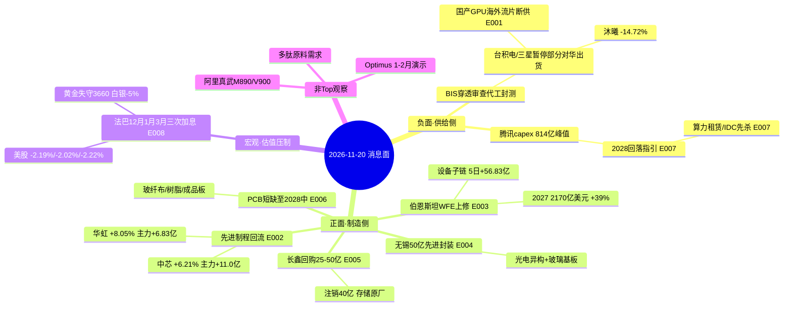

# 2026年11月20日 · **消息面事件驱动**

> **数据源新鲜度**: partial · **降级状态**: true · **置信度**: 0.66
> **覆盖窗口**: 2026-11-17 09:03 → 2026-11-20 05:56（news_cls 72h）
> **主源**: 财联社快讯 2918 + 公众号 95（财联社早知道/盘前纪要/调研先知/财闻私享）+ 公告窗口 2041 + 东财三季报预告 500 + tushare 行情/主力实测

## 一句话结论

消息面只认一条主线：**卖海外流片的国产 GPU、买国产制造（Fab）+ 设备 + 封测**；唯一硬对冲是美联储加息路径强化至 3 次叠加美股跌超 2%，压制高估值与贵金属。

## 🚦 今日盘面基线（R7 交叉，先认市场）

| 指标 | 11-19 收盘值 | 含义 |
|---|---|---|
| 主力净额 | **-313.15 亿**（前日 -85.21，摆动 -227.94） | 派发未结束，前日收窄只是反抽 |
| 20 日累计 | -3929.82 亿，20 日内仅 8 日为正 | 中期资金持续净流出 |
| 广度 | 涨 649 : 跌 4876，中位 -2.55% | 上涨占比 11.65%，普跌 |
| 成交 | 13145.8 亿（缩量 654.4 亿） | 无增量资金接盘 |
| 涨停/跌停/炸板 | 28 / 83 / 25 | 跌停:涨停 = 2.96:1 |
| **炸板率** | **47.17%**（stk_limit 权威口径） | **≥35% → 情绪=主跌，候选砍半** |
| 连板高度 | 最高 3 板（真视通/盛剑科技/全筑股份） | 高度被压缩，接力无溢价 |
| 情绪周期 | capitulation / 补跌（conf 0.90） | 动作=尽量不碰情绪票 |

**结论：今天是"研究日"不是"交易日"。R4 输出 0 个开仓候选，全部为观察腿，理由在最后一节。**

## 🗺️ 消息面全景图

## 🎯 顶级事件详解（8 条硬事件）

### E20261120_001 · 美 BIS 穿透审查代工封测 · strength=high · polarity=负面 · weighted=-0.689

**事件摘要**: 美国商务部 11-16 新规取消"数晶体管开证明"的便利通道，中国及新马泰等地设计公司先进芯片出货须**逐件向美国政府申请许可**；11-19 晚间媒体进一步报道台积电、三星暂停部分对华芯片出货。盘中有机构与媒体辟谣，但资金先砸为敬：沐曦股份 -14.72%、国产算力板块暴跌（上证报 12:59 口径）。

**大资金意图**: 不是交易"传闻真假"，而是交易**确定性折价**。海外流片占比高的设计公司，其 2027 年收入指引从"可兑现"变成"条件兑现"，机构必须先减仓再验证——这解释了为什么上证报盘中辟谣、尾盘仍砸：卖方研究覆盖的是估值模型，不是辟谣稿。

**为什么走强**: 这是"负面腿"的走强：砸的是**纯度**。纯海外流片（沐曦 99.2% GPU、天数/燧原台积依赖）跌幅最大，而寒武纪（690 主力已切国内）仅 -1.58%，说明资金按"海外代工暴露度"分层定价，不是无差别砍算力。

**逻辑够不够硬**: 硬，但要分层。**硬的部分**：BIS 规则方向（调研先知逐条拆解）+ 阿里 CEO"新管制将影响明年产品与服务"的官方口径背书 + 11-19 已发生的价格实证。**软的部分**："暂停对华出货"目前是晚间媒体转述，与盘中辟谣并存，故 summary 只敢写"管制方向确认"，不敢写"已全面断供"。这条的正反两面已强制拆成两条（正面腿见 E002）。

#### 沐曦股份 688802 · role=减仓/回避（海外流片 100% 暴露）
- 行情口径（tushare 前复权）：11-19 收 **410.01**（-14.72%）/ MA5 **487.46** / MA20 **487.90** / 距 60 日高 **-44.3%** / 5 日主力 **-3.11 亿**（东财口径 主力=超大单+大单）
- **买入理由**（本票为减仓/回避腿，逻辑是"不买"）：GPU 产品及配件占收入 **99.2%**（hithink 主营构成，毛利率 56.2%），先进制程全部海外流片，是管制穿透审查的**最纯受害者**；11-19 单日 -14.72% 已把逻辑打在价格上，反抽是减仓窗口不是买点。
- **风险点**: 业绩并不差——前三季营收 +105.6%~151.29%、扣非扭亏 2.23-3.02 亿，若管制落地尺度比传闻温和（合规成本上升而非断供），会出现"业绩+估值"双修复的逼空；此外流通盘小、科创板 20% 涨跌幅，反抽弹性大。
- **止损条件**: 参考价 410.01，若反抽到 470-520 区间分批减，跌破 **388.00**（-5.4%）则剩余观察仓清零；不做空、不加仓。
- **可验证假设**: 若 11-20 竞价该票跌幅收窄至 -2% 以内且成交额 ≥ 11-19 的 80%，说明抛压被承接、管制恐慌属"一次性定价"，则回避理由降级；若继续放量下杀，则"海外流片折价"仍在扩散。

### E20261120_002 · 先进制程回流 · 强 Call 国产 Fab 与设备 · strength=high · polarity=正面 · weighted=+0.646

**事件摘要**: 与 E001 同源的正面腿。机构在 11-19 盘后明确表态"先进制程回流趋势已定，继续强 Call 国产 Fab & 设备"；调研先知给出受益路径：拿不到许可的订单只能回中国生产与封装（中芯国际、长电、通富），国产 Fab 产能有限、不一定全接得下。阿里 CEO 同日补充需求端："AI 算力国内近两年尤其紧缺，国产算力比例将持续提升"。价格已先行：中芯 +6.21%、华虹 +8.05%，两者当日主力净流入 +11.0 亿 / +6.83 亿。

**大资金意图**: 这是全市场唯一"钱在进、价在涨、逻辑在加强"的三重共振方向。在主力 -313 亿、跌停 83 家的主跌日，集成电路制造单日 +24.23 亿、5 日 +42.58 亿且 5/20 日双正，说明资金不是博反弹，是在**换仓**：从"海外算力叙事"换到"国产制造叙事"。

**为什么走强**: 因为它是 E001 的**镜像资产**。同一个管制，对海外流片是收入折价，对国产 Fab 是订单转移；A 股定价从不看绝对好坏，只看边际变化方向，于是同一晚出现"沐曦 -14.72% + 中芯 +6.21%"的极致分化。再叠加 5/20 日双正的资金结构，它成了主跌市里的唯一"避风港+进攻位"。

**逻辑够不够硬**: 中等偏硬。硬的：订单转移的机制清晰（许可制→本土化）、需求端有阿里官方口径、资金已实证。软的：中芯 122.25 距 60 日高仅 -5.9%，**已被定价**，且先进制程产能扩张受设备交付约束，回流订单的兑现节奏是 2027 年而非 2026Q4；今日再追等于用"2027 逻辑"付"2026 溢价"。

#### 中芯国际 688981 · role=龙头（晶圆代工 A 股）
- 行情口径：11-19 收 **122.25**（+6.21%）/ MA5 **113.55** / MA20 **107.36** / 距 60 日高 **-5.9%** / 5 日主力 **+15.64 亿**
- **买入理由**: 集成电路晶圆代工占收入 **92.8%**（毛利率 22.8%，hithink），是"订单回流"唯一 A 股纯正载体；集成电路制造子链 5/20 日双正（+24.23 亿 / +42.58 亿），资金结构最干净。
- **风险点**: 距 60 日高只有 5.9%，**不是低位是高位**；RR 1.18 远低于 2；主跌日拉 6.21% 属逆势透支，次日若指数不共振，最容易变成"补跌对象"。
- **止损条件**: 参考价 122.25，跌破 **115.80**（-5.3%，即 11-19 阳线实体下沿）无条件退出，不做补仓摊薄。
- **可验证假设**: 若 11-20 前 30 分钟主力净流入 ≥ 3 亿且不破 118，则"换仓"逻辑延续；若低开且主力转负，则 11-19 的 6.21% 是单日脉冲，回避。

#### 华虹宏力 688347 · role=龙二（晶圆代工）
- 行情口径：11-19 收 **199.86**（+8.05%）/ MA5 **176.10** / MA20 **161.31** / 距 60 日高 **-23.1%** / 5 日主力 **+21.42 亿**
- **买入理由**: 晶圆代工占收入 **95.7%**（毛利率 18.5%），成熟制程与特色工艺是"接得住回流订单"的现实产能；5 日主力 +21.42 亿为代工链最强吸金，弹性大于中芯。
- **风险点**: 单日 +8.05% 后距 MA5 已 +13.5%，严重偏离均线；毛利率仅 18.5%，订单回流是"增收不增利"型扩张，业绩弹性小于估值弹性。
- **止损条件**: 参考价 199.86，跌破 **186.00**（-6.9%）退出；若开盘直接冲 210 以上不追，等回踩 190 附近再看。
- **可验证假设**: 若 11-20 换手率 < 11-19 的 70% 且价格守住 195，属"缩量强整理"，逻辑未破；若放量跌破 190，则 +8.05% 是接力盘出逃。

### E20261120_003 · 伯恩斯坦上调 WFE · strength=high · polarity=正面 · weighted=+0.650

**事件摘要**: 伯恩斯坦将 2027 年全球晶圆制造设备（WFE）支出预测上调至 **2170 亿美元（+39% YoY）**，2028 年 **2790 亿美元（+28%）**，并点名美欧日中多只设备股；中信建投同文补充"设备、材料、零部件未来三年爆发力与持续性拥有更高能见度"。对应 A 股：半导体设备子链 5 日主力 **+56.83 亿**，是全市场唯一 5/20 日双正的子链。

**大资金意图**: 设备是"卖铲子"环节，订单能见度比 Fab 更长。资金在主跌日仍给设备 +18.55 亿，是在买**2027-2028 年的确定性**，而不是买当季业绩——这与买中芯（买订单转移）是不同的持仓周期，前者是配置，后者是交易。

**为什么走强**: 因为它是唯一"越跌越有人买"的分支。WFE 上修把板块从"周期见顶"叙事拉回"资本开支上行"叙事，而 A 股设备股距 60 日高普遍 -20%~-34%，位置提供了修复空间，这是"逻辑+位置"同时成立的方向。

**逻辑够不够硬**: 硬在方向、软在验证。WFE 数字来自财联社转述的伯恩斯坦报告（未直取原文），但中信建投同向 + 资金 5 日 +56.83 亿构成双重旁证；风险是设备股业绩兑现滞后，若 Q4 订单不及预期，"上调预测"会变成"预期打满"。

#### 北方华创 002371 · role=龙头（设备平台）
- 行情口径：11-19 收 **592.02**（+3.13%）/ MA5 **566.84** / MA20 **535.12** / 距 60 日高 **-19.9%** / 5 日主力 **+20.90 亿**
- **买入理由**: 电子装备行业占收入 **95.3%**（毛利率 39.7%），薄膜沉积/刻蚀/清洗全平台，是 WFE 上修最直接受益；站上 MA5 与 MA20，5 日主力 +20.90 亿，位置与资金双合格。
- **风险点**: 592 元的绝对价位对资金体量要求高，单票 0.05 仓位已是上限；RR 1.63 < 2，不符合"盈亏比优先"的 execution 标准；距 60 日高 -19.9% 说明上方套牢盘厚。
- **止损条件**: 参考价 592.02，跌破 **556.50**（-6.0%）退出；若跌破 MA5 566.84 且当日主力转负，先减半。
- **可验证假设**: 若 11-20 半导体设备子链主力继续净流入 ≥ 5 亿且北方华创不破 580，则"配置盘"仍在；若设备子链单日转负，说明 5 日 +56.83 亿是抱团尾声。

#### 长川科技 300604 · role=弹性（测试设备）
- 行情口径：11-19 收 **192.84**（+1.93%）/ MA5 **184.88** / MA20 **181.99** / 距 60 日高 **-34.1%** / 5 日主力 **+12.59 亿**
- **买入理由**: 测试机占收入 **54.1%**（毛利率 64.9%）+ 分选机 33.5%，测试环节是先进封装与 HBM 扩产的"卡口"；三季报扣非 **+111.39%~124.07%** 是全事件里唯一业绩与逻辑同向的票，RR 2.15 为 12 票中最高。
- **风险点**: 距 60 日高 -34.1%，属深跌修复，不是新高突破；测试机订单与存储/封测扩产节奏绑定，若长鑫/长电扩产延后，业绩预期会下修。
- **止损条件**: 参考价 192.84，跌破 **180.20**（-6.6%）退出；RR 2.15 但主跌环境下仍需开盘 30 分钟确认，不确认则只看不做。
- **可验证假设**: 若 11-20 封测/设备子链同步走强且长川站上 195，则"测试卡口"逻辑被资金接受；若长川独跌而设备普涨，说明是补涨末端。

### E20261120_004 · 无锡 50 亿先进封装产线 · strength=high · polarity=正面 · weighted=+0.550

**事件摘要**: 11-18 无锡高新区青锋半导体"光电异构集成先进封装"产线奠基，总投资约 **50 亿元**，规划 12 英寸三维异质异构光电融合封装线 + 板级 CoPoS/玻璃基板封装线，一期 2028Q2 通线。爱建证券：封测量价改善与先进封装扩产共振，设备/材料/耗材持续受益。

**大资金意图**: 先进封装是"制程微缩失效"后的唯一性能出口，资本开支从"晶圆厂"外溢到"封装厂"。资金买的是**扩产周期**而非单项目——50 亿项目本身对上市公司利润影响极小，但它确认了"封测段开始花大钱"这一趋势。

**为什么走强**: 因为 11-19 盘面已经用涨停给出答案：江化微、格林达（光刻胶）、盛剑科技（3 板）、中京电子（PCB）、蓝箭电子（封测）——题材外围先动，龙头长电仅 +4.74%。这是典型的"叙事先行、龙头后动"，也说明当日资金更愿意买弹性小票。

**逻辑够不够硬**: 中等。项目真实（无锡发布官宣）、方向确定（CoPoS/玻璃基板是 2027+ 主流路线），但**时间太远**：2028Q2 才通线，对 2026 年报无贡献；把它当"今日买入理由"是把三年后的产能当今天的业绩。

#### 长电科技 600584 · role=龙头（封测）
- 行情口径：11-19 收 **55.47**（+4.74%）/ MA5 **52.72** / MA20 **52.85** / 距 60 日高 **-32.5%** / 5 日主力 **+4.94 亿**
- **买入理由**: 芯片封测占收入 **99.5%**，先进封装扩产直接承接；集成电路封测子链 11-19 主力 +14.94 亿、5 日 +4.85 亿，是本轮少见的"由负转正"子链；股价刚站上 MA5/MA20，位置低。
- **风险点**: 毛利率仅 14.9%，封测是重资产低毛利环节，扩产带来的是折旧而非利润；距 60 日高 -32.5%，上方套牢盘密集；RR 1.47 < 2。
- **止损条件**: 参考价 55.47，跌破 **51.70**（-6.8%，即 MA20 下方）退出。
- **可验证假设**: 若 11-20 封测子链主力净流入 ≥ 5 亿且长电守住 54，则"订单回流+扩产"双逻辑成立；若封测子链转负，说明 +14.94 亿是一日游。

#### 华测检测 300012 · role=边缘（封装检测）
- 行情口径：11-19 收 **15.70**（-0.82%）/ MA5 **15.80** / MA20 **15.69** / 距 60 日高 **-3.9%** / 5 日主力 **+0.24 亿**
- **买入理由**: 3D-X 射线/FIB/微纳结构分析覆盖 TSV、微凸块、多层堆叠检测，是先进封装的"质检卡口"；位置几乎贴 60 日高，是全事件里唯一没被杀的票。
- **风险点**: 主营是生命科学检测 41.7% + 工业品服务 20.8%，半导体封装检测只是细分业务，**业务纯度仅 0.45**；5 日主力 +0.24 亿等于没资金；RR 0.75 < 1，按纪律直接拒。
- **止损条件**: 参考价 15.70，跌破 **14.85**（-5.4%）退出；本票 RR 0.75 < 1，**不进 execution，仅留观察**。
- **可验证假设**: 若 11-20 该票放量突破 16.34（60 日高）且主力净流入转正 ≥ 0.5 亿，则"检测卡口"被资金认可；否则视为纯叙事跟随。

### E20261120_005 · 长鑫科技回购增至 25-50 亿 · strength=high · polarity=正面 · weighted=+0.700

**事件摘要**: 长鑫科技公告回购金额由原方案上调至 **25-50 亿元**，董事长朱一明提议，**最多注销 40 亿元股份**（证券时报/上证报同日确认）。这是存储原厂的注销式回购，直接减少流通股本。

**大资金意图**: 注销式回购是"A 股最贵的护盘"——它不注销则只是托价，注销则永久增厚 EPS。董事长提议 + 上限 50 亿，说明管理层认为 37.5 元的股价低于内在价值；但 5 日主力 **-45.46 亿**说明机构并不买账，这是"公司认为便宜、机构仍在卖"的分歧。

**为什么走强**: 消息层面是硬的（公告+两家官媒），但价格层面没走强：11-19 仅 +1.60%，仍在 MA20 40.87 下方。它是"利好但未定价"的典型——回购给的是下限，不是上限。

**逻辑够不够硬**: 硬在回购、软在业绩。按 Step2.5 业绩协议实测：Q1 净利 24.76 亿 / H1 77.61 亿 / Q3 单季 53.4-54.9 亿，**净利 QoQ 仅 +1.0%~+3.9%**，而营收 QoQ +15.3%~+20.3%，净利率由 5.31% 压到约 4.6%，是"增收不增利"雏形；DRAM 价格仍上行（Q4 +10-15%），故判"周期高位观察"，**业绩不给加分，正面只来自回购**。

#### 长鑫科技 688825 · role=龙头（DRAM 原厂）
- 行情口径：11-19 收 **37.50**（+1.60%）/ MA5 **37.78** / MA20 **40.87** / 距 60 日高 **-37.4%** / 5 日主力 **-45.46 亿**
- **买入理由**: DDR 系列 46.2%（毛利率 88.4%）+ LPDDR 52.0%（82.6%），是**原厂不是模组**，吃的是涨价而非被成本挤压；25-50 亿注销式回购给出估值下限，跌破净资产式下杀的空间被封。
- **风险点**: 5 日主力 -45.46 亿是 12 票里最差，机构在回购公告前仍在派发；净利环比走平，周期高位；距 60 日高 -37.4%，次新股无历史支撑位。
- **止损条件**: 参考价 37.50，跌破 **34.90**（-6.9%，即 10 日低 36.13 下方）退出；回购是下限不是买点，不因公告追高。
- **可验证假设**: 若 11-20 主力净流入转正 ≥ 3 亿且站上 MA5 37.78，说明回购开始被资金接受；若继续净流出，则"回购托底"失败，等 36.13 一线再看。

### E20261120_006 · 全球 PCB 短缺至 2028 年中 · strength=high · polarity=正面 · weighted=+0.600

**事件摘要**: 全球电子协会（Global Electronics Association）预警：从玻璃纤维布、树脂到成品电路板，**全供应链需求已超过供应能力**，短缺或持续至 **2028 年年中**，可能对全球经济造成广泛影响（news_cls 11-20 05:45）。

**大资金意图**: 这是"涨价链"最上游的硬约束。PCB 短缺意味着覆铜板/玻纤布/树脂有涨价权，中游板厂有转嫁能力；资金若信这条，应先买材料（生益）再买板厂（沪电），但 11-19 印制电路板 5 日主力 **-115.03 亿**，说明资金还没信。

**为什么走强**: 消息层面极硬（行业协会官方预警+时间跨度到 2028），且与三季报硬业绩同向：沪电扣非 +100.27%~107.36%、生益 +157%~174%。但价格层面 11-19 生益 -1.00%、距 60 日高 -61.7%，是"逻辑刚起、筹码未换"的典型低位方向。

**逻辑够不够硬**: 硬。协会预警 + 两家公司三季报翻倍级增长 + 11-19 中京电子 PCB 首板（封单 1.01 亿）三重旁证；唯一软点是"短缺"利好的是有产能的一方，若原材料涨价过快，中游板厂反而被挤压——需按环节分层，材料优于板厂。

#### 沪电股份 002463 · role=龙头（PCB）
- 行情口径：11-19 收 **81.10**（+1.13%）/ MA5 **78.07** / MA20 **86.25** / 距 60 日高 **-38.2%** / 5 日主力 **+1.62 亿**
- **买入理由**: 印刷电路板占收入 **90.3%**（毛利率 40.5%），AI 服务器高多层板是短缺最紧的规格；三季报扣非 +100.27%~107.36% 已兑现，属"业绩+短缺"双硬。
- **风险点**: 业绩已兑现 = 利好出尽风险；MA20 86.25 未站上，5 日主力仅 +1.62 亿（11-18 曾单日 +13.22 亿后衰减）；距 60 日高 -38.2%，反弹属性。
- **止损条件**: 参考价 81.10，跌破 **75.60**（-6.8%）退出；不追 86.25 以下的反抽，等站上 MA20 再谈。
- **可验证假设**: 若 11-20 PCB 子链主力转正 ≥ 3 亿且沪电站上 82，则"短缺定价"启动；若子链继续净流出，说明短缺只停在纸面。

#### 生益科技 600183 · role=龙二（覆铜板）
- 行情口径：11-19 收 **60.29**（-1.00%）/ MA5 **61.86** / MA20 **79.04** / 距 60 日高 **-61.7%** / 5 日主力 **-19.72 亿**
- **买入理由**: 覆铜板和粘结片占收入 **64.9%**（毛利率 29.2%）+ PCB 29.0%，是短缺链最上游、涨价传导第一站；三季报扣非 **+157%~174%**，业绩弹性全事件最高。
- **风险点**: 距 60 日高 **-61.7%** 是全表最深破位，5 日主力 -19.72 亿说明筹码仍在崩；MA20 79.04 遥不可及，"低位"也可能是"下坡"。
- **止损条件**: 参考价 60.29，跌破 **55.90**（-7.3%，即 10 日低 57.30 下方）退出；不因"跌得多"而抄底。
- **可验证假设**: 若 11-20 生益放量收阳且主力净流入 ≥ 2 亿，则"材料先涨价"逻辑被资金接受；若继续缩量阴跌，说明短缺叙事尚未传导到材料端。

### E20261120_007 · 腾讯 3Q26 capex 峰值 · strength=high · polarity=负面 · weighted=-0.516

**事件摘要**: 腾讯 3Q26 资本开支 **814.3 亿元**，录得负自由现金流；管理层业绩会明确现金 CapEx 处峰值、2028 年后才回落。瑞银称业绩逊预期、料市场反应负面；大华继显降目标价至 500 港元，指 AI 相关成本拖累毛利。

**大资金意图**: 市场此前把"capex 高增"当成算力链的永动机，这条把斜率改成"2028 后回落"，等于给算力租赁/IDC 的估值分母加了一个期限。资金对 A 股算力租赁的动作是"先杀再说"：润泽科技 -8.65% 已破位。

**为什么走强**: 负面腿走强的方式是"杀估值不杀业绩"。润泽 AIDC 占收入 53.3%、毛利 47.3%，基本面没有恶化，但它的客户资本开支斜率被下调，DCF 分母端先动，股价先跌。

**逻辑够不够硬**: 中等。硬的是腾讯官方口径（814.3 亿、峰值、2028 回落）；软的是**误读风险**：调研先知指出 2028 回落≠算力需求下行，27 年是激进补库窗口，N 卡不够就转国产。所以这条只否"capex 斜率"，不否"国产替代"——两件事必须分开定价。

#### 润泽科技 300442 · role=减仓/回避（AIDC）
- 行情口径：11-19 收 **51.02**（-8.65%）/ MA5 **53.62** / MA20 **55.11** / 距 60 日高 **-25.5%** / 5 日主力 **-0.27 亿**
- **买入理由**（本票为减仓/回避腿）：AIDC 占收入 **53.3%** + IDC 46.7%，对 CSP 资本开支斜率最敏感；11-19 -8.65% 已跌穿 MA5/MA20，是"斜率下修"的直接定价，反弹是减仓窗口。
- **风险点**: 若 2027 年确为"激进补库窗口"（调研先知口径），算力租赁会在 Q1 出现预期修复，杀过头后弹性大；AIDC 毛利率 47.3% 属优质资产，不存在基本面崩塌。
- **止损条件**: 参考价 51.02，反抽 54-58 分批减；跌破 **47.40**（-7.1%，10 日低 50.35 下方）剩余仓清零。
- **可验证假设**: 若 11-20 该票跌幅收窄至 -2% 以内且成交额萎缩至 11-19 的 60%，说明抛压一次性释放；若继续放量下杀，则"capex 斜率"仍在扩散到 IDC 全链。

### E20261120_008 · 美联储加息路径强化 · strength=high · polarity=负面 · weighted=-0.700

**事件摘要**: 法巴将美联储路径上调为 **12 月、1 月、3 月各 25bp 连续三次加息**；古尔斯比称下月会议"考虑所有选项"、未排除更大幅度；隔夜美股三大指数跌超 2%（道指 -2.19%、标普 -2.02%、纳指 -2.22%，AMD -7.60%），现货黄金失守 3660 美元、白银 -5%。

**大资金意图**: 这是"分母端"的行业级利空。连续加息三次意味着贴现率路径整体上移，杀的是高估值成长与贵金属的"降息交易"；11-18 沃勒讲话只是第一段，11-19 晚间法巴+古尔斯比是**路径确认**，资金无法再用"单次扰动"解释。

**为什么走强**: 负面腿的走强体现在"资产价格确认"：黄金从 4100→3660 的连续破位、白银单日 -5%、美股科技 -2.2%，说明不是 A 股独立情绪，是全球定价在重估。贵金属的"避险"属性在加息交易里失效。

**逻辑够不够硬**: 硬。三源同日（法巴路径、古尔斯比表态、美股与金属收盘价）+ 与 11-18 沃勒事件同向叠加；唯一变量是 12 月会议前的通胀数据，若 CPI 回落，路径会重新定价。

#### 紫金矿业 601899 · role=减仓（黄金铜双暴露）
- 行情口径：11-19 收 **23.88**（-2.61%）/ MA5 **25.35** / MA20 **27.35** / 距 60 日高 **-32.7%** / 5 日主力 **-14.78 亿**
- **买入理由**（本票为减仓/回避腿）：境内分部收入 110.4%（毛利率 13.5%）+ 境外 56.9%（26.9%），铜金双暴露于加息交易；MA5/MA20 全部跌破，5 日主力 -14.78 亿，趋势与资金同向向下。
- **风险点**: 铜的供给端逻辑（矿端紧缺）与加息逻辑相反，若 12 月通胀回落，铜金会同时反弹；紫金是资源龙头，长期产能扩张故事未破。
- **止损条件**: 参考价 23.88，反抽 26.0-27.5 分批减；跌破 **22.20**（-7.0%，10 日低 23.06 下方）剩余仓清零。
- **可验证假设**: 若 11-20 黄金站稳 3700 且紫金收复 25.35（MA5），则"加息交易"阶段性结束；若黄金再破 3600，则贵金属全链继续减。

## 📊 板块 × 事件热力矩阵（净分列）

| 板块 | 净分 | 极性 | 事件数 | 叉乘明细 |
|---|:--:|:--:|:--:|---|
| 半导体设备/材料 | **+1.035** | 正面 | 2 | E003 正面×1.00=+0.650 / E004 正面×0.70=+0.385 |
| 封测/先进封装 | **+1.002** | 正面 | 2 | E002 正面×0.70=+0.452 / E004 正面×1.00=+0.550 |
| 存储/DRAM | +0.700 | 正面 | 1 | E005 正面×1.00=+0.700 |
| 贵金属/黄金 | -0.700 | 负面 | 1 | E008 负面×1.00=-0.700 |
| 国产GPU/海外流片依赖 | -0.689 | 负面 | 1 | E001 负面×1.00=-0.689 |
| 晶圆代工/国产Fab | +0.646 | 正面 | 1 | E002 正面×1.00=+0.646 |
| PCB/覆铜板 | +0.600 | 正面 | 1 | E006 正面×1.00=+0.600 |
| AI算力硬件/算力租赁 | -0.516 | 负面 | 1 | E007 负面×1.00=-0.516 |
| 有色/工业金属 | -0.490 | 负面 | 1 | E008 负面×0.70=-0.490 |
| 全球流动性敏感成长股 | -0.490 | 负面 | 1 | E008 负面×0.70=-0.490 |
| AI算力芯片设计 | -0.482 | 负面 | 1 | E001 负面×0.70=-0.482 |
| 半导体零部件 | +0.455 | 正面 | 1 | E003 正面×0.70=+0.455 |
| 电子材料/玻纤布 | +0.420 | 正面 | 1 | E006 正面×0.70=+0.420 |
| 玻璃基板/先进封装材料 | +0.385 | 正面 | 1 | E004 正面×0.70=+0.385 |
| 港股科技 | -0.361 | 负面 | 1 | E007 负面×0.70=-0.361 |

> 叉乘公式：`contrib = abs(weighted_score) × sign(板块极性) × {high:1.0, medium:0.7, low:0.4}`，同板块同名累加；>+0.12 正面、<−0.12 负面。

## 🔀 多事件叉乘结论（sector_cross_summary）

- **半导体设备/材料 +1.035（全表最强）**：E003 伯恩斯坦 WFE 上修 + E004 先进封装扩产，两腿同向。且是唯一 5/20 日双正的子链（11-19 +18.55 亿 / 5 日 +56.83 亿）。**结论：这是当前唯一"逻辑+资金+位置"三项都能过的最小阻力方向**，但北方华创/长川 RR 1.63/2.15、距 60 日高 -20%/-34%，只能做修复不做突破。
- **封测/先进封装 +1.002**：E002 订单回流（medium 腿）+ E004 扩产（high 腿）。封测 11-19 主力 +14.94 亿、5 日 +4.85 亿，是本轮"由负转正"的子链。**结论：长电是低吸位（55.47，刚站上 MA20），但它毛利 14.9%，属"量增价不增"，只做修复不重仓。**
- 两条正腿之外，**最硬的负腿是 国产GPU/海外流片 -0.689 与 贵金属 -0.700**：前者是纯度定价（沐曦 -14.72% 实证），后者是全球分母端（黄金 3660 失守）。这两条不能碰，反弹即减。

## 🔥 三季报业绩预告命中（2026-09-30 报告期）

| 代码 | 名称 | 预告类型 | 增速下限-上限 | 事件命中 | 逻辑强度 |
|---|---|---|:--:|---|:--:|
| 001309 | 德明利 | 扭亏 | 净利 +32046.5%~33154.5% | 存储周期（非本文事件） | 🟡 同比失真 |
| 300821 | 东岳硅材 | 预增 | +19048.0%~19748.1% | 无（硅化工） | 🟡 非事件 |
| 000703 | 恒逸石化 | 预增 | 扣非 +9837.0%~10090.8% | 无（化纤） | 🟡 非事件 |
| 002466 | 天齐锂业 | 预增 | 扣非 +6957.1%~8219.8% | 无（锂资源周期） | 🟡 同比失真 |
| 688388 | 嘉元科技 | 预增 | 扣非 +3065.7%~3329.5% | 无（铜箔） | 🟡 非事件 |
| 301308 | 江波龙 | 预增 | 扣非 +2782.4%~2991.2% | E005 存储同链（模组环节） | 🟡 成本挤压 |
| 688825 | 长鑫科技 | 扭亏 | 净利 +2581.1%~2609.5% | **E005 命中** | 🟢 回购+原厂 |
| 002812 | 恩捷股份 | 扭亏 | 扣非 +1961.0%~2553.6% | 无（隔膜） | 🟡 非事件 |
| 688378 | 奥来德 | 扭亏 | 扣非 +1897.7%~2224.6% | 无（OLED材料） | 🟡 非事件 |
| 688808 | 联讯仪器 | 预增 | 净利 +1866%~2073% | 无（测试仪器） | 🟡 非事件 |
| 002463 | 沪电股份 | 预增 | 扣非 +100.27%~107.36% | **E006 命中** | 🟢🟢 业绩+短缺 |
| 600183 | 生益科技 | 预增 | 扣非 +157%~174% | **E006 命中** | 🟢🟢 弹性最高 |
| 300604 | 长川科技 | 预增 | 扣非 +111.39%~124.07% | **E003 命中** | 🟢🟢 业绩+逻辑 |
| 688802 | 沐曦股份 | 扭亏 | 净利 +269.84%~307.58% | **E001 命中（反向）** | 🔴 业绩好但逻辑被管制打断 |
| 300012 | 华测检测 | 略增 | 扣非 +18.6%~20.2% | **E004 命中** | 🟡 纯度低 |

> 周期股口径（Step2.5）：德明利、江波龙、长鑫的累计同比是"低基数+涨价"的后视镜，**不得据此给正面**；长鑫已按单季拆解（净利 QoQ +1~4%），判"周期高位观察"。江波龙属模组环节，Q3 已现成本挤压（原厂毛利 80%+ vs 模组净利环比仅个位数），**降级中性**。

## 📈 首板候选池（消息侧刺激池，非开仓资格）

| 代码 | 名称 | 质量 | 源数 | 11-19 收盘 | 涨跌 | 5日主力 | tradable | 主要风险 |
|---|---|:--:|:--:|:--:|:--:|:--:|:--:|---|
| 688981 | 中芯国际 | high | 4 | 122.25 | +6.21% | +15.64 亿 | true | 距60日高 -5.9%（已定价） |
| 688347 | 华虹宏力 | high | 3 | 199.86 | +8.05% | +21.42 亿 | true | 单日 +8.05% 偏离 MA5 +13.5% |
| 002371 | 北方华创 | high | 4 | 592.02 | +3.13% | +20.90 亿 | true | 距60日高 -19.9% / RR 1.63 |
| 600584 | 长电科技 | high | 3 | 55.47 | +4.74% | +4.94 亿 | true | 距60日高 -32.5% / 毛利 14.9% |
| 300604 | 长川科技 | medium | 3 | 192.84 | +1.93% | +12.59 亿 | false | 距60日高 -34.1%（深跌修复） |
| 688825 | 长鑫科技 | high | 4 | 37.50 | +1.60% | -45.46 亿 | false | MA20 下方 / 5日主力最差 |
| 002463 | 沪电股份 | medium | 3 | 81.10 | +1.13% | +1.62 亿 | false | MA20 86.25 未站上 |
| 600183 | 生益科技 | medium | 2 | 60.29 | -1.00% | -19.72 亿 | false | 距60日高 -61.7%（最深破位） |

> `tradable_today=true` 仅表示"消息+资金双确认"，**不等于开仓资格**（炸板率 47.17% → 情绪主跌 → 一律需开盘 30 分钟指数共振确认）。RR 全部 <2（长川 2.15 除外，但设 tradable=false），**execution_pool = 0**。

## 关键证据

- 证据 1：BIS 新规取消代工/封测"数晶体管自证"，中国设计公司先进芯片须逐件许可 — 调研先知 2026-11-19 · + 阿里 CEO"新管制影响明年产品" news_cls 11-19 20:39
- 证据 2：晚间媒体称台积电、三星暂停部分对华芯片出货 — 财闻私享 2026-11-19 21:25（单源转述，与盘中辟谣并存，已降级为"方向确认"）
- 证据 3：中芯 +6.21% / 主力 +11.0 亿，华虹 +8.05% / 主力 +6.83 亿 — tushare daily + moneyflow 2026-11-19 实测
- 证据 4：伯恩斯坦 WFE 2027 年 2170 亿美元（+39%）、2028 年 2790 亿美元（+28%）— 财联社早知道 2026-11-19 19:00
- 证据 5：无锡 50 亿先进封装产线（12 英寸光电异构 + 板级 CoPoS/玻璃基板）— 无锡发布 2026-11-18 · 财联社早知道 2026-11-19
- 证据 6：长鑫回购增至 25-50 亿、最多注销 40 亿 — 长鑫公告 11-19 18:19 · 证券时报 19:31 · 上证报 23:05
- 证据 7：全球 PCB 短缺至 2028 年中 — 全球电子协会预警 news_cls 2026-11-20 05:45
- 证据 8：腾讯 3Q26 capex 814.3 亿、负自由现金流、2028 后回落 — news_cls 11-18 16:37 + 调研先知 11-19
- 证据 9：法巴预计 12/1/3 月三次加息 25bp；美股 -2.19%/-2.02%/-2.22%；黄金失守 3660、白银 -5% — news_cls 11-20 04:37-05:50
- 证据 10：11-19 涨停 28 / 跌停 83 / 炸板率 47.17% / 最高 3 板 — R7 stk_limit 权威口径

## 数据源审计

| 源 | 日期 | 状态 | 备注 |
|---|---|:--:|---|
| tushare/news_cls | 2026-11-20 | 🟢 | 2918 条 · 72h 回看 11-17 09:03 → 11-20 05:56 |
| tushare/news_major | 2026-11-20 | 🟢 | 800 条 · 11-19 15:03 → 11-20 04:37 |
| eastmoney/earnings_predict | 2026-11-20 | 🟢 | 500 条 · 报告期 2026-09-30 |
| wechat_official_rss | 2026-11-20 | 🟢 | 95 篇 · 19 feed（财联社早知道/盘前纪要/调研先知/财闻私享） |
| wechat_cli_5groups | 2026-11-20 | 🔴 | 7 群任务 ok 但 0 条落盘（群聊腿缺失） |
| anns_window（盘前公告窗） | 2026-11-20 | 🟢 | 2041 条 · 跨 11-19 收盘至今 |
| expectation_gap | 2026-11-20 | 🔴 | status=no_input（4 篇/0 名录，个股级预期差缺失） |
| hithink/business_query | 2026-11-20 | 🟢 | 11 票主营构成（收入占比 + 毛利率） |
| tushare/daily + moneyflow | 2026-11-20 | 🟢 | 16 票 65 日 K 线复算 MA/60日高 + 5 日主力实测 |
| r7/capital_flow | 2026-11-20 | 🟢 | 情绪/板块资金/5 日主力交叉引用（未重算） |
| xtick/weflow | 2026-11-20 | 🔴 | weflow_snapshot error |
| 海外快照 | 2026-11-20 | 🟡 | degraded（美股盘中值，未收盘） |

## 不确定性 / 反证

1. **E001 的"暂停出货"是单源转述**：只有财闻私享（引晚间媒体），上证报盘中明确"业界称市场传闻不准确"。我按"管制方向确认、暂停范围待验证"处理，若今日出现官方澄清，E001 的 -0.689 会瞬间失效，沐曦的反抽会比预期猛。
2. **E002 已被定价**：中芯距 60 日高仅 -5.9%，+6.21% 的当日涨幅是"换仓第一日"，历史上换仓第一日的龙头次日胜率并不高（主跌环境下更差）。把 E002 当"今日追高理由"是错的，它只能当"回踩不破 MA5 的低吸池"。
3. **E007 的误读风险是双向的**：调研先知明确"2028 capex 回落≠算力需求下行，27 年是补库窗口"。若市场按"斜率下修"杀过头，算力租赁会在 Q1 出现预期修复；杀润泽但保留"27 年补库"观察位是更稳的做法。
4. **贵金属的反身性**：黄金 3660 是技术关口，若 12 月 CPI 回落，加息路径重定价会让"减仓紫金"变成"卖在地板"。本条只做"反弹即减"，不做追空。
5. **群聊与预期差两层全缺**：0 条群聊 + expectation_gap no_input 意味着我看不到"KOL 二次口播"与"公众号点名 vs 市场定价"的交叉验证，对情绪扩散速度的判断会比平时慢半天。这是 confidence 只给 0.66 的主因。
6. **正向事件的拥挤度**：设备/封测/代工三条腿在 11-19 已被资金抱团，11-19 主力 -313 亿的背景下，抱团越紧越容易在指数二次探底时补跌。**这是"逻辑对但时机不对"的典型日。**

## 与其他 R/D/E 的关系

- **依赖**：R7_capital_flow（情绪/板块资金/5 日主力）、news_cls + news_major + 公众号 RSS + anns_window + eastmoney 业绩预告（本 skill 自有源）、hithink business（主营构成验证）
- **被消费**：R2 主线板块（半导体设备/封测/晶圆代工三条正腿 + 国产GPU/贵金属两条负腿）、R5 个股画像（12 票）、R6 反证（E002 已定价 / E007 误读 / 长鑫业绩周期）、D1 预案（execution_pool=0，观察池 8 票）

## Sub-Agent 元数据

- skill: analyze_news_impact_v1@1.8
- artifact: data/research/20261120/R4_news.json（47.0 KB / 8 events / 12 stocks / 8 FBC）
- method: llm_v1（五源硬约束 + hithink 主营验证 + tushare 行情资金实测）
- top_events: 8（正面 5 / 负面 3）；sector_polarity_matrix 15 行；sector_cross_summary 2 行
- decay: λ=0.15，E001/E002/E007 days_since=1（weighted 0.689/0.646/0.516），其余盘后事件 days_since=0
- 生成时刻: 2026-11-20T07:42:00+08:00
- 纪律自检: 情绪=主跌（炸板率 47.17%）→ 候选砍半（8 FBC / 0 execution）；负面事件 3 条全部带 bearish_scope；RR<2 全部降级 watch
